# Paul of Tarsus: On the Roads of Rome

A browser point-and-click adventure in the style of early-1990s verb-and-inventory adventure games. You play Saul of Tarsus, later known as the apostle Paul, a tentmaker who gets out of tight spots with his trade, his brothers and prayer rather than with force.

There are eight chapters so far, in English and German. The game is a small engine in `index.html` plus one level file per chapter in `levels/`, loaded only when that chapter is played. There are no image or audio files: every backdrop, character and icon is painted in code on a canvas, and all music, ambience and sound effects are synthesized with the Web Audio API.

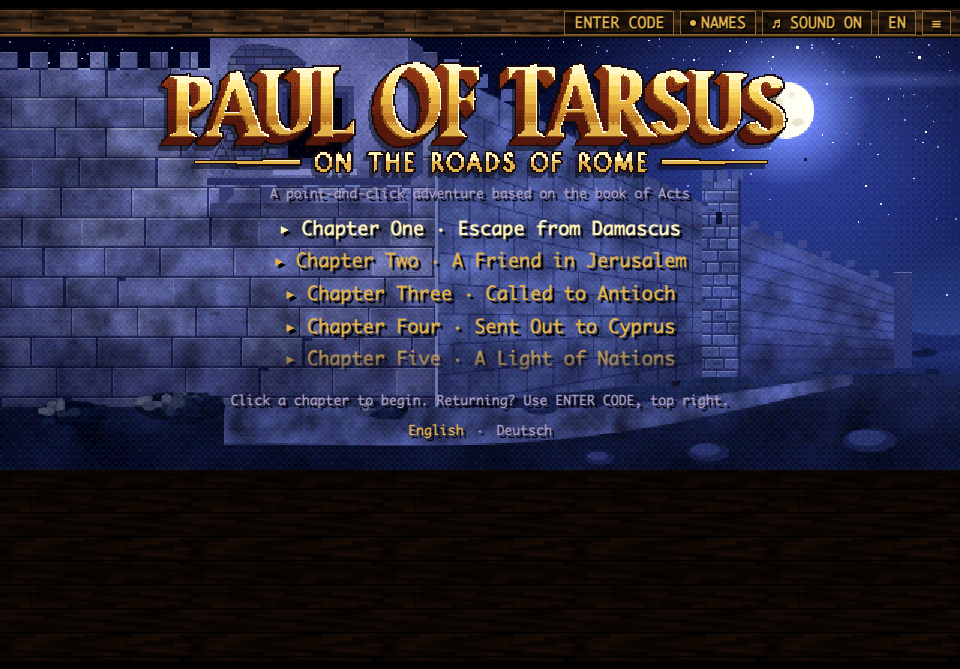

## Play

**Play online: https://marcuscalidus.github.io/paul-of-tarsus/**

Or download this repository and open `index.html` in any current desktop browser (keep the `levels` folder next to it). Pick a chapter on the title screen (scroll the list for the later ones); the game saves your place by itself, so next time the title screen offers to continue. Nothing to install or build.

The online version is served by GitHub Pages straight from the root of the `main` branch.

## Chapter One: Escape from Damascus

Damascus, about 36 C.E. Opposers have plotted to do away with Saul, and the governor under King Aretas has the city gates watched day and night. The brothers have a plan: lower him by night in a basket from a window in the city wall (Acts 9:23-25; 2 Corinthians 11:32, 33). The basket is frayed, the rope is too short, and a soldier is watching the alley to the wall.

| | |
|---|---|
| 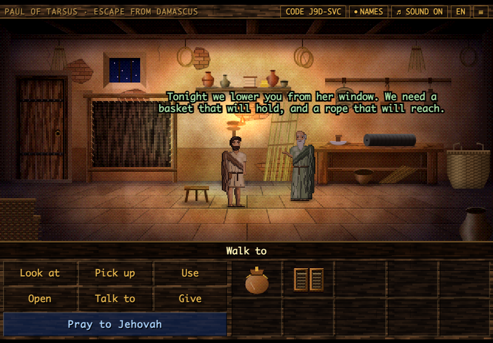 | 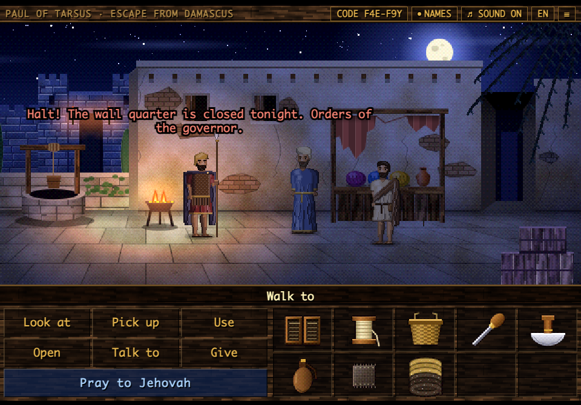 |
| Eliab's workshop: gather what a tentmaker needs | The street: a soldier of the governor bars the alley |
| 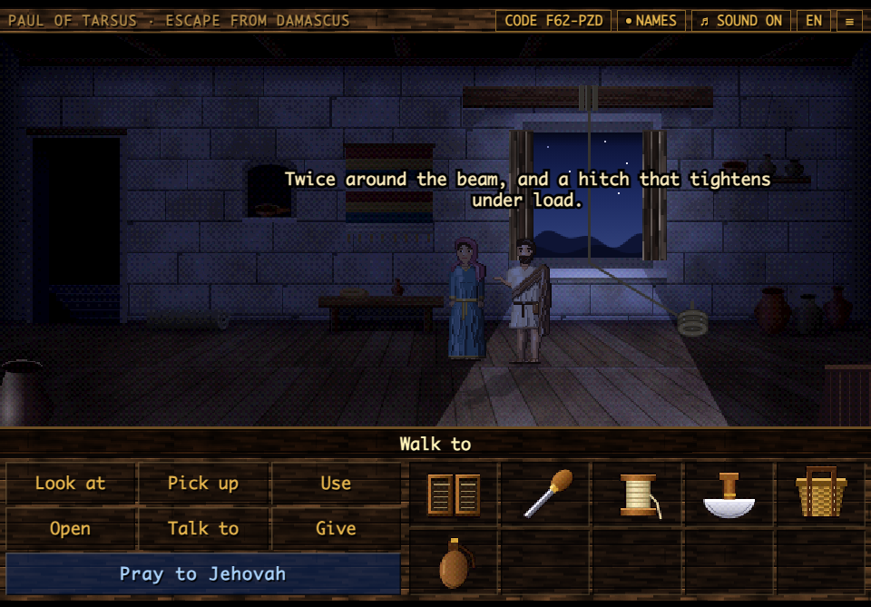 | 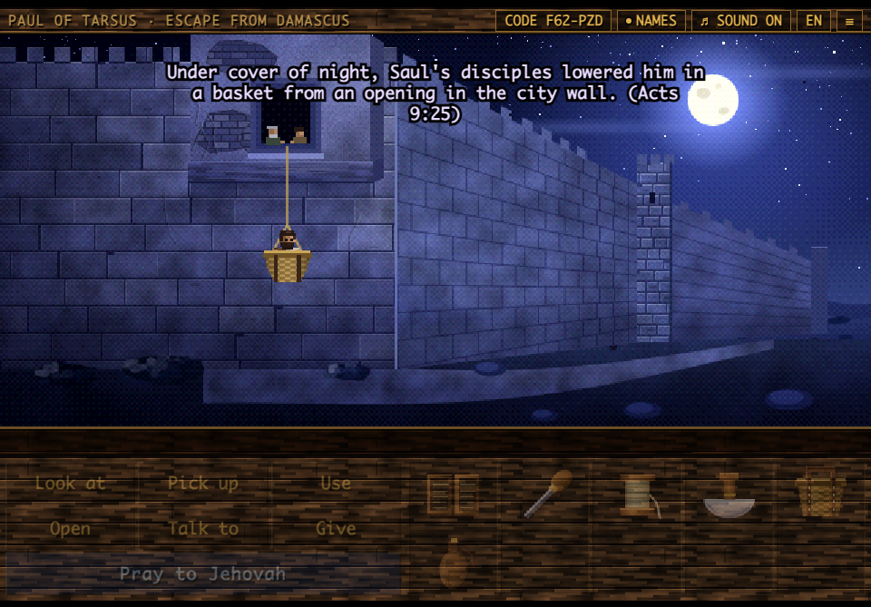 |
| Naomi's room on the wall: no light may show | By night, through an opening in the wall |

Three connected locations, five characters to talk to, and a puzzle chain built on Paul's trade: cutting and braiding goat-hair cloth, splicing rope, mending an awning, reinforcing a basket.

<details>
<summary>Walkthrough (spoilers)</summary>

1. Open the tool pouch. Pick up the thread, knife, cloth, rope and basket in the workshop.
2. Use the knife with the cloth, then the cloth strips with the rope.
3. In the street, talk to the merchant. Use the awl on his torn awning; he gives you leather straps and hangs the awning.
4. Use the straps with the basket.
5. Walk into the alley behind the awning.
6. In Naomi's room: use the lamp, open the shutters, use the long rope with the roof beam, use the basket with the window.

Optional: fill the waterskin at the well and give the guard a drink.
</details>

## Chapter Two: A Friend in Jerusalem

Three years after his conversion, Saul returns to Jerusalem and tries to join the disciples, but they are all afraid of him and do not believe he is a disciple. Then Barnabas comes to his aid (Acts 9:26-31; 22:17-21; Galatians 1:18, 19). Later, when a plot forces him to leave, the brothers bring him down to Caesarea, where the only ship bound for Tarsus has a torn sail.

| | |
|---|---|
| 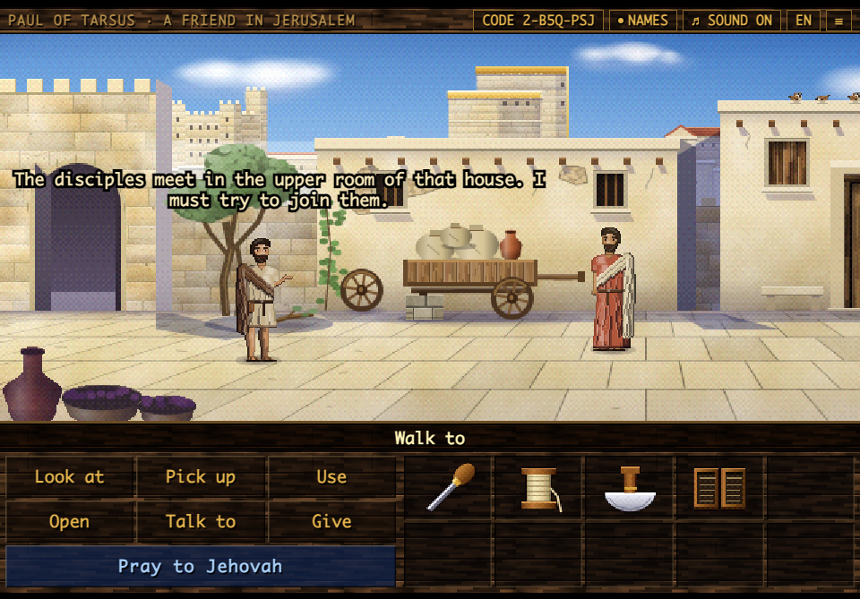 | 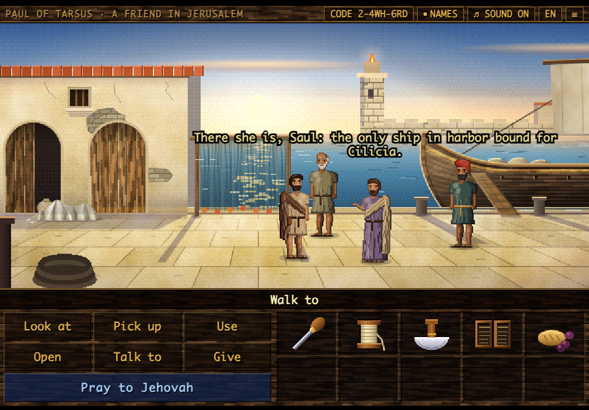 |
| Jerusalem: a stranger's broken cart, and a closed door | Caesarea: a ship that cannot sail, and a tentmaker who must |

Three more locations and eight new characters. This chapter turns on honesty as much as handiwork: Paul has to give Barnabas a plain account of himself, and the answers that excuse or recommend him get nowhere. Later, speaking boldly in Jerusalem, he disputes with two Greek-speaking Jews and answers them from the passages on his wax tablets; the last objection is about his own part in Stephen's death, and the answer to it is a confession (Acts 9:28, 29; 22:20).

| | |
|---|---|
| 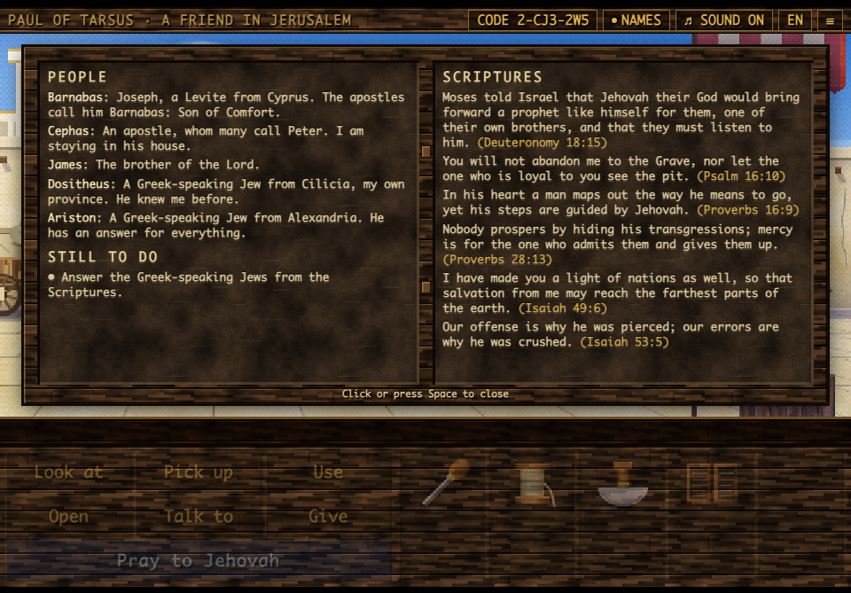 | 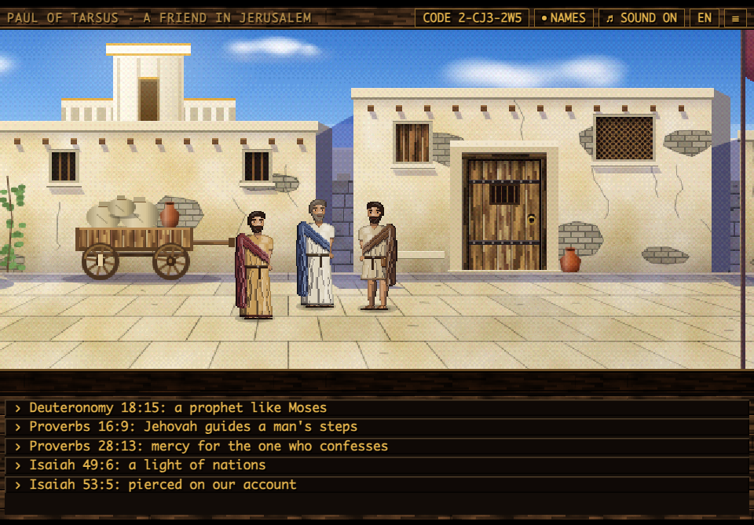 |
| The wax tablets: people met, what is still to do, and Scripture | Every answer is a passage from the tablets |

<details>
<summary>Walkthrough (spoilers)</summary>

1. Knock at the door of the house. Talk to the man with the handcart.
2. Pick up the pruned branch under the olive tree and use the knife on it.
3. Use the loose wheel, then use the peg with the handcart.
4. Answer Barnabas honestly: admit the persecution, tell what happened on the road to Damascus, and what happened in Damascus afterwards.
5. Knock at the door again. In the upper room, leave by the door to the city when you are ready.
6. In the street, talk to Dositheus. Answer each objection with a passage from your wax tablets: Isaiah 53:5 for the stake, Psalm 16:10 for the tomb, and Proverbs 28:13 when they ask about Stephen.
7. At the harbor, talk to the captain and use the halyard.
8. Use the knife on the heap of old sailcloth. Give the provisions to the fisherman.
9. Use the awl on the torn sail.
</details>

## Chapter Three: Called to Antioch

Tarsus, about 45 C.E. A great number of Greek-speaking people in Antioch of Syria have become believers, and Barnabas comes to Tarsus to make a thorough search for Saul. For a whole year the two of them teach in the congregation there, where the disciples are first called Christians by divine providence. Then the prophet Agabus foretells a great famine, and the disciples determine to send relief to the brothers in Judea, each according to what he can afford, by the hand of Barnabas and Saul (Acts 11:19-30; 12:25).

| | |
|---|---|
| 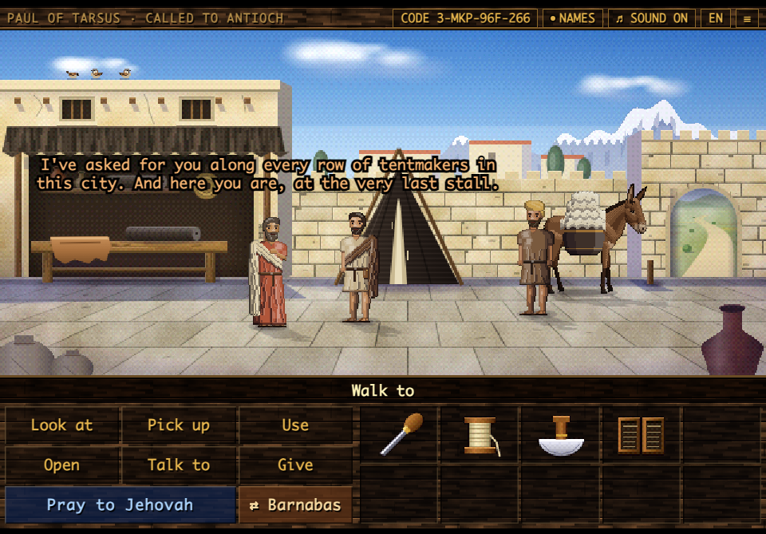 | 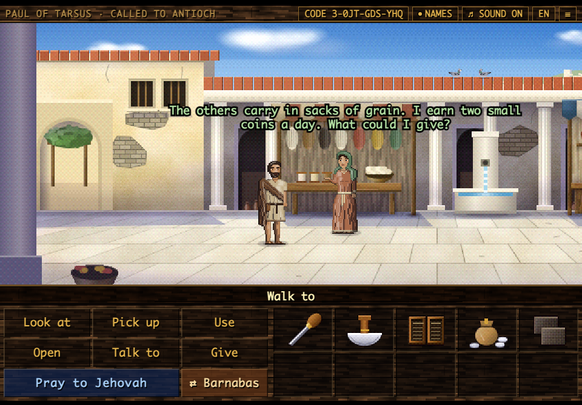 |
| Tarsus: Barnabas finds his man, who has a promise to keep first | Antioch: the gifts are in, with weeks of road ahead of them |

Three more locations and five new characters, with Barnabas back at Paul's side, and this time you can play him too. Paul finishes a promised tent before he will leave Tarsus, sews pack bags for the relief, and sees the gift counted and sealed before the brothers. Some work takes both men: Barnabas holds the far edge of the tent while Paul sews, and Theron's jar of oil is a load for two men and a bar, like the grapes of Eshcol (Numbers 13:23). The puzzle about people is a spinner who stays away because she thinks she has nothing to give: pressure and pity both fail with her.

| | |
|---|---|
| 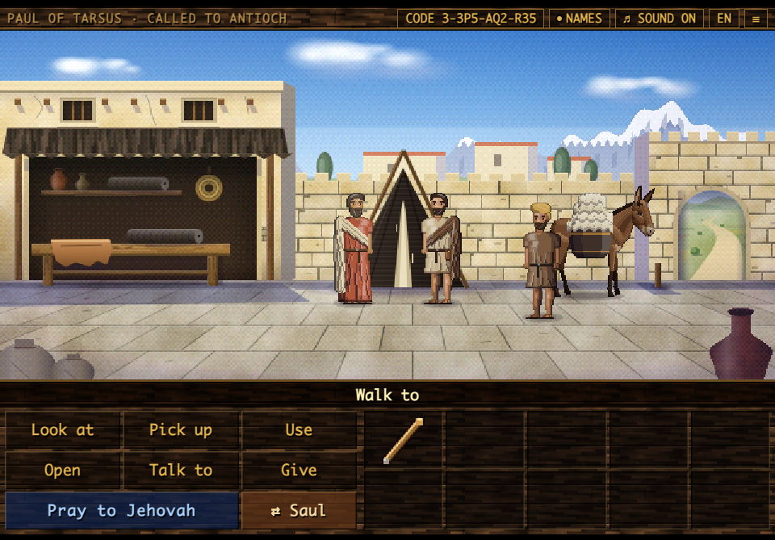 | 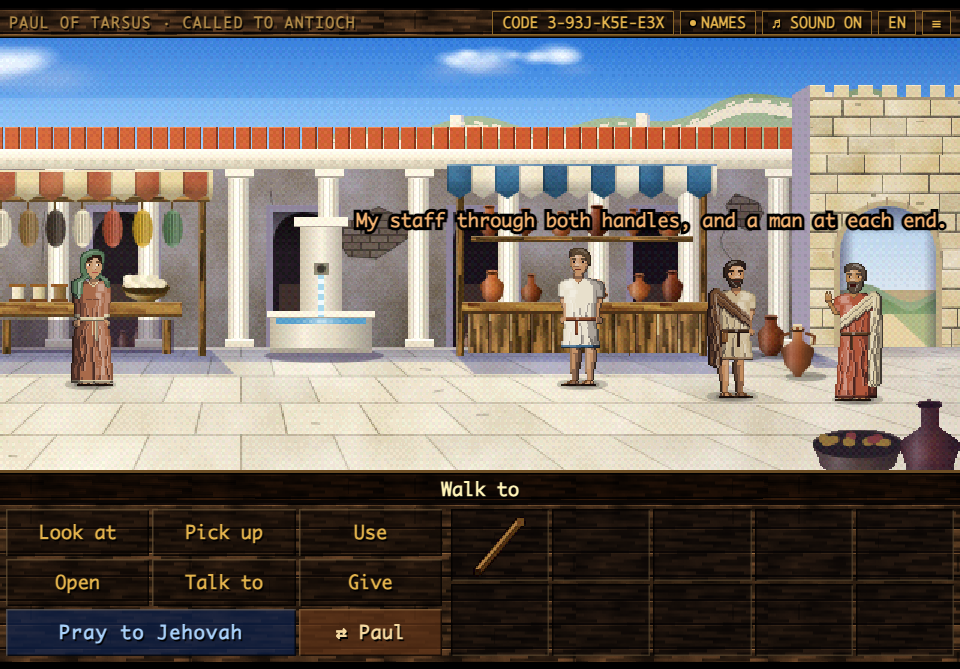 |
| Barnabas holds the far edge; his own inventory holds his staff | Both men at Theron's stall, Barnabas's staff through the handles |

<details>
<summary>Walkthrough (spoilers)</summary>

1. In Tarsus, switch to Barnabas (the **⇄ Barnabas** button beside the prayer, or `C`) and use the tent: he holds the far edge. Switch back to Paul and use the awl on the tent.
2. Use the knife on the leather hide, then the leather loops on the tent.
3. Pick up the finished tent and give it to Kleon. Leave by the east gate.
4. In the courtyard at Antioch, use the knife with the goat-hair cloth.
5. Go out to the street and talk to Xanthe. Tell her that each gives what he can afford, ask what is in her hands, and tell her that the gift has no bags and you have no thread.
6. Use the awl with the cloth panels.
7. Switch to Barnabas, who is still in the courtyard, and walk him out to the street. Use his staff on Theron's oil jar: the two men carry it to the courtyard.
8. As Paul, give your savings to Lucius, and ask for the purse to be counted before the brothers and sealed.
9. Use the pack bags with the donkey.
</details>

## Chapter Four: Sent Out to Cyprus

Antioch, about 47 C.E. As the prophets and teachers of the congregation are ministering to Jehovah and fasting, the holy spirit says: "Set aside for me Barnabas and Saul for the work to which I have called them." They lay their hands on them and send them off. With John Mark as their attendant, the two go down to Seleucia and sail to Cyprus, where Barnabas was born. At Salamis they proclaim the word of God in the synagogues of the Jews. Then they go through the whole island as far as Paphos, where the proconsul Sergius Paulus, an intelligent man, calls for them, and the sorcerer Bar-Jesus, also called Elymas, tries to turn him away from the faith (Acts 13:1-12; 4:36).

| | |
|---|---|
| 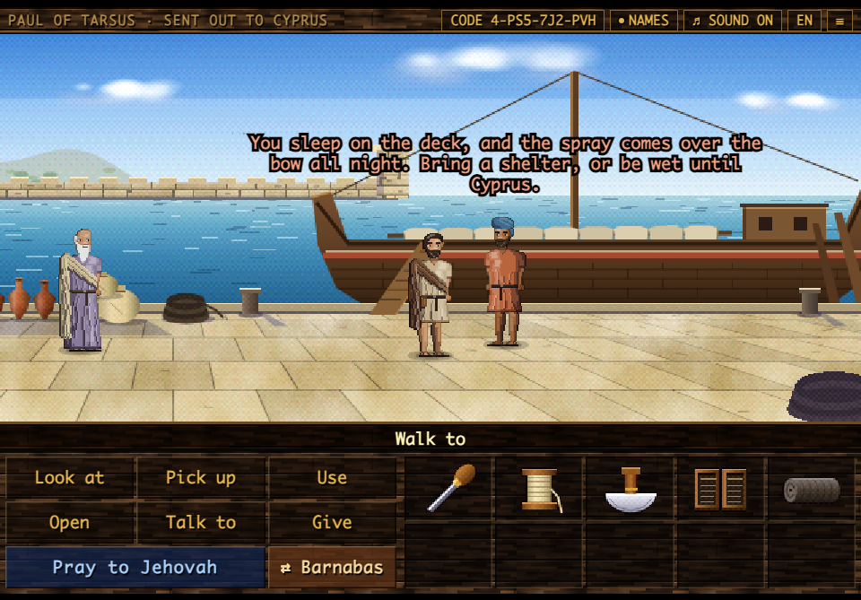 | 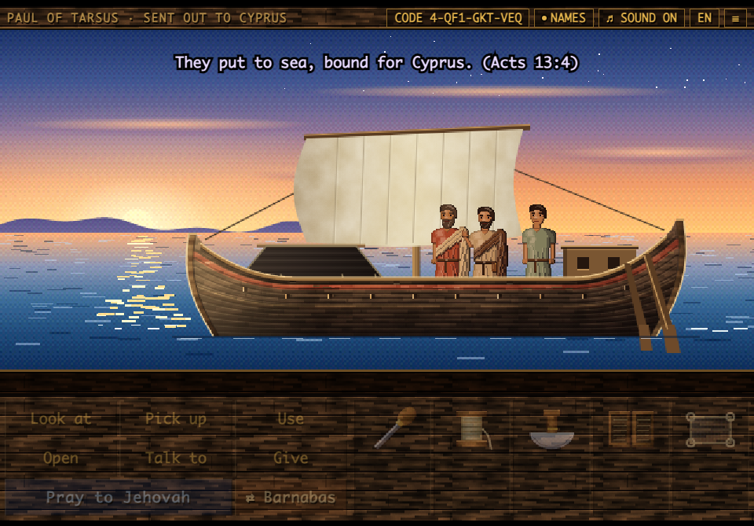 |
| Seleucia: a ship for Cyprus, and no roof for her deck | The crossing, under the roof a tentmaker sewed |
| 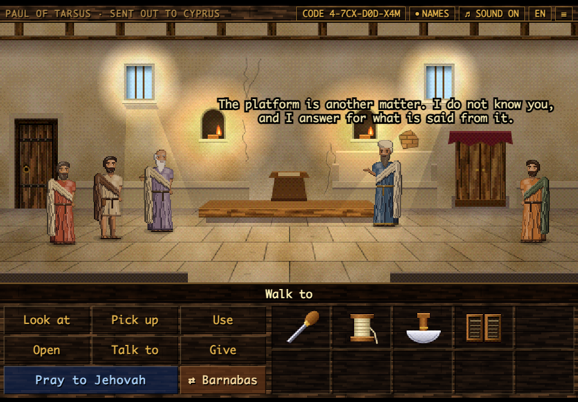 | 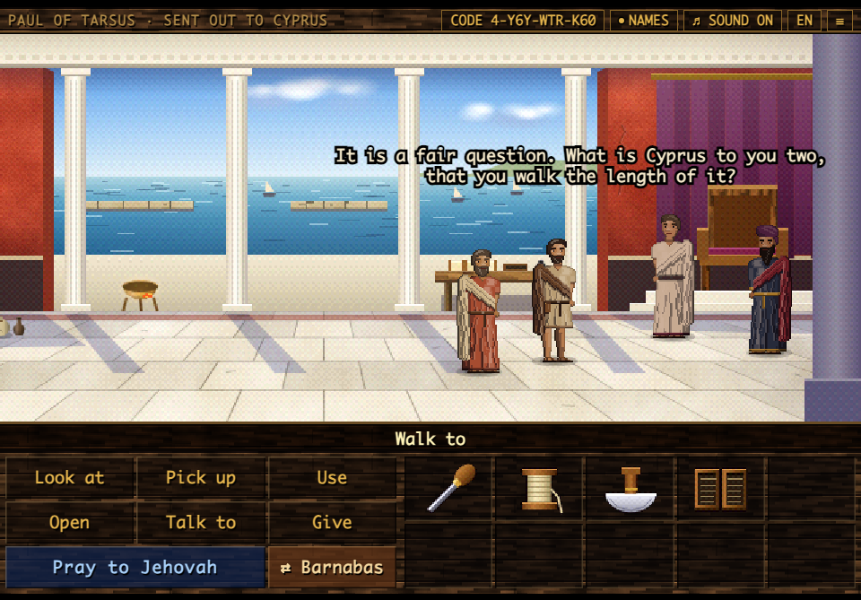 |
| Salamis: a stranger is welcome to a seat, not to the platform | Paphos: the proconsul asks, and Elymas objects |

Four more locations and seven new characters, and the first chapter in which the travel map is the way from place to place: the gangplank at Seleucia and the west gate of Salamis open it, and a click on a place goes there.

A merchant ship of those days gave its passengers drinking water and nothing else, so Paul sews a shelter for the deck, with a rope in its edge to lash it to the rail. On the quay sits an old disciple of Salamis whom Saul's persecution once drove out of Jerusalem (Acts 8:1-3; 11:19). He has nothing to say to Saul of Tarsus. Barnabas has to speak for his friend first, and then Saul has to say it himself, without an excuse.

On his own island Barnabas is the one who is known. He asks the presiding officer of a synagogue in Salamis for a hearing, and Paul builds his "word of encouragement" in the right order, beginning with what has just been read: the islands keep waiting for his law (Isaiah 42:4). In Paphos, Elymas raises three objections before the proconsul, and each is answered in its own way: one by Barnabas, one by showing Paul's awl, and one from the Scriptures. Then the account takes its course. What happens to Elymas is told as Acts tells it, and it solves no puzzle. From that hearing on the game calls Saul by his Roman name, Paul, as Acts does from chapter 13, verse 9.

| | |
|---|---|
| 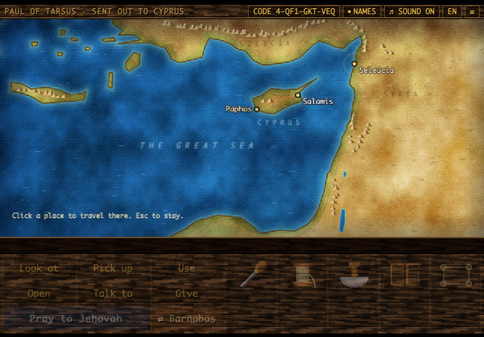 | 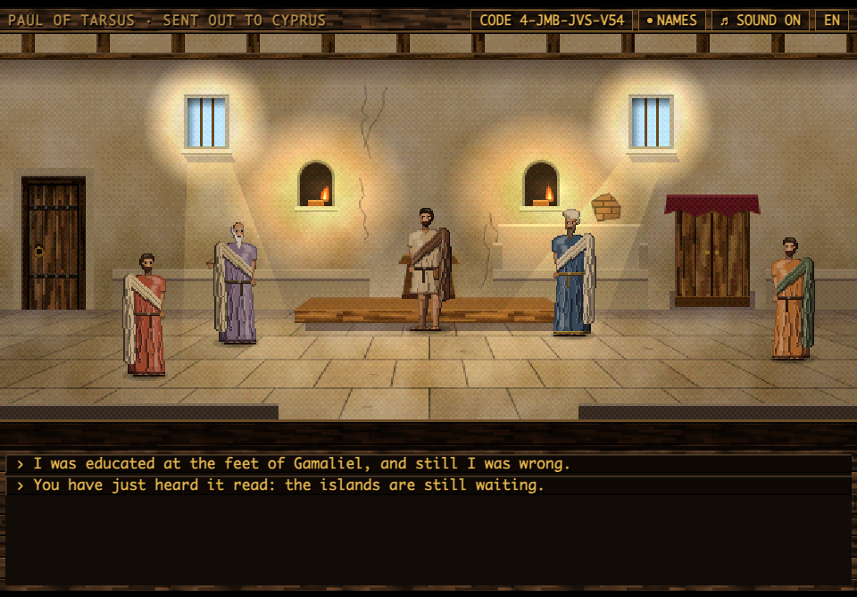 |
| The gangplank opens the map: Salamis lies a day and a night away | A word of encouragement has an order: do not run ahead of the hearers |

<details>
<summary>Walkthrough (spoilers)</summary>

1. At Seleucia, talk to Kallias, the shipmaster by the gangplank.
2. Use the knife on the coil of cord beside the mooring post. Use the awl (or the tarred cord) with the goat-hair cloth.
3. Switch to Barnabas and talk to the old man by the jars. Tell him that you asked the same question once, and then heard Saul out.
4. As Paul, talk to the old man, Jair, and say plainly what you did.
5. Walk up the gangplank, and click Salamis on the map.
6. In Salamis, open the door of the synagogue. Switch to Barnabas and talk to Zadok: let Saul speak after the reading, and test every word by the scroll.
7. As Paul, talk to Zadok. Build the talk in this order: the islands keep waiting; the promise to David; the savior from David's offspring, raised up; forgiveness of sins.
8. Leave by the door and then by the west gate, and click Paphos on the map.
9. In Paphos, switch to Barnabas and talk to the proconsul. As Paul, give the awl to the proconsul to show it. Then answer with Daniel 2:27, 28.
</details>

## Chapter Five: A Light of Nations

About 47 C.E. Paul and his companions put out to sea from Paphos and arrive at Perga in Pamphylia, where John Mark leaves them and returns to Jerusalem. The two go on, up through the Taurus, to Antioch in Pisidia. On the Sabbath they take a seat in the synagogue, and after the reading the presiding officers send word to them: "Men, brothers, if you have any word of encouragement for the people, tell it." The people plead to hear more, and the next Sabbath nearly all the city gathers to hear the word of Jehovah. When the Jews see the crowds, they are filled with jealousy and begin blasphemously contradicting the things Paul is saying. Paul and Barnabas answer boldly: "Since you are rejecting it and do not judge yourselves worthy of everlasting life, look! we turn to the nations. For Jehovah has commanded us in these words: 'I have appointed you as a light of nations, for you to be a salvation to the ends of the earth.'" Those of the nations rejoice, and all those who are rightly disposed for everlasting life become believers. Then persecution is stirred up: the two are thrown outside the city's boundaries, shake the dust off their feet and go on to Iconium, and the disciples continue to be filled with joy and holy spirit (Acts 13:13-52).

| | |
|---|---|
| 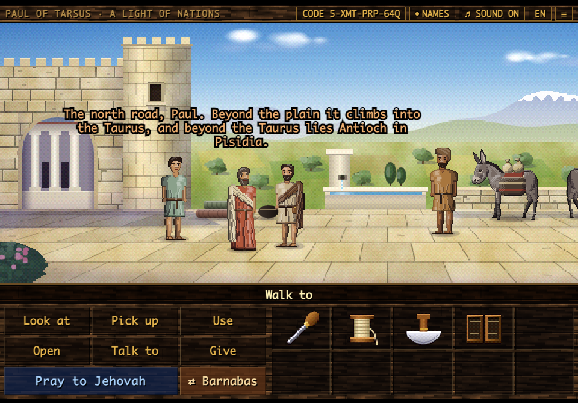 | 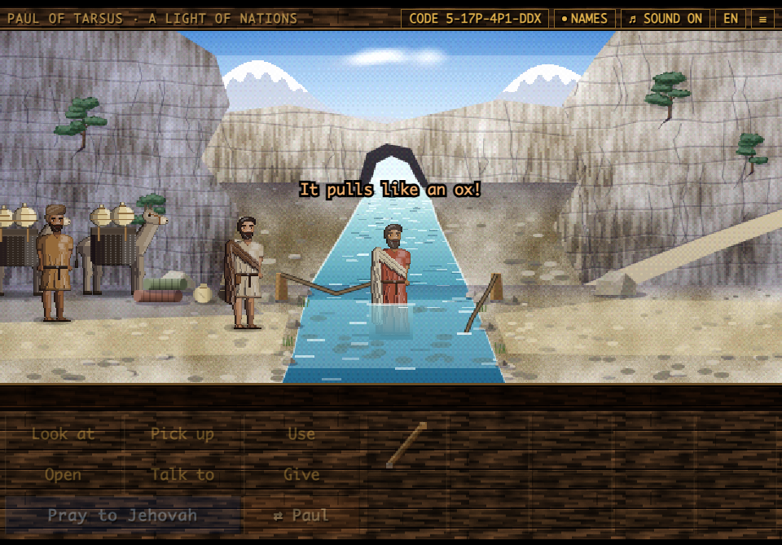 |
| Perga: the road north, a split sandal, and a parting | The ford: Barnabas carries the rope over, and Paul holds the line |
| 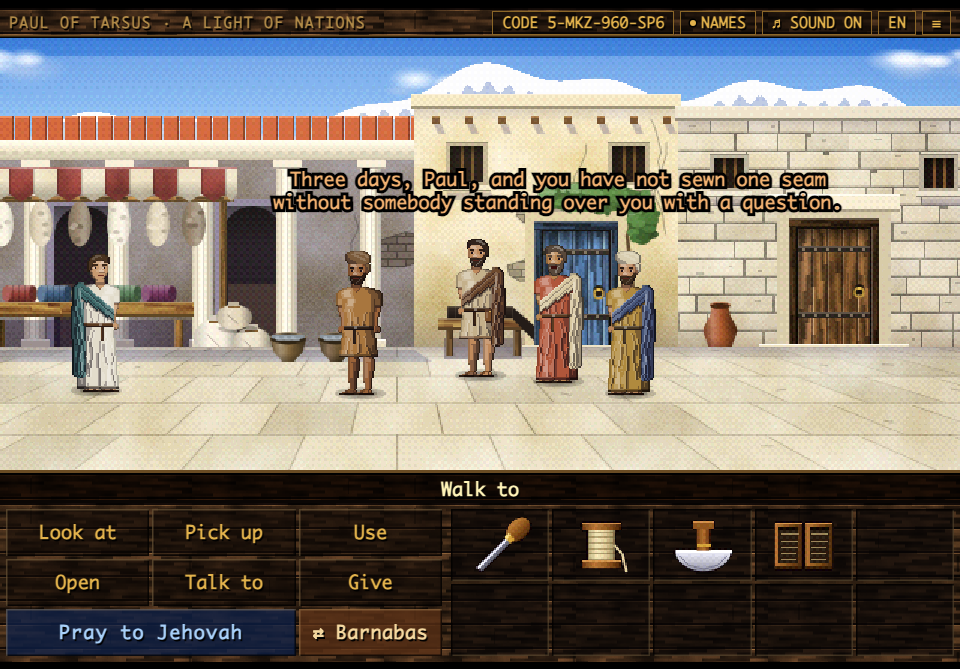 | 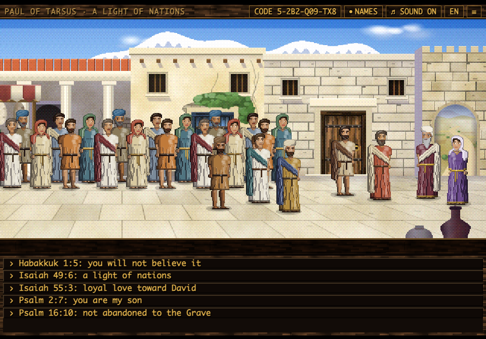 |
| Antioch in Pisidia: a week of questions at a tentmaker's bench | The next Sabbath: nearly all the city, and an objection |

Five more locations and six new characters. The account gives no reason why John Mark turned back, so the game gives none: he says that he is going, Paul says once and plainly that he wishes he would stay with the work, and the bundles change hands. Whether John Mark starts for Jerusalem with a share of the bread is up to the player.

The road to Antioch was about 180 kilometers over a mountain pass, through country known for its robbers and for rivers that dash down through narrow ravines (2 Corinthians 11:26). Nobody climbs it alone, so the two walk with a drover's pack train, and where a river has carried away the guide rope of a ford, the chapter's two-man puzzle begins. The rope Paul sewed into the edge of a deck shelter in Chapter Four comes out again, stitch by stitch, and is spliced to what is left on the post. Then somebody has to carry the end across, and only one of the two men has a staff.

In Antioch nothing is forced. A visitor takes a seat and waits to be asked, and when Paul is asked, the player chooses whom he addresses and which passages he quotes, as Acts records them. In the week that follows, three people want an answer, and each needs a different one: a Greek who has kept to the place by the synagogue door for years, of his own accord, is shown what Isaiah wrote about the foreigner; a drover who has never heard the Prophets read hears first about the God who made the mountains he crosses; and a Jew who fears what his new faith will cost him wants Barnabas, not Paul. On the next Sabbath the objection is answered from the tablets with Isaiah 49:6. What follows is told as Acts tells it. Nothing the player does keeps the two men in the city, and the last thing to do there is for the disciples, not against the opposers.

| | |
|---|---|
| 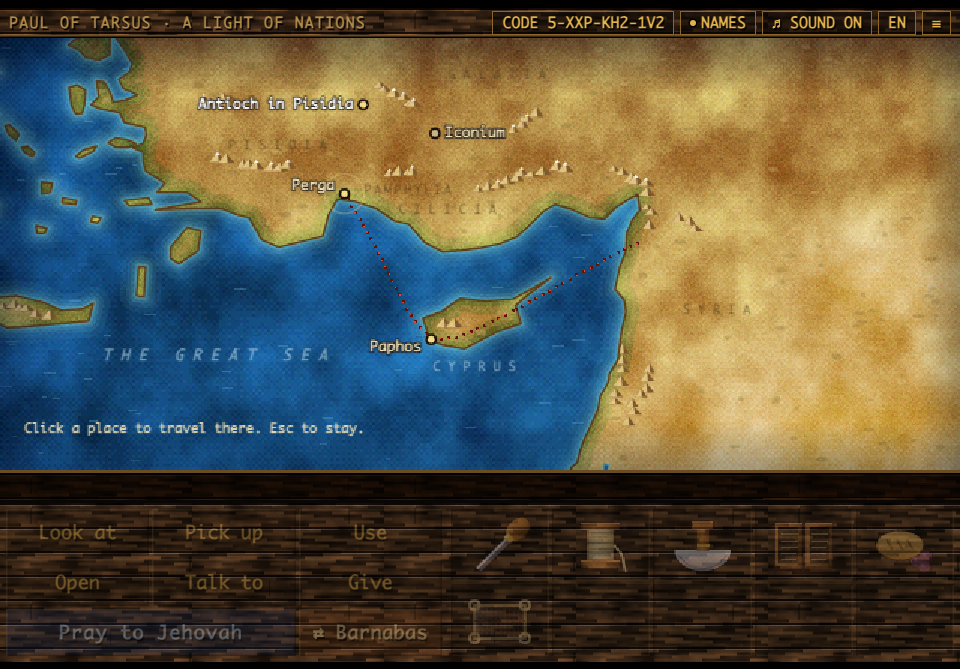 | 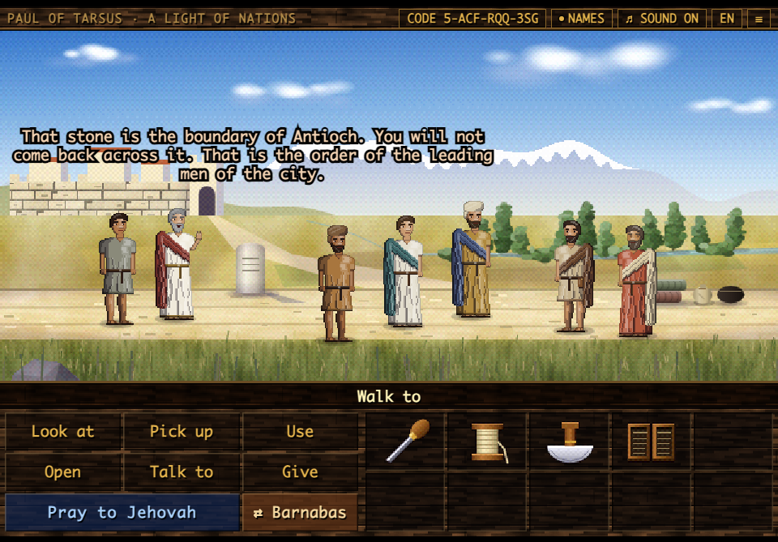 |
| The map looks further north: Perga, Antioch in Pisidia, Iconium | Outside the boundaries: three disciples have come out to stand with them |

<details>
<summary>Walkthrough (spoilers)</summary>

1. At Perga, talk to Papias, the drover by his donkeys. Talk to John Mark: he hands over the roof, the food bag and a leather thong.
2. Use the leather thong (or the awl) on Barnabas to mend his sandal. Leave by the road north, and click Antioch in Pisidia on the map.
3. At the ford, use the knife on the tent roof, then the tarred rope on the near post.
4. Switch to Barnabas and use his staff on the river. Switch back to Paul and talk to Papias (or use the river). Take the road to the pass.
5. In Antioch, open the door of the synagogue and use the bench. Address "Men, Israelites and you others who fear God", then choose Psalm 2:7, Isaiah 55:3 (or Psalm 16:10) and Habakkuk 1:5.
6. In the week, talk to Eumenes and show him what is written about the foreigner. Talk to Papias and begin with the God who made the mountains. Switch to Barnabas, talk to Joel, and urge him to remain in the undeserved kindness of God.
7. Go to the door of the synagogue, and answer with Isaiah 49:6.
8. Outside the boundaries, talk to Eumenes: it was never our word. Then use the boundary stone.

Optional: give the bread to John Mark before leaving Perga.
</details>

## Chapter Six: The Door to Faith

About 47 to 48 C.E. In Iconium the two men speak in the synagogue "in such a manner that a great multitude of both Jews and Greeks became believers", and they spend considerable time there, "speaking with boldness by the authority of Jehovah". But the city is divided, and when an attempt is made to stone them, they are informed of it and flee to the cities of Lycaonia. In Lystra Paul heals a man who has been lame from birth, and the crowds cry out in the Lycaonian language: "The gods have become like humans and have come down to us!" They call Barnabas Zeus and Paul Hermes, and the priest of Zeus brings bulls and garlands to the gates. The two rip their garments and leap out into the crowd: "We too are humans having the same infirmities as you have." They barely restrain the crowds from sacrificing to them. Then Jews arrive from Antioch and Iconium and persuade the crowds; Paul is stoned and dragged outside the city, and left for dead. "However, when the disciples surrounded him, he got up and entered the city." The next day he leaves with Barnabas for Derbe. From there they return to Lystra, Iconium and Antioch, strengthening the disciples: "We must enter into the Kingdom of God through many tribulations." They appoint elders in each congregation, go down by Perga to Attalia, and sail home to Antioch, where they relate that God "had opened to the nations the door to faith" (Acts 14:1-28).

| | |
|---|---|
| 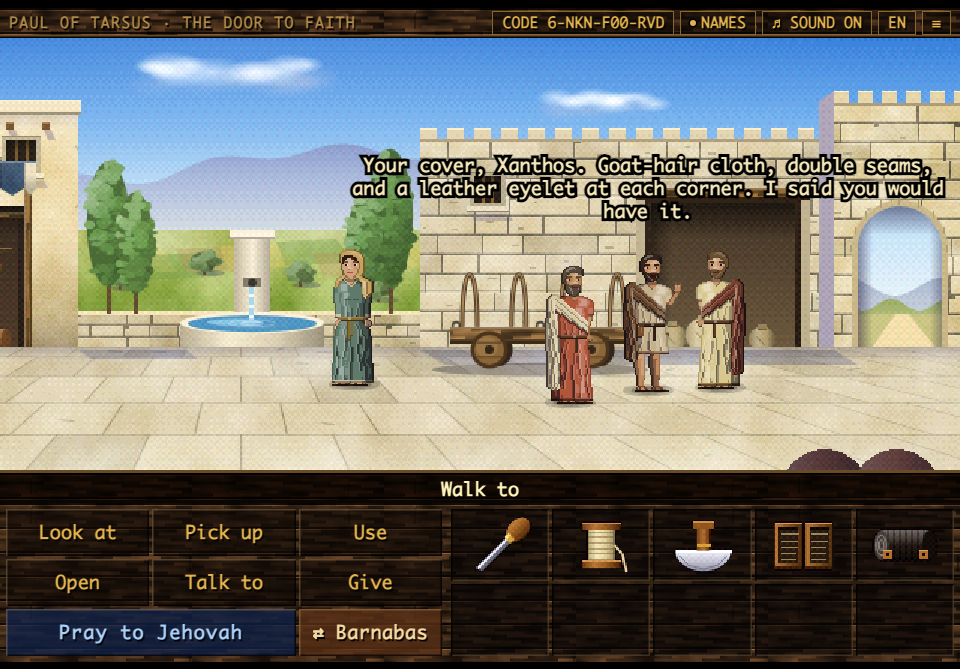 | 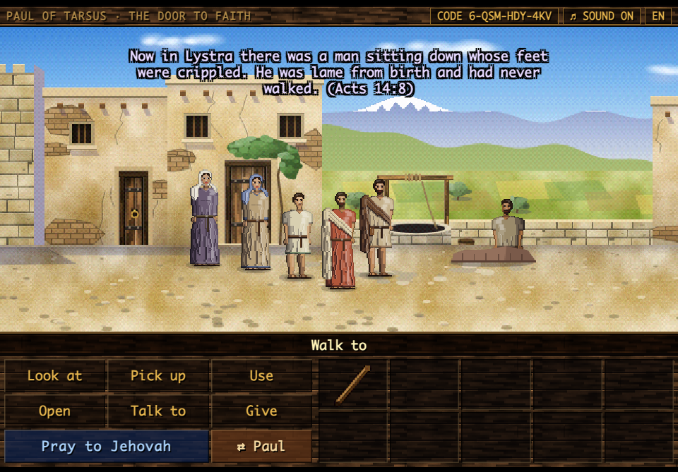 |
| Iconium: a promise is kept before the road is taken | Lystra: a town with no synagogue, and a man who has never walked |
| 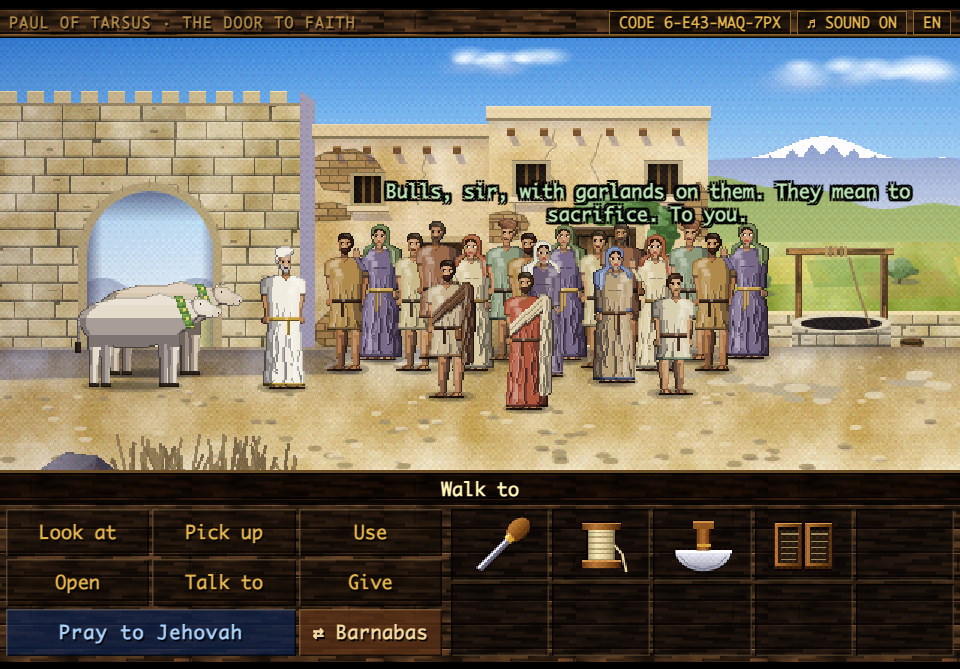 | 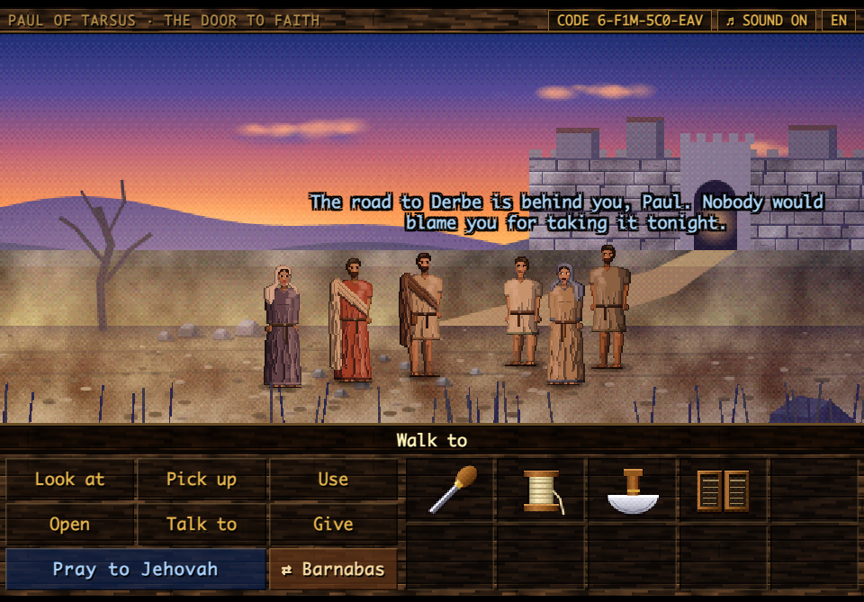 |
| The gate: bulls and garlands, for two men who will not have them | Outside the city: the disciples surround him, and he gets up |

Five more locations and nine new characters. In Iconium the two men are informed of the stones in the first minute, and they leave the same day. But Paul has taken half the price of a wagon cover from a carrier who now sides with the rulers and calls him a swindler, and the cover wants its corners. A saddler who believes gives the leather; Paul finishes the cover and puts it into the hands of the man who speaks against him. The carrier's wife is a believer, and it is Barnabas she asks why bold men go: words were answered, but of stones the Lord said, "When they persecute you in one city, flee to another" (Matthew 10:23). Whether the silver stays behind for the brothers of Iconium is up to the player.

Lystra has no synagogue, so Paul speaks at the well. The healing is told as Acts tells it. It solves no puzzle; it makes one, because the crowds cry out in Lycaonian and neither man understands a word. A boy of the town has both tongues: Timothy, whose mother Eunice and grandmother Lois taught him the holy writings from infancy. Once the two men know what is coming to the gate, the player chooses how Paul begins, to whom he turns his hearers, and what witness he names. The Law of Moses means nothing to people who never heard it read, and neither does the name of a psalm; what the psalm says does, and so do the rains and the fruitful seasons of their own valley. It is the lesson of Chapter Five, where a drover who had never heard the Prophets was told first about the God who made the mountains.

What follows is told in the words of Acts 14:19 on a dark screen, and nothing of it is shown. The next scene is dusk outside the city, and the first thing the player decides there is which way Paul goes: by the road to Derbe, or back in through the gate. That night, by the lamp of Lois and Eunice, the tentmaker mends the garments the two men ripped. In Derbe nobody lifts a hand against them, and a disciple offers a place on his wagon: a well-traveled Roman road ran on from Derbe to Tarsus, and from there it was a short journey home. The travel map offers Tarsus. It also offers the road back. In Lystra again, a believing woman with an unbelieving husband asks whether it will always be like this, and Paul does not tell her that it gets easier.

| | |
|---|---|
| 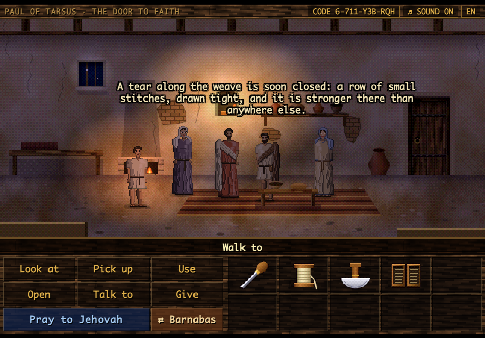 | 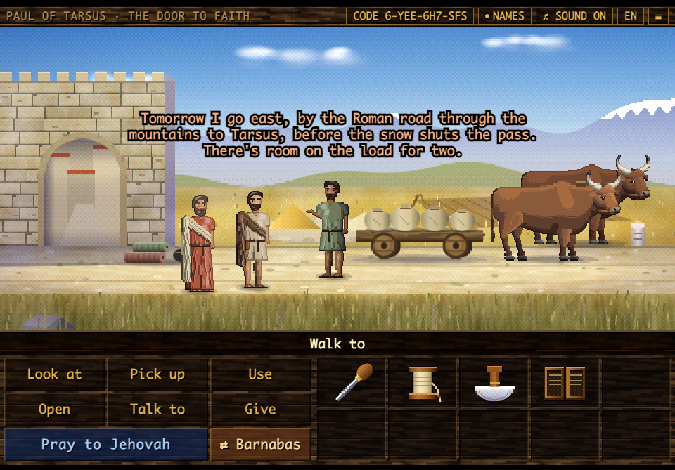 |
| The house of Lois and Eunice: stoned by day, and sewing by lamplight the same night | Derbe: a loaded wagon, and the short road home |
| 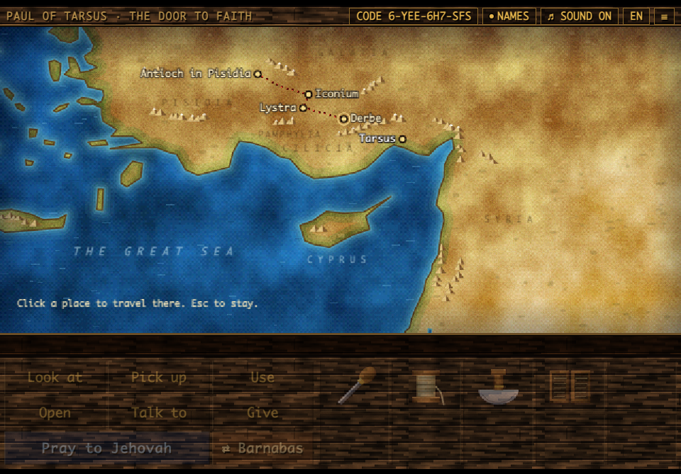 | 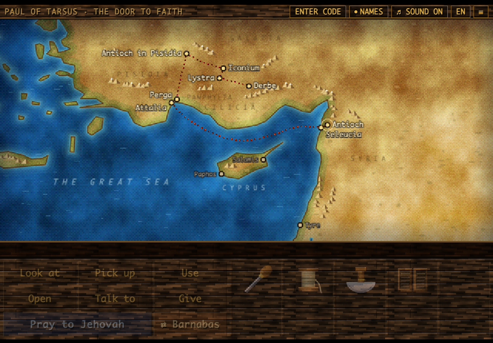 |
| At Derbe the map offers Tarsus, and the road back | The way home: by Perga to Attalia, and by sea to Antioch |

<details>
<summary>Walkthrough (spoilers)</summary>

1. In Iconium, talk to Nathan and ask for leather for four corners. Use the leather corners (or the awl) on the unfinished cover, and give the wagon cover to Xanthos.
2. Switch to Barnabas and talk to Tatia: "Words we answered. From stones, our Lord said: flee." Leave by the south gate, and click Lystra on the map.
3. In Lystra, talk to Timothy, then use the well. Talk to Timothy again to learn what the crowd is shouting.
4. Go to the city gate. Choose "We too are humans, with the same infirmities as you", "To the living God, who made heaven, earth and sea" and "Rain from heaven, and fruitful seasons".
5. Outside the city, go in at the city gate. In the house, use the thread (or the awl) on Barnabas. Leave by the door to the lane, and click Derbe on the map.
6. At Derbe, take the road and click Lystra on the map, not Tarsus.
7. Back in the house of Lois, talk to Eunice: "I will not tell you that it gets easier." Then leave by the door to the lane.

Optional: give the silver coins to Nathan before leaving Iconium, and give the wax tablets to Timothy during the night in Lystra.
</details>

## Chapter Seven: Timothy of Lystra

About 49 C.E. Some men come down from Judea to Antioch and teach the brothers: "Unless you get circumcised according to the custom of Moses, you cannot be saved." Paul, Barnabas and some of the others are sent up to the apostles and elders in Jerusalem. There Peter speaks, Barnabas and Paul relate what God has done through them among the nations, and James gives his decision. Judas called Barsabbas and Silas, "leading men among the brothers", are sent back with them and with a letter "to those brothers in Antioch, Syria, and Cilicia who are from the nations", and Antioch rejoices over the encouragement. After some days Paul proposes to visit the brothers in every city. Barnabas is determined to take along John Mark, and Paul is not in favor of it. "At this there was a sharp burst of anger, so that they separated from each other"; Barnabas sails away to Cyprus with Mark. Paul selects Silas and goes "through Syria and Cilicia, strengthening the congregations". So he arrives at Derbe and also at Lystra, where there is a disciple named Timothy, "well-reported-on by the brothers in Lystra and Iconium". Paul expresses the desire for Timothy to accompany him. As they travel on through the cities they deliver the decrees, and the congregations continue "to be made firm in the faith and to increase in number day by day" (Acts 15:1–16:5).

| | |
|---|---|
| 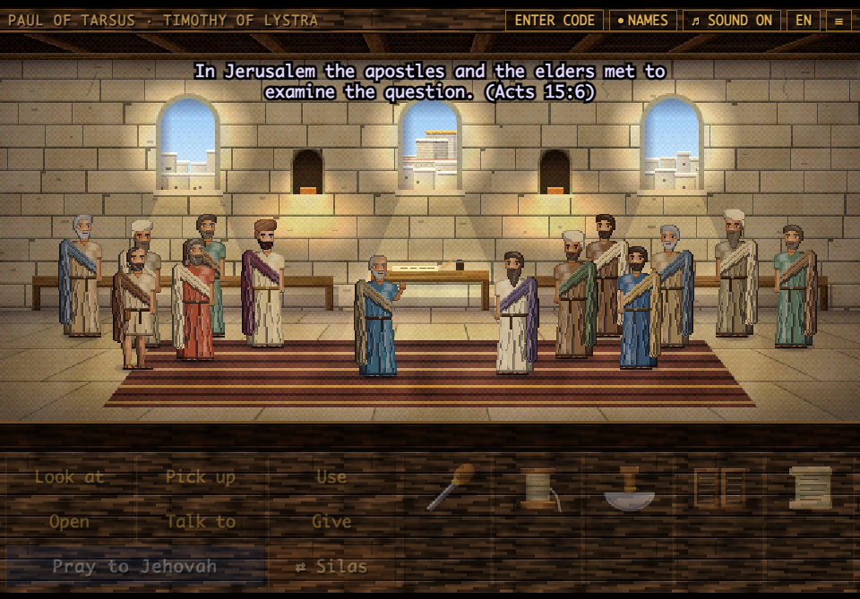 | 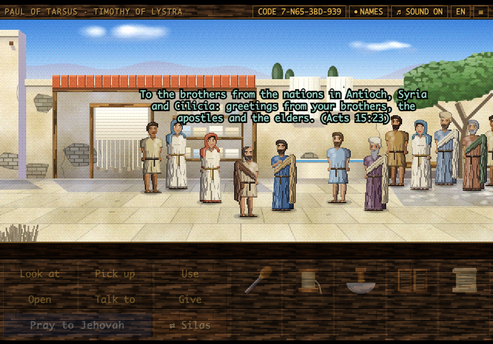 |
| Jerusalem: the apostles and the elders look into the matter | Tarsus: the letter, read to the whole congregation by the man who was sent with it |
| 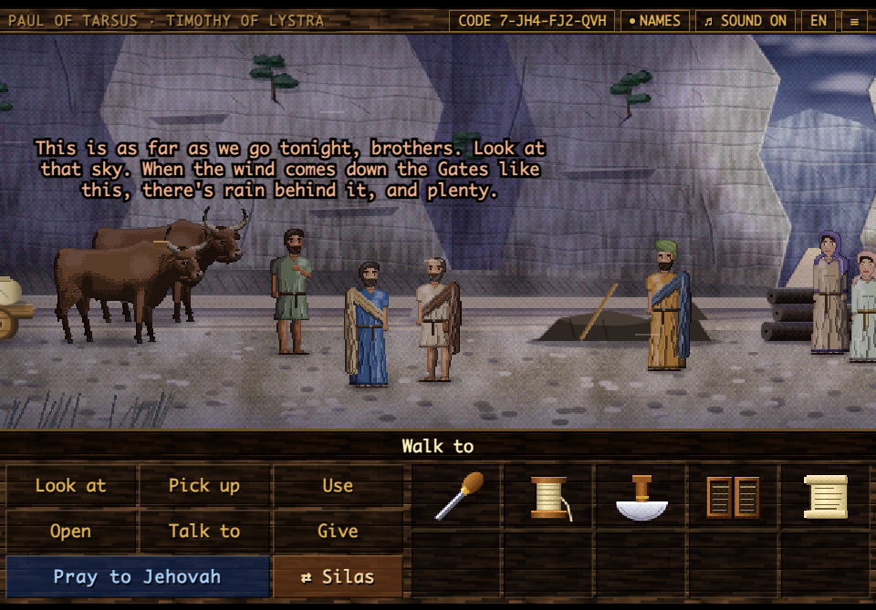 | 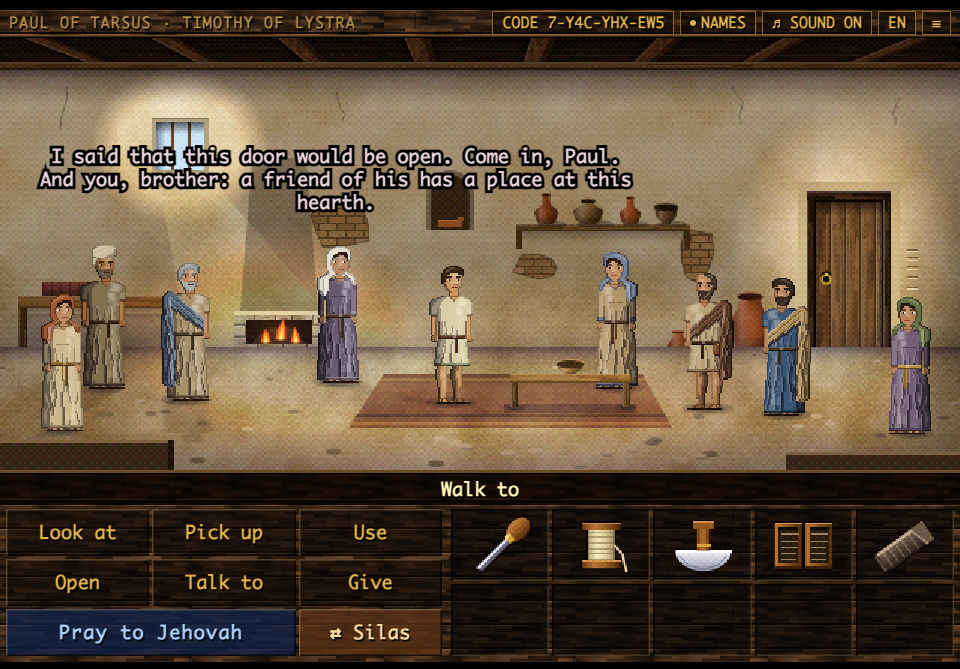 |
| The Cilician Gates: a torn tent, and a storm an hour away | Lystra: the door that Lois said would be open |

Four more locations, eight new characters, and a new man to play: Silas. The meeting in Jerusalem is told as the chapter opens, in the words of Acts 15 and in three scenes without a puzzle. So is the parting from Barnabas. The account gives no explanation for it, and the game adds none.

In Tarsus the congregation has heard the teaching from Judea, and a careful brother will not take the letter on the word of the man who carries it: Paul was one of the two sides in that dispute. Everything Paul can answer is true, and none of it helps. The answer is standing beside him. Silas was sent out from Jerusalem with the letter, "so that they also may report the same things by word of mouth" (Acts 15:27), and two witnesses are what the Law asks for (Deuteronomy 19:15). Then the letter has to be read, and not to one man beside a loom: in Antioch "they gathered the whole group together and handed them the letter" (Acts 15:30).

The road north climbs to the Cilician Gates, a cleft in the Taurus so narrow that the way for wagons was cut into its rock. Zenon, the carter of Derbe who offered this road in Chapter Six, is on it with his oxen; so is a cloth merchant whose tent has torn, with his wife and daughter, and the wind that comes before rain. Paul can close the seam and sew in a new corner loop, with leather from the carter's harness box. Raising a tent in that wind takes two: Silas, who has never pitched one, holds the windward line while Paul sets the pole and drives the pins. That night the rain finds the letter. The copies of the decrees are for every congregation on the road (Acts 16:4), so the merchant's thanks, a length of goat-hair cloth, becomes a case for them, and the carter's axle tallow keeps the water out of it.

In Lystra the door that Lois said would be open is open, and Timothy is a man's height. Paul would like to ask him at once, and the game lets the player try: it is a hasty choice, not an untrue one, and Paul sets it aside. First he hears what Acts 16:2 reports. He asks the older men appointed in Chapter Six, Timothy's mother and grandmother, and, a day's walk away in Iconium, the saddler Nathan and Tatia. What he asks matters. A question about what appears to the eyes (does he speak well, is he strong, does he come of a good family?) gets a short answer; a question about what Timothy does gets a true one (1 Samuel 16:7). Then Paul asks him, and tells him what it will cost.

| | |
|---|---|
| 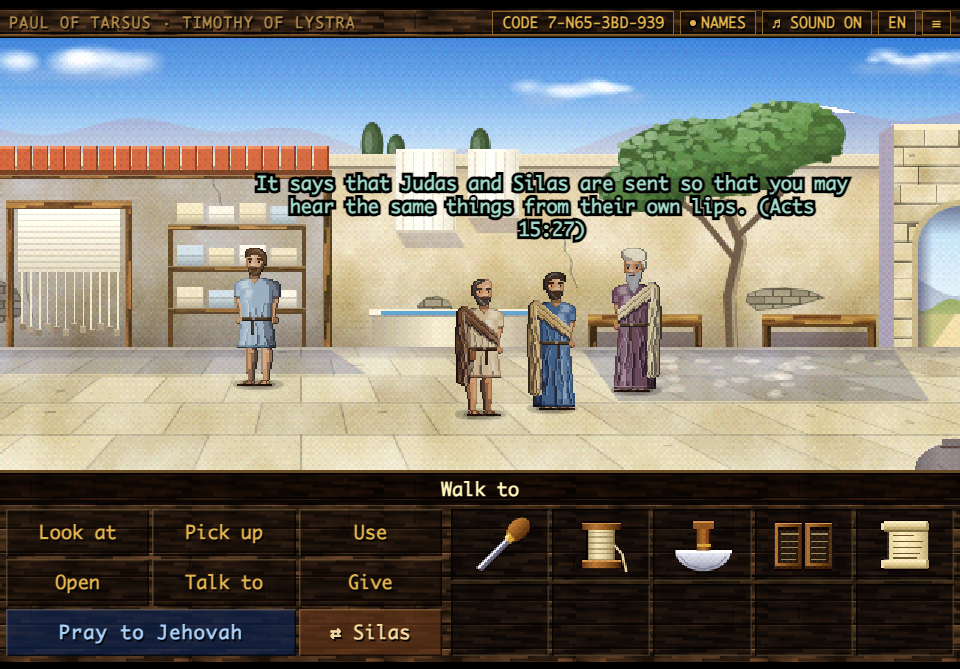 | 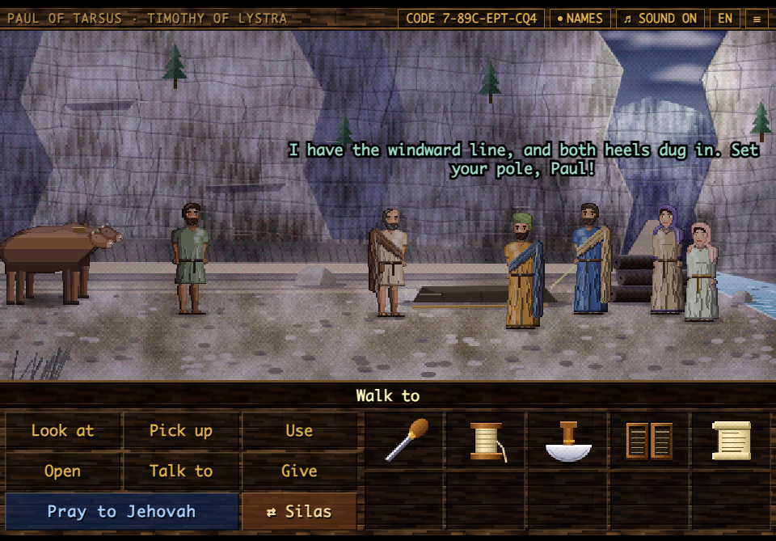 |
| The second witness: sent to report the same things by word of mouth | A tent goes up in a wind only with a man on its windward line |
| 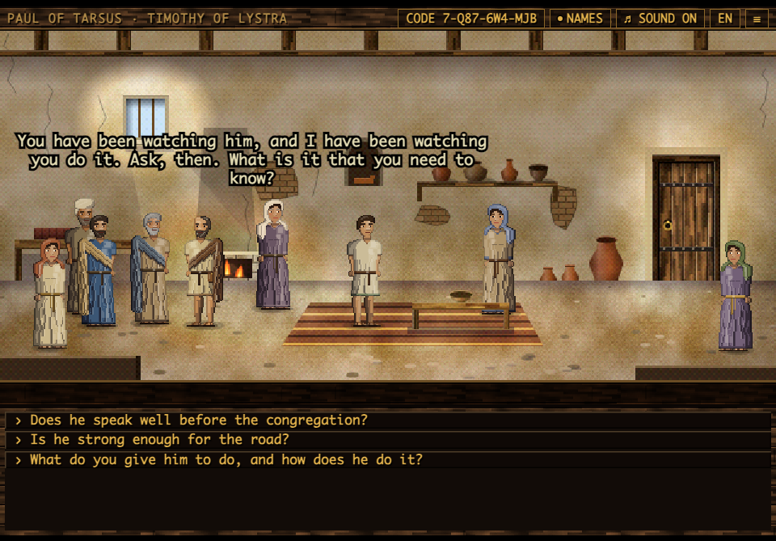 | 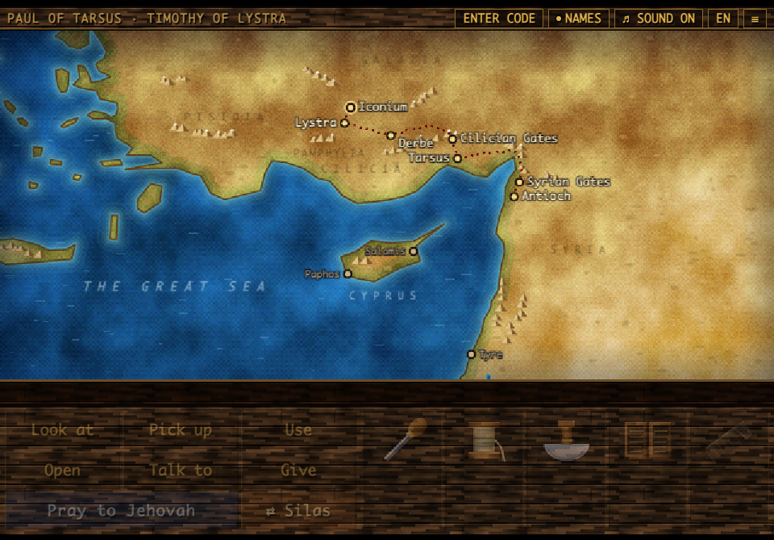 |
| What to ask an older man about a young one | By the Syrian Gates to Tarsus, over the Taurus, and on to Iconium |

<details>
<summary>Walkthrough (spoilers)</summary>

1. In Tarsus, talk to Reuben: nothing Paul says persuades him. Switch to Silas (the **⇄ Silas** button, or `C`) and talk to Reuben: "I was sent from Jerusalem to report it by word of mouth."
2. Give the letter from Jerusalem to Eirene (either man can carry it). Leave by the gate to the street, and click the Cilician Gates on the map.
3. At the Gates, talk to Zenon and ask for leather. Use the yoke strap (or the awl) on the torn tent.
4. Switch to Silas and use the mended tent: he takes its windward line. Switch back to Paul and use the tent.
5. Use the awl with the goat-hair cloth. Ask Zenon how to keep the letter dry, and use the axle tallow with the letter case. Walk on to the Cilician Gates, and click Derbe on the map.
6. In Lystra, give the letter to Myron. Talk to Myron: "What do you give him to do, and how does he do it?" Talk to Eunice: "What is he at home, when the brothers are not looking?" Leave by the door to the lane, and click Iconium on the map.
7. In Iconium, give the letter to Nathan. Talk to Nathan: "How does Iconium come to know a young man from Lystra?" Talk to Tatia: "What does he do, when he comes to Iconium?" Leave by the south gate, and click Lystra on the map.
8. Talk to Timothy: "I want you with us. It will cost you your home."

Optional: give the wax tablets to Lois.
</details>

## Chapter Eight: The Man from Macedonia

About 50 C.E. Paul, Silas and Timothy travel "through Phrygia and the country of Galatia, because they were forbidden by the holy spirit to speak the word in the province of Asia". When they come down to Mysia, they make efforts to go into Bithynia, "but the spirit of Jesus did not permit them". So they pass by Mysia and come down to Troas. During the night a vision appears to Paul: a Macedonian man is standing there, urging him: "Step over into Macedonia and help us." From here on the account says "we": "As soon as he had seen the vision, we tried to go into Macedonia, drawing the conclusion that God had summoned us to declare the good news to them." They make a straight run to Samothrace, come to Neapolis on the following day, and go on to Philippi, "a colony, which is the principal city of the district of Macedonia". On the Sabbath they go "outside the gate beside a river, where we thought there was a place of prayer", sit down and begin speaking to the women who have assembled. "And a woman named Lydia, a seller of purple from the city of Thyatira and a worshipper of God, was listening, and Jehovah opened her heart wide to pay attention to the things Paul was saying." When she and her household get baptized, she urges them: "If you have considered me to be faithful to Jehovah, come and stay at my house." "And she just made us come" (Acts 16:6-15).

| | |
|---|---|
| 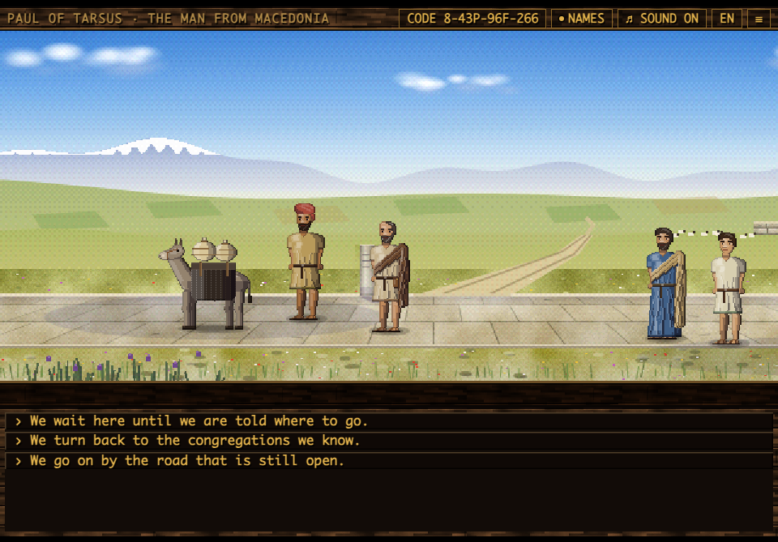 | 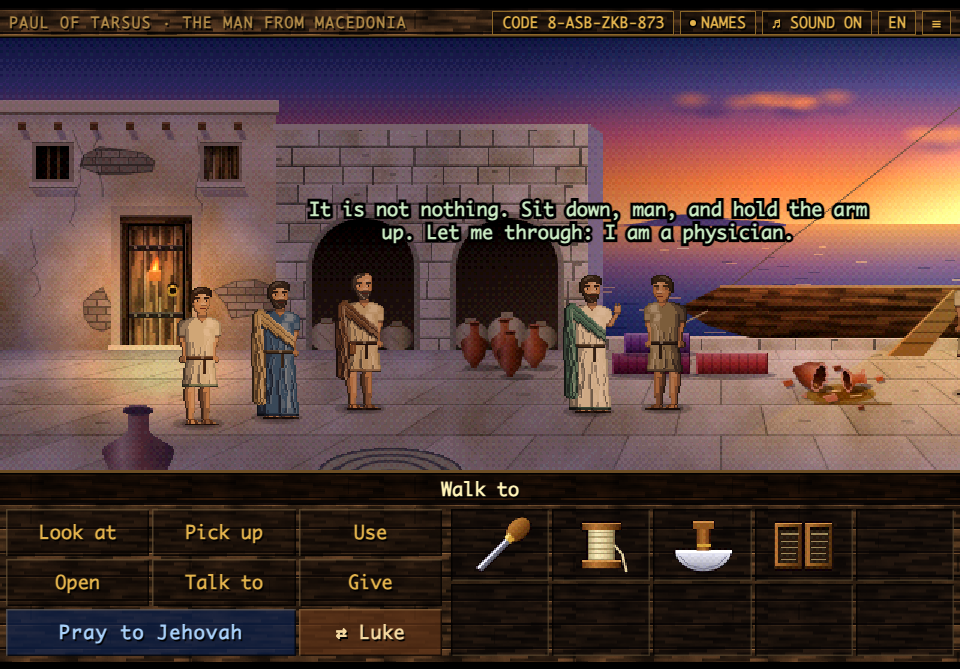 |
| The plateau: the road to Ephesus is closed, and Paul has to decide what to do next | Troas: a hurt man on the quay, and a physician who wants clean linen |
| 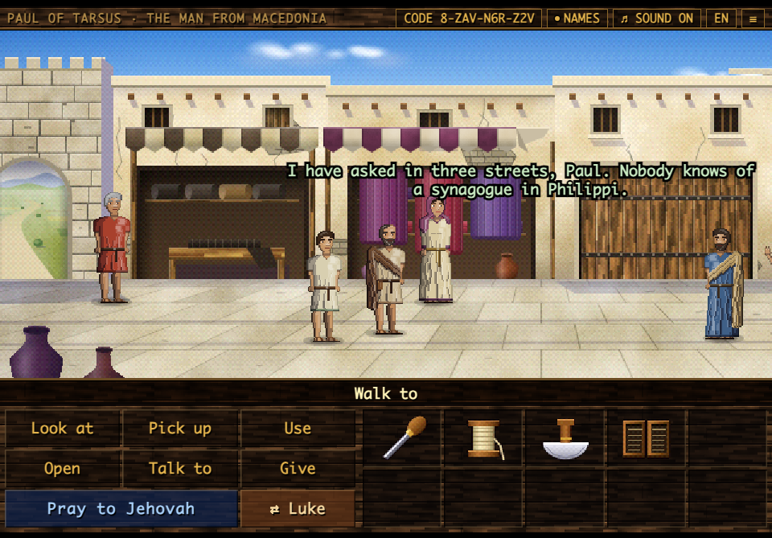 | 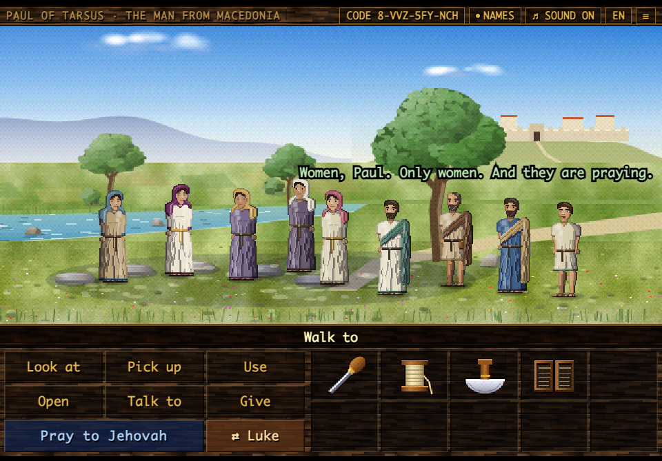 |
| Philippi: a Roman colony with no synagogue, and one shop that is shut | The Sabbath: outside the gate, beside a river |

Five more locations, ten new characters, and a new man to play: Luke. The chapter is about not knowing where to go. *Bearing Thorough Witness* says of these weeks that the men "knew what to preach and how to preach, but they did not know where to preach", and that direction came only after each step had been taken. So nobody in this chapter gets anywhere by standing still, and nobody gets to Macedonia by being clever.

On the plateau a paved road runs west, down to Ephesus, and Paul means to take it. He is forbidden, in the words of Acts 16:6, and the game does not say how: the account does not. What the player decides is what Paul does next. He can wait at the fork until he is told where to go, or turn back to the congregations he knows. Both are honest and unwise, and Paul sets them aside. He goes on by the road that is still open, and at a ferry on the edge of Bithynia the same thing happens again. The one road left runs west for some 550 kilometers, past city after city, to a harbor. Mysia belonged to the province of Asia, so they pass it by: what was forbidden there is forbidden here.

At Troas a jar has slipped from its sling and laid a seaman's arm open, and a physician is already kneeling beside him. Luke has wine and oil, the treatment he himself later recorded (Luke 10:34), and no linen. Timothy's mother packed a clean cloth in his bundle; Paul cuts it into strips, and later sews a sling out of old sailcloth. Binding the wound is not the tentmaker's craft, so the player does that as Luke, who leaves the sewing to Paul. That night the vision is told in the words of Acts 16:9 on a dark screen, and nothing of it is shown. In the morning Paul does not announce a decision. He tells the other three exactly what he saw, and no more, and the four of them lay beside it what they already know: Asia closed, Bithynia closed, and the one open road ending at a harbor that looks toward Macedonia. Acts gives the conclusion to all of them: "we". From that verse on the game's narration says "we" too, as it took up the name Paul at Acts 13:9.

Philippi has no synagogue, and nobody in the game says why: the Study Edition offers two possible reasons and decides for neither. Paul finds the place of prayer by asking people what they have seen. An old soldier at the gate does not know why there is no synagogue, or whom other people pray to; he does know who goes out by his gate that is not going to work. A seller of purple does not know any Jews; she does know that the shop beside hers is shut every seventh day. Then Paul sews at a borrowed bench until the Sabbath. He says "I think", never "I know": Acts says "where we thought there was a place of prayer".

Beside the river the player chooses how the four men come to the women, and where Paul begins. These hearers pray to the God of Israel already, so he begins from the Scriptures, which is the opposite of Lystra. Whatever is chosen, the scene comes to the same sentence: "Jehovah opened her heart wide." Nothing the player does wins Lydia, and Paul says so. Her baptism is told in the words of Acts 16:15 and is not drawn. Then she urges them to stay at her house, and the last puzzle of the chapter is solved by accepting. Paul has reasons to decline that are all true: they have lodgings and pay for them, he has a trade, four men are a heavy load, and he wants to offer the good news without cost. To each of them she has one answer, the sentence Acts gives her. She is not asking about lodgings.

| | |
|---|---|
| 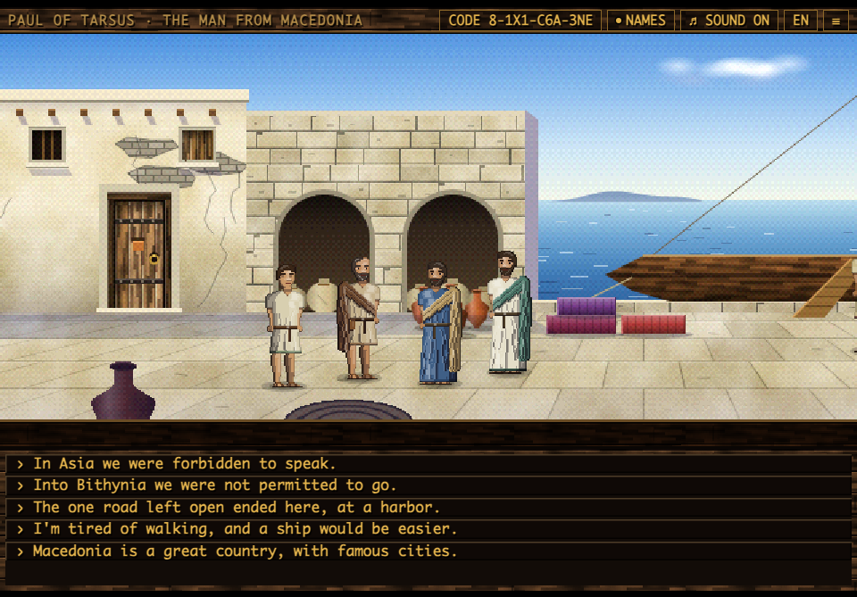 | 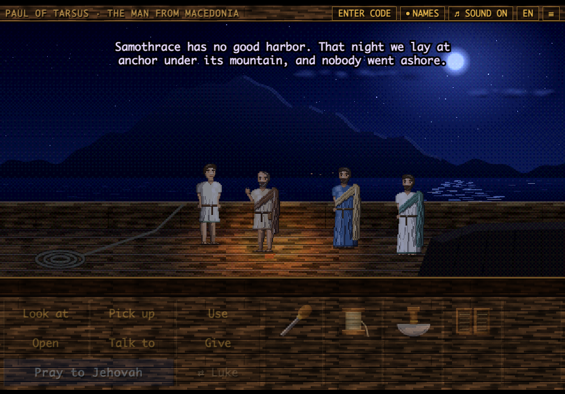 |
| The morning at Troas: what else do we know, besides what Paul saw? | Samothrace: a night at anchor under the mountain, and nobody goes ashore |
| 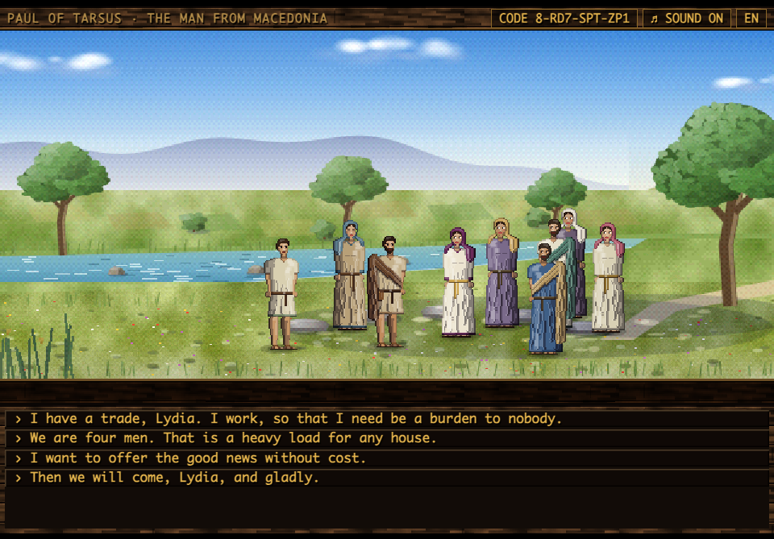 | 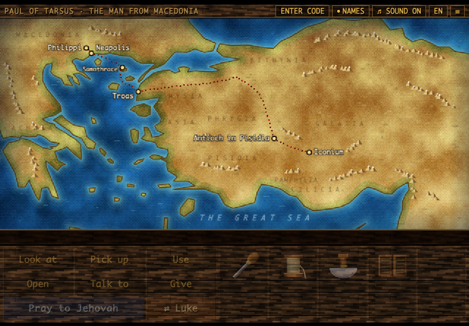 |
| "If you have considered me to be faithful to Jehovah, come and stay at my house." | From Iconium to Troas, and over the sea to Philippi |

<details>
<summary>Walkthrough (spoilers)</summary>

1. On the plateau, take the paved road west. Choose "We go on by the road that is still open." Then take the track to the north.
2. At the river, use the ferry. Choose "West. It is the one road left." Then take the road west.
3. At Troas, talk to Timothy and tell him that the physician needs clean linen. Use the knife with the linen cloth, and give the linen strips to Luke.
4. Switch to Luke (the **⇄ Luke** button, or `C`). Use his bag on Sosias, and then the linen strips.
5. As Paul, pick up the old sailcloth by the stern of the ship, use the awl with it, and give the arm sling to Luke. As Luke, use the sling on Sosias.
6. Go in at the door of the inn.
7. In the morning, talk to Silas, Timothy or Luke: "Tell them exactly what I saw, and no more." Then name the three things they know: Asia, Bithynia, and the harbor at the end of the one road left.
8. Go up the gangplank.
9. In Philippi, talk to Quintus at the gate: "Who goes out by this gate that is not going to work?" Talk to Zosime: "Why is the shop beside yours shut?"
10. Use the bench, and then go out by the west gate.
11. At the river, talk to one of the women: "Go down, greet them, and sit among them." Then talk to Lydia: "With the Scriptures they know, and the one they promise."
12. Answer Lydia: "Then we will come, Lydia, and gladly."

Optional: use the awl on Zosime's torn awning.
</details>

## Look and sound

The backdrops are painted in the manner of early-1990s VGA adventure games: perspective floors, textured plaster and stone, warm light against cool shadow, a foreground layer that slides past the scene as it scrolls, and a final ordered dither. Rooms are painted at twice the classic 320-pixel resolution. Night scenes and interiors are painted in daylight colors and then multiplied by a light map, so a lamp, a brazier or the moon through a window really lights the room; the same light falls on the characters as they walk through it.

The characters are sprites in the manner of the same era: placed pixel by pixel in a three-quarter view, shaded in flat bands of tone with dark edges on the shadow side instead of an outline. Faces, beards and head coverings are small hand-drawn pixel maps; one figure serves the whole cast through its palette and dress.

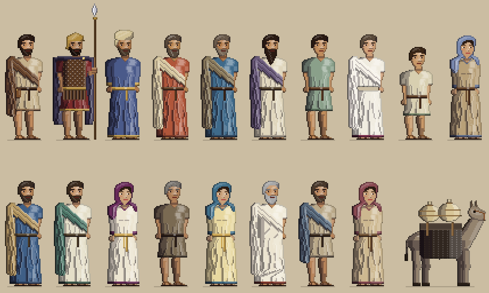

A scene has depth: whoever stands farther back is drawn behind. A man who walks behind the carrier's mule is hidden by it up to the waist, and hides it when he stands in front; the same holds for a stool, a low table or a heap of sailcloth that stands out on the floor.


Each chapter ends on a travel map of the eastern Mediterranean, painted the same way: coasts, shallows and mountain ranges, cities as dots, and no grid lines. The road travelled so far is shown, and the chapter's own leg draws itself as a dotted line from city to city, to a short sting on frame drum, harp and ney in the chapter's own key: Damascus to Jerusalem; Jerusalem to Caesarea and by sea to Tarsus; Tarsus to Antioch, where Paul's missionary journeys would begin. The routes never cross. Where the Scriptures do not say which way he went, the line takes a plausible one: by sea east of Cyprus, by road round the Gulf of Issus, and through the south of Cyprus.

Chapter Four draws the first missionary journey on a map of its own: Antioch to Seleucia, by sea to Salamis, and across the island to Paphos. The earlier roads are left off it, because the sea lane from Caesarea to Tarsus runs between Cyprus and Syria, just where the ship from Seleucia has to pass. In that chapter the map is also how you travel.

Antioch in Pisidia and Iconium lie north of that map's upper edge, so Chapter Five looks at the same map through a second window, further north: Asia Minor as far as Galatia, with the Aegean islands on the left and Jerusalem and Egypt out of sight below. Pamphylia, a strip of coast too small for a widely spaced name, is named on it in closer letters. The chapter opens on it, with the crossing from Paphos to Perga, and closes on it, with the road from Perga over the Taurus to Antioch and on to Iconium.

Chapter Six looks through the same window, and travels on it: from Iconium to Lystra, on to Derbe, and back. The way home is the road they came by, so the closing map does not draw it a second time: a light walks back from city to city, to Lystra, Iconium, Antioch and Perga. Then two new legs draw themselves, from Perga down to Attalia and by sea, between Cyprus and the coast of Cilicia, to Seleucia and Antioch. The crossing from Paphos to Perga is left off this map, because the voyage home would have to cross it.

Chapter Seven draws the opening of the second journey on a map of its own, as Chapter Four did, and through the northern window: from Antioch by the Syrian Gates and round the Gulf of Issus to Tarsus, over the Taurus by the Cilician Gates to Derbe and Lystra, and on to Iconium. The roads of the first journey are left off it. The chapter opens on this map and travels on it; Derbe is passed on the way, and the walk from Lystra to Iconium is made in both directions. Acts names neither of the two passes: the map shows the road that was likely.

Chapter Eight leaves that window too. Troas, Samothrace, Neapolis and Philippi lie north and west of it, so the map has a third one: the lands round the Aegean, from Macedonia and Achaia on the left to Iconium on the right, with the Black Sea along its top. The coast of Thrace and Macedonia, the Propontis, the Peloponnese and the islands of the northern Aegean were painted for it, once, for the chapters that follow. The chapter's road is drawn on a map of its own: from Iconium by Antioch in Pisidia, north through Phrygia and Galatia until Bithynia is near, west through Mysia to Troas, between Lemnos and Imbros to Samothrace, through the strait north of Thasos to Neapolis, and up to Philippi. Acts names the regions and not the roads: the line shows what is likely, and two of its turning points have no name on the map because the account gives them none. Philippi lay some fifteen kilometers from its port, less than two dots apart at this scale, so it stands a little further inland than it lay.


Each chapter has its own score, and each room its own sounds; the music rings longer in a synagogue or an upper room than on an open road or a quay:

| Chapter | Music | Around you |
|---|---|---|
| Escape from Damascus | Oud, frame drum and ney in D Hijaz; in the watched street only a drone and a heartbeat remain | Crickets, an owl, the soldier's brazier, night wind at the open window |
| A Friend in Jerusalem | Lyre and ney in A Dorian; at the harbor a harp rocks in threes like the swell | Birds and a distant market, then waves, gulls and creaking timbers |
| Called to Antioch | A quick lyre figure, walking bass and reed pipe in G Mixolydian, with claps in the busy street | A tentmakers' row, vine leaves in the courtyard, the fountain and the crowd |
| Sent Out to Cyprus | A harp in E Aeolian that rocks in three, three and two like a hull on a swell, with a ney at sea and a reed pipe in the harbors; before the proconsul only a drone, a slow drum and a few notes of the lyre | Waves, gulls and creaking timbers, a coppersmith's hammer in the market of Salamis, lamps in the synagogue, a brazier in the proconsul's hall |
| A Light of Nations | A walking tune in D Phrygian, the mode named after the country Antioch borders on: a lyre in even fours, a frame drum at the pace of a pack train, and a reed pipe; a ney in the synagogue; at the ford and before the opposers only a drone, a slow drum and a few notes of the oud | Crickets and hooves on the hot plain, the rush of the river in the gorge, the wool market of Antioch, the wind across the high plain |
| The Door to Faith | A tune for a high, well-watered plain in F Lydian: lyre, bass, frame drum and reed pipe on the roads; harp and ney indoors; a drone, a slow drum and a few notes of the oud when stones are spoken of; and when a whole town runs to the gate with garlands, a doubled drum, hand claps, a drone and a pair of pipes, one going round and round on four notes while the other holds the keynote under it | The fountain and the saddlers' hammers of Iconium, the well and the crowd of Lystra, crickets and an owl at dusk outside the city, a thorn fire in the house of Lois, wind over the stubble at Derbe |
| Timothy of Lystra | A road tune on five notes, in E flat, such as a shepherd's pipe plays: lyre, bass, frame drum and reed pipe on the roads; harp and ney in the courtyard and by the hearth; a drone, a slow drum and a few notes of the oud while a congregation is of two minds; and in the gorge a drum that rolls like thunder a long way off | Birds in a fig tree over a divided congregation, the wind coming down the Gates and then rain on a goat-hair tent, a thorn fire in the house of Lois, the fountain and the saddlers' hammers of Iconium |
| The Man from Macedonia | A walking tune in bars of five, three steps and two, on the white notes from D: a lyre, a low string, a hand drum and a pair of pipes whose phrases never come to rest on their own first note; a harp and a ney in the harbor and the street; a drone, a slow drum and a few notes of the oud where a road is closed; a drone and a harp by night; and beside the river the same notes settle a step lower, on C, where the ney's tune ends. Nothing is claimed about how music was played then | Wind, larks and hooves on the plateau; the river and the leaves at the ferry; waves, gulls and creaking timbers at Troas and at anchor; the fountain and the crowd of a Roman street; water, birds and leaves at the place of prayer |

## How to play

| Action | How |
|---|---|
| Do the obvious thing | Point at something: its usual verb lights up in the panel and shows on the status line (**Open** a door, **Talk to** a person, **Pick up** what can be taken, **Look at** anything else). Click to do it. On a touch screen the status line shows it as your finger touches the scene. |
| Use a verb | Click **Look at**, **Pick up**, **Use**, **Open**, **Talk to** or **Give**, then the target |
| Look at something | Right-click it, in the scene or in the inventory. Paul looks from where he stands. |
| Leave a room at once | Double-click an exit to skip the walk to it |
| Show what can be clicked | Hold `Tab`: everything in the room gets a dot and its name. On a touch screen, or to keep them on, tap **NAMES** in the top bar; tap it again to hide them. While they are on, a name stands for its thing: pointing at it, tapping it, a right-click and a double-click do what they would do on the thing itself. The names step aside while a scene plays or someone speaks. |
| Combine things | **Use**, then an inventory item, then another item or something in the scene |
| Play the other man | In Chapters Three, Four and Five, click **⇄ Barnabas** (or **⇄ Paul**) beside the prayer button, or press `C`. Each man has his own inventory, and in Chapter Three he can stand in a different room; the view follows the one you play. **Give** an item to the other when they share a room to hand it over (**Use** on him only shows it). |
| Play Silas | In Chapter Seven the button reads **⇄ Silas**: he was sent out with the letter, and he has two hands. He leaves the tentmaker's crafts to Paul, as Barnabas did. |
| Play Luke | In Chapter Eight the button reads **⇄ Luke**. It is there from the start and cannot be used until Troas, where he is with them. He is a physician: binding a wound is his craft, and Paul leaves it to him. |
| Travel | In Chapters Four and Five the way out of a town opens the travel map. Click a place to go there; `Esc` or a right-click stays. A place the story has not reached yet, or one that lies behind, says why not. |
| Read Paul's notes | Click the **wax tablets** in the inventory (their default verb is **Open**): the people he has met, what is still to be done, and the Scriptures for the chapter. Click or press Space to close them. |
| Show something to someone | **Give** (or **Use**) an item on a person. Everyone has something to say about everything Paul carries, sometimes a clue. Only what someone actually needs changes hands. |
| Ask about what you have learned | Once Paul learns something (a frayed basket, a torn sail, a famine), it appears as a new question when he talks to people in that chapter |
| Skip a line of dialogue | Click the scene or press Space |
| Change the language | Click **English** or **Deutsch** on the title screen, or the **EN**/**DE** button in the top bar at any time |
| Keyboard | `1`-`6` verbs, `P` pray, `M` mute, `Tab` names, `C` switch character |
| Sound | It starts with your first click, tap or key. **♫ SOUND ON** (or `M`) switches it off and on. On iPhone and iPad the game respects Silent Mode, and Safari cannot tell the game whether it is on, so a short note at the top right says where to look when the sound starts and whenever you switch it on. |


| | |
|---|---|
|  |  |
| Showing the long rope to the guard | The fisherman can be asked about Barnabas, the sail and the twine |

### Languages

The game plays in English and in German (Deutsch). It starts in your browser's language and remembers your choice; switch on the title screen or with the **EN**/**DE** button in the top bar, even in the middle of a scene. Only the words change: the puzzles, the answers and their order are the same, so the walkthroughs above hold in German too. A safe-point code works in either language. The German Bible quotations are from the *Neue-Welt-Übersetzung der Heiligen Schrift (Studienausgabe)*, and names follow it: Saulus, Kephas, Jakobus, Damaskus, Antiochia. A link can choose the language with `?lang=de` or `?lang=en`.


### Pray to Jehovah

The blue button is the hint system. Paul pauses, bows his head and prays for wisdom and a calm heart (James 1:5; Proverbs 3:5, 6). Prayer never solves a puzzle or changes the game. It clears his mind, and he then has a thought that points toward the next practical step. Praying again at the same point gives a more direct thought.


### Safe-point codes

The top bar always shows a short code for exactly where you are: six characters in Chapter One, and the same with a leading `2-` in Chapter Two. Chapter Three, Four and Five codes are nine characters (`3-XXX-XXX-XXX`, `4-XXX-XXX-XXX`, `5-XXX-XXX-XXX`), because they also remember which man you are playing, where each of them stands and who carries what; six-character Chapter Three codes from before still work. Write it down, and enter it later with **ENTER CODE** on the title screen (or the code button during play) to return to the same room with the same inventory and progress. Any moment outside a cutscene is a safe point.

The game also keeps that same point in your browser, every time it changes. Come back in the same browser and the title screen leads with **Continue**, naming the chapter, which returns you to the room, inventory and progress you left. A finished chapter leaves **Continue** at the next one, and a finished game leaves nothing. The code is still what carries your place to another browser or device, and what you write down; the browser's copy is only as lasting as the browser's site data, so clearing it, a private window or another browser starts without it.

Chapter Six, Seven and Eight codes are nine characters too (`6-XXX-XXX-XXX`, `7-XXX-XXX-XXX`, `8-XXX-XXX-XXX`).


## About the content

The game follows the scriptural understanding of Jehovah's Witnesses and the wording of the New World Translation of the Holy Scriptures (Study Edition); the German version quotes the German edition, the *Neue-Welt-Übersetzung der Heiligen Schrift (Studienausgabe)*. Historical details are checked against jw.org and wol.jw.org. Paul is shown as a courageous, observant minister who relies on practical wisdom, cooperation with fellow believers and trust in Jehovah. There are no halos, crosses or mystical effects, and no puzzle is solved by a miracle or by violence.

The events themselves are from the Scriptures. All dialogue is imaginative dramatization, including the words given to Barnabas, Cephas, James, Agabus, Lucius, John Mark, Sergius Paulus, Bar-Jesus, Timothy, Eunice, Lois, the man who was lame and the priest of Zeus, and so are the supporting characters: Eliab, Naomi, Jesse, the merchant Zakkai and the guard in Chapter One; Mattan, the captain, the fisherman, the doorkeeper and the two Greek-speaking Jews Dositheus and Ariston in Chapter Two; Kleon, Xanthe and Theron in Chapter Three; the shipmaster Kallias, the old disciple Jair, the presiding officer Zadok and the merchant Philon in Chapter Four; the drover Papias, the wool merchant Eumenes, Joel, the presiding officer Hanan, Ammia and her husband Straton in Chapter Five; the saddler Nathan, the carrier Xanthos and his wife Tatia, and the carter Zenon in Chapter Six. The Scriptures say nothing of how the relief was packed or counted: those details are invented as well.

Chapter Four fills several silences of the account in the same way. Acts does not say where on Cyprus Barnabas was born, what was said in the synagogues of Salamis or how the people there responded, or what Elymas said to turn the proconsul away. The chapter places Barnabas's boyhood in Salamis, keeps the response there small, and gives Elymas three objections of its own. Acts 13:5 records that they proclaimed the word of God in the synagogues of Salamis but gives no talk, so the talk in the synagogue there is dramatized, and modeled on the one Paul gave in the synagogue at Antioch in Pisidia (Acts 13:16-41). The shelter on the ship's deck rests on what is known of sea travel then: passengers on a merchant ship slept on deck and brought their own food and bedding. The ship has no figurehead, because those commonly showed a god.

Chapter Five does the same. Acts does not say why John Mark left, how the two men travelled from Perga to Antioch, what was said in the week between the two Sabbaths, or who carried out the expulsion. The game gives John Mark no reason; the pack train, the ford and its rope are invented, and rest on what is known of that road: it was notorious for bandits, and its rivers were dangerous. That Paul worked at his trade in Antioch, and the three conversations of the week, are invented too. No source says where those who feared God sat in a synagogue, so the game claims no custom: Eumenes keeps to the place by the door of his own accord. The account does not give the season either; the game sets the climb in spring, with snow still on the mountains, and puts the river at the ford in flood after rain: the Study Edition's note on 2 Corinthians 11:26 says that in Pisidia the rivers often flooded after rains. The chest of the scrolls is one that is carried in and set in place: *Insight on the Scriptures* ("Synagogue") says that the scrolls came to be kept in a portable chest that was put in position during worship, and that only later synagogues built it into a wall. Paul is unwell after the climb: *Bearing Thorough Witness* (chapter 11) says it is likely that he had health problems at this point, and cites Galatians 4:13; the game does not say what the illness was. The opposers' words are kept mild, and that they spoke "blasphemously" is told only in the words of Acts 13:45. In his talk Paul quotes the Scriptures as Acts 13 words them, while the tablets hold the same passages as they stand in the Psalms and the Prophets.

Chapter Six does the same. Acts does not say who informed the two men of the attempt to stone them, what Paul worked at in Iconium, where in Lystra he spoke, or who told them what the crowds were crying out in Lycaonian. The wagon cover, the saddler and the carrier's divided household are invented; so is the well, though *Bearing Thorough Witness* (chapter 12) notes that Lystra possibly had no synagogue, so that they preached in a public area. The old story of Zeus and Hermes that the household of Lois tells is the legend that the same chapter cites. Acts does not name the disciples who surrounded Paul. The game makes them Lois, Eunice and Timothy: the Study Edition's note on 2 Timothy 1:5 says that Eunice and Lois likely became Christians during this first stay in Lystra, and Timothy knew what happened to Paul there (2 Timothy 3:10, 11); but the account does not say so, and the chapter's end screen says that it does not. The healing of the lame man is told as Acts tells it and solves no puzzle. The stoning is not shown. The bulls and garlands of Acts 14:13 are shown, because the scene is about refusing them; the temple of Zeus is not, and nothing in the chapter shows a statue, an altar or an image of a god. That a road ran on from Derbe to Tarsus, and that the two men could have gone home that way, is from *The Watchtower* of September 1, 1992; the carter who offers it is invented. Of the return visits only the one to Lystra is shown, and the appointing of elders is told in the words of Acts 14:23.

Chapter Seven does the same, and its end screen says so. Acts 15:41 says that Paul "went through Syria and Cilicia, strengthening the congregations", and names no city. The game sets one of those congregations in Tarsus, the chief city of the Cilician plain: *Insight on the Scriptures* ("Tarsus") says that he no doubt passed through there on some of his missionary journeys. Acts does not describe the road beyond it either. *Insight* ("Cilicia") names the Cilician Gates, a gorge in the Taurus some 50 kilometers north of Tarsus, as the natural route for his second journey, so the game takes him that way, and its narration says that the account does not. The doubting brother, the reading in a weaver's courtyard, the torn tent, the storm, the case for the copies of the decrees, the tallow that proofs it, and the reading on a threshing floor at Derbe are invented; that the decrees were delivered in each city is from Acts 16:4. After Acts 15:32 Silas is shown neither leaving Antioch nor staying behind: the Study Edition leaves out verse 34, and its note says that those words are not found in the earliest and most reliable manuscripts; where Silas was in between is uncertain. James is said to have presided because the Study Edition's note on Acts 15:13 says that it appears so, and the narration keeps the "it appears". Lystra was apparently Timothy's home. Acts 16:1 speaks of his mother only as "a believing Jewish woman": her name, and that of his grandmother Lois, are from 2 Timothy 1:5, and the account does not say that Lois lived in that house, as she does here and in Chapter Six. Of Timothy's father Acts says only that he was a Greek, and the Study Edition's note on Acts 16:1 adds that he was apparently not a Christian; that he is living, keeps sheep and does not hinder his household is invented. Acts says that Timothy was well-reported-on by the brothers in Lystra and Iconium, but not how Paul came to hear it: the four conversations, the walk to Iconium and back, and what each witness says are invented, around the qualities that *Bearing Thorough Witness* (chapter 15) draws from Philippians 2:20-22 and 2 Timothy 1:5. That book says that Paul and the local elders recommended him; that there were prophecies about Timothy, and that the body of elders and Paul laid their hands on him, is from 1 Timothy 1:18; 4:14 and 2 Timothy 1:6. That this was the occasion is only likely, and the narration says "it may have been at this time". His circumcision is told in the words of Acts 16:3, with the reason it gives, and is not shown. What Peter and James say in the opening scenes is quoted from Acts 15; the words given to Silas are dramatization, like the rest of the dialogue. The supporting characters are invented: Reuben, Agathon and Eirene in Tarsus; the merchant Bion, his wife Charis and their daughter Melissa at the Cilician Gates; and Myron, one of the older men of Lystra. Zenon, Nathan and Tatia come back from Chapter Six.

Chapter Eight does the same, and its end screen says so. Acts does not say how the holy spirit forbade them to speak in Asia, or how the spirit of Jesus did not permit them to go into Bithynia; *Bearing Thorough Witness* (chapter 16) says "in some undisclosed manner", and the game shows and explains nothing. That a paved road led west to Ephesus, that they may have walked for days on unpaved tracks between Phrygia and Galatia, and that the walk west to Troas was some 550 kilometers past city after city, is from that chapter; the fork, the milestone, the carrier, the ferry and its ferryman are invented, and the account names no road. They went through Mysia without stopping to preach there: the Study Edition's note on Acts 16:8 explains "passed by" so, and *Insight on the Scriptures* ("Asia", "Mysia") says that Mysia belonged to the province of Asia. Luke is with them from Troas on, because the account says "we" from Acts 16:10; how he came to be with them, where he was from and when he became a disciple is not told, and the game does not say. The hurt seaman, the shipmaster, the linen and the sling are invented. That Luke treats the wound with oil and wine rests on Luke 10:34, which the Study Edition's note calls consistent with the methods of the day. The vision is told in the words of Acts 16:9 on a dark screen. That the four men worked their passage is invented. Samothrace has no good harbor, and there is no indication that Paul went ashore there (*Insight*, "Samothrace"): the night at anchor is invented, and nobody lands. The ship has no figurehead. Neapolis lay about fifteen kilometers from Philippi, three or four hours on foot over a pass (*Insight*, "Neapolis", "Philippi").

Why Philippi had no synagogue is not known. The Study Edition's note on Acts 16:13 says that perhaps the Jews were forbidden to have one because of the city's military character, or that the city might have lacked ten Jewish males; nobody in the game gives either reason. The river is not named: the same note gives three candidates. That Paul worked at his trade in Philippi is invented; *The Watchtower* of September 15, 1996, says that before they met Lydia the missionaries perhaps had lodgings at their own expense. The old soldier, the seller of purple beside the shut shop, and that Lydia kept a shop and closed it every seventh day are invented; an inscription found in Philippi attests a guild of sellers of purple there, and the Study Edition's note on Acts 16:14 says that Lydia was probably a Jewish proselyte. What was said beside the river is not recorded: Paul's words there are dramatized, around Isaiah 53:5 and Psalm 16:10, the second of which he quoted in Antioch in Pisidia (Acts 13:35), and the game credits Lydia's response as Acts does. Her household is seen and not explained: the note says that it could mean relatives, or slaves and servants. Her baptism is told in the words of Acts 16:15 and not drawn; the account does not say where it took place. That she had to insist implies that they held back, and the same *Watchtower* article gives Paul's reasons (1 Corinthians 9:18; 2 Corinthians 12:14); the wording of his refusals is invented. Lydia came from Thyatira, which lay in the province of Asia, where the men had just been forbidden to speak. The game lets the player notice it and draws no conclusion from it, because the sources draw none. Carpus of Troas (2 Timothy 4:13) and the Philippians named in Paul's letter are not placed in these events by the account, and do not appear. The words given to Luke and to Lydia are dramatization, except her one sentence from Acts 16:15. The supporting characters are invented: the carrier Attalos and the ferryman Kleitos in Asia Minor; the shipmaster Leon and his steersman Sosias at Troas; and in Philippi the old soldier Quintus, the seller of purple Zosime, and Phila and Elpis, two of the women at the river.

This is an independent, non-commercial fan project. It is not produced, endorsed or reviewed by Jehovah's Witnesses or the Watch Tower Bible and Tract Society.

## Development

```
index.html            the engine: layout, paint toolkit, figures, audio sequencer, verbs, inventory, safe-point codes, level loader
levels/chapter1.js    Escape from Damascus
levels/chapter2.js    A Friend in Jerusalem
levels/chapter3.js    Called to Antioch
levels/chapter4.js    Sent Out to Cyprus
levels/chapter5.js    A Light of Nations
levels/chapter6.js    The Door to Faith
levels/chapter7.js    Timothy of Lystra
levels/chapter8.js    The Man from Macedonia
shared/tablets.js     Paul's wax tablets, used by every chapter
shared/map.js         the travel map: the journeys between chapters, and travel for a hub chapter
lang/de/              the German text: main.js for the engine and shared files, chapterN.js for each chapter
tools/                headless playtest, and the translation check (strings.mjs)
```

A level file holds everything that belongs to one chapter and nothing else does: its music and ambience, its artwork, its cast and items, its rooms with their hotspots and dialog, its cutscenes and its prayer hints. `index.html` keeps only a manifest with one line per chapter (`CHAP`: name, file, code salt), and fetches a level with a script tag the first time it is needed, so the game still runs when opened straight from disk. To add a chapter, write `levels/chapter9.js` and add its line to the manifest.

Inside a level file:

- **Music and ambience** are plain data. A score names a tempo, a tonic, a mode and a list of tracks (drone, drum pattern, step-sequenced instrument, melody); a bar is 16 steps unless the score says otherwise with `steps` (12, 10 or 14 for bars in threes, fives or sevens), and the patterns, the melody lines, the loop, the drones, the downbeat and the accents follow it; each track lists the moods it plays in, and each room names its mood (`calm`, `tense`, `hope`, or one of the chapter's own, such as `feast` in Chapter Six) and the sounds around it, for example `amb:{waves:.8,gulls:.6}`, and may say how much room it has: `space:1.5` in a synagogue, `space:.5` on an open road (1 if it says nothing, as for scenes). Voices sent with `echo:1` sound in that room, a short synthesized reverberation, and the amount glides when you walk from one room to the next. When the mood changes, in a new room or in the middle of a scene, the tracks of the old mood fade out and those of the new one fade in over a few steps; a drone that joins its mood between strikes is struck at once. Above about 550 Hz the ney, the aulos and the overtones of the plucked strings are played a little softer (`bite()`, some 3 dB by 1200 Hz), so a tune can be moved up an octave without growing shrill. The instruments, drums and ambience voices themselves live in the engine. The plucked strings and the drums are played by hand: each note lands a few milliseconds off the grid, and notes that start a beat are a little louder. Beats are fours unless a track, or the whole score, says how a bar falls, for example `group:[3,3,2]` for a harp that rocks in three, three and two; the held voices (ney, aulos, drone) play exactly as written. The aulos is a pair of pipes that play the same note; a track that says `hold:0` (or `hold:7`) has its second pipe hold the tonic (or the fifth) under the melody instead, breathed again bar by bar, as in Chapter Six's feast. The engine remembers the key of the chapter (`AU.key`: its score's root and scale) even while no score plays, as on the map and at a chapter's end. `note(degree, oct)` gives the MIDI note of a degree of that scale, as the sequencer plays it, and `snap(midi)` the nearest note in it. `tune(semitones, oct)` turns a figure written as semitones above the tonic into MIDI notes in any key: it places the figure on the chapter's tonic nearest D4, where these sounds were tuned, and snaps each note into the mode. The fanfares for a solved step, a finished chapter and a prayer are written that way, so they sound in Chapter One, and on the title screen, exactly as before, and in every other chapter begin on its own tonic.
- **Where the sounds live.** The shared ensemble (`INST`, `DRUMS`), the ambience voices (`BEDS`, `CALLS`) and the sequencer stay in the engine, because every chapter and the title screen use them. The map's music lives in `shared/map.js`. A sound only one chapter needs lives in its level file:
  - an instrument or drum stroke in the score, `inst:{horn(f,t,d,v,down){...}}` or `drums:{x(t,v){...}}`, which wins over the engine's of the same name for that score only. It must write to `AU.out` (`AU.body` for a lyre-like body) and send to the room only with `tone({..., echo:1})`, so that its track's fade and room send cover it, as they do the engine's. Give an instrument `hand:true` (`Object.assign(fn,{hand:true})`) if it is played by hand, so that it lands a few milliseconds off the grid and takes the accents; drum strokes always are.
  - an ambience voice in what the level file returns, `calls:{name:[shortest gap, longest gap, (t, out)=>{...}]}` or `beds:{name:{type, f, q, lfo, depth, v}}`, made like the engine's and named unlike them. Its rooms name it in `amb` like any other; it is heard only while that chapter is played, on its map and end screen too, and fades when another chapter begins.
- **Sound starts** with the first press anywhere: browsers only allow it inside a click, tap or key press. Any later press wakes it again if the browser held it back or iOS interrupted it (after switching apps or locking the screen). The audio session is `ambient`, so iPhones and iPads keep the game quiet in Silent Mode; on those devices a note (`hush()`) says so, because Safari does not tell a page whether Silent Mode is on.
- **Artwork** is a painter per room: `paint` draws the backdrop once, `fore` an optional foreground layer, `draw` whatever changes with the story (items that can be taken, a sail going up), and `light` says how the room lights the people in it. The painters use the engine's toolkit: `plaster`, `ashlar`, `pave`, `wood`, `vessel`, `foliage`, `lightmap`, `shade` and so on.
- **Depth.** A room is drawn from the back to the front, so that the nearer hides the farther. The actors are sorted by the `y` of their feet, and so is everything that a room's `draw` places with `man`, `beast` or another `figure`: it waits in a queue at the `y` of its feet until the room is put together. `depth(y, () => ...)` puts any other drawing in that queue; inside it figures are drawn at once, in the order written, so a team of oxen with its wagon and its yoke is one thing at one depth. A thing that is painted into the backdrop and yet stands inside the walkable strip (`walk`), such as a stool, a low table or a heap of sailcloth, is named once more in the room's `props:[{y, shape(g, variant)}]`: `shape` fills its outline, without its shadow, and the engine cuts that outline out of the finished backdrop and lays the piece over whoever stands behind it. What stands against the back wall, behind the strip, needs none of this. Where two stand level, the actor is in front. Cutscenes and a room's `front` are drawn in the order written.
- **Rooms and dialog** are tables of hotspots with their lines, and short async scripts for the puzzles and cutscenes. A hotspot's default verb (what a plain click does) is worked out by the engine: a door is opened, another exit is walked to, a person is talked to, something picked up with `take(...)` is picked up, and anything else is looked at. A hotspot can name its own with `def:'use'`, or with a getter when it changes with the story.
- **People** are hotspots with an `actor`. Besides `look` and `talk`, a person has a `give` script for the items that really matter to him (it returns `false` for the rest), a `show` table with his reply to every other item, keyed by item id, and a fallback `show['*']`, all in his own voice. Replies can be a line, a list of lines or a script. Using an item on a person is the same as giving it.
- **Wax tablets** are data too: `TABLETS` holds the chapter's `people` (name and note), `tasks` and `scripture` (reference and exact text), each with an optional condition `if` on the story, and the chapter definition passes it on as `tablets`. The overlay that shows them is `shared/tablets.js`, which the engine loads with `need('tablets')` the first time the tablets are opened. Anything else shared between chapters goes under `shared/` the same way.
- **A party** of playable characters is declared in the chapter definition: `party:['paul','barnabas']`. `P` is always Paul and the scripts use him by name; `PC()` is whoever is being played, and `playAs(P)` hands control back before a cutscene. Each member has his own inventory: `home` says who usually carries an item (`{staff:'barnabas'}`), and `share` lists the items that can change hands. Another member does only what the level writes for him, in `as:{barnabas:{look, use, useWith, give, talk, show}}` on a hotspot or a person; otherwise he answers from his own `def` table, leaves the crafts to Paul (`noCraft`), and describes items in his own words (`ITEMS[id].by.barnabas`). A member who joins later stands in no room until then: the swap button names him and stays disabled, and the chapter's `away(id)` says from the story when he is still away, so that a code does not place him (Luke, in Chapter Eight).
- **Ids are shared.** Rooms, artwork, items, icons, looks and actors are kept in tables that every chapter writes into (`ROOMS`, `ART`, `ITEMS`, `ICON`, `LOOK`, `ACT`), so an id must be new in the whole game, not only in its file. A place or a person that comes back gets a second id: Chapter Seven's Lystra is `lystra7`, and its Timothy is `timothy7`, a man's height now. So do two places that only share a word: the house of Lois in Chapter Six is `house6`, because Chapter One has a `house` of its own. Otherwise the later chapter would redraw the earlier one's room, and a code for the earlier chapter would open the wrong scene. A chapter that brings the same person or thing back may repeat its look or its icon unchanged, as each does with Barnabas and his staff. The playtest watches every chapter register itself, and fails if one takes a room, a backdrop or an item from another.
- **Topics** are what Paul learns in a chapter: `TOPICS` lists them, each with its question and a condition on the flags, for example `{id:'sail',q:"The captain's sail is torn.",if:()=>F.metCapt}`. A person's `ask` table holds his answer to each topic he can be asked about. `talkTree` adds the topics that are open to its own questions, each asked once.

**Text and translations.** All player-visible text is written in English, in the code where it belongs: a look line on its hotspot, a reply in a person's `show` table, a line in a script. The engine translates it as it is shown, with `T(line)`: `say` and `narr`, `choose`, the status line, the top bar, the Tab labels, the tablets, the map and the overlays all do this, so a level writes plain English and never calls `T` itself, except for a line put together from parts, which it writes as a template: `T('It still needs {list}.',{list})`. The game's logic only ever sees the English, so flags, hotspot names and safe-point codes are the same in every language.

Each other language is a folder under `lang/`: `lang/de/main.js` for the engine and `shared/`, and `lang/de/chapter1.js` and so on, each loaded with its chapter. A file is a table from each English line, exactly as it stands in the code, to its translation:

```js
TEXTS('de',1,{
  "spool of thread":"Garnspule",
  "Waxed thread. Good and strong.":"Gewachster Faden. Gut und stark.",
  ...
});
```

A line with no entry is shown in English. `node tools/strings.mjs --check` (which the playtest runs first) finds the English text in the code and reports every line missing from a language, every entry whose English line has changed or gone, a `{slot}` added in a translation, English book names in a reference, and pronunciation marks copied from the Bible text. Then the playtest plays the whole game in each language and fails on any line that was shown untranslated, and on any text that overflows its box. To add a language: add its line to `LANGS` in `index.html` (`fr:{native:'Français',dir:'lang/fr/'}`), copy `lang/de` to `lang/fr` and replace the translations, quoting every verse from that language's Study Edition. Nothing else in the engine changes.

**The travel map.** `shared/map.js` holds the geography, and its own music: the sting and the chime as a leg arrives are data (`STING`, `CHIME`), semitones above the tonic and an octave, played through the engine's `tune()`, so they follow each chapter's key without naming one. It also holds `PLACES` (each city's longitude and latitude, and the side its name goes on), the coasts, islands, lakes and ranges, and `VIA`, waypoints for legs that should not run straight. A chapter declares the way out of it as `route:[['jerusalem','caesarea','new'],['caesarea','tarsus','new sea']]`, with the earlier legs first and `new` on the ones to draw now, and calls `await journey()` in its ending. Check a new leg against the others: the playtest fails if two routes cross. A name sits on the side its place gives it (`lab`, and `dy` to raise or lower it). Where that side would lie across one of a chapter's routes, the chapter says where the name goes on its own map: `labels:{salamis:{lab:'r',dy:4.2}}`. A road travelled a second time is not drawn a second time: two dotted lines along one curve cross each other. Chapter Six ends by showing its roads at once (`journey(route,{instant:1})`), moving the light from city to city (`state.pulse`), and drawing only the new legs with `go(from,to)`.

The map is larger than the screen. Everything on it keeps its coordinates, and a chapter whose road leaves the usual window names another one: `view:'north'` (Chapters Five, Six and Seven) or `view:'aegean'` (Chapter Eight, and the chapters in Macedonia and Achaia that follow it). A view is declared in `VIEWS` as the distance its window lies to the right of and below the usual one, in whole pixels; `SEA` says where the name of the sea stands in each. The coast, the islands and the ranges are painted once per view. A new view may need coast that the others never showed: the Aegean shore north of Miletus was added for the northern one, and for the Aegean one the Black Sea shore, the Propontis, Thrace, Macedonia, Greece and the islands between. A place with `hide:1` is a point on a road and nothing more: a leg may start or end there, and neither a dot nor a name is drawn. Chapter Eight uses two, where the account names a region and no town.

**A hub chapter** (Chapters Four, Five, Six and Seven) is a chapter whose rooms are places on the map that the player travels between by clicking. It declares them in its definition, by their ids in `shared/map.js`, each with the room it leads to and where Paul stands on arrival:

```js
rooms:['seleucia','salamis','synagogue','paphos'],
places:{
  seleucia:{room:'seleucia',x:300,y:122,dir:-1,if:()=>false,no:'We were sent out, not back.'},
  salamis:{room:'salamis',x:150,y:122,dir:1,if:()=>G.room==='seleucia'},
  paphos:{room:'paphos',x:150,y:124,dir:1,if:()=>G.room==='salamis'&&F.spoke,no:'Paphos lies at the far end of the island.'}},
```

and gives the exits that lead out of town `exit:travel`, or an exit of its own that checks what the story still needs and then calls `travel()`. `travel()` opens the map with those places as dots; hovering lights a name, a click draws the way there and enters that room, and Esc or a right-click stays. A place can say when the way to it is open (`if`) and what the character says when it is not (`no`: a line, a list of lines or a script), and `hide` keeps it off the map. The chapter's `way()` lists the legs already travelled, which the map shows, and its `arrive(to, from)` runs after the journey and before the room appears: it brings the rest of the party along, and may tell of the journey, as the crossing to Salamis is told. It may also enter another room than the place's own: in Chapter Five the road to Antioch comes down to a ford first. A place can stand for more than one room: in Chapter Six, Lystra is the open place by the well, the ground outside the gate, or the house of Lois, so its `room` is a getter that follows the story. A place that is not in `PLACES` yet is added there with its coordinates. A hub chapter will have more than three rooms, so it gets wide codes automatically; if it may grow, it reserves room with `codeBits` from the start.

**Autosave.** The save is the safe-point code, not a second format: `codeBtn()` writes the string it shows to `localStorage` under `paul.save`, whenever the player is in a room outside a cutscene (so it always names a point they could have written down). The title screen reads it back with `saved()` and, if it still decodes, leads with **Continue**, which `resume()` restores the way typing the code does. `endScreen()` replaces the save with the next chapter's first code (or clears it, after the last chapter). A browser that refuses storage is fine: the game plays on and the code screen does not claim a save. Because the save is a code, every promise below holds for it too, and nothing else may go into it without a format the decoder can tell apart.

**Safe-point codes.** A chapter whose state fits in 19 flags and three rooms, with Paul alone, gets the original six-character codes. Any other chapter (a party, more flags, more rooms) gets wide codes of 9, 12 or more characters, always a multiple of three, so the decoder tells the two apart by length. A wide code packs, from the lowest bit: the flags, each member's room, the member being played, and for each item in `share` the member who carries it; then it is masked and checked with 9 bits salted by the chapter, like the short codes. Every field has a fixed width, so a chapter can grow without breaking its codes: room for 19 flags and two bits per room (four rooms), unless the chapter needs more or reserves more with `codeBits:{flags, rooms, share}`. Never reorder a chapter's `flags`, `rooms` or `share`; only append, within those widths.

Edit a file and reload.

`tools/playtest.mjs` plays all eight chapters through the real interface in headless Chrome and checks each puzzle step, the save codes and the endings. It also renders every instrument and drum stroke offline on the game's own mixer (`audioGraph`), and checks that each sounds without clipping, that the ney's vibrato comes in late and the aulos scoops, and that the notes played by hand never land in the past. It needs Node 22 or newer and Google Chrome. Each run asks Chrome for a free debugging port, so several runs can go side by side.

```bash
node tools/playtest.mjs
```

It plays the game once in English and once more in every other language under `lang/`, each followed by `resume`, which reloads the game to check that the autosave brings the player back (`continue` stops at the title screen that offers it, and `titlescroll` at the title screen with its chapter list scrolled to the end). Pass stop names to save screenshots to `tools/out/` instead, for example `node tools/playtest.mjs title workshop harbor`; put a language in front of a stop to take it in that language: `node tools/playtest.mjs de:title de:tablets`. The stop names are defined in `tools/playtest-harness.html`; Chapter Three stops such as `tarsus`, `court` and `antioch` start that chapter directly, and so do Chapter Four stops such as `seleucia`, `salamis` and `paphos` Chapter Five stops such as `perga`, `ford` and `pisidia`, and Chapter Six stops such as `iconium`, `lystra` and `derbe`. Chapter Seven stops such as `council`, `gates` and `lystra7` start that chapter in the same way; its opening scenes have stops of their own (`dispute7`, `council`, `letter7`, `parting7`, `map7`). Chapter Eight stops such as `fork8`, `troas8` and `river8` do the same, and its scenes and maps have theirs (`vision8`, `deck8`, `house8`, `map8`, `sea8`). The stop `beasts` shows the animal sprites enlarged; the playtest fails if any part of one (a tail, a head, a highlight) is not attached to the rest.

## Contributing

Read [CONTRIBUTING.md](CONTRIBUTING.md) before changing the game. It holds the rules every change must follow: Bible wording from the New World Translation (Study Edition), historical details checked against jw.org and wol.jw.org, no violence, deceit or miracle shortcuts, no crosses, and the art, audio, code and save-code rules. The same rules apply in a fork. AI coding assistants find them through [AGENTS.md](AGENTS.md) and [CLAUDE.md](CLAUDE.md).

## Credits

Design, code, art and music by Marco Warm, built with Claude.

## License

Copyright © 2026 Marco Warm. Released under the [MIT License](LICENSE).
