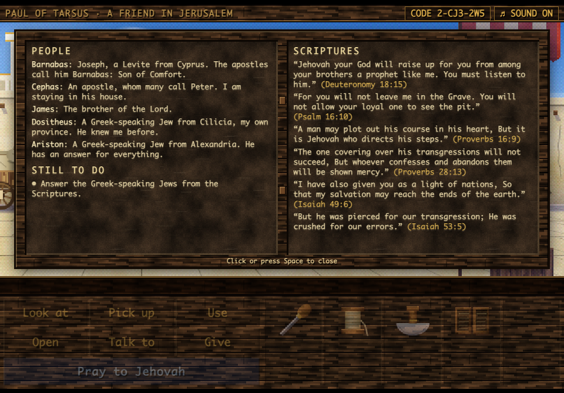
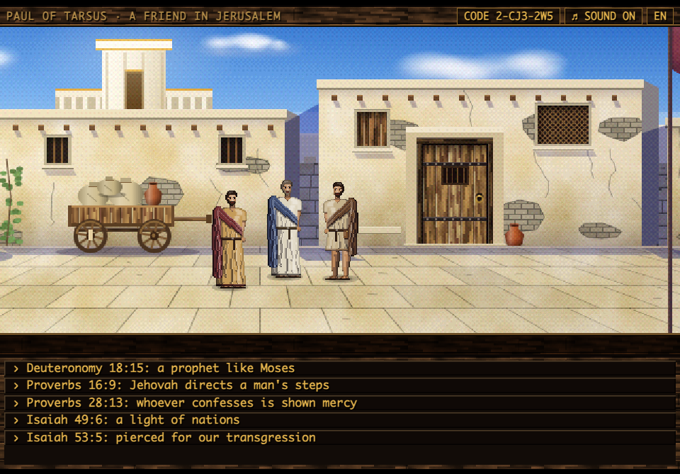
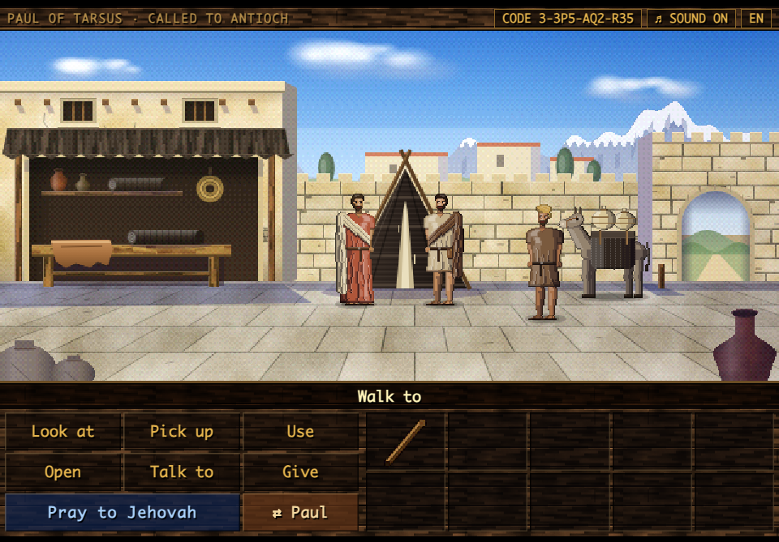
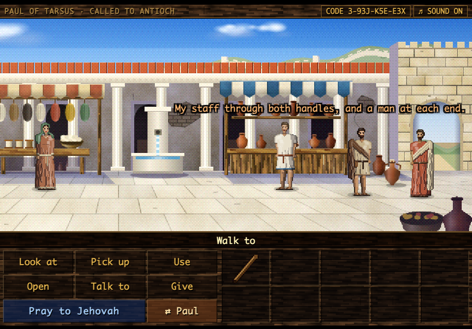
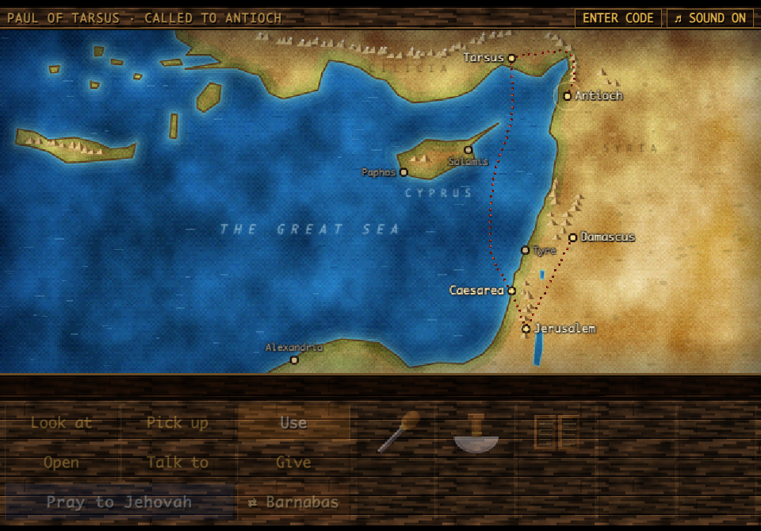
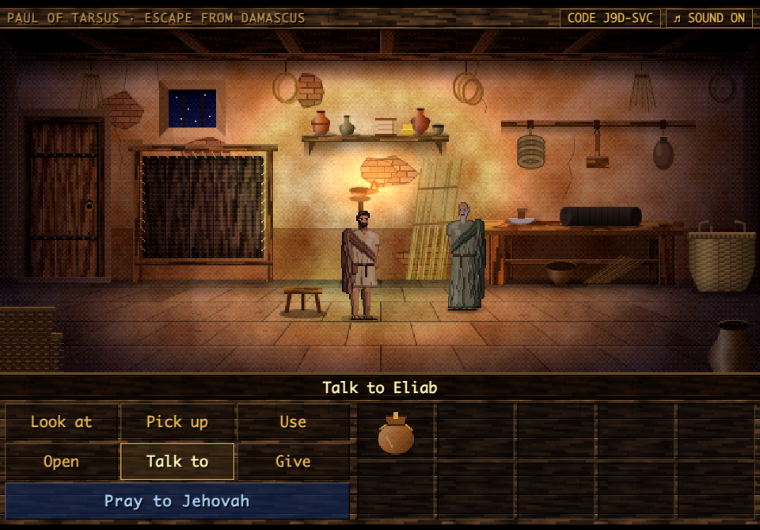
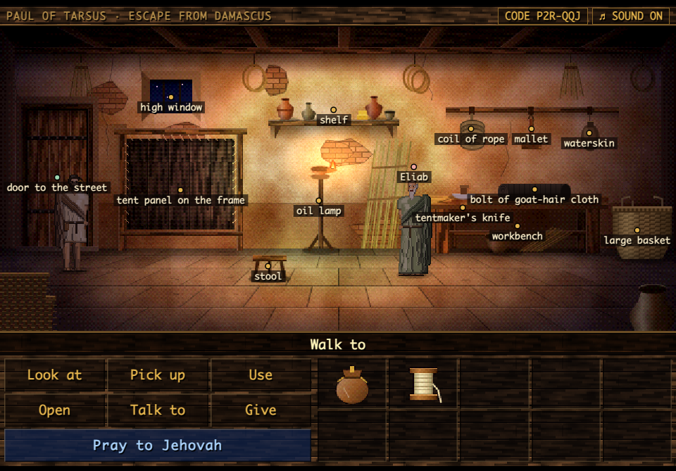
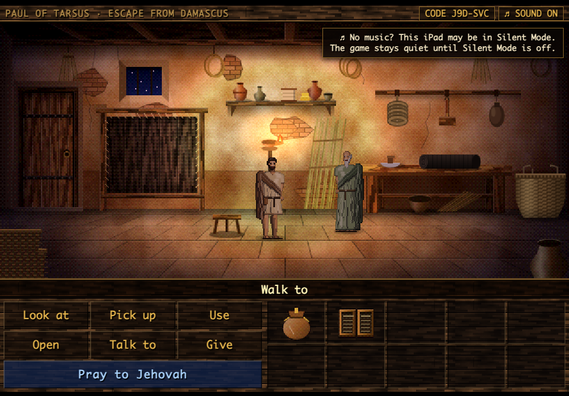
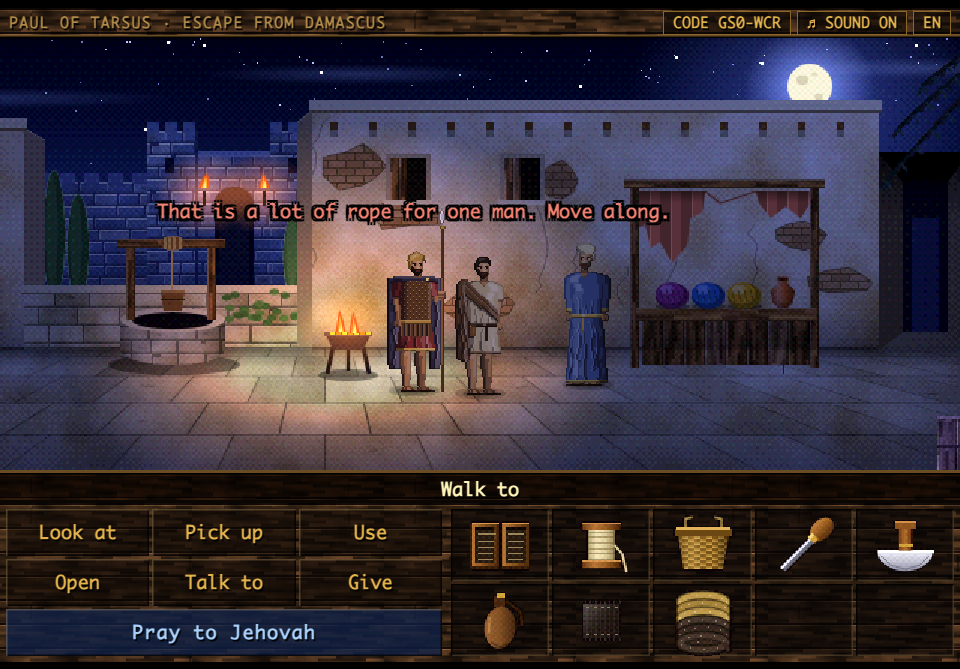
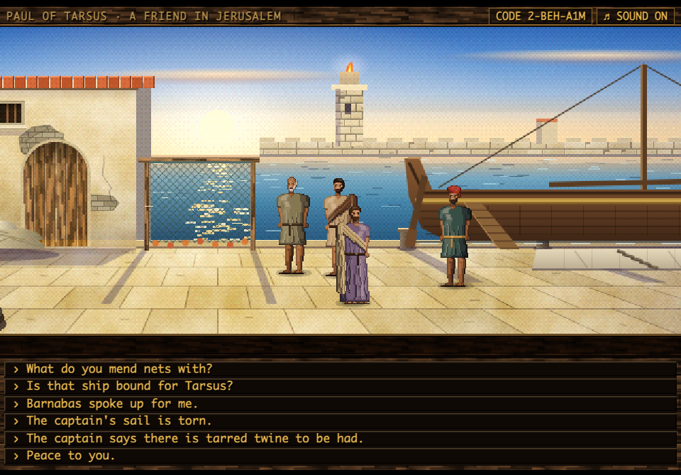

# Paul of Tarsus: The Roman Road Runner

A browser point-and-click adventure in the style of early-1990s verb-and-inventory adventure games. You play Saul of Tarsus, later known as the apostle Paul, a tentmaker who gets out of tight spots with his trade, his brothers and prayer rather than with force.

There are three chapters so far. The game is a small engine in `index.html` plus one level file per chapter in `levels/`, loaded only when that chapter is played. There are no image or audio files: every backdrop, character and icon is painted in code on a canvas, and all music, ambience and sound effects are synthesized with the Web Audio API.


## Play

**Play online: https://marcuscalidus.github.io/paul-of-tarsus/**

Or download this repository and open `index.html` in any current desktop browser (keep the `levels` folder next to it). Pick a chapter on the title screen. Nothing to install or build.

The online version is served by GitHub Pages straight from the root of the `main` branch.

## Chapter One: Escape from Damascus

Damascus, about 36 C.E. Opposers have plotted to do away with Saul, and the governor under King Aretas has the city gates watched day and night. The brothers have a plan: lower him by night in a basket from a window in the city wall (Acts 9:23-25; 2 Corinthians 11:32, 33). The basket is frayed, the rope is too short, and a soldier is watching the alley to the wall.

| | |
|---|---|
|  |  |
| Eliab's workshop: gather what a tentmaker needs | The street: a soldier of the governor bars the alley |
|  |  |
| Naomi's room on the wall: no light may show | By night, through an opening in the wall |

Three connected locations, five characters to talk to, and a puzzle chain built on Paul's trade: cutting and braiding goat-hair cloth, splicing rope, mending an awning, reinforcing a basket.

<details>
<summary>Walkthrough (spoilers)</summary>

1. Open the tool pouch. Pick up the thread, knife, cloth, rope and basket in the workshop.
2. Use the knife with the cloth, then the cloth strips with the rope.
3. In the street, talk to the merchant. Use the awl on his torn awning; he gives you leather straps and hangs the awning.
4. Use the straps with the basket.
5. Walk into the alley behind the awning.
6. In Naomi's room: use the lamp, open the shutters, use the long rope with the roof beam, use the basket with the window.

Optional: fill the waterskin at the well and give the guard a drink.
</details>

## Chapter Two: A Friend in Jerusalem

Three years after his conversion, Saul returns to Jerusalem and tries to join the disciples, but they are all afraid of him and do not believe he is a disciple. Then Barnabas comes to his aid (Acts 9:26-31; 22:17-21; Galatians 1:18, 19). Later, when a plot forces him to leave, the brothers bring him down to Caesarea, where the only ship bound for Tarsus has a torn sail.

| | |
|---|---|
|  |  |
| Jerusalem: a stranger's broken cart, and a closed door | Caesarea: a ship that cannot sail, and a tentmaker who must |

Three more locations and eight new characters. This chapter turns on honesty as much as handiwork: Paul has to give Barnabas a plain account of himself, and the answers that excuse or recommend him get nowhere. Later, speaking boldly in Jerusalem, he disputes with two Greek-speaking Jews and answers them from the passages on his wax tablets; the last objection is about his own part in Stephen's death, and the answer to it is a confession (Acts 9:28, 29; 22:20).

| | |
|---|---|
|  |  |
| The wax tablets: people met, what is still to do, and Scripture | Every answer is a passage from the tablets |

<details>
<summary>Walkthrough (spoilers)</summary>

1. Knock at the door of the house. Talk to the man with the handcart.
2. Pick up the pruned branch under the olive tree and use the knife on it.
3. Use the loose wheel, then use the peg with the handcart.
4. Answer Barnabas honestly: admit the persecution, tell what happened on the road to Damascus, and what happened in Damascus afterwards.
5. Knock at the door again. In the upper room, leave by the door to the city when you are ready.
6. In the street, talk to Dositheus. Answer each objection with a passage from your wax tablets: Isaiah 53:5 for the stake, Psalm 16:10 for the tomb, and Proverbs 28:13 when they ask about Stephen.
7. At the harbor, talk to the captain and use the halyard.
8. Use the knife on the heap of old sailcloth. Give the provisions to the fisherman.
9. Use the awl on the torn sail.
</details>

## Chapter Three: Called to Antioch

Tarsus, about 45 C.E. A great number of Greek-speaking people in Antioch of Syria have become believers, and Barnabas comes to Tarsus to make a thorough search for Saul. For a whole year the two of them teach in the congregation there, where the disciples are first called Christians by divine providence. Then the prophet Agabus foretells a great famine, and the disciples determine to send relief to the brothers in Judea, each according to what he can afford, by the hand of Barnabas and Saul (Acts 11:19-30; 12:25).

| | |
|---|---|
|  |  |
| Tarsus: Barnabas finds his man, who has a promise to keep first | Antioch: the gifts are in, with weeks of road ahead of them |

Three more locations and five new characters, with Barnabas back at Paul's side, and this time you can play him too. Paul finishes a promised tent before he will leave Tarsus, sews pack bags for the relief, and sees the gift counted and sealed before the brothers. Some work takes both men: Barnabas holds the far edge of the tent while Paul sews, and Theron's jar of oil is a load for two men and a bar, like the grapes of Eshcol (Numbers 13:23). The puzzle about people is a spinner who stays away because she thinks she has nothing to give: pressure and pity both fail with her.

| | |
|---|---|
|  |  |
| Barnabas holds the far edge; his own inventory holds his staff | Both men at Theron's stall, Barnabas's staff through the handles |

<details>
<summary>Walkthrough (spoilers)</summary>

1. In Tarsus, switch to Barnabas (the **⇄ Barnabas** button beside the prayer, or `C`) and use the tent: he holds the far edge. Switch back to Paul and use the awl on the tent.
2. Use the knife on the leather hide, then the leather loops on the tent.
3. Pick up the finished tent and give it to Kleon. Leave by the east gate.
4. In the courtyard at Antioch, use the knife with the goat-hair cloth.
5. Go out to the street and talk to Xanthe. Tell her that each gives what he can afford, ask what is in her hands, and tell her that the gift has no bags and you have no thread.
6. Use the awl with the cloth panels.
7. Switch to Barnabas, who is still in the courtyard, and walk him out to the street. Use his staff on Theron's oil jar: the two men carry it to the courtyard.
8. As Paul, give your savings to Lucius, and ask for the purse to be counted before the brothers and sealed.
9. Use the pack bags with the donkey.
</details>

## Look and sound

The backdrops are painted in the manner of early-1990s VGA adventure games: perspective floors, textured plaster and stone, warm light against cool shadow, a foreground layer that slides past the scene as it scrolls, and a final ordered dither. Rooms are painted at twice the classic 320-pixel resolution. Night scenes and interiors are painted in daylight colors and then multiplied by a light map, so a lamp, a brazier or the moon through a window really lights the room; the same light falls on the characters as they walk through it.

The characters are sprites in the manner of the same era: placed pixel by pixel in a three-quarter view, shaded in flat bands of tone with dark edges on the shadow side instead of an outline. Faces, beards and head coverings are small hand-drawn pixel maps; one figure serves the whole cast through its palette and dress.


Each chapter ends on a travel map of the eastern Mediterranean, painted the same way: coasts, shallows and mountain ranges, cities as dots, and no grid lines. The road travelled so far is shown, and the chapter's own leg draws itself as a dotted line from city to city, to a short sting on frame drum, harp and ney: Damascus to Jerusalem; Jerusalem to Caesarea and by sea to Tarsus; Tarsus to Antioch, where Paul's missionary journeys would begin. The routes never cross. Where the Scriptures do not say which way he went, the line takes a plausible one: by sea east of Cyprus, and by road round the Gulf of Issus.



Each chapter has its own score, and each room its own sounds:

| Chapter | Music | Around you |
|---|---|---|
| Escape from Damascus | Oud, frame drum and ney in D Hijaz; in the watched street only a drone and a heartbeat remain | Crickets, an owl, the soldier's brazier, night wind at the open window |
| A Friend in Jerusalem | Lyre and ney in A Dorian; at the harbor a harp rocks in threes like the swell | Birds and a distant market, then waves, gulls and creaking timbers |
| Called to Antioch | A quick lyre figure, walking bass and reed pipe in G Mixolydian, with claps in the busy street | A tentmakers' row, vine leaves in the courtyard, the fountain and the crowd |

## How to play

| Action | How |
|---|---|
| Do the obvious thing | Point at something: its usual verb lights up in the panel and shows on the status line (**Open** a door, **Talk to** a person, **Pick up** what can be taken, **Look at** anything else). Click to do it. |
| Use a verb | Click **Look at**, **Pick up**, **Use**, **Open**, **Talk to** or **Give**, then the target |
| Look at something | Right-click it, in the scene or in the inventory. Paul looks from where he stands. |
| Leave a room at once | Double-click an exit to skip the walk to it |
| Show what can be clicked | Hold `Tab`: everything in the room gets a dot and its name |
| Combine things | **Use**, then an inventory item, then another item or something in the scene |
| Play the other man | In Chapter Three, click **⇄ Barnabas** (or **⇄ Paul**) beside the prayer button, or press `C`. Each man has his own inventory and can stand in a different room; the view follows the one you play. **Give** an item to the other when they share a room to hand it over (**Use** on him only shows it). |
| Read Paul's notes | Click the **wax tablets** in the inventory (their default verb is **Open**): the people he has met, what is still to be done, and the Scriptures for the chapter. Click or press Space to close them. |
| Show something to someone | **Give** (or **Use**) an item on a person. Everyone has something to say about everything Paul carries, sometimes a clue. Only what someone actually needs changes hands. |
| Ask about what you have learned | Once Paul learns something (a frayed basket, a torn sail, a famine), it appears as a new question when he talks to people in that chapter |
| Skip a line of dialogue | Click the scene or press Space |
| Keyboard | `1`-`6` verbs, `P` pray, `M` mute, `Tab` names, `C` switch character |
| Sound | It starts with your first click, tap or key. **♫ SOUND ON** (or `M`) switches it off and on. On iPhone and iPad the game respects Silent Mode, and Safari cannot tell the game whether it is on, so a short note at the top right says where to look when the sound starts and whenever you switch it on. |







| | |
|---|---|
|  |  |
| Showing the long rope to the guard | The fisherman can be asked about Barnabas, the sail and the twine |

### Pray to Jehovah

The blue button is the hint system. Paul pauses, bows his head and prays for wisdom and a calm heart (James 1:5; Proverbs 3:5, 6). Prayer never solves a puzzle or changes the game. It clears his mind, and he then has a thought that points toward the next practical step. Praying again at the same point gives a more direct thought.


### Safe-point codes

The top bar always shows a short code for exactly where you are: six characters in Chapter One, and the same with a leading `2-` in Chapter Two. Chapter Three codes are nine characters (`3-XXX-XXX-XXX`), because they also remember which man you are playing, where each of them stands and who carries what; six-character Chapter Three codes from before still work. Write it down, and enter it later with **ENTER CODE** on the title screen (or the code button during play) to return to the same room with the same inventory and progress. Any moment outside a cutscene is a safe point.


## About the content

The game follows the scriptural understanding of Jehovah's Witnesses and the wording of the New World Translation of the Holy Scriptures (Study Edition). Historical details are checked against jw.org and wol.jw.org. Paul is shown as a courageous, observant minister who relies on practical wisdom, cooperation with fellow believers and trust in Jehovah. There are no halos, crosses or mystical effects, and no puzzle is solved by a miracle or by violence.

The events themselves are from the Scriptures. All dialogue is imaginative dramatization, including the words given to Barnabas, Cephas, James, Agabus and Lucius, and so are the supporting characters: Eliab, Naomi, Jesse, the merchant Zakkai and the guard in Chapter One; Mattan, the captain, the fisherman, the doorkeeper and the two Greek-speaking Jews Dositheus and Ariston in Chapter Two; Kleon, Xanthe and Theron in Chapter Three. The Scriptures say nothing of how the relief was packed or counted: those details are invented as well.

This is an independent, non-commercial fan project. It is not produced, endorsed or reviewed by Jehovah's Witnesses or the Watch Tower Bible and Tract Society.

## Development

```
index.html            the engine: layout, paint toolkit, figures, audio sequencer, verbs, inventory, safe-point codes, level loader
levels/chapter1.js    Escape from Damascus
levels/chapter2.js    A Friend in Jerusalem
levels/chapter3.js    Called to Antioch
shared/tablets.js     Paul's wax tablets, used by every chapter
shared/map.js         the travel map: the journeys between chapters, and travel for a hub chapter
tools/                headless playtest
```

A level file holds everything that belongs to one chapter and nothing else does: its music and ambience, its artwork, its cast and items, its rooms with their hotspots and dialog, its cutscenes and its prayer hints. `index.html` keeps only a three-line manifest (`CHAP`: name, file, code salt), and fetches a level with a script tag the first time it is needed, so the game still runs when opened straight from disk. To add a chapter, write `levels/chapter4.js` and add its line to the manifest.

Inside a level file:

- **Music and ambience** are plain data. A score names a tempo, a tonic, a mode and a list of tracks (drone, drum pattern, step-sequenced instrument, melody); each track lists the moods it plays in, and each room names its mood (`calm`, `tense`, `hope`) and the sounds around it, for example `amb:{waves:.8,gulls:.6}`. The instruments, drums and ambience voices themselves live in the engine.
- **Sound starts** with the first press anywhere: browsers only allow it inside a click, tap or key press. Any later press wakes it again if the browser held it back or iOS interrupted it (after switching apps or locking the screen). The audio session is `ambient`, so iPhones and iPads keep the game quiet in Silent Mode; on those devices a note (`hush()`) says so, because Safari does not tell a page whether Silent Mode is on.
- **Artwork** is a painter per room: `paint` draws the backdrop once, `fore` an optional foreground layer, `draw` whatever changes with the story (items that can be taken, a sail going up), and `light` says how the room lights the people in it. The painters use the engine's toolkit: `plaster`, `ashlar`, `pave`, `wood`, `vessel`, `foliage`, `lightmap`, `shade` and so on.
- **Rooms and dialog** are tables of hotspots with their lines, and short async scripts for the puzzles and cutscenes. A hotspot's default verb (what a plain click does) is worked out by the engine: a door is opened, another exit is walked to, a person is talked to, something picked up with `take(...)` is picked up, and anything else is looked at. A hotspot can name its own with `def:'use'`, or with a getter when it changes with the story.
- **People** are hotspots with an `actor`. Besides `look` and `talk`, a person has a `give` script for the items that really matter to him (it returns `false` for the rest), a `show` table with his reply to every other item, keyed by item id, and a fallback `show['*']`, all in his own voice. Replies can be a line, a list of lines or a script. Using an item on a person is the same as giving it.
- **Wax tablets** are data too: `TABLETS` holds the chapter's `people` (name and note), `tasks` and `scripture` (reference and exact text), each with an optional condition `if` on the story, and the chapter definition passes it on as `tablets`. The overlay that shows them is `shared/tablets.js`, which the engine loads with `need('tablets')` the first time the tablets are opened. Anything else shared between chapters goes under `shared/` the same way.
- **A party** of playable characters is declared in the chapter definition: `party:['paul','barnabas']`. `P` is always Paul and the scripts use him by name; `PC()` is whoever is being played, and `playAs(P)` hands control back before a cutscene. Each member has his own inventory: `home` says who usually carries an item (`{staff:'barnabas'}`), and `share` lists the items that can change hands. Another member does only what the level writes for him, in `as:{barnabas:{look, use, useWith, give, talk, show}}` on a hotspot or a person; otherwise he answers from his own `def` table, leaves the crafts to Paul (`noCraft`), and describes items in his own words (`ITEMS[id].by.barnabas`).
- **Topics** are what Paul learns in a chapter: `TOPICS` lists them, each with its question and a condition on the flags, for example `{id:'sail',q:"The captain's sail is torn.",if:()=>F.metCapt}`. A person's `ask` table holds his answer to each topic he can be asked about. `talkTree` adds the topics that are open to its own questions, each asked once.

**The travel map.** `shared/map.js` holds the geography: `PLACES` (each city's longitude and latitude, and the side its name goes on), the coasts, islands, lakes and ranges, and `VIA`, waypoints for legs that should not run straight. A chapter declares the way out of it as `route:[['jerusalem','caesarea','new'],['caesarea','tarsus','new sea']]`, with the earlier legs first and `new` on the ones to draw now, and calls `await journey()` in its ending. Check a new leg against the others: the playtest fails if two routes cross.

**A hub chapter** (not written yet; Chapter Four could be one) is a chapter whose rooms are places on the map that the player travels between by clicking. It declares them in its definition, by their ids in `shared/map.js`, each with the room it leads to and where Paul stands on arrival:

```js
rooms:['jerusalem','temple','caesarea','harbor','antioch','court'],
places:{jerusalem:{room:'jerusalem',x:40,y:120,dir:1},caesarea:{room:'harbor',x:40,y:122,dir:1},antioch:{room:'court',x:146,y:128,dir:-1}},
```

and gives the exits that lead out of town `exit:travel`. `travel()` opens the map with those places as dots; hovering lights a name, a click draws the way there and enters that room, and Esc or a right-click stays. A place that is not in `PLACES` yet is added there with its coordinates. A hub chapter will have more than three rooms, so it gets wide codes automatically; if it may grow, it reserves room with `codeBits` from the start.

**Safe-point codes.** A chapter whose state fits in 19 flags and three rooms, with Paul alone, gets the original six-character codes. Any other chapter (a party, more flags, more rooms) gets wide codes of 9, 12 or more characters, always a multiple of three, so the decoder tells the two apart by length. A wide code packs, from the lowest bit: the flags, each member's room, the member being played, and for each item in `share` the member who carries it; then it is masked and checked with 9 bits salted by the chapter, like the short codes. Every field has a fixed width, so a chapter can grow without breaking its codes: room for 19 flags and two bits per room (four rooms), unless the chapter needs more or reserves more with `codeBits:{flags, rooms, share}`. Never reorder a chapter's `flags`, `rooms` or `share`; only append, within those widths.

Edit a file and reload.

`tools/playtest.mjs` plays all three chapters through the real interface in headless Chrome and checks each puzzle step, the save codes and the endings. It needs Node 22 or newer and Google Chrome. Each run asks Chrome for a free debugging port, so several runs can go side by side.

```bash
node tools/playtest.mjs
```

Pass stop names to save screenshots to `tools/out/` instead, for example `node tools/playtest.mjs title workshop harbor`. The stop names are defined in `tools/playtest-harness.html`; Chapter Three stops such as `tarsus`, `court` and `antioch` start that chapter directly.

## Contributing

Read [CONTRIBUTING.md](CONTRIBUTING.md) before changing the game. It holds the rules every change must follow: Bible wording from the New World Translation (Study Edition), historical details checked against jw.org and wol.jw.org, no violence, deceit or miracle shortcuts, no crosses, and the art, audio, code and save-code rules. The same rules apply in a fork. AI coding assistants find them through [AGENTS.md](AGENTS.md) and [CLAUDE.md](CLAUDE.md).

## Credits

Design, code, art and music by Marco Warm, built with Claude.

## License

Copyright © 2026 Marco Warm. Released under the [MIT License](LICENSE).
