# Paul of Tarsus: The Roman Road Runner

A browser point-and-click adventure in the style of early-1990s verb-and-inventory adventure games. You play Saul of Tarsus, later known as the apostle Paul, a tentmaker who gets out of tight spots with his trade, his brothers and prayer rather than with force.

There are three chapters so far. The game is a small engine in `index.html` plus one level file per chapter in `levels/`, loaded only when that chapter is played. There are no image or audio files: every backdrop, character and icon is painted in code on a canvas, and all music, ambience and sound effects are synthesized with the Web Audio API.

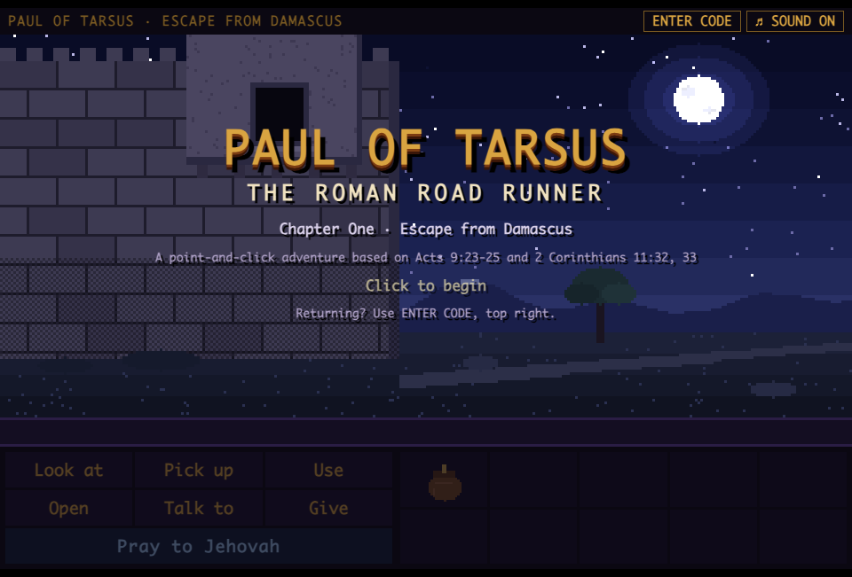

## Play

**Play online: https://marcuscalidus.github.io/paul-of-tarsus/**

Or download this repository and open `index.html` in any current desktop browser (keep the `levels` folder next to it). Pick a chapter on the title screen. Nothing to install or build.

The online version is served by GitHub Pages straight from the root of the `main` branch.

## Chapter One: Escape from Damascus

Damascus, about 36 C.E. Opposers have plotted to do away with Saul, and the governor under King Aretas has the city gates watched day and night. The brothers have a plan: lower him by night in a basket from a window in the city wall (Acts 9:23-25; 2 Corinthians 11:32, 33). The basket is frayed, the rope is too short, and a soldier is watching the alley to the wall.

| | |
|---|---|
| 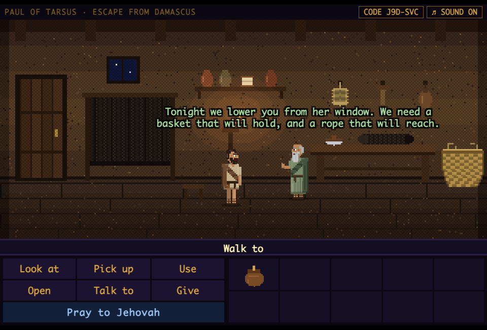 | 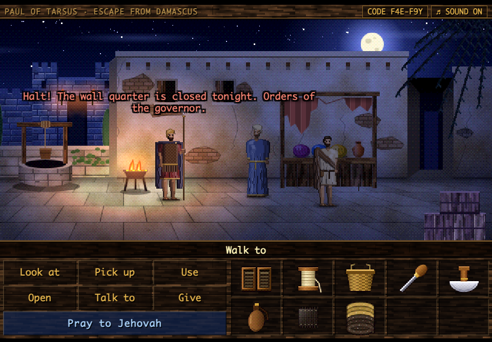 |
| Eliab's workshop: gather what a tentmaker needs | The street: a soldier of the ethnarch bars the alley |
| 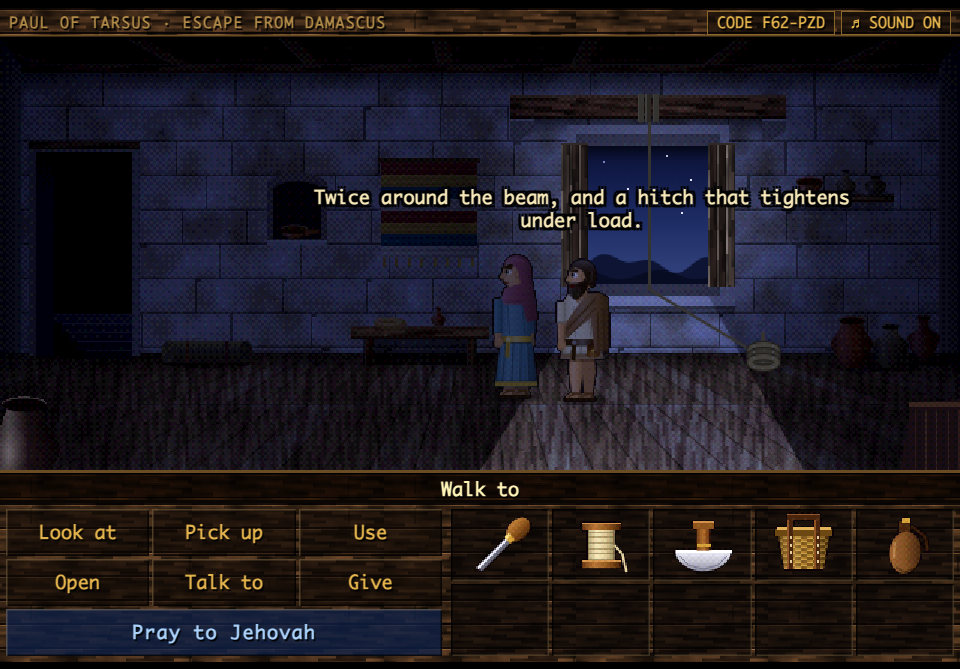 | 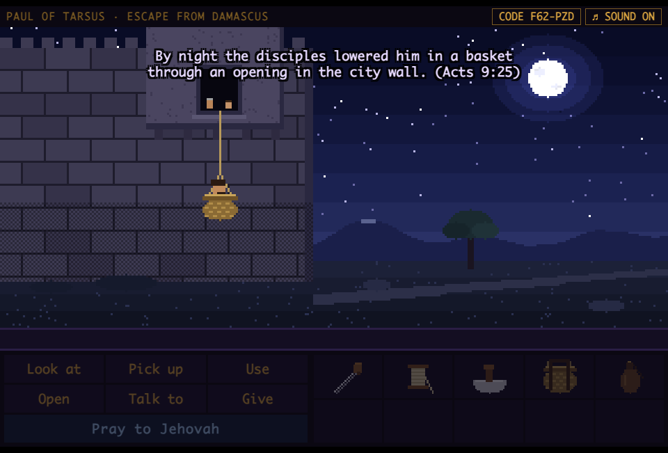 |
| Naomi's room on the wall: no light may show | By night, through an opening in the wall |

Three connected locations, five characters to talk to, and a puzzle chain built on Paul's trade: cutting and braiding goat-hair cloth, splicing rope, mending an awning, reinforcing a basket.

<details>
<summary>Walkthrough (spoilers)</summary>

1. Open the tool pouch. Pick up the thread, knife, cloth, rope and basket in the workshop.
2. Use the knife with the cloth, then the cloth strips with the rope.
3. In the street, talk to the merchant. Use the awl on his torn awning; he gives you leather straps and hangs the awning.
4. Use the straps with the basket.
5. Walk into the alley behind the awning.
6. In Naomi's room: use the lamp, open the shutters, use the long rope with the roof beam, use the basket with the window.

Optional: fill the waterskin at the well and give the guard a drink.
</details>

## Chapter Two: A Friend in Jerusalem

Three years after his conversion, Saul returns to Jerusalem and tries to join the disciples, but they are all afraid of him and do not believe he is a disciple. Then Barnabas comes to his aid (Acts 9:26-31; 22:17-21; Galatians 1:18, 19). Later, when a plot forces him to leave, the brothers bring him down to Caesarea, where the only ship bound for Tarsus has a torn sail.

| | |
|---|---|
| 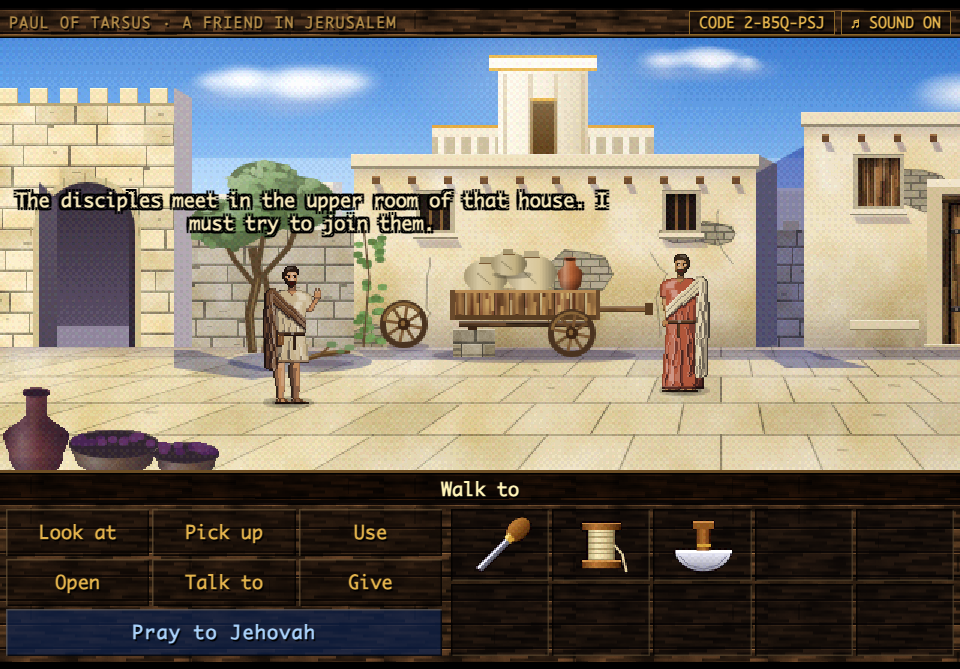 | 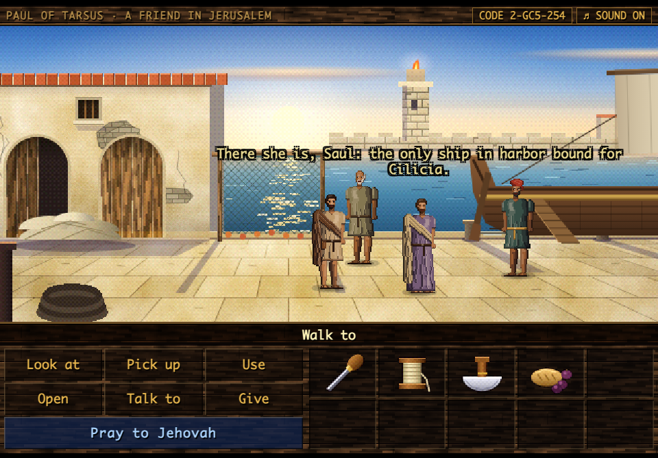 |
| Jerusalem: a stranger's broken cart, and a closed door | Caesarea: a ship that cannot sail, and a tentmaker who must |

Three more locations and six new characters. This chapter turns on honesty as much as handiwork: Paul has to give Barnabas a plain account of himself, and the answers that excuse or recommend him get nowhere.

<details>
<summary>Walkthrough (spoilers)</summary>

1. Knock at the door of the house. Talk to the man with the handcart.
2. Pick up the pruned branch under the olive tree and use the knife on it.
3. Use the loose wheel, then use the peg with the handcart.
4. Answer Barnabas honestly: admit the persecution, tell what happened on the road to Damascus, and what happened in Damascus afterwards.
5. Knock at the door again. In the upper room, leave by the door to the city when you are ready.
6. At the harbor, talk to the captain and use the halyard.
7. Use the knife on the heap of old sailcloth. Give the provisions to the fisherman.
8. Use the awl on the torn sail.
</details>

## Chapter Three: Called to Antioch

Tarsus, about 45 C.E. A great number of Greek-speaking people in Antioch of Syria have become believers, and Barnabas comes to Tarsus to make a thorough search for Saul. For a whole year the two of them teach in the congregation there, where the disciples are first called Christians. Then the prophet Agabus foretells a great famine, and the disciples determine to send relief to the brothers in Judea, each according to what he can afford, by the hand of Barnabas and Saul (Acts 11:19-30; 12:25).

| | |
|---|---|
| 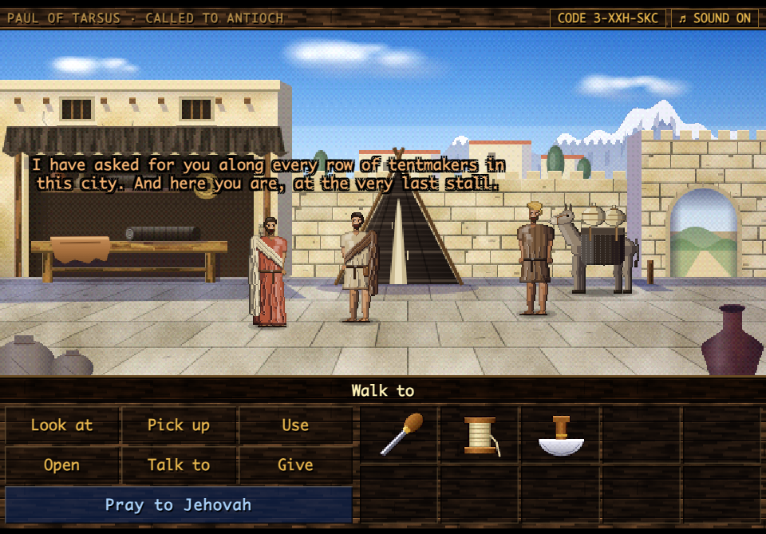 | 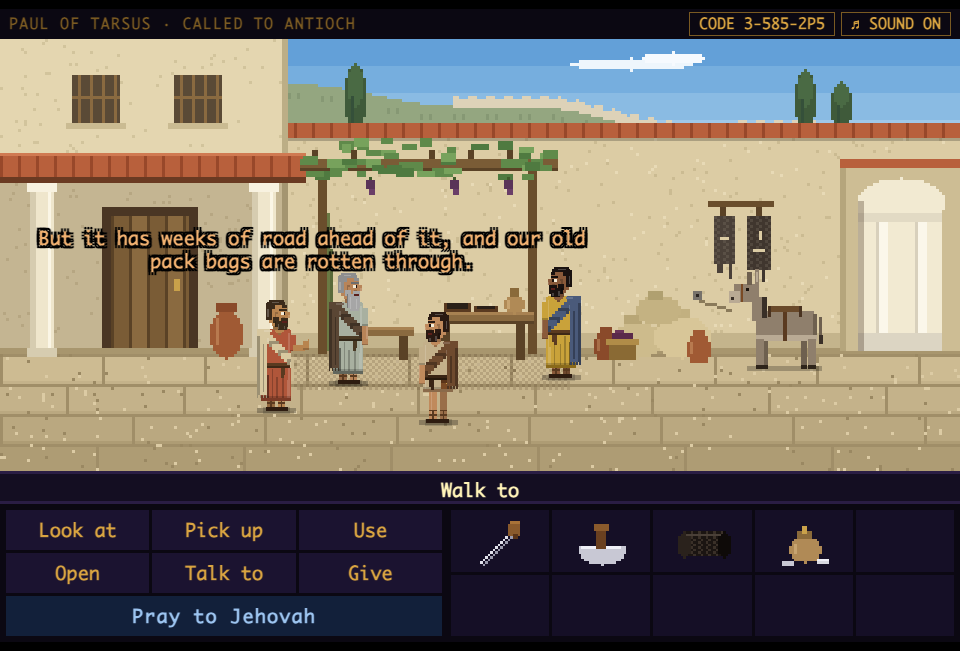 |
| Tarsus: Barnabas finds his man, who has a promise to keep first | Antioch: the gifts are in, with weeks of road ahead of them |

Three more locations and five new characters, with Barnabas back at Paul's side. Paul finishes a promised tent before he will leave Tarsus, sews pack bags for the relief, and sees the gift counted and sealed before the brothers. The puzzle about people is a spinner who stays away because she thinks she has nothing to give: pressure and pity both fail with her.

<details>
<summary>Walkthrough (spoilers)</summary>

1. In Tarsus, use the awl on the tent; Barnabas holds the seam.
2. Use the knife on the leather hide, then the leather loops on the tent.
3. Pick up the finished tent and give it to Kleon. Leave by the east gate.
4. In the courtyard at Antioch, use the knife with the goat-hair cloth.
5. Go out to the street and talk to Xanthe. Tell her that each gives what he can afford, ask what is in her hands, and tell her that the gift has no bags and you have no thread.
6. Use the awl with the cloth panels.
7. Back in the courtyard, give your savings to Lucius, and ask for the purse to be counted before the brothers and sealed.
8. Use the pack bags with the donkey.
</details>

## Look and sound

The backdrops are painted in the manner of early-1990s VGA adventure games: perspective floors, textured plaster and stone, warm light against cool shadow, a foreground layer that slides past the scene as it scrolls, and a final ordered dither. Rooms are painted at twice the classic 320-pixel resolution. Night scenes and interiors are painted in daylight colors and then multiplied by a light map, so a lamp, a brazier or the moon through a window really lights the room; the same light falls on the characters as they walk through it.

The characters are sprites in the manner of the same era: placed pixel by pixel in a three-quarter view, shaded in flat bands of tone with dark edges on the shadow side instead of an outline. Faces, beards and head coverings are small hand-drawn pixel maps; one figure serves the whole cast through its palette and dress.

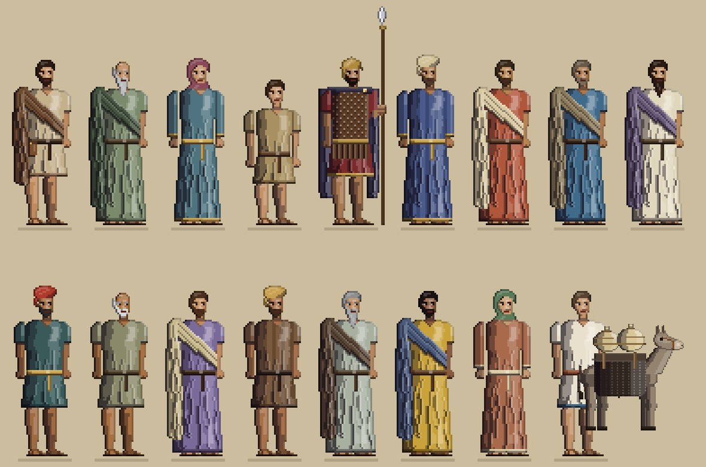

Each chapter has its own score, and each room its own sounds:

| Chapter | Music | Around you |
|---|---|---|
| Escape from Damascus | Oud, frame drum and ney in D Hijaz; in the watched street only a drone and a heartbeat remain | Crickets, an owl, the soldier's brazier, night wind at the open window |
| A Friend in Jerusalem | Lyre and ney in A Dorian; at the harbor a harp rocks in threes like the swell | Birds and a distant market, then waves, gulls and creaking timbers |
| Called to Antioch | A quick lyre figure, walking bass and reed pipe in G Mixolydian, with claps in the busy street | A tentmakers' row, vine leaves in the courtyard, the fountain and the crowd |

## How to play

| Action | How |
|---|---|
| Walk, look, talk, use an exit | Click in the scene |
| Use a verb | Click **Look at**, **Pick up**, **Use**, **Open**, **Talk to** or **Give**, then the target |
| Combine things | **Use**, then an inventory item, then another item or something in the scene |
| Skip a line of dialogue | Click the scene or press Space |
| Keyboard | `1`-`6` verbs, `P` pray, `M` mute |

### Pray to Jehovah

The blue button is the hint system. Paul pauses, bows his head and prays for wisdom and a calm heart (James 1:5; Proverbs 3:5, 6). Prayer never solves a puzzle or changes the game. It clears his mind, and he then has a thought that points toward the next practical step. Praying again at the same point gives a more direct thought.

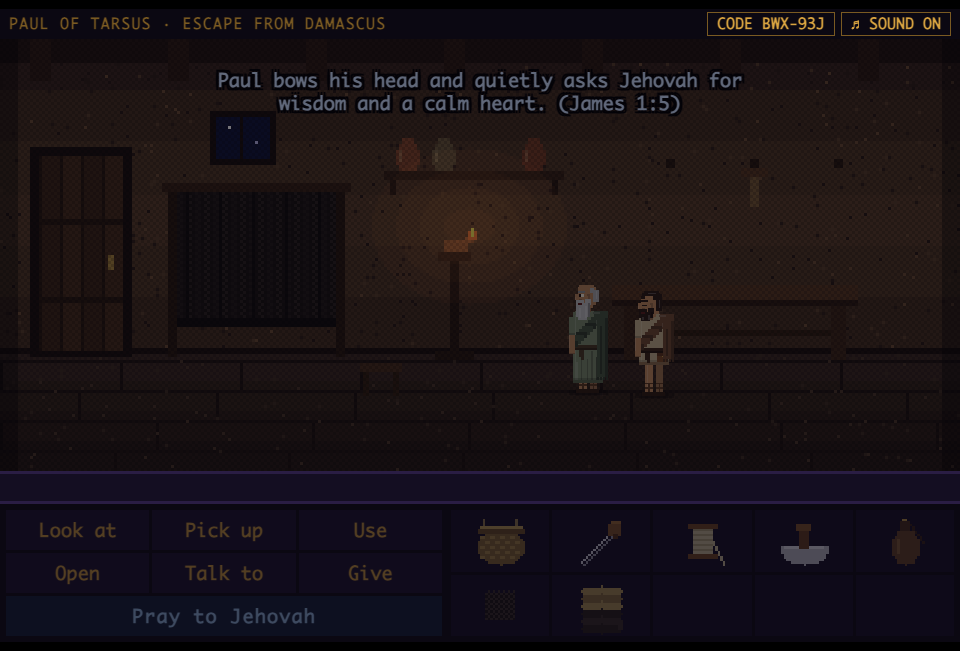

### Safe-point codes

The top bar always shows a short code for exactly where you are: six characters in Chapter One, and the same with a leading `2-` or `3-` in the later chapters. Write it down, and enter it later with **ENTER CODE** on the title screen (or the code button during play) to return to the same room with the same inventory and progress. Any moment outside a cutscene is a safe point.

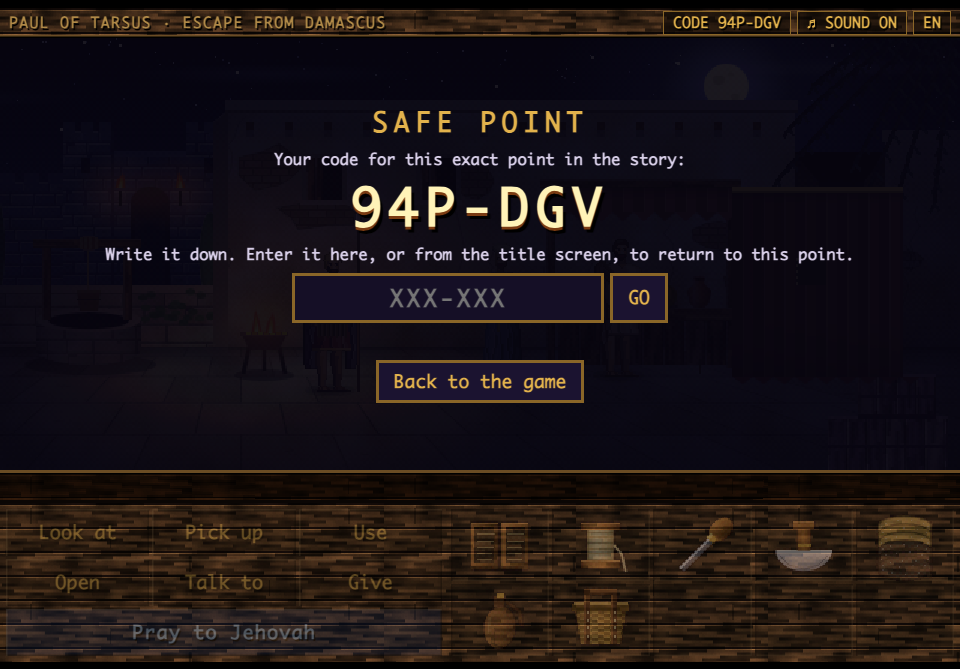

## About the content

The game follows the scriptural understanding of Jehovah's Witnesses and the wording of the New World Translation. Paul is shown as a courageous, observant minister who relies on practical wisdom, cooperation with fellow believers and trust in Jehovah. There are no halos, crosses or mystical effects, and no puzzle is solved by a miracle or by violence.

The events themselves are from the Scriptures. All dialogue is imaginative dramatization, including the words given to Barnabas, Cephas, James, Agabus and Lucius, and so are the supporting characters: Eliab, Naomi, Jesse, the merchant Zakkai and the guard in Chapter One; Mattan, the captain, the fisherman and the doorkeeper in Chapter Two; Kleon, Xanthe and Theron in Chapter Three. The Scriptures say nothing of how the relief was packed or counted: those details are invented as well.

This is an independent, non-commercial fan project. It is not produced, endorsed or reviewed by Jehovah's Witnesses or the Watch Tower Bible and Tract Society.

## Development

```
index.html            the engine: layout, paint toolkit, figures, audio sequencer, verbs, inventory, safe-point codes, level loader
levels/chapter1.js    Escape from Damascus
levels/chapter2.js    A Friend in Jerusalem
levels/chapter3.js    Called to Antioch
tools/                headless playtest
```

A level file holds everything that belongs to one chapter and nothing else does: its music and ambience, its artwork, its cast and items, its rooms with their hotspots and dialog, its cutscenes and its prayer hints. `index.html` keeps only a three-line manifest (`CHAP`: name, file, code salt), and fetches a level with a script tag the first time it is needed, so the game still runs when opened straight from disk. To add a chapter, write `levels/chapter4.js` and add its line to the manifest.

Inside a level file:

- **Music and ambience** are plain data. A score names a tempo, a tonic, a mode and a list of tracks (drone, drum pattern, step-sequenced instrument, melody); each track lists the moods it plays in, and each room names its mood (`calm`, `tense`, `hope`) and the sounds around it, for example `amb:{waves:.8,gulls:.6}`. The instruments, drums and ambience voices themselves live in the engine.
- **Artwork** is a painter per room: `paint` draws the backdrop once, `fore` an optional foreground layer, `draw` whatever changes with the story (items that can be taken, a sail going up), and `light` says how the room lights the people in it. The painters use the engine's toolkit: `plaster`, `ashlar`, `pave`, `wood`, `vessel`, `foliage`, `lightmap`, `shade` and so on.
- **Rooms and dialog** are tables of hotspots with their lines, and short async scripts for the puzzles and cutscenes.

Edit a file and reload.

`tools/playtest.mjs` plays all three chapters through the real interface in headless Chrome and checks each puzzle step, the save codes and the endings. It needs Node 22 or newer and Google Chrome.

```bash
node tools/playtest.mjs
```

Pass stop names to save screenshots to `tools/out/` instead, for example `node tools/playtest.mjs title workshop harbor`. The stop names are defined in `tools/playtest-harness.html`; Chapter Three stops such as `tarsus`, `court` and `antioch` start that chapter directly.

## Credits

Design, code, art and music by Marco Warm, built with Claude.

## License

Copyright © 2026 Marco Warm. Released under the [MIT License](LICENSE).
