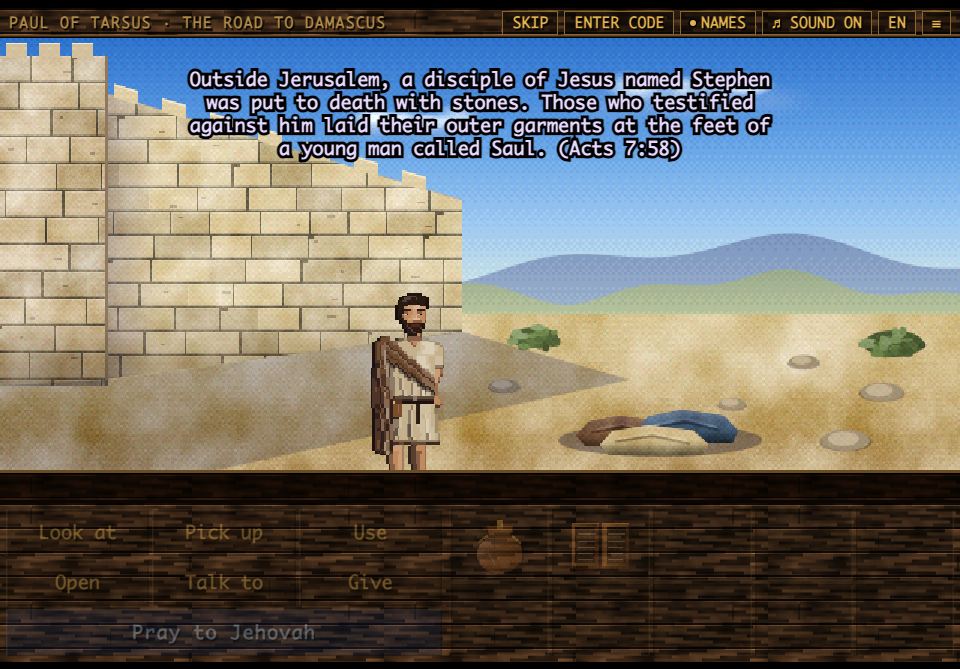
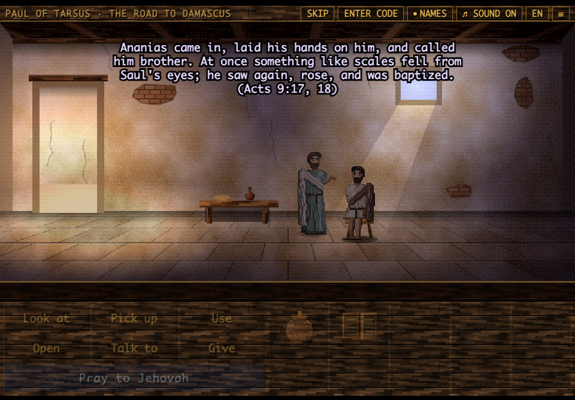

# Chapter One: Escape from Damascus

## Prologue: The Road to Damascus

Before Chapter One begins, an optional narrated prologue (`levels/prologue.js`) tells who Saul of Tarsus was and how he came to be in Damascus as one of the disciples: standing by the outer garments at the stoning of Stephen outside Jerusalem (Acts 7:58; 22:20), ravaging the congregation from house to house (Acts 8:3; 9:1, 2), traveling toward Damascus when a light from heaven flashed around him at midday (Acts 9:3-8; 22:6-11; 26:13), sitting three days without sight in the house of Judas on the street called Straight until Ananias laid hands on him and he was baptized (Acts 9:9-18), and preaching in the synagogues that Jesus is the Christ and the Son of God (Acts 9:19-22). Click **SKIP** in the top bar at any time to go straight to Chapter One.

| | |
|---|---|
|  |  |
| Outside Jerusalem: the witnesses lay their outer garments at Saul's feet | On the street called Straight: Ananias lays his hands on Saul |

## Escape from Damascus

Damascus, about 36 C.E. Opposers have agreed among themselves to kill Saul, and the governor under King Aretas has the city gates watched by day and by night. The brothers have a plan: to let him down at night, in a basket, through a window in the city wall (Acts 9:23-25; 2 Corinthians 11:32, 33). The basket is frayed, the rope is too short, and a soldier is watching the alley to the wall.

| | |
|---|---|
|  |  |
| Eliab's workshop: gather what a tentmaker needs | The street: a soldier of the governor bars the alley |
|  |  |
| Naomi's room on the wall: no light may show | By night, through an opening in the wall |

Three connected locations, five characters to talk to, and a puzzle chain built on Paul's trade: cutting and braiding goat-hair cloth, splicing rope, mending an awning, reinforcing a basket.

Walkthrough (spoilers)

1. Open the tool pouch. Pick up the thread, knife, cloth, rope and basket in the workshop.
2. Use the knife with the cloth, then the cloth strips with the rope.
3. In the street, talk to the merchant. Use the awl on his torn awning; he gives you leather straps and hangs the awning.
4. Use the straps with the basket.
5. Walk into the alley behind the awning.
6. In Naomi's room: use the lamp, open the shutters, use the long rope with the roof beam, use the basket with the window.

Optional: fill the waterskin at the well and give the guard a drink.

## Music and sound

| Chapter | Music | Around you |
|---|---|---|
| Prologue: The Road to Damascus | Ten-bar overture in D Hijaz (two-bar harp fanfare, four-bar theme for ney, aulos with tonic drone pipe, lyre, oud, harp and road percussion, and four-bar high unison climax); low drone and sparse oud outside Jerusalem; silence on the white screen; gentle harp for Ananias | Desert wind and cicadas by day, room ambience in the house of Judas |
| Escape from Damascus | Oud, frame drum and ney in D Hijaz; in the watched street only a drone and a heartbeat remain | Crickets, an owl, the soldier's brazier, night wind at the open window |

## About the content

In the prologue, the words of the voice on the road and the words between the Lord and Ananias are paraphrased from Acts 9:4-6, 10-17 in the game's own wording. Judas, at whose house on the street called Straight Saul lodged (Acts 9:11), is named in the account and is not shown in the room. In Chapter One, the supporting characters are invented dramatization: Eliab, Naomi, Jesse, the merchant Zakkai and the guard.

[← All chapters](../README.md#chapters)
