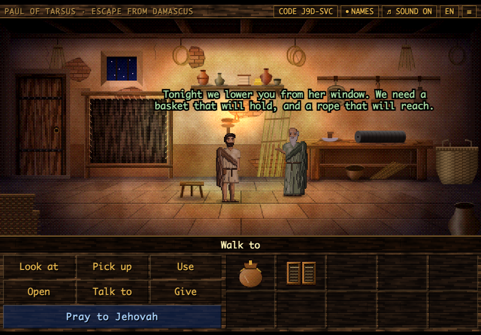
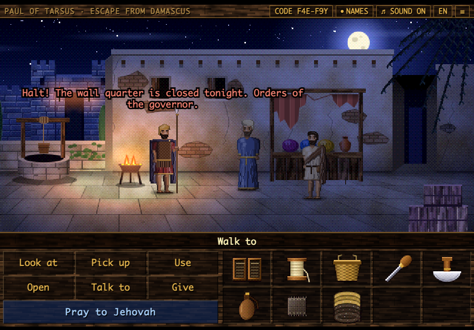
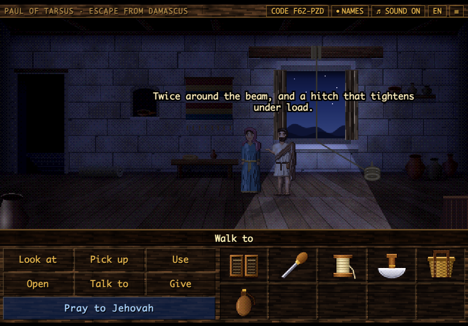
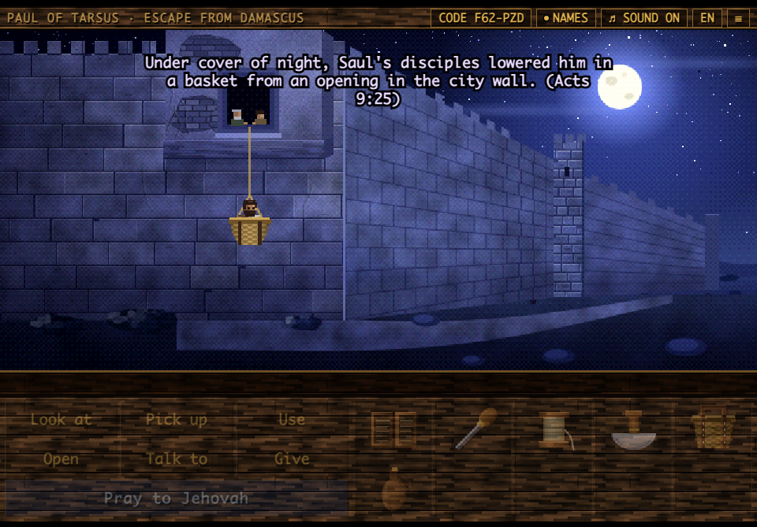

# Chapter One: Escape from Damascus

Damascus, about 36 C.E. Opposers have plotted to do away with Saul, and the governor under King Aretas has the city gates watched day and night. The brothers have a plan: lower him by night in a basket from a window in the city wall (Acts 9:23-25; 2 Corinthians 11:32, 33). The basket is frayed, the rope is too short, and a soldier is watching the alley to the wall.

| | |
|---|---|
|  |  |
| Eliab's workshop: gather what a tentmaker needs | The street: a soldier of the governor bars the alley |
|  |  |
| Naomi's room on the wall: no light may show | By night, through an opening in the wall |

Three connected locations, five characters to talk to, and a puzzle chain built on Paul's trade: cutting and braiding goat-hair cloth, splicing rope, mending an awning, reinforcing a basket.

Walkthrough (spoilers)

1. Open the tool pouch. Pick up the thread, knife, cloth, rope and basket in the workshop.
2. Use the knife with the cloth, then the cloth strips with the rope.
3. In the street, talk to the merchant. Use the awl on his torn awning; he gives you leather straps and hangs the awning.
4. Use the straps with the basket.
5. Walk into the alley behind the awning.
6. In Naomi's room: use the lamp, open the shutters, use the long rope with the roof beam, use the basket with the window.

Optional: fill the waterskin at the well and give the guard a drink.

## Music and sound

| Chapter | Music | Around you |
|---|---|---|
| Escape from Damascus | Oud, frame drum and ney in D Hijaz; in the watched street only a drone and a heartbeat remain | Crickets, an owl, the soldier's brazier, night wind at the open window |

## About the content

The supporting characters are invented dramatization: Eliab, Naomi, Jesse, the merchant Zakkai and the guard.

[← All chapters](../README.md#chapters)
