# Chapter Ten: Is It So?

About 50 C.E. Paul, Silas and Timothy leave Philippi, pass through Amphipolis and Apollonia and come to Thessalonica, where the Jews have a synagogue. Paul goes in, as he always does, and on three Sabbaths he reasons with them from the Scriptures: he explains, and shows from what is written, that the Christ had to suffer and to rise from the dead, and that the Jesus he proclaims is that Christ. Some of the Jews believe and join Paul and Silas, and with them a great many Greeks who worship God and a good number of the leading women. Then the Jews grow jealous. They collect bad men who hang about the marketplace, raise a mob and set the city in an uproar. They storm Jason's house, do not find Paul and Silas, and drag Jason and some of the brothers before the city rulers: the men who have upset the whole world are here now, Jason has taken them in, and all of them defy Caesar's decrees by saying that another is king, Jesus. The rulers take security from Jason and the others and let them go. That night the brothers send Paul and Silas to Beroea. Its Jews are of a nobler mind: they take in the word eagerly and search the Scriptures every day to see whether it is so, and many believe. When the Jews of Thessalonica learn of it, they come and stir up the crowds there too. The brothers send Paul off to the sea at once, and Silas and Timothy stay. Those who go with Paul bring him as far as Athens, and return with word that the two are to follow as quickly as they can (Acts 17:1-15).

| | |
|---|---|
| 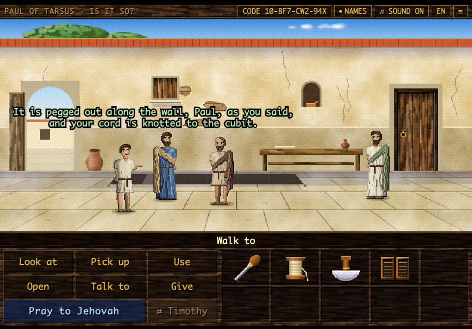 | 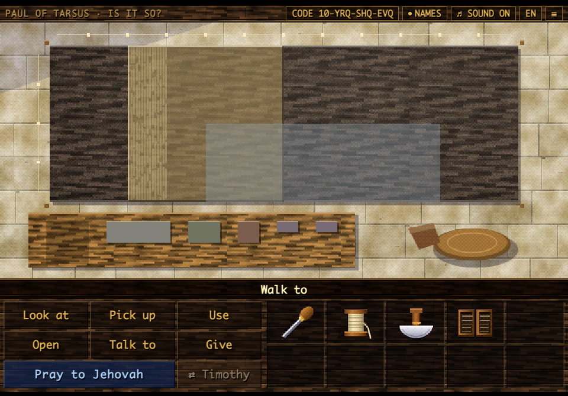 |
| Thessalonica: a roof under Jason's eave, and an order for a tent | The bolt: twelve cubits by four, and one of them woven thin |
| 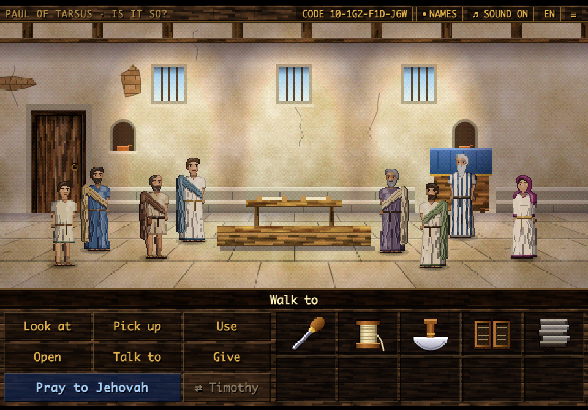 | 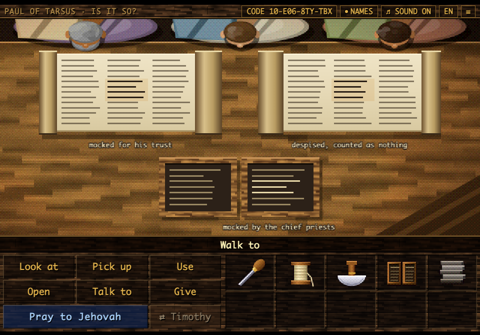 |
| The first Sabbath: the Christ comes to rule, and is the sour wine written? | The scroll table: a psalm, a prophet, and what was done |

Seven more locations, fourteen new characters, a new man to play, and the game's first two close views: pictures in which nobody walks, and whose parts are set by hand. The study note on Acts 17:3 says that the proving was, literally, a placing of one thing beside another, and the note on 17:11 that what the Beroeans did is named with a word for sifting. So in this chapter things are laid side by side: first by Paul, and then by those who listen to him.

Paul worked night and day in Thessalonica, so as to be a burden to none of them (1 Thessalonians 2:9). Here he takes an order for a traveling tent and has one bolt of goat-hair cloth for it, a little too short, with one cubit woven thin. The bolt lies pegged out on the paving and is seen from above, with the six panels of the tent waiting on a board beside it. A panel is taken in hand, turned if need be, and laid on the cloth. Nothing may hang over the edge; a panel may end on the thin strip, where a seam will fold the cloth double, and must not run across it; and what is left over has to be one length, six cubits, for the loops. There is one way to do it, and its mirror image. Only then does the knife come. The seams are night work, and the brothers of Philippi send something for his needs twice while he is at it (Philippians 4:16).

In the synagogue two scrolls lie on the reading table, the Psalms and the Prophets, and in front of them Paul's own tablets with what was handed on to him (1 Corinthians 15:3). A click on a scroll's roller winds it to its next place, or back; a click on the tablets turns them to their next line; and what lies open is named under it. Nothing on the table has a number: chapters and verses were numbered many centuries later, and a place in a scroll is found by winding. Acts 17:3 has three parts, and each Sabbath takes one. A hearer says what he cannot see, and the player sets the table until scroll, scroll and tablets say one thing; then Paul turns to the men before the benches. A setting that does not hold costs nothing. Somebody says what he sees in it, and never which part to change. On the second Sabbath the prophet's scroll stays rolled shut, and beside the psalm lies the last line of the tablets: who saw him afterwards, and last of all the man who is speaking. Who believes, and who grows jealous, is told as the account tells it: no setting of the scrolls wins anyone or loses anyone.

| | |
|---|---|
| 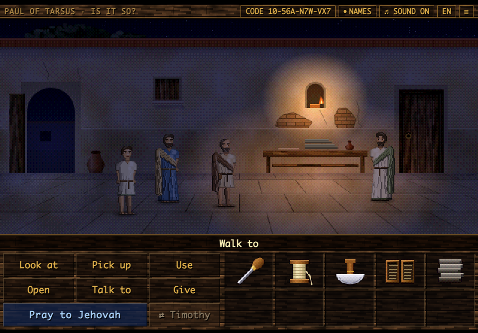 | 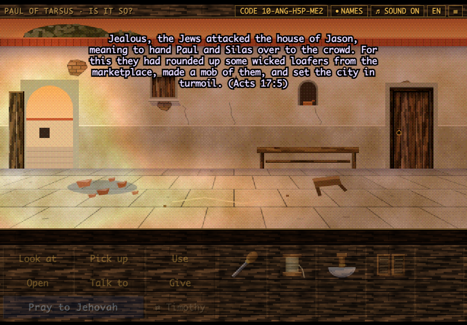 |
| By night at the bench: Philippi sends for the first time | The uproar is told over an empty courtyard |
| 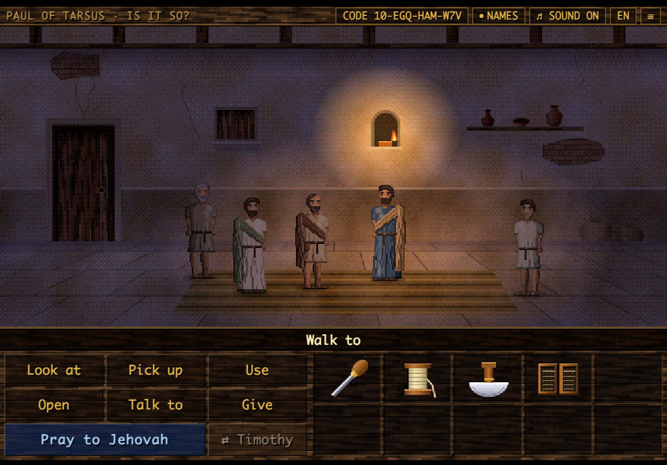 | 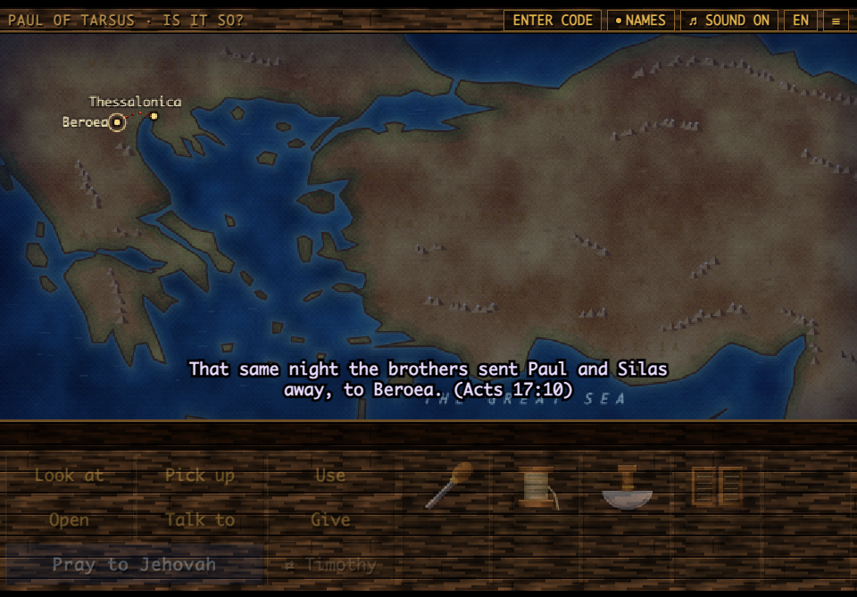 |
| Jason has given security, and it was for them | The same night, to Beroea |

What follows is told over an empty courtyard at dusk: the mob, the house, the city rulers and the security. Paul and Silas are not there, as the account says, and the game does not say where they were. Night finds them in another house. Jason has given security, and every choice that was right in the prison at Philippi is offered again: to stand before the rulers in the morning, to stay and teach behind a shut door, to go back to the bench. Paul sets each aside, because here another man would pay for it, and goes the same night.

In Beroea three scrolls lie on the table: Moses, the Prophets and the Psalms (Luke 24:44). The Beroeans' hands are on the rollers, and each day one of them has set the table before Paul comes in, with what he found the evening before. On the first day Moses and David lie open at the unbroken bones, and the player adds the prophet and the afternoon: the row that John himself lays out (John 19:36, 37). On the second they bring three places of their own finding, and for each the player turns the tablets to the line that belongs beside it. On the third a young man has read on by lamplight and found the words "his anointed one". This time nothing is laid beside the scroll. The line is read to its end, and it names Cyrus (Isaiah 45:1). Paul says so, and "I have nothing to lay beside that" is, for the first time, the right answer.

| | |
|---|---|
| 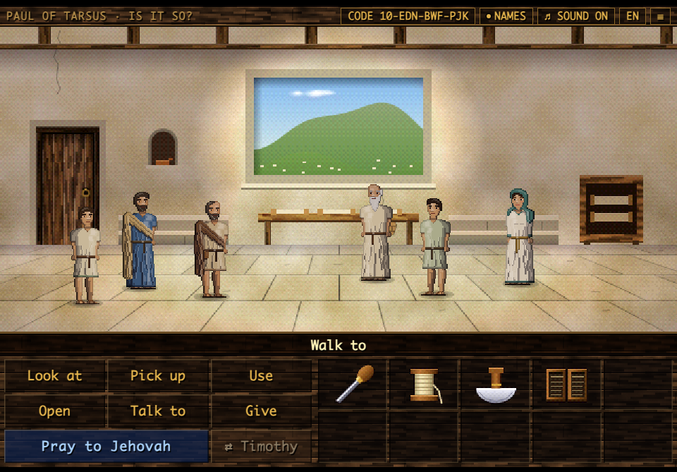 | 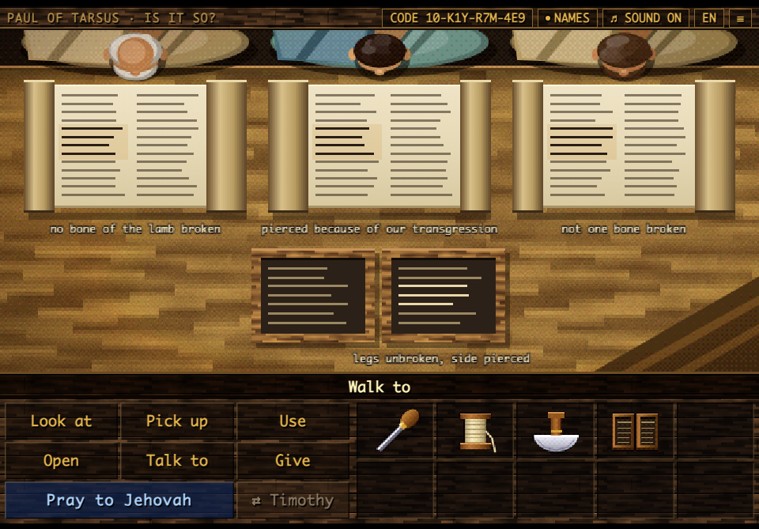 |
| Beroea: they come in every morning, before their work | Moses, the Prophets and the Psalms beside one afternoon |
| 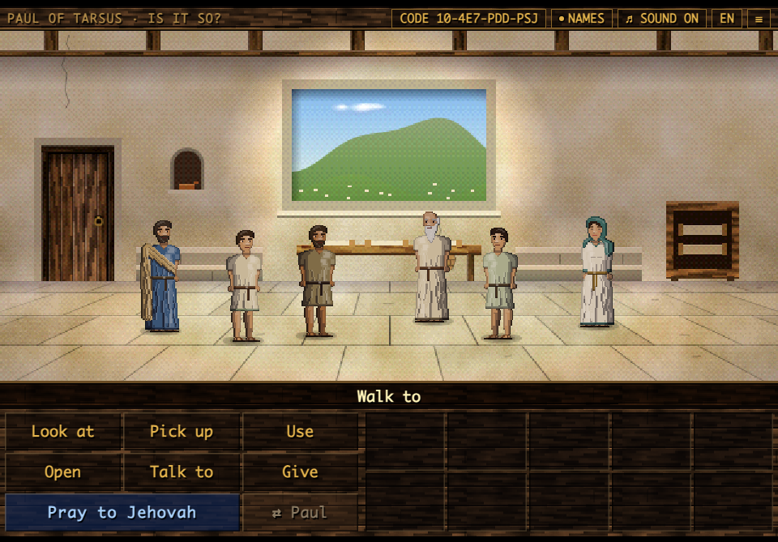 | 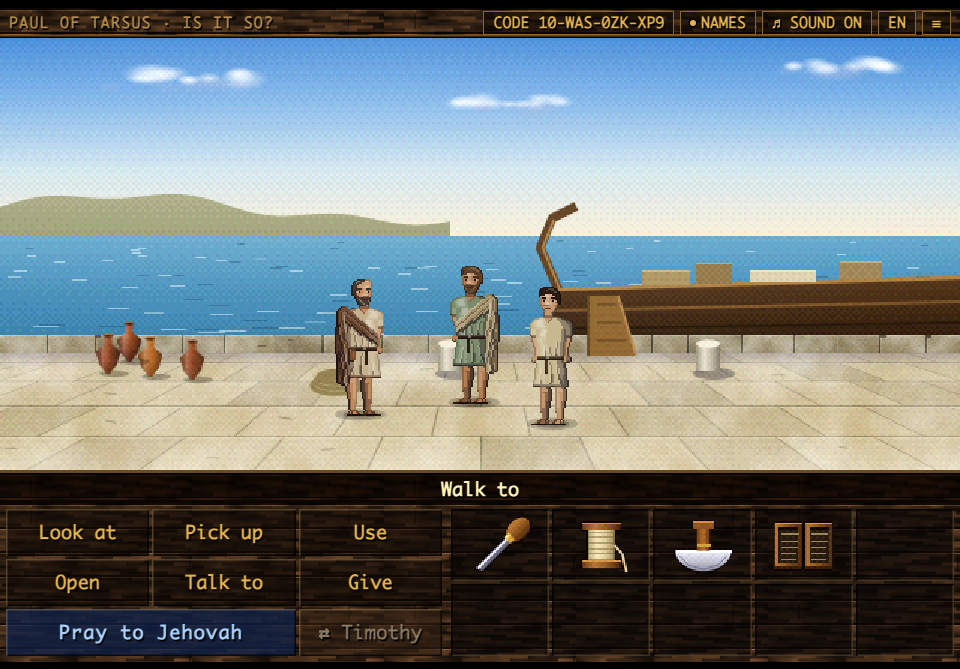 |
| Without Paul: the button that led back to him is grey | Athens: a message that has to be carried by word of mouth |

Then strangers stand at the gate, and the brothers send Paul to the sea. The game stays behind. The button that has always led back to Paul is grey, and the player is Timothy, who has known the holy writings since he was a small child (2 Timothy 3:15). A man who was with his flocks all week asks what the others asked on the first day. Timothy could set the table for him. He asks the old man who found two of the three places to do it, and the last round at the table is solved by taking the hand away from it.

On the quay at Athens the brothers who brought Paul have to sail home, and what he sends with them is carried by word of mouth. The player puts the message together from its parts. Everything else that could be added is true and kind, and makes it longer and less sure.

Walkthrough (spoilers)

1. In Jason's courtyard, use the bolt of goat-hair cloth. In the close view, click a panel on the board to take it, click it again to turn it, and click the cloth to lay it with its upper left corner there. Lay the end wall, turned upright, in the two cubits left of the thin strip; the long wall beside it, beginning on the thin strip; the two gussets under the long wall; the door flap after them; and the roof at the far end. Six cubits are left in one length along the near edge.
2. Use the knife with the bolt of cloth. Then go out by the gate to the street.
3. In the synagogue, use the reading table. Wind the Psalms to "vinegar for his thirst", leave the Prophets rolled shut, turn the tablets to "sour wine at his mouth", and talk to the men on the benches.
4. Wind the Psalms to "mocked for his trust" and the Prophets to "despised, counted as nothing", turn the tablets to "mocked by the chief priests", and talk to the men on the benches.
5. Back in the courtyard, use the awl with the cut panels. Go out by the gate again.
6. At the table: the Psalms at "not abandoned to the Grave", the Prophets rolled shut, the tablets at "raised, and seen by many".
7. In the courtyard, give the traveling tent to Parmenon. Go out by the gate.
8. At the table: the Psalms at "not one bone broken", the Prophets at "pierced because of our transgression", the tablets at "legs unbroken, side pierced".
9. In the house by night, talk to Jason: "Go tonight, as the brothers ask."
10. In Beroea, use the reading table. Moses and the Psalms lie open already: wind the Prophets to "pierced because of our transgression", turn the tablets to "legs unbroken, side pierced", and talk to the Beroeans at the table.
11. Use the reading table again. For each place that they have found, turn the tablets and talk to the Beroeans: "lots cast by the soldiers", then "no answer to his accusers", then "a rich man's new tomb".
12. Use the reading table once more. Look at the scroll of the Prophets, turn the tablets until they are closed, and talk to the Beroeans.
13. As Timothy, talk to the man back from his flocks: "Ask Eupolemos to show him."
14. On the quay, talk to the brother from Beroea. Choose "It is for Silas and Timothy.", "They are to come to me, here in Athens." and "As quickly as they can.", and then "That is the whole message."

## Music and sound

| Chapter | Music | Around you |
|---|---|---|
| Is It So? | The plain major scale from B flat, which no earlier chapter has used. In Thessalonica the tune walks in bars of seven, two and two and three: a lyre, a low string, a hand drum and a ney by day; a low drone and a harp, far apart, by night at the bench; a harp alone in the synagogue; a drone, a slow drum and a few notes of the oud while the city is in an uproar. In Beroea, and on the quay, the same tune runs in even bars: a harp, a low string and a ney. At the scroll table nothing plays: a roller that is wound gives one plucked note, a note for each place, and a row that holds sounds as a chord. Nothing is claimed about how music was played then | Birds and a hammer somewhere in the street of Thessalonica, crickets and a lamp by night; the hush of a synagogue; a crowd some streets away, coming nearer, and a gate thrown open; birds and leaves at Beroea, and then voices in the street; waves, gulls and creaking timbers at the quay |

Every step at the scroll table can be solved from the text alone, because the game stays quiet in Silent Mode.

## The travel map

Thessalonica and Beroea lie near the left edge of the Aegean window, where their names had no room, so Chapter Ten looks through a fourth one, a little further west. Four small islands west of Greece were painted for it. The road is told on the map three times, and nobody chooses it. The chapter opens on the road from Philippi through Amphipolis and Apollonia to Thessalonica. The two towns that they passed through lay a day's walk from each other and from Thessalonica, a few dots apart at this scale, so their names are set small and stand above the road. The road to Beroea is told by night: the window is darkened, and the route and the names stay bright. The last map goes from Beroea to the sea, at a point that has no dot and no name, because the account names no harbor, and then by sea to Athens: down the gulf, outside Euboea, between it and Andros, and round the cape of Attica. The account names no course either: the line shows open water. Over these maps the road runs along the upper edge of the window, so what is told there stands at the foot of the view.

| | |
|---|---|
| 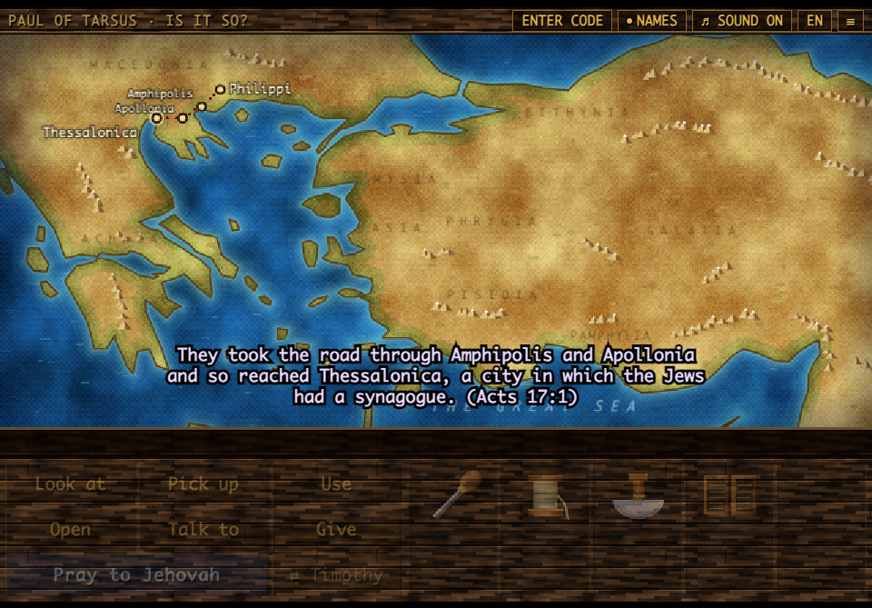 | 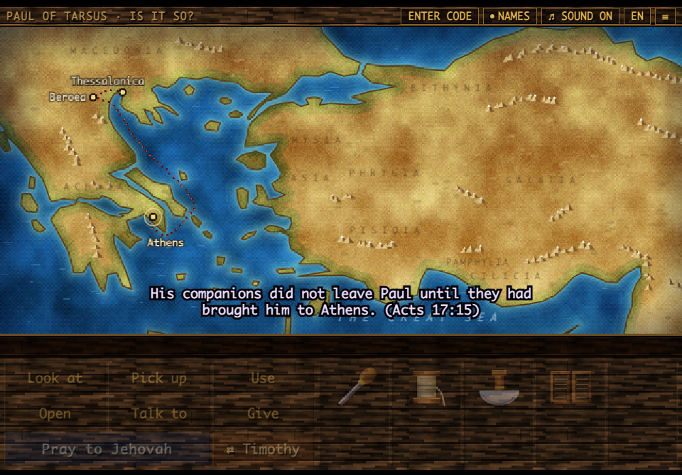 |
| Through Amphipolis and Apollonia to Thessalonica | From Beroea to the sea, and on to Athens |

## About the content

Chapter Ten does the same, and its end screen says so. It tells what the account says (Acts 17:1-15) in the narrator's own words, verse by verse with the reference, and puts none of it into a mouth as a quotation. The places in the scrolls and the lines of Paul's tablets are notes in his own words too. They stand together at the top of `levels/chapter10.js` and `lang/de/chapter10.js` (`TOLD`, `PLACE` and `EV`), where they can be checked against the Study Edition.

Acts does not say which passages Paul used in Thessalonica. The scroll table holds the ones that the Study Edition's marginal references give at Acts 17:3 (Psalm 16:10; 22:7; 34:20; 69:21; 118:22; Isaiah 50:6; 53:3, 5), and a row is used only if those references link its parts: the unbroken bones and the pierced one, for instance, are the two passages that John 19:36, 37 lays side by side. The references are for the player; nothing on the table has a number. *The Watchtower* of June 1, 2012, says that the Jews looked for a Messiah who conquers, which is what the first hearer says. The hearers, what they ask, and the attendant who brings out the scrolls are invented.

That Paul worked at tentmaking in Thessalonica is what the study notes on 1 Thessalonians 2:6 and 2 Thessalonians 3:8 call possible; the order, the trader, the bolt and its thin strip are invented. That he preached to those he met as he worked is from the Study Edition's media note on 1 Thessalonians 2:9. *Bearing Thorough Witness* (chapter 17) says that the stay was likely somewhat longer than three weeks, and why; the game shows three Sabbaths and the working days between them. Jason is called Paul's host by the study note on 1 Thessalonians 1:6 and by *Insight on the Scriptures* ("Jason"). That article leaves open whether he is the Jason whose greetings Paul later sent to Rome, and whether he was a relative of Paul's; the game says nothing of either. Acts names Timothy first at Beroea (17:14). *Insight* ("Timothy") says that he shared in the work in Thessalonica as well, so he is shown there, and the end screen says that Acts does not name him.

The mob, the house and the hearing are told and not shown. Where Paul and Silas were when the house was stormed, the account does not say, and neither does the game: night finds them in another house. What the security was, or what it bound Jason to, is not said either. *The Watchtower* of June 1, 2012, suggests that it may have bound them to see that Paul left and stayed away; the game says "security" and no more. *Bearing Thorough Witness* (paragraph 13) draws the line between boldness and recklessness at this point, and the choice in the house by night rests on it. The torn sleeve, the brother whose house it is, and the brother who comes from Philippi are invented.

What the Beroeans examined, and for how many days, is not recorded: the three days, the places they bring, and the line about Cyrus are invented. *Bearing Thorough Witness* (paragraph 16) says that they neither distrusted what was new nor took it on trust, and *The Watchtower* of April 15, 2007, describes how such checking is done: each place is looked up, its surroundings are read, and it is held against other passages. *Insight* ("Synagogue") says that the Law was read on two weekdays as well as on the Sabbath, and ("Scroll, Roll", "Book") how a scroll is wound and how long one could be. Whether such scrolls were Hebrew or Greek is not said, and a scroll is wound the other way for the one than for the other, so the game does not make the direction matter. The mountain in the window of the synagogue is not named. Thessalonica and Beroea were full of sanctuaries; no temple, altar, statue or image is shown, and the charge about Caesar's decrees is told as Acts tells it, without more.

Paul left Silas and Timothy behind to care for the new believers (*Insight*, "Beroea", "Timothy"); the scene in which Timothy is asked, and steps back, is invented. From which harbor Paul sailed is not said: the Study Edition has him sent to the sea, and *Insight* ("Beroea") says that he sailed. That his instruction was spoken and not written, and the quay, are invented. Aristarchus and Secundus of Thessalonica and Sopater of Beroea (Acts 20:4) are not placed in these weeks by the account, and do not appear. The letters to the Thessalonians were written from Corinth, months later: only the narrator cites them.

The supporting characters are invented: in Thessalonica the trader Parmenon, the attendant Theodotos, Lysimachos and Menandros, who ask, and Stratonike, one of the leading women; in Beroea Eupolemos, Dorotheos and Kleonike, and the man back from his flocks. Their names are Greek names that the Scriptures give to nobody.

[← All chapters](../README.md#chapters)
