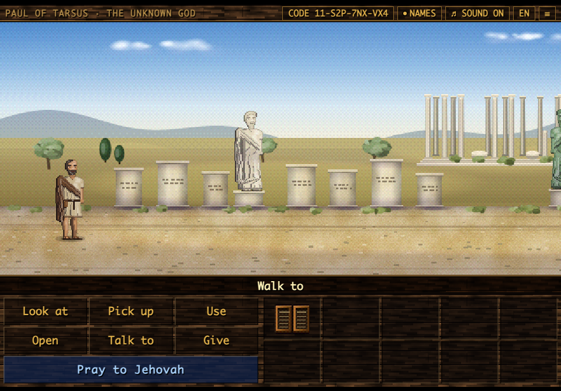
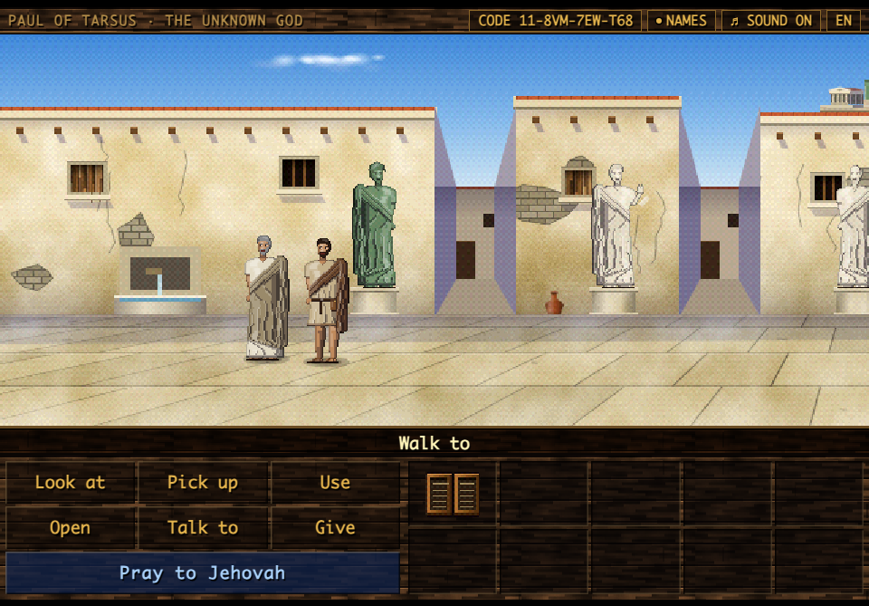
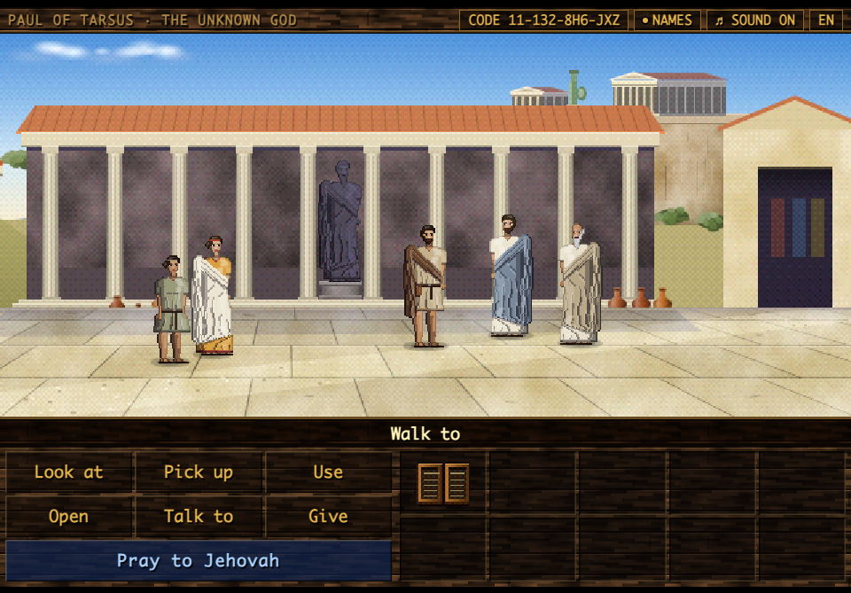
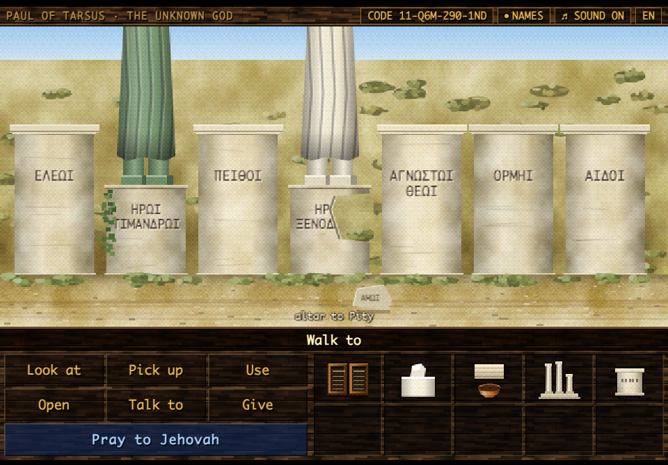
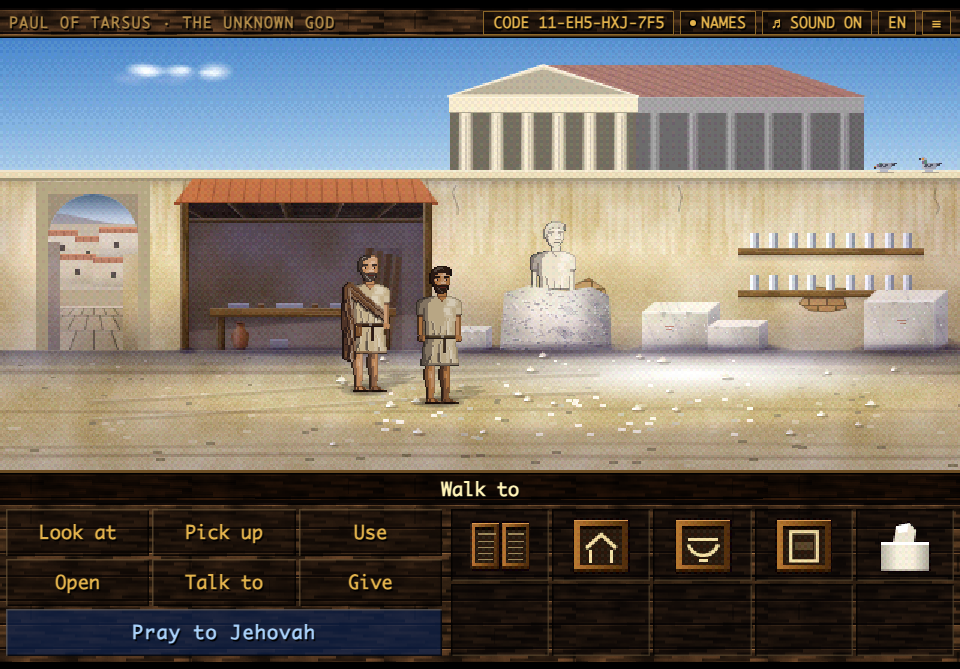
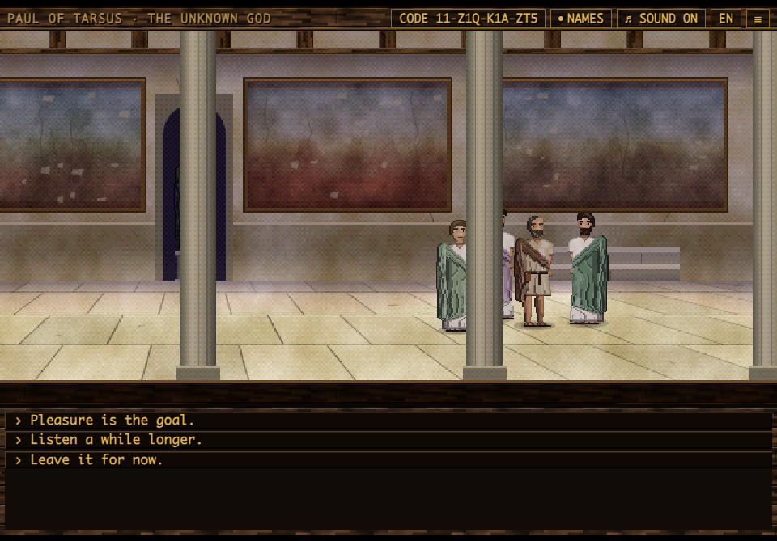
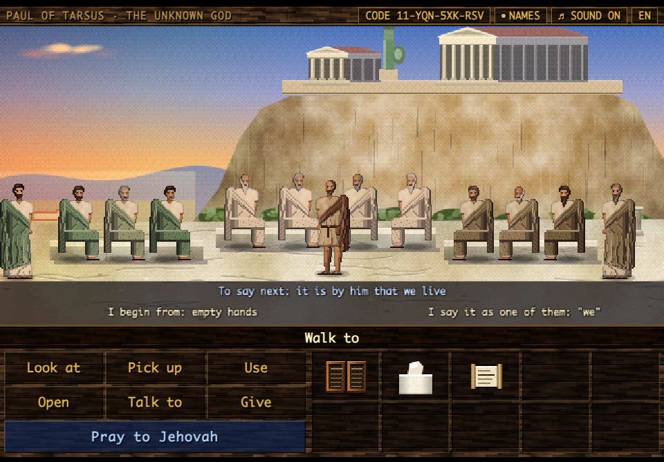
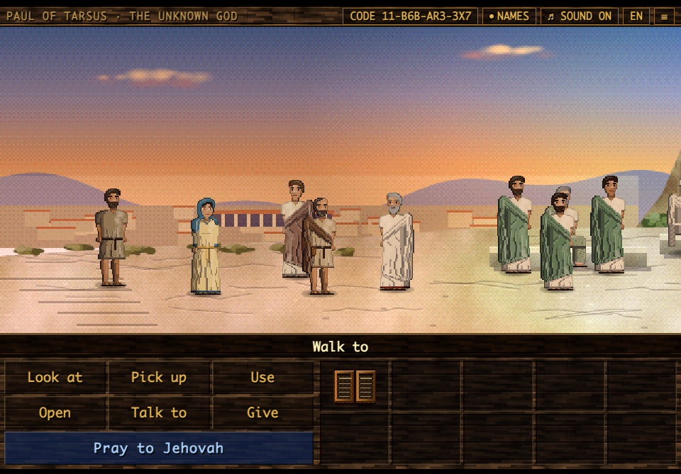
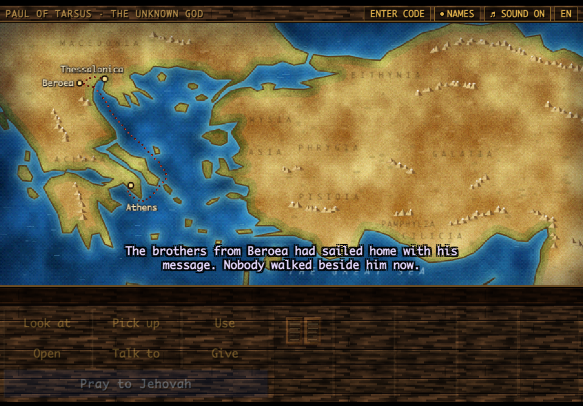

# Chapter Eleven: The Unknown God

About 50 C.E. Paul waits in Athens for Silas and Timothy, and it goads him to see a city full of idols. He reasons in the synagogue with the Jews and the others who worship God, and every day in the marketplace with whoever happens to be there. Some Epicurean and Stoic philosophers take him on. Some of them ask what this chatterer is trying to say; others think that he is announcing foreign deities, because he is declaring the good news about Jesus and the resurrection. They take hold of him and lead him to the Areopagus, and ask to be told what this new teaching is. Standing in the midst of the Areopagus, Paul begins from what he has seen in their own city: looking closely at the things they venerate, he even found an altar inscribed to an unknown god. What they worship without knowing it, he declares to them: the God who made the world lives in no temple that hands have made and needs nothing from human hands; out of one man he made every nation, so that they would seek him, and he is not far from any one of us; some of their own poets have said that we too are his children, so we should not think that the Divine Being is like gold or silver or stone. Now he tells all people everywhere to repent, because he has set a day on which he will judge the inhabited earth by a man he has appointed, and he has given everyone a guarantee of it by raising that man from the dead. At the resurrection some scoff, and others say they will hear him another time. So Paul leaves them. Some join him and become believers, among them Dionysius, a judge of the court of the Areopagus, and a woman named Damaris (Acts 17:16-34).

| | |
|---|---|
|  |  |
| The road to Athens: altars, and the temple of Zeus, not yet finished | The way to the synagogue is given by the statues |
|  |  |
| The marketplace: on the steps they want to hear something new | Three stones seem to name nobody, and one of them says so itself |

Eight locations, ten new characters, and a rule that turns ten chapters round: **the tablets stay shut.** *Bearing Thorough Witness* (chapter 18) says that on the hill Paul taught what the Scriptures teach without quoting them, that he said "we", and that he drew on writers the Athenians respected. Nobody in the marketplace of Athens has heard of Moses or Isaiah, so the player has to find something else to begin from: what Paul sees in their city, and what they say themselves. The study note on Acts 17:18 gives the chapter its picture. The word behind "chatterer" means a picker-up of seeds: a bird that pecks up grain, and so a man who gathers scraps and cannot put them together. The game takes the philosophers at their word. Paul gathers five grains, all over their city, and on the hill he puts them together.

Paul comes up from the harbor alone, and asks for the synagogue. An old Athenian gives him the way as an Athenian would, by what stands where: past the bronze in the helmet, past the marble with the scroll, past the old lawgiver. Each figure in the street is only "a statue" until Paul looks at it, and a wrong lane leads back to the fountain. To cross this city at all, the player looks at more images than in ten chapters together.

At the boundary stone of the marketplace stands a basin of water, for the cleansing of whoever comes in. Paul declines it, plainly and without scorn, and that is the news that gathers his first hearers. On the steps of the long colonnade he then does what he has done in every city: he opens his tablets. Three passages, all true, and to these men only names. So he shuts the tablets, and carries four questions through their city instead, as things in his pack: who made them, where does he live, what does he need, and is there one they do not know? A question is used on something in the city. Put to the wrong thing it gets an honest answer and no more; put to the right thing it becomes a grain, noted on a new leaf of the tablets headed "Seen in Athens".

| | |
|---|---|
|  |  |
| Who made them? In a yard under the temple it can be watched | Two teachers under one roof: where Paul stands decides whom he hears |
|  |  |
| In the midst of the Areopagus: what he begins from, and how he says it | Some joined him: a judge of that court, and a woman who listened from the path |

The fourth question belongs on the road from the harbor, which is lined with altars. A close view shows seven stones, cut off at the height of a man's knee, so that of a figure on its base only the feet and the hem are seen. Each has a band of letters in Greek capitals. Three seem to name nobody: on one the letters are under ivy, on one they are broken off and the piece lies in the grass, and one is whole and clean, and says what it says on purpose. Each has to be gone into in its own way before Paul will build on the third.

In the painted colonnade two men teach, a Stoic at one end and an Epicurean at the other, and whom Paul hears, and which tune, depends on where he stands; between them he hears both and follows neither. Each says four things. One of the four Paul can hold with him, and the player has to say which: from the Stoic a poet's line, that we too are his children, and from the Epicurean that a god lacks nothing our hands could bring. A man who goes from teacher to teacher and writes down one sentence from each has a name in this city, and they give it to him.

On the Areopagus the speech goes in the order of the account, part by part. For each part the player sets two things: what Paul begins from (one of the grains, or empty hands) and how he says it: to them, as "you"; as one of them, as "we"; or to all people everywhere. The sentence that is to be said next stands at the foot of the view, and it has the account's own word for whom it is said of: "us" where every nation comes from one man (Acts 17:27), "we" where the Divine Being is not to be likened to stone (17:29), and all people everywhere where they are told to repent (17:30). *Bearing Thorough Witness* (chapter 18, paragraphs 16 and 19) points to that "us" and that "we". When both carry the sentence, the narrator tells that part, the men on the seats lean in, and one more note joins a chord. When they do not, somebody says what he heard, and never which of the two to change; said to all people everywhere before the last part, it goes over the heads of the men in front of him. A grain is spent when it has carried its sentence. Nothing of theirs carries the middle of the speech, where all nations come from one man: that is said with empty hands, as one of them. And nothing carries its end. Before the last part every man is leaning toward him, and the game offers to stop there; every reason for stopping is true. He says all of it, and at the resurrection they laugh.

Three kinds of men are left on the rock. The scoffers are answered by the path down, those who would hear more are told where to find him, and for the two who follow him down the tablets open, for the first time in the chapter, at their first line.

Walkthrough (spoilers)

1. Walk up the road and go in by the city gate. Talk to Nikias, by the fountain.
2. Look at the statues along the street. Take the fourth lane: the one just beyond the marble youth without a right hand.
3. In the synagogue, talk to Dositheos.
4. In the marketplace, choose "Decline, and tell him plainly why."
5. Talk to Charmides or Aristion on the steps, and read out all three passages.
6. Take the lane to the craftsmen. Use "question: who has made them?" with the block with half a figure.
7. Go back by the street and the city gate to the road. Use "question: what does he need?" with the slave, and "question: where does he live?" with the temple of Zeus.
8. Use the altars by the road. In the close view: use the ivy, and look at the base it covered; look at the piece of stone in the grass, and at the broken base; look at the fifth stone, the altar that is whole; then use "question: one they do not know?" with it.
9. Go back to the marketplace and into the painted colonnade. At the left end, talk to Philokles: choose "Listen a while longer." until he has said four things, and then "We too are his children." At the right end, talk to Antigenes in the same way, and choose "A god lacks nothing."
10. Go back to the marketplace. Choose "I bring no new god: I announce the One who made you."
11. On the Areopagus, click "what I begin from" and "how I say it" to set them, and talk to the men on the seats after each setting: their altar, "you"; the temple without a roof, "you"; the robe and the dish, "you"; empty hands, "we"; a line of their poets, "we"; the block of marble, "we". Choose "Say all of it, now." Then: empty hands, "all people everywhere".
12. Talk to the men who would hear more. Take the path down, at the left. Give the wax tablets to Dionysius or to Damaris.

## Music and sound

| Chapter | Music | Around you |
|---|---|---|
| The Unknown God | A scale that no earlier chapter has used, a minor third with a raised fourth, from F sharp, in bars of twelve steps. On the road and in the streets a lyre and a low string. In the marketplace a reed pipe plays short tunes that begin, break off and begin again as something else, for a city that only wants what is new. On the second walk the same notes slowly, one voice over a drone. In the painted colonnade two tunes that do not fit: a lyre in even twos at the Stoic's end, a pipe that sways in threes at the Epicurean's, and both where Paul stands between them. On the hill one low note; while he speaks nothing else plays, each part that holds adds one plucked note to a chord, and the last part is spoken into silence. Nothing is claimed about how music was played then | Wind and birds on the road; a fountain and voices in the street; the crowd of the marketplace; a mallet on a chisel in the stonecutter's yard; the hush of a synagogue; wind on the rock |

Every step can be solved from the text alone, because the game stays quiet in Silent Mode: in the colonnade the speaker's line stands over his head, and on the hill what is set is written at the foot of the view.

## The travel map

Nobody travels in this chapter. It opens on the map once, through the western window that Chapter Ten painted: Athens, and far to the north Beroea, where Silas and Timothy still are. The name of the region, Achaia, is set in.

## About the content

Chapter Eleven tells what the account says (Acts 17:16-34) in the narrator's own words, verse by verse with the reference, and puts none of it into a mouth as a quotation; the speech itself is told as what Paul said. The passages on his tablets are notes in his own words too. They stand together at the top of the story in `levels/chapter11.js` and `lang/de/chapter11.js` (`TOLD` and `PS`), where they can be checked against the Study Edition. The passages that appear on the tablets as the speech goes on are the ones that the Study Edition's marginal references set beside its parts.

**Athens in pictures.** CONTRIBUTING section 3 makes an exception for Athens, Ephesus and Rome: these cities cannot be shown as they were without their temples, altars and images. What is shown follows the publications. *Insight on the Scriptures* ("Athens") and *Bearing Thorough Witness* (chapter 18) describe the Acropolis and the temple of Athena on it, and say that idols stood in temples, in public squares and on the streets. *Aid to Bible Understanding* ("Athens") dates the temple of Zeus: begun in the sixth century B.C.E., taken up again in the second, and finished only in 129 C.E. So the game shows it unfinished, as tall columns without a roof; how far the work had come by Paul's day the publications do not say, and the man with the mule who tells of it is invented. *The Watchtower* of July 15, 1998, describes the marketplace: its colonnades, the temple of Hephaestus above it with craftsmen round it, the road across it, the boundary stone with its basin. The Stoics had their name from a painted colonnade (*Insight*, "Stoics"); that an Epicurean taught under the same roof is invented. The Areopagus is a bare ridge of limestone with seats cut in the rock (*Insight*, "Areopagus"). Everything is seen from outside. No rite is shown, nothing is unclothed, no image of a god is seen close, and what those publications say stood at the entrance to the marketplace is left out. The bronze figure on the Acropolis, with helmet and shield, is not from the publications: it is small, and it is there because the maintainer chose statues that are recognizable and restrained. The figures of the street are statues of men.

**The altar.** The study note on Acts 17:23 gives the words of the inscription and names altars to such things as Fame, Modesty, Energy, Persuasion and Pity (the row has four of them: no word in it contains a phi, which is a line through a ring); its media note says that altars to unknown gods are known from writers and from finds. *Insight* ("Athens") tells of a traveller of the second century who saw such altars on the road from the harbor at Phaleron, and thinks it possible that Paul came by that road. Where the altar of Acts 17:23 stood is not said: the row by the road, the ivy, the broken base and the two heroes with their names are invented. The inscriptions are in Greek capitals; a letter in an inscription is a letter (CONTRIBUTING section 3).

**The philosophers.** What each school held is from the study notes on Acts 17:18 and from *Insight* ("Stoics", "Epicureans"). The study note on 17:28 says that Paul apparently quoted the Stoic poet Aratus, and that words like his are found in Cleanthes; the game names neither. That a god needs nothing from men is what *Bearing Thorough Witness* (paragraph 14) says some philosophers in his audience may have believed. It does not say which school; the game gives the thought to its Epicurean. The account gives the philosophers' two verdicts and not their arguments, and the game invents none for them: one question is put to Paul plainly, because Greek and Roman law forbade the bringing in of new gods (*Insight*, "Athens").

**The hill.** The study note on Acts 17:19 leaves open whether Paul was taken to the hill or to a sitting of the council elsewhere, perhaps in the marketplace, and *Insight* says it cannot be stated for certain that he spoke before the court. The game shows the hill, calls nobody an accuser, and passes no sentence. That the mockers cut him short is from *Insight* ("Areopagus"); that he did not name the judge, and did not trade the truth away to please them, from *Bearing Thorough Witness* (paragraphs 21 and 24). Nothing the player does wins anyone or loses anyone: who scoffs, who waits and who believes is told as the account tells it.

**Dress, and Damaris.** *Insight* ("Dress") describes the Greek tunic and the outer garment, a rectangular length of cloth; *Awake!* of 1995 ("Fashion: Ancient Greek Style") describes the dress and the hair of Greek women. The men of standing wear that mantle over a tunic, and the game calls it a mantle. The few women in the streets wear a tunic to the feet and the mantle, the hair parted and bound with a band, or the mantle drawn over the head. No woman is on the Areopagus. *Insight* ("Damaris") says that she heard Paul's defense, that she was possibly not a Greek, because women in Athens normally stayed out of public life, and that nothing shows she was the wife of Dionysius: she listens from the path below the seats, and the game says nothing of where she came from.

Paul is alone in this chapter. *Insight* ("Athens") holds it possible that Timothy came to him in Athens and was sent back, and more likely that he was left there without companions. Whether a congregation was formed in Athens then is not stated (*Aid*, "Athens"), and the game does not say.

The supporting characters are invented: Nikias, who gives the way; Charmides and Aristion on the steps; Xenokles the stonecutter; the slave with the robe and the dish, and the man with the mule who is only heard of; Philokles and Antigenes, who stand for their schools; Dositheos, the attendant of the synagogue. Their names are Greek names that the Scriptures give to nobody. What Dionysius and Damaris say is invented too, and so is the evening on which the tablets are opened for them, at Genesis 1:1.

[← All chapters](../README.md#chapters)
