# Chapter Twelve: Tentmakers of Corinth

From the autumn of 50 C.E. to the spring of 52. Paul leaves Athens and comes to Corinth. He finds a Jew named Aquila, born in Pontus, who has lately come from Italy with his wife Priscilla, because Claudius had ordered every Jew out of Rome; he lodges and works with them, for they are tentmakers, as he is. Every Sabbath he speaks in the synagogue. When Silas and Timothy come down from Macedonia he gives himself wholly to the word. The Jews keep opposing him, so he shakes out his garments and moves next door, into the house of Titius Justus, whose house adjoins the synagogue. Crispus, the presiding officer of the synagogue, believes with all his household, and so do many Corinthians. In a vision by night the Lord tells Paul not to be afraid, but to keep on speaking: nobody will harm him, and there are many people in this city. He stays a year and six months. While Gallio is proconsul of Achaia the Jews lead him to the judgment seat, and Gallio drives them away before Paul has opened his mouth. After quite a few days more he says goodbye, has his hair cut short at Cenchreae because of a vow, and sails with Priscilla and Aquila to Ephesus. There he leaves the two. The Jews of the synagogue ask him to stay, and he answers that he will come back if Jehovah is willing. By Caesarea he comes home to Antioch (Acts 18:1-22).

| | |
|---|---|
| 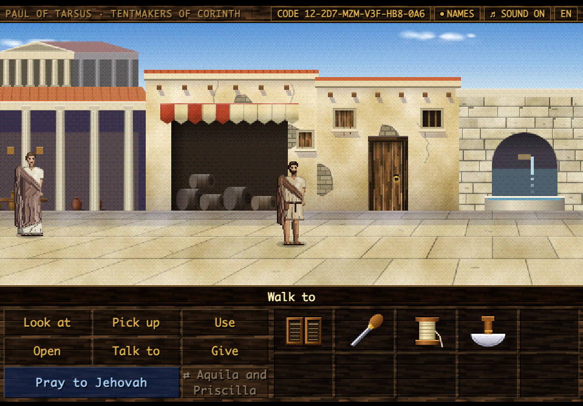 | 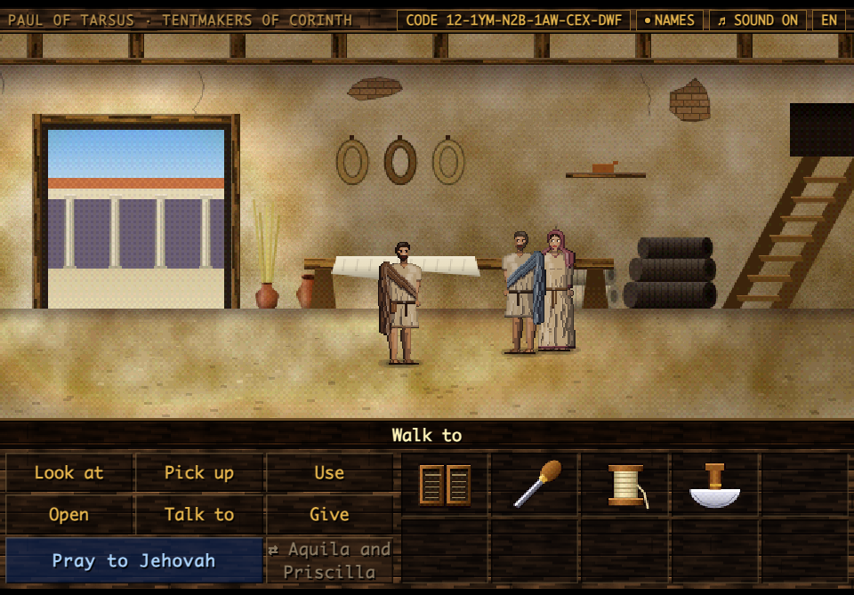 |
| Corinth: his tools, and no bench to use them at | The workshop: a couple whom the Scriptures never name apart |
| 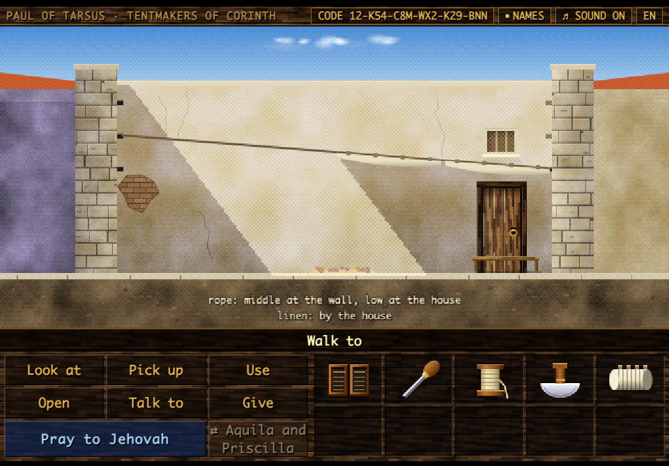 | 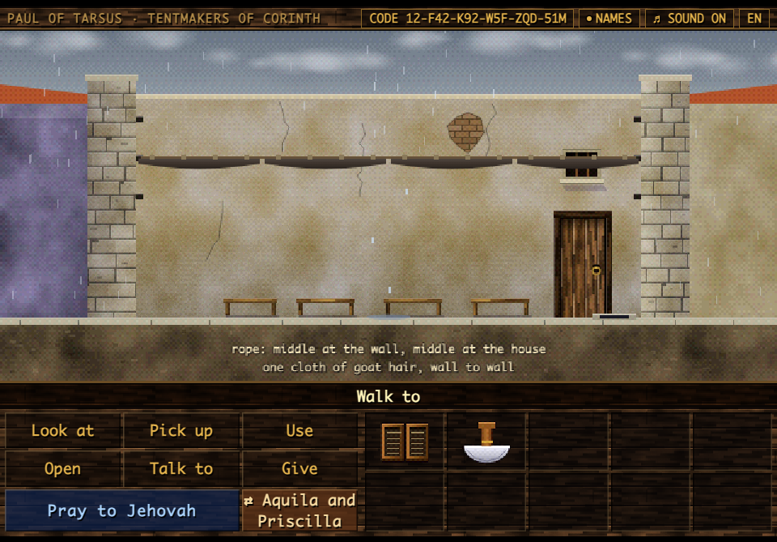 |
| A roof of linen: where the cloth hangs decides where the light falls | In winter the question is where the water runs |

Eleven locations, seventeen new characters, and two things the game has not had: **light**, and **time**. It also has the game's first pair: Aquila and Priscilla are played as one.

In eleven chapters trouble has ended on the road: a basket in Damascus, a ship from Caesarea, the dust of Antioch, the night road to Beroea. Corinth is where that stops. The synagogue turns against him, and he goes one door further. He is told to keep on speaking, and stays a year and six months, longer than anywhere so far. He is led before the proconsul, and the case is over before he has said a word. When he leaves at last, nobody has driven him out.

**A roof of linen.** The first order that the three finish together is a sun awning for the court of a man whose house stands wall to wall with the synagogue. The court is seen from the side, as if the near wall were taken away. A rope runs from one of three hooks in the wall of the synagogue to one of three in the front of the house, and the cloth slides along it on its rings, a quarter of the court at a time. The sun is not in the picture. Its light is: it is worked out from where the cloth hangs and painted anew whenever something moves. Justus wants shade on his bench at midday and sun on his drying figs. When something is wrong, somebody says what he sees, and never which part to change.

The same court comes back twice. In winter the house is open to whoever comes, and it rains: one cloth of goat hair reaches from wall to wall, and what matters now is the slope, because the water has to run into the cistern by the door and not down the wall of the neighbors. A summer later the court is full, and one cloth is not enough. Two are set, so that every bench has shade, the place where Paul reads has light, and nobody at the door has cloth in his hair. The awning that he sewed for wages in autumn shades the congregation by summer.

**The awl laid down.** When Silas and Timothy come, they bring what Macedonia has sent, and from then on Paul gives all his time to the word (Acts 18:5; 2 Corinthians 11:9). For the player that means giving something up. One order of his lies half sewn on the bench, and he leaves no promise lying there: the seam is closed to a corner, where another hand can go on, and the customer hears from Paul himself who will finish it. Then the awl, the first tool of Chapter One, is given to Aquila and Priscilla to keep. From that moment the two can be played, with the button beside the prayer. They move, stand and answer together, and the bench work is theirs: when a neighbor comes with a torn awning, Paul cannot mend it. He walks the man to the bench, and has both hands free to talk.

| | |
|---|---|
| 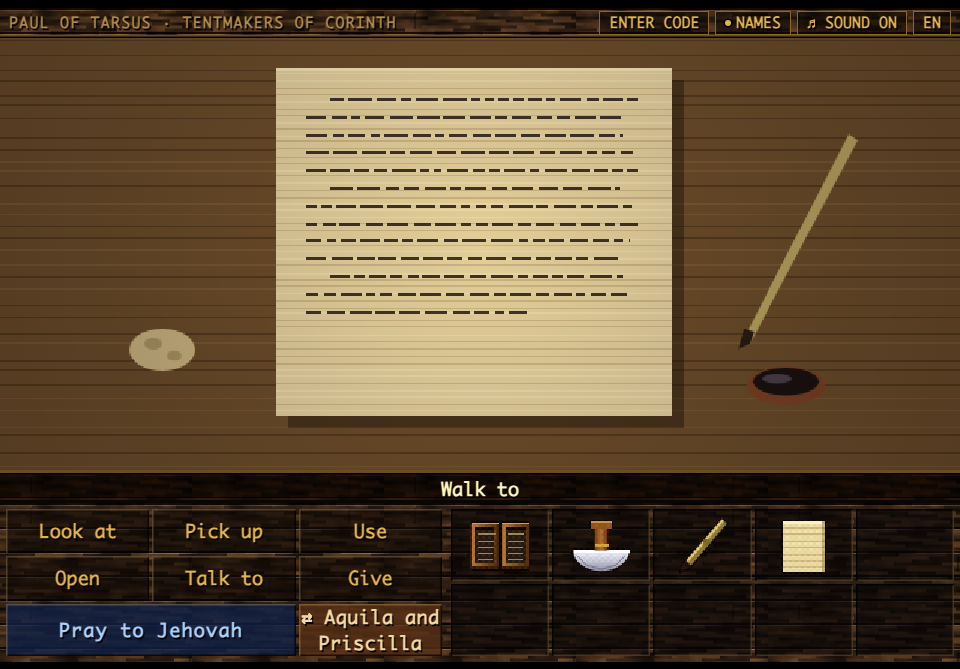 | 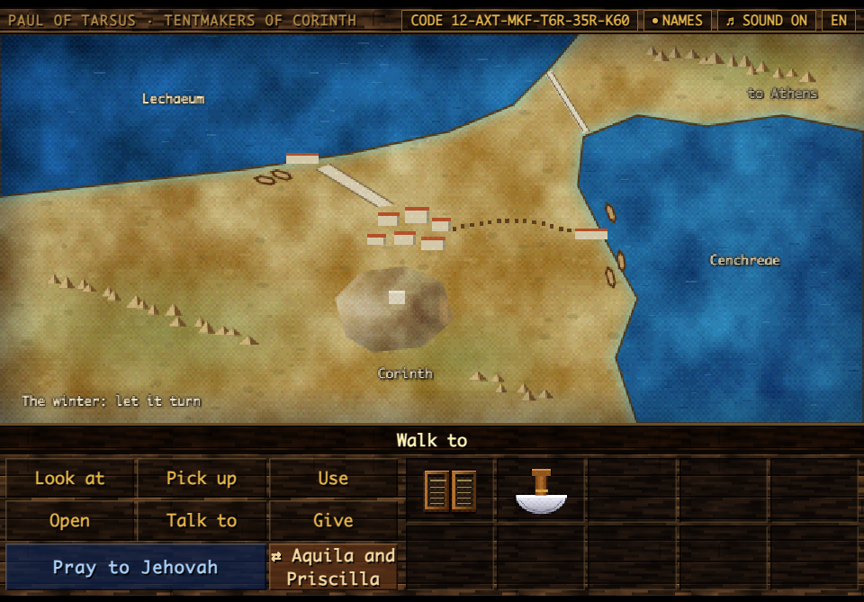 |
| What he could not go and say, he wrote | Two harbors, and a season that turns when the player lets it |
| 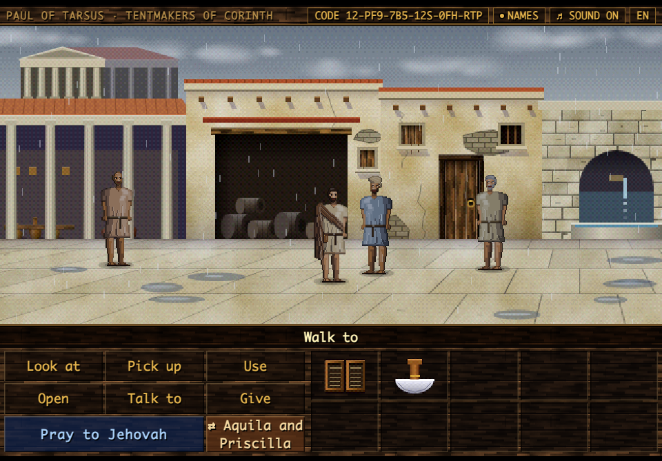 | 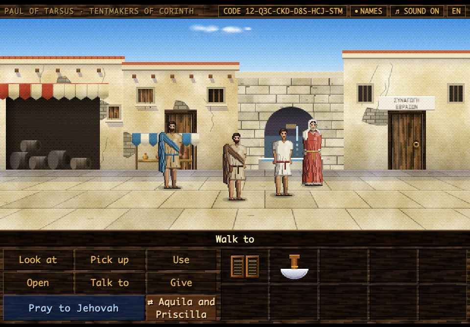 |
| Winter: people he has no errand with | The spring of the games: booths in the street |

**Black and reed.** Timothy has come from Thessalonica with good news, and offers to carry the answer back by mouth, as a message was carried in Chapter Ten. This time it is too much for a mouth, and it is for all of them. So Paul cuts a reed with his own knife, slanting, and slits its point; grinds a cake of black into water and tries it on a potsherd, where it runs, or clogs, or stays; and gets a sheet of papyrus from Silas. Timothy writes and Paul speaks. What the letter says is told by the narrator with its references (1 Thessalonians 1:1; 2:17; 5:27): the player composes none of it.

**The road out.** On the evening after he has left the synagogue, the others do what the brothers have done in every chapter: a bundle is packed, and a ship lies at the eastern harbor. A picture of the neck of land opens, with a harbor on each sea. Whatever the player chooses, Paul has not answered when night falls, and the vision is told on a dark screen. In the morning the bundle still stands by the door, and nothing on the picture is the way on. The way on is to unpack. A year later it comes again: word is brought that he will be taken before the proconsul. This time nothing is said to him in the night, and the player has to remember what was said.

**Where and when.** The year and six months are walked season by season: winter, the spring of the games at the Isthmus, summer. In each season there are people in the street whom Paul has no errand with, and he speaks to them all the same. Some have no time now and say when they have: a seaman while his ship is laid up, a potter when his kiln is cold, a clerk when the court is not sitting, a runner after the games, a seller when the booths are down. None of them says where, or in which season. That has to be worked out from what the city is: a ship that runs to Ephesus and Smyrna lies at the eastern harbor and not at the western one, and a judgment seat that stands empty is not sitting. Each promise is noted on the tablets, and Paul will not let a season go while somebody is expecting him. Who comes to believe is not the player's doing: the narrator says what the account says, and no more.

| | |
|---|---|
| 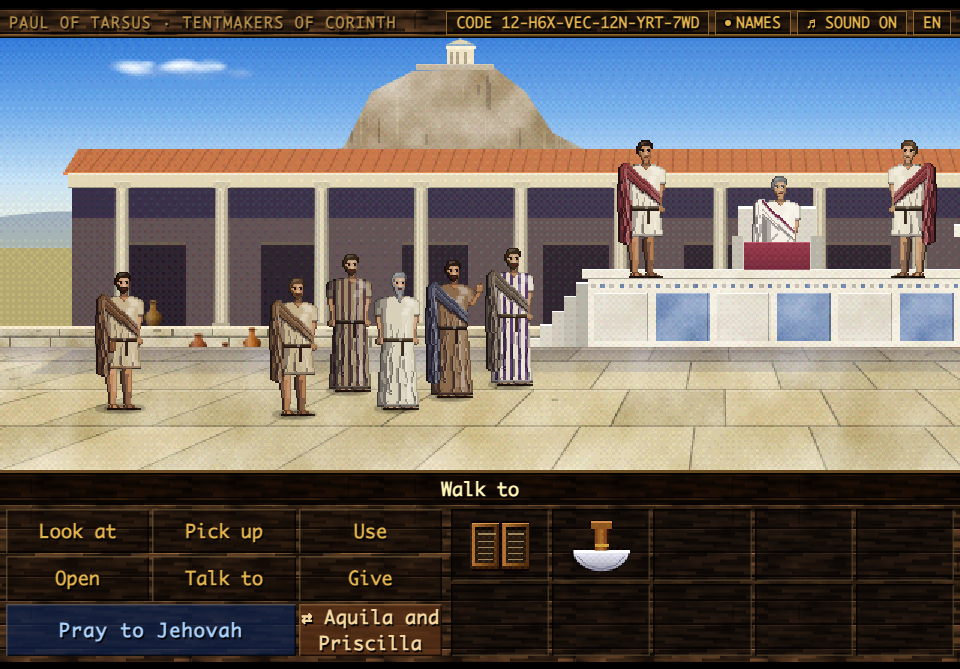 | 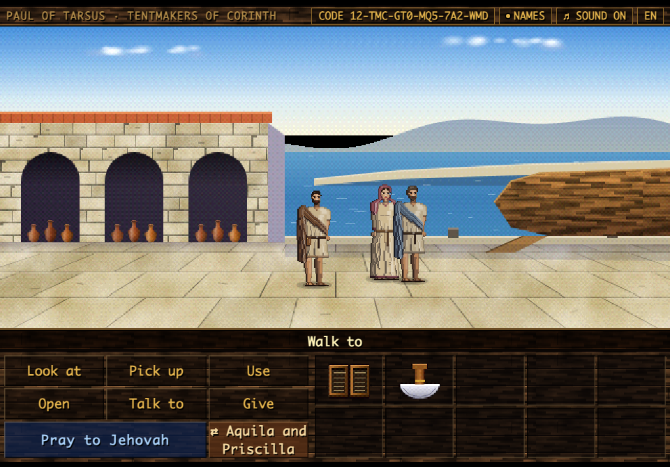 |
| He has his first sentence ready, and nobody asks for it | Cenchreae: the bench goes aboard |
| 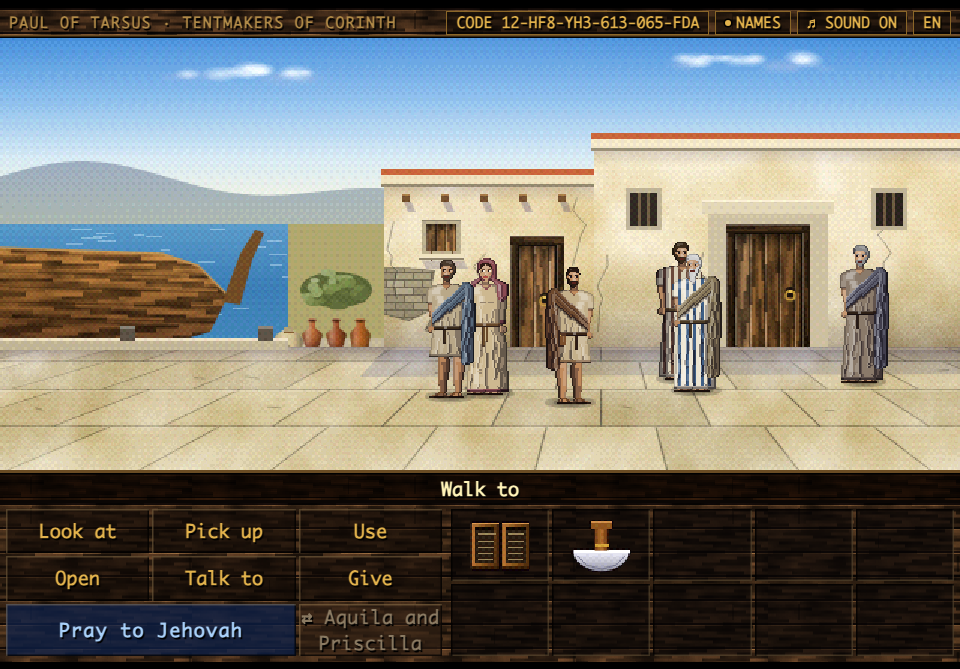 | 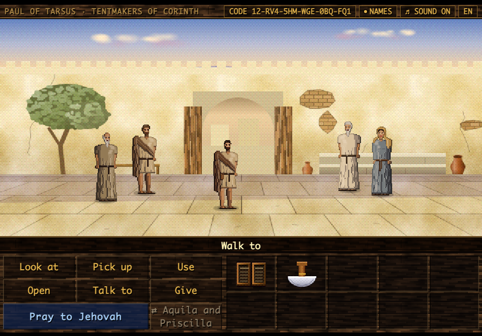 |
| Ephesus: they ask him to stay | Antioch: where the road began |

**About to speak.** In a room beside the judgment seat, with a floor of mosaic and a bench of marble, Paul waits to be called. The charge can mean the law of Rome or the Law of Moses, and the player chooses how he will begin. Then he stands before the seat, and one thing is left to do: to speak. The player does it, and Gallio speaks instead. The sentence that was ready stays on the tablets, under what was not needed in Corinth.

**If Jehovah is willing.** In Chapter Eight the paved road to Ephesus was closed to him. Now he stands in its synagogue, they have a hundred questions, and they ask him to stay. Lydia once urged him, and to accept was right. Here he does not agree, and the account gives no reason. What the player chooses is how he takes his leave: a flat promise is not his alone to give, and a shrug is less than he means. Then he goes aboard, and the button that led to Aquila and Priscilla turns grey: he left them there.

After the end screen the game looks back: five maps, journey by journey, with every road of Chapters One to Twelve, and then what Acts says next (Acts 18:23).

Walkthrough (spoilers)

1. In the street, walk to the workshop that is open to the street, and talk to Aquila and Priscilla.
2. Use the awl with the length of linen. Go out by the opening to the street, and in at the door of Titius Justus.
3. In the court, use the rope and hooks. In the view from the side, click the linen cloth until it hangs by the house, and click "step back and look".
4. Go back to the workshop. Use the awl with the half-sewn cover. Talk to Sabinus: "It will be ready on that day. Aquila will finish it: from today I do not sew." Give the awl to Aquila and Priscilla.
5. Talk to Timothy. Pick up a reed in the corner, and use the knife with it. Talk to Aquila and Priscilla for the cake of black. Use the cake of black with the small bowl twice, and the reed pen with the potsherd; if it clogs, use the bowl once for a few drops of water, and try again. Talk to Silas for the sheet. Give the reed pen to Timothy.
6. Go out, and in at the door of the synagogue. Use the mantle with the men who oppose him.
7. In the court, use the rope and hooks: click the high hook in the wall and the low hook in the house, and step back and look.
8. In the workshop, by night, go to the opening to the street, and choose a harbor. In the morning, use the bundle.
9. Winter. In the street, talk to Marcellus: "Come with me." Change to Aquila and Priscilla (the **⇄** button, or `C`), use the awl with the torn awning, and change back. In the street, talk to Thrason and to Kallistos. Take the road to the harbors, click Cenchreae, and talk to Kallistos by his ship. Take the road back, then the road to the harbors again, and click the season at the foot of the picture.
10. Spring. Talk to Praxias, Euphron and Decimus. Go up the steps to the marketplace, and talk to Decimus by the empty judgment seat. Go back, take the road to the harbors, and click the season.
11. Summer. Talk to Euphron by his door. In the marketplace, talk to Thrason by his pots. Take the road to the harbors, click Cenchreae, and talk to Praxias.
12. In the workshop, change to Aquila and Priscilla, use the awl with the length of linen, and change back. In the court of Justus, use the rope and hooks: the middle hook in the wall, the middle hook in the house, the linen cloth in the middle, the new cloth in the last quarter. Step back and look.
13. In the workshop, by night, use the bundle.
14. In the waiting room, use the bench of marble, and choose how to begin. Before the seat, talk to the proconsul.
15. Go down to the street, and in at the door of Titius Justus. At Cenchreae, go up the plank.
16. At Ephesus, talk to Philon: "I will come back to you again, if Jehovah is willing." Go up the plank.
17. At Antioch, talk to the brothers.

## Music and sound

| Chapter | Music | Around you |
|---|---|---|
| Tentmakers of Corinth | A scale that no earlier chapter has used, a major third under a minor sixth and seventh, from A flat, in even bars of sixteen. At the bench a working tune on the lyre over a low string and a steady hand drum. From the day he lays the awl down, the same tune without its beat. In the night of Acts 18:9 nothing plays. Through the year and six months the tune is a round: one voice in winter, a second that comes in two bars behind it in spring, a third in summer; in the court of Justus the round is whole. Before the judgment seat one drum, which stops in the middle of a bar. At Ephesus a tune that is begun and left unfinished. On the way home and in Antioch the round once more, far off. Nothing is claimed about how music was played then | The spring and the voices of the street; rain on paving and on cloth in winter, and a crowd in the spring of the games; a lamp and crickets by night in the workshop; a mallet under a ship on the beach, and waves and gulls at Cenchreae; the square before the seat; the quay of Ephesus; leaves and birds at Antioch |

Every step can be solved from the text alone, because the game stays quiet in Silent Mode: in the view of the awning what is set is written at the foot of the picture, and somebody says what he sees.

## The travel map

The chapter opens on the map with Athens and Corinth and no road between them: the account does not say whether he went by land or by sea (Acts 18:1), so none is drawn. Cenchreae lay 11 kilometers from Corinth, less than a dot on this map, so the sea road simply begins at the coast beside the city. It runs south of the cape of Attica and north of Samos to Ephesus; the way home leaves that course off Samos, so that no stretch of sea is drawn twice, passes between Carpathus and Rhodes and south of Cyprus to Caesarea, goes up to Jerusalem, and north to Antioch behind the mountains of the coast. The account names no course for either voyage: the lines show open water. Acts 18:22 says only that he went up and greeted the congregation; the study note says that this was apparently in Jerusalem, so the map names it, and the end screen says that the account does not.

Travel inside the chapter is not on that map: Corinth and its two harbors are a picture of their own, the neck of land seen from above.

| | |
|---|---|
| 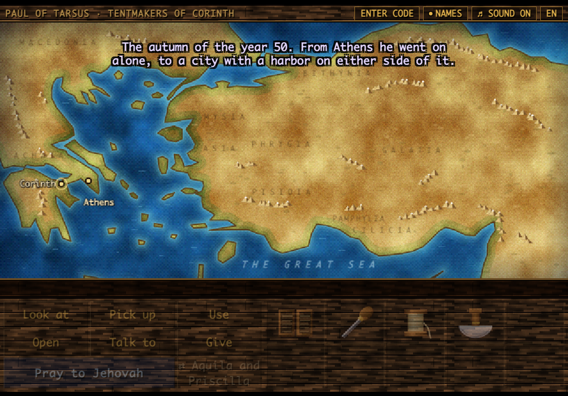 | 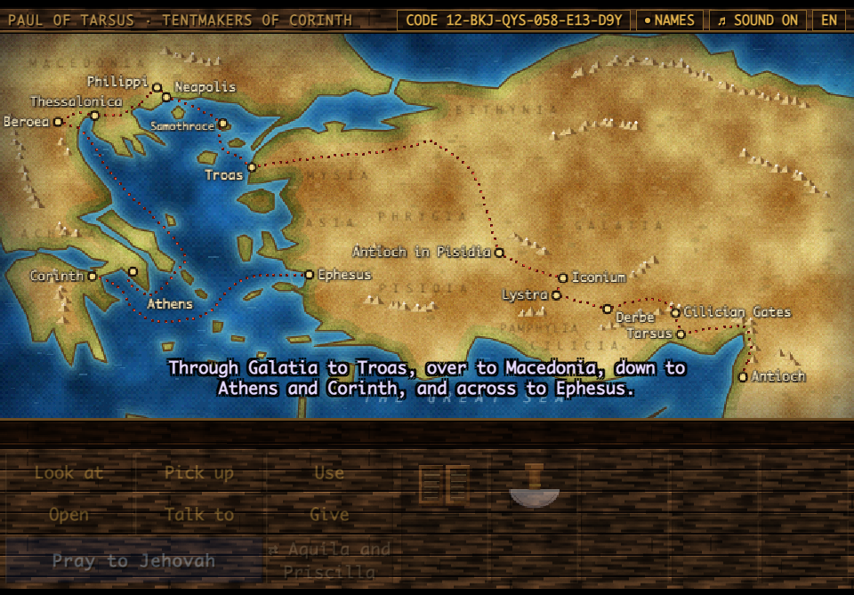 |
| Athens and Corinth, and no road drawn between them | The look back: the second journey, as far as Ephesus |

## About the content

Chapter Twelve tells what the account says (Acts 18:1-23) in the narrator's own words, verse by verse with the reference, and puts none of it into a mouth as a quotation. What Paul's letters say of these months is told the same way (1 Corinthians 1:14, 16; 2:3; 9:24, 25; 16:15; 2 Corinthians 11:9; 1 Thessalonians 1:1; 2:17; 3:6; 5:27). These lines stand together in `levels/chapter12.js` and `lang/de/chapter12.js` (`TOLD` and `PS`), where they can be checked against the Study Edition.

**The trade.** The study note on Acts 18:3 and *Insight on the Scriptures* ("Tentmaker") say that the cloth of Cilicia was stiff and rough and hard to cut and sew; *The Watchtower* of November 1, 2012 ("Did You Know?"), says that tents were also made of leather and of linen, and that Paul, working with Aquila, may have made linen sun awnings of the kind that covered the open court of a private house. *The Watchtower* of March 1, 2009, cites a writer who says that the tentmakers of Corinth also made sails. That Titius Justus ordered such an awning, the hooks and the rope, the goat-hair cloth for the rain, the second cloth, the cover for Sabinus and the torn awning of Marcellus are invented. Where the workshop stood, nobody knows (*Awake!*, January 22, 1991); the game puts it on the road to the western harbor. The account calls Aquila a Jew. Whether the two were disciples before they met Paul is not said in anything read for this chapter, and the game does not say it either way.

**The house next door.** *Bearing Thorough Witness* (chapter 19, paragraphs 9, 10 and 18) says that Paul went on lodging with Aquila and Priscilla, that the house of Titius Justus became the place where he preached and where the new congregation met, and that his words to the Jews cannot have meant that he turned from every one of them: Crispus believed after them. How Crispus came to believe is not said; the day on which he comes through the door is invented. Paul himself baptized Crispus, Gaius and the household of Stephanas, whom he calls the firstfruits of Achaia (1 Corinthians 1:14, 16; 16:15). Acts does not name Stephanas or Gaius: they are seen in the court because the letter places them in Corinth in these months, and *The Watchtower* of December 15, 1996, counts them among those who likely went in and out. What they say is invented. No baptism is shown.

**The letter.** *Insight* ("Thessalonians, Letters to the") and *Bearing Thorough Witness* (chapter 19, box) place both letters to the Thessalonians in Corinth, the first of them after Timothy had come; the book calls it the earliest of Paul's inspired writings, and *Insight* says: perhaps the first. The reed pen, cut slanting and slit, and the ink of soot and gum that was sold dry and mixed with water are from *The Watchtower* of November 1, 2012. Who wrote the letter down, and who carried it, is not recorded anywhere: the game gives the reed to Timothy and the letter to a brother who is not named, and its end screen says so. That Silas had a sheet, and that Priscilla had black for marking cloth, is invented.

**The road out.** The account says that the Lord told Paul not to be afraid (Acts 18:9), and Paul wrote that he had come to Corinth in weakness and fear (1 Corinthians 2:3). *Bearing Thorough Witness* (paragraph 12) says that if he had any doubt about going on in Corinth, it must have gone that night. That anybody spoke of leaving is invented: in the game the others propose it, and Paul neither packs nor agrees. In which month of the stay the vision came is not said.

**The seasons.** His arrival in the autumn of 50 and his sailing in the spring of 52 are from the study note on Acts 18:2 and *Bearing Thorough Witness* (chapter 19). The games at the Isthmus were held every second year, and the box in that chapter says that Paul would have been in Corinth for those of 51; *The Watchtower* of August 1, 1993, says that the visitors lived in tents and that sellers stood under covered stalls. The game gives them a spring: crowds, booths, and a runner. No sanctuary, no rite and no contest is shown, and no god is named. *The Watchtower* of March 1, 2009, names the kinds of people who filled the road to the harbor, and that of August 1, 1993, cites a scholar on the customers, passers-by and officials whom a workshop on such a street brought Paul into contact with. Every one of the five in the game, and what they say, is invented, and nothing is said of who among them came to believe.

**Gallio.** *Insight* ("Gallio") dates his year as proconsul from the summer of 51 to the summer of 52, though some scholars prefer 52 to 53, and says that the office usually began with the summer: so the judgment seat stands empty in the game's spring. The platform of white and blue marble, its fine carving, and the waiting rooms beside it with mosaic floors and marble benches are from *Insight* ("Corinth", "Judgment Seat") and the Study Edition's media note. Which law the charge meant is not said, and what Paul would have answered is invented and never spoken. The publications read for this chapter do not describe the dress of a proconsul: the white mantle with a colored border is the game's own. The beating of Sosthenes is told as Acts 18:17 tells it and not shown. Who beat him, the oldest manuscripts do not say (*Insight*, "Sosthenes"); the publications hold it possible that he is the Sosthenes whom Paul later calls a brother (1 Corinthians 1:1), and the game leaves it at "may".

**Cenchreae, Ephesus, home.** What the vow was, the Scriptures do not tell (*Bearing Thorough Witness*, chapter 19, box; *Insight*, "Vow"): the verse is told without a reason, and from that scene on Paul is painted with his hair short. Why he would not stay at Ephesus is not said either. *The Watchtower* of May 15, 2008, says that Silas and Timothy stayed in Corinth.

**Corinth in pictures.** CONTRIBUTING section 3 makes an exception for Athens, Corinth, Ephesus and Rome. Two temples are seen, from outside and from afar: the old one on its rise over the city, with heavy columns each of a single stone (*Awake!*, January 22, 1991), and the one on the summit of the rock, 513 meters above the marketplace (*Insight*, "Corinth"). No god is named, no rite is shown, and Paul admires neither. The sanctuaries of Cenchreae, the statues of the marketplace and the temple of Ephesus are not shown. The road to Lechaeum with its colonnades of shops and the spring near its end, the two long walls, the trackway on which small ships were hauled across the neck of land, and the two piers of Cenchreae are from *Insight* ("Corinth", "Cenchreae"), *Bearing Thorough Witness* (chapter 19, box), *The Watchtower* of March 1, 2009, and *Awake!* of January 22, 1991. A marble lintel naming a synagogue of the Hebrews was found near that road. The study note on Acts 18:1 says that some date it to Paul's time and that most date it later: the game paints such an inscription over the door, in Greek capitals, and does not claim that it is that stone.

The supporting characters are invented: Sabinus, who ordered a cover; Marcellus, whose awning tore; Kallistos the seaman, Thrason the potter, Decimus the clerk, Praxias the runner and Euphron the seller; Philon of Ephesus; the attendant in the waiting room. Their names are Greek and Latin names that the Scriptures give to nobody: Corinth was a Roman colony.

[← All chapters](../README.md#chapters)
