# Chapter Thirteen: The Hall of Tyrannus

About 52 to 55 C.E. After a while at Antioch, Paul is on the road again, through Galatia and Phrygia from one place to the next, and gives strength to all the disciples. To Ephesus, meanwhile, comes Apollos, a Jew born in Alexandria: a gifted speaker who knows the Scriptures thoroughly, and whose teaching about Jesus is correct, though the only baptism he knows is John's. Priscilla and Aquila hear him in the synagogue, draw him into their company and set the way of God out for him more exactly; then he goes over to Achaia with a letter from the brothers. Paul crosses the inland regions, comes down to Ephesus, and meets some disciples there, about twelve men, to whom nobody has ever said that there is a holy spirit. For three months the synagogue hears him. When some set themselves against believing and run down The Way in front of the crowd, he leaves them, takes the disciples with him, and from then on speaks day by day in the hall of the school of Tyrannus. That lasts two years, until everybody who lives in the province of Asia has heard the word. Cloths and aprons are carried from him to the sick. Seven sons of a chief priest named Sceva try the name of Jesus for themselves, and get an answer. Many who have come to believe tell openly what they practiced; a good many who practiced magical arts heap up their books and burn them in front of everybody, and the price comes to fifty thousand pieces of silver. In this way the word of Jehovah grows mightily and prevails (Acts 18:23–19:20).

| | |
|---|---|
| 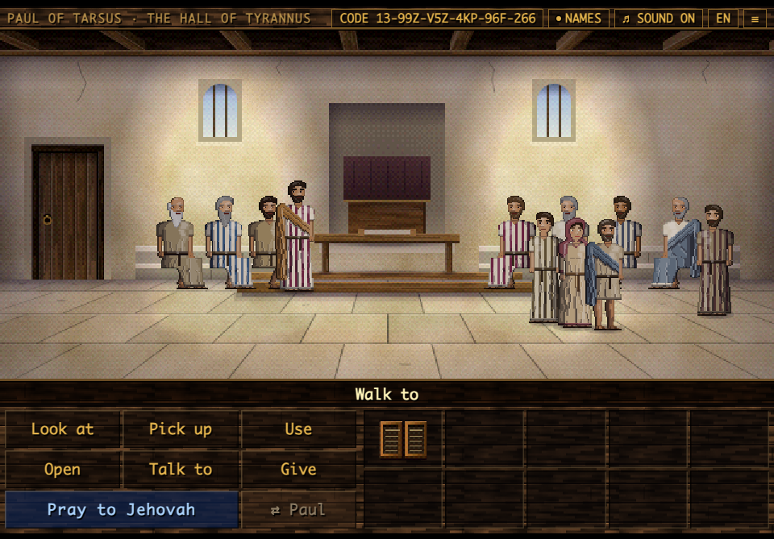 | 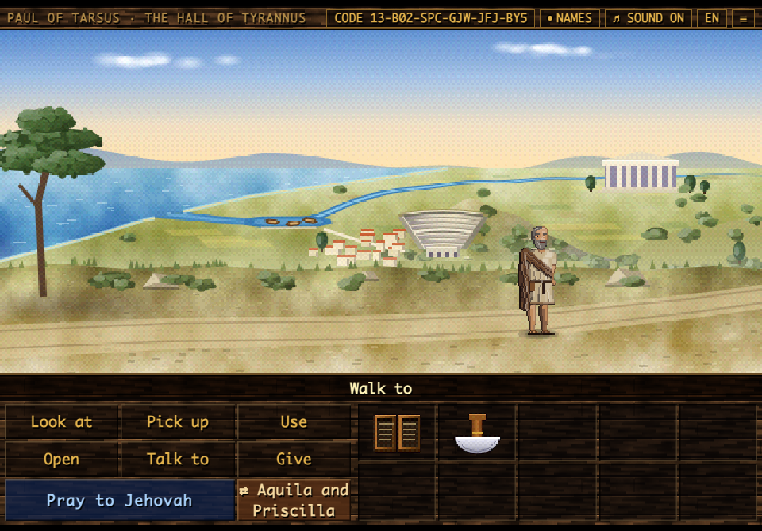 |
| He says nothing that is wrong | The road that was closed to him once |
| 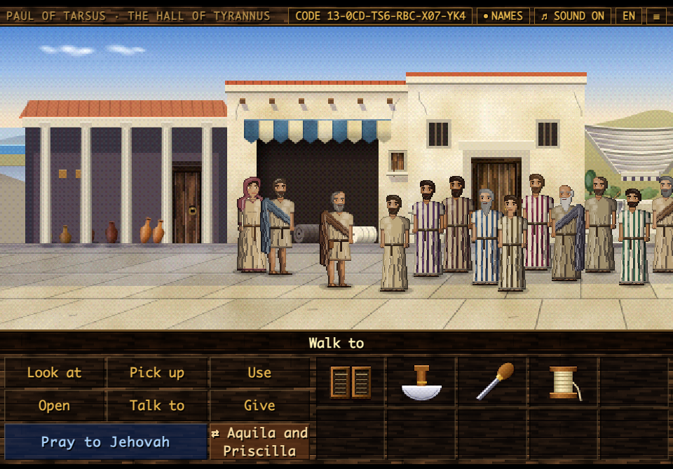 | 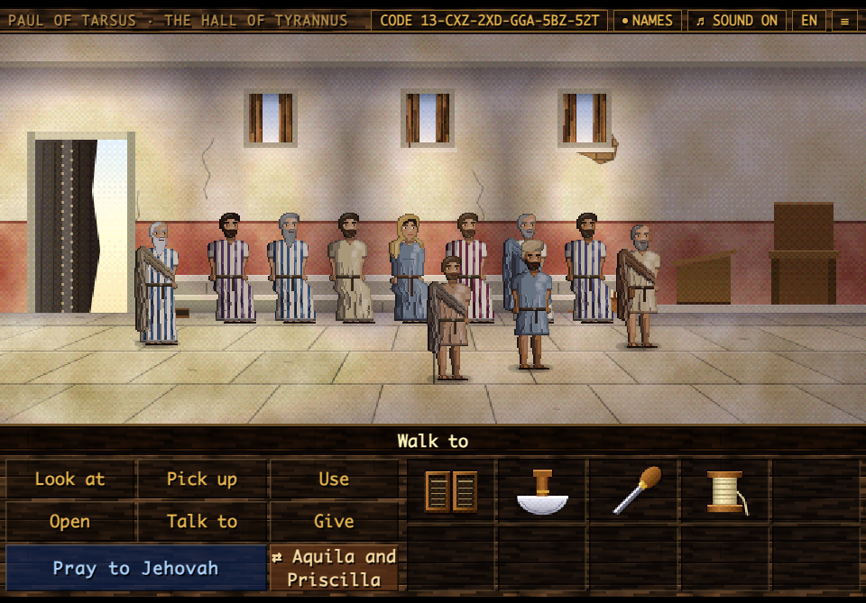 |
| Disciples already: so he asks before he teaches | The hall, in the hot hours, on the second of three days |

Seven locations, more than thirty people, and three things the game has not had: a puzzle about what is **not said**, a **day in three parts** that the player moves on, and two close views, a house that is searched and a counting board.

Nobody in this chapter is in the wrong, and nearly everybody lacks something. Apollos lacks one thing that two tentmakers know. Twelve men lack what nobody has told them. A city of new believers still has its old books at home. None of them is shamed for it: each lets the gap be filled, or gives the thing up. And there is no journey. For the first time a chapter stays in one street, for two years, and the province comes to it.

**What is missing.** The chapter begins without Paul. Aquila and Priscilla are played, as one, from the first scene; the button that would lead to Paul names him and is grey, because he is on a road somewhere. On their tablets stands the way as they were taught it in Corinth, in five notes. In the synagogue Apollos speaks, and each thing he says is one of those notes in better words than theirs: the player says which. Whoever "corrects" him is answered kindly, from the scroll. At the end four notes are marked as heard, and one is not. What is to be found is not a mistake. It is the thing that he did not say.

**Aside.** Where to say it, and how. Before the whole synagogue it would be true and unkind; to say nothing only looks like kindness. So he is asked to their table (Acts 18:26). There the order matters: what he said well comes first, and before they add anything they ask whether they may. When they have told him, the tune of the chapter, which has stepped over one note of its scale since the first bar, plays that note for the first time.

**The right question.** Paul comes down by the inland road, and his awl and thread are given back to him, oiled. Twelve disciples stand at the door of the workshop. Every beginning that offers itself is true, and leads nowhere: they are disciples already, and say so. What opens them is a question, and each answer shows where the next one lies (Acts 19:2-4). Their baptism and what followed are told by the narrator and not shown.

**The door.** Three months later the synagogue is a quarrel. Paul has an answer for everything that Symmachos throws at him, and every answer is turned into the next accusation in front of the crowd. The way through is not a better answer. It is to tell the disciples that they are going, and to go, without a last word (Acts 19:9). Philon, who held Paul to his promise in Chapter Twelve, comes as far as the door.

**A hall for a curtain.** The street has a school, and its hall stands empty from the hour when the sun is high: the sea wind has torn its door curtain, and it is an oven. The caretaker will give it, in those hours, for a curtain that is whole. The cloth is rotten along the tear, so it wants a strip laid behind it and both edges sewn down, at the bench, with the awl.

| | |
|---|---|
| 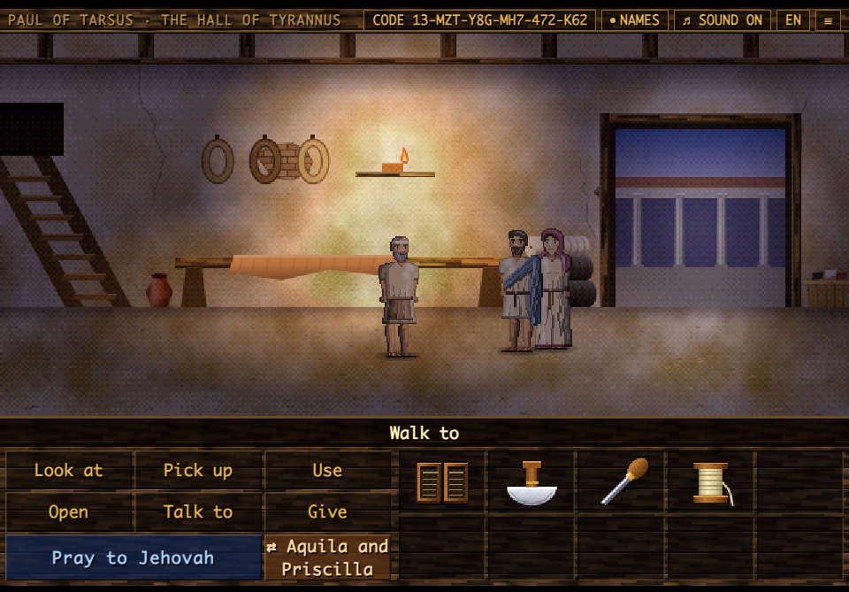 | 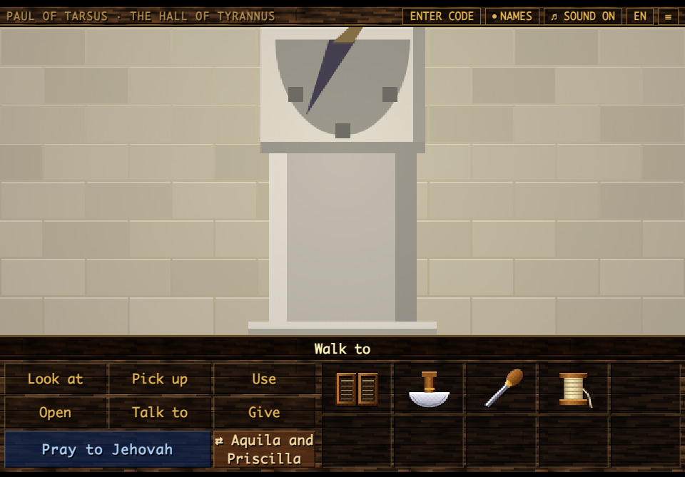 |
| The bench before sunrise | The day is moved on at the sundial |
| 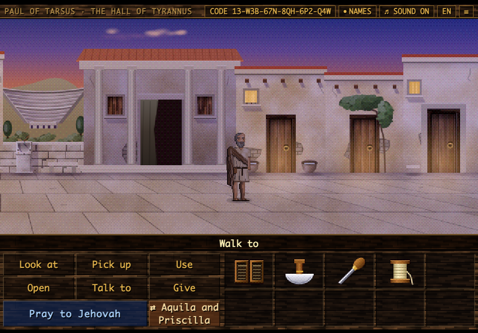 | 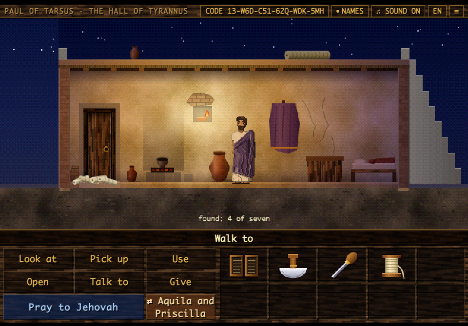 |
| Evening: the doors of those who asked | Nothing kept back: six places, and what he remembers of each |

**A day in three parts.** From then on the same street is seen in three lights: the bench by lamplight before sunrise, the hall at midday, the doors of the street when the lamps are lit (Acts 20:20, 34). The player moves the day on at a sundial in the street, and its shadow will not move while something promised for that part of the day is still open; the steps to the loft end the day. Three days are played out of the two years: an early one, a middle one and a late one. Each time the hall is fuller, and Philon is nearer: at the door of the synagogue, then in the doorway of the hall, then on a bench.

**From house to house.** In the hall somebody always stays behind with a question, and it is answered in the evening, at his lodging, from the Scriptures: the player chooses the passage. On the second day two men ask, and both must be answered that same evening, at two doors. Paul cannot be at both. What the second man asks is how somebody who works six days in seven is ever to learn all this, and the ones to answer it are the two who learned it at the bench: the player changes to Aquila and Priscilla.

**The apron.** On the second morning a woman is waiting at the bench. She asks for the apron that Paul works in, for a sick man of her house, and he gives it. What God did is told by the narrator (Acts 19:11, 12). On the last day the man sits beside her in the hall. Nothing more is made of it.

**Nothing kept back.** A man of standing stands up in the hall and says what he practiced, and that for a year he has kept his books (Acts 19:18). He wants every one of them out of his house, and no longer knows where they all are. His house is seen in the evening with one wall taken away. He remembers something about each place, and the player looks where his words point. No writing and no sign is shown: a book is a tied roll, a charm a small pouch, and nobody reads from one. Then the hard one: the last roll cost more than the house. Why not sell it, and give the silver to the poor? Paul does not tell him. He asks who would buy it.

| | |
|---|---|
| 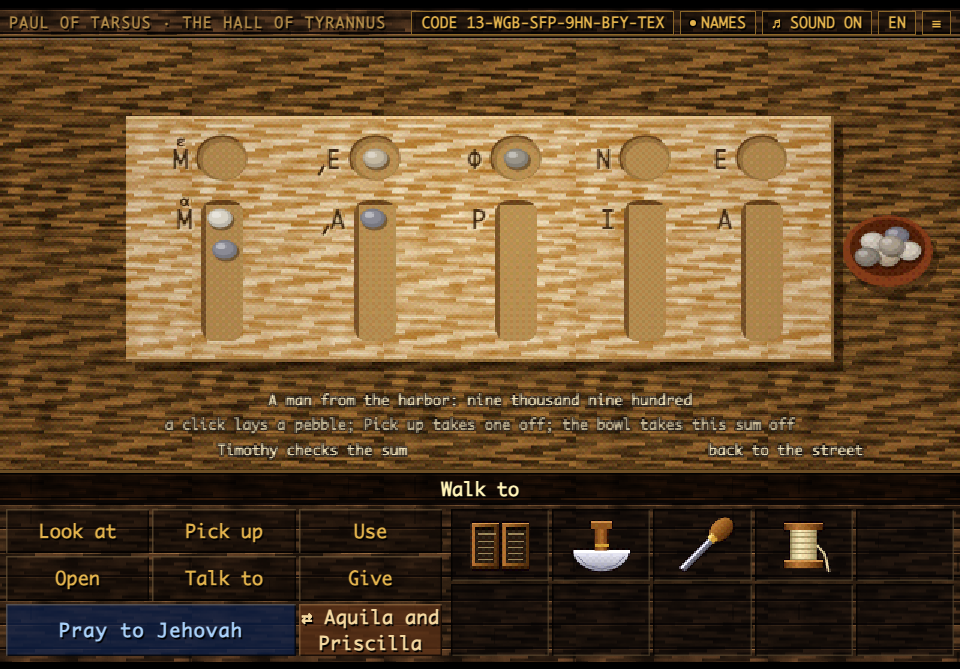 | 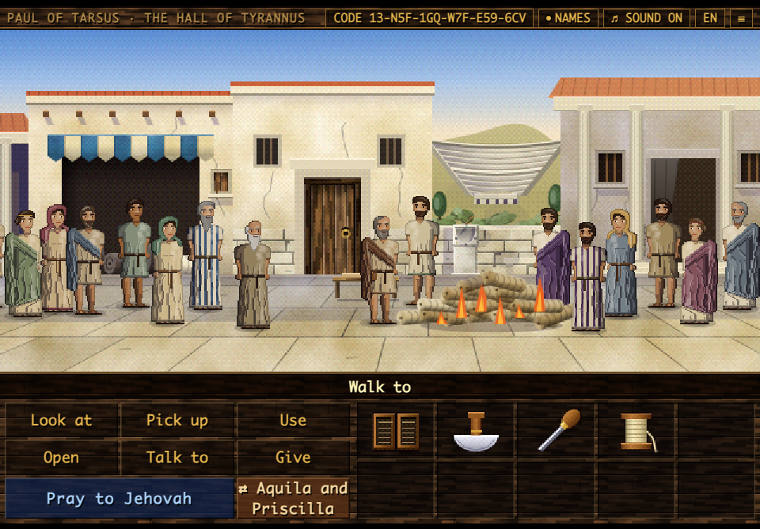 |
| The sum: pebbles, and the letters that the Greeks used for numbers | Before everybody, by day |

**The sum.** In the morning the rolls lie in the street, and before they are lit the price is reckoned. Each owner names what his books cost him, in pieces of silver, some of them as a small sum to work out. The player lays it out in pebbles on a counting board, and Timothy, who keeps the count on his tablet, says whether the board agrees. The board has five places. In each, a trough holds up to four pebbles and a hollow above it holds one that counts as five. Nothing on the board is written in the player's language: beside each trough and each hollow its worth is cut in the letters that the Greeks used for numbers, and what they mean is part of the puzzle. **Look at** names a letter, the board itself shows how the places follow one another (a fifth pebble in a trough becomes one in the hollow, a second in a hollow becomes one in the next place), and prayer gives the key. When the last sum is laid, one pebble lies in the highest place and the board is bare under it.

**Who heard it where.** Each hearer who is answered goes home, and the night after, a picture of the province shows his town and his road: Sardis, then Smyrna and Thyatira, and at the end eight towns. There is nothing to solve in it. Paul has not left the city; the province has come through it and gone home (Acts 19:10).

Walkthrough (spoilers)

1. As Aquila and Priscilla: go out by the door to the street, and in at the door of the synagogue.
2. Talk to Apollos. Each time he has spoken, choose the note that he has just said (the tablets hold all five). After the fourth, talk to him again and choose the note that was not heard: baptism in the name of Jesus Christ, and the gift of holy spirit. Then: "Ask him to our table."
3. At the table: "We haven't heard the Scriptures opened like that for a year." Then: "May we tell you what we were taught".
4. As Paul, on the road: take the road down to the city. In the street, walk to the workshop.
5. Talk to a disciple: "Holy spirit, brothers: was it given to you when you came to believe?" Again: "Then what baptism did you receive?" Again: "John himself pointed people on to someone who would come after him."
6. Go in at the door of the synagogue. Talk to Symmachos as often as you like; then talk to the disciples, and go out by the door to the street.
7. Talk to Menekrates, in front of the hall. Pick up the torn curtain in its door.
8. In the workshop, pick up a strip from the basket of remnants. Use the torn curtain with the workbench, the awl with the torn curtain, the strip with the torn curtain, and the awl once more. In the street, use the mended curtain with the hall of Tyrannus.
9. First day. In the workshop, use the awl with the awning for the potter. In the street, use the sundial. Go in at the hall, use the desk, and talk to Glaukos. Go out by the door curtain, and use the sundial. Open the fuller's door, and choose Daniel 2:44. In the workshop, use the steps to the loft.
10. Second day. Talk to Myrtale, and give her the apron. In the street, use the sundial. In the hall, use the desk, and talk to Hegesias and to Diodotos. Go out, and use the sundial. Open the wine seller's door, and choose Psalm 146:5, 6. Change to Aquila and Priscilla (the **⇄** button, or `C`), go out to the street, open the door under the vine, and choose "We learned it at the bench, a seam at a time." Go back to the workshop, change back to Paul, and use the steps to the loft.
11. Third day. Use the sundial. In the hall, use the desk. Go out, use the sundial, and open the door of the large house.
12. In the house, talk to Kleandros for what he remembers, and click the threshold, the stone by the hearth, the jar of barley, the bed and the rolled mat on the roof; use the awl with the cloak. When six places are found he speaks of the seventh: choose "Who would buy it from you?" In the workshop, use the steps to the loft.
13. In the morning, use the counting board. The letters, from the right: alpha is one and epsilon five; iota ten and nu fifty; rho a hundred and phi five hundred; alpha and epsilon with a stroke, a thousand and five thousand; and under the mu, ten thousand and fifty thousand. Lay each sum on top of the last, and click Timothy after each. The board stands at 15,000 (one pebble in the trough at the far left, one in the second hollow), then at 16,600, at 26,500, at 31,750 and at 50,000. **Pick up** takes a pebble off; the bowl takes off what was laid for the sum in hand.

## Music and sound

| Chapter | Music | Around you |
|---|---|---|
| The Hall of Tyrannus | One tune in three lights, in bars of nine (two, two, two and three), from G with a minor third and a major sixth. Before sunrise it is a working tune on the lyre over a low string and a hand drum. At midday the same tune at half its pace on one pipe, over a single held note. By lamplight it is played on the harp. The tune has a gap: until the evening at the tentmakers' table it leaves out the sixth note of its scale and steps over the place where that note belongs. At that table the note is heard for the first time, alone and then between its neighbors, and from then on it belongs to the tune. On the road above the city the tune is far off; in the synagogue, when the quarrel comes, a low string and a slow drum; what is told in the dark has no music; at the fire all three play it together. Nothing is claimed about how music was played then | The voices of the synagogue and of the street; in the hall, cicadas in the heat of midday, a dry rattle that swells and breaks off, and the sea wind in the door curtain; crickets by night; wind, birds and leaves on the road; a pebble set down on wood; a fire, and the people round it |

Every step can be solved from the text alone, because the game stays quiet in Silent Mode: what each owner says stands written under the board, and Timothy says in words whether the sum agrees.

## The travel map

The chapter opens on the map: the road out of Antioch, through Galatia and Phrygia. The account names no town on it (Acts 18:23), and the map names none. After the evening at the table the map comes again with one new road, through the inland regions and down to Ephesus (Acts 19:1). *Bearing Thorough Witness* (chapter 20) says that he could have sailed, and took the longer road to strengthen the disciples.

Then the map does not move again. What moves is a picture of the province of Asia, with Ephesus on its coast. The towns stand where the publications put them (*Insight on the Scriptures*, under each name): Smyrna on the coast, Pergamum to the north of it and a little way from the sea, Thyatira inland, Sardis south of Thyatira and east of Smyrna, Philadelphia south-east of Sardis, and Laodicea far inland, east of Ephesus, with Hierapolis to the north of it and Colossae to the east-south-east. Those three stand a little further apart than they lay, so that they can be told apart, and Hierapolis a little to the east of north. A road is a row of dots from Ephesus or from a town already on a road; they branch and never cross. The account says that all who lived in the province heard the word, and not how it came to any town: the roads are the ways home of people who had been in the hall, and the picture claims a congregation for none of them.

| | |
|---|---|
| 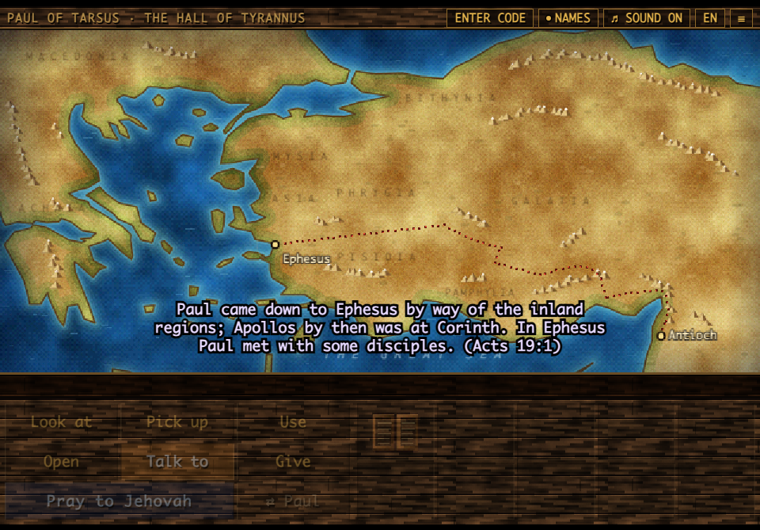 | 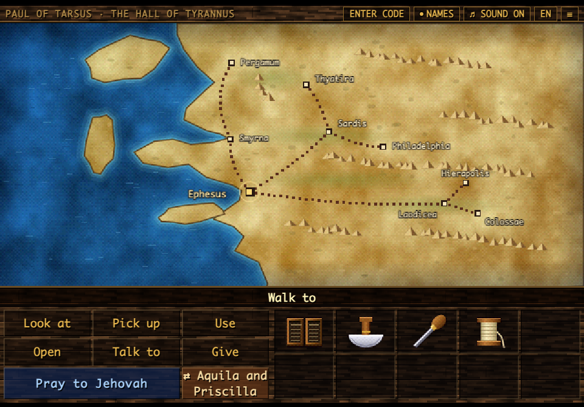 |
| Down to Ephesus, by land | The province at the end of the two years |

## About the content

Chapter Thirteen tells what the account says (Acts 18:23–19:20) in the narrator's own words, verse by verse with the reference, and puts none of it into a mouth as a quotation. That holds for the three questions that Paul asks the twelve as well (Acts 19:2-4): they are worded by the game, and so is what Apollos says of Isaiah and of John. What other passages say of these years is told the same way (Acts 16:6; 20:20, 34; 1 Corinthians 16:8, 9, 19), and so are the three passages from which a question is answered in the evening (Isaiah 40:3; Daniel 2:44; Psalm 146:5, 6). These lines stand together in `levels/chapter13.js` and `lang/de/chapter13.js` (`TOLD` and `PS`), where they can be checked against the Study Edition. The narration says "he" and "they" throughout: the account's "we" does not come back until Acts 20:5.

**Apollos.** The study note on Acts 18:24 and *Insight on the Scriptures* ("Apollos") say that he was apparently raised in Alexandria and may have learned what he knew from disciples of John or from others who had heard of Jesus before Pentecost. What he said in the synagogue is not recorded: the game has him speak of things that such a man could have said, all of them correct, and leaves out the one thing that Acts 18:25 says he did not know. Where and on how many evenings Priscilla and Aquila taught him is not said; their table is invented. *The Watchtower* of October 1, 1996 ("Apollos: An Eloquent Proclaimer of Christian Truth"), says that they wisely did not correct him in public, that one may imagine several conversations, and that he took it humbly. The letter of the brothers (Acts 18:27) is told and not written by the player.

**Aquila and Priscilla.** They were left at Ephesus (Acts 18:19), and the congregation met in their house (1 Corinthians 16:19; *Insight*, "Prisca"). That they worked at a bench there, and that Paul worked with them again, is not said in Acts 19; Paul later reminded the elders of Ephesus that his own hands had supplied his needs (Acts 20:34), and the study note on Acts 19:12 takes the aprons and cloths for those of a man at work. The awning for the potter is invented.

**The twelve.** The account does not say where Paul found them or who brought them; in the game the two tentmakers do, and the men stand at the door of the workshop. *Insight* ("Baptism") says that they had evidently been baptized with John's baptism after it had ceased to be valid. All twelve are drawn, three speak, and none is named. No baptism is shown.

**The synagogue and the hall.** Symmachos and the quarrel are invented; Acts 19:9 says only that some hardened themselves and spoke against The Way before the crowd. Nothing is known of Tyrannus or of his school (*Insight*, "Tyrannus"; study note on Acts 19:9). He is named and never seen, and the caretaker, the torn curtain and the bargain are invented. Acts gives no hours. A few manuscripts add some, from about eleven in the morning to about four in the afternoon; the study note does not take those words for the original text, and says that some find the hot, quiet hours reasonable all the same. The game paints the hall at midday and states no hour as a fact, and its end screen says so. Hours were counted from sunrise, twelve to the day (*Insight*, "Hour"); the publications read for this chapter describe no sundial, and the one in the street is the game's own.

**Timothy.** Acts 19:22 places him at Ephesus at the end of this time and does not tell when he came. He is in the hall on the last played day and keeps the count at the fire; the end screen says what the account leaves unsaid. Erastus is not shown.

**The apron.** Acts 19:11, 12 does not say who asked for a cloth or an apron, or who was made well. Myrtale and the sick man of her house are invented, at the maintainer's wish that one such request be seen. Paul says that there is nothing in the cloth and that what is done, God does. No healing is shown.

**The sons of Sceva** (Acts 19:13-17) are told on the narrator's scroll. Nothing of it is seen or heard.

**The books.** Ephesus was known for magic, and written formulas were named after the city (*Insight*, "Ephesus"; *Bearing Thorough Witness*, chapter 20). Kleandros, his house, the six places and what he remembers of each are invented. No formula, sign or charm is drawn or worded anywhere, in either language. Why the books were burned and not sold, the account does not say: the reason that Kleandros finds (whoever bought the roll would do with it what he had done) is the game's inference and not a verse.

**The sum.** Acts 19:19 says that the prices were reckoned and came to fifty thousand pieces of silver, and not how. The study note leaves open which coin is meant, so nobody in the game names one. The five owners and their sums are invented; they add up to the account's figure. The publications read for this chapter describe no counting board: this one, with its troughs and hollows, is the game's own.

**The letters on the board: for the maintainer to check.** The number letters are *not* taken from the publications. *Insight* ("Number, Numeral") says only that the Jews came to use the letters of their own alphabet as figures, and that the Christian Greek Scriptures mostly write numbers out as words. The ten signs on the board are the Greek number letters as they are commonly given (alpha 1, epsilon 5, iota 10, nu 50, rho 100, phi 500; a stroke at the foot for thousands; mu, for a myriad, with a small letter over it), put there because the maintainer asked for Greek numerals. None of the ten is shaped like a cross; CONTRIBUTING section 3 says what holds if one were.

**The province.** Asia was the Roman province in the west of Asia Minor, and Ephesus by now its capital (*Insight*, "Asia"). In Chapter Eight the spirit forbade Paul to speak the word there (Acts 16:6). Glaukos of Sardis, Hegesias of Smyrna and Diodotos of Thyatira are invented, and so is every road on the picture. Paul's thought of a seller of purple from Thyatira is Lydia (Acts 16:14).

**Ephesus in pictures.** CONTRIBUTING section 3 makes an exception for Athens, Corinth, Ephesus and Rome. The temple is seen once, far off, from the road above the city, and nobody names it or its goddess: the uproar about it belongs to the next chapter. Its size, a hundred columns some seventeen meters high, is from *Insight* ("Ephesus") and *Bearing Thorough Witness* (chapter 20, box). The theater in the slope of the hill, with room for some 25,000, the harbor near the mouth of a river that was kept open by dredging, and the colonnades of shops are from the same pages. Where the synagogue, the hall or anybody's house stood is not known: the street is invented.

The supporting characters are invented: Symmachos, who opposes; Menekrates, the caretaker of the hall; Myrtale; Kleandros; Glaukos, Hegesias and Diodotos; the man who was made well; the owners at the fire. Philon of Ephesus was invented in Chapter Twelve. Their names are Greek names that the Scriptures give to nobody.

[← All chapters](../README.md#chapters)
