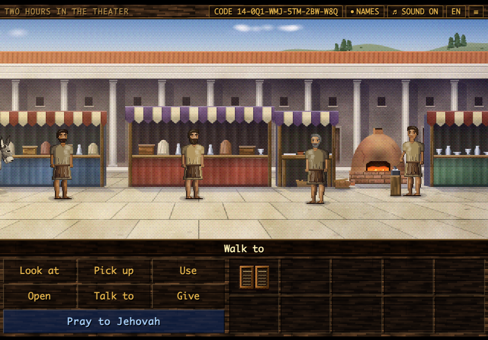
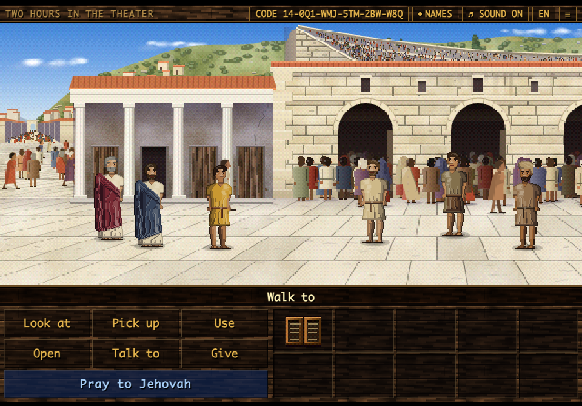
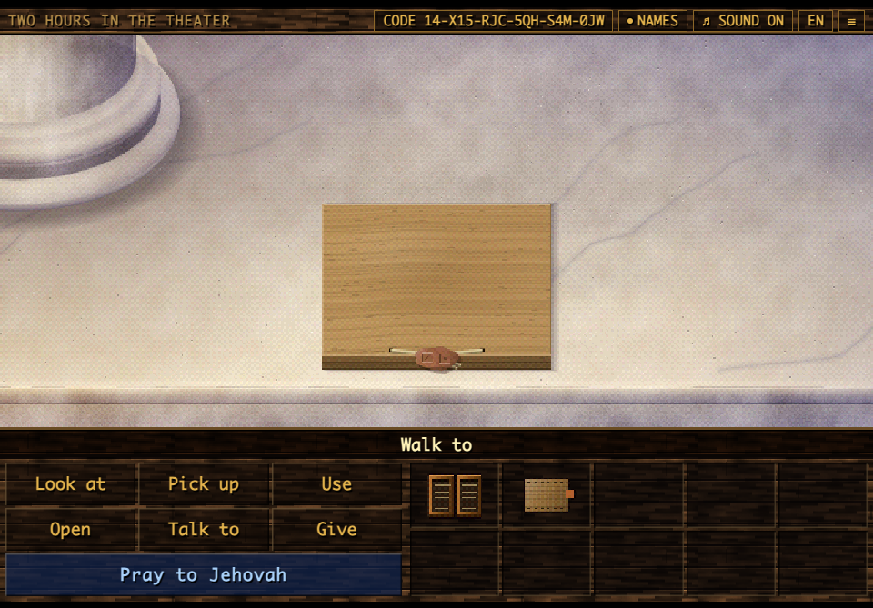
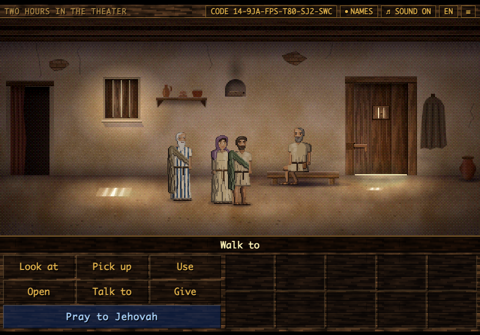
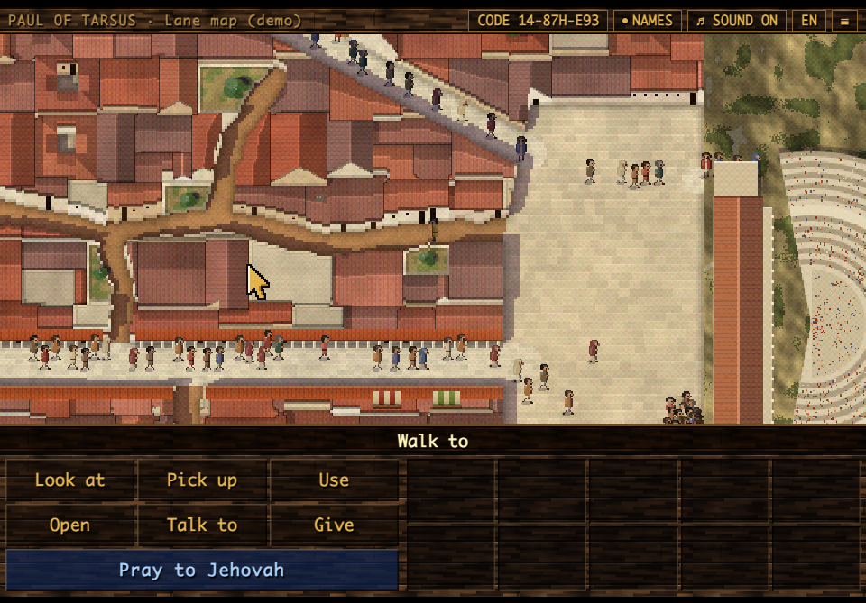
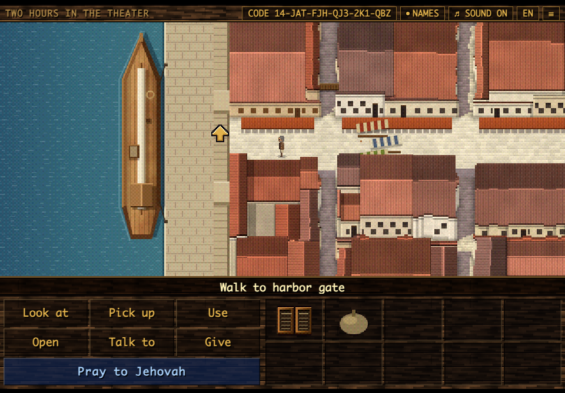

# Chapter Fourteen: Two Hours in the Theater

About 55 C.E. After all this, Paul makes up his mind to travel through Macedonia and Achaia to Jerusalem, and after that to see Rome. He sends two of his helpers, Timothy and Erastus, into Macedonia, and stays on in the province of Asia for a while. Then a silversmith named Demetrius, who makes silver shrines of Artemis, calls the craftsmen together: this Paul has talked a great many people out of their gods made by hands, and their trade is in danger. They start shouting for Artemis of the Ephesians, the whole city is thrown into confusion, and the crowd surges into the theater, dragging along Gaius and Aristarchus, two Macedonians who travel with Paul. Paul is ready to go in among the people; the disciples will not let him, and some of the commissioners of festivals and games, friends of his, send word begging him to keep away. In the theater most of the crowd does not know why it has come. For about two hours it shouts, until the city recorder quiets it and sends the assembly home. When the uproar has died down, Paul sends for the disciples, encourages them, says goodbye and sets out for Macedonia (Acts 19:21–20:1).

| | |
|---|---|
|  |  |
| Demetrius at his stall: told, not played | Six people at the arches, and nobody agrees |
|  |  |
| Writing to writing, the cord through the holes, clay over the knot | Three true words about others, and then the knock |

Four places, a city seen from above, and three people played one after another, none of them Paul until the end: a runner, a household, and then Paul himself.

**The court.** The chapter opens in a small court with a fig tree, inside a block of houses, where Paul is staying with two disciples, Damon and Theano. Timothy and Erastus leave for Macedonia through the passage under the house. The player sees the court once and should remember it.

**The marketplace** is shown and not played. Demetrius stands at his stall among the other silversmiths, one of them at work at the kiln, and the narrator tells what he said to them. The stalls hold boxes, shrines wrapped in cloth and a few small silvery figures without any detail. The crowd's cry is heard and never written: rhythmic vowels of the words Acts gives, in the player's language.

**Why are you here?** At the outer colonnade of the theater the player is Eudoros, a young disciple who serves in the house of Aristokles, one of the commissioners of festivals and games. Half the city is pushing in through the arches, and nobody called an assembly. Six people stand there, each sure of something: a bread seller, a silversmith's apprentice, a porter, a woman with a water jar, an old man and a dyer. Eudoros notes every claim on his tablets. Aristokles then asks three questions (who started it, what it is about, and who was dragged in), and only what two of them agree on is an answer. Every choice names who said it, so that nothing offered is untrue.

**The sealed plea.** Aristokles and Philokrates each write on one leaf of a tablet. Before it goes, it is closed so that nobody can read it on the way and Paul can see that nobody has: the leaves are laid writing to writing with their holes together (one of them has to be turned round first), the cord goes through both holes and is knotted at the edge, and the clay goes over the knot. Then the two commissioners press their rings into it. Every wrong order is turned back with its reason.

| | |
|---|---|
|  |  |
| Against the surge | After the uproar |

**Against the surge.** Ephesus seen at a slant from above. The whole city is pouring into the theater along the harbor road, and the runner has to go the other way, by the back lanes of the residential quarter, to a court that is entered under a house and has a fig tree in it. The crowd presses him back where it is thick, narrow streets are jammed by people who cannot get through themselves, and two other courts, entered the same way, have every shutter bolted and no fig tree. The roar of the crowd dies down as the house comes near. A click walks only by the lanes he has seen or come by, so the way is found by the player.

**Held back.** Inside the door of the house, the player is Damon and Theano. Paul has his mantle on and his hand on the bolt; Gaius and Aristarchus are in the theater because of him, and he is going in. Every warning about his own life is true and only makes him more set on going. What holds him are true words about others: Gaius and Aristarchus, the road ahead of him, the brothers in this city. He lets go of the bolt, takes his mantle off and sits down. Then somebody knocks: the runner, at the hatch, with a sealed tablet whose seals are both whole. It is the last word.

**Two hours.** While they wait, the narrator tells what happened in the theater, and the light from the hatch moves across the floor. Then the city goes quiet.

**The farewell.** In the court, as Paul, the player says goodbye to Damon and Theano, to Philon, who asked him to stay longer years before, to Kleandros, whose books burned in the street, and to the disciples. Then Paul walks the same city, emptied, to the harbor gate. Some streets are barred, stalls lie overturned across the harbor road, and the marketplace can be visited once more on the way.

Walkthrough (spoilers)

1. At the colonnade, as Eudoros: talk to each of the six people at the arches (the bread seller, the apprentice, the porter, the woman with a jar, the old man and the dyer).
2. Talk to Aristokles. Who started it: "The apprentice and the porter: the silversmiths." What it is about: "The apprentice and the dyer: Paul teaches that a god made by hands is no god." Who was taken in: "The porter and the dyer: two Macedonians."
3. In the close view: pick up Philokrates's leaf (it is turned round), then use it (it is laid on Aristokles's). Use the cord with the tablet, then the clay with the tablet. Use the ring.
4. Walk out by the square before the theater. On the lane map keep off the harbor road and go by the back lanes to the north-west: the court where Paul is staying is in a block north of the harbor road, entered by a passage under a house, with a fig tree. The quiet courts have no fig tree.
5. In the house, as Damon and Theano: talk to Paul three times and choose what concerns others: Gaius and Aristarchus, the road he has ahead of him, and the brothers in this city. Then open the hatch and give the sealed tablet to Paul.
6. In the court, as Paul: talk to Damon and Theano, to Philon, to Kleandros and to a disciple. Go out by the passage under the house.
7. On the lane map, walk to the harbor gate at the far end of the harbor road. Where a lane is barred or the road is blocked, go round by another street.

## Music and sound

| Chapter | Music | Around you |
|---|---|---|
| Two Hours in the Theater | One tune, taken over: from D with a minor third and a major sixth, in bars of eight that fall three, three, two. The tune is eight bars long. It begins with four even steps up from the keynote to the fifth, turns back from the sixth, and its first half stops open, held on the fifth; the second half answers it, climbs on by step to the octave, reaches the high E in its sixth bar and comes down by turns to the keynote. In the marketplace it is a working tune on the lyre, over a low string that follows its harmony and a hand drum. In the uproar the same tune is played on a reed pipe an octave higher, every note cut a little short, over a fast hand drum and a low string, with the roar of the crowd under it. In the house there is a low string that plucks the keynote and leans on the note above it, a ticking drum that almost stops every fourth bar, and a ney that begins the tune and breaks off, then climbs to the high note and breaks off there, and the roar outside. After the city recorder there is silence; then the tune comes back at half its pace on the harp for the farewell, all sixteen bars, and far off at the harbor. Nothing is claimed about how music was played then | The hammers of the silversmiths; the roar of a crowd, with a slow swell, and its cry: many men shouting the same vowels a little off one another's beat and pitch, the vowels and rhythm of the words Acts gives, in the player's language, and never a word to read; a knock at a door; a seal broken; birds and wind after the uproar, and at the harbor waves and gulls |

Every step can be solved from the text alone, because the game stays quiet in Silent Mode: on the lane map the house is found by its description, a passage under a house and a fig tree in its court, and the roar of the crowd is only a help.

## The lane map

The city is laid out from what the publications say of Ephesus in Paul's day. *Insight on the Scriptures* ("Ephesus") places the theater in the hollow of Mount Pion, with room for about 25,000 in 66 rows, and describes the street that ran from in front of it straight to the harbor: paved with marble, about half a kilometer long and eleven meters wide, with colonnades and shops on both sides and a gateway at each end; the harbor lay inland and was kept open by dredging. The Study Edition's media on Acts 19:29 puts the theater where two main streets met, with the agora beside it. The publications name no street, and nothing is named on the screen: the street to the harbor is the harbor road. The Study Edition's picture labels it "Arcadian Way" without dating the name, and the game leaves that name out. The grid of streets at right angles follows the maintainer's notes on the city's plan; in Ephesus such streets may cross on the map (CONTRIBUTING section 3). The theater faces west, toward the harbor at the end of its street. The temple at the edge of the map stands outside the city, far off, and nothing on the screen names it.

## About the content

Chapter Fourteen tells what the account says (Acts 19:21–20:1) in the narrator's own words, verse by verse with the reference, and puts none of it into a mouth as a quotation. Demetrius's speech (Acts 19:25-27) and the city recorder's (19:35-40) are told as what they said, in the third person, and nobody played speaks inside the theater. These lines stand together in `levels/chapter14.js` and `lang/de/chapter14.js` (`TOLD`), where they can be checked against the Study Edition; the German lines were written from the German edition. The narration says "he" and "they" throughout: Luke is not with Paul here, and the account's "we" does not come back until Acts 20:5. Neither "Jehovah" nor "Lord" appears in these verses.

**The date.** *Insight on the Scriptures* ("Demetrius") places the riot near the end of Paul's stay in Ephesus, about 53 to 55 C.E.; "Ephesus" has him arrive in 52 and teach three months in the synagogue and two years in the hall of Tyrannus.

**Demetrius and the shrines.** Demetrius is named by the account (Acts 19:24). Where he spoke to the craftsmen is not said; the game sets it in the silversmiths' marketplace. *The Watchtower* of February 1, 2009 ("Did You Know?") says that the silversmiths prospered from silver shrines of Artemis, which visitors bought as souvenirs, amulets or offerings, or for worship at home, and that inscriptions from Ephesus name a guild of silver-workers; the Study Edition's media on Acts 19:23 shows one such inscription, from a later century. What the shrines looked like is not described in the publications read; the stalls show them wrapped in cloth or in boxes, and the few small figures beside them are plain draped shapes without detail, as issue #35 asked (CONTRIBUTING section 3, the exception for Ephesus, in its most restrained form). Nobody bows to anything, and the temple is seen only far off.

**The commissioners and the runner.** The study note on Acts 19:31 says that the commissioners of festivals and games (literally, Asiarchs) were leading men of the province of Asia who presided over and paid for its public games; *Bearing Thorough Witness* (chapter 20) says that Paul's conduct had won the respect of such officials. Acts does not say how their message reached him, or what it said beyond their plea. Aristokles and Philokrates, their names, the runner Eudoros, the tablet and its seals are invented. *Insight* ("Seal") describes a deed folded, tied with a cord, a lump of clay or wax pressed onto the cord and the seal pressed into it, and ("Letters") says that confidential letters were usually sealed; how a wax tablet was bound is not described there, and the holes and the knot at its edge are the game's own.

**The six at the arches.** Acts 19:32 says that some shouted one thing and some another, and that most did not know why they had come together. The six people and what each says are invented; what two of them agree on is what the account says (the silversmiths began it; it was about Paul's teaching that gods made by hands are no gods; two Macedonians, Gaius and Aristarchus, were dragged in). The woman's "temple robbers" is wrong, as the city recorder later says (19:37).

**The house and the disciples.** Acts does not say where Paul was staying, or who the disciples were who held him back. Damon and Theano and their house are invented; Aquila and Priscilla, at whose bench he worked in Chapter Thirteen, are not shown, so that nothing is claimed about Romans 16:3, 4. Philon (Chapter Twelve) and Kleandros (Chapter Thirteen) are invented, and come to the farewell. What the disciples say to hold Paul back, and what he says to them at the farewell, is invented; the account says only that the disciples would not let him go in (19:30) and that he encouraged them (20:1).

**Gaius and Aristarchus** are dragged into the theater (Acts 19:29) and are not shown; nothing is done to anyone on the screen. *Insight* ("Gaius") calls this Gaius a Macedonian who travelled with Paul, and possibly the Gaius of Derbe of Acts 20:4. What happened to the two after the assembly was dismissed is not said; Aristarchus is with Paul again later (Acts 20:4; 27:2).

**Alexander** (Acts 19:33, 34) is told and not shown. *Insight* ("Alexander") lists him apart from the coppersmith of 2 Timothy 4:14; *Bearing Thorough Witness* (chapter 20) says that he may have wanted to explain how the Jews differed from the Christians.

**The city recorder.** *Insight* ("City Recorder") calls him the most important public officer of the city, with direct access to the proconsul and answerable to Rome for order; the assembly in the theater was not a lawful one. *Insight* ("Theater") says that the theater was used for public assemblies.

**Timothy and Erastus** are sent to Macedonia at the start (Acts 19:22); what they say in the court is invented. *Insight* ("Erastus") thinks him likely to be the Erastus who later stayed in Corinth (2 Timothy 4:20).

**How Paul left.** Acts 20:1 says that he set out for Macedonia, and not how. *Bearing Thorough Witness* (chapter 21) says that on the way he stopped at Troas (2 Corinthians 2:12, 13). The ship at the quay is invented, and the chapter ends at the harbor gate.

The supporting characters are invented: Eudoros; Aristokles and Philokrates; Damon and Theano; the bread seller, the silversmith's apprentice, the porter, the woman with a jar, the old man and the dyer; the silversmiths but Demetrius; and the disciples at the farewell. Philon and Kleandros were invented in Chapters Twelve and Thirteen. Their names are Greek names that the Scriptures give to nobody.

[← All chapters](../README.md#chapters)
