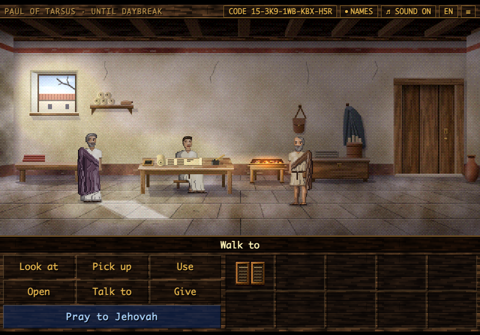
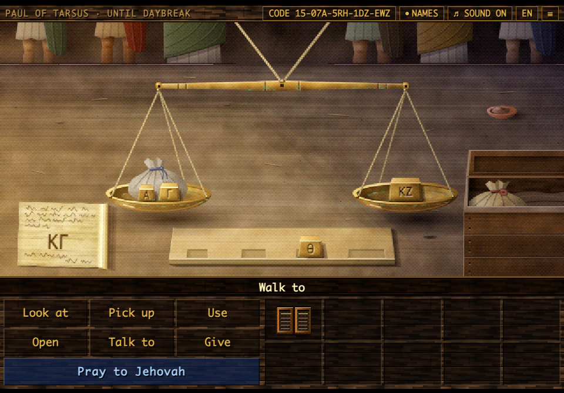
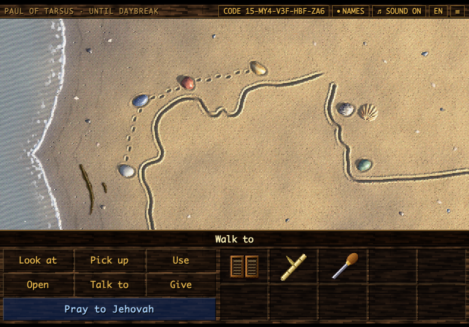
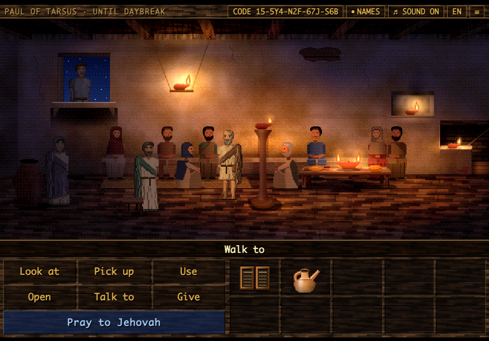
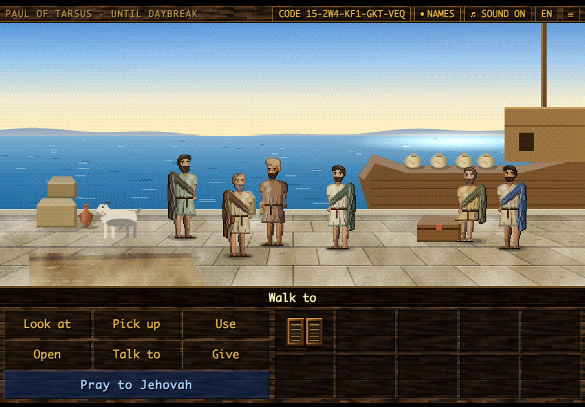
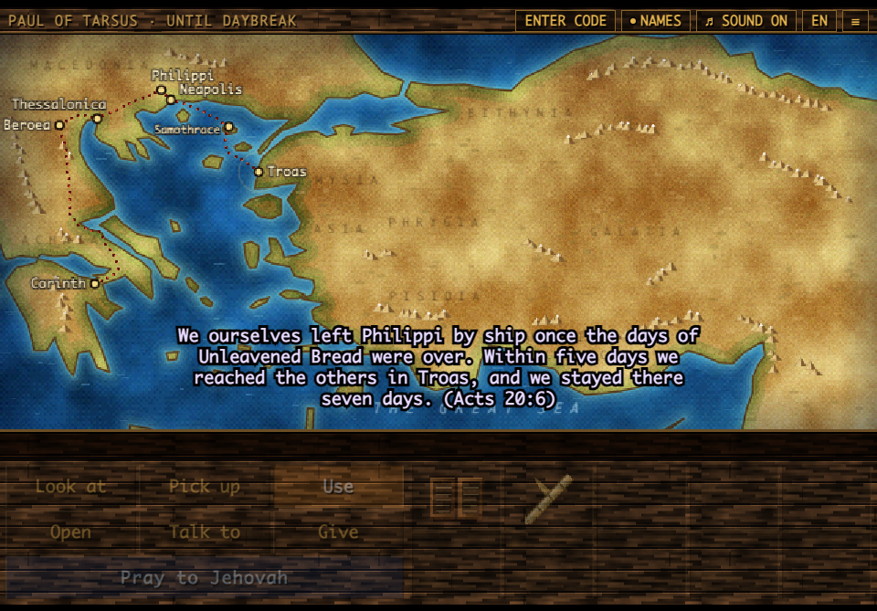
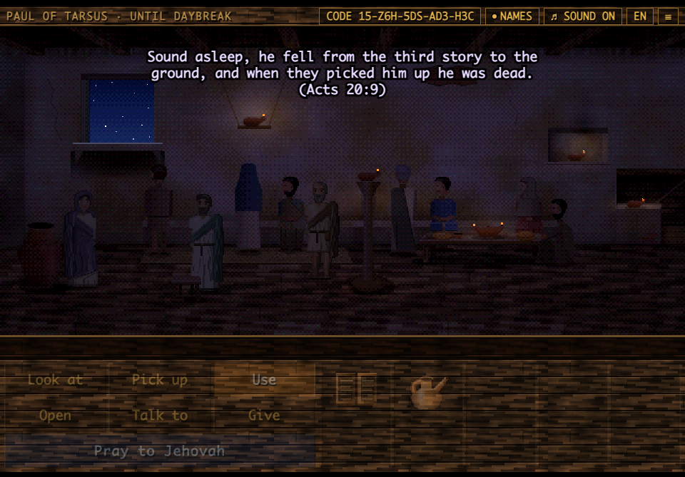
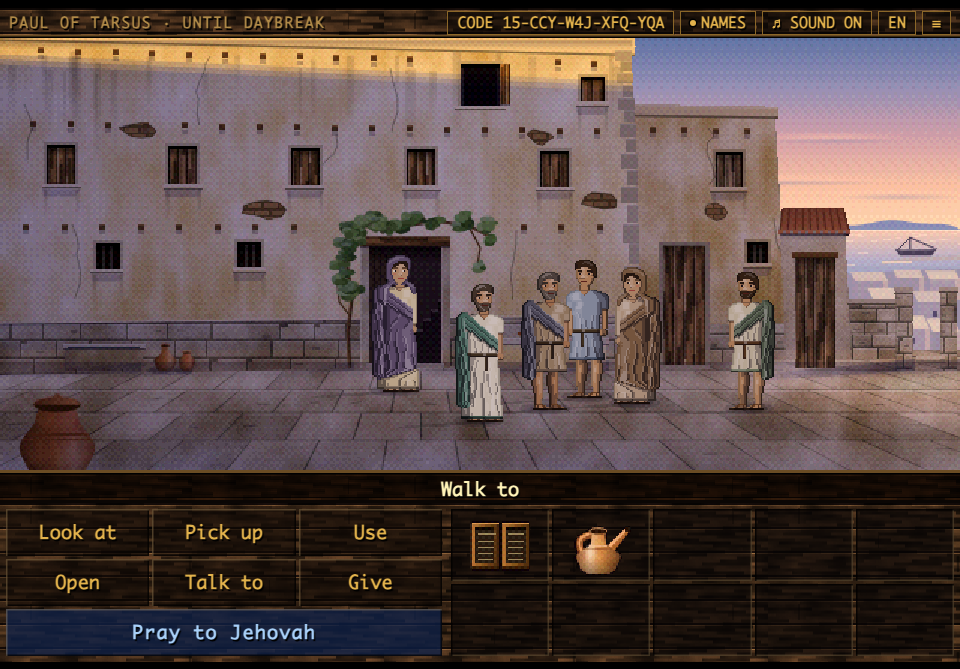

# Chapter Fifteen: Until Daybreak

About 56 C.E. When the uproar at Ephesus is over, Paul sends for the disciples, encourages them, says goodbye and sets out for Macedonia. He travels through those parts with much to say that encourages the disciples, and comes to Greece, where he spends three months. He is about to sail for Syria when a plot is laid against him, so he decides to go back through Macedonia. Seven men go with him: Sopater of Beroea, the son of Pyrrhus; Aristarchus and Secundus of Thessalonica; Gaius of Derbe; Timothy; and Tychicus and Trophimus from the province of Asia. They travel ahead and wait at Troas. From here the account says "we": they sail from Philippi after the days of the unleavened bread, reach the others at Troas within five days, and stay there seven. On the first day of the week they have come together for a meal, and Paul, who means to leave the next day, speaks to them, and goes on until midnight, in an upper room lit by quite a few lamps. A young man named Eutychus, sitting at the window, sinks into a deep sleep while Paul talks on, falls from the third story and is picked up dead. Paul goes down, throws himself on him and puts his arms around him, and tells them to stop their outcry, because he is alive. Then he goes up again, begins the meal and eats, talks with them a long while, until daybreak, and leaves. The boy is taken away alive, and they are comforted beyond measure (Acts 20:1-12).

| | |
|---|---|
|  |  |
| What does a stranger need to read about Phoebe? | Twenty-three: twenty-seven across, three and one beside the bag |
|  |  |
| The way, where the chest waits, and where Paul stays | Five lamps, one jug, and a long evening |

Seven places, two close views, two roads told over the map, and two people played one after the other: Paul in Greece, and Luke from the quay of Troas to the end.

**Carried to Rome.** The chapter opens on the map and then in Corinth, in the house of Gaius, on a winter day. Tertius has written down the body of a long letter to the holy ones in Rome, and one thing is missing: Phoebe is going there, and nobody in Rome knows her. Tertius asks three questions, as a stranger would: who is she, what do you ask of them, and why should they? Each time three lines are offered, and every one of them is true, because Paul does not lie; but only one answers the question, and a line that is beside the point is turned back and drops out.

**The scale: in the sight of men.** In the storeroom the gift for the holy ones in Jerusalem is weighed where everybody can see it, each congregation's bag against the weight that its letter gives. This is a close view of a balance of bronze. Paul does not touch the silver or the bags; he sets the weights. The house has four of them, and each bears its worth in the letters that the Greeks used for numbers, as each bag's letter does: what the letters mean is part of the puzzle. A click moves a weight from the board into the right pan, a second click into the left pan beside the bag, a third back to the board, and the beam tilts as it would. The first bag is weighed by adding; the next two cannot be, with four weights, until one sees that a weight laid beside the bag takes away from what lies across from it. When the beam stands level, the bag agrees with its letter, and it is sealed before them all.

| | |
|---|---|
|  |  |
| A ship for Syria, and a word from a porter | By land to Philippi, and across to Troas |

**Cenchreae.** At the harbor that looks east a ship for Syria is loading. A brother who carries loads on the quay has a word for Paul, away from the gangway: since yesterday men have been asking which ship he sails on. So not this ship, and not this harbor. A goat is tethered among the bales.

**The other road.** Paul lays the plan out in the wet sand at the foot of the quay, where all nine can see it: a second close view, seen from above, with a pebble for each city. Three things are settled, with three things he has in his hands. The reed draws the way. The shell stands for the seven and the chest, and is laid where they will wait. His own awl stands for him, and is set where he will stay over the days of the unleavened bread. Each wrong place is turned back with its reason, by Paul or by one of the men who stand round. Then the journey is told over the map, and the narrator's "they" becomes "we".

**Troas, the quay.** From here Luke is played. It is the seventh day at Troas, Paul leaves in the morning, and tonight everyone comes together in the upper room of a house in the city. The woman of the house asks whether Luke would bring the oil up from the quay.

**Oil and hours.** The upper room is lit by five lamps of three sizes, and the big jar of oil has to last until morning: the jug is filled with three measures at a time, each time Luke has sat and listened a while. A sitting burns one measure in every lamp. Luke cannot sit down while a lamp is burning its last, or with oil still in his jug; and he will not pour a measure where it would leave another lamp dark before midnight. So the puzzle is to see which lamp runs dry first, sitting after sitting, four times. There is never a dead end: a pour that cannot be made good is not made. A young man sits on the windowsill, where the air is, and Luke may have a few kind words with him. Nothing the player does or leaves undone changes what happens to him.

| | |
|---|---|
|  |  |
| Told, with the window empty | The boy on his own feet, with his people round him |

**Midnight** is told, and nobody is played. The young man is still in the window while the narrator tells of his sleep. Then the picture is the same room with the window empty, and the fall is told: it is never shown, and nothing sounds. The music has stopped. The street below is seen by night, with Paul bent low among the people who stand round, small and half hidden; then the room again, with Paul at the table; and then the street at daybreak.

**Daybreak.** In the street under the house Luke finds Eutychus on his own feet, with his people round him, and the ship for Assos is ready.

Walkthrough (spoilers)

1. In the house of Gaius, talk to Tertius. Who is she: "She's our sister, and she serves the congregation in Cenchreae." What do you ask: "That they welcome her in the Lord, as holy ones should, and help her with whatever she needs." Why: "Because she has stood up for many, and for me too."
2. Go through the door to the storeroom. The number letters: Α is one, Γ three, Θ nine, Ι ten, Κ twenty, so ΚΖ is twenty-seven. Click a weight to move it: into the right pan, then into the left pan beside the bag, then back to the board. The bag from Galatia, ΙΒ (twelve): Θ and Γ in the right pan. The bag from Achaia, ΚΓ (twenty-three): ΚΖ in the right pan, Γ and Α beside the bag. The bag from Macedonia, ΙΖ (seventeen): ΚΖ in the right pan, Θ and Α beside the bag. Each time, use the scale (or talk to Timothy) when the beam stands level.
3. At Cenchreae, talk to the man from the quay. Then look at the strip of sand.
4. Over the plan: use the reed with the road north; use the shell with the pebble for Troas; use the awl with the pebble for Philippi.
5. On the quay of Troas, as Luke: talk to the oil seller, then take the lane to Korinna's house.
6. In the upper room, use the stool to sit and listen. After the first sitting use the jug with the lamp at the stairs twice and with the lamp in the niche once, and sit again. After the second: twice with the lamp by the speaker, once with the lamp in the niche; sit. After the third: once each with the lamp at the stairs, the hanging lamp and the lamp on the table; sit. (Other ways through the night work too. Look at a lamp to see what it holds.)
7. At daybreak, take the way to the harbor.

## Music and sound

| Chapter | Music | Around you |
|---|---|---|
| Until Daybreak | One tune, and what a night does to it: six notes from C, with a major third and no seventh, in bars of twelve that rock in four threes. In the house of Gaius the lyre has it over a low string; at Cenchreae one pipe has it over a harp, and when the warning has come its keynote is withheld, a rest wherever the tune came home and the fifth held under it; on the road north the same notes are counted in twos, on the oud over a hand drum, and on the quay of Troas lyre and pipe take turns with it. In the upper room the harp plays it at a third of its pace, with long rests; at midnight nothing plays, then one low note; at daybreak the lyre has it again and climbs once to the keynote above, which it reached nowhere before. Nothing is claimed about how music was played then | A brazier's tick in the house in winter; sea, gulls and a creaking hull at the two harbors; in the upper room the faint hiss of the lamps, a wick that sputters, and the quiet of a sleeping city; nothing at all at midnight; the first birds at daybreak, one at a time |

Every step can be solved from the text alone.

## The travel map

The chapter opens on the map: from Ephesus to Troas, across to Macedonia, through it, and down to Corinth. Acts says only that Paul set out for Macedonia, went through those parts and came to Greece (Acts 20:1, 2); that he was at Troas on the way is known from his own letter (2 Corinthians 2:12, 13). No road or ship is named for any of it. Between Ephesus and Troas the line shows open water, west of Chios and of Lesbos; from Troas it takes the sea lane to Neapolis that Chapter Eight drew, and from Philippi it runs by Thessalonica to Beroea; from there to Corinth it keeps to the land.

After the plan in the sand the map comes again with the other road: from Corinth by land, round the head of the gulf and up through Thessaly to Beroea, on to Thessalonica and Philippi, and from there by sea to Troas. The account says that he went back through Macedonia and sailed from Philippi (Acts 20:3, 6), and names no town between. Which way the seven took to Troas is not said, and no line is drawn for them. The two roads are shown on two maps, so that no line lies on another.

## About the content

Chapter Fifteen tells what the account says (Acts 20:1-12) in the narrator's own words, verse by verse with the reference, and puts none of it into a mouth as a quotation. These lines stand together in `levels/chapter15.js` (`TOLD`) and in the language files, where they can be checked against the Study Edition; the German lines were written from the German edition. The two lines of Acts 20:1 have the wording of Chapter Fourteen, where the verse is told first: a verse has one wording wherever it is told. The narration says "he" and "they" up to Acts 20:4 and "we" from Acts 20:5 on, as the account does, and from the quay of Troas on Luke is played. What Paul said that night is told and never composed: in the upper room he is seen speaking, and the player hears none of it. A few lines outside Acts carry a reference as well: the narrator's on Gaius, Tertius and the gift (Romans 16:22, 23; 15:26), and Paul's own at the weighing (2 Corinthians 8:5, 20, 21). Each says in the game's words what the passage says, and none is a quotation.

**What was read, and how.** On 23 November 2026 these were read on wol.jw.org, in English and in German: Acts 20 in the Study Edition with its notes; 2 Corinthians 2, 7 and 8; 1 Corinthians 16; Romans 15 and 16; *"Bearing Thorough Witness" About God's Kingdom*, chapter 21, with its two boxes; and in *Insight on the Scriptures* the articles "Eutychus", "Troas", "Lamp", "Gaius", "Sopater", "Secundus", "Tychicus", "Trophimus", "Tertius", "Phoebe" and "House". Part of that reading was done through a tool that fetches a page and returns a summary of it, because no browser was connected at the time; Acts 20:1-13 in German was read in the browser itself. No article "Window" or "Contribution" was found in *Insight*. The decisions that followed are in issue #36.

**The date and the road.** *Bearing Thorough Witness* (chapter 21) has Paul stop at Troas after leaving Ephesus, hoping to find Titus there (2 Corinthians 2:12, 13), go on into Macedonia, perhaps for a year or so, meet Titus there (2 Corinthians 7:5-7) and write 2 Corinthians about 55 C.E. For the three months in Greece (Acts 20:2, 3) the book names Corinth, and says that the letter to the Romans was likely written during that stay; the study note on Romans 15:23 dates the letter to the beginning of 56 C.E. *Insight* ("Troas") puts the week at Troas in the spring of 56 C.E. Acts itself does not say in which city the three months were spent, and the end screen says so.

**Tertius, Gaius and Phoebe.** Tertius did the writing of the letter to the Romans and adds a greeting of his own (Romans 16:22). Gaius is host to Paul and to the whole congregation (Romans 16:23); *Insight* ("Gaius") takes him for the Corinthian whom Paul baptized (1 Corinthians 1:14), a different man from Gaius of Derbe, who is one of the seven (Acts 20:4). The game keeps the two apart, and Paul says so when he looks at the second. Phoebe is our sister, a minister of the congregation in Cenchreae, and has stood up for many and for Paul himself; the Romans are asked to welcome her and to help her with whatever she needs (Romans 16:1, 2). The study note says that she may have carried the letter. The game takes that as possible and not certain, and its end screen says so; Phoebe herself is not shown. What Tertius asks and how Paul answers is invented: the three answers that are written down say, in the game's own words, what those two verses say of her, and the six that are turned back are true and say nothing of her.

**The gift, and who carried it.** The brothers in Macedonia and Achaia had gathered a gift for the holy ones in Jerusalem who were poor (Romans 15:25-27); the Macedonians had begged to be allowed to give, and gave themselves first (2 Corinthians 8:1-5); the Corinthians had been told to put something by every week (1 Corinthians 16:1, 2); and men chosen by the congregations travelled with it, so that nobody could find fault with Paul over it, because he cared for what is honest in Jehovah's sight and in men's as well (2 Corinthians 8:16-21). The box on the relief contributions in *Bearing Thorough Witness* (chapter 21) says that in 56 C.E. representatives of congregations met Paul with what had been collected, and that nine men travelled together, for safety and so that nobody could accuse Paul. Neither Acts nor that book says in so many words that the seven of Acts 20:4 carried the gift. The game shows them with it, as its reading, and its end screen says that Acts does not say so.

**The scale.** Nothing in the account or in the publications read says how the gift was counted, kept or carried. The balance, the letter that comes with each bag, the weights and what the bags weigh, the chest and the seals on it are invented, and so is Nikandros, the brother of Corinth who kept Achaia's bag. In the game Paul sets the weights and never touches a bag or the silver: that is the game's way of showing what 2 Corinthians 8:20, 21 says he took care of.

**The number letters: for the maintainer to check.** As on the counting board of Chapter Thirteen, the number letters are *not* taken from the publications; *Insight* ("Number, Numeral") says only that the Jews came to use the letters of their own alphabet as figures, and that the Christian Greek Scriptures mostly write numbers out as words. The letters here are the Greek number letters as they are commonly given: alpha 1, beta 2, gamma 3, zeta 7, theta 9, iota 10, kappa 20. The four weights are Α, Γ, Θ and ΚΖ (1, 3, 9 and 27); the three letters give ΙΒ, ΚΓ and ΙΖ (12, 23 and 17); and Paul's tablets note "Α 1, Β 2, Γ 3 ... Θ 9, Ι 10, Κ 20". None of these seven letters is shaped like a cross; CONTRIBUTING section 3 says what holds if one were.

**The plot.** Acts 20:3 says that a plot was laid against Paul by the Jews as he was about to sail for Syria, and that he decided to return through Macedonia. *Bearing Thorough Witness* (chapter 21) suggests that they may have expected him at Cenchreae. How the plot became known is not said. Mikon, the brother who carries loads on the quay, and what he has heard are invented, and so is the ship.

**The seven, and the other road.** The seven are named in Acts 20:4, and verse 5 says that they went ahead and waited at Troas; by which way is not said. The study note on Acts 20:5 has Luke join Paul again at Philippi, which is why the "we" begins there; in the game Timothy says that Luke is at Philippi. The plan in the sand, with its reed, shell and awl, is invented: it lets the player arrive at what verses 3 to 6 say (back through Macedonia; the seven ahead to Troas; Paul at Philippi over the days of the unleavened bread, and then across), and the reasons that Paul and the others give for each place are the game's own. Timothy, Aristarchus and Trophimus speak, and what they say is invented; Sopater, Secundus, Gaius of Derbe and Tychicus are seen and say nothing.

**The upper room and its lamps.** Acts 20:7, 8 says that they had come together for a meal on the first day of the week, that Paul spoke until midnight, and that there were quite a few lamps in the upper room. The study note on Acts 20:7 says that this was an ordinary meal, not the Lord's Evening Meal, and the game shows bread on a table and nothing more. Whose house it was is not said: Korinna and her house are invented, and so are the oil seller on the quay and the big jar. *Insight* ("Lamp") describes the lamps of that day: mostly of earthenware, by the first century closed on top, with a hole for filling and a spout for the wick; a wick of flax and olive oil; set in a niche, on a shelf or a stand, or hung by cords. It does not say how long a lamp burned. The three sizes, what each holds and what a sitting burns are the game's own.

**Eutychus.** The account calls him a young man (Acts 20:9) and, when he is taken away alive, the boy (20:12). The study note on Acts 20:10 says that his life was restored. *Insight* ("Eutychus") names tiredness, and perhaps the heat of the lamps, as what may have overcome him. His few words with Luke before midnight are invented, and so are the two people who stand with him at daybreak. The game never shows the fall and gives it no sound: the narrator tells it over the picture of the empty window. In the street by night Paul is seen bent low among those who stand round, small and half hidden, and nobody lies in plain sight. Nothing the player does, or leaves undone, touches Eutychus: he sits where the account has him, and at daybreak he stands in the street.

**The German text.** Names and terms follow the German Study Edition: Beroa, Thessalonich, Sekundus, Gajus, Tychikus; the plot of Acts 20:3 is an „Anschlag“, the festival days of verse 6 are the „Tage der ungesäuerten Brote“, and the room of verse 8 is a „Raum im Obergeschoss“.

The supporting characters are invented: Nikandros of Corinth; Mikon, the porter at Cenchreae; Korinna, in whose house the upper room is; the oil seller; and the two who stand with Eutychus at daybreak. So is the goat. Nikandros, Mikon and Korinna are Greek names that the Scriptures give to nobody. All that is spoken is invented, including what is said by Tertius, Gaius, Timothy, Aristarchus, Trophimus, Eutychus, Luke and Paul.

[← All chapters](../README.md#chapters)
