# Chapter Sixteen: These Hands

About 56 C.E., in the spring, after the days of the unleavened bread. Paul has arranged to go from Troas to Assos on foot, and the others sail ahead to take him aboard there. They come to Mitylene, the next day level with Chios, the day after to Samos, and a day later to Miletus. Paul has decided to sail past Ephesus so as not to lose time in the province of Asia: he wants, if he can, to be in Jerusalem for Pentecost. From Miletus he sends to Ephesus for the elders of the congregation. When they come, he reminds them how he lived among them and tells them what lies ahead of him. They know, he says, how his own hands worked for what he and those with him needed, and he asks them to remember what the Lord Jesus himself said: giving brings more happiness than receiving. Then he kneels and prays with them all; they weep, embrace him, and go with him to the ship (Acts 20:13-38).

| | |
|---|---|
| 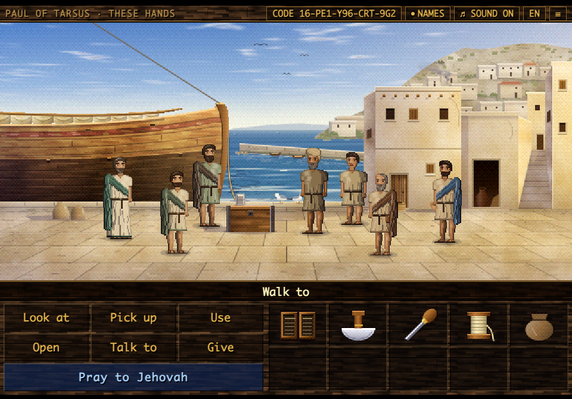 | 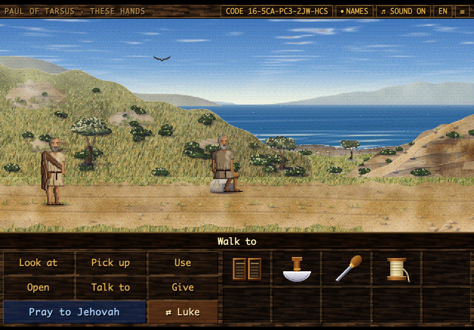 |
| A coaster for Assos, and a master with three questions | Paul on the coast road, and a fisherman who knows the way |

Ten places, three of them close views, and two people played: Paul on the quay of Troas; then Paul and Luke **two at once**, Paul on the coast road and Luke aboard, swapping between them with the swap button; Luke aboard from Assos to Chios, while Paul rests; and Paul at Miletus.

**The instructions.** On the quay of Troas the master of the coaster has three concerns about a passenger who will not be aboard: will he wait for him, who pays for the empty place, and how will he know him. Each time three lines are offered, all true; only one answers the question, and a line beside the point is turned back and drops out. Why Paul walks, he does not say: he has decided to go on foot, and nobody presses him. Then his bag goes aboard with Luke.

| | |
|---|---|
| 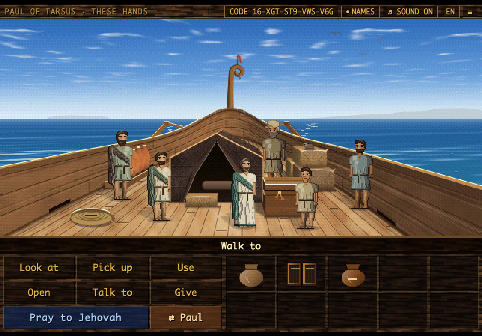 | 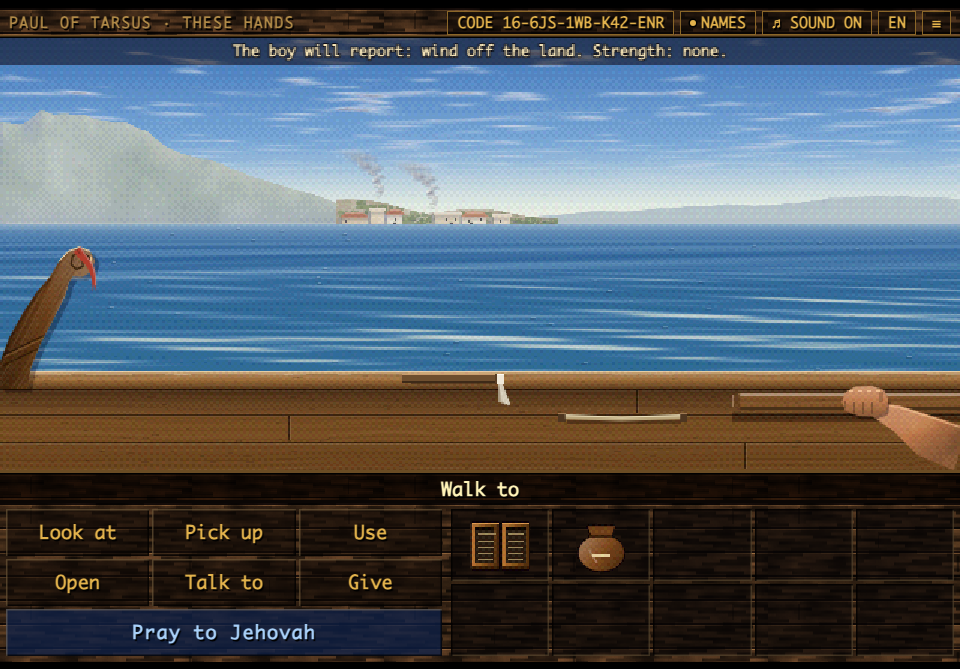 |
| Under way from Troas, looking aft, with the gift's chest aboard | Off Mitylene: the smoke under the hill curls the wrong way |

**The north wind.** The master sails with a north wind and nothing else, and his boy must report it. A close view over the stern shows the signs a sailor reads and nothing more: the pennant, the smoke of the hearths on the shore, the whitecaps, the clouds. The player sets the boy's report with his wool tuft (where the wind comes from, named as sailors name it: from up the coast, from down the coast, off the land, off the sea) and the knots of his cord (how hard), and tells the master. Three mornings: at Troas every sign agrees; off Mitylene the smoke under a steep hill curls the wrong way; off Chios the ship swings at anchor and the pennant swings with her, so the sea and the clouds must be read.

| | |
|---|---|
| 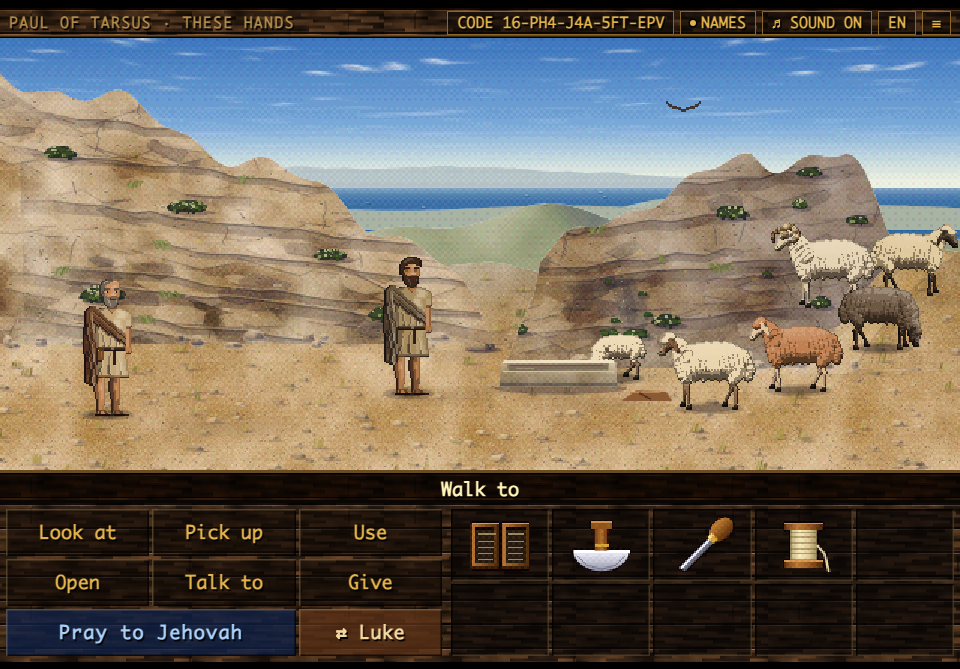 | 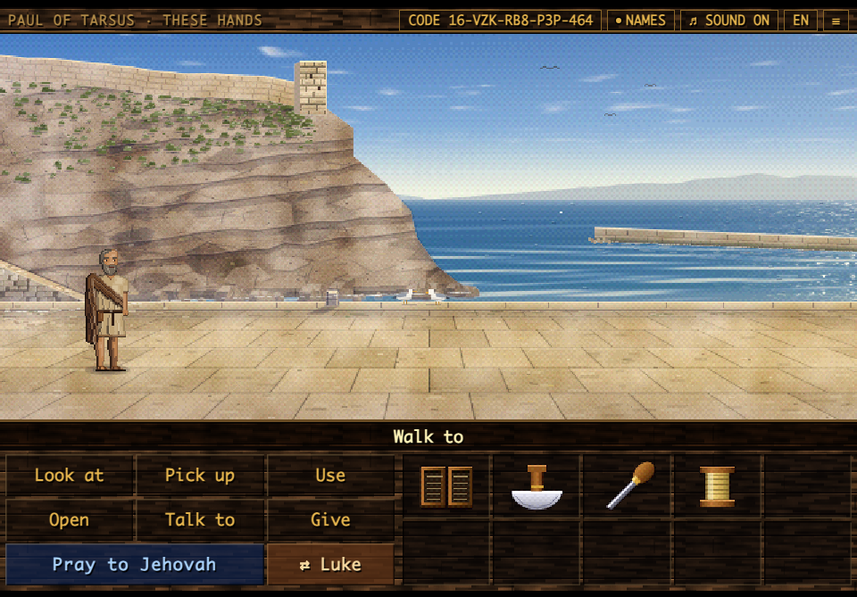 |
| A split water skin, and the flock filling the path down | Assos: whoever comes first waits on the quay |

**Flock on the pass.** On the pass a shepherd's water skin has split along its seam, and his flock fills the path down. Paul's thread would let the water through: he scrapes the wax from a spare leaf of his tablets with his knife, waxes the thread, and sews the seam with his awl.

**A sailor's hands.** Under way, the halyard has taken the skin off a sailor's hands. Luke, the physician, puts oil on them first and binds them with clean linen from Paul's bag, which Paul gave him at Troas. The master has his hand back and brings her in at Assos.

| | |
|---|---|
| 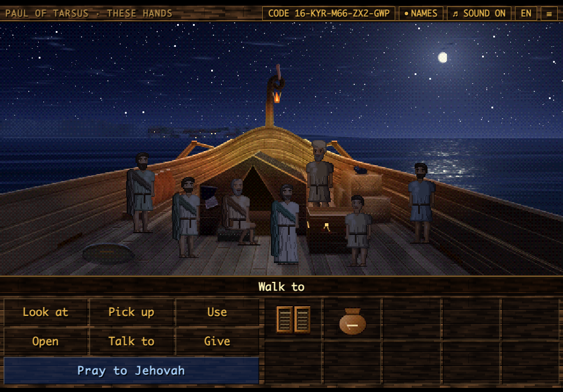 | 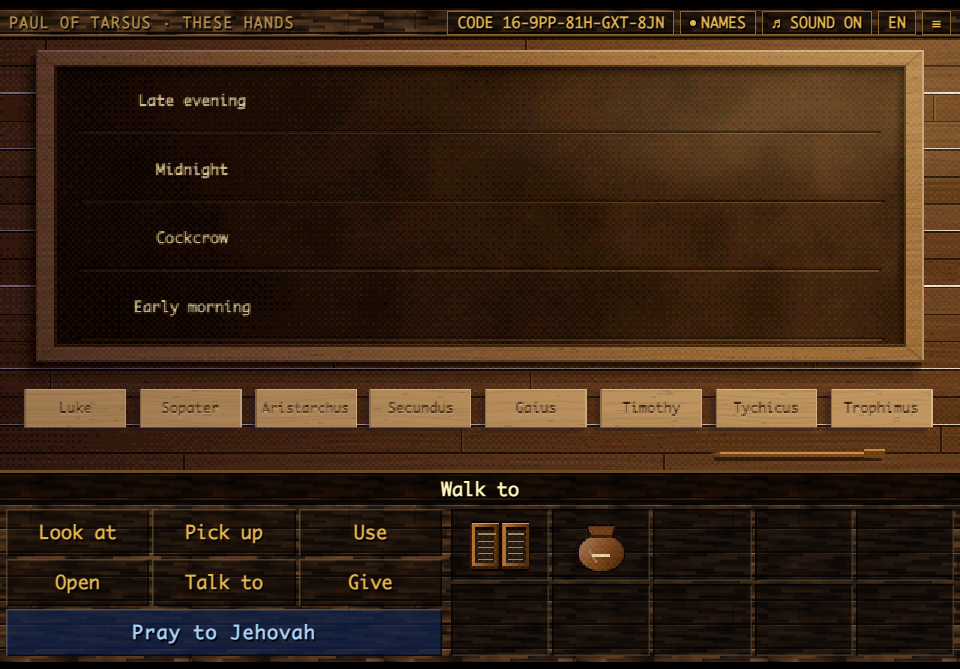 |
| At anchor off Chios: the moon, one lamp, and the chest | Four watches of the night, two names to each |

**The night watch.** Off Chios the gift's chest must never be left alone. Luke draws up four watches on his tablet, two men to each, never two from the same place, so that nobody can say a word about how the gift was kept; and five of the men have asked for something. Only one list keeps the rule and every wish. Paul walked to Assos, and the brothers leave him out.

| | |
|---|---|
| 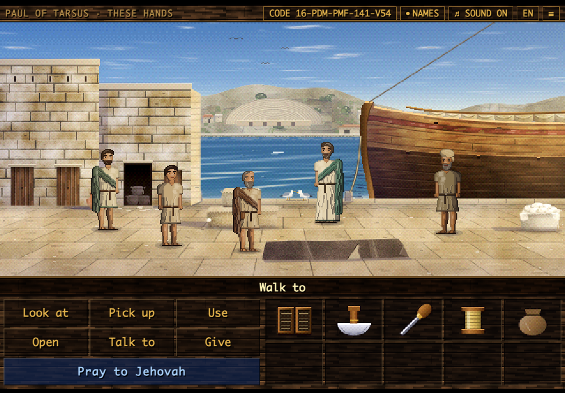 | 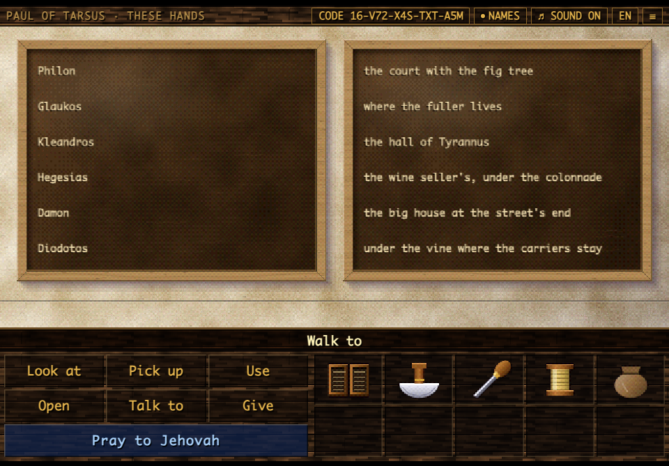 |
| Miletus: warehouses, wool, and the master's torn awning | Who lives where in Ephesus, for a messenger who has never been there |

**These hands.** At Miletus the master's awning, torn by the wind off Chios, lies on the quay. Paul mends it with a patch of goat-hair cloth and his waxed thread, and is paid; the pay is the fare and the bread of Menon, a runner who knows the ferry. Menon has never been to Ephesus, so Paul goes through his old page from Ephesus to say where each man is found. A wrong match is only Paul's own check; only the finished list is spoken.

| | |
|---|---|
| 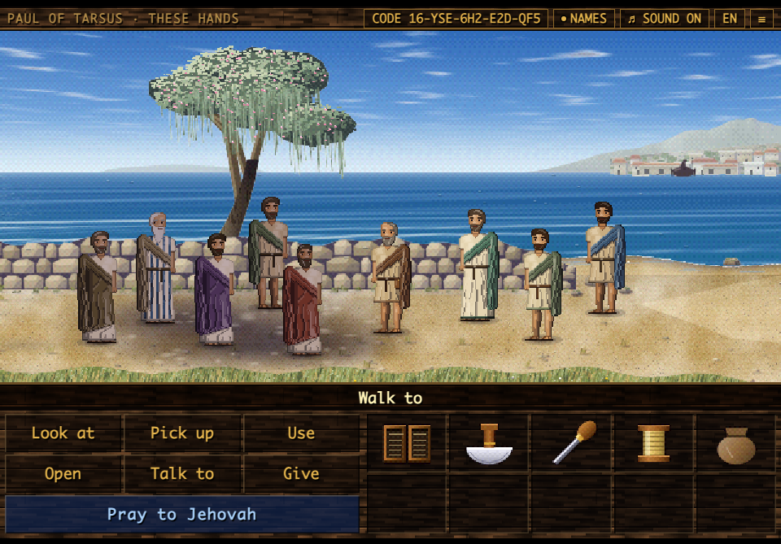 | 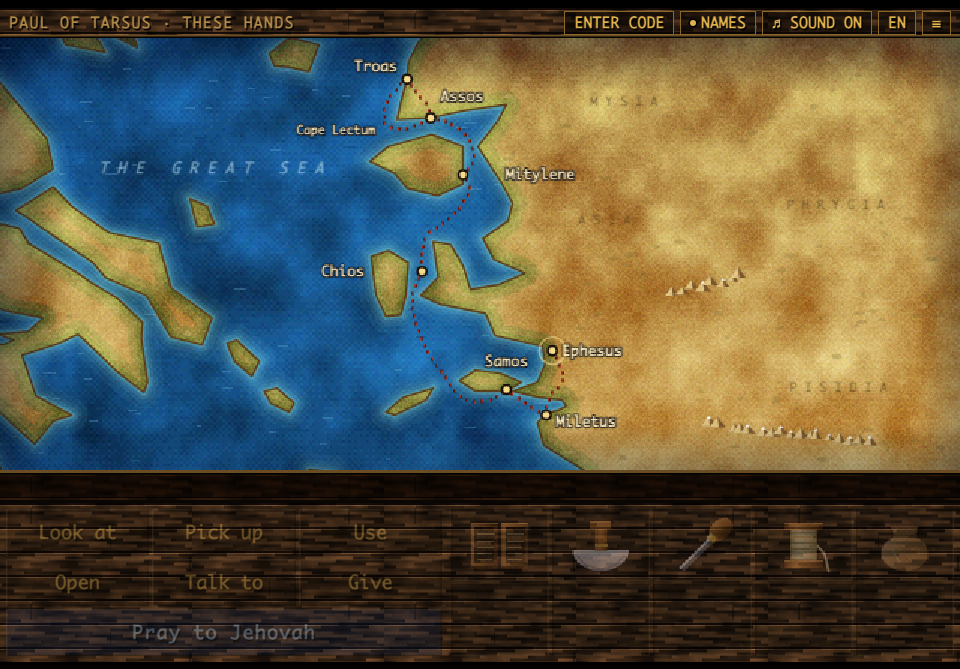 |
| The elders of Ephesus by the shore | Troas to Miletus day by day, and the messenger's way to Ephesus |

**By the shore.** The elders come. What Paul says to them is told, over pictures of him speaking; at "these hands" he holds out his hands, palms up and low. They kneel and pray, and walk him down to the ship.

Walkthrough (spoilers)

1. On the quay of Troas, talk to the master. Will you be there: "By road I'll be in Assos before you. You have to sail round the cape, and my way is shorter." Who pays: "I'll pay my fare from Troas, as if I were aboard the whole way." How will I know you: "Luke will be aboard. He'll point me out to you."
2. As Paul, take the coast road south. The fisherman says which way: the path over the hill.
3. Swap to Luke. Talk to the boy. Over the stern, set the tuft to "from up the coast" and the cord to "fresh", and talk to Pamphilos, the master (his hand is on the tiller).
4. Under way, open Paul's bag (it holds clean linen). Use your own bag with Kerdon (oil first), then the linen with Kerdon. The ship comes in at Assos.
5. Swap to Paul. On the pass, talk to the shepherd. Use the knife with the tablets, the thread with the wax, and the waxed thread with the water skin. Take the way down to Assos.
6. Off Mitylene, as Luke, talk to the boy: from up the coast, a breath (not the smoke under the hill).
7. Off Chios, talk to Aristarchus. Click a name, then a watch, to lay it there (click a laid name to take it back). Late evening: Luke and Secundus. Midnight: Aristarchus and Tychicus. Cockcrow: Sopater and Gaius. Early morning: Trophimus and Timothy.
8. In the morning, talk to the boy: from up the coast, strong.
9. At Miletus, open your bag for the goat-hair patch; use it with the torn awning, then the waxed thread with the awning. Talk to Menon: the master's pay is his fare. On the page, click a name, then a place: Philon, the hall of Tyrannus; Kleandros, the big house at the street's end; Damon, the court with the fig tree.
10. Take the road to the shore. After the elders have prayed with Paul, take the way down to the ship.

## Music and sound

| Chapter | Music | Around you |
|---|---|---|
| These Hands | One tune, and a journey that ends in a parting: C sharp, with a minor third and a major sixth and seventh, in bars of eleven (three threes and a two), a bar that walks and then catches its step; no earlier chapter has this key or this bar. On the quay of Troas the lyre has it over a low string and the pipe answers; on the coast road the oud walks it in twos over a hand drum; on the pass the pipe has half of it, with long rests, over one low note; aboard by day the harp rocks under the lyre and the low string keeps the swell; at anchor in the evening the harp has it at half its pace over a low held note; at Miletus lyre and oud take turns over the drum, the busiest the tune gets. By the shore, while Paul speaks, only the low string and a pipe far off, with the tune's first bar again and again, never finished; at the parting the lyre plays the whole of it slowly, and in its last bar it does not come home but rests on the fifth, where the harp holds it. Nothing is claimed about how music was played then | Sea, gulls and a creaking hull at Troas, Assos and Miletus, with the murmur of the harbor crowd at Miletus; on the coast road wind, the sea below and birds; on the pass wind and the small bells of the flock, now one, now two together, never a tune (a sound of this chapter's own); aboard the swell, the hull and the wind, quieter at anchor, with no gulls at night; by the shore the waves, the wind and the leaves of the tamarisk. Gulls wheel over the harbors and over the deck by day, and a bird of prey circles over the road and the pass; none flies at night or over the parting |

Every step can be solved from the text alone.

## The travel map

The voyage is drawn on a closer window of the map, the coast of Asia from the Troad to Miletus at two and a quarter times the usual size, one leg for each day's sail. When the coaster leaves Troas the ship's way round Cape Lectum to Assos and Paul's way over the land are drawn together, and Acts 20:13 is told over them. After Assos comes the leg to Mitylene; the next day the leg to the waters off Chios (20:15). From Chios the line runs to Samos while 20:16 is told, Paul's decision to pass Ephesus by, and on to Miletus. Last, when the list is spoken, the messenger's way is drawn from Miletus to Ephesus, and 20:17 is told.

Acts names no road for Paul's walk and no route for the messenger: the line over the land from Troas to Assos is a plausible one, and the messenger's follows what the publications think likely: by land, and probably partly by ferry. Cape Lectum stands on the map as a name without a dot. No line crosses another, and no name crosses a coast or a route.

## About the content

Chapter Sixteen tells what the account says (Acts 20:13-38) in the narrator's own words, verse by verse with the reference, and puts none of it into a mouth as a quotation. These lines stand together in `levels/chapter16.js` (`TOLD`) and in the language files, where they can be checked against the Study Edition; the German lines were written from the German edition. The narration says "we", as Acts does, all through the chapter. What Paul said to the elders (20:18-35) is told by the narrator over pictures of him speaking, and never composed as a speech; at 20:33, 34 he holds out his hands, and at 20:36 they all kneel.

**What was read, and how.** On 24 November 2026 these were read by hand in the browser, on wol.jw.org: Acts 20 in the Study Edition with its study notes, in English, and Acts 20:13-38 in German; the media note "Paul's Visits to Miletus"; *"Bearing Thorough Witness" About God's Kingdom*, chapter 21, with its boxes; the *Insight on the Scriptures* articles "Assos", "Mitylene", "Chios", "Samos", "Miletus", "Pentecost", "Trophimus", "Tychicus", "Night" and "Attitudes and Gestures"; and Mark 13:35 in German. The chapter's lead did the reading and gave the facts to the builders in a brief; nothing was added to them.

**What they establish.** Between them, these publications give the following, said here in the game's own words. The voyage falls in the spring of about 56 C.E., after the festival of unleavened bread, and Pentecost came on the fiftieth day counted from Nisan 16, which is why there was a hurry. On foot Troas lies some 32 km from Assos; the ship had to go round Cape Lectum, so Paul's way was the shorter, and he could be there in time. Assos was a port of Mysia, in the province of Asia, on the north shore of the Gulf of Adramyttium, with Lesbos across the water to the south. Mitylene, the chief city of Lesbos, lies about 45 km on; the ship may only have anchored there, perhaps because the north winds that it needed had died down. From there to the waters off Chios is about 100 km, a day's sail from morning to sunset, and about as far again from Chios to Samos, where the ship put in only briefly. The picture that the game takes from this is a coaster that sails by day with a north wind and lies at anchor at night. Miletus lay near the mouth of the Maeander, had four harbors, was known for its wool and had a large theater. The elders came from Ephesus by land, and likely partly by ferry, and it took at least about three days for word to reach them and for them to come; the game gives no distance for that way. The word for elder speaks of maturity, and the word for overseer of the duty of watching over others. Trophimus was an Ephesian (Acts 21:29), and Tychicus too came from the province of Asia. Kneeling was a usual way to pray. By Roman times the night was divided into four watches, as Mark 13:35 names them: late evening, midnight, cockcrow and early morning. The words of the Lord Jesus in Acts 20:35 are recorded by Paul alone and not in the Gospels.

**What is invented.** The supporting characters are invented: Pamphilos, master of the coaster; Simias, his boy; Kerdon, a sailor; the fisherman on the coast road; the shepherd and his flock; Menon, the young runner of the harbor of Miletus who carries the message; and the elders Euphranor and Polemon. Philon, Kleandros and Damon are the game's own believers of Ephesus from Chapters Thirteen and Fourteen, and so are invented too, as is Theano, who is named in Paul's notes. The ship's cat is invented, and so are the master's questions, the signs of the wind and the report the boy makes, the split water skin and the wax scraped from a tablet, the sailor's raw hands, the master's torn awning and the pay for mending it, the four watches over the chest and the wishes of the men, Paul's old page from Ephesus and the list he gives Menon, and the shaded place by the shore under a tamarisk. The mended awning and the honest pay let the player arrive at what Acts 20:34 says of Paul's hands. The rule of the watches, two to each and never two from the same place, is the game's way of showing what Chapter Fifteen took from 2 Corinthians 8:20, 21: that nobody could find fault with how the gift was handled. Where the men come from is as Acts 20:4 gives it: Sopater of Beroea, Aristarchus and Secundus of Thessalonica, Gaius of Derbe, Timothy, and Tychicus and Trophimus from the province of Asia. Paul's old page names three visitors to Ephesus from Chapter Thirteen as well, Glaukos of Sardis, Hegesias of Smyrna and Diodotos of Thyatira, who went home long ago. All that is spoken is invented, including what is said by Paul, Luke, Timothy, Aristarchus, Trophimus, Sopater and Secundus; Gaius and Tychicus are seen and say nothing.

**What Acts leaves unsaid.** Acts gives no reason for Paul's walk to Assos, and the game gives none. It does not say who carried the message to Ephesus (in the game Menon, hired and paid honestly), whether the seven carried the gift for Jerusalem (the game's reading, as in Chapter Fifteen), how anything was watched at night, whether the ship put in at Mitylene or only lay at anchor there, or where by the shore the elders met Paul. Acts names none of the elders. The kneeling of 20:36 is shown, heads bowed and arms down or folded; the tears and the embrace of 20:37, 38 are told while they walk him to the ship. The chapter's end screen says these things too.

**No temple.** Assos and Miletus are not among the cities where the game shows pagan temples (CONTRIBUTING section 3): Assos shows its rock and its walls, and Miletus its quays, its warehouses and, far off across the water, its theater, seen from outside and empty.

**The German text.** Names and terms follow the German Study Edition: Assos, Mitylene, Chios, Samos, Milet, Ephesus, Lesbos and the „Provinz Asien“; Pentecost is the „Pfingstfest“ (20:16), the elders are „die Ältesten“ (20:17) and the overseers „Aufseher“ (20:28), and God's kindness is „unverdiente Güte“ (20:24, 32). The four watches on Luke's tablet are „Später Abend“, „Mitternacht“, „Hahnenschrei“ and „Früher Morgen“, after Mark 13:35, which was read in German for them. The coaster is a „Küstensegler“ and the cape „Kap Lekton“: these are the game's words.

[← All chapters](../README.md#chapters)
