# Chapter Seventeen: The Belt

About 56 C.E., with Pentecost in view. After the parting at Miletus the ship runs straight before the wind to Cos, to Rhodes the next day, and on to Patara. There they find a ship that is crossing to Phoenicia; Cyprus comes in sight and falls behind on the left, and they put in at Tyre, where the ship is to unload. They look for the disciples, find them, and stay seven days, and through the spirit the brothers keep telling Paul not to set foot in Jerusalem. All of them, women and children too, see them out of the city; they kneel on the beach and pray, and say goodbye. The voyage ends at Ptolemais, with one day among the brothers, and the next day they come to Caesarea and stay in the house of Philip the evangelizer, one of the seven, whose four unmarried daughters prophesy. After a good many days the prophet Agabus comes down from Judea, binds his own feet and hands with Paul's belt and says what the holy spirit says: the owner of this belt will be bound in the same way in Jerusalem and handed over to people of the nations. They beg Paul not to go up; he is ready to be bound, and to die there, for the name of the Lord Jesus. When he will not be moved, they give up pleading and leave it to Jehovah's will. Then they set out for Jerusalem (Acts 21:1-16).

| | |
|---|---|
| 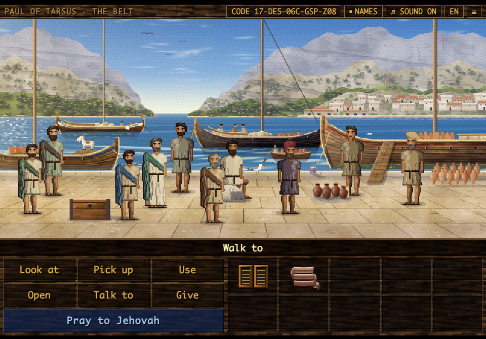 | 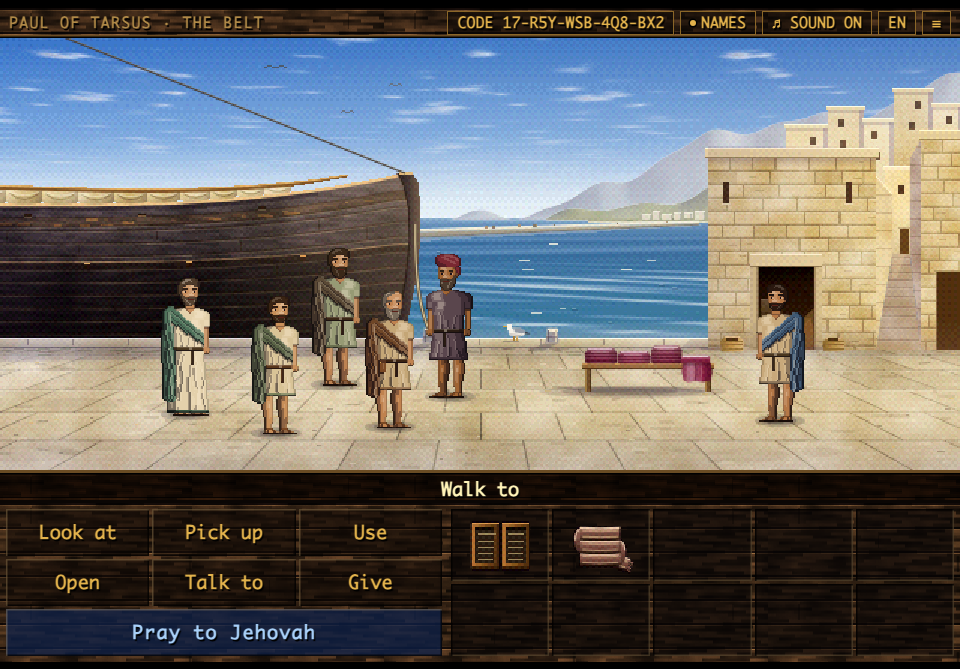 |
| Patara: four ships, and nobody says where his is bound | Tyre: home for Akestor, and half his crew already gone |

Nine places, one of them a close view and one a city seen from above, and two people played: Paul from Patara to Caesarea, and Luke in Philip's house from the moment they all begin to plead until it is left in Jehovah's hands.

**Whose ship?** In the harbor of Patara lie a small coaster and three big ships. Luke says what a ship for Phoenicia needs: it lies across open water to the southeast, and the northwest wind that blows here every morning would carry a big ship straight there. Nobody tells Paul where a ship is bound, and he asks nobody: he reads it in the harbor. Each ship shows what she is doing (**Look at** her), and each master talks about his own work: one is loading oil for the next town along and will be back by dark, one is emptying her hold and waiting for timber from up the valley, one has had the wind in his face for four days. Only one ship is big, laden, watered for days out of sight of land and ready to sail with this wind. Paul asks a master for passage only once he has looked at that master's ship, a wrong ask is answered truthfully and nothing is lost, and the right master names the fare, which Paul pays from the folds of his belt.

| | |
|---|---|
| 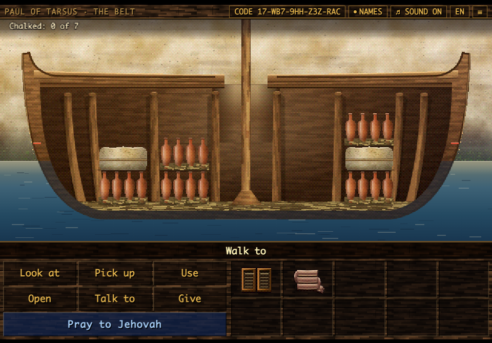 | 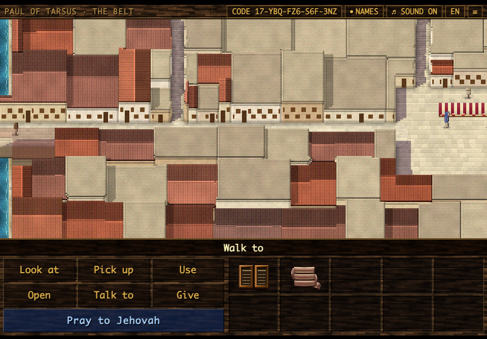 |
| The hold: seven lots, seven days, and a ship that swings like a balance | The island city of Tyre, entered by the harbor gate |

**An even keel.** Akestor is short-handed, and his ship must not go down by the head or the stern against the quay while she is unloaded. Paul offers the hands of the travellers, and the hold is seen from the side, in section: jars and bales lie in three bays before and behind the mast, some on top of others. Akestor's rules are said once and written on the tablets: one lot a day; what lies on top comes out first; lift weight out forward and her stern goes down, lift it aft and her bow goes down, the more the farther from the mast; a row of jars weighs as much as three bales; and one row of jars from the bay just before the mast puts her stern right down to its mark. Past a mark he stops the work. Paul chalks a day on each lot, and Akestor reads the plan through day by day while the hull trims as it would. On the first day that breaks a rule, the ship leans or the lot is still under another, he says so, and the chalk from that day on is rubbed out. There is only one order that keeps her within her marks for all seven days, and the seven days in Tyre pass with it.

**Found without asking.** Paul does not ask where the Christians live: he watches what people do. Tyre is a lane map, a city seen from above and larger than the screen, and Paul knows only the lanes he has seen. At the meat stall in the market two women buy meat. A Jewish woman asks for meat killed and bled as the Law says, which is nothing new; a Tyrian woman asks whether it was strangled and whether the blood is out, and will not take meat from the temple, not any more. That is a believer of the nations keeping what the letter from Jerusalem asked (Acts 15:29), which is on Paul's tablets. Each goes home by her own lane. Following the Tyrian woman leads to a glassworkers' yard, where a Tyrian sings at his furnace the psalm that calls all the earth to sing to Jehovah (Psalm 96:1-3); then he banks his fire and goes north, and at a fork a man of the Jews greets him at a door as his brother. Paul knocks at that door.

| | |
|---|---|
| 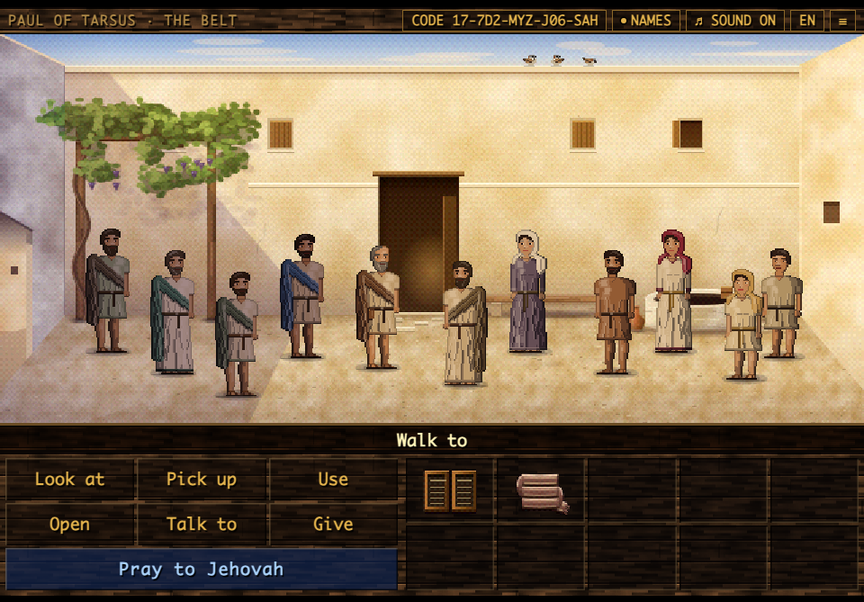 | 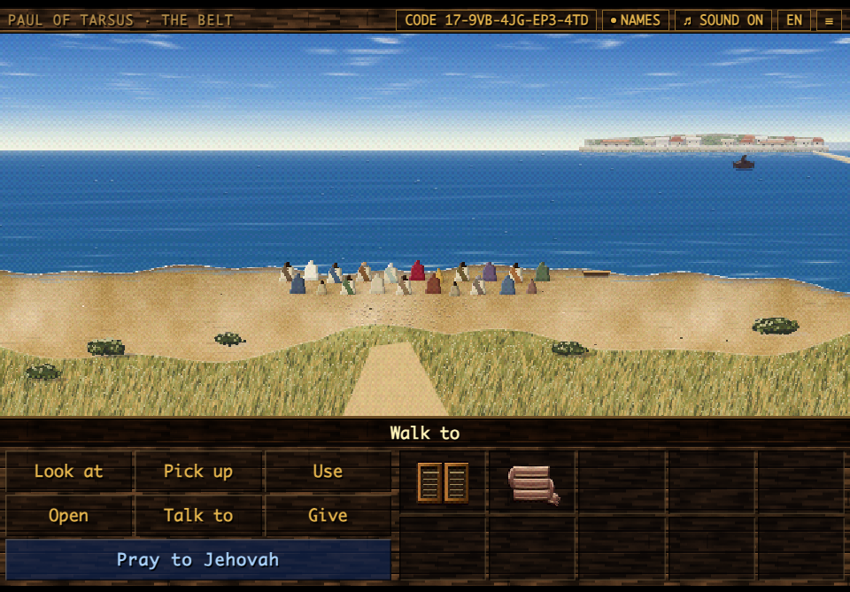 |
| Euanthe's court: the brothers and sisters of Tyre, and their children | All of them kneel on the beach, seen from behind and far off |

**Seven days.** In Euanthe's court the brothers and sisters of Tyre take them in, and the seven days pass while Akestor's cargo comes out as it was chalked. Near their end the brothers plead with Paul not to go up to Jerusalem, and the narrator says what the spirit had shown them and what they concluded themselves, out of love. Then they all walk him out of the city to the beach, where the prayer is told over a picture of the whole congregation kneeling at the water's edge.

| | |
|---|---|
| 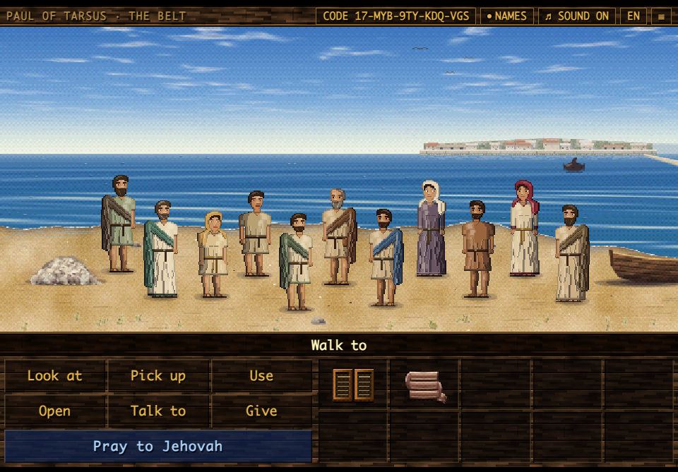 | 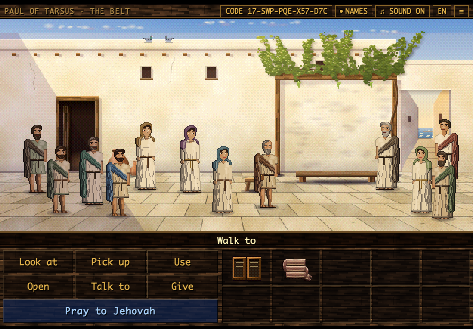 |
| The goodbye on the beach, and the ship's boat waiting | Caesarea: Philip, his four daughters, and the brothers of the city |

**Philip's house.** The ship takes them to Ptolemais, shown in one told picture of the bay with Mount Carmel closing it to the south, and the next day they are in Caesarea, in the court of Philip's house. Philip is grey now, some twenty years after Samaria. His daughters see to the guests and talk about the work in a harbor city that the whole world passes through; none of them is shown prophesying. Talking to Philip again, Paul may speak of Stephen: Philip was one of the seven with him, and Saul approved of his death; the scattering that followed carried the good news to Samaria and as far as Phoenicia, and now Saul is a guest in Philip's house. Nothing is said of Stephen that Acts 6 to 8 does not say.

| | |
|---|---|
| 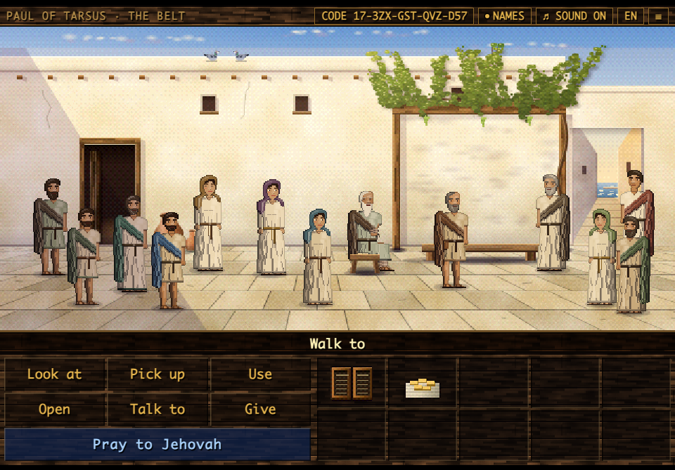 | 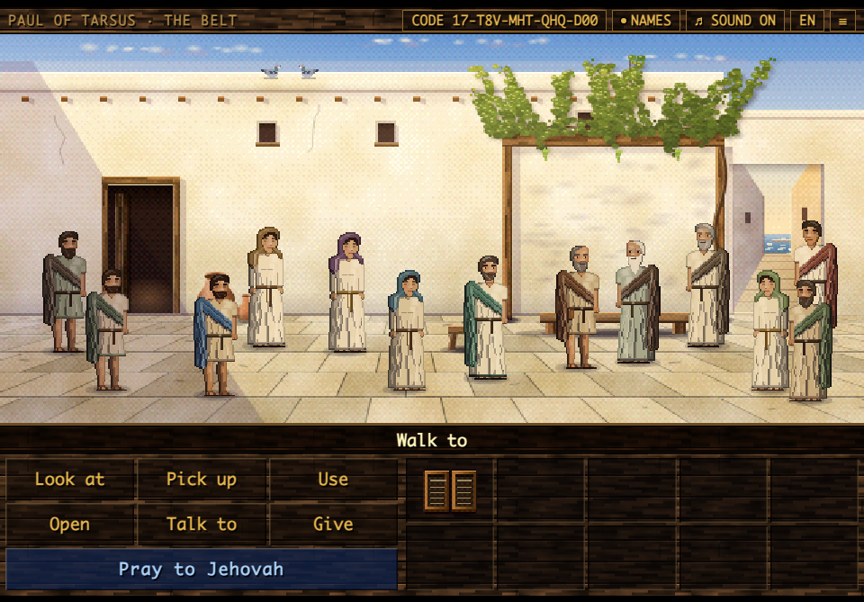 |
| Agabus binds his own feet and hands with Paul's belt | Luke has reasons enough, and every one of them is true |

**The belt.** Paul has carried his belt since the start of the chapter: a long strip of cloth wound round the waist, with his coins in its folds. When the days have gone by, Agabus comes down from Judea and asks for it. Paul takes his coins out first and gives it. Agabus sits and binds his own feet and hands with it while the narrator tells what he said; then he gives it back. It is the same belt, and its look line says that it isn't.

**Every true reason.** Then they all plead with Paul, and Luke is played. Luke may give every true and loving reason there is: that Agabus's word about the famine came true, that the rest of them can take the gift up without him, that the congregations still need him, that Timothy is young, that Philip's house would keep him, that a physician knows what chains do to a body. Paul answers each gently, and never says more than Acts 21:13 says he did. Every reason stays on offer after it has been said, and among them from the start is the line that stops pleading: "Then may Jehovah's will be done." Only that line ends it.

| | |
|---|---|
| 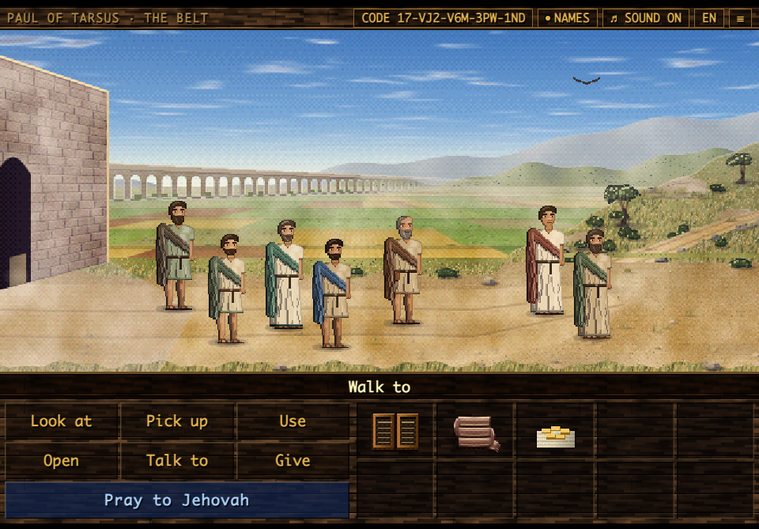 | 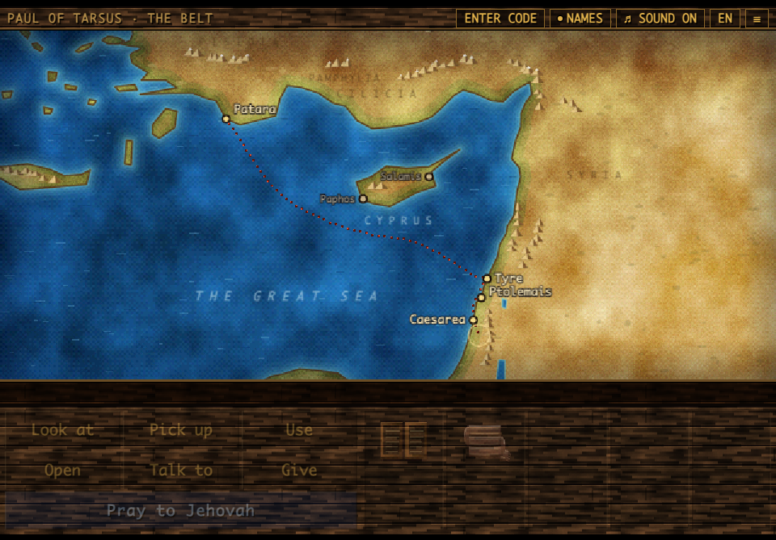 |
| Disciples of Caesarea go with them, to take them to Mnason | Patara past Cyprus to Tyre, and down the coast to Caesarea |

**Up to Jerusalem.** Outside the city the aqueduct runs across the plain, and the road climbs into the hills of Judea. Disciples from Caesarea go with them, to take them to Mnason of Cyprus, at whose house in Jerusalem they will stay. The road up ends the chapter.

Walkthrough (spoilers)

1. At Patara, **Look at** the ship with the black hull (or the boat that rows water jars out to her). Talk to Akestor, the master in the red head-cloth, and ask: "Do you have room for nine of us, and a chest?" He names the fare. **Give** the belt to Akestor. (The coaster, the ship with the red wale and the ship with the white wale are each turned back by what their masters say: a night in every harbor, empty until the timber comes, waiting for the wind to turn.)
2. On the quay of Tyre, talk to Akestor to offer your help, and go down into the hold with him.
3. In the hold the left of the picture is forward. Click each lot to chalk the next day on it (click a chalked lot to rub it out, with every day after it). The one order: the upper row of jars just before the mast (her stern goes down to its mark); the upper row of jars in the bay aft (the bow goes down twice as much, to its mark); the bale far forward on top of its jars; the bale aft; the jars far forward under where the bale was; the last jars aft; and the lower row just before the mast, which brings her level. When all seven are chalked, Akestor reads the plan through.
4. Take the lane into the city. Walk along the main street to the market square: the two women buy meat at the stall. Follow the woman in the red mantle up the right-hand lane out of the square to the glassworkers' yard (the left-hand lane leads only to the Jewish woman's home). **Look at** or **Talk to** the glassworker at his furnace.
5. Follow him north to the fork: a man of the Jews greets him at a door as his brother. **Open** that door, the one with the vine on the right-hand branch (the door on the left-hand branch gives no reason to knock).
6. The seven days pass in the court. Then take the way out at the left, to the beach. After the prayer and the goodbye, take the ship's boat at the right.
7. In Caesarea, talk to Philip. Optionally talk to him again, "About Stephen...", and to each of his daughters. **Use** the bench under the vine to let the days go by: Agabus comes.
8. **Give** the belt to Agabus.
9. Luke is played. Talk to Paul and give any reasons you like; then choose "Then may Jehovah's will be done."
10. Paul is played again. **Use** the coins with the belt to put them back in its folds, if you like. Take the gate at the right, and on the road outside, the road up to Jerusalem.

The hidden treasure lies on the beach outside Tyre, off the way to the boat: the heap of shells at the far left. **Look at** it, or try to pick one up.

## Music and sound

| Chapter | Music | Around you |
|---|---|---|
| The Belt | One tune, for a voyage that ends on a road: B, a minor key with its own sixth and seventh, in bars of thirteen that fall three, two, three, two, three, a bar that rocks like a hull and never quite settles; no earlier chapter has this key or this bar. In the harbors the lyre has it over a low string and a light drum, and the pipe answers; in the hold the harp plays it at half its pace over a low note, a man thinking; in the lanes of Tyre the oud walks it over a hand drum; in the brothers' court lyre and harp take turns, warm and slow. On the beach the lyre plays the whole of it slowly and does not come home: it rests on the fifth. In Philip's house lyre and oud take turns without a drum. When Agabus comes, the low string plucks the keynote and leans on the note above, a drum ticks with it and almost stops every fourth bar, and the pipe begins the tune and breaks off; while they plead, only a low string and a pipe far off, with the first bar again and again. On the road the oud walks it over the drum and the low string. Nothing is claimed about how music was played then | Sea, gulls, wind and a creaking hull at Patara and on the quay of Tyre, with the harbor crowd; in the hold the hull creaks and the harbor sounds through the planks; in the lanes the crowd and the birds, and the sea and its gulls nearer the island's edge; in the courts birds and leaves; on the beach the waves and the wind; at the gate of Caesarea wind and birds. Gulls wheel over the harbors and stand on the quays, sparrows sit on the parapet of Euanthe's house and doves on Philip's, a bird of prey circles over the plain, and no bird flies while they pray on the beach |

Every step can be solved from the text alone.

## The travel map

The chapter opens on a closer window of the map, the coasts of Caria and Lycia at three times the usual size, with LYCIA named in this window only: from Miletus to Cos, to Rhodes and on to Patara, one leg after the other, while Acts 21:1 is told. When the fare is paid the map opens at its usual size on the eastern sea, and the crossing from Patara to Tyre is drawn south of Cyprus, which lies on the left of the ship's way, while 21:2 and 21:3 are told. From the beach the leg runs down the coast to Ptolemais, where the bay is shown and 21:7 told; the next leg goes on to Caesarea, with 21:8, 9. At the end the road from Caesarea begins to climb inland toward Jerusalem, and only its start is drawn, to a point with no dot and no name.

Acts does not say whether they went from Ptolemais to Caesarea by land or by sea: the line keeps to the coast, and the end screen says that Acts does not say. Phoenicia is not named on the map, because at this scale there is no room for its name between the coast, Tyre and the mountains. No line crosses another, and no name crosses a coast or a route.

## About the content

Chapter Seventeen tells what the account says (Acts 21:1-16) in the narrator's own words, verse by verse with the reference, and puts none of it into a mouth as a quotation. These lines stand together in `levels/chapter17.js` (`TOLD`) and in the language files, where they can be checked against the Study Edition; the German lines were written from the German edition. The narration says "we", as Acts does, all through the chapter. One line is told without a reference, because it gives the understanding of 21:4 and not the verse: that the spirit had shown the brothers at Tyre what awaited Paul, and that his staying away was their own conclusion, out of love for him. No line says that Jehovah or the spirit forbade the journey. What Agabus said (21:11) and what Paul answered (21:13) are told by the narrator; Paul's answers to Luke in the game are dialogue that says no more than that verse.

**What was read, and how.** On 24 November 2026 these were read by hand in the browser, on wol.jw.org: Acts 21 in the Study Edition with its study notes and footnotes, in English and in German; Acts 6:3, 5, 8:1-6, 26-30 and 40, 11:19 and 27, 28, 15:28, 29 and Psalm 96:1-3 in both languages; *"Bearing Thorough Witness" About God's Kingdom*, chapter 22; the *Insight on the Scriptures* articles "Cos", "Rhodes", "Patara", "Cyprus", "Tyre", "Phoenicia", "Acco", "Caesarea", "Philip", "Agabus", "Mnason", "Dress" and "Purse"; and, in German, Acts 27:5 for the spelling of Lycia, and 1 Chronicles 12:6 and 2 Samuel 23:20 for the spelling of two Bible names that invented characters bear. The chapter's lead did the reading and gave the facts to the builders in a brief; nothing was added to them.

**What they establish.** Between them, these publications give the following, said here in the game's own words. The ship from Miletus went straight before a fair wind, with no need to tack. Cos lies about 75 km down the coast, some six hours' sail with the usual northwest wind, so the ship likely lay at anchor off the island that night; Rhodes, about 120 km on, came the next day. Some manuscripts add Myra after Patara; the game keeps to Patara. The great statue of Rhodes had fallen long before, and the game neither shows nor names it. Patara was a seaport of Lycia on the mountainous southwest coast of Asia Minor, about 10 km east of the mouth of the Xanthus, the harbor of that river's valley and a port of call for ships from Italy, Egypt and Syria; *Bearing Thorough Witness* describes the ship they found there as a large cargo ship that took them straight to Tyre. With Cyprus on the left, the ship evidently passed the southwest end of the island on an easterly course. Tyre was the chief port of Phoenicia, built again after Alexander joined the island city to the mainland by a causeway in 332 B.C.E., a much-used port of call in the first century, and known for its metalwork, its glass and above all its purple, which took thousands of murex shellfish, each yielding a single drop, for a few yards of cloth, and fetched the highest prices. There had been believers in Phoenicia since the scattering of Acts 11:19. Ptolemais, the old Acco, lay 39 km south of Tyre at the north end of the bay that Mount Carmel closes 13 km farther south, gave poor shelter from the sea winds, was made a Roman colony under Claudius, and had a congregation. Caesarea was Herod's port, with an artificial harbor behind a great breakwater, the seat of the Roman governor and a mostly Gentile city, with a theater, a hippodrome, an amphitheater, an aqueduct and a temple to Caesar. Philip was one of the seven of Acts 6:5, and this was some twenty years after he preached in Samaria and ran beside the Ethiopian's chariot; he was still known as the evangelizer, and his four daughters, old enough to prophesy, followed his example. Agabus had foretold the famine of Acts 11:28 about ten years before. Paul's belt was a long strip of cloth worn round the waist, in whose folds money and other things could be carried. The study notes explain that the word for weakening Paul's resolve means, literally, crushing his heart, and that the brothers, when they gave up, literally fell silent. Mnason, from Cyprus, was an early disciple, and his home was in Jerusalem.

**What is invented.** The supporting characters are invented: at Patara the four masters, Akestor of Tyre (the black-hulled ship), Moschos (the coaster), Kallikrates (the ship with the red wale) and Sostratos (the ship with the white wale), and the water seller and the goat; in Tyre the butcher, the Jewish woman in the blue mantle, the coppersmith, and the disciples Euanthe, a widow in whose house they meet, Phanias the glassworker and Myrto his wife (the woman in the red mantle), Joezer, a carrier, Euanthe's granddaughter Melitta, and the boy Philinos; and in Caesarea the brothers Aulus and Benaiah. Philip's daughters are not named, and all they say is invented; they speak as members of the household and are never shown prophesying. Everything that is spoken is invented, including what is said by Paul, Luke, Timothy, Aristarchus, Trophimus, Philip and Agabus. The ships' clues, Akestor's short crew, the seven lots in his hold and his rules for lifting them, the purple cloth and the gull on the quay, the meat stall, the glassworkers' yard and the song at the furnace, the fork and the door, the heap of shells on the beach, Paul's coins and Luke's reasons are invented. The lanes of Tyre are an invented plan: the publications say nothing of its streets. The two women at the stall rest on Acts 15:29, the letter that Paul himself handed on in Chapter Seven (Acts 16:4): a Jewish woman would ask about the blood too, so it is the Tyrian who asks it who marks a believer of the nations.

**What Acts leaves unsaid.** Acts does not say how the ship at Patara was chosen, that the unloading at Tyre took the seven days or that Paul and the others helped with it, how the disciples at Tyre were found, the names and the words of Philip's daughters, or whether they went from Ptolemais to Caesarea by land or by sea. Acts 21 names none of the men who travelled with Paul beyond the "we" that includes Luke; the game keeps with him the companions of Acts 20:4 and the gift for Jerusalem, as Chapters Fifteen and Sixteen do, and Acts 21:29 later places Trophimus in Jerusalem. Mnason is named and not shown: his house is in Jerusalem, where the next chapter begins. The kneeling of 21:5 is seen from behind and far off, every arm down or folded. The chapter's end screen says these things too.

**No temple.** Patara, Rhodes, Tyre, Ptolemais and Caesarea are not among the cities where the game shows pagan temples (CONTRIBUTING section 3), and no temple, altar, statue or image of a god is seen anywhere in the chapter. Caesarea shows the court of Philip's house, a street down to the harbor and the breakwater through his gate, and outside the city its wall, the aqueduct and the road.

**The German text.** Names and terms follow the German Study Edition: Kos, Rhodos, Patara, Lyzien (after Acts 27:5), Phönizien, Zypern, Syrien, Tyrus, Ptolemais, Cäsarea, Judäa, Agabus, Mnason, and Philippus „der Evangeliumsverkündiger“; the belt is „der Gürtel“. The invented Joezer and Benaiah bear Bible names, and take their German spelling from the Study Edition: Joeser and Benaja. Philip's daughters are „Philippus’ Tochter“, with „älteste“, „zweite“, „dritte“ or „jüngste“. Luke's last line is „Dann soll geschehen, was Jehova will.“, in the game's own words. The coaster is a „Küstensegler“, and in the hold a row of jars is a „Krugreihe“ and a bale a „Wollballen“: these are the game's words.

[← All chapters](../README.md#chapters)
