# Chapter Eighteen: On the Stairs

Jerusalem, 56 C.E. The brothers welcome Paul and his companions gladly, and they stay with Mnason of Cyprus, a disciple from the early days. The next day they go to James, and all the elders are there. Paul greets them and tells them, one thing after another, what God has done among the nations through his ministry. They glorify God, and then tell him what many thousands of zealous Jewish believers have heard about him: that he teaches the Jews among the nations to turn away from Moses. Their counsel is that he go with four men who are under a vow, be cleansed with them and pay their expenses, so that everyone can see the rumor is empty. The next day he goes into the temple with them. When the seven days are nearly over, Jews from the province of Asia see him there, stir up the crowd and seize him: they had seen Trophimus the Ephesian with him in the city, and supposed that Paul had brought him into the temple. He is dragged out and the doors are shut. The commander of the garrison runs down with soldiers and army officers, has him bound with two chains, and orders him into the soldiers' quarters; on the stairs the soldiers have to carry him for the violence of the crowd. There Paul asks the commander, in Greek, to let him speak, motions to the people with his hand, and speaks to them in Hebrew. When he says that the Lord sent him to the nations far away, they shout him down. Inside, they stretch him out to examine him under the whip, and Paul asks the army officer standing there whether it is lawful to scourge a Roman who has not been condemned. Those who were about to examine him draw back, and the commander is afraid, because he has bound a Roman (Acts 21:17–22:29).

| | |
|---|---|
| 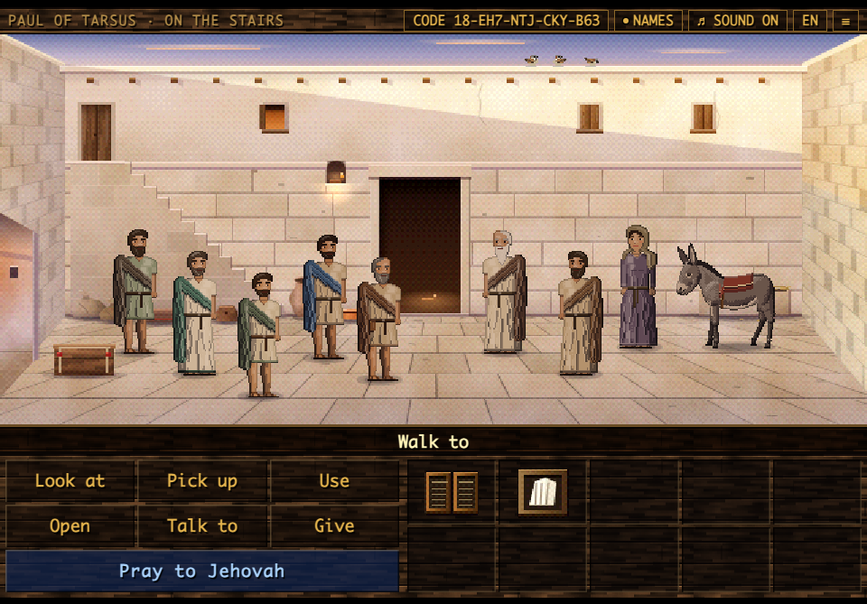 | 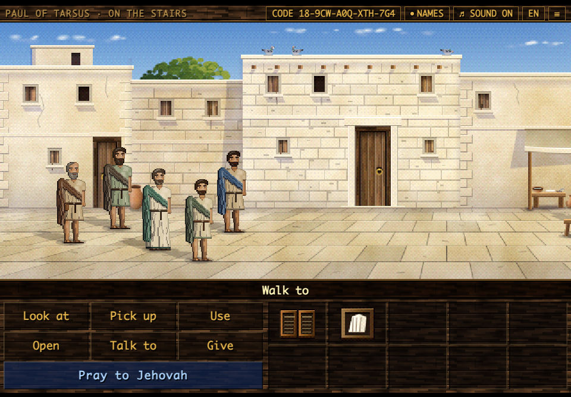 |
| Mnason's court: the brothers of Jerusalem, the companions, and Mnason's donkey | The street between Mnason's house, James's door and the temple, with the barber's stall |

Seven places, one of them a close view, and Paul played throughout. Luke, Timothy and Aristarchus come with him to Mnason's and to James; after the elders' counsel only Trophimus is seen with him.

**Mnason's house.** The chapter opens in the evening, in the court of Mnason's house: a brother and a sister of the congregation in Jerusalem, Mnason himself, old and glad of his guests, and his donkey, who has carried every guest's baggage up from the gate. Trophimus sees Jerusalem for the first time. Paul greets his host, and they rest under his roof.

**The street.** In the morning a street of the upper city leads to the door of the house where James and the elders meet, and on up to the temple. A barber has his stall there. In the days that follow Trophimus walks with Paul as far as the temple, and Jews from the province of Asia are seen in the street, men who know Trophimus from Ephesus; nothing they say tells what they will do.

| | |
|---|---|
| 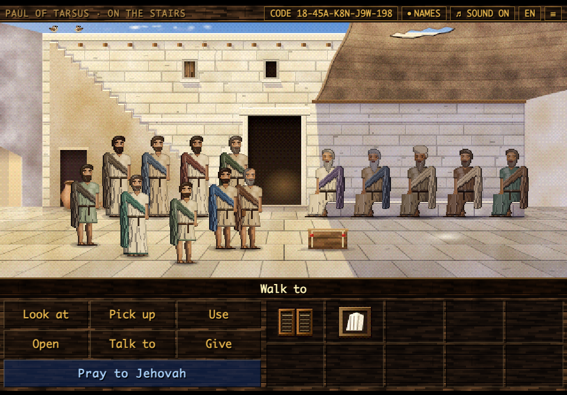 | 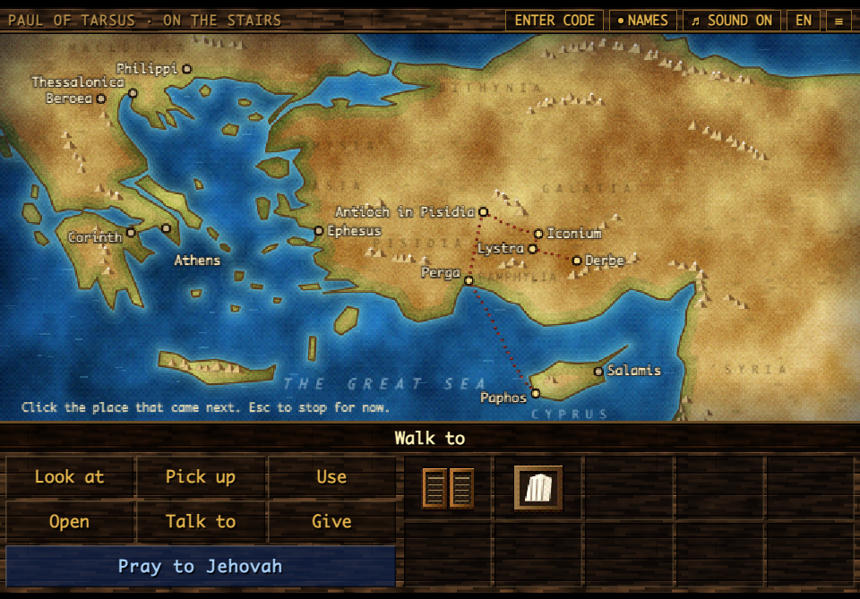 |
| The gift: the chest from Macedonia and Achaia, its seals whole, set before James | One by one: the first journey told, Paphos to Derbe, and the second still to come |

**The gift.** James and the elders sit along the wall of the court, under a goat-hair awning with a tear in it. The chest that has come all the way from Corinth stands with Aristarchus. Once Paul has greeted James, he has it set before him: its seals are whole, and James thanks them for the poor among the holy ones in Jerusalem. It is one quiet beat. Acts does not tell of the gift here, and the end screen says so.

**One by one.** James asks Paul to tell them everything, one thing after another (Acts 21:19), and the travel map opens on the window of the journeys, from Macedonia to Cyprus, with thirteen places of the journeys of Chapters Four to Fourteen as dots. The player tells Paul's ministry among the nations in the order it came, one click at a time: each right place brings Paul's line of what God did there and an elder's short answer, and the road told so far draws itself. Only what the earlier chapters told is told again. Every place stays on offer, so the order is found by knowing the journeys and not by counting down a list: a place already told is answered "I've told them that already", one that came later "That came later", and Salamis and Perga, which are not stops of this telling, have true lines of their own: at Salamis they spoke in the synagogues of the Jews, and Perga they only passed through at first. `Esc` leaves the map, and the telling goes on from where it stopped. Then the elders glorify God, tell Paul of the rumor and give their counsel, and recall the letter to the believers of the nations (Acts 21:20-25). Paul agrees, since nothing in it goes against the good news, and James names the four men.

| | |
|---|---|
| 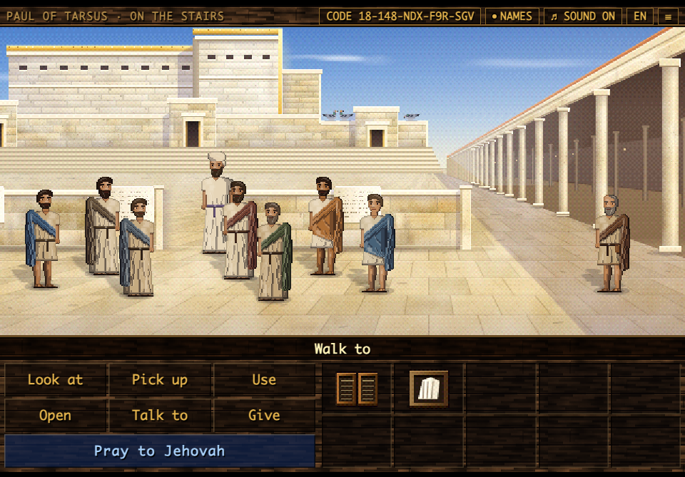 | 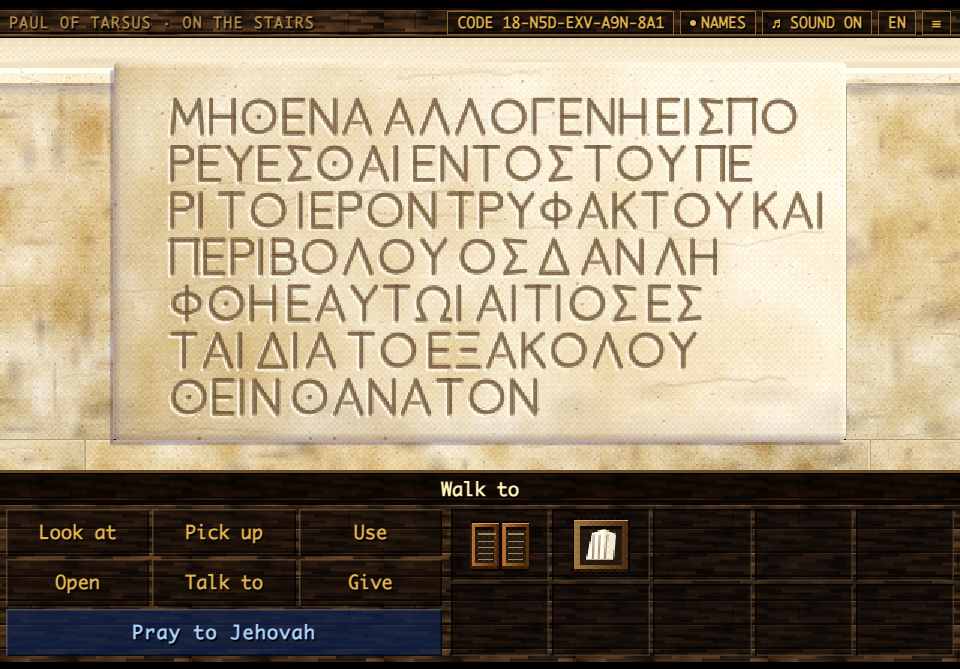 |
| The Court of the Gentiles: the barrier, its opening and the Levite, the inner courts and the sanctuary | The warning stone, read word by word |

**Outside the barrier.** In the Court of the Gentiles a low stone barrier runs round the inner courts, with an opening where a Levite stands, and stones set along it bear a warning in Greek. Paul is to go in with the four men to give notice of when their days would end (Acts 21:26). Three others wait at the opening for his word: Trophimus, a man from Cyrene in a Greek mantle, and a Greek of the city who would like to see the gate up close just once. Paul may not decide for anyone until he has read the stone. It is a close view in real Greek capitals, and each word is read with **Look at**; Paul's look line says what he makes of it. Its second word is the one that rules: it bars a man born of another people, not a man from another land, nor one who speaks another tongue. Then what each of the three says of himself decides it. Trophimus is an Ephesian, of the nations, and a brother; the man from Cyrene was born abroad and speaks only Greek, but his house is a Jewish house from his fathers' fathers; the Greek was born in Jerusalem and talks as its people do, but his father's people are Greeks. Paul tells each either to come in with them or to wait in Solomon's Colonnade. If anyone is placed wrongly when Paul goes to the opening, it is said truthfully, by Paul himself, by the Levite or by the man concerned, and the choices may be changed. The puzzle keeps to the stone's own distinction, a foreigner or a Jew, and rules on nobody in between.

| | |
|---|---|
| 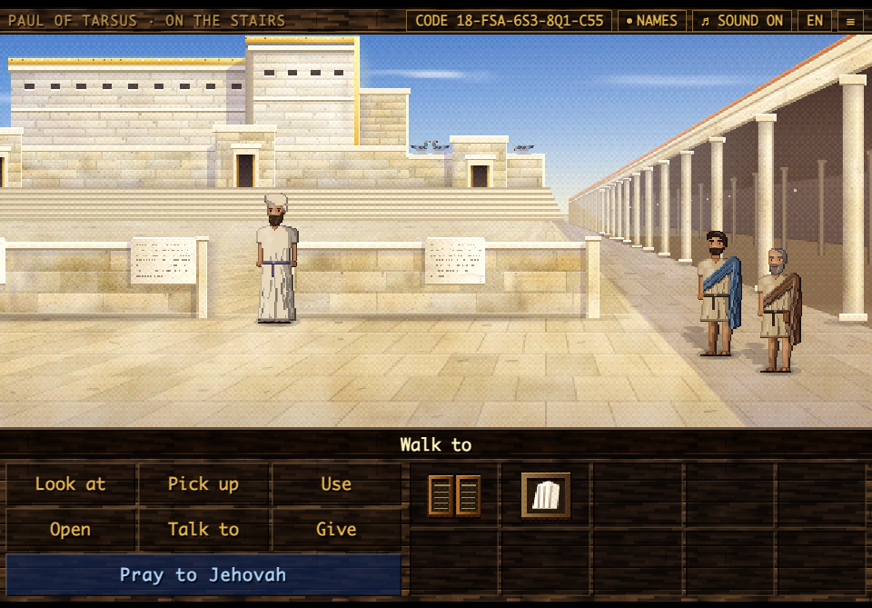 | 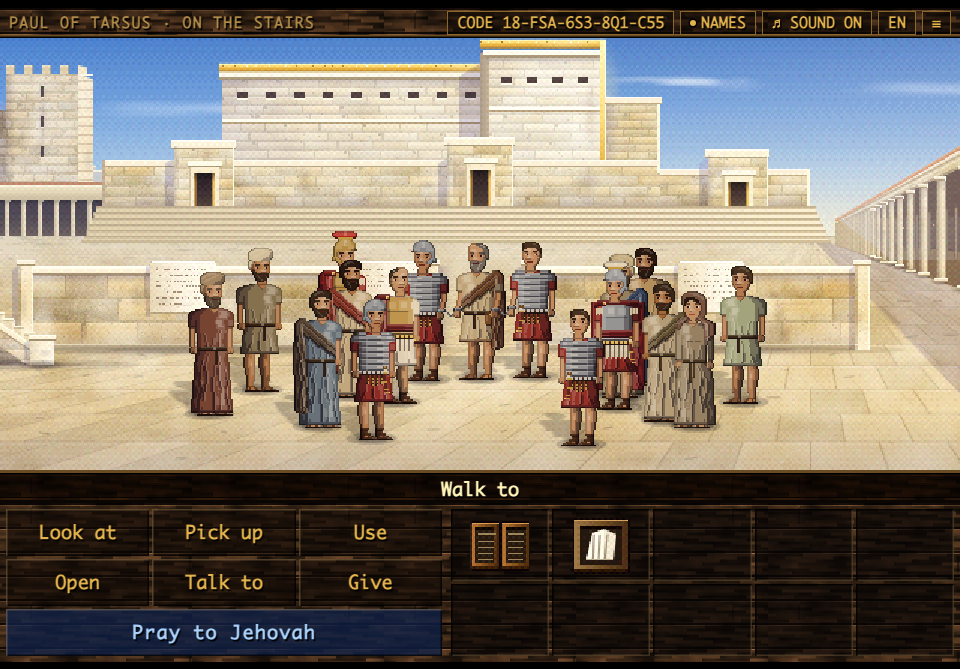 |
| Near the end of the seven days: Trophimus waits in the colonnade, as he has every day | Two chains: a soldier on either side, and the crowd round them |

**Seven days.** The days pass with it, told lightly: each day Paul goes in with the four men, and each day Trophimus waits for him in the colonnade, outside the barrier, in sight of the opening. So when the Jews from Asia cry out that Paul has brought Greeks inside, the player knows that he never took Trophimus in. Neither the vow nor its cost is shown or named.

**The arrest.** When Paul goes in for the last time, the arrest is played without the player steering it. The narrator tells how the Jews from Asia see him and seize him, why they suppose what they suppose, and how the city runs together and he is hauled out and the doors are shut. The commander comes down the flight of Antonia's stairs with his soldiers and army officers, and the beating stops; no blow is shown. He has Paul bound with two chains, a short chain from each wrist to a soldier on either side.

| | |
|---|---|
| 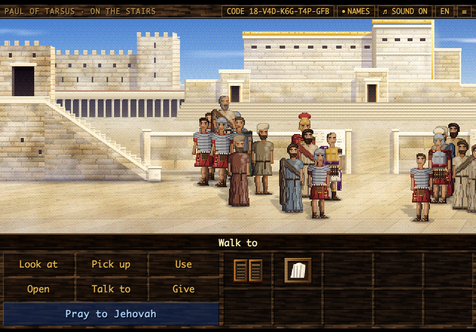 | 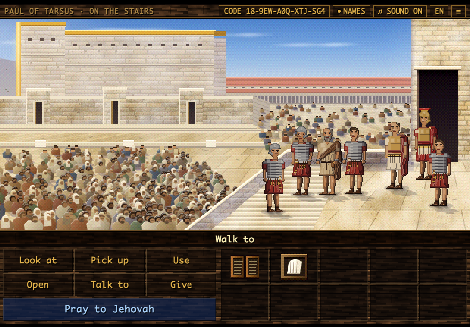 |
| Up the stairs: the soldiers carry him, and the player chooses only where he looks | The stairs: the commander, the army officers and the soldiers, the crowd below, the temple beyond |

**Up the stairs.** The soldiers lift Paul and carry him toward the stairs in a tight knot, his head and shoulders above theirs. The player does not steer; twice, the player chooses where Paul looks: at the men from Asia pushing to the front, at Trophimus still in the colonnade, back at the shut doors, at a woman who draws her child out of the crush, or at the commander climbing ahead. Every choice is right. What he saw is what he can truly say later, in the soldiers' quarters, when they ask him why the crowd was shouting. The crowd's cry is heard and never written: the vowels and the rhythm of the words the account gives, in the player's language.

**Two tongues.** On the landing every line Paul can say is offered twice, once in Greek and once in Hebrew. The commander understands only Greek: in Greek Paul asks for a word, is taken for the Egyptian who led the four thousand dagger men into the wilderness, says who he is, a Jew of Tarsus in Cilicia, and asks to speak to the people. In Hebrew the commander does not understand a word. The crowd quiets only for Hebrew, and only once Paul has motioned to them with his hand (the far forearm raised, bent, with its chain); in Greek the murmur begins again. Each line is true in both tongues: only who can hear it changes.

| | |
|---|---|
| 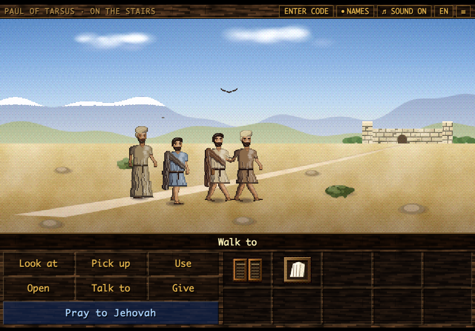 | 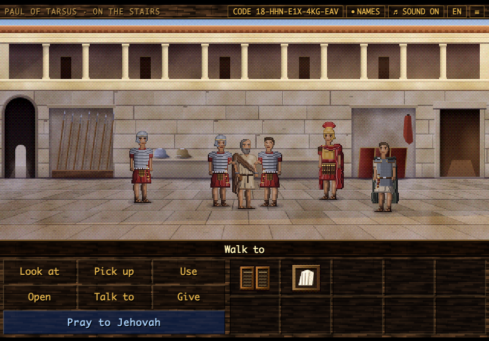 |
| The speech: the road to Damascus, after the light, and Saul led by the hand | The soldiers' quarters: two soldiers hold him, and the army officer stands there |

**The speech.** Then Paul speaks, and the narrator tells it in parts (Acts 22:1-21). From 22:6 to 22:16 the telling passes over the Prologue's pictures: the road near Damascus at midday, where the screen goes plain white and comes back out of it, the men who lead him by the hand into the city, and the room in the house of Judas, where Ananias comes to him. At the words about the nations far away the crowd shouts him down, throwing their outer garments about and tossing dust into the air (22:22, 23), and the commander orders him taken inside to be examined under the whip.

| |
|---|
| 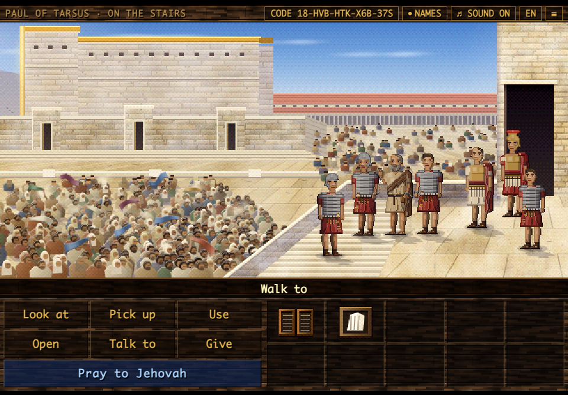 |
| The outcry: outer garments waved over the heads and dust tossed into the air |

**The right moment.** From the start of the chapter Paul carries one true sentence in his inventory: Roman by birth. Given to anyone else it does nothing: on the stairs the commander cannot hear it over the crowd, to the crowd it means nothing, and to a soldier it is not his to decide. In the soldiers' quarters two soldiers hold Paul by the arms, bent at his sides; no post, no whip and no blow is shown, and no arm is spread. Then the officer standing there asks why they were shouting, and Paul answers with something he truly saw. Given to the army officer now, the sentence becomes Paul's question of 22:25, and it stops everything. If the player waits too long, a runner calls the officer to the gate, the soldiers let go and wait, and when he comes back the moment comes again. The officer goes to the commander, the commander asks whether Paul is a Roman, and he says yes; the commander says what his citizenship cost him, and the player may answer that Paul was born one or let it stand. Both are true. The chapter ends when those who were to examine him draw back and the commander is afraid (22:29).

Walkthrough (spoilers)

1. In Mnason's court, **Talk to** Mnason, the old man with the white beard. Then **Use** the doorway to the guest room to rest.
2. In the street, go through James's door.
3. In the elders' court, **Talk to** James to greet him. Then **Use** the chest (or **Talk to** Aristarchus) to set it before James.
4. **Talk to** James again: the map opens. Click, in this order: Paphos, Antioch in Pisidia, Iconium, Lystra, Derbe, Philippi, Thessalonica, Beroea, Athens, Corinth, Ephesus. (Salamis and Perga get lines of their own and change nothing.)
5. After the elders' counsel, choose "I'll go with them, and I'll pay their expenses." or "There's nothing in this against the good news. I'll do it." (Either; "Let me think it over." only puts it off: talk to James again.)
6. The next morning, take the way up to the temple at the right of the street.
7. In the Court of the Gentiles, **Look at** the warning stone by the opening to see it close. **Look at** its words; the second word, ALLOGENE, is the one that matters. Go back to the court.
8. **Talk to** Trophimus and choose "Wait for us in Solomon's Colonnade."; **Talk to** the man from Cyrene and choose "Come in with us."; **Talk to** the Greek of the city and choose "Wait for us in Solomon's Colonnade."
9. Go through the opening in the barrier. The seven days pass. Go through the opening once more: the arrest follows.
10. Carried up the stairs, choose where Paul looks, twice: any choice will do.
11. On the stairs, **Talk to** the commander: "In Greek: Could I have a word with you?" **Talk to** him again: "In Greek: Tell him who I am, and ask to speak to the people."
12. **Use** the crowd (or **Talk to** the crowd and choose "Motion to them with my hand."). Then **Talk to** the crowd: "In Hebrew: Men, brothers and fathers: listen to what I have to say in my defense."
13. In the soldiers' quarters, answer the officer with any line. Then **Give** Roman by birth to the army officer, the one with the crested helmet. At the end, choose either answer.

The hidden treasure lies in the Court of the Gentiles, off the way: the far end of Solomon's Colonnade, where its columns run off into the distance. **Look at** it.

## Music and sound

| Chapter | Music | Around you |
|---|---|---|
| On the Stairs | One tune for a city that turns against him: F, a minor key, in bars of fifteen that fall three, two, three, two, three, two, a bar that climbs like a stair and pauses on every second step; no earlier chapter has this key or this bar. The tune is four bars long, from the keynote up to the fifth, a turn round the sixth, down to the note below the keynote, and home. At Mnason's lyre and harp take turns, warm and slow, over a low string. In the street the oud walks it over a hand drum and a low string. With the elders the harp plays it at half its pace and the lyre rocks under it. In the temple court the ney has it over a low note that lies quietly under it, and the harp rocks. In the arrest, on the stairs and in the soldiers' quarters the low string plucks the keynote and leans on the note above, a drum ticks with it and almost stops every fourth bar, and the ney begins the tune and breaks off before it comes home, no louder than the rest. While Paul speaks, only the low string and the harp far off, with the first bar again and again. Nothing is claimed about how music was played then | Birds and leaves in Mnason's court and the elders' court, with the city far off; the crowd, the birds and the wind in the street and in the Court of the Gentiles; on the stairs the roar of the crowd and its cry, which falls away to a murmur when Paul motions with his hand and comes back with the outcry; in the soldiers' quarters the wind and the city far off. The cry is heard and never written, in the vowels and rhythm of the words the account gives (21:36; 22:22). Sparrows sit on the parapets of Mnason's house and the elders' house, doves on the roofs of the street and on the wall of the Court of Women, and from the arrest on no bird is seen |

Every step can be solved from the text alone.

## The travel map

The chapter opens on the map in the window of the eastern sea: the road from Caesarea, which Chapter Seventeen began, runs on inland and its last stretch draws itself up to Jerusalem while Acts 21:17 is told.

For "one by one" (Acts 21:19) the map opens in a window of its own, a little farther off than usual, from Macedonia to Cyprus: Salamis, Paphos, Perga, Antioch in Pisidia, Iconium, Lystra, Derbe, Philippi, Thessalonica, Beroea, Athens, Corinth and Ephesus are all in it, with names placed so that none crosses a coast or another name. The roads between places told one after the other draw themselves as they are told: the first journey by land from Perga to Derbe, the second from Philippi by Amphipolis and Apollonia to Thessalonica and Beroea, by sea to Athens, on to Corinth, and from Cenchreae across the sea to Ephesus. Between Derbe and Philippi, Paul says only that they crossed the sea to Macedonia, and nothing is drawn. No line crosses another.

## About the content

Chapter Eighteen tells what the account says (Acts 21:17–22:29) in the narrator's own words, verse by verse with the reference, and puts none of it into a mouth as a quotation. These lines stand together in `levels/chapter18.js` (`TOLD`) and in the language files, where they can be checked against the Study Edition; the German lines were written from the German edition. The narration says "we" for 21:17 and 21:18, as Acts does, and "he" and "they" from there on. Where a line of the account is spoken in the game (the commander's questions and Paul's answer, 21:37-39; Paul's question, 22:25; the officer, 22:26; the commander and Paul, 22:27, 28), it stands in the game's own words. Paul's lines on the map restate what Chapters Four to Fourteen told, and add nothing to them. Three lines are told between the lines of the account and are not the account: the night at Mnason's, the next morning, and Trophimus waiting each day in the colonnade.

**What was read, and how.** On 25 November 2026 these were read by hand in the browser, on wol.jw.org: Acts 21 and 22 in the Study Edition with every study note, footnote and media note for these verses, and Acts 21:17–22:30 in the German Study Edition; Numbers 6:9-21, John 10:22, 23, Acts 3:11, 5:12 and 24:17, and Leviticus 19:27; the study notes on John 5:2 and Acts 12:17; the media notes "The Wall in Between" and "Roman Citizenship", and the Study Edition's media on the temple for Luke 1 and Luke 4; appendix B11 in English and German, and the ground plan of the temple Herod rebuilt in appendix 9F of the Reference Bible; *"Bearing Thorough Witness" About God's Kingdom*, chapters 22 and 23 with their boxes; the *Insight on the Scriptures* articles "Antonia, Tower of", "Garrison", "Jerusalem", "Temple" (with its photograph of the warning stone), "Gate, Gateway", "Trophimus", "Vow", "Nazirite", "Clean, Cleanness", "Dagger Men", "Egypt", "Claudius Lysias", "Military Commander", "Army Officer", "Army", "Citizen, Citizenship", "Beating", "Bond", "Tarsus", "Paul", "Mnason" and "Attitudes and Gestures"; and *Watchtower* articles on the temple police, the barrier, Roman citizenship, Gamaliel and Paul's appeal to Caesar, and the "Did You Know?" of 1 October 2015 on the temple. In German, Exodus 6:23, 25, 2 Kings 15:10 and Proverbs 30:1 were read for the spelling of the Bible names that three invented characters bear. The chapter's lead and its helpers did the reading and gave the facts to the builders in a brief; nothing was added to them.

**What they establish.** Between them, these publications give the following, said here in the game's own words. The visit was in 56 C.E. Mnason, from Cyprus, was an early disciple, and his home was in Jerusalem; nothing is said of his house. The James to whom they went was likely Jesus' half brother, who took the lead among the elders; no apostle is named, and the notes say the Bible does not say why. *Bearing Thorough Witness* considers it likely that Paul also spoke of the relief he had brought from Europe, which Acts 24:17 mentions later. The believers zealous for the Law were literally myriads. Just what the vow was is not known; *Bearing Thorough Witness* says that no principle was at stake, so Paul went along with the counsel, and that he would hardly have supported an offering for sin; *Insight* says that paying the expenses of poor Nazirites was counted a good work. No cost is given anywhere, and nothing explains the seven days. The temple police, who were Levites, were likely involved when he was seized and the doors were shut. The commander was a chiliarch, over a thousand men; he took several army officers with him; his name, which Acts first gives at 23:26, is Greek, which suggests a Greek by birth who likely bought his citizenship under Claudius, and a military tribune showed his rank by a narrow purple stripe and a gold ring. The fortress of Antonia stood at the northwest corner of the temple court and overlooked it, with barracks, courts and a tower at each corner, and Paul appears to have spoken from its steps; no source describes the stairs. More soldiers were kept in the garrison at festivals, but the account does not say a festival was on, and the game does not name one. *Insight* says that the Jews violently opposed the images on Roman standards, and the game shows none. The language Paul spoke to the crowd was Hebrew, not Aramaic. Throwing off outer garments and tossing dust was a show of contempt. It was illegal to scourge a Roman citizen who had not been condemned; no document was shown, Paul's word was enough, and a false claim of citizenship could be punished with death. No amount is given for what the commander paid. The Court of the Gentiles was lined with colonnades, Solomon's Colonnade on the east and the Royal Colonnade on the south; a stone barrier about three cubits high ran round the inner courts, with openings in it and stones set along it that warned foreigners in Greek and in Latin that whoever went inside had himself to blame for his death; inside it, steps led up to the Court of Women, and the sanctuary, facing east, rose over all the courts. Jesus walked in Solomon's Colonnade one winter, at the Festival of Dedication; the people ran together to Peter and John there; and they all used to meet there (John 10:22, 23; Acts 3:11; 5:12).

**The temple, drawn as it was.** Jehovah's temple is shown in this chapter, by the maintainer's decision for it (CONTRIBUTING section 3): the Court of the Gentiles, Solomon's Colonnade receding to the east, the barrier with its opening and its stones, the steps, the inner walls with their gatehouses, the Court of Women, and over them the sanctuary, its taller front block toward the east with a gold coping, and at the northwest corner the fortress of Antonia with its stairs; from the landing of the stairs the view looks south, over the court and the crowd to the sanctuary's flank and the Royal Colonnade far off. The layout and the proportions were laid out from the Study Edition's media and the publications named above, and checked against them only: the painting is the game's own, made in code, and nothing of their artwork, drawings or photographs is copied. The altar lies behind the inner walls and is not seen. No sacrifice, fire, smoke or rite is shown, no priest is seen at a rite, and no Roman standard is seen anywhere.

**The warning stone.** The close view shows one warning stone, with its warning in real Greek capitals, cut as grooves in the stone's own color with no paint, as no publication read mentions any. Its letters were read on the photograph of the surviving stone in *Insight* "Temple". That stone is worn and broken in places; the game shows it complete and new, as it was in 56 C.E., and the letters that cannot be read on the surviving stone follow the standard scholarly reading of it. Tau and chi are accepted as letters (CONTRIBUTING section 3); the alpha has a faint short crossbar so that it can be told from lambda. Its meaning is told in Paul's look lines, in the game's own words. Only the Greek stone is shown: no Latin text was read, so none is painted.

**What is invented.** The supporting characters are invented: Eleazar, Nahum, Ithiel and Shallum, the four men under the vow, whom Acts does not name, and who bear names from the Hebrew Scriptures; the brother and the sister of the congregation at Mnason's; the four elders beside James; the barber; the man from Cyrene, a Jew born abroad; the Greek of the city; the Levite at the opening; the woman with her child and the others in the crowd; the runner; and the soldiers and the army officers, whom the account mentions without names. The Jews from the province of Asia are the account's own and are not named. Mnason's donkey is invented. Everything that is spoken is invented, including what is said by Paul, Luke, Timothy, Aristarchus, Trophimus, Mnason, James and the commander, apart from the lines of the account named above, which are told in the game's own words. Mnason's house and the elders' house, the street and the barber's stall, the torn awning, the seals on the chest, the telling on the map, who waited at the opening and what each of them said, the word Paul reads on the stone, where he looks on the stairs, every line offered in Greek or Hebrew beyond the account, the officer's question in the soldiers' quarters, the runner who calls him away, and the look of the stairs and of the soldiers' quarters are invented.

**What Acts leaves unsaid.** Acts says "we" for 21:17 and 21:18 and then no more, and does not say who besides Trophimus was with Paul after that; the game shows Luke, Timothy and Aristarchus at Mnason's and with James, and only Trophimus afterward. Acts does not say that the gift was handed over at this meeting: it tells of the gift later (Acts 24:17), and *Bearing Thorough Witness* calls it likely. Acts does not say what the vow was or what it cost, why the days were seven, which doors were shut and by whom, or how the two chains were fastened: the game fastens them as Acts 12:6 tells of Peter, a soldier on either side, and *Insight* "Bond" describes that as the Roman custom. Acts does not describe the stairs, where Paul looked as he was carried, or anything said in Greek or Hebrew beyond what it tells. It names the commander only later (Acts 23:26), and the game calls him the commander. The chapter's end screen says these things too.

**The German text.** Names and terms follow the German Study Edition: Jakobus, Mnason, Trophimus der Epheser, die Juden aus der Provinz Asien, der Militärbefehlshaber and die Offiziere, die Kaserne, die Burg Antonia, die Treppe, Salomos Säulenhalle, der Vorhof, die Absperrung, das Heiligtum, Tarsus in Zilizien, Kyrene, and on the map Ikonion, Perge and Beröa. The four men are Eleasar, Nahum, Ithiël and Schallum, spelled as the German Study Edition spells these Bible names. The choices on the stairs begin „Auf Griechisch:“ and „Auf Hebräisch:“, and the sentence Paul keeps is „Römer von Geburt“. Mnason's donkey is a she-donkey, „die Eselin“, because the joke in German calls her „sie“. The crowd's cries are the vowels and rhythm of the German Study Edition's words of 21:36 and 22:22, and are never shown.

[← All chapters](../README.md#chapters)
