# Chapter Nineteen: The Sister's Son

Jerusalem and Caesarea, 56 C.E. The military commander still wants to know for certain what the Jews accuse Paul of, so the next day he has him untied, calls the chief priests and the whole Sanhedrin together, and brings Paul down to stand among them. Paul says that he has lived before God with a clear conscience to this day, and the high priest Ananias orders the men at his side to strike him on the mouth. Paul calls him a whitewashed wall; told that this is God's high priest, he says that he did not know it, and recalls that the Scriptures forbid speaking abusively of a ruler of the people. Seeing that one part of the council are Sadducees and the other Pharisees, he says that he is a Pharisee, a son of Pharisees, on trial over the hope of the resurrection of the dead. The assembly splits, some scribes of the Pharisees' party stand up for him, and the commander, afraid that Paul will be torn to pieces, has his soldiers take him back to the soldiers' quarters. The next night the Lord stands by him and tells him to take courage: he must bear witness in Rome too. When day comes, more than forty men bind themselves under a curse to eat and drink nothing until they have killed Paul, and they ask the chief priests and the elders to have the commander bring him down, as if to look into his case more closely. The son of Paul's sister hears of the ambush, goes into the soldiers' quarters and tells Paul; Paul has an army officer take the young man to the commander, who takes him by the hand, hears him alone, and tells him to say nothing to anyone. At the third hour of the night two hundred soldiers, seventy horsemen and two hundred spearmen leave for Caesarea with horses for Paul, and the commander writes to the governor Felix. By night they bring Paul to Antipatris; the next day the foot soldiers go back and the horsemen ride on. At Caesarea Felix reads the letter, asks Paul what province he is from, hears Cilicia, promises him a full hearing when his accusers come, and has him kept under guard in Herod's palace (Acts 22:30–23:35).

| |
|---|
| 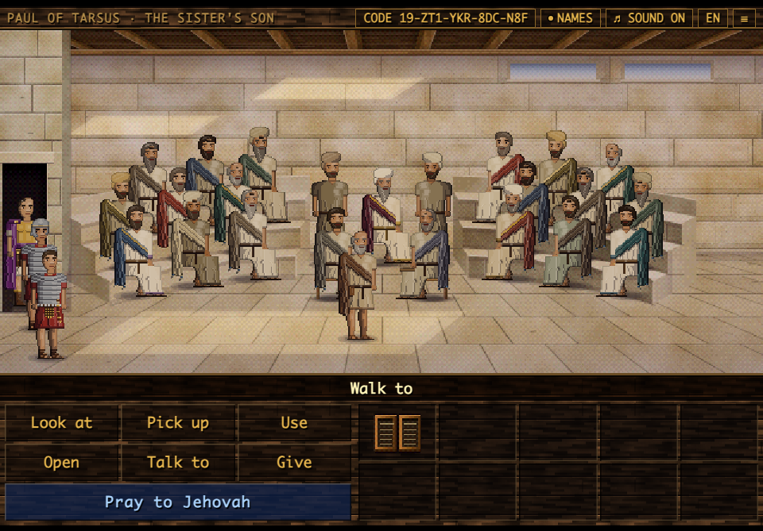 |
| Two benches: the Sanhedrin in a half circle, Ananias presiding, the clerks in front, Paul on the open floor and the soldiers at the door |

Nine places, one of them a lane map and one a close view. Paul is played in the council, in the yard at the third hour, at Antipatris and at Caesarea; from his mother's door to the commander, his sister's son is played, and Paul waits in the soldiers' quarters. From this chapter on Paul is drawn bald, with grey at the sides and a grey beard (issue #29).

**The council.** The chapter opens in the soldiers' quarters on the next morning, while the narrator tells Acts 22:30, and moves down to the council. It meets in a hall of hewn stone, by day: seventy-one men on stepped stone seats in a half circle three rows deep, so that every member can see every other, two clerks with writing boards in front, one for what speaks for the accused and one for what speaks against him, and Ananias presiding at the middle of the curve, with two men standing at his side. The commander and his soldiers wait at the door. Before the session the members talk among themselves, and whom Paul hears depends on where he comes to rest.

**Two benches.** Every Jewish man there wears a scripture case and fringes, but some wear their cases broader and their fringes longer than the rest (Matthew 23:5): a look at one of them tells Paul that he is a Pharisee. At the left end of the benches a man in fine linen tells his neighbor that nobody rises from the dead and that there is no angel or spirit either, and the neighbor holds all three. Each of these goes on Paul's tablets as he learns it. When he steps onto the floor before the council the session begins: his first words (23:1); a man steps forward from beside the high priest, and the picture cuts away before anything happens while the narrator tells the order to strike him (23:2); the whitewashed wall, the rebuke and the apology (23:3-5). Then Paul has a moment while the council confers. He has true sentences to say: that he was taught at the feet of Gamaliel, that he is a Roman citizen, that he has done nothing against the Law or the temple. Each is answered truthfully, and none changes anything. Only once he knows both what the broad cases mean and what the men at the left end hold is the sentence of 23:6 on offer, so it is found by knowing who sits there and not by trying everything. It splits the council, the scribes of the Pharisees' party stand up, and the soldiers lead him out (23:7-10); no blow is shown and no weapon is drawn.

**The night and the scroll.** What follows is read from the narrator's scroll with nothing seen and no light: the Lord standing by Paul the next night (23:11), the forty men and their curse (23:12, 13), and their plan with the chief priests and the elders (23:14, 15). The account says "the Lord" here, and the game keeps it.

**The sister's door.** Later that day, in the upper city of Jerusalem, Paul's sister stands at the door of her house, and her son is played. She sends him with a jug to the oil seller below the fortress, to have it filled for the lamps, and asks him to be back before they are lit. She is shown only here, with a few plain words. He carries one thought from home: his uncle is a prisoner in the fortress, and the council heard him yesterday.

| | |
|---|---|
| 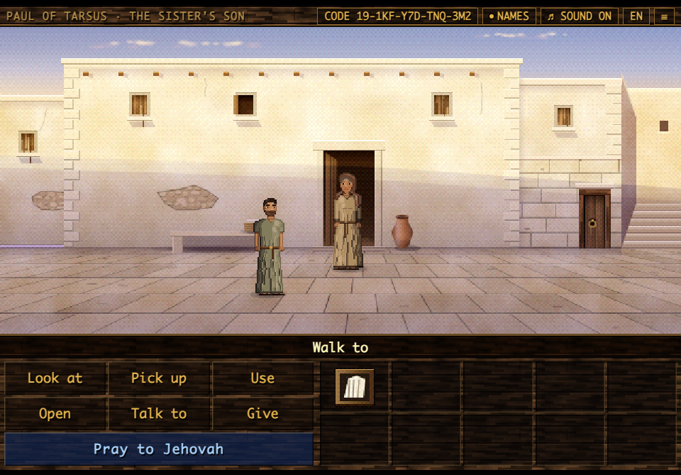 | 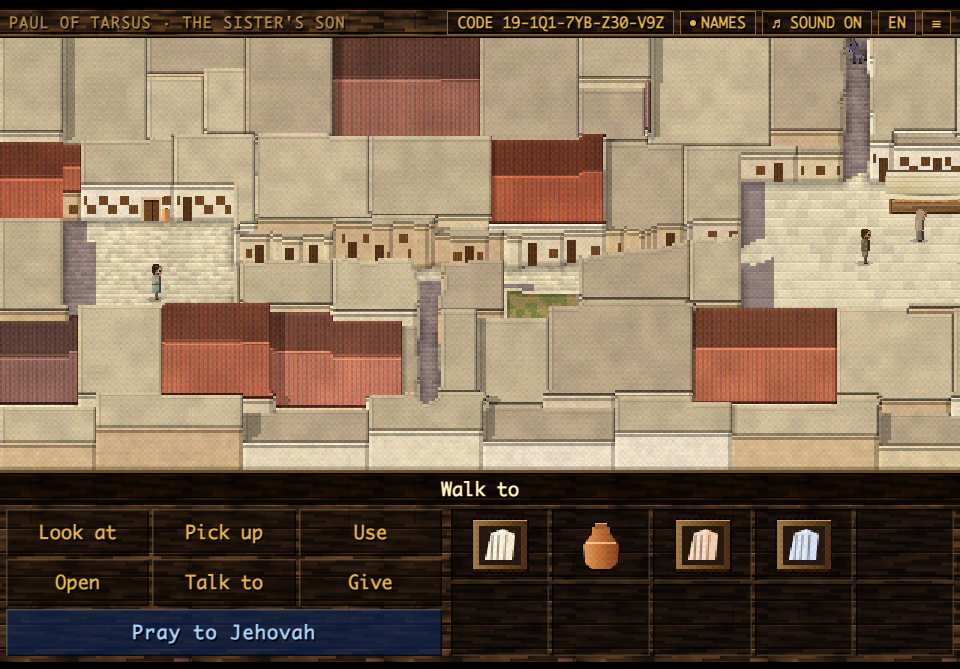 |
| The sister's door: her house in the upper city in the late afternoon | Overheard: the upper city from above, with both halves in the nephew's inventory |

**Overheard.** The upper city is a lane map, seen at a slant from above and larger than the screen, as Tyre is in Chapter Seventeen: his mother's door at one side, the market with its bread stall, the court before a fine house, and the oil seller's stall below the fortress wall, whose gate opens at the top of the map. Doves sit on the coping of the wall. A donkey with a load on its back stands across the short lane north of the market and will not move, and the way round passes the fine house. The nephew never hides or follows anyone: he hears what is said where he is. At the bread stall men refuse bread and water because they are under an oath with a curse on them until they have done away with a man; whom, they do not say. In the court of the fine house an elder tells a man of the chief priests' households that the council will ask the commander tomorrow to bring the prisoner down, as if for a closer look; why, he does not say. Each half becomes a thought he carries. Put together (**Use** one with the other), they make one: men under a curse are waiting for the prisoner who is brought down tomorrow. Put with the thought he brought from home, it can mean only his uncle. Every other pairing gives a true thought that is not enough. Then he makes for the gate of the fortress.

**In through the front.** Three listeners each listen for something else, and every line offered is true. The sentry wants to know who he is and whom he wants: Paul's sister's son, for the prisoner Paul. Inside, in the court of the soldiers' quarters in the late sun, the soldier who guards Paul wants to know whether he is family. The army officer whom Paul calls (23:17) wants to know whether it can wait and whom it is for: it cannot, and it is for the commander alone. Each lets him on once he has heard both of his things, in any order. "There's a plot against him" is on offer to all three, and each time the nephew holds it back himself ("Not to him."): what the matter is, he tells only Paul and the commander. Nothing is lost by it. His talk with his uncle is short and warm.

| | |
|---|---|
| 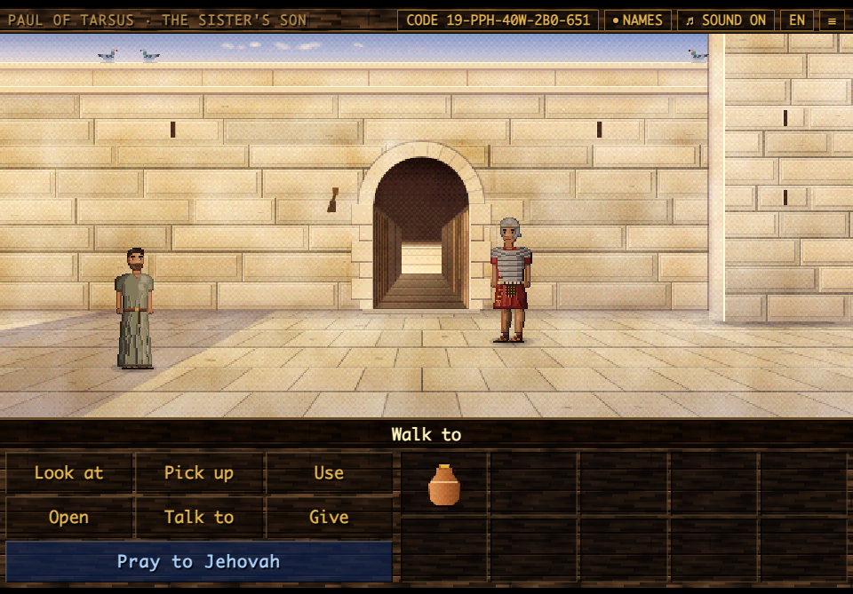 | 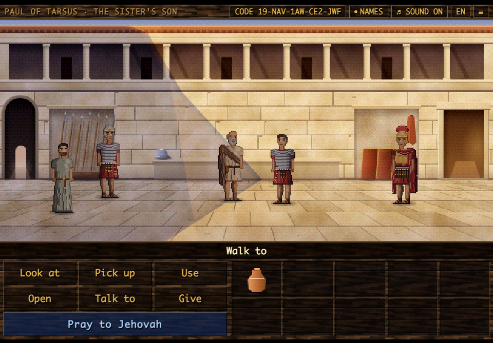 |
| The gate of the fortress, and the sentry | The soldiers' quarters in the late afternoon: the nephew just in from the gate, Paul among the soldiers, and the army officer |

| |
|---|
| 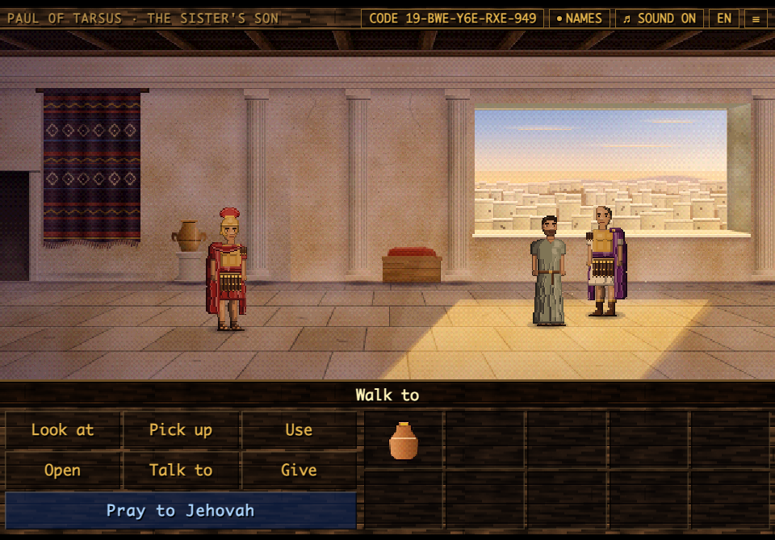 |
| The commander's room: the officer, and the commander with the young man by the opening |

**The commander.** The commander's room in the fortress of Antonia looks west over the city through a wide opening above a parapet, in the late afternoon. The officer reports that the prisoner Paul asked him to bring the young man (23:18); the commander takes him by the hand and draws him aside, and they talk alone by the opening (23:19). The nephew begins either way he likes, both true, and tells what he heard (23:20, 21); the commander tells him to say nothing of it to anyone (23:22).

| | |
|---|---|
| 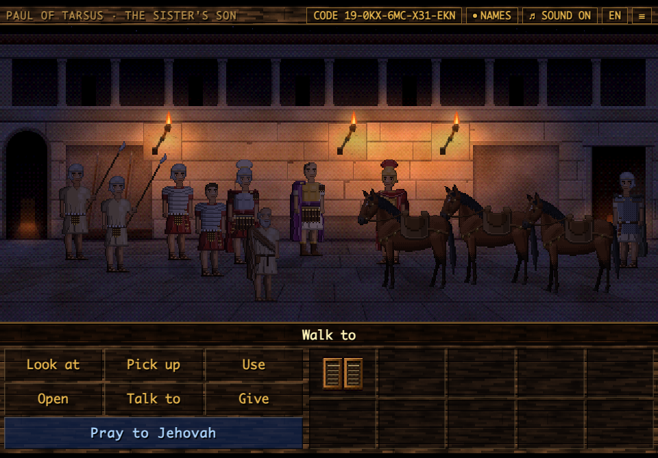 | 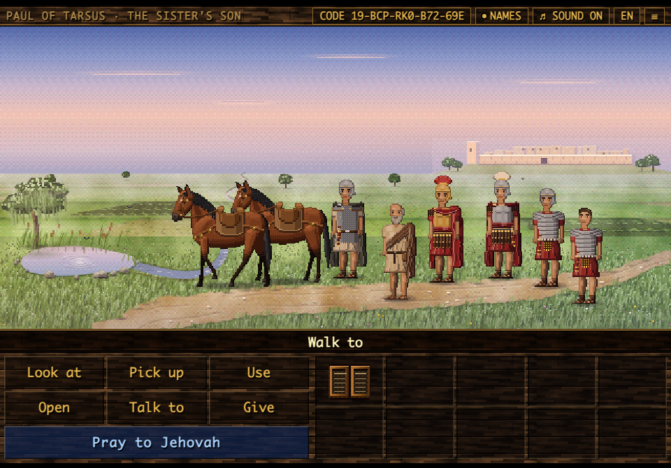 |
| The third hour: the yard by torchlight, the column forming and three horses ready | Antipatris at dawn, in the Plain of Sharon |

**The third hour.** At the third hour of the night, about 9 p.m. by the reckoning from sunset, the yard is lit by torches leaning out from the wall. The commander gives his orders to two officers (23:23, 24), and Paul is played again. Three horses stand ready, and he is to take one: one has its ears pinned back and stamps a forefoot, one shows the white of its eye and tosses its head at every torch, and one has its ears forward and soft, its weight square on four feet, and a quiet eye. **Look at** tells them apart; the horseman who holds them answers the two fresh ones truthfully, and the calm one is Paul's. The officer tells him where he rides, and the narrator tells that the commander also wrote a letter (23:25). It is not read yet. No standard is carried, and every spear slants.

**The night road.** The travel map opens by night, and the road from Jerusalem down to Antipatris draws itself while Acts 23:31 is told.

**Antipatris.** At dawn the column halts at Antipatris, the town Herod the Great rebuilt on its mound in the green, well-watered Plain of Sharon. The foot soldiers turn back to the quarters, and the horsemen ride on with Paul (23:32). Paul goes with them on his own calm horse; on foot, or back toward Jerusalem, is not his way. The map shows the road on to Caesarea by day.

| | |
|---|---|
| 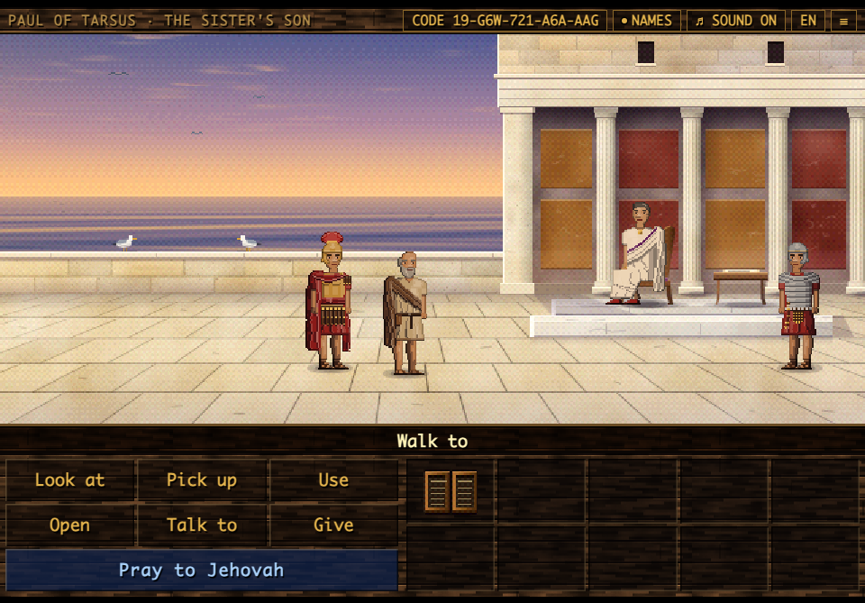 | 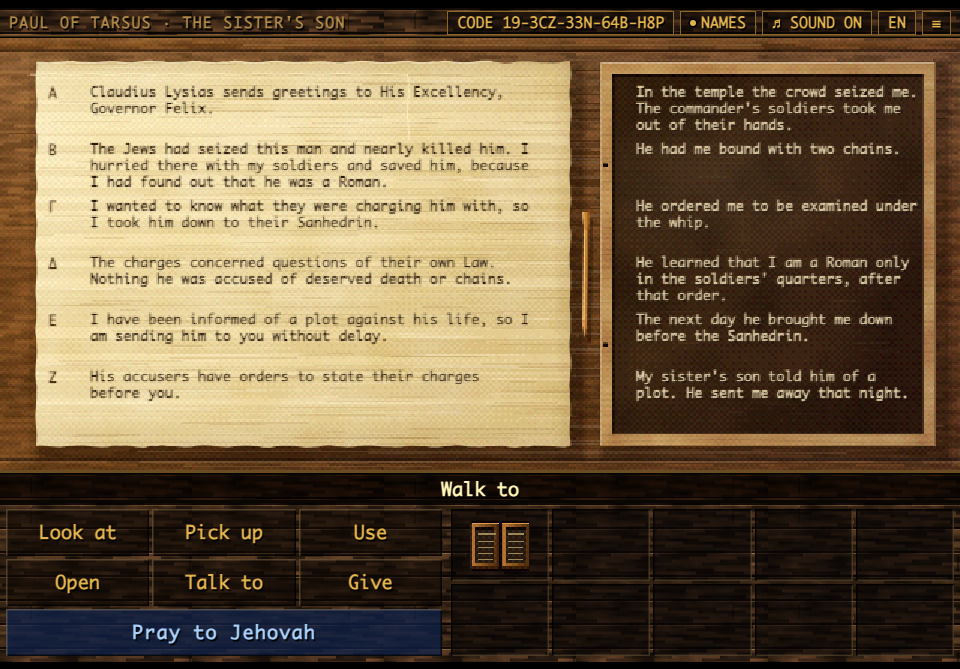 |
| Herod's palace at Caesarea: Felix on the dais, gulls on the sea wall | What the letter leaves out: the letter's lines beside Paul's notes, nothing marked yet |

**What the letter leaves out.** In Herod's palace at Caesarea, which reaches out into the sea, the horsemen's officer hands the letter to Felix, who sits on a raised seat on a dais of two steps. Felix reads it aloud, line by line: Claudius Lysias greets His Excellency the governor Felix; he rescued this man from the Jews because he had learned that he was a Roman; he took him down to their Sanhedrin; the charges were questions of their Law, nothing deserving death or chains; a plot has been made known, so he sends him at once, and the accusers are to speak before the governor (23:26-30). The commander is named for the first time here, and the tablets call him Claudius Lysias from now on. Then Felix lays the letter open on the table beside him and reads it again to himself. **Look at** it to see it close, beside Paul's tablet with six notes of what happened since the temple: the crowd that seized him, the two chains, the order to examine him under the whip, that the commander learned he was a Roman only in the soldiers' quarters after that order, the council, and his nephew and the plot. Each note is marked with the line of the letter that tells it, or as not in the letter, and one line is marked as told out of order. A wrong arrangement is answered, in a fixed order, with what is truly wrong, and the marks can be changed. When all agree, Paul only thinks it: the commander told it his own way, without the chains or the whip and with the Roman before the rescue, and Paul will say nothing against him. Nothing else changes.

**Which province?** Felix asks what province Paul is from. He has three true answers: Cilicia, that he was brought up in Jerusalem, and that he is a Roman citizen. Only Cilicia answers what was asked (23:34); the others are answered truthfully, and the question comes again. Felix promises to hear him in full when his accusers arrive, and orders him guarded in Herod's palace (23:35).

Walkthrough (spoilers)

1. In the council, walk to the left end of the benches and stop there: two members talk of the resurrection, angels and spirits. **Look at** a member with a broad scripture case, such as one in the front row. (Either may be done before or after the session begins.)
2. **Use** the place before the council (or **Talk to** the man who presides): the session begins and runs to 23:5.
3. **Talk to** Ananias and choose "I'm a Pharisee, a son of Pharisees: it's about the resurrection". (Until both things of step 1 are known, it is not on offer; the other sentences are true and change nothing.)
4. At the sister's door, **Talk to** her. Take the lane into the city at the right.
5. On the lane map, walk into the market and past the bread stall: the men under an oath. Go round the donkey to the court before the fine house: the elder.
6. **Use** what the men swore with what the elder said. **Use** the two halves together with my uncle in the fortress.
7. **Talk to** the oil seller below the fortress to fill the jug (his mother's errand; nothing else depends on it). Walk to the gate of the fortress at the top of the map.
8. **Talk to** the sentry and choose "I'm the son of Paul's sister." and "I want to see the prisoner Paul." (either order).
9. In the court, **Talk to** Paul; the guard stops him: choose "I'm his sister's son." **Talk to** Paul again. To the officer, choose "It can't wait." and "It's for the commander alone." (either order).
10. Before the commander, choose either answer.
11. In the yard, **Look at** the three horses, then **Use** the calm one, the middle one with its ears forward.
12. At Antipatris, **Use** the horses at the water.
13. At Caesarea, **Look at** the letter on the table. **Use** each note on Paul's tablet and mark it: the crowd at the temple and a Roman in the soldiers' quarters with "The line: I saved him, having found out he was a Roman"; the two chains and the order to whip him with "The letter doesn't tell it"; down to the Sanhedrin with "The line: I took him down to their Sanhedrin"; my nephew and the plot with "The line: a plot, so I'm sending him to you". Then **Use** the line "I saved him, having found out he was a Roman" and choose "This line tells it out of order".
14. Answer Felix: "From Cilicia."

The hidden treasure lies at Antipatris, off the way: the spring at the left, under the willow, where the young river begins. **Look at** it.

## Music and sound

| Chapter | Music | Around you |
|---|---|---|
| The Sister's Son | One tune for a man passed from hand to hand: E in the Phrygian mode, whose second note lies only a half step above the keynote, in bars of seven that fall two, two, three; no earlier chapter has this key or this bar. The tune is four bars long: up from the keynote to the third, on to the fourth and the fifth, down from the sixth, and home by way of the half step. In the council the lyre has it over a low note on the keynote, slow and grave. In the lanes and at the sister's door the oud walks it over a hand drum and a low string. At the fortress and with the commander the harp takes it at half its pace and the lyre answers. In the yard at the third hour a drum keeps a steady step and the low string walks under the ney. At Antipatris at dawn the ney has it and the harp rocks. At Caesarea lyre and harp take turns over a low string. In the session, while the council divides, and on the night the plot is told, the low string plucks the keynote and leans on the half step above, a drum ticks with it and almost stops every fourth bar, and the ney begins the tune and breaks off before it comes home, no louder than the rest. Nothing is claimed about how music was played then | The murmur of the council and a little wind in the hall; the wind and the garrison in the soldiers' quarters, and crickets in the yard at night; birds, wind and the people of the city at the sister's door, in the lanes and at the gate; birds and wind at the commander's opening; at Antipatris birds, wind and leaves; at Caesarea the waves against the palace and the gulls. Sparrows sit on the parapet of the sister's house and doves on the fortress wall over the lanes and at the gate; at Antipatris a lark climbs over the plain and swallows skim the young river; at Caesarea gulls wheel over the open sea and two stand on the palace's sea wall. No bird is seen in the council, in the soldiers' quarters or at night |

Every step can be solved from the text alone.

## The travel map

The chapter adds Antipatris to the map, rebuilt by Herod the Great at the source of the Yarkon in the Plain of Sharon. When Paul has mounted, the map opens by night in the window of the eastern sea, and the road from Jerusalem down to Antipatris draws itself while Acts 23:31 is told at the foot of the picture. At Antipatris, after the foot soldiers turn back, it opens again by day, and the road draws itself on to Caesarea. No line crosses another, no name crosses a coast or a road, and no distance is given.

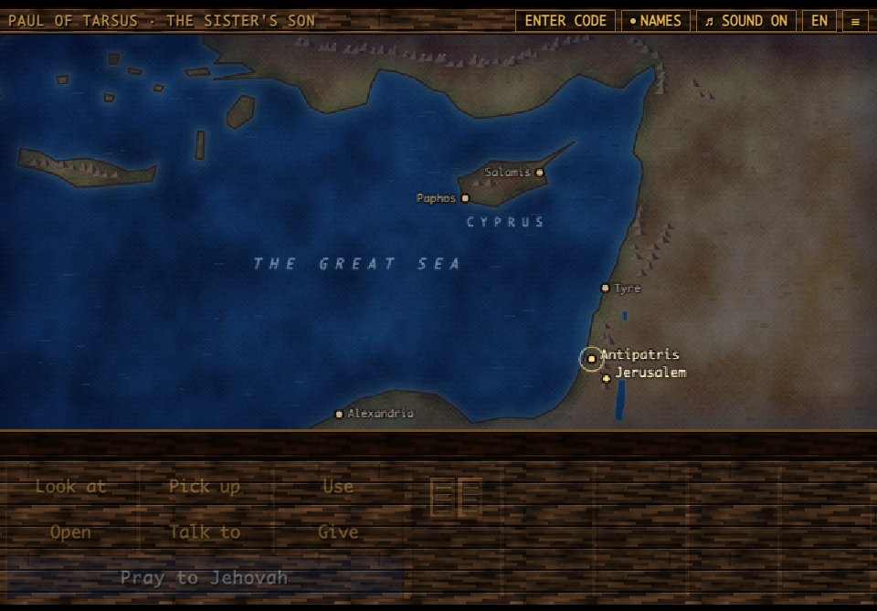

## About the content

Chapter Nineteen tells what the account says (Acts 22:30–23:35) in the narrator's own words, verse by verse with the reference, and puts none of it into a mouth as a quotation. These lines stand together in `levels/chapter19.js` (`TOLD`) and in the language files, where they can be checked against the Study Edition; the German lines were written from the German edition. Where a line of the account is spoken in the game (Paul, 23:1, 3, 5, 6; those standing by, 23:4; the scribes, 23:9; Paul to the officer, 23:17; the officer, 23:18; the commander, 23:19, 22, 23, 24; the nephew, 23:20, 21; Felix, 23:34, 35), it stands in the game's own words; the scribes' sentence, which the account leaves unfinished, becomes a plain question that says no more than the verse. The letter's lines (23:26-30) are told the same way and shown without quotation marks. Paul's sentence of 23:6 is true in the sense the Study Edition's note gives it: he sided with the Pharisees because he shared their hope of the resurrection, and he claims nothing of their other beliefs. The narrator says "the Lord" at 23:11, as the account does: the one who stood by Paul was Jesus. One line is told between the lines of the account and is not the account: later that day, in the upper city.

**What was read, and how.** On 25 November 2026 these were read by hand in the browser, on wol.jw.org: Acts 22:30, 23 and the opening of 24 in the Study Edition with every study note, footnote, cross-reference and media item on these verses, and the same verses in the German Study Edition; Exodus 22:28 in both; Matthew 23:5 with its notes, and the notes on Matthew 26:65 and Luke 22:66; the Study Edition's media "The Sanhedrin", "Roman Spears" and "Caesarea"; *"Bearing Thorough Witness" About God's Kingdom*, chapters 23 and 24 with their boxes on Roman citizens, on the Sadducees and the Pharisees, and on Felix; the *Insight on the Scriptures* articles "Ananias", "High Priest", "Dress", "Scripture-containing Case", "Pharisees", "Sadducees", "Court, Judicial", "Sanhedrin", "First-Century Jerusalem", "Antonia, Tower of", "Curse", "Ambush", "Night", "Spearmen", "Claudius Lysias", "Felix", "Antipatris", "Aphek", "Caesarea" and "Paul"; and the *Watchtower* articles "Take Courage—Jehovah Is Your Helper" (November 2020), "Paul's Nephew—He Saved His Uncle's Life" (June 1, 2009), the one on apologizing as a key to peace (November 1, 2002), and the questions on Acts 23:1-5 (January 15, 1960), with the *Teach Your Children* lesson on Paul's nephew. A passage of *The Watchtower* of September 15, 2005, on Pontius Pilate was read only as a search result. The chapter's lead and its helpers did the reading and gave the facts to the builders in a brief; nothing was added to them.

**What they establish.** Between them, these publications give the following, said here in the game's own words. The hearing was in about 56 C.E., at a meeting of the Sanhedrin called for the purpose, and the account puts the place below the fortress. Ananias, son of Nedebaeus, was high priest from about 48 to 58 C.E. and presided. By the Mishnah's description the court of seventy-one sat in a half circle three rows deep, so that all could see one another, with two clerks in front who wrote down what spoke for acquittal and what for conviction. The order to strike Paul on the mouth went to those standing beside the high priest, and branded him a liar before anything had been heard. Why Paul did not recognize the high priest is not known: *Bearing Thorough Witness* names three possibilities, weak eyesight, his long absence from Jerusalem, or a crowd that hid who gave the order, and the game names none. The German Study Edition gives "hypocrite" as another rendering of the whitewashed wall. The two parties were rivals in the council: the Sadducees, close to the priesthood and the wealthy, denied the resurrection, angels and spirits, and the Pharisees held all of them. The only visible mark the sources give is the Pharisees' broadened scripture cases and lengthened fringes (Matthew 23:5): small cases worn by Jewish men on the forehead and the left arm, and fringes on the corners of the garment. The vestments of the high priest were kept in the fortress of Antonia, so the game dresses Ananias in a rich robe and headcloth of his own. Paul was probably brought back to Antonia and was there when his nephew came. The curse the forty swore was an oath that would bring a curse on themselves if they failed. *Insight* says that Paul's sister and her son lived in Jerusalem, and *The Watchtower* that they apparently followed Jesus, and that how the young man heard is not known. The third hour of the night was about nine in the evening, counted from sunset; the escort numbered four hundred seventy; the spearmen were light infantry. Claudius Lysias, a Greek by his name, had bought his citizenship. Antipatris, at the source of the Yarkon in a well-watered part of the Plain of Sharon, was rebuilt by Herod the Great and stood where the military roads met. Felix, a freed slave of the imperial house and the brother of Pallas, was governor from about 52 C.E. Herod's palace at Caesarea, the governor's residence, reached out into the sea. A governor in his public dress wore a white toga with a purple border.

**The letter.** *Bearing Thorough Witness* (chapter 24) and *Insight* ("Claudius Lysias") both say plainly that the commander's letter did not tell everything as it happened: he had not rescued Paul because he knew him to be a Roman, since he learned that only later, in the soldiers' quarters, and he left out the two chains and the order to examine Paul by scourging. Both also say that he wrote it as Roman law required. The puzzle keeps to what they say. Paul does not expose him: what the player marks is Paul's own thought, and the story goes on as the account has it.

**What is invented.** Paul's sister appears once, at her door, with a few plain words; nothing is said of her beyond being his mother, at her house in Jerusalem. The nephew has no name, as in the account. How he heard is invented: the errand for lamp oil, the two halves heard at the bread stall and before the fine house, and the thoughts he puts together. The supporting characters are invented: the bread seller, the men at her stall, the elder and the man of the chief priests' households, the oil seller and the donkey in the lane; the sentry, the soldier who guards Paul and the horseman with the three horses; and the clerks, the members of the council who speak, and the men at the high priest's side, whom the account mentions without names, as it does the army officers, the soldiers, the horsemen and the spearmen. Everything that is spoken is invented, including what is said by Paul, Ananias, the nephew, his mother, the commander and Felix, apart from the lines of the account named above, which are told in the game's own words. The hall of hewn stone and its look, where the members sit and what they say before the session, Paul's other true sentences, the sentry's, the guard's and the officer's questions, the commander's room, the order of march, the calm horse, the palace's hall and the marks on the letter are invented.

**What Acts leaves unsaid.** Acts does not say where the Sanhedrin met: the Study Edition marks its hall's place as possible only, and the hall of hewn stone is a tradition; the game does not name it on the screen. It does not say why Paul did not know the high priest, how his sister's son heard of the plot, or anything about his sister beyond the relation. It does not say where the forty meant to strike, whether they were armed, or what became of them and their oath: the game shows them unarmed and leaves the rest untold. It gives no reason for horses, in the plural, and says nothing of the order of march. It says that Felix read the letter, not that he read it aloud with Paul before him. It names the commander only in the letter, and the game calls him the commander until then. The chapter's end screen says these things too.

**The German text.** Names and terms follow the German Study Edition: der Sanhedrin, der Hohe Priester Ananias, die Sadduzäer und die Pharisäer, der Militärbefehlshaber and die Offiziere, die Kaserne and die Burg, der Herr at 23:11, die Oberpriester und die Ältesten, Reiter and Speerträger, der Statthalter Felix, Zilizien, Antipatris, Cäsarea and der Palast von Herodes. The nephew and the sister are „Neffe von Paulus“ and „Schwester von Paulus“ in the status line. The spring at Antipatris is the source of the Jarkon, in the Ebene Scharon. *Insight on the Scriptures* is named „Einsichten über die Heilige Schrift“ on the end screen.

[← All chapters](../README.md#chapters)
