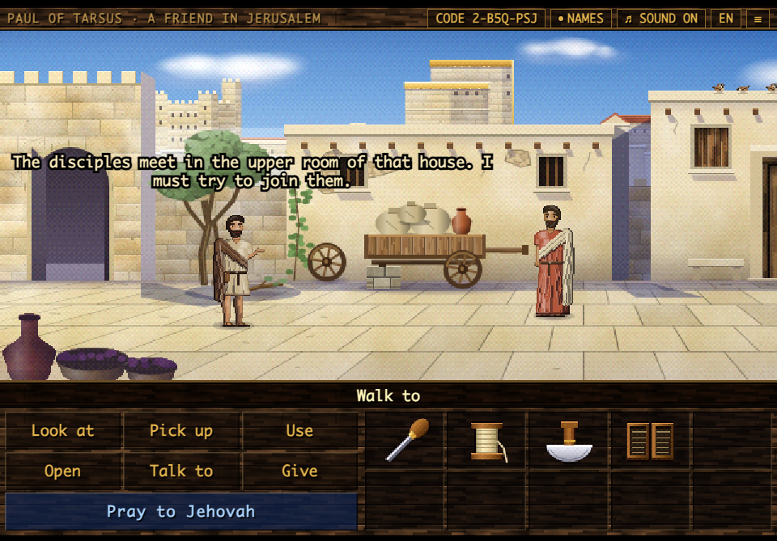
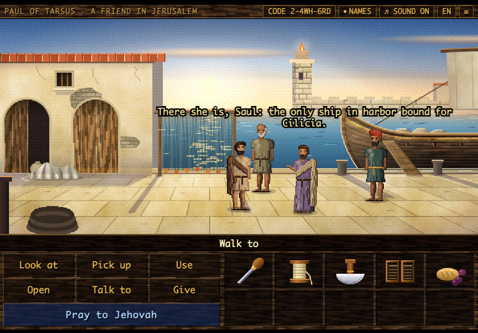
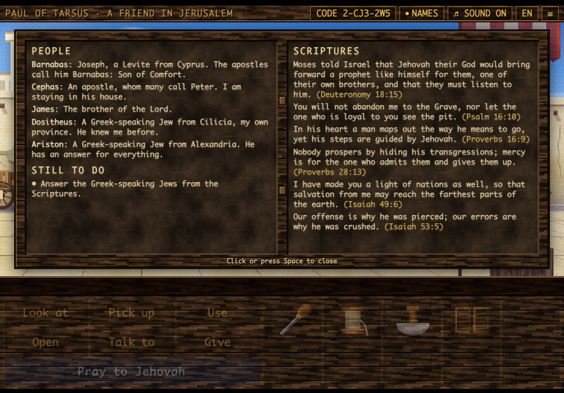
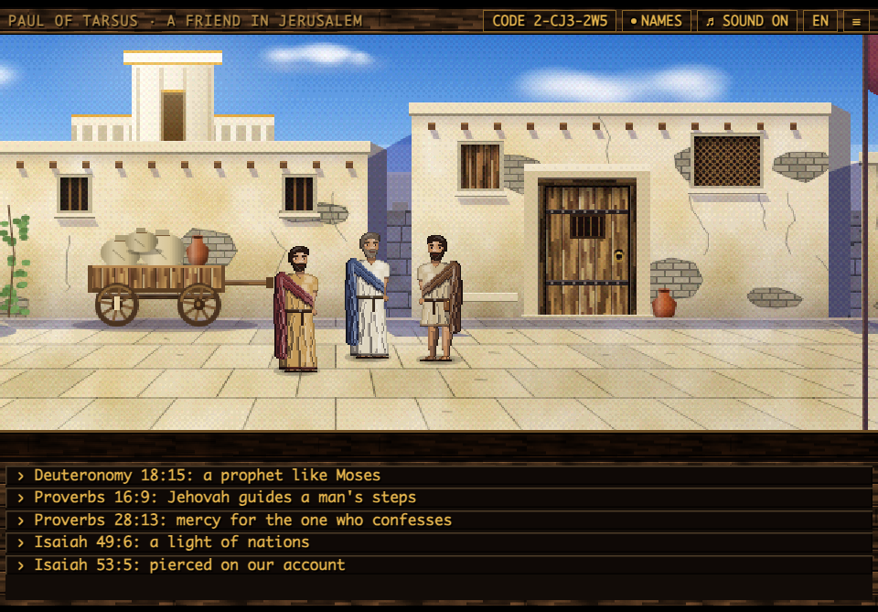

# Chapter Two: A Friend in Jerusalem

Three years after his conversion, Saul comes back to Jerusalem and wants to join the disciples there. Every one of them fears him, and nobody believes that he has become a disciple, until Barnabas takes his part (Acts 9:26-31; 22:17-21; Galatians 1:18, 19). Later, when a plot forces him to leave, the brothers take him down to Caesarea, where the only ship bound for Tarsus has a torn sail.

| | |
|---|---|
|  |  |
| Jerusalem: a stranger's broken cart, and a closed door | Caesarea: a ship that cannot sail, and a tentmaker who must |

Three more locations and eight new characters. This chapter turns on honesty as much as handiwork: Paul has to give Barnabas a plain account of himself, and the answers that excuse or recommend him get nowhere. Later, speaking out fearlessly in Jerusalem, he debates with two Jews who speak Greek and answers them from the passages on his wax tablets; the last objection is about his own part in Stephen's death, and the answer to it is a confession (Acts 9:28, 29; 22:20).

| | |
|---|---|
|  |  |
| The wax tablets: people met, what is still to do, and Scripture | Every answer is a passage from the tablets |

Walkthrough (spoilers)

1. Knock at the door of the house. Talk to the man with the handcart.
2. Pick up the pruned branch under the olive tree and use the knife on it.
3. Use the loose wheel, then use the peg with the handcart.
4. Answer Barnabas honestly: admit the persecution, tell what happened on the road to Damascus, and what happened in Damascus afterwards.
5. Knock at the door again. In the upper room, leave by the door to the city when you are ready.
6. In the street, talk to Dositheus. Answer each objection with a passage from your wax tablets: Isaiah 53:5 for the stake, Psalm 16:10 for the tomb, and Proverbs 28:13 when they ask about Stephen.
7. At the harbor, talk to the captain and use the halyard.
8. Use the knife on the heap of old sailcloth. Give the provisions to the fisherman.
9. Use the awl on the torn sail.

## Music and sound

| Chapter | Music | Around you |
|---|---|---|
| A Friend in Jerusalem | Lyre and ney in A Dorian; at the harbor a harp rocks in threes like the swell | Birds and a distant market, then waves, gulls and creaking timbers |

## About the content

The supporting characters are invented dramatization: Mattan, the captain, the fisherman, the doorkeeper and the two Greek-speaking Jews Dositheus and Ariston.

[← All chapters](../README.md#chapters)
