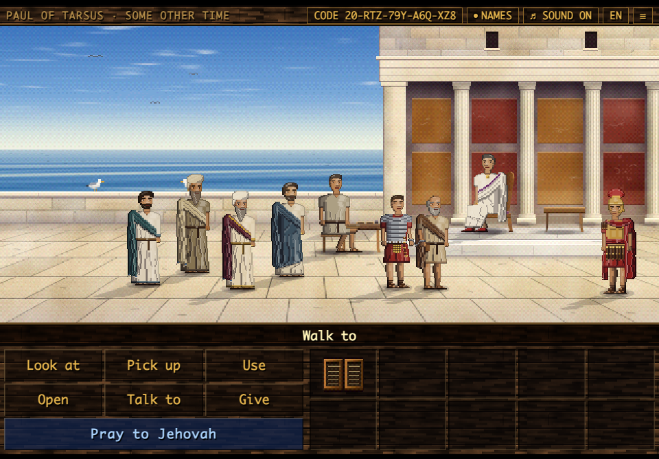
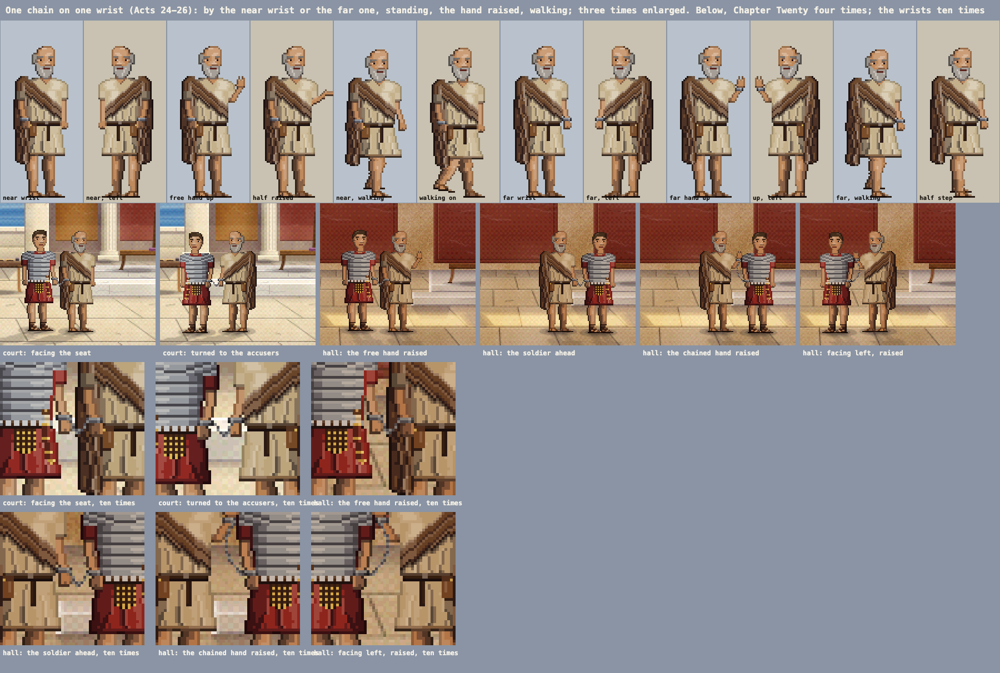
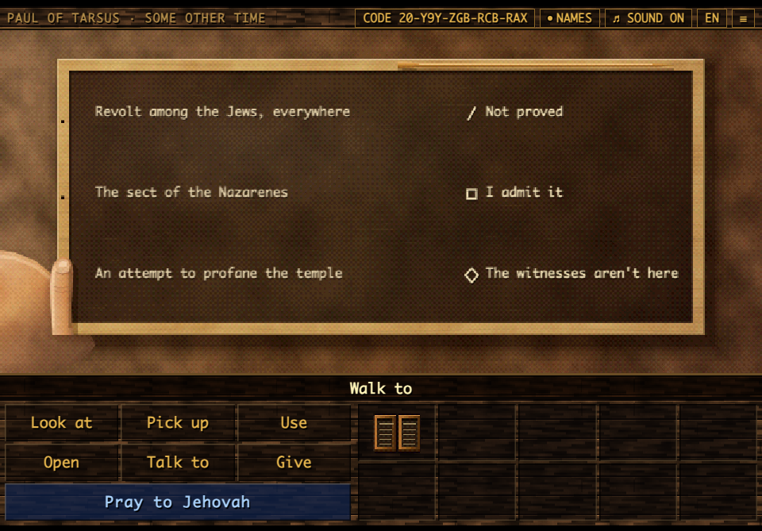
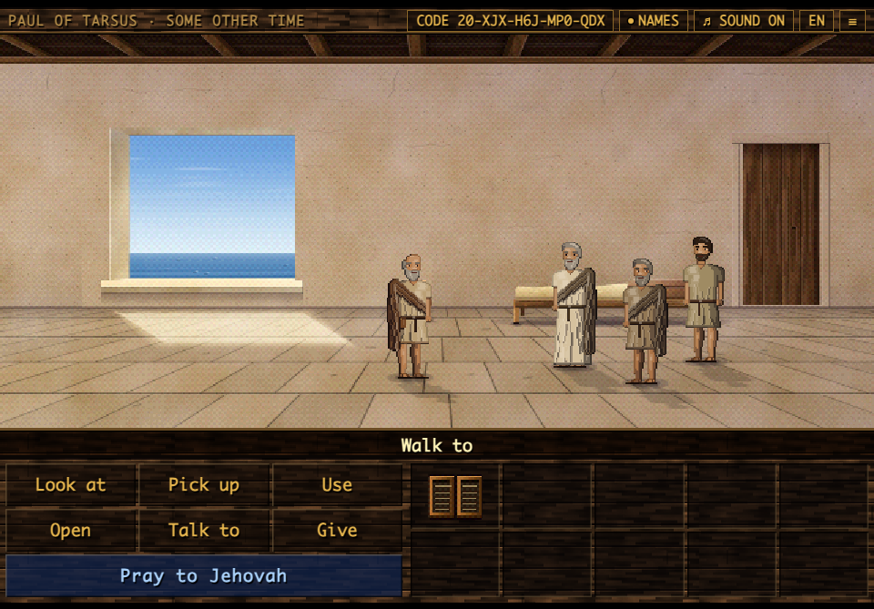
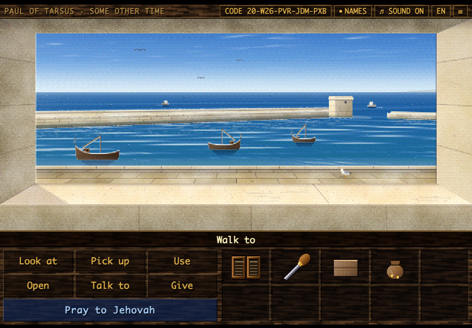
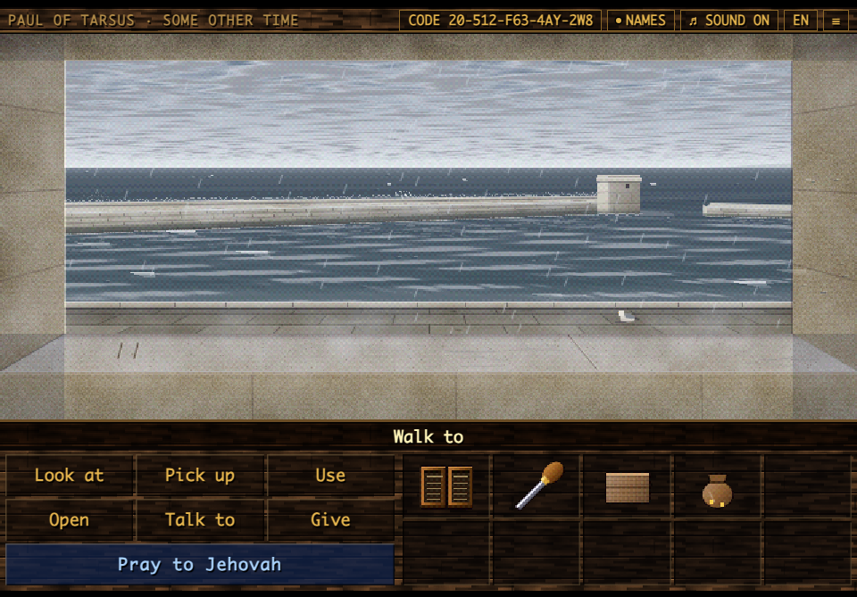
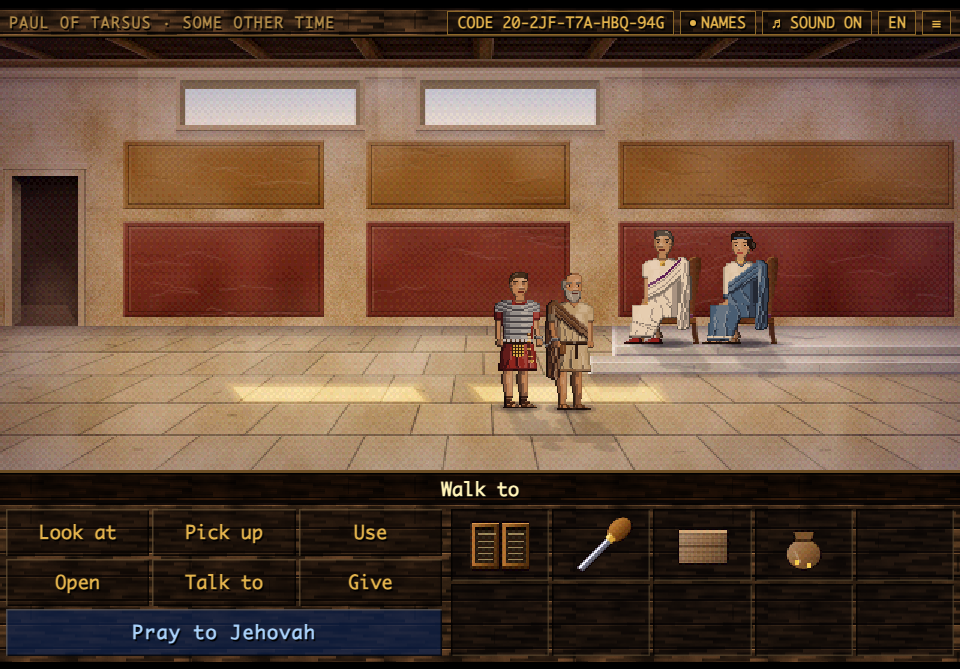
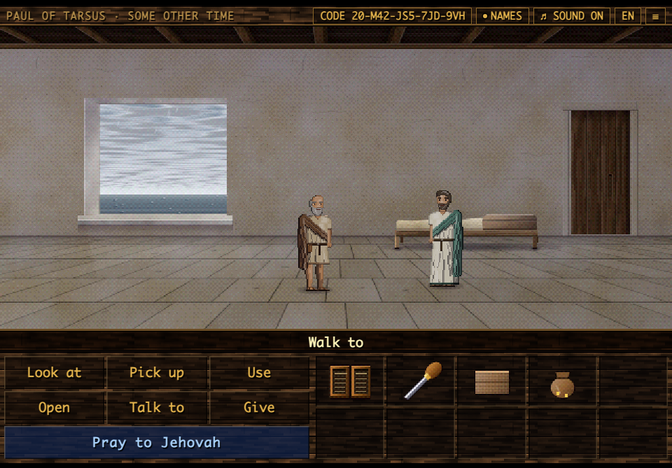
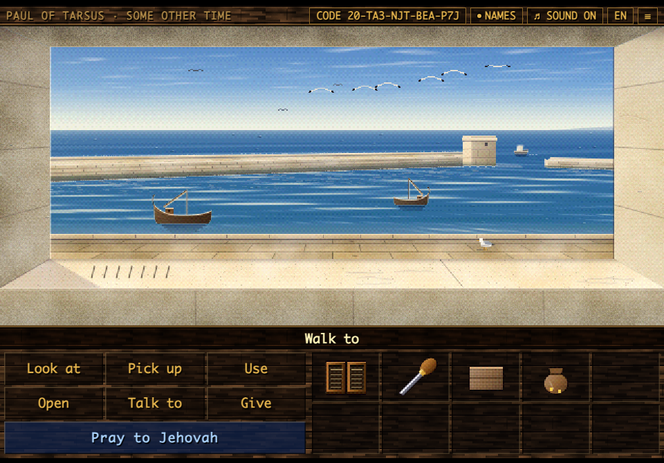
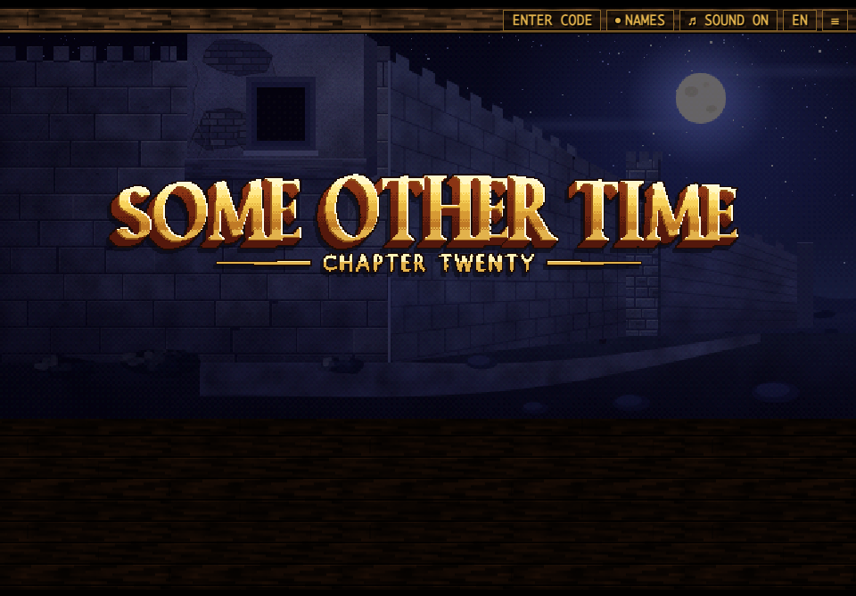

# Chapter Twenty: Some Other Time

Caesarea, about 56 to 58 C.E. Five days have gone by when the accusers arrive: Ananias the high priest, some of the elders, and a public speaker named Tertullus to put their case to the governor Felix. Tertullus begins with praise, and then brings three charges: that Paul is a pest who stirs up revolt wherever Jews live, that the sect of the Nazarenes has him as a spearhead, and that he tried to profane the temple. The Jews who came join in. With a nod the governor tells Paul to speak, and Paul answers for himself: he went up to Jerusalem to worship no more than twelve days ago, nobody saw him gather a mob, and they cannot prove their charges; he admits that he serves the God of his forefathers in the way they call a sect; the Jews of the province of Asia who found him in the temple should be the ones to accuse him; and the only thing these men can name is what he called out before the Sanhedrin, about the resurrection of the dead. Felix, who knows a good deal about the Way, puts them off until Lysias the commander comes down, and orders the army officer to keep Paul under arrest, with some freedom, and to let his own people look after what he needs. A few days later Felix sends for him with Drusilla, his Jewish wife, and hears him on the belief in Christ Jesus; when Paul speaks of righteousness, of self-control and of the judgment to come, Felix becomes frightened and sends him away until he finds an opportunity. He is hoping for money from Paul, and sends for him more often than before. Two years go by; Porcius Festus takes over, and Felix, who wants to stand well with the Jews, leaves Paul in custody (Acts 24:1-27).

| |
|---|
|  |
| The hearing: Felix on the dais, the clerk at his desk, Tertullus, Ananias and the elders, Paul and the soldier he is chained to, and the army officer at the right |

Five places, two of them close views, and Paul played throughout. The chapter takes the two years at a window: eight seasons, from the first summer to the second spring, each moved on by a mark on the sill.

**The hearing.** The chapter opens on the narrator's scroll (Acts 24:1) and then in the court of Herod's palace, the court of Chapter Nineteen, by morning. Felix sits on his seat on its dais of two white steps; at a small desk left of the dais the governor's clerk writes down every word. Tertullus, Ananias and two elders stand at one side, and Paul has been brought in by the army officer and a soldier, a light chain from one wrist to the soldier's. What Tertullus says is told by the narrator while he is seen speaking, and never put in his mouth: the praise, the three charges, and the others joining in (24:2-9). As each charge is told, Paul writes it on his tablet. Then Felix nods to him, the one nod the account itself names (24:10).

**The one true courtesy.** Paul chooses what to begin with, and every line on offer is a true thought: that Felix has judged this nation for many years, that he is a Roman citizen, that he comes from Cilicia, that the high priest had him struck in the council. He sets each of the last three aside himself, with its true reason: Felix has read the first in the commander's letter, asked the second the day he came, and the third would only start a quarrel. Only the first is spoken. Paul does not flatter, and does not say aloud that Tertullus did.

| |
|---|
|  |
| One light chain on one wrist, before the governor: always the same hand, whichever way he turns, and only a chained far hand rises with its chain |

| | |
|---|---|
|  |  |
| What I admit: the three charges on Paul's tablet, each marked | Paul's room in the first summer: Philip, Simmias and Phaidros have come |

**What I admit.** Then Paul's wax tablet is seen close, in his hand: the three charges as Tertullus brought them, one to a line. Each takes one of three marks, a word with a small sign beside it: not proved (a slanting stroke), the witnesses aren't here (a hollow diamond), or I admit it (a hollow square). Not every charge gets the same answer. When all three are marked, they are read in their order, and the first wrong one is answered by Paul himself with the true reason it will not do; it never names the right one, and the marks can be changed. When all three agree with what he truly can say, he speaks his defense in the account's order (24:11-21): the twelve days, as his own line with nothing counted on the screen; no crowd and no proof; what he admits, and the hope he shares with his accusers; the gifts of mercy and the temple; the men from Asia, who should be here; and last the one thing he called out before the Sanhedrin. Felix puts them off and gives the officer his orders (24:22, 23).

**Two years at a window.** Paul is kept in a room of the palace, and there he wears no chain. It has limewashed walls, a wooden bed, a water jar, and a plain door with a soldier always outside it; one deep window in the back wall looks west, with no bars, over the sea. **Look at** the window to see it close: the harbor of Sebastos from above, with its long breakwater and the tower at its end, the ships in the basin and the open sea beyond. The harbor is the calendar. In summer it is full of ships; in autumn there are fewer every week; in winter the sea is closed, grey, with rain and a swell on the breakwater, and the basin lies empty; in spring the first ships are back. Paul scratches a mark on the stone sill with his awl (**Use** awl with sill, or with the window), and the mark moves the season on, but only when nothing is owed: while his visitors are still to be received, Felix is still to be answered or Luke is still waiting for his answers, Paul leaves the sill alone. The marks stand side by side on the sill, one for each season gone by.

| | |
|---|---|
|  |  |
| The window in the first summer: the harbor full of ships | The window in winter: the sea closed and the basin empty |

**His own people.** In the first summer Philip comes with two brothers of the congregation at Caesarea, Simmias and Phaidros: the officer has said they may look after him. Philip brings the tool pouch that Paul left at his house, with his awl and needle still in it (the pouch of Chapter One); Simmias his cloak, since the nights are cool by the water; and Phaidros a few coins from the brothers. **Open** the pouch to take out the awl.

**Not what he wants to hear.** In the first autumn a soldier fetches him to an inner hall of the palace, tall and nearly empty, lit from two long windows high in the wall, where Felix sits on a dais with Drusilla beside him, and Paul is chained again. Drusilla asks, in a line, what the belief in Christ Jesus asks of a person. Paul may speak of six things, and all of them are true. Three tell what the belief gives or what has come of it (the hope of the resurrection, the Messiah the Prophets wrote of, the congregations from Jerusalem to Macedonia): Felix hears them politely, and nothing changes. Three tell what it asks: righteousness, self-control and the judgment to come. When Paul has spoken of all three, in any order, the narrator tells that Felix became frightened (24:25), and Felix sends him away: some other time. Every subject stays on offer after it has been used. Nothing is said of Drusilla's history.

| | |
|---|---|
|  |  |
| Felix and Drusilla in the inner hall | The first winter: Luke comes with questions |

**Luke's questions.** In the first winter Luke comes. He is writing things down and wants them right, and he asks about the years before he was with Paul, one name at a time: Ananias the disciple, Cephas, Lucius of Cyrene, Sergius Paulus the proconsul, and Timothy. For each Paul has the same five places on offer, Damascus, Jerusalem, Antioch, Paphos and Lystra, which the player knows from Chapters One to Seven. A wrong place is Paul's own thought, and he does not say it; the right one he says, and Luke asks once more to be sure.

**The purse stays shut.** In the first spring Felix sends for him again, without Drusilla. He talks round the subject three times, a remark each time Paul is spoken to: that Paul has friends in the city who bring him what he needs; the gifts for his nation that Paul spoke of at the hearing; how a man with friends like that could see an end to all this waiting. He never names a price. Paul answers each with one of two true lines. **Give** or **Use** the coins on Felix, or on anyone else, and Paul refuses it himself: that would be a bribe. No item moves the scene on; it ends when Felix has had enough for the day, and the narrator tells that he was hoping for money and sent for Paul more often (24:26).

**The second year.** The seasons after that are a line or two each. In the second summer the soldier fetches him again for another talk with Felix, told in one thought, and a gull stands on the sill of his window; in the second autumn Simmias and Phaidros come with the brothers' greetings; in the second winter nobody comes. The mark of the second spring ends the chapter, and the narrator tells that two years went by and Festus came (24:27).

Walkthrough (spoilers)

1. In the court, when Felix has nodded, **Talk to** Felix and choose "That he has judged this nation for many years." (The other three are true and Paul sets them aside himself.)
2. On the tablet, **Use** each charge and mark it: "Revolt among the Jews, everywhere" with "Not proved"; "A leader of the sect of the Nazarenes" with "I admit it"; "An attempt to profane the temple" with "The witnesses aren't here". Paul's defense follows.
3. In Paul's room, **Talk to** Philip (or one of the brothers): the tool pouch, the cloak and the coins. **Open** the tool pouch: the awl.
4. **Use** the awl with the window (or **Look at** the window and **Use** the awl with the sill): autumn, and Felix sends for him.
5. In the hall, **Talk to** Felix or Drusilla three times and choose "Righteousness", "Self-control" and "The judgment to come", in any order. (The other subjects are true and change nothing.)
6. **Use** the awl with the window again: winter, and Luke comes. **Talk to** Luke and answer each name with its place: Ananias, Damascus; Cephas, Jerusalem; Lucius of Cyrene, Antioch; Sergius Paulus, Paphos; Timothy, Lystra.
7. **Use** the awl with the window: spring. In the hall, answer Felix with either line, and **Talk to** Felix twice more, each time with either line. Keep the coins.
8. **Use** the awl with the window four more times: the second summer, autumn, winter and spring. The mark of the second spring ends the chapter.

The hidden treasure lies at the window in the second spring, before the last mark: **Look at** the sky over the harbor.

## Music and sound

| Chapter | Music | Around you |
|---|---|---|
| Some Other Time | One tune for two years of waiting: B in the Dorian mode, a minor third over the keynote with a bright sixth, in bars of six that fall three and three, a lilt like the swell under the palace; no earlier chapter has this key or this bar. The tune is four bars long: up from the keynote by the third to the fifth, on to the sixth and down, up again from the fourth, and home by way of the second. As at Caesarea in Chapter Nineteen, lyre and harp take turns with it: at the hearing the lyre first and the harp after it, over a low string; in the inner hall the lyre has it while the harp rocks; in Paul's room the harp has it while the lyre rocks; in winter the harp alone, at half its pace, over a low note held quietly on the keynote. While the charges are brought and when Felix is frightened, the low string plucks the keynote and leans on the note above it, a drum ticks with it and almost stops every fourth bar, and the ney begins the tune and breaks off before it comes home, no louder than the rest. Nothing is claimed about how music was played then | Waves, gulls and a little wind in the court and at the window, softer in Paul's room; in winter the waves are heavier, the wind stronger and the rain falls beyond the window; in the inner hall only a little wind and the palace far off. Gulls wheel over the sea from the court and stand on its sea wall; from the window gulls fly over the harbor and one stands on the near quay, and in winter none flies and the one on the quay sits hunched against the rain; in the second summer a gull stands on the sill of Paul's window. No bird is seen in the hall or on the tablet |

Every step can be solved from the text alone.

The chapter opens on its title card, over a short sting in its own key of B.

The chapter has no travel map: Paul does not leave Caesarea.

## About the content

Chapter Twenty tells what the account says (Acts 24:1-27) in the narrator's own words, verse by verse with the reference, and puts none of it into a mouth as a quotation. These lines stand together in `levels/chapter20.js` (`TOLD`) and in the language files, where they can be checked against the Study Edition; the German lines were written from the German edition. What Tertullus says (24:2-9) is told and never spoken. Where a line of the account is spoken in the game (Paul, 24:10-21; Felix, 24:22, 25), it stands in the game's own words; the twelve days of 24:11 are Paul's own line, and nothing is counted or laid out on the screen. Tertullus says nothing of the commander Lysias, because the Study Edition leaves out verse 7, which only later manuscripts have. The three charges on Paul's tablet have one wording here and on the clerk's report in Chapter Twenty-One. Felix's nod is the one the account gives him (24:10).

**What was read, and how.** On 26 November 2026 these were read by hand in the browser, on wol.jw.org: Acts 24 in the Study Edition with every study note, footnote, cross-reference and media item, and the same chapter in the German Study Edition with its notes and the glossary entries on gifts of mercy and on the Way; the verses of Acts 21 to 23 that mark the days before the hearing, the note on Acts 23:35 and the notes on Acts 27:9 and 28:16-30 with the media on Paul's bonds in Rome; the note on Mark 10:47; the Study Edition's media "Caesarea" (its caption and key); *"Bearing Thorough Witness" About God's Kingdom*, chapter 24 with its box on Felix, and the opening of chapter 25; the *Insight on the Scriptures* articles "Felix", "Drusilla", "Tertullus", "Festus", "Ananias", "Caesarea", "Paul", "Luke", "Luke, Good News According to", "Philip", "Aristarchus", "Sect", "Sedition", "Extortion", "Bribe", "Governor", "Chronology", "Way, The", "Trophimus", "Prison", "Bond", "Judgment Seat", "Colossians, Letter to the" and "Dress"; and *The Watchtower* of December 15, 2001 ("I Appeal to Caesar!"), of November 2020 ("Take Courage—Jehovah Is Your Helper") and the public edition No. 5 of 2017 ("Did You Know?", on sailing in winter). The chapter's lead did the reading and gave the facts to the builders in a brief; nothing was added to them.

**What they establish.** Between them, these publications give the following, said here in the game's own words. The hearing was in about 56 C.E., and the two years in custody were the last two of Felix's time as governor; he was recalled perhaps in 58. Ananias was high priest from about 48 to 58 C.E. Tertullus was a speaker who pleaded the case for the accusers, perhaps as an advocate; nothing is known of what people he came from, so the game gives him none. *Bearing Thorough Witness* says that his praise of Felix was meant to win his favor and was far from true: no governor before the revolt against Rome left Judea less at peace, and most Jews hated him. Under Roman law, sedition could bring the death penalty (*Insight*, "Sedition"), and the accusers gave a religious quarrel a political turn since a governor would not sentence anyone over religion alone (*The Watchtower*, 2001). Paul could truly say that Felix had judged the nation for many years, since he had served there for years (*Insight*, "Felix"). The Way was the name for the faith of Jesus' followers. The custody of 24:23 left Paul some freedom, less, it seems, than he had later in Rome (*Insight*, "Colossians"); some prisoners were allowed visitors, and some had their hands chained to their guards (*Insight*, "Prison"). Drusilla, a daughter of Herod Agrippa I, was a young woman then; the game says nothing of her history. Felix kept Paul in the hope of a bribe, and *Insight* ("Extortion") says that Paul knew what Felix was after and gave him nothing; *The Watchtower* (2001) adds that Roman law forbade an official to take money for releasing a prisoner. Herod's palace was the governor's residence and reached out into the sea (the note on 23:35 and the media "Caesarea"); the harbor that Herod built was called Sebastos (*Insight*, "Caesarea"). *The Watchtower* ("Did You Know?", 2017) says that from about the middle of November to the middle of March nobody counted the sea as open for sailing, which is why the window shows the harbor empty in winter. *Insight* ("Luke") says that these two years at Caesarea are the likely time and place of Luke's Gospel, with eyewitnesses near at hand; *Insight* ("Philip", "Caesarea") says that Philip had his home in Caesarea in about 56 and possibly settled there. The game shows them visiting Paul, and says no more about either than that.

**What is invented.** The room with its window, where Paul was kept, and the inner hall where Felix hears him are invented, and so is holding the hearing at the judgment seat in the open court. The governor's clerk who writes at the hearing is invented; he is played in Chapter Twenty-One. Simmias and Phaidros, two brothers of the congregation at Caesarea, are invented and bear Greek names that nobody in the Scriptures bears; the account says only that his people were allowed to look after him, and names nobody. Every visit, the tool pouch from Philip's house, the cloak and the coins are invented, and so are the soldier who fetches Paul, the army officer's and the soldier's looks, and the gull. The light chain on one wrist before the governor is invented: the account does not say how he was held. Everything that is spoken is invented, including what is said by Paul, Felix, Drusilla, Philip and Luke, apart from the lines of the account named above, which are told in the game's own words: Paul's choice of where to begin, Drusilla's question, Felix's remarks about Paul's friends and the gifts, Luke's questions, and the marks on the tablet. The harbor as a calendar and the marks on the sill are invented, and the eight seasons are the game's way of letting two years pass; the account names no month and no festival in them, and the game names none either.

**What Acts leaves unsaid.** Acts does not say where in the palace the hearing was held, where Paul was kept, or whether he was chained. It does not say who his people were or who visited him: the game shows Luke and Philip, because *Insight* calls it probable that Luke was at Caesarea and possible that Philip lived there, and the chapter's end screen says so. It does not say what the later talks with Felix were about, whether Drusilla was at them, or why Felix thought that Paul could pay. It does not say from when the five days of 24:1 are counted, and nothing in it says that Lysias ever came down. The chapter's end screen says these things too.

**The German text.** Names and terms follow the German Study Edition: der Statthalter Felix, Drusilla, der Hohe Priester Ananias, die Ältesten, Tertullus, ein öffentlicher Redner, die Sekte der Nazarener, der Weg, der Offizier, Lukas and Philippus, and on Luke's questions Damaskus, Jerusalem, Antiochia, Paphos and Lystra. The chapter's title is „Ein andermal“, Felix's answer of 24:25 in the game's own words. The marks on the tablet are „Nicht bewiesen“, „Die Zeugen sind nicht hier“ and „Das gebe ich zu“. *Insight on the Scriptures* is named „Einsichten über die Heilige Schrift“ on the end screen.

[← All chapters](../README.md#chapters)
