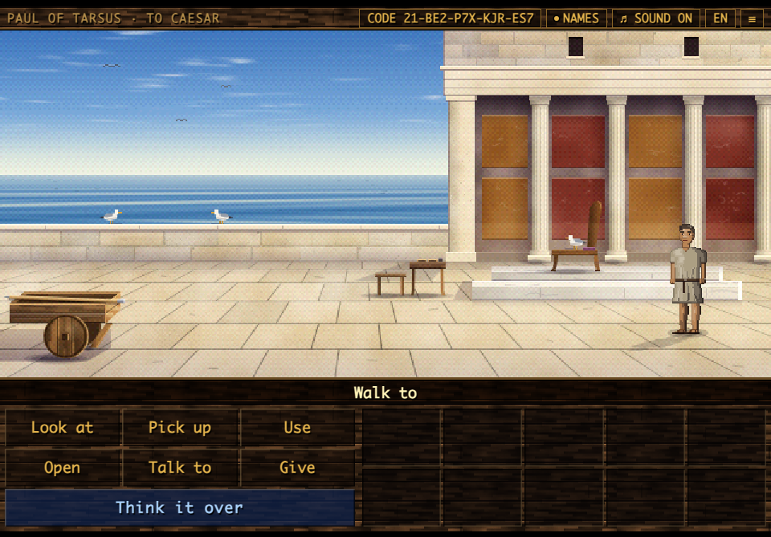
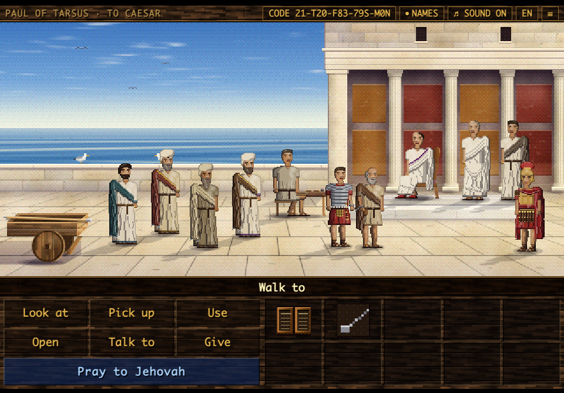
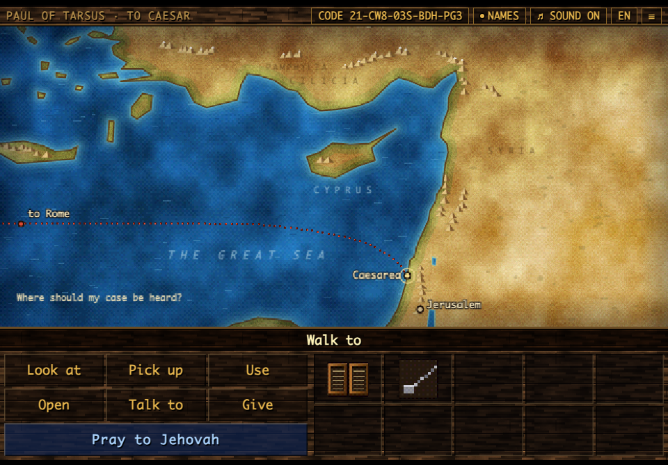
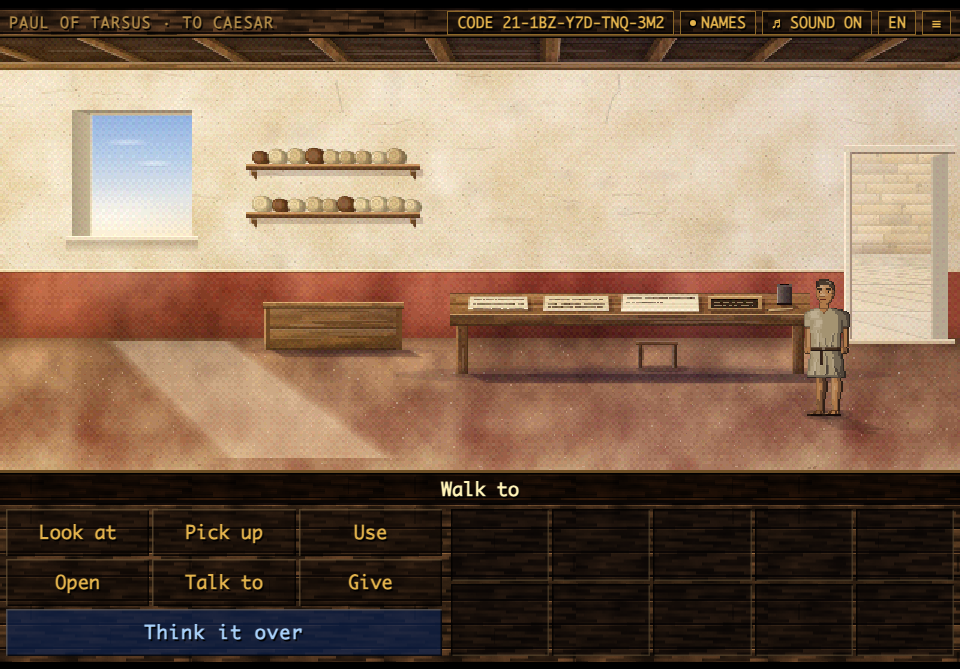
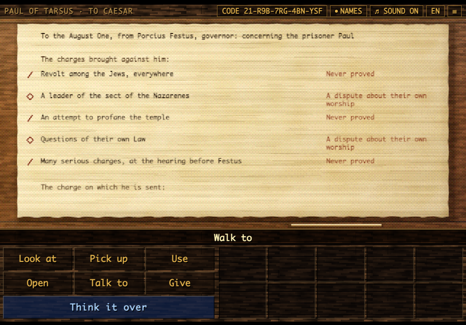
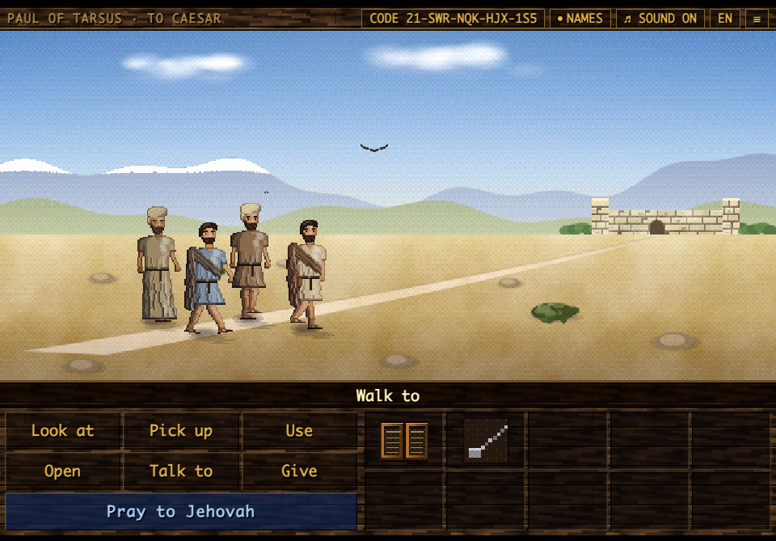
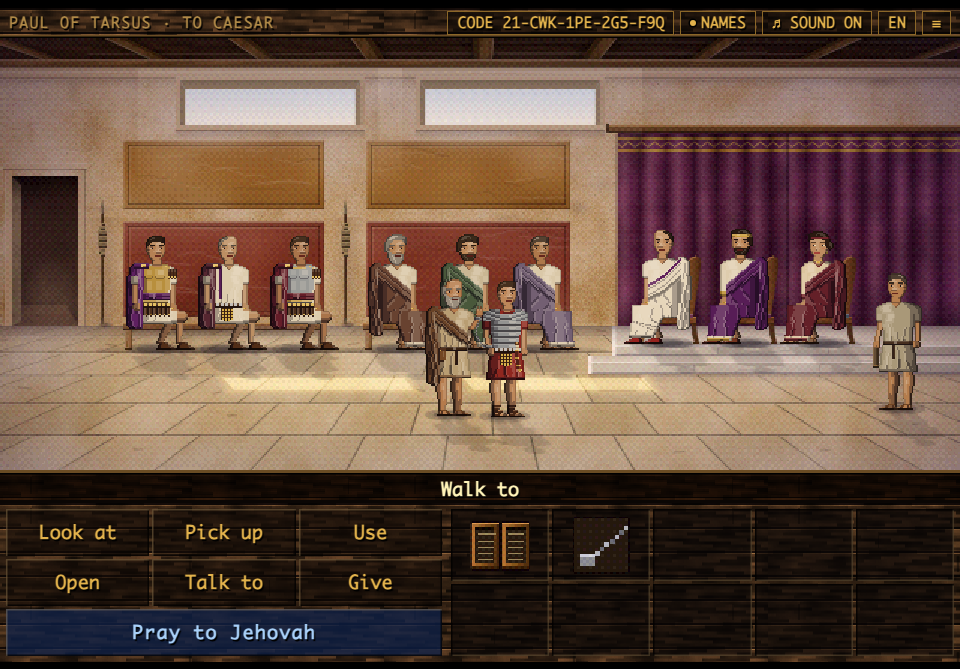
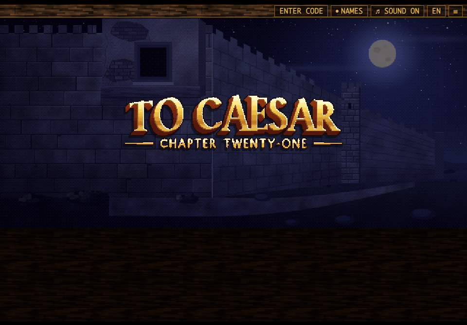

# Chapter Twenty-One: To Caesar

Caesarea, about 58 C.E. Festus arrives in the province and takes up his office, and three days later he goes up from Caesarea to Jerusalem. There the chief priests and the leading men of the Jews lay their complaint against Paul and beg one favor: that he have Paul brought to Jerusalem, for they mean to lie in wait on the road and kill him. Festus answers that Paul stays under guard at Caesarea, and that their men in authority may come down and bring their charge. Back at Caesarea he sits on the judgment seat; the Jews from Jerusalem close round Paul with many serious charges that they cannot prove, and Paul answers that he has sinned against none of them: not the Law of the Jews, not the temple, not Caesar. Festus, who wants to stand well with the Jews, asks whether he will be judged in Jerusalem. Paul says that he stands before Caesar's judgment seat, where his case belongs; that if he deserves death he does not ask to be let off dying, but that nobody may give him up to them to please them; and he appeals to Caesar. Festus speaks with his advisers: to Caesar he will go. Some days later King Agrippa and Bernice come to pay the new governor a visit of courtesy, Festus lays the case before the king, and Agrippa wants to hear the man. The next day, with great show, they enter the audience chamber with the military commanders and the leading men of the city, and Festus says that he has nothing certain to write to his Lord about the prisoner. Agrippa gives Paul leave; his hand goes out, and he tells of his youth as a Pharisee, of the hope, of how he fought the name of Jesus, of the road to Damascus at midday, and of how he has obeyed the vision from heaven ever since. Festus breaks in, loudly; Paul answers him, and asks the king whether he believes the Prophets. Agrippa answers that before long Paul would be persuading him to become a Christian, and Paul wishes that everyone who hears him would become what he is, only without these bonds. Going out, they say to one another that nothing he does deserves death or bonds, and Agrippa tells Festus that the man could have been set free had he not appealed to Caesar (Acts 25:1–26:32).

| |
|---|
|  |
| The audience chamber: the dais and its three chairs, the two benches, Paul and the soldier, and the clerk standing at the right |

Four places, one of them a close view, with the travel map and the Prologue's road, and two people played: the governor's clerk, who has no name, before the hearing, over the report and in the passage, and Paul at the hearing and in the audience chamber, where he stands chained to the soldier beside him. While the clerk is played, the blue button reads **Think it over** („Nachdenken“): he does not worship Jehovah, so he does not pray, and the hint is his own thought. The narration says "they" throughout, as Acts 25 and 26 do.

**Before the hearing.** The chapter opens on the narrator's scroll, with Festus's visit to Jerusalem and his answer (25:1-5). Then the court of the palace by morning, the court of Chapters Nineteen and Twenty, and the clerk who wrote at the hearing before Felix is played: the new governor sits in judgment this morning, and the court has to be ready. A gull is standing on the governor's seat; he sends it off, and sits down at his desk. At the left of the court, by the palace gate, a carter's farm cart stands unhitched, its wheels solid discs.

| | |
|---|---|
|  |  |
| The clerk readies the court: a gull on the seat, and the cart by the gate | The hearing: Festus on the seat, his two advisers, and the accusers round Paul |

**The hearing.** Festus sits on the seat with his two advisers standing beside him, the accusers from Jerusalem stand round Paul with their arms down or folded, and Paul is played, a light chain from one wrist to the soldier a step behind him. The narrator tells the hearing (25:6, 7); the charges are told, not listed. Paul answers Festus (25:8), and Festus asks whether he will have the case heard in Jerusalem.

**Three roads.** The travel map opens in the window of the eastern sea with three places on it: Jerusalem, Caesarea, and the end of a road at the western edge of the map, marked "to Rome". Each is answered by a true thought of Paul's, about what he himself knows: at Jerusalem more than forty men swore two years ago to kill him, and there his accusers would sit as his judges; at Caesarea he has been two years, and no judge has decided anything; and in Jerusalem, in the night, the Lord told him that he must bear witness in Rome as well (Acts 23:11, in Chapter Nineteen). The plot of 25:3 was told to the player, not to Paul, and his thought does not use it. Jerusalem and Caesarea leave the map open; the road west is the appeal. Paul speaks his answer (25:10, 11), Festus speaks with his advisers, and answers: to Caesar he will go (25:12). Some days later King Agrippa and Bernice cross the court to Festus while the narrator tells of their visit (25:13).

| | |
|---|---|
|  |  |
| Three roads: Jerusalem, Caesarea, and the road that leaves the map to the west | The clerk's writing room: three papers and the report on the table |

**Nothing to write.** A prisoner sent to Caesar must take a report with him, and drafting it is the clerk's job. In his writing room, under a window onto the morning, with rolls on two shelves and a chest under them, three papers lie on his table beside the report: the commander's letter of Chapter Nineteen, in its lines from that chapter; the record of the hearing before Felix, with Chapter Twenty's three charges and what Paul answered to each; and his own notes of the hearing before Festus. **Look at** a paper to read it. On the report every charge ever brought against Paul is a line: the three of the hearing before Felix, the commander's questions of their own Law, and the many serious charges at the hearing before Festus. Each takes one of two marks, a word beside the line and a sign in the margin: never proved (a slanting stroke), or a dispute about their own worship (a hollow diamond), which is what Festus himself found (25:18, 19). A line can be marked only once the clerk has read the paper that settles it, and a wrong mark is answered at once with the true reason it will not do and is not set. When every line has its mark, the field for the charge on which he is sent is still empty. The clerk takes it to Festus in the court, where he stands with the king and Bernice; Festus puts the case to the king, and the narrator tells the rest (25:14-22).

| |
|---|
|  |
| The report with every line marked: and the field for the charge still empty |

**The audience.** The next day the audience chamber is the inner hall of Chapter Twenty, dressed for the great show: three chairs on the dais, two hangings of purple wool behind them, and two benches at the back left, one for the military commanders and one for the leading men of the city. The clerk is played as it fills, and has no chair. Festus, Agrippa and Bernice walk in to their chairs while the narrator tells the great show (25:23); Paul and the soldier come in, the soldier now a step ahead of him, between him and the dais, so that the chained hand is the far one. Festus presents him to all of them and says that he has nothing certain to write (25:24-27), and Agrippa gives Paul leave to speak (26:1). Bernice says nothing in the game, and nothing is said or hinted of her beyond that she is the king's sister.

At the back of the hall, in the shade of the wall behind the seated commanders, stand two Roman standards, small: one between the doorway and the commanders' bench and one between the two benches. They are shown for historical accuracy, as the garrison's standards; no source places them in the hall, and the end screen says so. Each is a plain pole with a short stack of discs drawn as small squares and a plain top, with no crossbar and no cloth, and nothing on it can be made out. Nobody looks at them, speaks of them or honors them, and they are no hotspot. The rule for them is in [CONTRIBUTING](../CONTRIBUTING.md), section 3.

**The defense.** When Paul speaks to the king, his far hand goes out first, the forearm bent, as the account says (26:1). Then his courtesy to Agrippa, who knows all the customs of the Jews and their controversies (26:2, 3), and the narrator tells his youth as a Pharisee, the hope, and how he fought the name of Jesus the Nazarene (26:4-11). The vote of 26:10 is the line only; no pebble is shown. **The road** (26:12-18) is told over the Prologue's pictures, as Chapter Eighteen tells it, and built round what only Acts 26 has: the road at midday, the light brighter than the sun round all of them; on the plain white screen, that all of them fell, the voice in Hebrew and the saying about kicking against the goads, and that it was Jesus; and when the road comes back, the commission Jesus gave him himself. The blindness, the hand that led him, Ananias and the baptism are not told here. The voice is told, never painted. Then Paul tells, in his own words, how he obeyed the vision and what the Prophets and Moses said would happen (26:19-23), and Festus breaks in, loudly (26:24).

| | |
|---|---|
|  |  |
| The road at midday, told over the Prologue's picture | These bonds: the far hand raised, bent, with its chain |

**Two listeners.** Now every sentence Paul can say is true, and the player chooses the sentence and whom it is said to: **Talk to** Festus or **Talk to** King Agrippa offers the same four sentences, in the same mixed order, and they stay on offer after use. What is plain to the king is strange to the governor, and each answers a sentence that is not meant for him in his own way, saying nothing about what he believed. The account fixes the way through: that what Paul says is true, and a sound mind says it, to Festus (26:25); that the king knows these things and none of it happened in a corner, to Festus after that (26:26); and then the question of 26:27, to the king. The narrator tells Agrippa's answer (26:28), without a tone.

**These bonds.** While Paul is chained, the chain on his wrist is in his inventory. **Use** it with the king and his far hand comes up, bent, the chain with it, and he speaks the wish (26:29). The account does not say that he raised his chain; the end screen says so. Then the king rises, and the governor, Bernice and all who sat with them (26:30).

**In the passage.** The clerk is played once more, in the emptying hall. On his way out by the door of the hall he hears what they say to one another, and what the king says to the governor (26:31, 32). Back at his table, the field for the charge is still empty. The narrator tells, in one sentence from the scroll, that from the voyage to Italy on the one who tells the account is among the travellers again (27:1), and the chapter ends.

Walkthrough (spoilers)

1. In the court, as the clerk, **Use** the governor's seat to send the gull off. Then **Use** the writing desk: the hearing begins.
2. As Paul, **Talk to** Festus (or **Use** the dais) to answer him. The map opens.
3. On the map, click the road end "to Rome" at the western edge. (Jerusalem and Caesarea give Paul's own thoughts and change nothing.)
4. In the writing room, **Look at** the commander's letter, the record of the hearing before Felix, and the notes of the hearing before Festus. Then **Use** the report.
5. On the report, **Use** each charge and mark it: "Revolt among the Jews, everywhere" with "Never proved"; "A leader of the sect of the Nazarenes" with "A dispute about their own worship"; "An attempt to profane the temple" with "Never proved"; "Questions of their own Law" with "A dispute about their own worship"; "Many serious charges, at the hearing before Festus" with "Never proved".
6. Go back to the table and out by the door to the court. **Talk to** Festus.
7. In the audience chamber, as Paul, **Talk to** King Agrippa: the defense.
8. **Talk to** Festus and choose "What I say is true, and sound." **Talk to** Festus again and choose "The king knows. None of it happened in a corner." Then **Talk to** King Agrippa and choose "Do you believe the Prophets?"
9. **Use** Chain on my wrist with King Agrippa.
10. As the clerk, go out by the door of the hall. In the writing room, **Use** the report.

The hidden treasure lies in the court, off the way: the ox goad lying along the bed of the cart at the left, by the palace gate. **Look at** it as the clerk, before the hearing or when he goes out to Festus.

## Music and sound

| Chapter | Music | Around you |
|---|---|---|
| To Caesar | One tune for the last hearings at Caesarea: A in the Aeolian mode, in bars of twenty steps that fall three, three, four, three, three, four; no earlier chapter has this key or this bar. The tune is four bars long: up the triad, round the fourth and the sixth, down from the octave, and home by the second. It grows out of the palace music of the chapters before it: in the court lyre and harp still take turns over a low string. In the writing room the harp has the tune alone over the low string. For the great show of 25:23 a horn calls the first two bars over a steady drum, and lyre and harp answer; in the audience chamber lyre and harp go on at half their strength. While the road is told the ney has the tune and the harp rocks. At the hearing and when Festus breaks in, the low string plucks the keynote and leans on the note above, a drum ticks with it and almost stops every fourth bar, and the ney begins the tune and breaks off before it comes home, no louder than the rest. Nothing is claimed about how music was played then | Waves, gulls and a little wind in the court; the sea faint through the window of the writing room; the murmur of the gathering and a little wind in the audience chamber. Gulls wheel over the sea from the court and stand on its sea wall, and one stands on the governor's seat until the clerk sends it off. No bird is seen in the writing room or in the audience chamber |

Every step can be solved from the text alone.

The chapter opens on its title card, over a short sting in its own key of A.

## The travel map

For the three roads (Acts 25:9-12) the map opens in the window of the eastern sea, with only three places to click: Jerusalem, Caesarea, and the end of a road at the left edge of the window, a small red dot named "to Rome" („nach Rom“). The road to it leaves the shore at Caesarea and runs due west out of the picture, well south of Cyprus and its name; nothing else is drawn. No line crosses another, and no name crosses a coast or a road. `Esc` leaves the map, and Festus asks again.

## About the content

Chapter Twenty-One tells what the account says (Acts 25:1–26:32) in the narrator's own words, verse by verse with the reference, and puts none of it into a mouth as a quotation. These lines stand together in `levels/chapter21.js` (`TOLD`) and in the language files, where they can be checked against the Study Edition; the German lines were written from the German edition. Where a line of the account is spoken in the game (Paul, 25:8, 10, 11; 26:2, 3, 19-23, 25-27, 29; Festus, 25:9, 12, 24-27; 26:24; Agrippa, 26:1, 32), it stands in the game's own words. The narration says "they", as these chapters of Acts do; "we" comes back only at 27:1, which the end tells in one sentence. Paul's three thoughts on the map use only what he knew: the oath of the forty and the Lord's words of 23:11, which Chapter Nineteen told, and the two years at Caesarea. The commander's letter keeps the wording of Chapter Nineteen, and the three charges keep the wording of Chapter Twenty.

**What was read, and how.** On 26 November 2026 these were read by hand in the browser, on wol.jw.org: Acts 25 and 26 in the Study Edition with every study note, footnote, cross-reference and Research Guide entry, and the same chapters in the German Study Edition with their notes and footnotes; Acts 9:1-19 and 22:3-21, the notes on Acts 24:23, 27 and 27:1, 2, and the notes on Acts 11:26, John 5:2, Matthew 24:15 and Luke 21:20; the Study Edition's media "Caesar Nero" and "Paul's Prison Bonds While He Was Under House Arrest"; *"Bearing Thorough Witness" About God's Kingdom*, chapter 25 with its boxes on Porcius Festus and on Herod Agrippa II, in English and in parts in German; the *Insight on the Scriptures* articles "Festus", "Herod" (Herod Agrippa II), "Bernice", "Caesar", "Augustus", "Judgment Seat", "Caesarea", "Paul", "Citizen, Citizenship", "King", "Rome", "Governor", "Goad", "Aramaic", "Stone", "Military Commander", "Army", "Pilate", "Dress", "Dyes, Dyeing", "Crown", "Attitudes and Gestures" and "Court, Judicial"; *The Watchtower* of December 15, 2001 ("I Appeal to Caesar!"), September 1, 1998 ("Paul Boldly Witnesses Before Dignitaries"), November 15, 2003 ("Help Others to Accept the Kingdom Message"), June 15, 1997 ("Questions From Readers"), June 15, 1999 ("Why Did Saul Persecute Christians?"), the "Did You Know?" of July 1 and August 1, 2011 and of March 1, 2015, the article "Let the Reader Use Discernment" and the one on Pontius Pilate; and *Awake!*, "What Do You Know About Flags?", on ancient standards. The chapter's lead did the reading and gave the facts to the builders in a brief; nothing was added to them.

**What they establish.** Between them, these publications give the following, said here in the game's own words. The hearings were in about 58 C.E.; the year Festus came is not certain, and *Insight* holds 58 the likeliest. *Insight* describes a judgment seat as usually a raised platform out of doors, reached by steps, and *Bearing Thorough Witness* as a chair set on a dais, whose height gave the judge's word its weight; the game sets it in the open court on the dais of Chapter Nineteen. The charges of 25:7 are not listed; the notes point back to those of 24:5, 6. By the note on 25:11, the appeal was the third time Paul used his rights as a Roman citizen (16:37; 22:25), and an appeal could be made before a sentence was given; it may be that some appeals could be refused, which is likely why Festus spoke with his advisers first. Caesar here is Nero. *Insight* ("Citizen") says that once a citizen had appealed, the appeal could not be taken back, which is why Agrippa says what he says in 26:32. Agrippa was Herod Agrippa II, a son of the Herod of Acts 12; he oversaw the temple and named the high priests, so Paul could truly call him an expert on the customs of the Jews, and Bernice was his sister. A new governor was customarily visited by his neighbors in office, as Agrippa visited Festus. The military commanders were officers of the commander's rank, each over a thousand men, present in some number that no source gives; *Bearing Thorough Witness* seats Agrippa and Festus on the judgment seat for the audience, so the game seats them on a dais with Bernice beside them. *The Watchtower* (2001) says that a prisoner sent to a higher court had to be sent with a report on his case, and that Festus himself had to draw it up, with Agrippa asked to help. The vote of 26:10 was literally a pebble, dark for guilt; *The Watchtower* (1999) leaves open whether Paul cast it as a member of a court or only backed the sentences, so the game does not make him a member. Only Acts 26 says that the light shone round all of them, that all of them fell, that the voice spoke in Hebrew, and that Jesus gave Paul his commission there on the road. The study note calls the saying about the goads a proverb from Greek writings, of a stubborn bull that kicks against the goad and only hurts itself; *Insight* ("Goad") describes the goad as a long rod, tipped with metal for driving the oxen, with a small blade on its other end for scraping the plowshare clean. No note gives the tone of 26:28, and the publications read it differently, so the narrator tells it without one. The words of 26:29 show that Paul was bound as he spoke; how is not said. *Insight* ("Crown") describes the early diadem as a plain band, so Agrippa wears a plain band of gold with nothing standing up from it, and purple was a costly dye that the rich and the great wore (*Insight*, "Dyes, Dyeing").

**The standards.** *Insight* ("Army") and the note on Matthew 24:15 say that Roman standards carried images and were held sacred, even worshiped, and *Awake!* says the same of ancient standards in general. No source places any in the audience chamber at Caesarea, and none describes what a standard of the cohorts there looked like. They are shown in the hall for historical accuracy, as the maintainer decided on 26 November 2026, under the rule in [CONTRIBUTING](../CONTRIBUTING.md) section 3: at the back, small, never in close view and never a hotspot, a plain pole with discs and no crossbar or cloth, nothing on it that can be made out, and nobody who looks at one, speaks of one or honors one. No standard is seen anywhere else at Caesarea.

**What is invented.** The governor's clerk is invented, and so are his writing room, his papers and his report: the publications have Festus write the report himself, with Agrippa's help. The clerk is the scribe who writes at the hearing in Chapter Twenty, with the same look. Holding the hearing of 25:6 at the judgment seat in the open court and the audience in the inner hall of Chapter Twenty are invented, and so is the look of the hall: its dais and chairs, its hangings and benches. The faces of Festus's two advisers, whose names and number the account does not give, the accusers from Jerusalem, the soldier and the army officer, the three commanders and the three leading men who are seen, the gull on the seat, and the carter's cart with its goad by the gate are invented. What Agrippa and Bernice wear was decided for the game: the sources say only that they came with great show. The travel map as the place of the decision is the game's own. The chain on one wrist, and Paul raising it as he speaks the wish of 26:29, are dramatized. Everything that is spoken is invented, including what is said by Paul, Festus, Agrippa and the clerk, apart from the lines of the account named above, which are told in the game's own words: Paul's thoughts on the map, the marks on the report and the clerk's thoughts on them, the clerk's words to Festus, Festus's words to the king about the case, the sentences in the two listeners beyond those of the account, and what each listener answers.

**What Acts leaves unsaid.** Acts does not say where the hearing before Festus was held, what the audience chamber looked like, how many commanders were there or what anybody wore. It does not say how Paul was bound in the hall, that a soldier was chained to him, or that he raised his chain. It does not say in what tone Agrippa answered (26:28), or whether the report to Caesar was ever written. No source says that Roman standards stood in the hall. The chapter's end screen says these things too.

**The German text.** Names and terms follow the German Study Edition: der Statthalter Festus, König Agrippa, Bernice, Cäsar, der Richterstuhl, die Berater, der Audienzsaal, die Militärbefehlshaber, die angesehenen Männer der Stadt (in the narration; one of them pointed at is a „Würdenträger der Stadt“), die Oberpriester, Damaskus, and in 26:29 „Ich bete zu Gott“ and „diese Fesseln“. The clerk is „Schreiber des Statthalters“, the goad „Ochsenstachel“, and the road end on the map „nach Rom“. The marks on the report are „Nie bewiesen“ and „Ein Streit über ihre eigene Gottesanbetung“. While the clerk is played the hint button reads „Nachdenken“. *The Watchtower* is named „Der Wachtturm“ on the end screen.

[← All chapters](../README.md#chapters)
