# Chapter Twenty-Two: Euroaquilo

About 58 C.E., in the fall. It has been decided that Paul is to sail for Italy, and Julius, an army officer of the unit of Augustus, takes charge of him and of some other prisoners. Luke tells the voyage as one who is on board, and Aristarchus of Thessalonica goes with them. A ship from Adramyttium, bound for the harbors of the province of Asia, takes them up the coast to Sidon, where Julius kindly lets Paul go to his friends and be cared for; then, with the wind against them, they keep in the shelter of Cyprus and cross the open sea off Cilicia and Pamphylia to Myra in Lycia. There the officer finds an Alexandrian ship bound for Italy and puts them on board. For many days she makes little way. They come to Cnidus only with difficulty, pass Salmone in the shelter of Crete, and at last reach Fair Havens, near the city of Lasea. Much time has been lost, the fast of Atonement Day is already past, and a voyage now is dangerous. Paul tells them what he can see coming: damage and great loss, to the cargo, to the ship, and to their lives as well. The officer goes by the pilot and the shipowner instead, and most of them are for putting out to reach Phoenix and winter there. A gentle south wind seems to give them their chance, and they sail close along the coast of Crete. Before long the Euroaquilo, a violent wind, falls on the ship; she cannot keep her bow to it, and they let her run before it. In the shelter of the small island Cauda they can hardly master the skiff at the stern. With the skiff aboard, the sailors bind the hull round from below to hold her together; the Syrtis is what they fear now, so they lower the gear and let her drift. The next day they start to lighten the ship, and on the third day they throw her tackling away themselves. For many days there is no sun and no star, the storm does not let up, and hope of rescue begins to go. Then Paul, after they have long gone without food, stands up among them. They should have taken his advice at Crete; now he urges them to take courage, because no life will be lost, only the ship. That night an angel of the God he belongs to and serves stood beside him and told him not to fear: he is to stand before Caesar, and God has given him the lives of all on board. He trusts God that it will happen just so, though first they will be driven ashore on an island (Acts 27:1-26).

| |
|---|
| 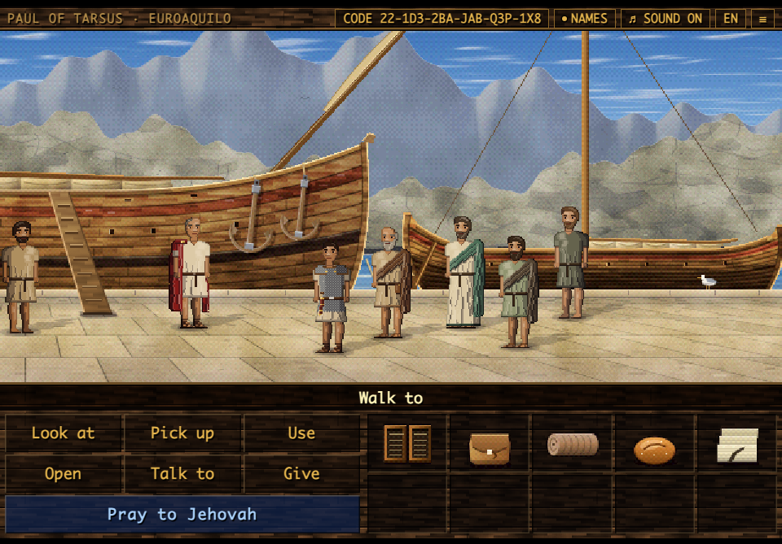 |
| Myra: the grain ship from Alexandria, bound for Italy, and the coaster that brought them from Caesarea |

Six places, one of them a close view and one a told picture, with the travel map, and two people played, each when the scene has him: Paul on the quay, at Myra, at Fair Havens, with the bales and in their midst, and Luke at the skiff and through the days without sun or stars. Who is played is fixed by the scene; there is no button to change it. While Luke is played, he prays to Jehovah as Paul does, and his hints are his own thoughts. The narration says "we" from the first verse, as Acts 27 does, and "they" where the account says the sailors did something (27:17-19). Paul's words in the account say "God", as Acts 27 does. No chain is seen on board: a soldier of Julius's is always near Paul.

**To the ship.** The chapter opens on the narrator's scroll (27:1), and then on the quay at Caesarea on a fair morning, looking west over the harbor of Sebastos, as Paul's window did in Chapter Twenty: Julius, two soldiers, three other prisoners, Luke and Aristarchus, and the coaster of Adramyttium behind the edge of the quay, her sail furled on its lowered yard. When Paul makes for her gangplank, Julius calls everyone aboard, and the coaster pulls away while 27:2 is told.

| | |
|---|---|
| 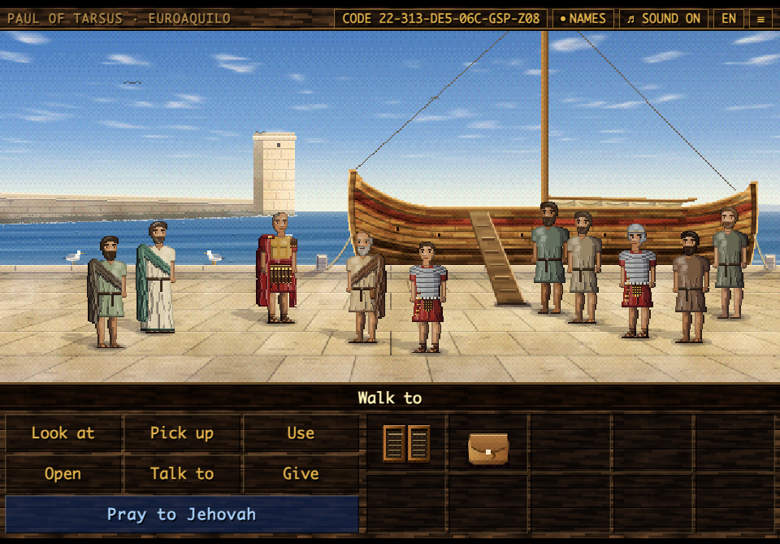 | 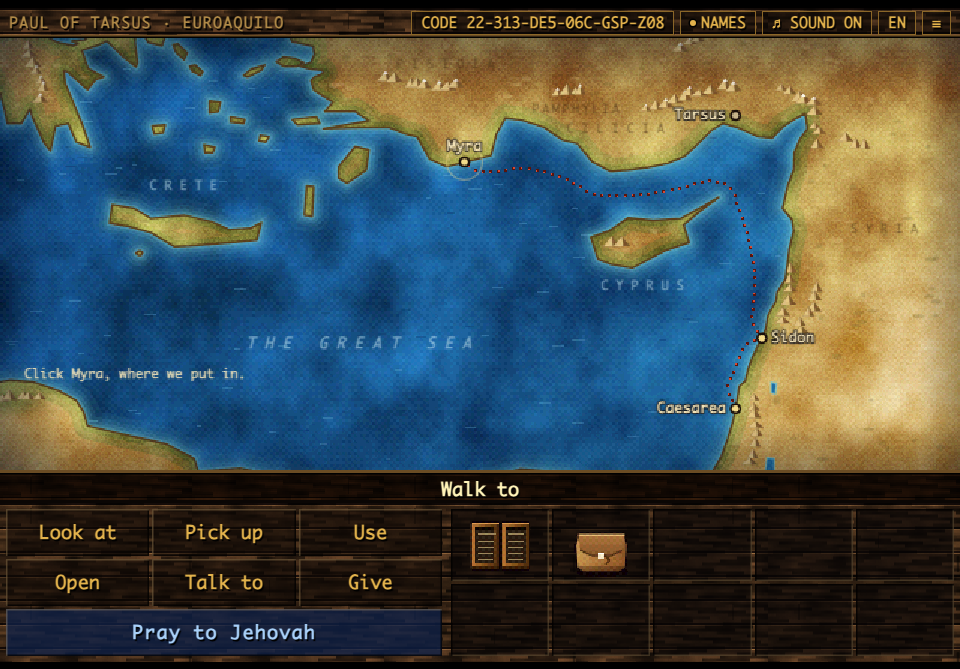 |
| Caesarea: the coaster from Adramyttium, ready to sail | The voyage out: Sidon, Cyprus on the left, and Myra |

**The voyage out.** The travel map opens on a window of its own, west of the usual one. The leg to Sidon draws itself while 27:3 is told, and Paul has a bundle from the brothers there to take along. The leg to Myra goes round the east end of Cyprus and along its north side, past Cilicia and Pamphylia, while 27:4, 5 are told. Then the map waits, with four places on it: Caesarea and Sidon, which Paul looks back on, Tarsus, and Myra, where they put in. Nothing in the story changes until Myra is clicked.

**Myra.** The harbor of Myra is two screens wide, under the mountains of Lycia: the coaster that brought them, and beside her the great grain ship from Alexandria, the swan's neck at the top of her sternpost, two anchors hung at her bow and her skiff astern. While 27:6 is told the brothers' bundle comes into Paul's inventory: bedding, bread, and an old length of sailcloth with a long tear in it. A sailor of the grain ship says what the ship does for her passengers.

| | |
|---|---|
| 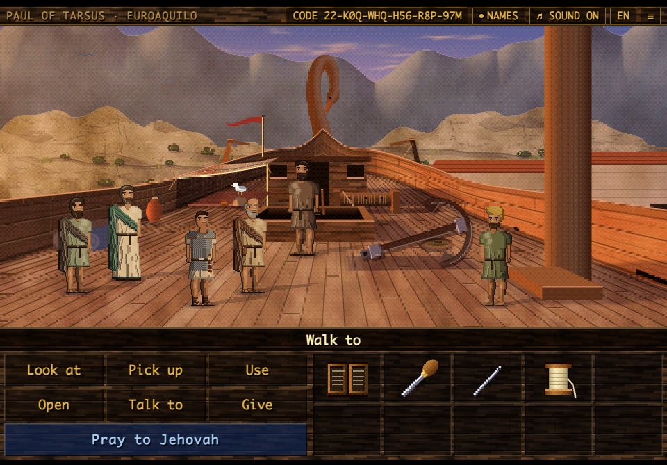 | 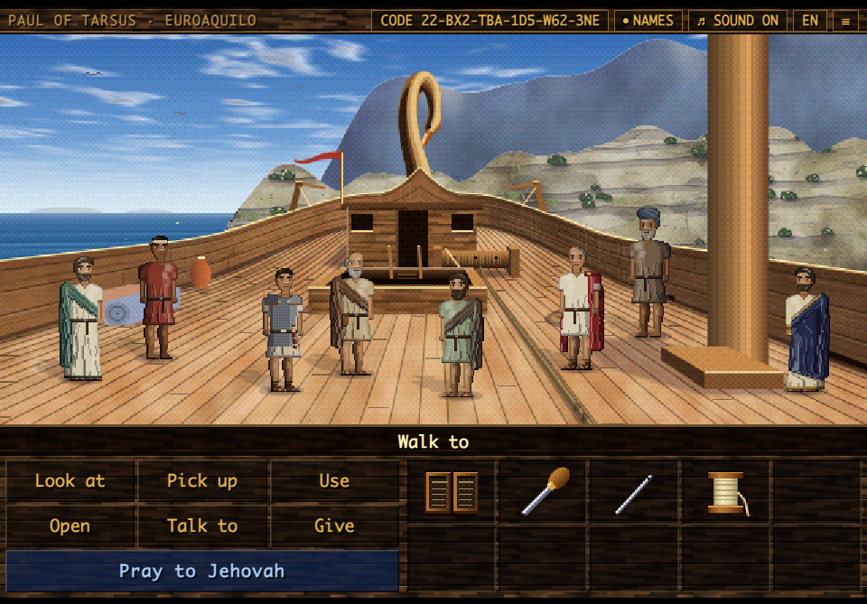 |
| A roof for the night, in the lee of the deckhouse | Fair Havens: Julius, the pilot and the shipowner |

**A roof for the night.** On the deck at Myra in the evening everyone sleeps where he can, and Paul needs a roof. His tool pouch holds his awl, a needle and thread; the sailcloth will make a roof once its tear is sewn, and Paul goes about it as a tentmaker does: the awl first, then the threaded needle. A sailor has old cord to spare. There are two free places on the deck, one each side of the deckhouse aft, and the pennant on its staff shows where the wind comes from: the shelter has to stand on the side away from it, or the wind would fill it like a sail. An anchor of the time lies on the deck, a wooden shank with a heavy lead stock, and one look line says what it is. With the roof up, the night passes, and the map shows the slow days to Cnidus, past Salmone and along Crete to Fair Havens (27:7, 8).

**Not listened to.** At Fair Havens the narrator tells that much time has been lost and the fast is past (27:9). Before Paul says anything to the officer, he wants to be sure of what he has seen, and four true things are found by looking and asking: Luke's count of the weeks lost, a sailor's word on the season, the pennant, which shows the wind against them as it has been since Sidon, and, looking at the open sea, his own three shipwrecks (2 Corinthians 11:25). Each is noted on his tablets under "What I have seen", and Julius will not be spoken to before all four are. Then Paul gives his recommendation (27:10). The pilot and the shipowner answer with reasons of their own, the narrator tells that the officer went by them and that most were for Phoenix (27:11, 12), and Paul says to himself that he said it as plainly as he could and that the choice was never his.

**This cannot be won.** The scene is played so that the player does everything right and is still not listened to, because the account says so. Nothing the player does changes what the officer decides; there is no wrong answer to find, and Paul's own thought says that the failure is not his. A soft south wind follows (27:13): the anchor cable comes up over the bow, and no anchor is seen. Then the narrator tells the wind (27:14), and the deck becomes the deck in the storm (27:15, 16). From here on the chapter has no humor.

| | |
|---|---|
| 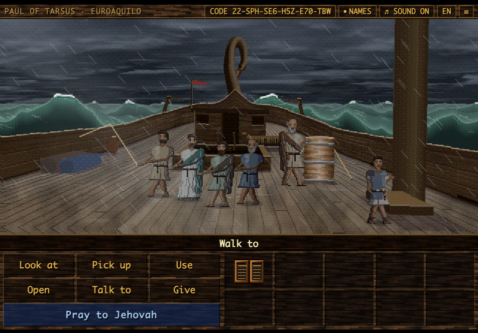 | 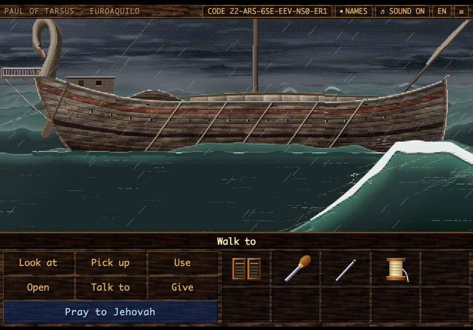 |
| In the lee of Cauda: the skiff, full of water, comes in only while the stern is down | Girded: the ropes round her hull, slanting and curved |

**The skiff, on the beat.** Luke is played. The deck in the storm heaves and rolls with every sea while the sea, the sky and the rain do not. Luke, Aristarchus and two sailors haul on the rope to the skiff, which hangs full of water at the left, and the player calls the pull: **Use** the rope. A pull gains only while the stern is down, in the pause after a sea has broken over the side and run off the deck, before the next one rises. Four good pulls bring her aboard. The narrator then tells 27:17 over the ship seen from the side with the ropes round her hull, and the map opens once to show where the Syrtis lies, off the coast of Africa.

**The beat.** Three steps of Chapters Twenty-Two and Twenty-Three are timed by the sea, and they work the same way. A sea comes about every six seconds: it rises at the left, breaks over the side and runs off, and then there are about three seconds of calm before the next one rises. A click counts only in that calm, and only if the step still fits into it. A click on the wave is a miss, and a miss costs only that step: the pull gains nothing, or the one who is crossing is thrown back to where he last held on. Nothing is said, so there is no line to click away. The help grows by itself: after three misses a sailor calls the moment, and "Now!" stands over him in the calm; after three more he takes the one who is crossing across himself, and at the skiff every pull then counts, so that nobody can get stuck. The wave is seen and heard from one clock, so the picture alone keeps the time with the sound off, and a tap works as a click.

| | |
|---|---|
| 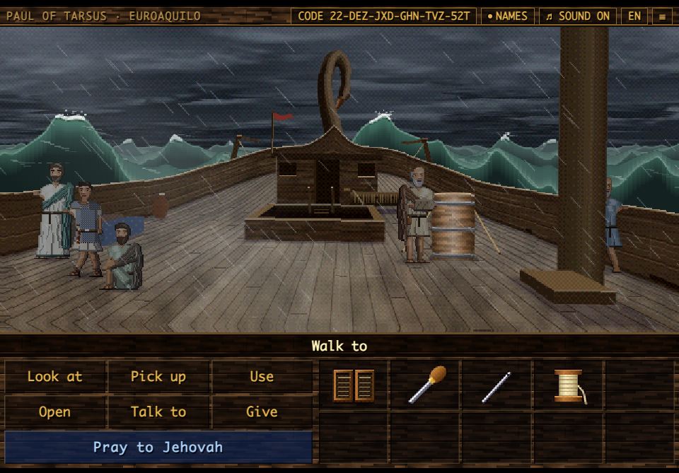 | 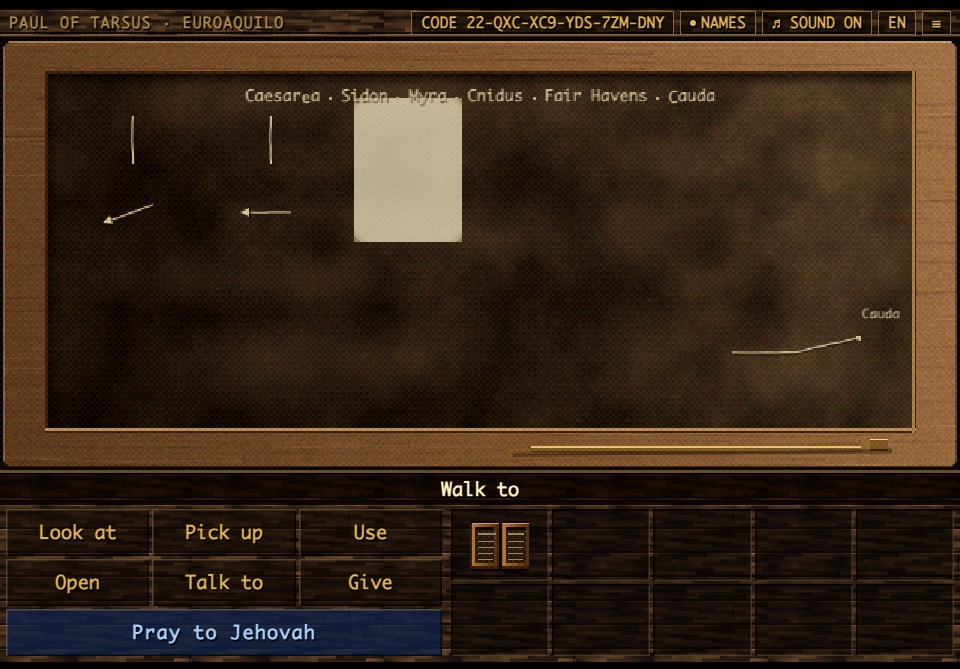 |
| Between two waves: a bale at the cask, and the mast and the lee rail still to go | Luke's tablet: one column for each day, and a mark for each |

**Between two waves.** The next day they start to make the ship lighter (27:18), and Paul is played. He takes a bale from the hatch and carries it across the deck to the lee rail from hold to hold, each step in the pause between two seas: the hatch, the cask lashed to the deck, the mast, the rail. Only the next hold counts. A miss is a short step out and back, braced, the bale still in his arms. After three misses in a crossing the sailor at the lee rail calls the moment, and after three more he comes and walks Paul across. What is in the bales is never named. Three go over, and the narrator tells the tackling (27:19).

**No sun, no stars.** Luke is played through the dark days. Each day he may ask the pilot, look at the clouds and feel the wind, and every answer is true and not enough: the pilot can take no bearing, and the sky shows nothing. Luke's tablet is in his inventory. **Open** it to see it close: the names of the voyage at its head, a column for each day, and **Use** today's column to mark it. There are four marks to choose from, southwest, west, northwest, or only the stroke for the day, and Luke says a true line for each kind. **No mark is right or wrong.** Nobody on board knew where they were, and the game does not know either: whatever is marked is kept, it draws a line westward from Cauda on the tablet, and it is carried into Chapter Twenty-Three. After the sixth day the narrator tells, from the scroll, that hope began to go (27:20).

| |
|---|
| 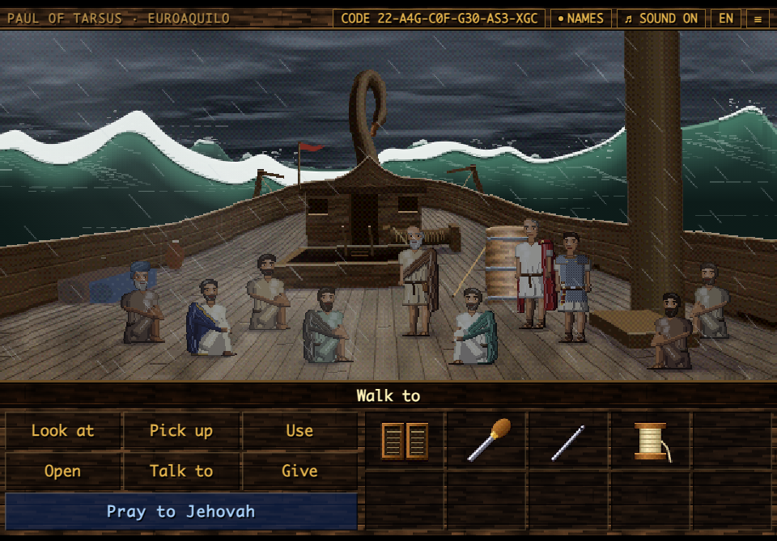 |
| In their midst: Paul stands up among them |

**In their midst.** For a long time nobody has eaten, and Paul stands up among them (27:21). **Talk to** anyone round him: what he can say stands as six short lines, the six parts of what he told them, in a mixed order, and each part stays on offer after it has been said. The next part is spoken in full when it is chosen; a part chosen too soon is answered by a true thought of Paul's, such as that they need to hear first what comes first, and never by naming the right one. The order is the account's (27:21-26), and it is found by knowing it. When the last part has been said, the end screen follows.

**Luke's tablet, carried on.** The end screen leads on to Chapter Twenty-Three with that chapter's first code, and the code holds Luke's six marks. A click on the end screen starts Chapter Twenty-Three with the same marks, and the printed code, typed later on any device, does too: Luke's tablet opens the next chapter as it was left. Chapter Twenty-Three started from the title, or from any other code, carries nothing in: its tablet holds only the strokes of the days.

Walkthrough (spoilers)

1. On the quay, **Use** the gangplank (or the coaster).
2. When the map waits after Cyprus, click Myra. (Caesarea and Sidon give Paul's own thoughts and change nothing.)
3. At Myra, **Use** the grain ship's gangplank (or the grain ship).
4. On the deck, **Open** the tool pouch. **Use** the awl with the torn sailcloth, **Use** the needle with the thread, and **Use** the threaded needle with the torn sailcloth.
5. **Talk to** the sailor at the right for some cord. (**Look at** the pennant: it streams to the left, so the wind comes from the right.)
6. **Use** the mended sailcloth (or the cord) with the deck left of the deckhouse. Then **Use** the shelter to rest.
7. At Fair Havens, **Talk to** Luke, **Talk to** the sailor beside him, **Look at** the pennant, and **Look at** the open sea at the left. Then **Talk to** Julius.
8. Luke is played on the deck in the storm. **Use** the rope to the skiff, at the left, in the calm after a sea has run off the deck. Four good pulls bring her in.
9. Paul is played. **Use** the hatch to take a bale, then **Use** the cask, the mast and the lee rail at the right, one after another, each in the calm between two seas. Do this three times.
10. Luke is played. **Open** Luke's tablet in his inventory, **Use** today's column and choose any mark. (Talking to the pilot, looking at the clouds and looking at the wind first is up to you.) Do this for six days.
11. Paul is played. **Talk to** anyone round him and choose, one after another: "My advice at Crete", "Only the ship will be lost", "An angel stood beside me", "I must stand before Caesar", "I believe God", "We must be cast ashore".

The hidden treasure lies on the travel map, off the way: while the map waits for Myra, click Tarsus, up behind the coast of Cilicia.

## Music and sound

| Chapter | Music | Around you |
|---|---|---|
| Euroaquilo | One tune for the voyage and the storm: A in the harmonic major, a major scale with a lowered sixth, in bars of twenty-one steps that fall six, six, nine, like a swell that comes in twice and the third time runs on; no other chapter has this key or this bar. A bar lasts three seconds, so two bars are one sea of the storm. The tune is four bars long: up the triad and down round the lowered sixth, up to the octave, down from it leaning on the lowered sixth, and a last bar that on the voyage stops on the fifth and never comes home. On the quay at Caesarea the lyre has it and the harp answers, over a low string and a light frame drum, a lilt; in the harbor of Myra the harp has it first and the lyre answers. On deck at Myra in the evening the harp has the tune alone over the low string. At Fair Havens the ney has only the first bar and the bar that leans on the lowered sixth, never the climb, over the harp's rocking figure. In the storm the low string plucks the keynote and leans on the note above, a drum ticks with it and almost stops every fourth bar, and the ney begins the tune and breaks off on the raised seventh, no louder than the rest. In the dark days the low string plucks one note to a bar under a few bars of the tune on the harp, far apart. When Paul stands up among them lyre and harp have the whole tune, and for the first time in the chapter it comes home. Nothing is claimed about how music was played then | Waves, gulls, a little wind and a creaking hull at Caesarea, at Myra and at Fair Havens, where the skiff knocks softly at the stern. In the storm the gale roars in the rigging and comes in gusts, rain hisses and patters on the planks, the hull works, and in the lee of Cauda the sail slats and the skiff knocks at the stern until it is hoisted aboard and the gear is lowered. While the skiff is hauled and the bales are carried, each sea is heard as it is seen: it rises, breaks with a weight rather than a bang, and runs off the deck, and the storm stands back a little so that the seas can be followed by ear; with the sound off the picture alone keeps the time. No gull is heard or seen in the storm, and nothing thunders: the lightning is far off and silent |

Every step can be solved from what is seen and said, and the timed steps need no sound.

The chapter opens on its title card, over a short sting in its own key of A. Its name is the first with a Q, which the title's letters have for it.

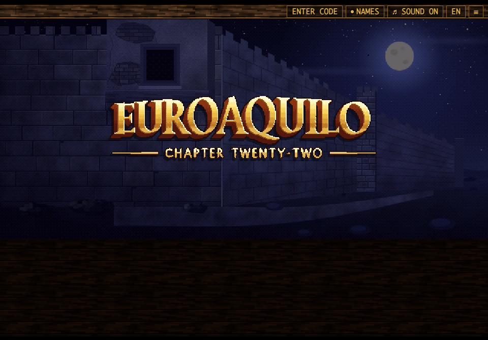

## The travel map

The voyage of Acts 27 runs west of the windows of the earlier chapters, so the map has new windows for it, and the coast of Africa and the islands of the west are drawn wherever a window reaches them. The voyage out opens on its own window at the usual size: from Caesarea up the coast to Sidon, then round the east end of Cyprus and along its north side, past Tarsus, Pamphylia and Lycia to Myra, and later on to Cnidus, south past Cape Salmone, and along the south of Crete to Fair Havens; the top of Cyrenaica shows in the lower left corner. While it waits for Myra, four places can be clicked: Caesarea, Sidon, Tarsus and Myra. After the skiff a wider window, from Crete west to Sicily and Malta, shows the leg from Fair Havens round Cape Matala to the lee of Cauda, and the Syrtis named off the coast of Africa, where the wind could drive them. The route follows the one the Study Edition's map of the voyage draws, in the game's own drawing. No leg crosses another, Chapter Twenty-One's road west is not shown with them, and no name crosses a coast or a route.

## About the content

Chapter Twenty-Two tells what the account says (Acts 27:1-26) in the narrator's own words, verse by verse with the reference, and puts none of it into a mouth as a quotation. These lines stand together in `levels/chapter22.js` (`TOLD`) and in the language files, where they can be checked against the Study Edition; the German lines were written from the German edition. Where Paul speaks words of the account, his recommendation at Fair Havens (27:10) and what he says in their midst (27:21-26), they stand in the game's own words, and the end screen gives their reference. The narration says "we" as Acts 27 does from its first verse, and "they" for what the sailors did (27:17-19). Paul says "God" wherever Acts 27 does; the divine name does not occur in these verses. The note on Paul's tablets about his shipwrecks gives its reference, 2 Corinthians 11:25.

**What was read, and how.** On 26 November 2026 these were read by hand in the browser, on wol.jw.org: Acts 27 in the Study Edition with every study note on verses 1-26, the marginal references and the Research Guide lists, and the same verses in the German Study Edition with their notes; the Study Edition's media "First-Century Merchant Ship" and "An Anchor of Wood and Metal", the list of events of Paul's trip to Rome, and Appendix B13, "The Spread of Christianity"; *"Bearing Thorough Witness" About God's Kingdom*, chapter 26, with its boxes on sea travel, on the winds of the Mediterranean and on where the ship was wrecked, in English and in German; the *Insight on the Scriptures* articles "Augustus, Band of", "Army", "Army Officer", "Julius", "Adramyttium", "Adria", "Aristarchus", "Luke", "Paul", "Sidon", "Cyprus", "Cilicia", "Lycia", "Myra", "Alexandria", "Cnidus", "Salmone", "Crete, Cretans", "Fair Havens", "Lasea", "Phoenix", "Euroaquilo", "Cauda", "Syrtis", "Atonement Day", "Wind", "Ship", "Mariner", "Rudder", "Malta" and "Great Sea"; *The Watchtower* articles "In Dangers at Sea" (March 15, 1999), "Aristarchus—A Loyal Companion" (September 15, 1997), "The Kind Roman Centurion" (1991), the "Did You Know?" items on the sailing season (February 1, 2010) and on Paul's advice (2017, No. 5), "Zealous Witnesses of Jehovah on the March!" (May 15, 1990), "Boldly Proclaim Jehovah's Kingdom!" (June 15, 1990), the "Questions From Readers" of 2004 on where the ship was wrecked, and "Defending the Good News Before High Officials" (September 2016); and *Awake!*, "Paul's Voyage to Rome" (April 8, 1971) and "The Love That Binds" (October 8, 1996). The chapter's lead did the reading and gave the facts to the builders in a brief; nothing was added to them.

**What they establish.** Between them, these publications give the following, said here in the game's own words. The voyage was in about 58 C.E., in the fall: the fast of Atonement Day fell in late September or early October, and by the reckoning of a Roman writer whom *The Watchtower* cites, sailing grew doubtful from the middle of September, while *Bearing Thorough Witness* says the sea was generally held to be closed from the middle of November to the middle of March. The account names no month, and neither does the game. An army officer commanded about a hundred soldiers; which unit was called the unit of Augustus cannot be settled. From 27:1 on, the "we" shows that Luke sailed with Paul all the way to Rome. Whether Luke and Aristarchus went as paying passengers or as Paul's servants is not known, and the game does not say. The ship from Adramyttium, a port in the northwest of Asia Minor, was a coaster that was not fitted out for passengers. Sidon lay a day's sail, about 110 km, to the north; the word for Julius's kindness speaks of a humane concern for a person, and Paul's friends there were the brothers. With the westerly winds of the season the ship kept round the east end of Cyprus and along its north side, and *Bearing Thorough Witness* says that she passed near Tarsus, Paul's home town. The ship at Myra was a grain ship, part of the trade that carried Egypt's wheat to Rome; the Study Edition's note says she must have been much larger than the coaster and likely carried travelers besides the crew, the soldiers and the prisoners. Such a ship likely had a mainsail and a foresail, and she was steered by two great oars at the stern; her anchors were of wood in the shape of a hook, with a heavy stock of lead. Passengers lived on deck, slept under tentlike shelters they may have put up for the night, and brought their own food and bedding: the ship gave them only water. From Myra to Cnidus is about 240 km, a day with a good wind; the wind was probably from the northwest. Salmone is generally taken to be the cape at the east end of Crete, Fair Havens a small bay with islands before it near Lasea, and Phoenix a harbor about 65 km farther west. *Insight* ("Fair Havens") says that Paul had come through at least three shipwrecks and that the account does not reveal whether his advice was inspired; nobody in the game says it was. The account describes no vote: the officer decided, after the pilot and the shipowner had persuaded him, and the majority wanted to go on. Euroaquilo is a wind from the east-northeast, the most violent wind of that sea, and here it swept down on them from the mountains of Crete; the German Study Edition calls it a wind that falls from the heights. Cauda, now Gavdos, lies about 65 km west-southwest of Fair Havens, and its lee likely gave them calmer water. The skiff was the ship's small boat, towed astern and taken aboard in a storm; *Bearing Thorough Witness* says it was likely full of water. To undergird the ship, ropes or chains were apparently passed under the hull from one side to the other and drawn tight on deck, and the German verse itself names ropes. The Syrtis was two gulfs off North Africa whose sandbanks the sea kept shifting, and sailors dreaded them. What the gear of 27:17 was is not settled: the publications suggest the rigging, or the mainsail taken in, and the game tells it in the account's own word and does not explain it. What went over the side on the second day is not named in the account. Sailors steered by the sun and the stars and had no compass, so the pilot could take no bearing for many days; *Bearing Thorough Witness* says that Luke may well have kept notes on the way. When Paul spoke in their midst, it was not to say that he had told them so, and the account does not call the angel's visit a dream or a vision.

**The grain ship, drawn as she was.** Three things of the ship are shown for historical accuracy, as the maintainer decided on 26 November 2026, under the rule in [CONTRIBUTING](../CONTRIBUTING.md) section 3. Her anchors of the time are seen at Myra only: hung at her bow from the side, their stocks end-on, and one lying on her deck, which one look line explains; where anchors are weighed (27:13), only the cable is seen. The ropes that undergird her (27:17) are seen round her hull from the side in the storm, slanting and curving with it, never straight bars across her planks. Her sternpost ends in a swan's neck and head, as the publications draw such a ship: a carved ornament of plain wood, which nobody looks to or speaks of, never seen close, and never standing as a ring round a head. She has no figurehead, and no temple is seen at Sidon, Myra or Cnidus.

**The storm.** The account names a violent wind, cloud and rain, and many days without sun or stars; it names no lightning. The maintainer decided on 26 November 2026 that the storm has lightning, far off (CONTRIBUTING section 4): a thin broken stroke low in the sky, which brightens the cloud near it and never the whole picture, and is never heard. The end screen says that the account names none. The maintainer also decided that the ship's motion is shown: on the deck in the storm the whole ship, with everyone on her, heaves and rolls a few degrees with each sea, while the sea, the sky and the rain do not move with her. Nothing sways for a player whose device asks for reduced motion, or who has chosen calm movement in the options.

**What is invented.** The supporting characters are invented and have no names: the two soldiers of the guard, the three other prisoners, the sailors of the coaster and of the grain ship, among them the sailor who calls the moment in the storm and walks Paul across. The pilot and the shipowner are in the account; their looks and their words are invented, and neither has a name. Invented too are the deckhouse aft and the shelter of sailcloth that Paul makes in its lee, and that Paul makes it; what the brothers at Sidon gave him (bedding, bread and the old sailcloth); the cord from a sailor; the pennant and the wind it shows; the four things Paul weighs at Fair Havens and how he comes by them; the reasons of the pilot and the shipowner; the skiff hauled by Luke, Aristarchus and the sailors; the bales that Paul carries to the rail when the ship is made lighter, the cask and the holds of the crossing; and Luke's tablet, with its columns and its marks. All the dialogue is invented, apart from Paul's words of the account named above. The end screen says what is invented.

**What Acts leaves unsaid.** Acts does not say how Paul was guarded on board, how Luke and Aristarchus came to sail with him, why Fair Havens was unsuitable for wintering, what the gear was that they lowered, or what was thrown over the side on the second day. It does not give the number of soldiers, of the crew or of the ship's masts, or say what her hold looked like, and it does not say that Paul prayed for the others. The chapter's end screen says these things too.

**The German text.** Names and terms follow the German Study Edition: Julius, „der Offizier“ of „die Abteilung des Augustus“, Aristarchus, Sidon, Zypern, Myra, Knidos, Salmone, Kreta, Schönhafen, Lasea, Phönix, Kauda and die Syrte; „das Fasten des Sühnetages“, der Steuermann and der Schiffseigentümer, the Euroaquilo as „ein heftiger Fallwind“, the skiff „das Beiboot“, and in 27:17 the hull secured „mit Tauen“. Paul says „Gott“ wherever the German verses do. The coaster is a „Küstensegler“, the grain ship a „Getreideschiff“, Luke's tablet „Tafel von Lukas“, its marks „Südwest“, „West“, „Nordwest“ and „Nur der Tag“, and the call in the storm „Jetzt!“. The title is *Euroaquilo* in German too, and the hidden treasure is „Tarsus vom Meer aus“.

[← All chapters](../README.md#chapters)
