# Chapter Twenty-Three: All Safe to Land

About 58 C.E., late in the year. It is the fourteenth night of the storm, and the ship is still being driven to and fro on the Sea of Adria. Around midnight the sailors begin to suspect that land is near. They sound and find twenty fathoms, and a little farther on fifteen; afraid of running onto rocks, they let go four anchors from the stern and long for daylight. Then the sailors try to get away: they lower the skiff, as though they meant to run out anchors from the bow. Paul tells the army officer and the soldiers that unless these men stay with the ship, they cannot be saved, and the soldiers cut the skiff's ropes and let it fall. Shortly before daybreak Paul urges everyone to eat: it is the fourteenth day they have waited without food, it is for their safety, and not one of them will lose a hair of his head. He eats in front of them all, giving thanks to God over the bread he has broken, and they all take heart and eat too. There are 276 of them on board. When they have had enough, they throw the wheat into the sea. At daylight they do not know the land, but they see a bay with a beach and mean to run the ship onto it. With the anchors cut away, the steering oars freed and the foresail up, she runs for it and grounds on a shoal with the sea on both sides of it: the bow sticks fast, and the waves begin to break the stern apart. The soldiers decide to kill the prisoners so that none can swim off, but the officer stops them, because he wants to bring Paul safely through; he orders the swimmers into the water first, and the others to come after them on planks and bits of the wreck. So all come safe to land, and they learn that the island is called Malta. The people of the island, who speak a language of their own, are unusually kind: it is raining and cold, and they light a fire and take them all in. When Paul lays a bundle of sticks on the fire, a viper comes out with the heat and fastens on his hand. The islanders say to one another that he must be a murderer whom Justice will not let live, though he escaped the sea. He shakes it off into the fire and is not harmed; they wait a long time for him to swell up or drop dead, and when nothing happens, they decide that he is a god. Near by lie the lands of Publius, the principal man of the island, who takes them in and is their host for three days. His father lies ill with fever and dysentery; Paul visits him and prays, and with his hands laid on the man he heals him. Then the other sick of the island come and are cured, and the islanders give them many gifts, and later supply all they need for the voyage (Acts 27:27–28:10).

| |
|---|
| 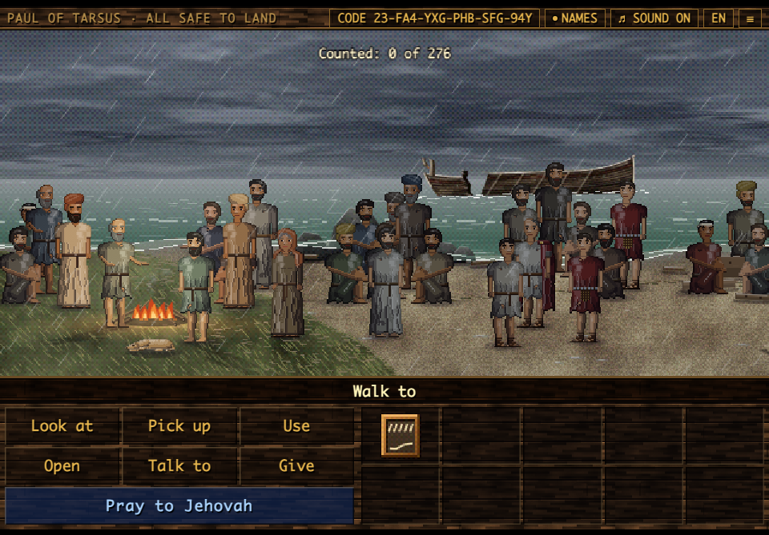 |
| The count on the beach: Luke finds the groups one after another, and the number stands at the top |

Twelve places, three of them close views and two told pictures, with Luke's tablet and the travel map, and two people played, each when the scene has him: Luke at the stern, on the beach and at the estate, and Paul at the bow, in the hold, on the wreck and in the surf. Who is played is fixed by the scene; while Luke is played he prays to Jehovah as Paul does, and his hints are his own thoughts. The narration says "we" where the account does, and "they" for the sailors and the soldiers. Everyone from the wreck is wet and torn until the house of Publius; the islanders are dry.

**Luke's tablet.** Luke carries his wax tablet from Chapter Twenty-Two, and until the island has its name it is the chapter's map: **Open** it in his inventory to see it close. Fourteen strokes for the days of the storm stand on it in two groups of seven, and below them the line that the six marks of Chapter Twenty-Two make, from Cauda westward, one piece for each day: down for southwest, level for west, up for northwest, and a small square and a gap for a day marked with its stroke only. Luke says one true line about what his marks would mean, by where the line ends: that it bends southwest toward the Syrtis, or that it runs west or a little north of west, and that he made his marks without sun or stars; or, if he marked only the days, that not one stroke says where they are. **Begun from the title**, or from the bare first code of the chapter, the chapter carries nothing in: the tablet holds only the strokes of the days, and Luke says that where they leave them he can't tell. A code saved later in the chapter keeps the marks it began with. The rest of the chapter is the same either way.

| | |
|---|---|
| 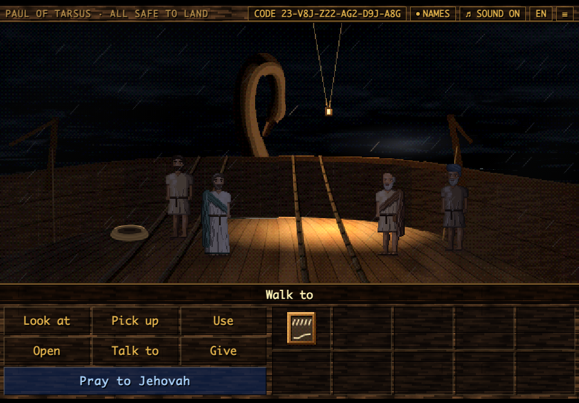 | 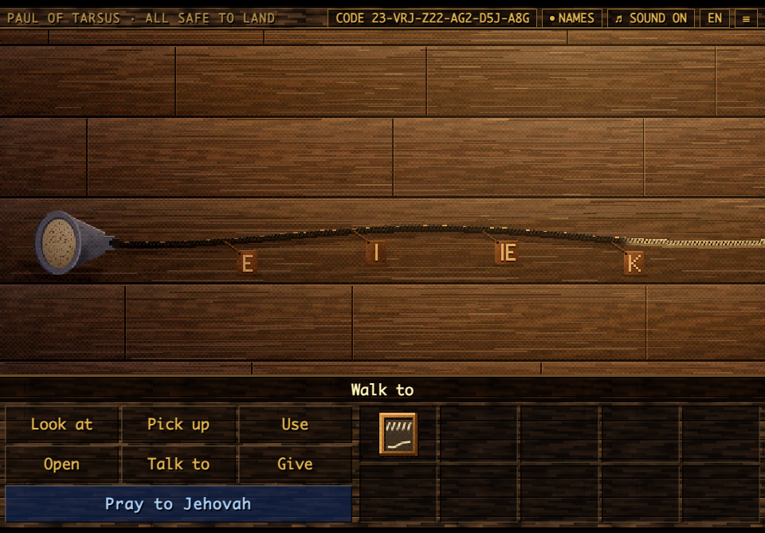 |
| The fourteenth night: four cables over the stern, and no anchor seen | Twenty fathoms: the line is wet up to Κ, and the tallow has brought up sand |

**Twenty, then fifteen.** The chapter opens on the narrator's scroll (27:27), then on the after deck by night, with no star and one lantern, the swan's neck of the sternpost against the dark, and Luke is played. The sailors keep going to the rail to listen. A sailor heaves the lead and lays the wet line out along the deck, and it is seen close. A leather tag hangs on it at every fifth fathom with a Greek number letter cut in it: Ε five, Ι ten, ΙΕ ten and five, Κ twenty (**Look at** a tag). Luke reads the depth at the tag where the wet part of the line ends, and writes it on his tablet; then he looks at the tallow on the underside of the lead, and writes down what it brought up from the bottom. A tag that is not where the wet part ends is answered plainly: the line is still wet beyond it, or dry that far up. After a while they sound again. When both soundings are written, the narrator tells them (27:28), the sailors say what they mean, and four cables run out over the stern one after another while 27:29 is told. No anchor is seen.

**An anchor from the bow.** Paul is played at the bow, by night, while 27:30 is told. Asked, a sailor gives the pretext, and nothing changes. Before he speaks to the officer Paul wants to be sure of what he is seeing, and three things show it: the skiff going down the side with nobody in it yet, how many sailors have gathered at the bow for one anchor, and the anchors of the bow still lying under their cover. Then he speaks to Julius and the soldiers in the account's words (27:31). A soldier cuts the ropes with a short blade, his hand closed over the hilt, and the skiff drops away empty (27:32).

| | |
|---|---|
| 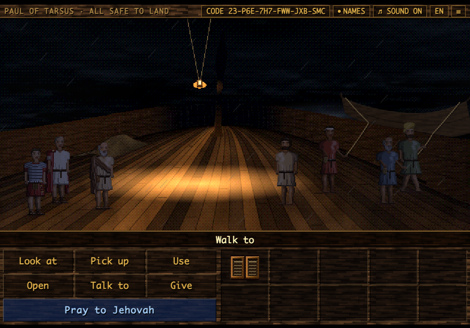 | 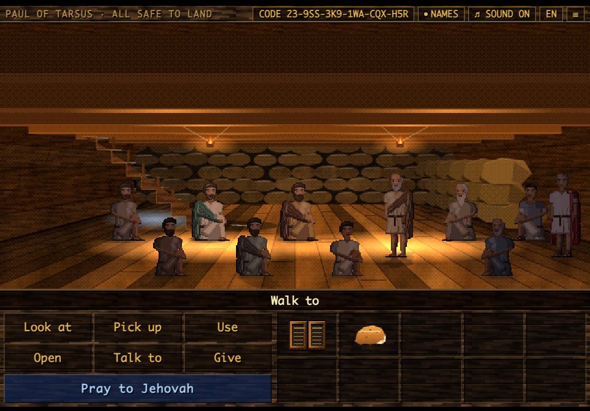 |
| The bow: so many hands for one anchor | Before them all: Paul under the lamp, where everyone can see him |

**Before them all.** Close to daybreak (27:33), in the hold, by two lamps that hang from a beam on two cords each, the people sit close along the hull, gray in the face; sea water comes down the stairs from the hatch. Urging one man at a time to eat changes nothing: each has his own reason not to. Paul has to stand where all of them can see him, under the lamp at the right, and speak to all of them (27:33, 34, in the game's own words), and only then use his bread before them all. Handing it to one man is refused: all of them should see it. The narrator then tells what he did and what they did (27:35-37), and Luke's tablet has the number on it from then on, in Greek number letters, ΣΟϚ. While the wheat is thrown out (27:38), two sailors carry sacks up the stairs. Nothing is handed round.

| | |
|---|---|
| 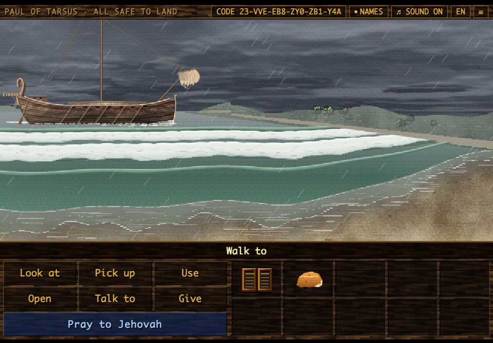 | 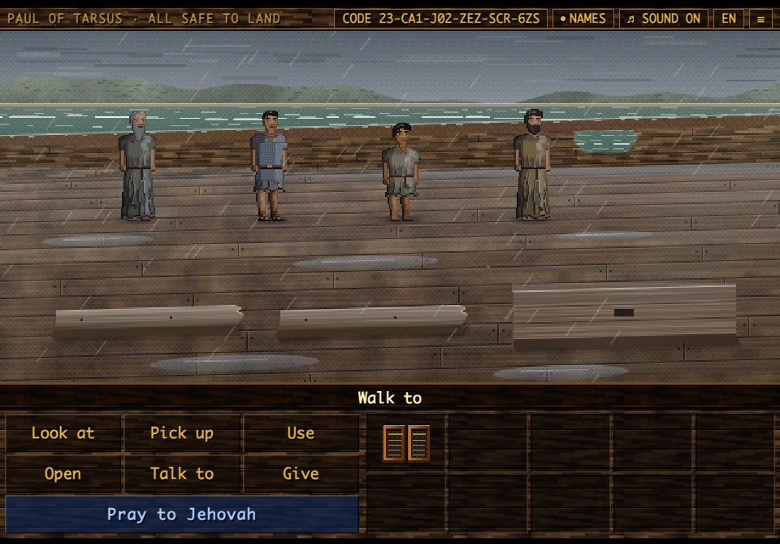 |
| The bay: told, as the ship runs in and strikes | Everyone has a plank: two planks, a hatch cover, and four who cannot swim |

**The bay.** The run for the beach is told over one picture: the bay at a gray daybreak in the rain, with the grain ship cutting her anchors loose, the steering oars going down into the water, the foresail set, and the ship running in until she strikes the shoal, her bow fast and the surf heaped round her stern (27:39-41).

**Everyone has a plank.** On the foredeck of the wreck the narrator tells the soldiers' plan and the officer's order (27:42, 43); no blade is seen, and the swimmers jump and are gone. Four are left with Paul who cannot swim: an old prisoner, a soldier in his mail, the ship's boy and a merchant. **Use** the planks and the hatch cover to see them close, then click a person and the thing he is to take. A refusal is answered with a true reason and lets go of the one chosen: a plank holds up one man, the hatch cover two and not three, nobody goes into the water in mail, and the old prisoner will not go beside a soldier after what the soldiers meant to do. Once the soldier has been refused, **Talk to** him and he takes his mail off. There is more than one right answer: any pairing that keeps the rules will do. Then Paul takes a plank himself.

| | |
|---|---|
| 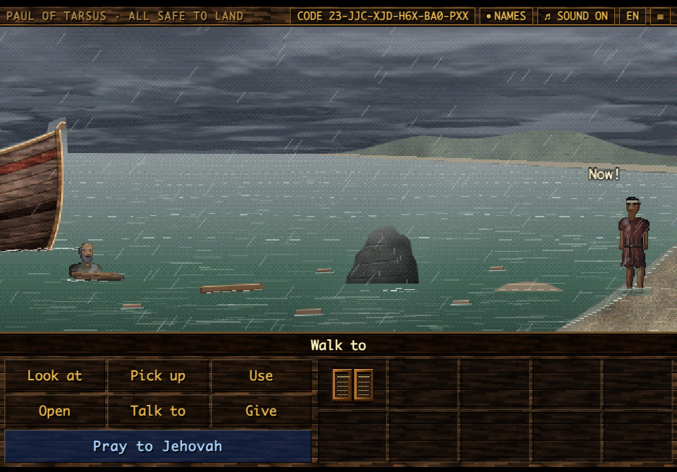 | 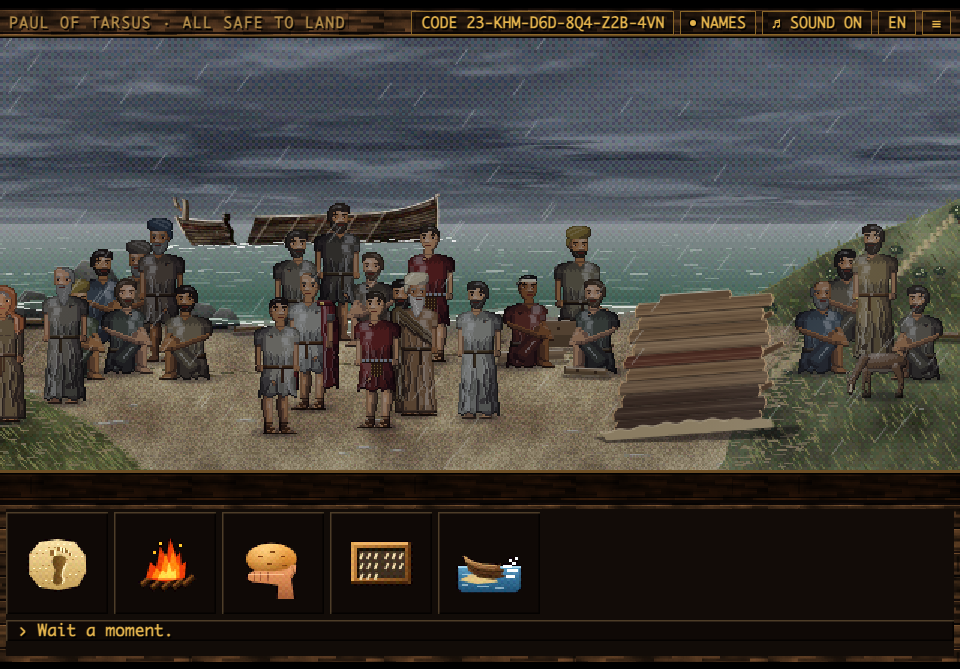 |
| Through the surf: after three misses the sailor in the shallows calls the moment | A talk in pictures: the wreck, the marks on the tablet, the ground here, the fire, eating |

**Through the surf, on the beat.** The water is crossed from the wreck to the beach, hold by hold: a floating spar, a rock, a sandbar and the beach. It is the beat of Chapter Twenty-Two, with the sea seen from the side this time: white water rushes in from the wreck and drains away, then there are three seconds of dark water with only lace on it, and then the next sea rises at the left. Click the next hold in the calm. A click on the wave is a miss and costs only that step: the sea throws Paul back to his last hold, and nothing is said. After three misses the sailor standing in the shallows calls the moment, and "Now!" stands over him; once he has begun to call, he goes on calling until Paul is ashore, and after three more misses he wades out and brings him in. The wave is seen and heard from one clock, so the picture alone keeps the time with the sound off, and a tap works as a click.

**The count on the beach.** Luke is played, on a gray beach in the rain, half again as wide as the screen, with the wreck far off on the shoal and the ropes still round her hull. Everyone is ashore, but is everyone there? The count stands at the top of the picture, "Counted: 0 of 276", and grows as Luke finds the groups by looking and walking: at the islanders' fire, by the rocks, at the water's edge with the officer and his soldiers, behind the wreckage, and by the path at the far right. When all five are counted, one is still missing. The last is the old prisoner from the planks, crouching behind a piece of the stern that the sea has thrown up, hiding from the soldiers; Luke tells him the officer has forbidden it, and he comes out. Only then does the narrator tell that all came safe to land (27:44), and an islander comes down the path.

**A talk in pictures.** The islander speaks a language Luke does not know, so the player answers him with pictures instead of sentences: five square pictures, the wreck, the marks on Luke's tablet, the ground here, the fire, and someone eating, and a line that only waits. Luke tells what the islander does, never what he says: he points out to sea and then at Luke, as a question; he waves along the beach. A picture that does not fit is answered with a true gesture, and the question comes again. When he has seen where they came from and how many they are, Luke asks his own question, where they are, and the islander says the one word that is learned: the name of the island. The narrator tells it (28:1), and Luke scratches the name in Greek letters, ΜΕΛΙΤΗ, at the end of his line. From then on his tablet opens the travel map, with the true line from Cauda to Malta. The narrator tells the kindness, the rain and the fire (28:2).

| | |
|---|---|
| 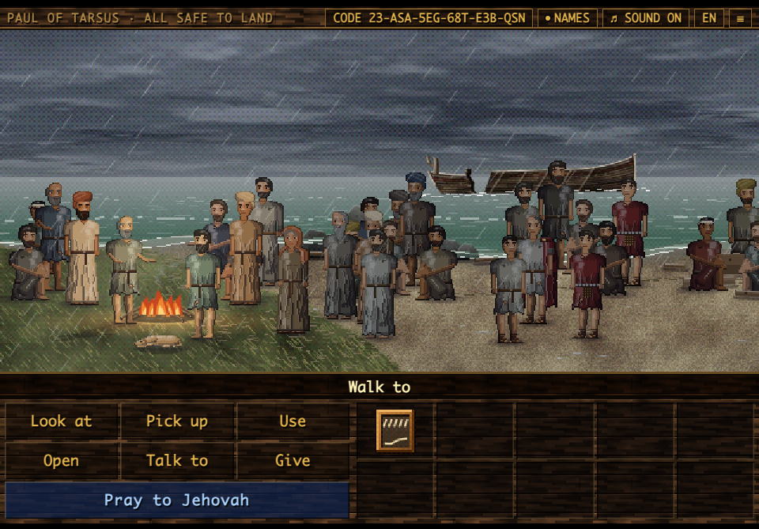 | 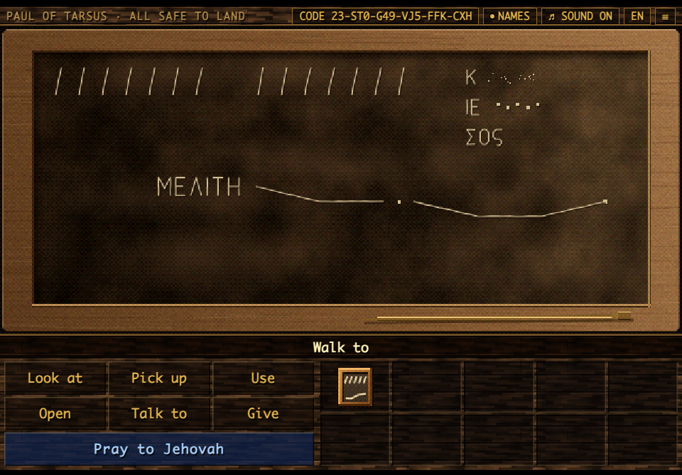 |
| The fire in the rain | Luke's tablet, with the name of the island at the end of his line |

**The viper.** The viper is a scene that is not played; Luke watches it. Paul brings an armful of sticks and lays them on the fire, the viper comes out with the heat and hangs from his far hand, and the narrator tells 28:3, 4 while two islanders turn to each other; Paul does not understand them and does not answer. He shakes it off into the fire (28:5), and the light changes and the rain thins over the long wait while 28:6 is told. When they call him a god, nothing is shown: Paul warms his hands and the scene moves on. Nobody bows.

| | |
|---|---|
| 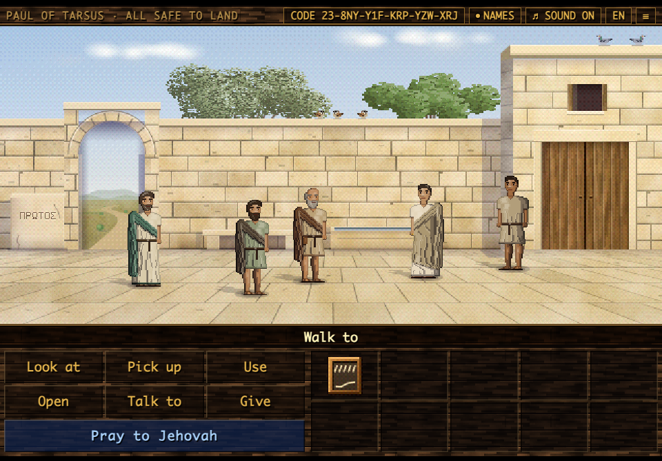 | 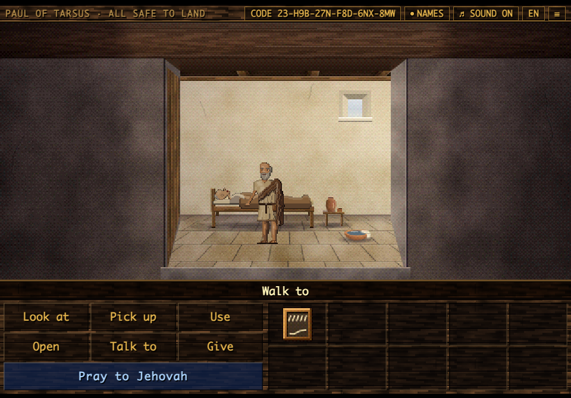 |
| The estate of Publius, and the stone at the gate | Fever and dysentery: told over one picture of the room |

**The estate.** Publius takes them in (28:7). His court is of the island's pale limestone, after the rain, with an olive and a fig over the wall, a stone bench and a trough, sparrows on the coping and doves on the cornice. Everyone in it is dry again. Luke is played: **Talk to** Publius, whose father is ill. Paul asks to go in to him, and 28:8 is told over one picture of the room seen through its open door: the old man in bed, Paul beside him with his far hand laid on him, the forearm bent. There is no light and no effect. Back in the court the father stands on his feet; the narrator tells of the other sick (28:9), and the gifts are brought into the court a few at a time while 28:10 is told: jars, a basket of bread and fruit, folded cloth. Then the narrator tells, from the scroll, what comes next (28:11), and the end screen returns to the title until Chapter Twenty-Four is built.

Walkthrough (spoilers)

1. At the stern, as Luke, **Talk to** the leadsman.
2. On the line, **Use** the tag Κ (where the wet part ends), **Look at** the lead, then **Use** the lead.
3. Back at the stern, **Talk to** the leadsman again. **Use** the tag ΙΕ, **Look at** the lead, then **Use** the lead.
4. At the bow, as Paul, **Look at** the skiff, **Look at** one of the sailors at the skiff, and **Look at** the anchors under cover. Then **Talk to** Julius.
5. In the hold, **Use** the hanging lamp at the right (or the place under the lamp). **Talk to** everyone in the hold (or anyone there). Then **Use** the piece of bread with everyone in the hold.
6. On the wreck, **Use** the planks and hatch cover. Click the soldier in mail, then a plank: he is refused. **Talk to** him: he takes his mail off. Then give each one his float: for example, the old prisoner on one plank, the soldier on the other, and the ship's boy and the merchant on the hatch cover.
7. In the surf, **Use** the floating spar, the rock, the sandbar and the beach, one after another, each in the calm between two seas.
8. On the beach, as Luke, **Look at** the five groups: the people at the fire, by the rocks, at the water's edge, behind the wreckage, and by the path at the far right. Then **Look at** the piece of the stern.
9. **Talk to** the islander and answer with the pictures: the wreck, then the marks on the tablet, then the ground here.
10. **Talk to** Paul (or **Use** the fire).
11. At the estate, as Luke, **Talk to** Publius.

The hidden treasure lies at the estate, off the way: **Look at** the stone left of the gateway. One word is cut in it, and Luke copies it onto his tablet.

## Music and sound

| Chapter | Music | Around you |
|---|---|---|
| All Safe to Land | One tune for the last night at sea and the island: B flat in the harmonic minor, in bars of eighteen steps that fall four, five, four, five, a long uneven swell; no other chapter has this key or this bar. The tune is four bars long: up the triad to the fourth, up to the raised seventh and the octave, down from the octave, and home through the raised seventh below. It grows out of the storm into the grey morning and the quiet of the estate. On the night deck the harp alone plays the tune slowly over a low string that plucks one note to the bar. At the bow, on the wreck and in the surf the low string plucks the keynote and leans on the note above, a drum ticks with it and almost stops every fourth bar, and the ney begins the tune and breaks off before it comes home, no louder than the rest. In the hold before daybreak the lyre has the tune over the low string; while the bay is told the ney has it and the harp rocks; on the grey beach the harp has its second half; at the fire lyre and harp take turns, and at the estate harp and lyre. Nothing is claimed about how music was played then | The storm's wind in the rigging, in gusts, and the sea at the stern and the bow by night. In the hold the timbers groan as the hull works, and water runs and bubbles below. At daybreak the surf breaks on the beach, slower and deeper than the sea at sea, and draws back over the sand; rain hisses on the deck of the wreck and on the beach. In the surf no breaker is heard but the one that is seen: each sea rises, breaks with a weight and runs back hissing over the sand, so that it can be followed by ear, and with the sound off the picture alone keeps the time. At the fire the sticks crackle, the flames breathe and the rain hisses on the embers. At the estate after the rain a little wind, birds and the sea far off. No gull is heard or seen from the storm to the beach, and nothing thunders |

Every step can be solved from what is seen and said, and the timed steps need no sound.

The chapter opens on its title card, over a short sting in its own key of B flat.

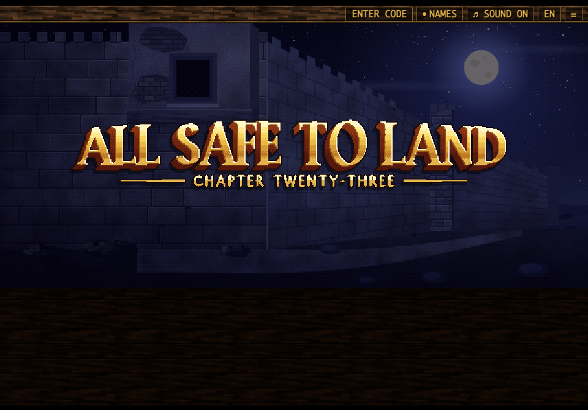

## The travel map

Until the island has its name, Luke's tablet is the map: the line his own marks make, westward from Cauda, with no coast on it. Once the name is scratched at its end, the tablet opens the travel map in the window from Crete west to Sicily and Malta, with the coast of Africa below: the legs of Chapter Twenty-Two from Myra to Cnidus, past Salmone to Fair Havens and on to Cauda, and the true line from Cauda across the open sea west-northwest to Malta, dipping a little south at first, as the Study Edition's map of the voyage draws it, in the game's own drawing. The Sea of Adria is named across it. Only Malta can be clicked, and a click on it, or `Esc`, puts the map away. No distance is named, no leg crosses another, and no name crosses a coast or a route.

| |
|---|
| 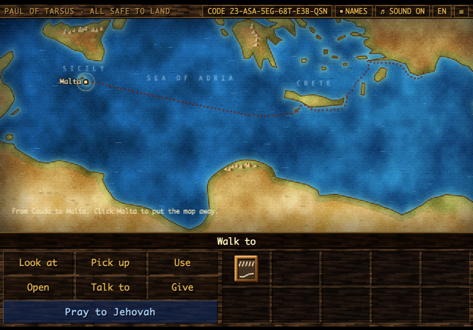 |
| From Cauda to Malta: the true line, at last |

## About the content

Chapter Twenty-Three tells what the account says (Acts 27:27–28:10) in the narrator's own words, verse by verse with the reference, and puts none of it into a mouth as a quotation; 28:11 is told before the end screen, as what comes next. These lines stand together in `levels/chapter23.js` (`TOLD`) and in the language files, where they can be checked against the Study Edition; the German lines were written from the German edition. Where Paul speaks words of the account, to the officer and the soldiers (27:31) and to everyone in the hold (27:33, 34), they stand in the game's own words, and the end screen gives their reference. His thanks in 27:35 are told, and no words are invented for them. The narration says "we" where the account does, and "they" for the sailors and the soldiers. The wish for daylight in 27:29 is told as a wish, not as a prayer. The islanders' word in 28:4 stays the account's, Justice, and no god is named.

**What was read, and how.** On 26 November 2026 these were read by hand in the browser, on wol.jw.org: Acts 27:27-44 and 28:1-11 in the Study Edition with every study note, marginal reference and Research Guide list, and in the German Study Edition with every note, cross-reference and footnote; the Study Edition's media "Sounding Weights" and the list of events of Paul's trip to Rome; *"Bearing Thorough Witness" About God's Kingdom*, chapter 26, with its boxes, in English and in parts in German; the *Insight on the Scriptures* articles "Malta", "Adria", "Fathom", "Lead", "Ship", "Rudder", "Mariner", "Hair", "Cnidus", "Acts of Apostles", "Archaeology", "Barbarian", "Viper", "Venom", "Publius", "Fever", "Diseases and Treatment", "Luke", "Paul" and "Zeus, Sons of", and in German „Malta“, „Publius“, „Ruder“ and „Schiff“; *All Scripture Is Inspired*, "Bible Book Number 44—Acts" and Study Number 3; *The Watchtower* articles "Paul Triumphs Over Adversity" (May 1, 1999), "In Dangers at Sea" (March 15, 1999), the "Questions From Readers" of August 15, 2004, the "Did You Know?" items of October 1, 2015 and March 1, 2009, "Boldly Proclaim Jehovah's Kingdom!" (June 15, 1990), "Show Loving-Kindness to Those in Need" (May 15, 2002), "Honor Men of All Sorts" (February 1, 1991), "Hope Conquers Despair!" (1992) and "Malta's Hospitality Brings Blessings" (1990); and *Awake!*, "Paul's Voyage to Rome" (1971) and "Malta—An Island of Hospitality" (1979). The chapter's lead did the reading and gave the facts to the builders in a brief; nothing was added to them.

**What they establish.** Between them, these publications give the following, said here in the game's own words. The publications count the fourteenth night from the beginning of the storm; they date the voyage to about 58 C.E., and the arrival in Rome, after the winter on Malta, to about 59. In those days the Sea of Adria took in the waters between Sicily and Malta in the west and Crete in the east. The account gives no reason why the sailors suspected land; *Bearing Thorough Witness* says that they may have heard breakers, and *Insight* ("Malta") that their ears perhaps caught the surf on a point of the bay. A fathom is about 1.8 m, roughly the reach of a man's arms stretched out to both sides, so twenty fathoms is about 36 m and fifteen about 27 m; *Insight* says that these depths agree with soundings made in St. Paul's Bay in the nineteenth century. To sound, a weight of lead on a rope was thrown over the side, and some weights had tallow on the underside that brought up sand or small stones from the bottom; the Greek word for sounding means to heave the lead. No source tells of marks on the line. Four anchors were let go from the stern to stop the drift and keep the bow toward the land; no source says what they were made of or how they were let go. *The Watchtower* (May 1, 1999) explains the skiff as the boat for going ashore from a ship at anchor, and the sailors' attempt as a way of saving their own skins and leaving behind the others, who could not sail her. *Bearing Thorough Witness* treats Paul's thanks over the bread as a public prayer of thanks before a meal, and no source has the bread handed round: they took food themselves. The number 276 has strong support in the manuscripts, and ships of the time could carry that many: Josephus tells of a wreck with about 600 on board. The wheat went over the side so that the ship would draw less water for the run in. At anchor the steering oars were held out of the water by lashings, one great oar at each side of the stern, and the small foresail gave them some steering. The Study Edition reads 27:41 as a shoal with the sea on both sides of it; *Insight* lists other readings, and says that the bow perhaps stuck in the mud and clay that lie in parts of St. Paul's Bay, the bay that tradition and the account point to. The soldiers' plan may have come of the Roman rule that guards answered for prisoners who escaped. All 276 came safe to land, and no source tells of any count on the beach. Melite has been taken for Malta for centuries, and with the northeaster blowing the ship was likely driven west; *Insight* sets Malta about 870 km west-northwest of Cauda, but the game names no distance. The account calls the islanders by the Greek word for people of another tongue, which then carried no contempt; the Study Edition's note says that they apparently spoke a language of their own, likely Punic. No source says whether any of them knew Greek or Latin, so the game says only that Luke does not know their language. Their kindness was a humane concern for strangers, people they owed nothing. There are no vipers on Malta today; the Study Edition's note says that the islanders of the account knew them, and *Insight* tells of one reported near St. Paul's Bay in 1853. The word Justice may stand for a goddess or for the idea of justice; the game keeps the account's word and names no goddess. *Bearing Thorough Witness* notes that the word for swelling up is a medical term, natural for Luke, the physician. Nothing is told of what Paul answered when they called him a god. Publius's name means popular; his title appears to be an official one, probably that of the leading Roman officer on the island, and *Bearing Thorough Witness* says that Luke uses the very title found on two inscriptions on Malta, one in Latin and one in Greek (*Insight*, "Archaeology"); the German Study Edition's footnote gives it literally as the first. The publications read the "us" whom he took in as Paul and his companions. Dysentery is a feverish illness, a severe inflammation of the bowels; *Insight* says that Paul healed by the power God had given him, and no source says that Luke treated anyone on Malta. What the gifts were is not told.

**The ship and the storm.** The undergirding ropes are seen round the hull of the wreck where she is seen from the side, and the swan's neck at her stern, as Chapter Twenty-Two shows them and under the same rule ([CONTRIBUTING](../CONTRIBUTING.md) section 3). No anchor is seen in this chapter: four cables over the stern by night, and their cut ends at daybreak. The account names no lightning; there is lightning far off in the night at the stern and the bow, as the maintainer decided for the storm (CONTRIBUTING section 4), and none in the bay at daybreak, and the end screen says that the account names none. At anchor the ship still rolls a little with the sea, with everyone on her, while the night around her does not; below deck and on the wreck she is still. Nothing sways for a player who has asked for reduced or calm movement. The estate of Publius has no shrine, statue or altar, and the figurehead of 28:11 belongs to Chapter Twenty-Four and is not named here.

**What is invented.** The supporting characters are invented and have no names: the leadsman and the other sailors, the soldier who cuts the ropes and the soldier in mail, the old prisoner, the ship's boy and the merchant who cannot swim, the sailor in the shallows, the islanders (the elder who talks with Luke, two men at the fire and a woman who brings food), and a servant of Publius's house; and the goat and the dog. The father of Publius is in the account; his look and his words are invented. Invented too are the tags on the sounding line and Luke's notes of the soundings; the three things Paul sees at the bow; the hold as the place of the meal, and the sacks of wheat; the planks and the hatch cover and who takes which; the spar, the rock and the sandbar of the surf; the count on the beach, its groups and their numbers, and the old prisoner hiding; the talk in pictures; the court of the estate, its gifts, and the stone at its gate with its one word; and Luke's tablet with its marks. All the dialogue is invented, apart from Paul's words of the account named above. The end screen says what is invented.

**What Acts leaves unsaid.** Acts does not say how the soundings were read, what Paul saw at the bow, where the meal was eaten, who could swim, or that anyone counted the survivors on the beach. It does not say how they learned the island's name, what the islanders looked like, what Paul answered when they called him a god, what the house of Publius looked like, or what his father's name was. The chapter's end screen says these things too.

**The German text.** Names and terms follow the German Study Edition: „das Adriatische Meer“, „Faden“, „das Beiboot“, „der Offizier“, Malta, Publius „der führende Mann der Insel“, „Fieber und Ruhr“, the viper „eine Otter“ and „die Gerechtigkeit“ of 28:4. The leadsman is „der Lotgast“, the lead „das Lot“ with its „Talg“, the tags „Marke Ε“ to „Marke Κ“, the hatch cover „Lukendeckel“, and the count on the beach „Gezählt: … von 276“. The pictures of the talk are named as short requests, such as „Zeig auf das Wrack“. The title is „Alle sicher an Land“, and the hidden treasure „Der Stein am Tor“.

[← All chapters](../README.md#chapters)
