# Chapter Twenty-Four: He Took Courage

About 59 C.E., in the spring. After three months on Malta they put to sea in a ship from Alexandria whose figurehead was the Sons of Zeus. She lay three days in port at Syracuse and went along to Rhegium; a south wind got up, and on the second day they were at Puteoli. There they came upon brothers, who urged them to stay seven days, and then they went on toward Rome. The brothers in Rome had heard about them and came out to meet them: at the Marketplace of Appius, and again at Three Taverns. At the sight of them Paul gave thanks to God and took courage. In Rome he was given leave to stay by himself, with a soldier to guard him (Acts 28:11-16).

| |
|---|
| 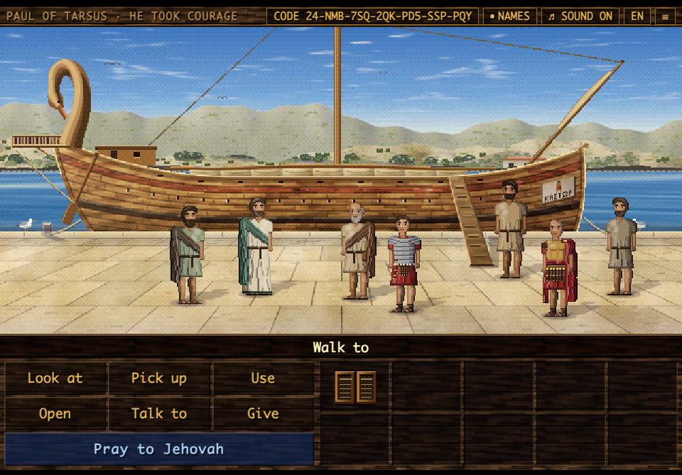 |
| Malta: the ship from Alexandria, and what an eyewitness writes down |

Fifteen places, one of them a close view, with the travel map, and six people played one after another, each when the scene has him: Luke at the quay of Malta, at Puteoli and in the streets of Rome; the three strangers who carry the news to Rome, Ovius the carter, Melanthios the trader and Varro the boatman; Sextus, a young brother of Rome; and Paul on the road, from the hills to the camp. Who is played is fixed by the scene; there is no button to change it. Luke, Sextus and Paul pray to Jehovah. The three who carry the news do not worship Jehovah: while one of them is played the prayer button reads **Think it over**, and his hints are his own thoughts. The narration says "we" to 28:16, as the account does. On the road Paul walks beside a soldier and wears no chain; he is chained in Rome, in Chapter Twenty-Five.

**What an eyewitness sees.** The chapter opens on the narrator's scroll: 28:11 is told in the same words as at the end of Chapter Twenty-Three, and then the figurehead in a line of its own. Then a harbor of Malta on a spring morning, with the ship from Alexandria along the quay, and Luke is played, his wax tablet at his belt. He wants to set down what he sees. **Talk to** the sailor coiling a rope: Luke can ask where she is from, whether she has been here long, and what is on her bow. The sailor names the twins, the Sons of Zeus, and says that sailors trust them to keep a ship safe; Luke thinks of what the Lord told Paul in Jerusalem (Acts 23:11, in Chapter Nineteen's words), and that he and Paul serve Jehovah. What he has heard he writes by using his tablet on the sailor, and the sign by using it on the ship once he knows what it is. Not before all three are written does he go up the gangplank. Then the travel map draws the sea legs, Malta to Syracuse, Rhegium and Puteoli, while 28:12 and 28:13 are told.

**The news goes ahead.** At Puteoli, in the court of the house of Herennius, where the brothers meet, the narrator tells that they came upon brothers and were urged to stay seven days. How they were found and how the week was granted is said in two lines of Luke's: a man who works on the docks brought them, and Julius let them stay; after the sea, Luke thinks, he trusts Paul. The brothers in Rome should know that Paul is coming, and no post carries a word like that, so travelers will have to. The message has four parts, each one short sentence: Paul, who wrote to the brothers in Rome, is coming as a prisoner with soldiers; he is coming up the Appian Way, on foot; he stays seven days in Puteoli and then sets out; and in Rome it is for the brothers who meet at Vibia's house. It goes from mouth to mouth in four hand-overs, and each time the one who gives it is played: Luke to Ovius, who drives his cart to Capua; at a station by Capua, Ovius to Melanthios, who rides north; by the canal in the marshes at dusk, Melanthios to Varro, who takes his barge up by night; and at the Marketplace of Appius at daybreak, Varro to Sextus, who carries goods between the barges and Rome. The one who receives it says it back in his own words, a sentence at a time, and after each the player lets it stand or says that part again. Most of what he changes does not matter, and setting it right only gets a kind "That's what I said". One thing each time does matter: seven weeks for seven days, by sea to Ostia for on foot up the Appian Way, Fabia's house for Vibia's. Sextus gets all of it right. A wrong thing let stand is noticed by the giver as the other turns to go, and he says that part once more, so nobody can get stuck and the message reaches Rome whole. Every correction on offer is the true part itself, and the slips are the same in English and German.

| | |
|---|---|
| 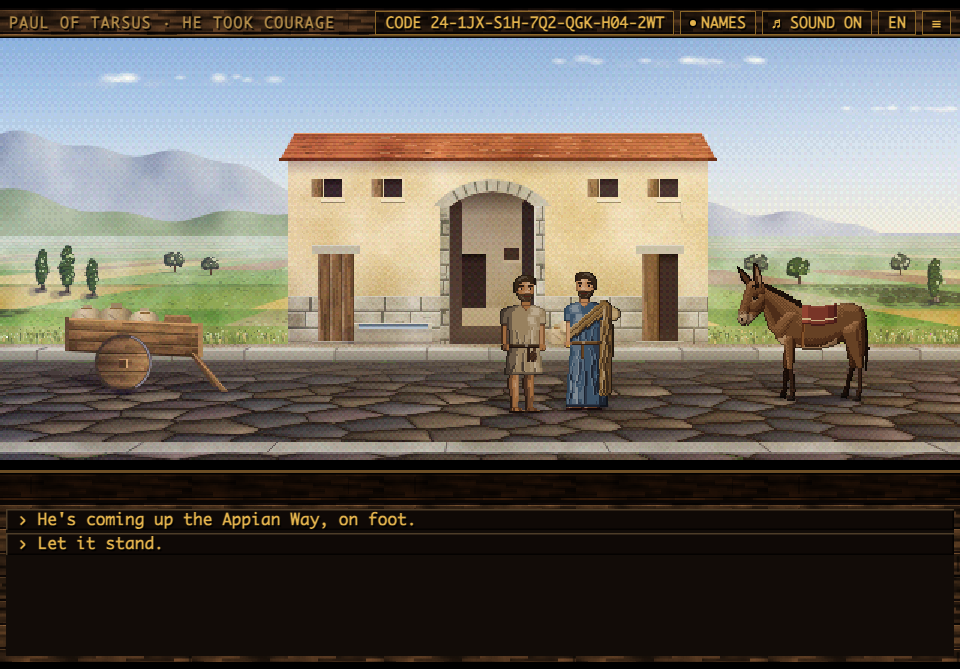 | 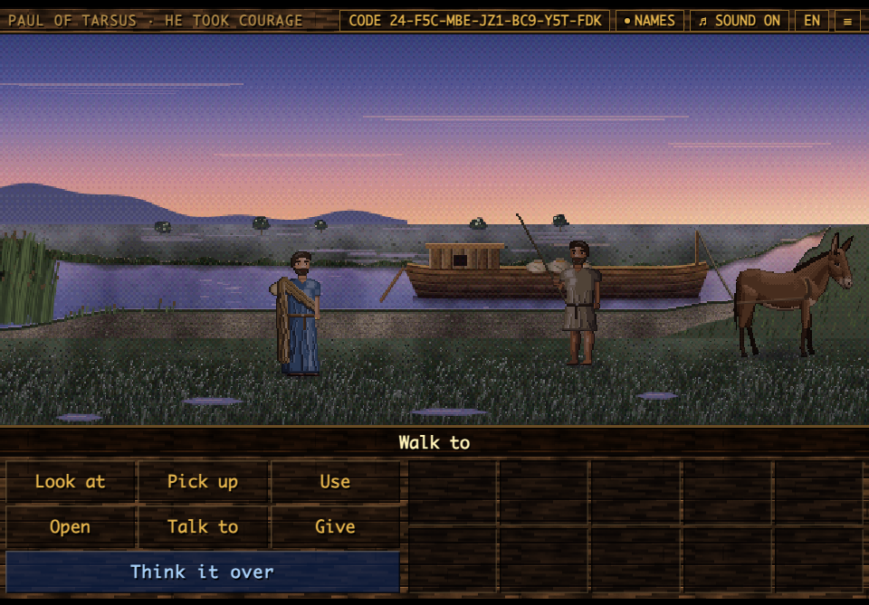 |
| Said back: let it stand, or say that part again | The canal at dusk, where the boatmen go north by night |

**The stones.** At the Marketplace of Appius at daybreak Sextus has the message, and he is played. He passes the milestones every week and has never learned to read them: the one here reads XLIII. **Talk to** Varro, and he teaches him the letters: I is one, V five, X ten and L fifty, a smaller letter after a bigger one adds to it and one before it takes away, so XL is forty and XLIII forty-three miles to Rome. The numbers are needed twice more: on the board in Rome, and on the walk.

| | |
|---|---|
| 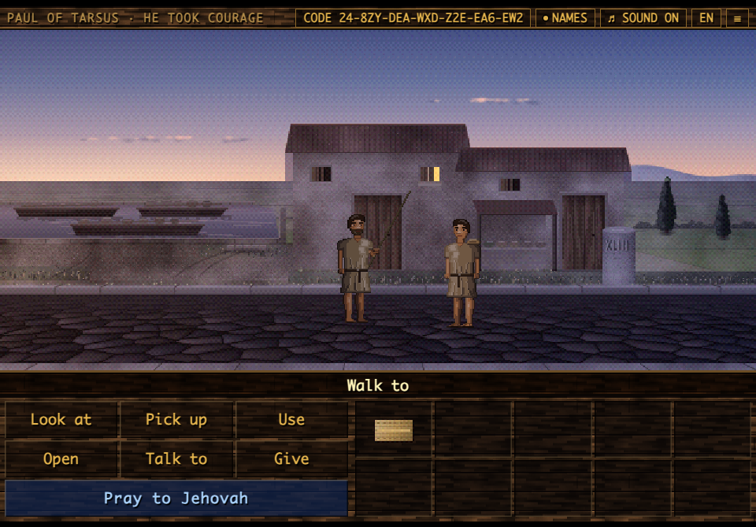 | 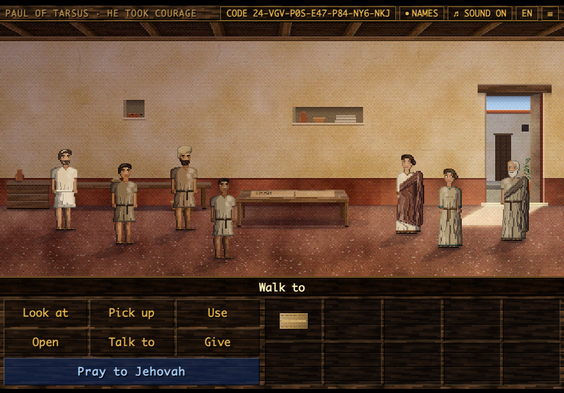 |
| XLIII: forty-three miles to Rome | Vibia's house: seven who want to go out to meet him |

**The plan on the road.** In Vibia's house in Rome, where some of the brothers meet, Sextus tells the news word for word, and seven want to go out to meet Paul: Sextus himself, Vibia and her daughter Aemilia, old Postumus, Firmus the baker, Thallos, a slave in a household of Rome, and Mikon, the brother who carried loads on the quay at Cenchreae in Chapter Fifteen and lives in Rome now. Each says one true thing about himself. On the table lies a board with the road scratched on it from the gate of Rome to the south, the stones beside it with their numbers, and two places by the road: Three Taverns at the stone XXXIII and the Marketplace of Appius at XLIII. Each person is a peg. When all seven are set, their words are tested, and the first one broken is said by the one it concerns, whose peg comes back. Nobody may wait alone, everyone must be able to get there and home, and somebody Paul knows should be among the first he meets. It comes out only one way, and as the publications tell it: some went on to the Marketplace while the others waited at Three Taverns.

| |
|---|
| 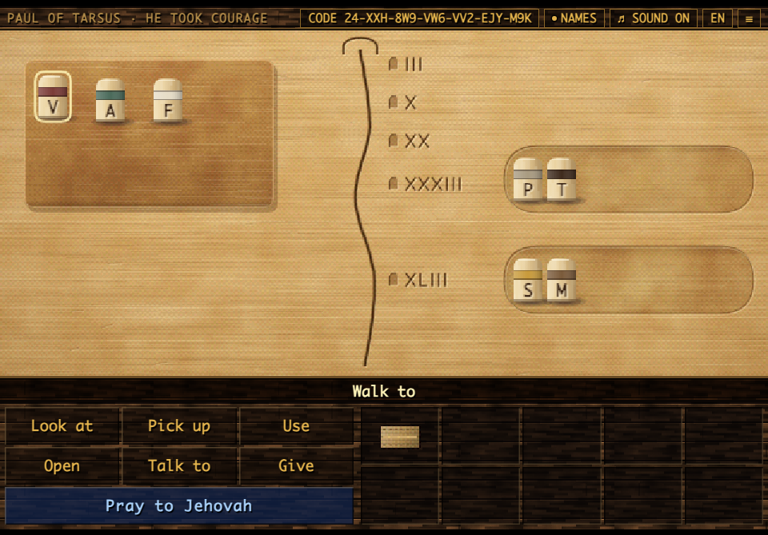 |
| The board on Vibia's table: a peg for each of them |

**In step.** From the scroll the narrator tells the last sentence of 28:14, and the map draws the road from Puteoli inland and up the Appian Way. Then Paul is played, on the road in the hills of Campania, with the column: Julius, two soldiers, two other prisoners, Luke and Aristarchus. The blocks are big and uneven, and Paul keeps step with the soldier beside him: when the soldier's foot comes up, he goes. **Use** the road ahead while the soldier's foot is up, and Paul and the column take the next step together. A step taken while the foot is down is a miss, and it costs only that step: the column waits, and nothing is said. After three misses the soldier calls the step, and **Now!** stands over him while his foot is up; after three more he takes Paul's arm and brings him along, so nobody can get stuck. There are three stretches of four steps, each ending at a milestone that Paul reads: LXI in the hills, then LII and XLVII on the straight road through the Pontine Marshes, with the canal beside it. From the second stretch on Paul is weary: he walks with his head a little lower, and his lines get shorter. He never says, and the game never says, that he has lost heart.

| |
|---|
| 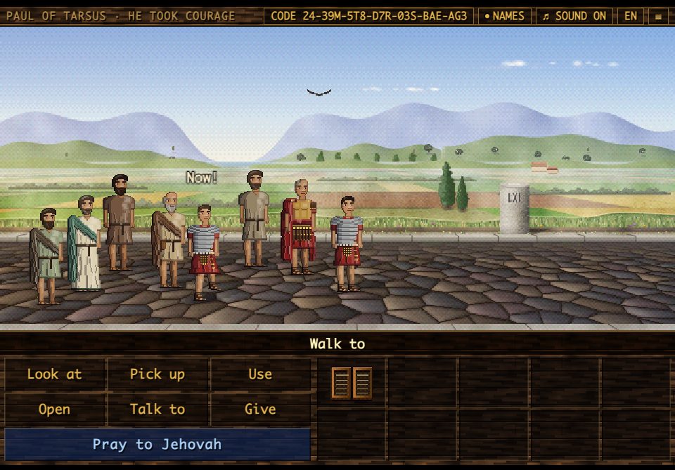 |
| In step: after three misses the soldier calls the step |

**He took courage.** At the Marketplace of Appius by day the brothers stand by the road, and the narrator tells that they came out to meet us, and that at the sight of them Paul gave thanks to God and took courage (28:15). Paul knows Mikon from the quay at Cenchreae, and he tells them what he wrote to them: that he longed to see them, so that they might encourage one another (Romans 1:11, 12). From here on the step no longer has to be kept: they walk with him. Sextus tells how the news came, from a carter to a trader to a boatman and to him. Up the road, at Three Taverns, the others are waiting, and the group that goes on to Rome is large.

| |
|---|
| 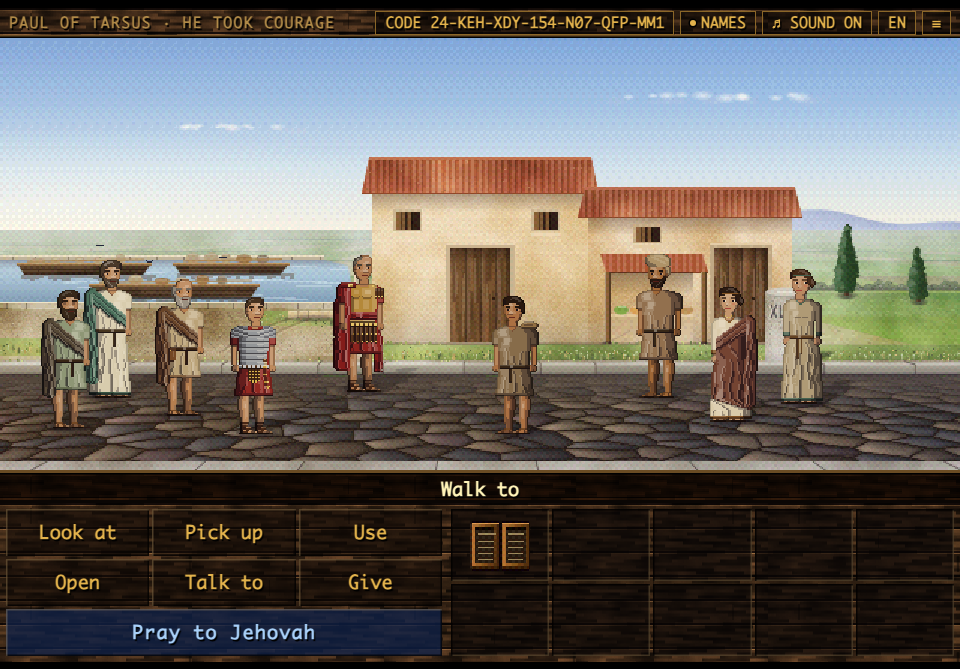 |
| The Marketplace of Appius: the brothers who came out to meet him |

**Into Rome.** The map draws the last of the road, by Three Taverns to Rome. Rome is first seen from afar at the third stone, where the road comes down from the hills: the city in the morning haze beyond the tombs, the pines and the cypresses, with two temple fronts far off. At the Porta Capena the Circus Maximus shows over the wall at the left, and the Palatine over the gate. At the high wall of red brick of the camp of the Praetorian Guard Julius speaks with Paul a last time: he won't forget what he saw at sea. Paul answers that it was God's doing and thanks him for his kindness the whole way. Nobody is handed over on the screen. Then 28:16 is told from the scroll.

| | |
|---|---|
| 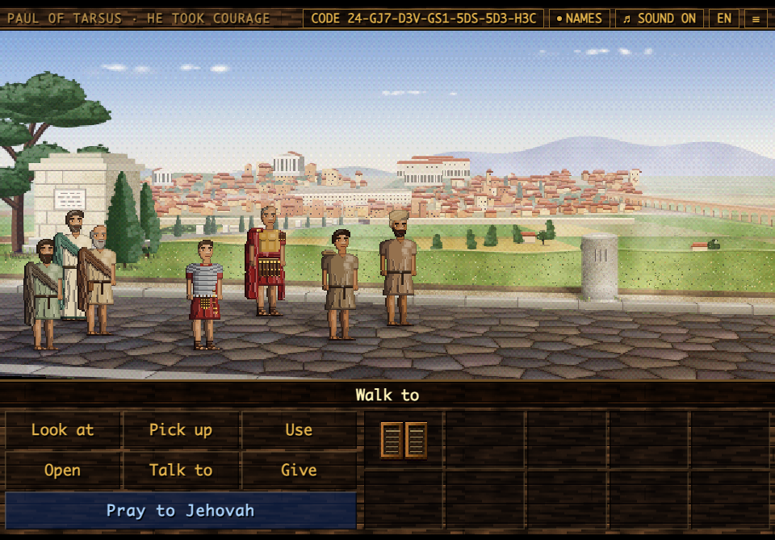 | 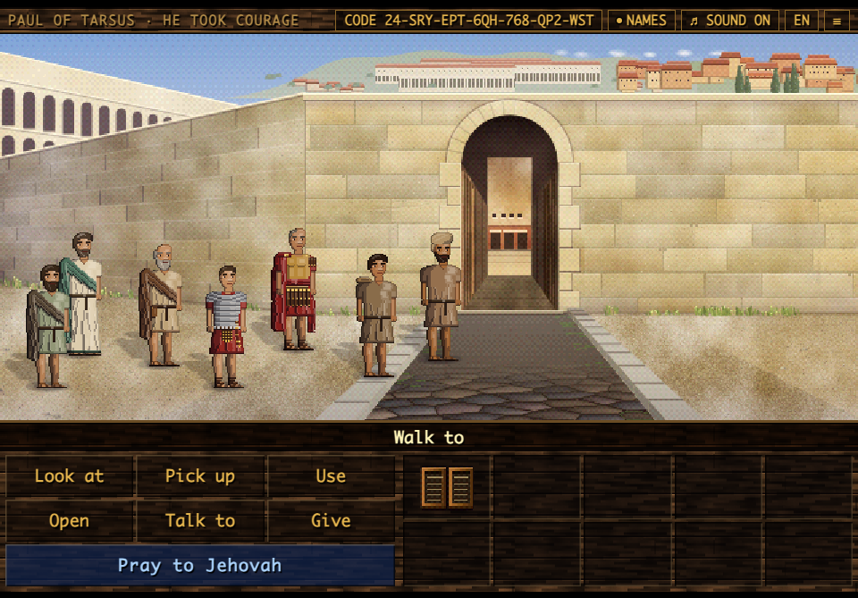 |
| Rome from afar: III, three miles more | The Porta Capena, where the Appian Way comes into the city |

| |
|---|
| 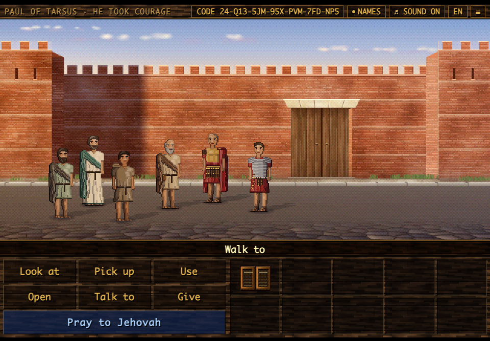 |
| The camp of the Praetorian Guard: Julius a last time |

**A room with a door.** Luke is played again, with Sextus, in a narrow street of tall tenements with shops below. The landlord has four rooms free in the street, and a soldier of the watch who will guard Paul is there to see where he can sit. Behind the four doors are a flat on the second floor, a room at street level whose door opens on the street, a room under the roof up three steep flights, and a little room at street level. **Open** a door to look in, and **Use** the room to take it. A lodging must hold many who come to listen, be within reach of the old and the lame, and have a place for the soldier's stool, and the first thing a lodging lacks is said by the one it concerns: three flights are too many for the old and the lame (Luke), and four people would fill the little room (Sextus). The flat and the room at street level both fit, and Luke says in a line why the one taken will do. Nothing is said of the rent.

| | |
|---|---|
| 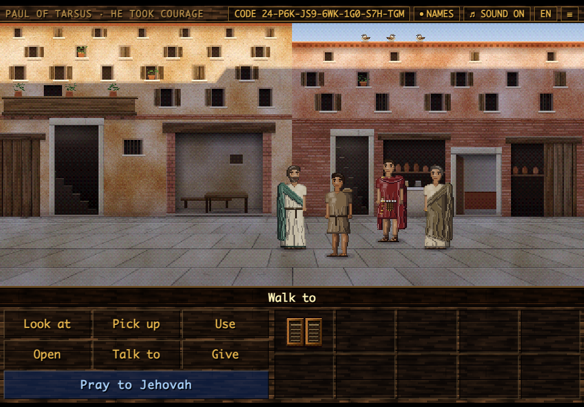 | 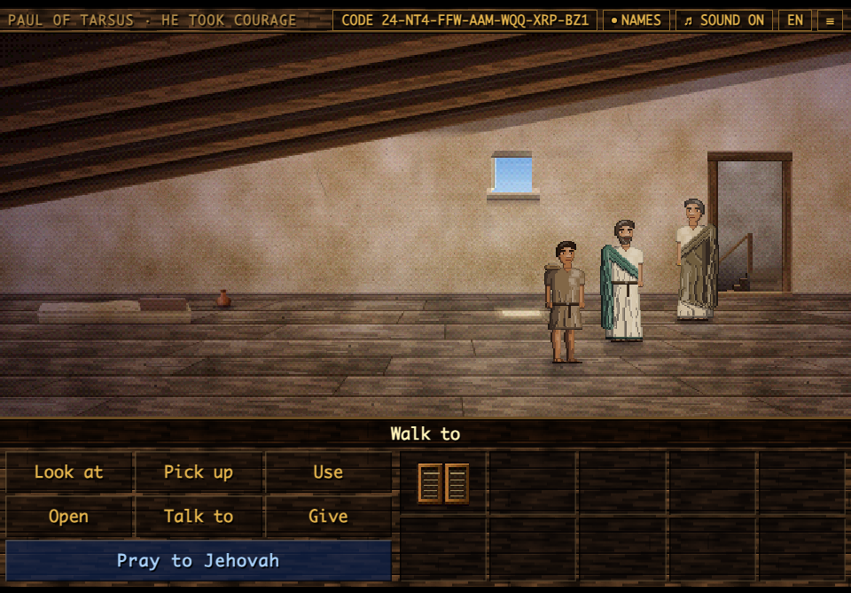 |
| Four doors: room for many, a way in for the old, a place for the soldier | Three steep flights: the old and the lame would never get up here |

**The lodging, carried on.** The end screen leads on to Chapter Twenty-Five with that chapter's first code, and the code holds the lodging chosen. A click on the end screen starts Chapter Twenty-Five in that room, and so does the printed code, typed later on any device. Chapter Twenty-Five begun from the title, or from its bare first code, is played in the flat on the second floor.

Walkthrough (spoilers)

1. On the quay of Malta, as Luke, **Talk to** the sailor and ask all three questions: where she is from, whether she has been here long, and what is on her bow. Then "Thanks. That's all."
2. **Use** Luke's tablet with the sailor (from Alexandria, wintered here), then **Use** Luke's tablet with the ship (her sign).
3. **Use** the gangplank.
4. At Puteoli, **Talk to** Ovius the carter. After each sentence he says back, choose **Let it stand**, except after "Seven weeks in Puteoli": there choose "He stays seven days in Puteoli, then sets out."
5. At Capua, as Ovius, **Talk to** Melanthios the trader. Let everything stand except "He's coming by sea, to Ostia": there choose "He's coming up the Appian Way, on foot."
6. By the canal, as Melanthios, **Talk to** Varro the boatman and choose "I have a message for Rome." Let everything stand except "the brothers at Fabia's house": there choose "In Rome, tell the brothers who meet at Vibia's house."
7. At the Marketplace at daybreak, as Varro, **Talk to** Sextus and let every sentence stand: he has it right.
8. As Sextus, **Look at** the milestone, then **Talk to** Varro to learn the letters. Then walk to the road north at the right.
9. In Vibia's house, **Use** the board. Click a peg, then a place: Sextus, Mikon, Vibia and Aemilia at the Marketplace of Appius (XLIII); Postumus, Firmus and Thallos at Three Taverns (XXXIII). (**Talk to** each of them first to hear why.)
10. On the road, as Paul, click the road ahead while the soldier's foot is up, four times in each of the three stretches.
11. At the Marketplace of Appius, walk to the road north at the right; at Three Taverns, walk on to the road north again.
12. Rome from afar: walk to the road on at the right. At the Porta Capena, walk through the gate. At the camp, **Talk to** Julius.
13. In the street, as Luke, **Open** the door to the second floor (or the room at street level) and **Use** the room.

The hidden treasure lies by the canal at dusk, off the way: while Melanthios is played, before he hands on the message, **Use** the reeds at the left, by the water.

## Music and sound

| Chapter | Music | Around you |
|---|---|---|
| He Took Courage | One tune for the road to Rome: C in the major mode, in bars of fifteen steps that fall five, five, five; no other chapter has this key or this bar. A bar lasts three seconds, and the beat of the timed walk is one bar long. The tune is four bars long: up the triad, down from the sixth, up from the second to the seventh, and home by the fifth and the second. On the quay of Malta lyre and harp take turns over a low string; at Puteoli and in the houses of Rome the harp has it; while the news goes from mouth to mouth a lighter lyre has it; by the canal at dusk and at daybreak a low note lies quietly under a sparse harp. On the road the low string walks and the ney has the tune, with no drum: the soldier's step is the beat there; when Paul is weary the ney begins it and breaks off before it comes home; from the meeting at the Marketplace of Appius into Rome lyre and harp have the whole tune again. No music in the chapter is tense: nothing on this road is a threat. Nothing is claimed about how music was played then | Waves, gulls, a little wind and a creaking hull on the quay of Malta; wind in the court at Puteoli, at the station by Capua, on the road and at the gates of Rome; crickets by the canal at dusk and in the marshes. On the road the soldier's footfall is heard as his foot comes down, and a light scuff as it leaves the ground, both from the clock that moves his foot in the picture and never from the music, so the picture alone keeps the time with the sound off. Touched, the reeds by the canal set the frogs off, and they croak the chapter's own tune |

Every step can be solved from what is seen and said, and the timed walk needs no sound.

The chapter opens on its title card, over a short sting in its own key of C.

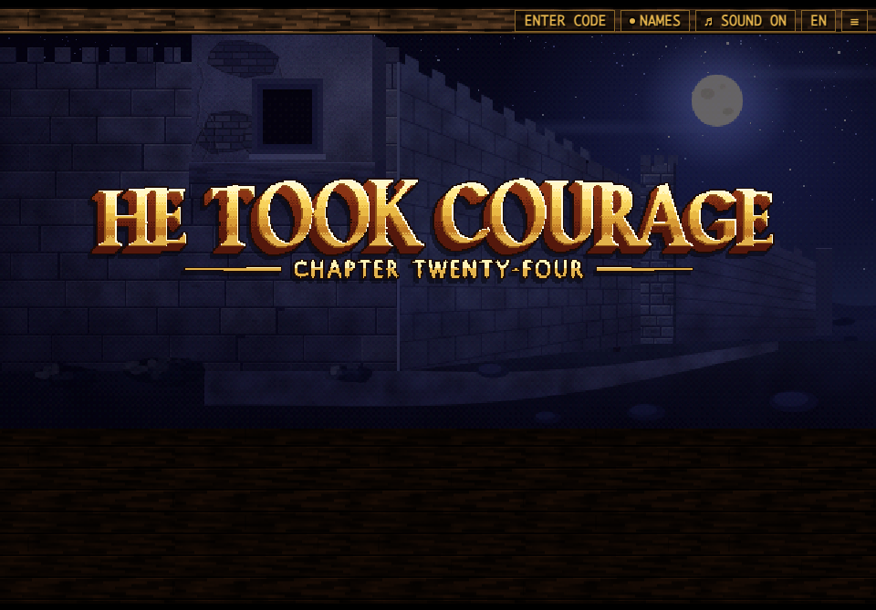

## The travel map

The map draws the chapter's way in three parts, in two windows. After the quay of Malta, in the window from Malta north to Rome: Malta to Syracuse, along to Rhegium at the toe of Italy, and up to Puteoli. When the column sets out, in a window that shows the last road four and a half times as close: from Puteoli inland, by Capua (which is not named on the map), and up the Appian Way to the Marketplace of Appius. After the meeting, in the same window: on by Three Taverns to Rome. These are the roads that the look back at the end of the game draws for the chapter. No leg crosses another, and no name crosses a coast or a route.

| |
|---|
| 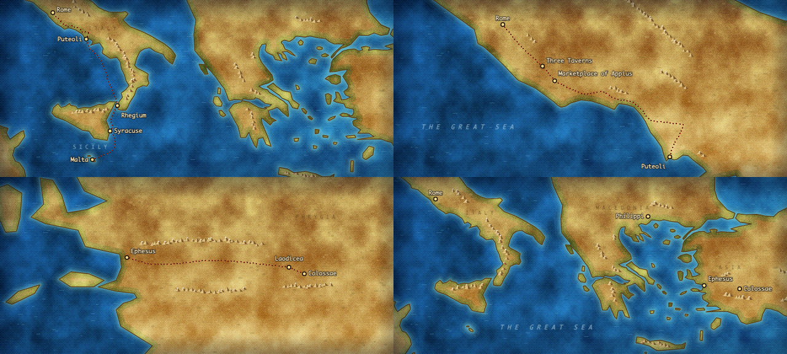 |
| The road to Rome on the travel map |

## About the content

Chapter Twenty-Four tells what the account says (Acts 28:11-16) in the narrator's own words, verse by verse with the reference, and puts none of it into a mouth as a quotation. These lines stand together in `levels/chapter24.js` (`TOLD`) and in the language files, where they can be checked against the Study Edition; the German lines were written from the German edition. Acts 28:11 is told in the same words as at the end of Chapter Twenty-Three, since a verse told in two chapters has one wording, and the figurehead follows it in a line of its own. What Luke thinks of at the quay is Acts 23:11 in Chapter Nineteen's words, and what Paul says to the brothers at the Marketplace of Appius is Romans 1:11, 12, in the game's own words with its reference. The narration says "we" as the account does, to 28:16. Paul's thanks in 28:15 are to God, as the account has it, and they are told; no words are invented for them.

**What was read, and how.** On 26 November 2026 these were read by hand in the browser, on wol.jw.org: Acts 28 in the Study Edition, with every study note on 28:11-15, 23 and 30, the marginal references and the Research Guide lists, and the same chapter in the German Study Edition with its notes; the study notes on Acts 27:1, 3 and 6, and Romans 1:7-15, 15:22-32 and 16:1-16 with their notes; the Study Edition's media "Construction of a Roman Road", "The City of Rome", "The Appian Way", "Paul's Prison Bonds While He Was Under House Arrest", "The Praetorian Guard", "Apartment Buildings in Ancient Rome" and the map of Paul's trip to Rome, some of them in German too; *"Bearing Thorough Witness" About God's Kingdom*, chapter 27, with its boxes, in English and in German; the *Insight on the Scriptures* articles "Puteoli", "Appius, Marketplace of", "Three Taverns", "Syracuse", "Rhegium", "Italy", "Zeus, Sons of", "Ship", "Alexandria", "Highway, Road", "Mile", "Inn", "Hospitality", "Rome", "Julius", "Army Officer", "Augustus, Band of", "Guard", "Praetorian Guard", "Romans, Letter to the", "Aquila", "Prisca", "Rufus", "Andronicus", "Junias", "Luke", "Aristarchus" and "Paul", and five of them in German; *The Watchtower*, the "Did You Know?" items of March 1, 2009 and January 1, 2010, "Roman Roads—Monuments to Ancient Engineering" (October 15, 2006), "Jehovah Is Our Helper" (December 15, 2004), "Take Courage—Jehovah Is Your Helper" (November 2020), "The Praetorian Guard Receives a Witness" (February 15, 2013, in English and in parts in German), "Syracuse—A Stopover on Paul's Voyage" (October 15, 2007), "Zealous Witnesses of Jehovah on the March!" (May 15, 1990), "Boldly Proclaim Jehovah's Kingdom!" (June 15, 1990), "The Kind Roman Centurion" (1991) and "Paul Triumphs Over Adversity" (May 1, 1999); *Awake!*, "'Queen of the Highways'" (August 22, 1981) and "Paul's Voyage to Rome" (April 8, 1971); the chapter "I Now Urge You to Take Courage"; and *All Scripture Is Inspired*, "Bible Book Number 44—Acts" and Study Number 3. This was done for the chapter's lead, who wrote the lines of the account from the verses in both editions and gave the facts to the builders in a brief; nothing was added to them.

**What they establish.** Between them, these publications give the following, said here in the game's own words. The leg from Malta and the arrival in Rome were in about 59 C.E.; *Insight* ("Italy") says that Paul probably first set foot in Italy at Rhegium in the spring of that year, and no source names a month, so the game names none. The Study Edition's note on 28:11 explains the Sons of Zeus as the twins Castor and Pollux of Greek and Roman myth, whom sailors held to be their protectors at sea, and takes the detail as one more sign that an eyewitness wrote the account. *The Watchtower* (March 1, 2009) says that such a sign was popular among sailors, and *Bearing Thorough Witness* sets the crew, who looked to the twins, beside Paul and his companions, who served Jehovah. The same book calls the ship likely a large grain carrier, and *Insight* ("Alexandria") ties the grain ships of Alexandria to Puteoli. No source says in which harbor of Malta she had wintered. Syracuse, on the southeast coast of Sicily, had a fine harbor; *Insight* says the three days there may have been spent waiting for a fitting wind, and *The Watchtower* (October 15, 2007) that it is not known whether Paul went ashore, so nothing of the town is shown. The Study Edition now says that they went along to Rhegium; *Insight* ("Syracuse") quotes an older wording whose exact sense, it says, is not known, and the game follows the Study Edition. Rhegium lay at the southern tip of Italy, on the strait across from Sicily, and Puteoli, about 320 km farther on, was a chief port on its bay, where the remains of a long mole can still be seen. That the brothers urged Paul to stay a week shows, as the Study Edition's note and *Insight* say, that he had some freedom though a prisoner. No source names the brothers there or says how they were found; *Bearing Thorough Witness* says that Paul had possibly won the full trust of his guards, and *Awake!* (1981) that the officer evidently did not object. From Puteoli to Rome is about 245 km, a journey of up to a week; they likely went inland to Capua, and *Bearing Thorough Witness* says they likely walked it, and from there on the Appian Way, which was mostly paved with large blocks of volcanic rock, slightly crowned, between curbstones and ditches. *The Watchtower* (October 15, 2006) tells of milestones, usually round pillars, set at every Roman mile, and *Awake!* (1981) of stones every mile that gave the distance to the great cities; how the numbers were cut on them is not described, and the numbers in the game are its own reckoning from the distances the Study Edition gives. That *Awake!* puts the Marketplace of Appius some 43 Roman miles from Rome and Three Taverns ten miles nearer agrees with them. Travelers stopped at stations about every 24 km. Through the Pontine Marshes a canal ran beside the road, and travelers were reportedly taken along it by night in barges pulled by mules; a Roman writer complained of the mosquitoes and the bad smell, and Horace, who made the trip long before Paul, of frogs, gnats, bad water, and a Marketplace crowded with boatmen and tight-fisted innkeepers. The Marketplace of Appius was a post station and market town at the northern end of the canal, about 65 km from Rome, and Three Taverns, about 50 km from Rome, was a rest stop whose name perhaps came from three inns; coming from the south, Paul reached the Marketplace first. *Bearing Thorough Witness* and *Insight* say that some of the brothers went on to the Marketplace while the others waited at Three Taverns, and none of them says why. *Bearing Thorough Witness* says that Paul may have known some of them personally, and that he thanked God because he saw Jehovah helping him through his brothers; *The Watchtower* (November 2020) says that he had not expected to come to Rome as a prisoner, and *Awake!* (1981) that the brothers perhaps knew he would likely be tired after the marshes. No source says that he had lost heart. The marginal reference on Romans 1:12 points to Acts 28:15. The "we" of the account ends with 28:16. Acts 28 does not name Julius, but *The Watchtower* (June 15, 1990) has him go on with Paul from Puteoli, and *The Watchtower* (February 15, 2013) tells the arrival as a scene: in by the Porta Capena and through the city to the camp of the Praetorian Guard, a fortress with high walls of red brick, battlements and towers, since the Guard had charge of prisoners from the provinces. The words of some later manuscripts at 28:16, that the officer handed the prisoners to the captain of the guard, are not in the Sinaitic, Alexandrine and Vatican manuscripts, and the New World Translation leaves them out (*Insight*, "Praetorian Guard"); the game hands nobody over. In Paul's day the common people of Rome lived in the valleys in tenements several storeys high along narrow streets, and the Circus Maximus held more than 150,000 (*Insight*, "Rome"); the media "Apartment Buildings in Ancient Rome" puts shops and their living quarters on the ground floor, larger flats on the floor above and cheaper small rooms higher up. *The Watchtower* (2013) says that Paul was allowed to arrange his own lodging, and that it was large enough for the many who came; no source says what it was like, what it cost or who paid for it.

**The figurehead, the stones and Rome.** Three things are shown as they were, for historical accuracy, under exceptions in [CONTRIBUTING](../CONTRIBUTING.md) sections 3 and 4. The ship's figurehead is the sign of the Sons of Zeus that the account names (28:11). No source shows it: *Insight* ("Zeus, Sons of") supposes that an image or symbol with the name of Castor was perhaps on one side of the bow and the same of Pollux on the other, and the German *Bearing Thorough Witness* has it adorn the bow. So the game paints a small board on the side of the bow, laid along her planks: one draped figure too small to make out, and under it a name in Greek capitals. It is seen once, from the quay of Malta, at the ship's own size in the picture, and never close; it is no hotspot of its own, and the ship's look line says plainly that she carries the sign. Nobody honors it, Paul says nothing of it, and the player does nothing with it. The milestones carry their numbers in Roman number letters, I, V, X and L, and an X cut in a stone is a letter, as the Greek number letters of Chapters Thirteen and Twenty-Three are. Rome is one of the four cities where a temple may be seen: from afar two temple fronts stand small in the haze, none is seen at the gate, and there is no altar, statue or rite anywhere. The view of Rome from afar keeps a high horizon as a view from a rise, the one room that is an exception to a scene's single horizon. Nothing is painted that did not yet stand in 59: no Colosseum, no arch of Titus, no great dome. At the camp of the Praetorian Guard no standard is seen.

**What is invented.** The supporting characters are invented: the sailor at Malta; Herennius, in whose house the brothers of Puteoli meet, and the brother who works on the docks and a sister of Puteoli, who have no names; Ovius the carter, Melanthios the trader and Varro the boatman, who carry the news; Sextus, the young carrier of Rome; Vibia, in whose house some of the brothers of Rome meet, her daughter Aemilia, Postumus, Firmus the baker and Thallos; the innkeeper at Three Taverns, the landlord of the street, and the soldier of the watch, who have no names; the two soldiers of the column and the two other prisoners; and Mikon, who was invented for Chapter Fifteen and has moved to Rome. Julius, Luke and Aristarchus are named in the account; their looks and their words are invented. Invented too are the harbor of Malta and the sailor's answers; how the brothers at Puteoli were found and how the week was granted, told in Luke's two lines; the message, its four parts, its slips and the three who carry it, and so how Rome heard; the numbers on the milestones, the game's own reckoning; the board and the reasons for the two groups; the walk in step, the column and Paul's weariness; the innkeeper's inns; what Julius says at the camp; the street, the landlord and the four lodgings, and the soldier who looks at them. All the dialogue is invented, apart from Paul's words of Romans named above. The end screen says that the chapter is a dramatization.

**What Acts leaves unsaid.** Acts does not say in which harbor of Malta the ship had wintered, how the brothers at Puteoli were found, who allowed the seven days, how the news reached Rome, how many came out to meet Paul, why to two places, or who went where; it names none of them. It does not say whether he was chained on the road, by which gate he came into Rome, or who brought him in: Julius is not named after Malta. Nor does it say where Paul first lodged, what the place was like, what it cost or who paid. The chapter's end screen says some of these things too; this page is the place where all of them, and the invented people, are named.

**The German text.** Names and terms follow the German Study Edition: Syrakus, Rhegion, Puteoli, der Marktplatz des Appius and die Drei Schenken, Rom, die Via Appia and die Pontinischen Sümpfe, the ship's „Galionsfigur“ and „die Söhne von Zeus“, Julius „der Offizier“, and die Prätorianergarde. The German verse of 28:15 says that Paul „bekam neuen Mut“, and so the chapter's title is „Neuer Mut“. The button of the three who carry the news reads „Nachdenken“, and the hidden treasure is „Das Lied der Frösche“.

[← All chapters](../README.md#chapters)
