# Chapter Twenty-Five: Without Hindrance

About 59 to 61 C.E., in Rome. Three days after his arrival Paul asks the principal men among the Jews to come together and tells them why he is a prisoner: it is for the hope of Israel that the chain is on him. They have had no letter about him from Judea, and they think it right to hear him. On the day they agree on, still more come to his lodging, and from morning to evening he bears thorough witness about the Kingdom of God, and from the Law of Moses and from the Prophets he tries to persuade them about Jesus. Some begin to believe; others will not. As they go, disagreeing, he tells them what the holy spirit said through Isaiah, and that God's salvation has been sent to the nations (Acts 28:17-28). For two whole years he lives in the house he has rented, and everyone who comes is welcome; he speaks with all freeness of speech, without hindrance (28:30, 31). His letters of those years tell the rest. Epaphroditus, who brought the gift of the Philippians and nearly died, goes home with a letter, and those of Caesar's household send their greetings (Philippians 2:25-30; 4:18, 22). Onesimus, who ran away from his master Philemon at Colossae, has become a Christian, and he goes back; Paul writes to Philemon in his own hand and asks where he could order (Philemon 8-22). Aristarchus, Mark, Jesus who is called Justus, Epaphras, Luke and Demas send greetings to Colossae, and Tychicus and Onesimus carry the letters for Asia and are to tell all the news by mouth (Colossians 4:7-18; Ephesians 6:21, 22).

| |
|---|
| 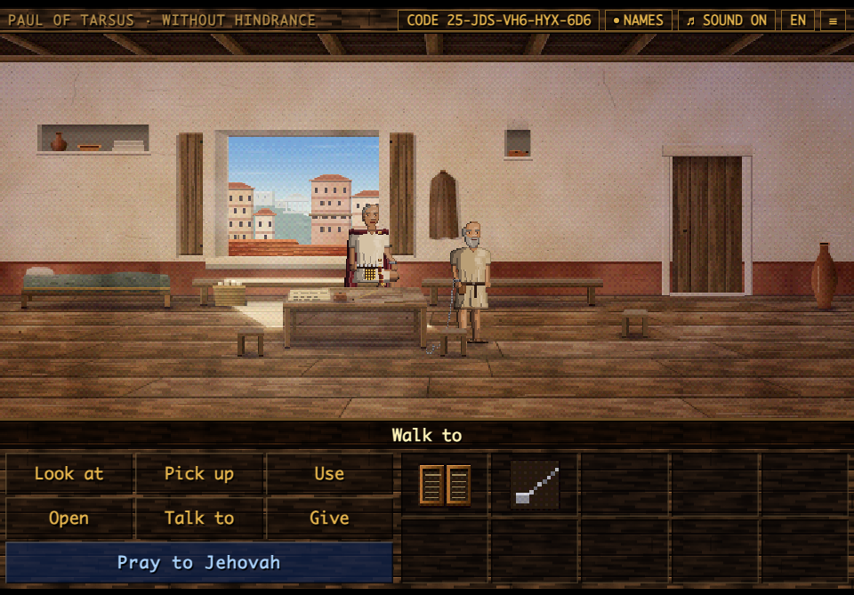 |
| The lodging: the flat on the second floor, chained to the soldier of the watch |

One room in two variants and two close views, with the travel map, and one person played: Paul. He cannot leave the room. He is chained by his right wrist to the soldier of the watch, and the two years move on each time the soldier is relieved: a watch is a part of the chapter, with its own soldier, its hour of the day and what happens in it, and it ends only when nothing is left to do in it and the soldier has had his answer. The room is the lodging chosen at the end of Chapter Twenty-Four, the flat on the second floor or the room at street level, carried in by the code; begun from the title the chapter is played in the flat. The narration says "he" and "they": the account's "we" ended at 28:16, though Luke is in the room.

| |
|---|
| 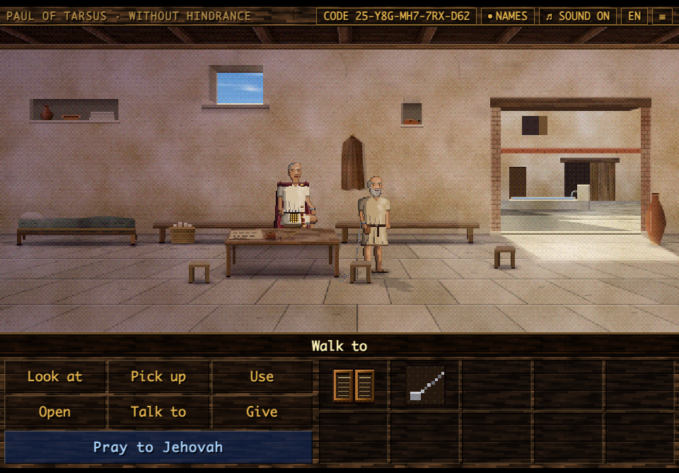 |
| The other lodging: the room at street level |

**The chain's length.** The chain runs from Paul's right wrist to the soldier's hand, and the soldier sits in one of three places: by the door, at the table or by the window. From each the chain reaches only part of the room. A click on something out of reach walks Paul as near as the chain lets him, and he says that it doesn't reach; the first time he adds that he could ask the soldier to sit somewhere else. **Talk to** the soldier, and Paul may ask him to sit by the door, at the table or by the window, each time with its plain reason, and that moves him. A vague plea doesn't, and neither does flattery, true as it is: a soldier of the Guard can sit wherever he likes, and he stays where he is. Never a trick. Looking needs no reach, and neither does speaking to those who sit along the walls.

| |
|---|
| 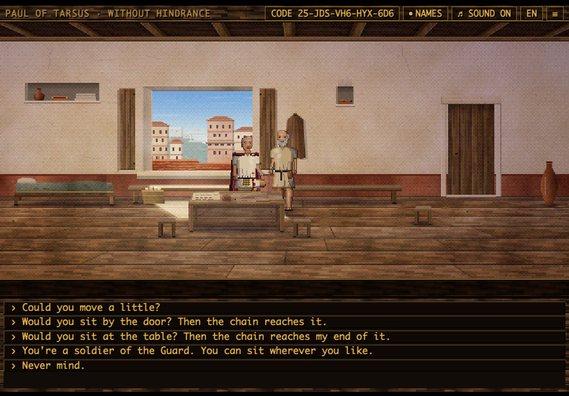 |
| Asked plainly, with the reason, the soldier moves |

**The watch.** Each soldier has heard everything said in his watch, and before he is relieved he asks one question about it. Three answers are offered, all of them true. The one that fits says just what he asked, in a sentence or two, and the watch ends with three knocks at the door. A longer one makes him look at the wall, and he asks again when he is next spoken to; one that answers something else, he says, is not what he asked. The next soldier, when he comes on, already knows whose prisoner this is. There are five soldiers, each with a care of his own: Fulvius counts the days to his discharge, Valens has a mother with a fever, Bassus finds the day long, Macer thinks little of prisoners, and Celer has never stood watch here before. No soldier is shown believing, and none says that he believes.

**This chain.** The chapter opens on the narrator's scroll (28:17), then on the lodging in the morning, three days after the arrival, with Fulvius by the window. A look at the ceiling before they come is a tentmaker's look at a roof that can't be folded up. The leading men knock, and the door is out of reach until Fulvius is asked to sit by it. Six of them come in and sit on the benches, and one speaks for all. **Talk to** them: Paul's first four points stand as four short lines, all of them on offer every time. The next in the account's order is said in full (28:17-19); one already said, or one that comes too early, is answered by Paul's own thought. The fifth is not among them: the hope of Israel and the chain (28:20) are said by using the chain on his wrist with the leading men. Their answer follows in the account's two lines (28:21, 22), and they agree on a day.

| |
|---|
| 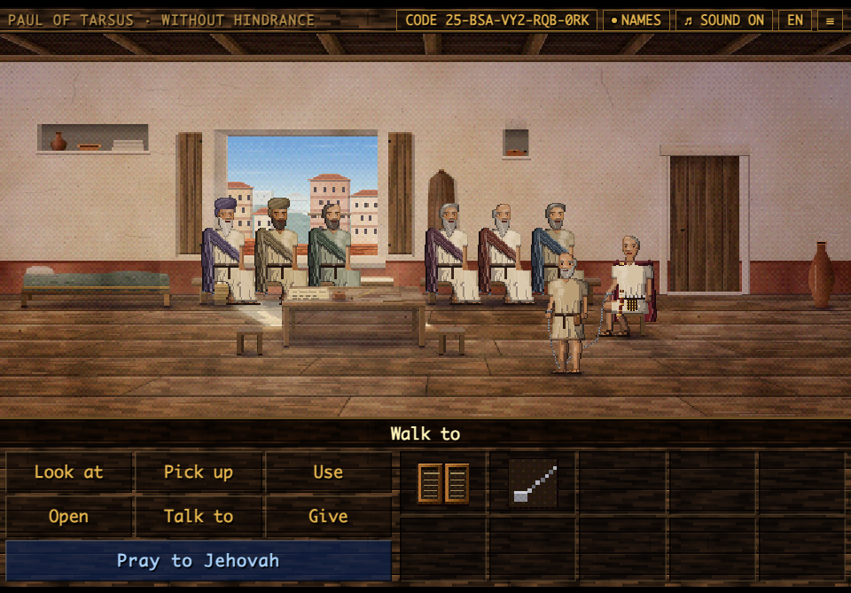 |
| This chain: the leading men on the benches |

**From morning to evening.** The narrator tells the day of 28:23, and the light crosses the room in five steps, from early morning to evening, while Valens sits at the table. More have come this time, eight along the benches. At each hour one of them says what holds him back: that the leaders of the nation turned Jesus away; that he died between criminals; that a man raised from the dead in their own days is more than he can believe; that the Messiah belongs to Israel; and that he has heard that not a bone of Jesus was broken, and where Moses says anything like that. **Talk to** the one who has just spoken and answer him with one of five passages from the Law of Moses and the Prophets, all of them on offer every time: Exodus 12:46, Habakkuk 1:5, Isaiah 49:6, Isaiah 53:3 and Isaiah 53:9, in the same words as the game told them in Chapters Five and Ten. A passage that does not meet what he said is answered by the listener, stays on offer and costs nothing; the one that meets it moves the light on. What each listener answers to it is his own, and the day cannot be won: by evening the narrator tells that some believed and others did not, that they left disagreeing, what the holy spirit said through Isaiah, and that God's salvation has been sent to the nations (28:24-28). Then it is night, and the lamp is lit in its niche.

| | |
|---|---|
| 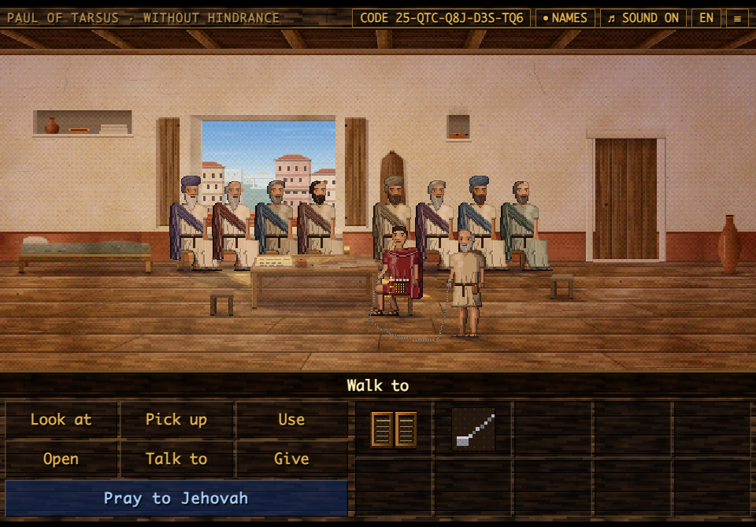 | 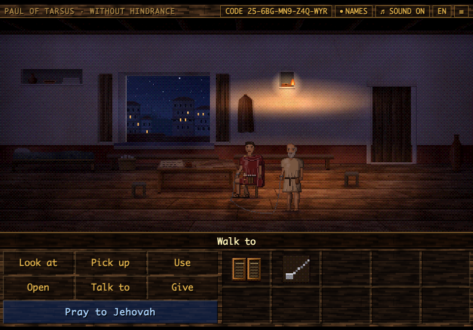 |
| From morning to evening: one listener at each hour | Night: the listeners have gone, and the lamp is lit |

**Sent home.** A year and more goes by. Epaphroditus is well again, and the narrator tells what the Philippians sent with him (Philippians 4:18). Timothy sits at the table with the pen, and Bassus is on watch. **Talk to** Timothy and give him the letter's three lines in order (Philippians 2:25-29). Then the landlady brings a visitor, Anthus, a freedman of Caesar's household who keeps accounts, and he asks to have a greeting added from those of the household; the letter takes Philippians 4:22. How he came to believe is never said. Epaphroditus leaves with the letter. Through this watch Luke sits writing on the bench.

| |
|---|
| 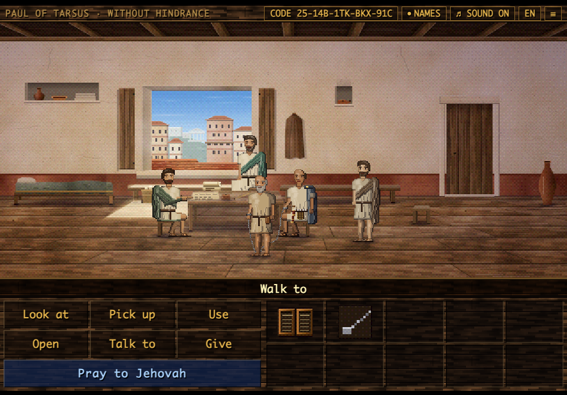 |
| Sent home: Timothy holds the pen, and Luke is at work on his account |

**Not as an order.** Toward the end of the two years the narrator tells, from the scroll, what Paul wrote of Onesimus (Philemon 10, 11). Then the room: Epaphras has come from Colossae with his news, and Onesimus is there, helping wherever he can: he is first seen here, at home already, and how he came is never said. This letter Paul writes himself, at his end of the table, and with Macer by the door the chain doesn't reach it: Macer must be asked to sit at the table. The cat has found the chain. At the desk the sheet for Philemon is seen close. For each of four lines Paul could write what he has every right to demand, or what he asks; the letter takes what he asks (Philemon 8, 9, 14, 17-19), and a demand is answered by Paul's own thought, that he could, and the line stays unwritten. After the first line Philemon 12 is written, and at the end Philemon 22, where Paul hopes to be given back to them: the only place where the game speaks of his release. Onesimus is given no order either; back in the room he says himself that he will go.

| | |
|---|---|
| 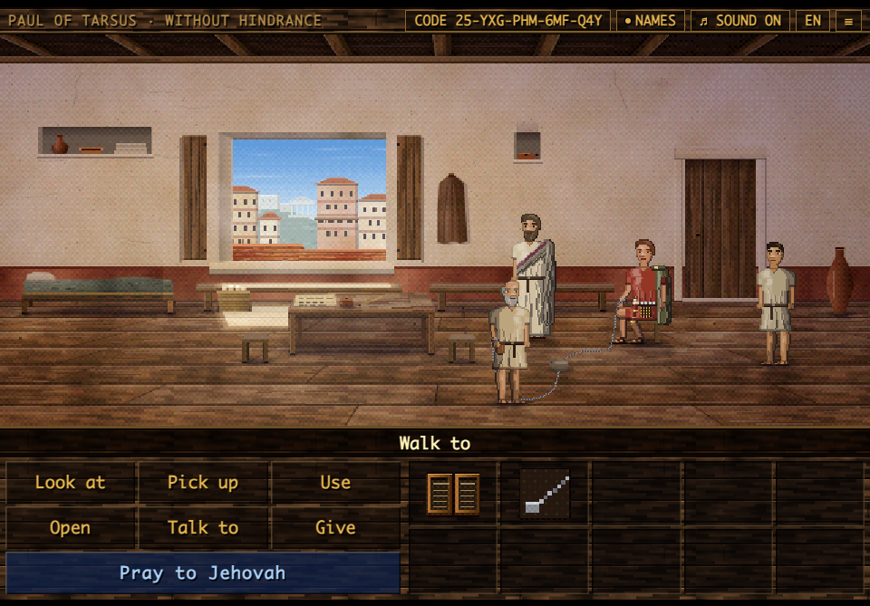 | 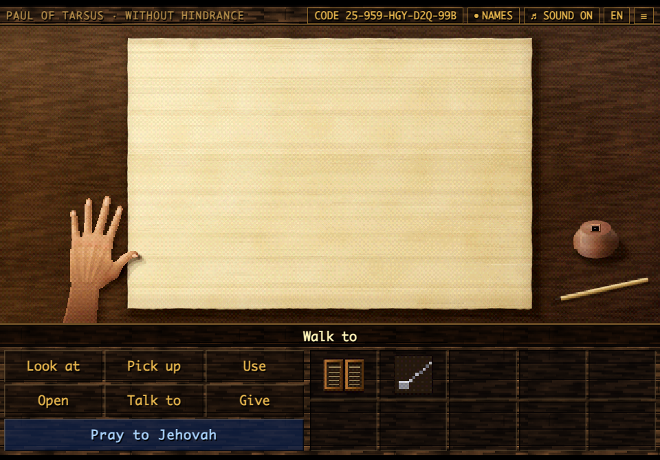 |
| Not as an order: the cat sleeps on the chain | The letter to Philemon: this one Paul writes himself |

**Those who greet you.** In the same weeks the letter for Colossae is done but for the greetings, and the room is the list: Aristarchus, Mark, Jesus who is called Justus, Epaphras, Luke and Demas stand about it, Timothy sits with the pen, and Tychicus and Onesimus stand ready to travel. **Talk to** each of the six and choose what the letter calls him: my fellow captive, the cousin of Barnabas, the one called Justus, one of you and a slave of Christ Jesus, the beloved physician, or no more than his name. All six are on offer every time; a name that is not his is answered by the man himself, truly, and the right one is dictated to Timothy (Colossians 4:10-14). From the table the chain reaches the two in the middle of the room: Valens has to be asked to sit by the window for the two at the left, and by the door for the two at the right. Mark's line is the one that tells the Colossians to welcome him; Justus and Demas have a line each and no more. Last, Paul writes the greeting in his own hand (Colossians 4:18).

| |
|---|
| 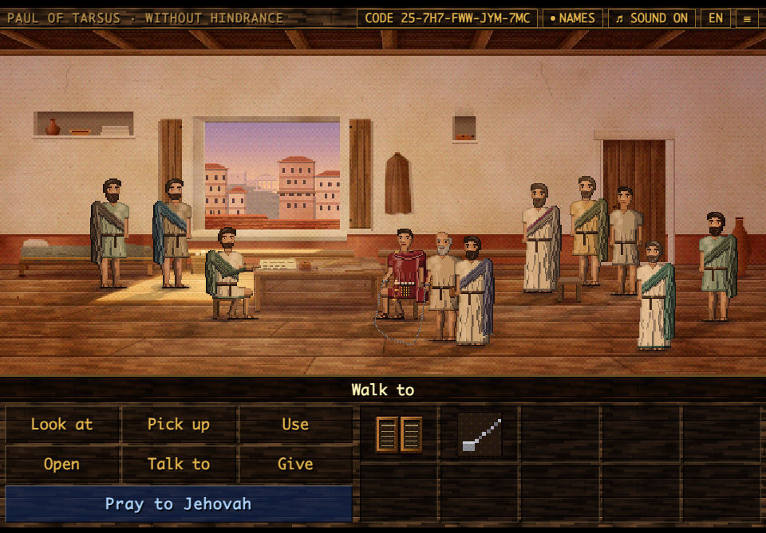 |
| Those who greet you: the room is the list |

**Three letters, one road.** On the day Tychicus and Onesimus are to leave for Asia, three letters lie finished on the table: one sheet and two rolls, seen close and told apart by looking. Each goes to the man who is to carry it: Ephesians to Tychicus, for Ephesus; Colossians to Tychicus, who will go with Onesimus to Colossae; and the letter to Philemon to either of the two. Onesimus says truly why the other two are not his to carry. Then Tychicus asks what to tell them about Paul by mouth. Six true pieces of news are offered: the three the letters leave out are the ones to give, and of the others he says that they are in the letters already. The narrator tells Colossians 4:7-9 and Ephesians 6:21, 22, and the travel map opens on the valley of the Lycus. No letter is tied or sealed, and a roll has no rod standing out of it.

| |
|---|
| 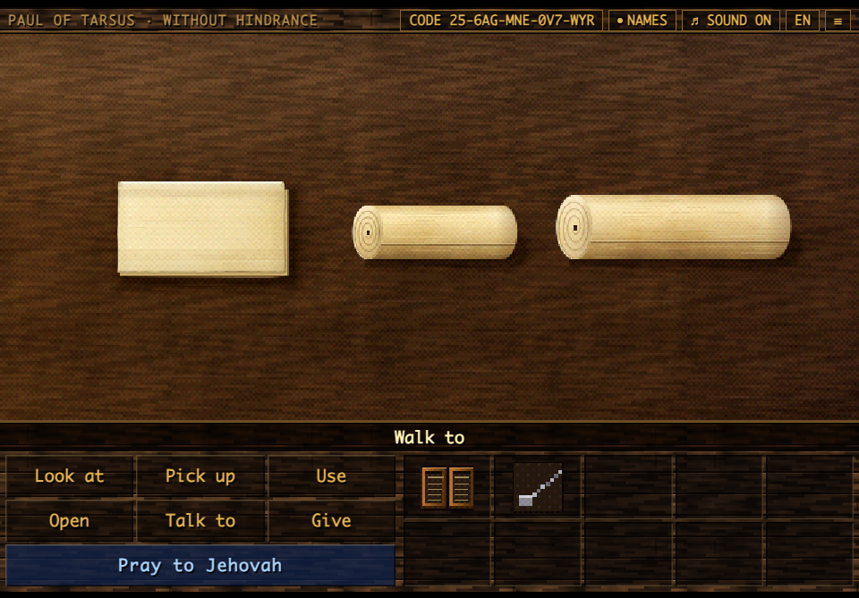 |
| Three letters, one road: a sheet and two rolls |

**The last watch, and the door.** One morning, late in the second year: this is the chapter's last safe point. Celer comes on duty, who has never stood watch here and knows who Paul is. Somebody knocks, and Celer gets up without being asked and carries his stool to the door, so that the chain reaches it. Opening the door is the last thing done in the game. Paul says to the visitor that the chain is on him, not on the door; another visitor is already on the stairs, or at the doorway of the room at street level, and the narrator tells Acts 28:30, 31 over the picture. No flag is set from the morning of this watch to the end.

| |
|---|
| 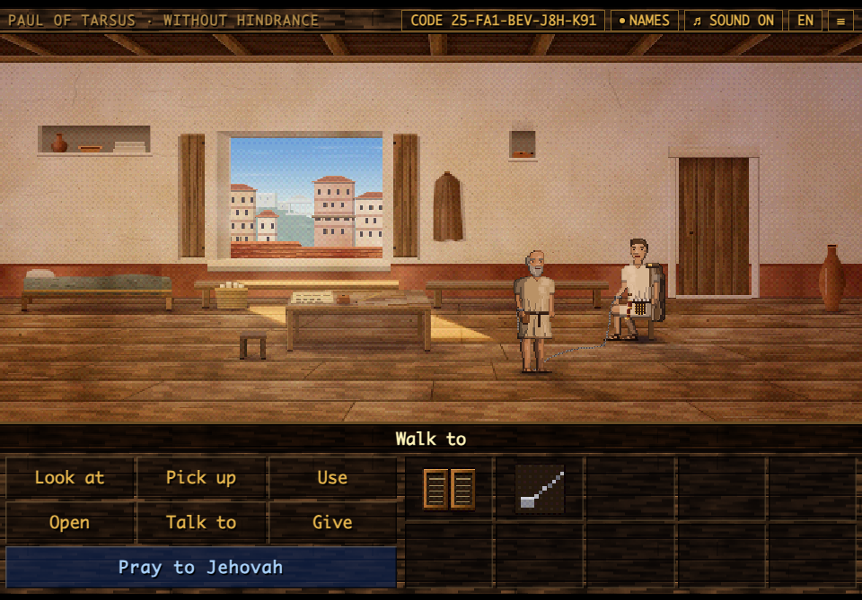 |
| The last watch: the stool by the door |

**After Acts.** After the open door the map of the letters written in Rome is shown, and the narrator closes the roll on the last line of Luke's account. Then, under the caption "After Acts", one more morning is played: the morning of Paul's release, which Acts does not tell and the publications give with "apparently", about 61 C.E. The lodging is as the last watch left it, without visitors, in the low sun of early morning. Celer has orders from the camp: Paul holds the chain out to him, and he unlocks it; Paul thanks him. Paul takes his cloak from the peg, since he will be outdoors from now on, and goes out through the door while Celer stays on his stool and finds it will be quiet now. Paul is seen in the street of Rome in the morning, alone, walking off. No court, no emperor and no verdict is seen. Then a map lights the places that his later letters name, each with its line: Crete (Titus 1:5), Ephesus with Macedonia beyond (1 Timothy 1:3), Nicopolis (Titus 3:12), Troas and Miletus (2 Timothy 4:13, 20), and Spain, faint at the edge of the map, as a perhaps (Romans 15:24, 28). No road is drawn between them.

| | |
|---|---|
| 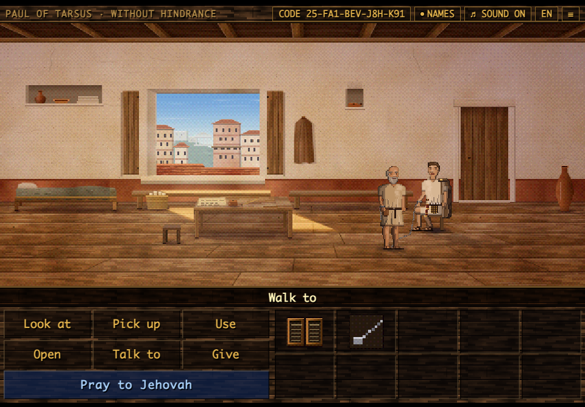 | 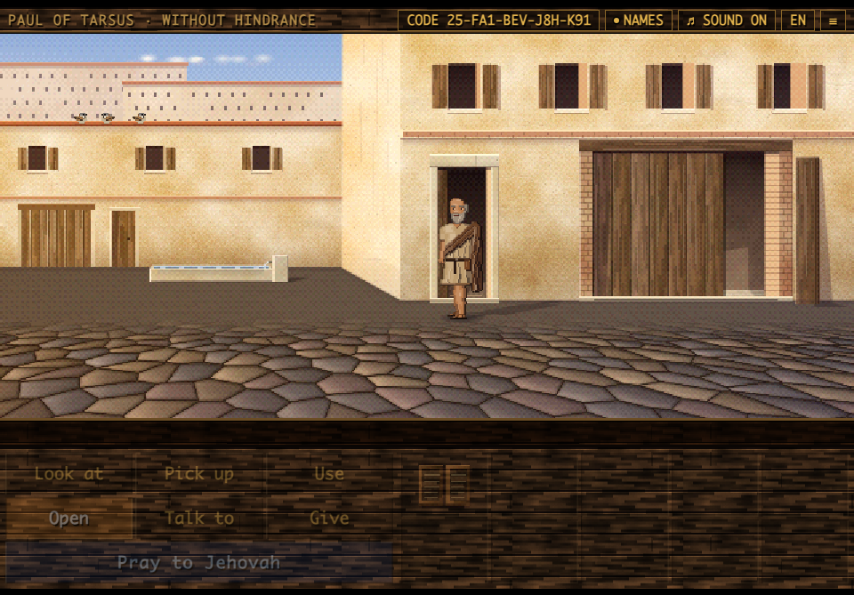 |
| After Acts: Celer has orders from the camp | Out into the street, in his cloak |

| |
|---|
| 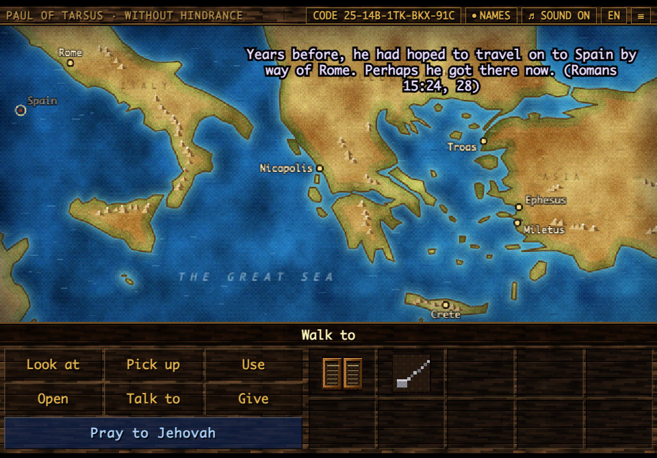 |
| The places of the later letters, and Spain as a perhaps |

**No end screen.** This is the last chapter, and it has no end screen of its own (CONTRIBUTING section 2). After the morning after Acts the game is watched again: the look back over every journey, and the game's closing screen, which takes the place of the end screen. What the chapter invented and what the account leaves unsaid stand on a page behind the closing screen, opened by its line **About the last chapter**; this page says them in full. How the end of the game looks and works is in the [README](../README.md#how-to-play), in [How to play](how-to-play.md) ("Watch the end" and "After the end") and in [Look and sound](look-and-sound.md) ("The end of the game").

Walkthrough (spoilers)

1. **Talk to** Fulvius and choose "Would you sit by the door? Then the chain reaches it." Then **Open** the door.
2. **Talk to** the leading men and choose, one after another: "I've done nothing against our people", "All the same, I'm a prisoner", "The Romans wanted to let me go", "I had no choice but to appeal to Caesar". Then **Use** the chain on my wrist with the leading men.
3. Fulvius asks why Paul sent for them first: "They're the leaders of my people here. They should hear my side first."
4. On the day of Acts 28:23, **Talk to** the listener who has just spoken and answer with the passage that meets what he said: Isaiah 53:3 (despised), Isaiah 53:9 (a grave with the rich), Habakkuk 1:5 (you will not believe it), Isaiah 49:6 (a light of nations), Exodus 12:46 (no bone of the lamb broken).
5. Valens asks why Paul reads them their own books: "Because they trust those books, and those books speak of him."
6. **Talk to** Timothy and give, one after another: "I'm sending Epaphroditus back to you", "He longs to see you. He was sick, and nearly died", "So he comes quickly. Welcome him gladly". When Anthus has asked, **Use** the letter for Philippi (or talk to Timothy) and choose "Greetings from the holy ones of Caesar's household."
7. Bassus asks what a man from the palace is doing here: "He's one of the brothers. He came to send greetings."
8. **Talk to** Macer and choose "Would you sit at the table? Then the chain reaches my end of it." **Use** the desk.
9. **Use** the letter to Philemon four times, and each time choose what Paul asks: "I appeal to you instead, out of love", "I'll do nothing without your consent", "Welcome him as you would welcome me", "Whatever he owes you, put it on my account."
10. Macer asks why the young slave is going back: "Because he wants to go. Nobody has to force him."
11. **Talk to** Justus ("the one called Justus") and Epaphras ("one of you, a slave of Christ Jesus"). Ask Valens to sit by the window, and **Talk to** Aristarchus ("my fellow captive") and Demas ("no more than his name"). Ask him to sit by the door, and **Talk to** Mark ("the cousin of Barnabas") and Luke ("the beloved physician"). Ask him to sit at the table, and **Use** the desk.
12. Valens asks why Paul put every one of them in the letter: "So the brothers there know who's here with me."
13. **Use** the letters on the table, **Pick up** the longer roll, the shorter roll and the sheet of papyrus, and go back to the room. **Give** the letter to the Ephesians and the letter to the Colossians to Tychicus, and the letter to Philemon to Tychicus or Onesimus.
14. Tychicus asks what to tell them: choose "I live in a rented house, chained to one soldier at a time", "Everyone who comes here is welcome, and I speak freely" and "The soldiers who guard me hear everything that's said here."
15. On the last morning, **Open** the door.
16. After Acts: **Use** the chain on my wrist with Celer, **Pick up** my cloak from the peg, and **Open** the door.

The hidden treasure lies in the third watch, off the way: **Look at** Luke's roll on the bench beside him, apart from Luke himself. He reads what he has just set down.

## Music and sound

| Chapter | Music | Around you |
|---|---|---|
| Without Hindrance | One tune for two years in one room: A flat in the Mixolydian mode, a major scale with a lowered seventh, in bars of seventeen steps that fall four, four, four and five; no other chapter has this key or this bar. The tune is four bars long: up from the keynote by the third and the fifth to the sixth, down from the lowered seventh, down again from the third to the second, and home from the fifth by the third and the second. Until the last watch it never comes home: its fourth bar stops on the second and holds it. By day in the lodging the lyre has the tune while the harp rocks over a low string; on the day of 28:23 the harp has it while the lyre rocks; at night the harp plays it alone at half its pace over a low note held quietly on the keynote; in the close views the harp alone, quietly. In the last watch the tune comes home at last, on the lyre with the harp an octave under it. No music in the chapter is tense: nothing in it is played as a danger. Nothing is claimed about how music was played then | In the flat the murmur of the city far below, a little wind and a bird now and then; in the room at street level the people of the square near by and its fountain; at night crickets. Three low knocks at the door when the leading men come, when a soldier is relieved, when the landlady brings a visitor, and on the last morning |

The chapter opens on its title card, over a short sting in its own key of A flat.

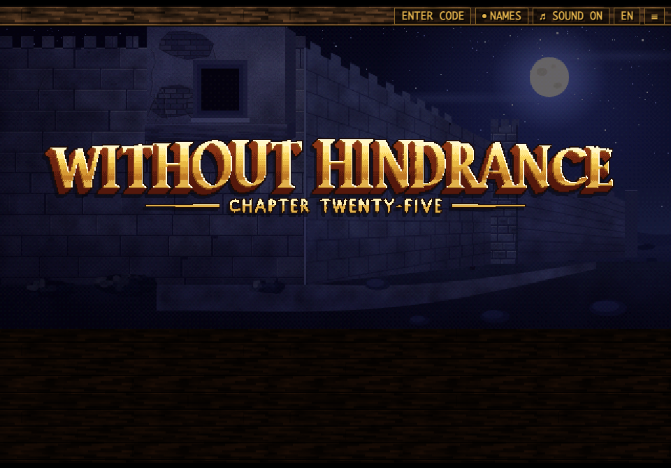

## The travel map

When Tychicus and Onesimus have gone, the travel map opens on a window of its own, four times as close as the usual one: the valleys of the Maeander and the Lycus. Ephesus, Laodicea and Colossae light up, and one road draws itself, from Ephesus up the valley to Laodicea and on to Colossae. No road is drawn from Rome, because no source gives the way the letters went from there. The map of the finale, on which Philippi, Ephesus and Colossae light up while Paul stays in Rome, belongs to the end of the game.

| |
|---|
| 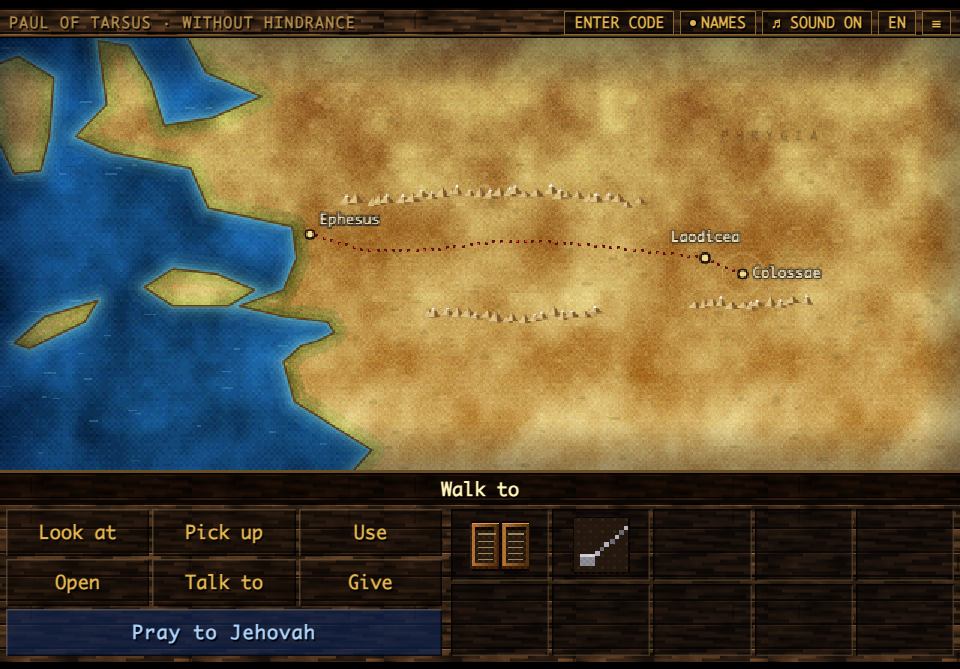 |
| From Ephesus up the Lycus to Laodicea and Colossae |

## About the content

Chapter Twenty-Five tells what the account says (Acts 28:17-31) and what Paul's letters of those years say (Philippians 2:25-29; 4:18, 22; Philemon 8-22; Colossians 4:7-18; Ephesians 6:21, 22) in the game's own words, with their references. Three kinds of line stand together in `levels/chapter25.js` and in the language files, where they can be checked against the Study Edition; the German lines were written from the German edition. The narration is told by the narrator, each line with its reference. What Paul and the leading men say in Acts 28:17-22 is speech, and carries no reference on the line; the page behind the closing screen gives the passage. What stands in a letter appears as writing, or is read out as it is written, with its reference and without quotation marks. The account has no verse 29 (see below), and the game tells none. The five passages of the day of 28:23 are told in the same words as in Chapters Five and Ten, and what Luke reads from his roll is the first line the game's narrator told, from the Prologue (Acts 7:58, 60). Paul says "God" wherever these verses do.

**What was read, and how.** On 26 November 2026 these were read by hand in the browser, on wol.jw.org: Acts 28 in the Study Edition and in the German Study Edition, with every note and footnote on 28:16-31, and the notes on Acts 18:2, 24:5 and 26:32; Isaiah 6:9-11; Philippians 1, 2 and 4, Colossians 1, 2 and 4, Ephesians 1, 3 and 6, Philemon and Hebrews 13, with their notes and the Study Edition's introductions to these books, in English and in parts in German; the Study Edition's media "Paul's Prison Bonds While He Was Under House Arrest", "The Praetorian Guard", "The Praetorian Guard on Duty", "Paul's Letter to the Philippians", "Paul Writes the Philippians a Letter of Love and Joy", "Onesimus Returns to his Master, Philemon", "Common Duties of a Slave", "Letter Writing" and "Seal Devices"; *"Bearing Thorough Witness" About God's Kingdom*, chapter 27, with its boxes, in English and in German, and parts of chapter 28; the *Insight on the Scriptures* articles "Paul", "Praetorian Guard", "Caesar", "Rome", "Onesimus", "Philemon", "Philemon, Letter to", "Tychicus", "Epaphroditus", "Epaphras", "Mark", "Demas", "Justus", "Aristarchus", "Luke", "Timothy", "Claudius", "Slave", "Letters" and "House", some of them in part, and "Paulus" and „Prätorianergarde“ in German; *All Scripture Is Inspired*, the studies of Ephesians, Philippians, Colossians, Philemon and Hebrews, and Study Number 3; and *The Watchtower*, "The Praetorian Guard Receives a Witness" (February 15, 2013, in English and in German), "Did You Know?" on the dress of the Praetorian Guard (2026, in English and in German) and on those of the household of Caesar (March 1, 2011), "An Appeal on the Basis of Love" (2026), "Philemon and Onesimus—United in Christian Brotherhood" (1998), "Tychicus—A Trusted Fellow Slave" (1998), "Epaphroditus—Envoy of the Philippians" (August 15, 1996), "Epaphras—'A Faithful Minister of the Christ'" (1997), "I Appeal to Caesar!" (December 15, 2001) and "Aquila and Priscilla—An Exemplary Couple" (1996), and the chapter on Mark, "He Is Helpful to Me". This was done for the chapter's lead, who wrote the lines of the account and the letters from the verses in both editions and gave the facts to the builders in a brief; nothing was added to them.

**What they establish.** Between them, these publications give the following, said here in the game's own words. The two years were about 59 to 61 C.E. For prisoners in light custody a chain to the guard was usual (*Bearing Thorough Witness*), and the media "Paul's Prison Bonds" says that the prisoner's right wrist was usually chained to the guard's left, which kept the guard's right hand free; how long Paul's chain was, no source says, so the long chain and its reach are the game's. The soldiers who guarded him probably belonged to the Praetorian Guard; *The Watchtower* (2013) says that his guard changed regularly, and *Insight* only supposes that it was changed daily. In Rome the Guard usually wore a tunic and sometimes a cloak, with a belt, sandals and side arms (*The Watchtower*, 2026, and the media "The Praetorian Guard on Duty"), and so the soldiers of the watch wear no armor or helmet. *Bearing Thorough Witness* says that Paul gave himself just three days to recover before he called the leaders of the Jews, that by calling them brothers he looked for common ground with them, and that the hope of Israel was bound up with the Messiah and his Kingdom. The same book quotes a reference work: Paul's ship must have been one of the first to reach Italy after the winter, so no letter about him could have come yet. *The Watchtower* (2001) adds that he also wanted to see what they knew about him, which may have shown him what his accusers meant to do. A large Jewish community had lived in Rome at least since 63 B.C.E., and inscriptions name a dozen or so synagogues (*The Watchtower*, 1996); Claudius had ordered the Jews out of Rome in 49 or early 50 C.E., and no source says when they came back. The verse has them arrange the day of 28:23; no source gives their number, and none names a passage that Paul used. *Bearing Thorough Witness* says that he kept to the Kingdom, tried to persuade, reasoned from the Scriptures, and gave the whole day to it, and that the outcome did not surprise him: it fitted the prophecy and what he had met before. The footnote on 28:27 says that the heart had literally grown thick. Some later manuscripts add a verse 29, in which the Jews go away disputing among themselves; the earliest and most reliable ones do not have it, and the Study Edition's note says it is apparently not part of the original text. Of his rented house the sources say only that it held many (*The Watchtower*, 2013), and that the common people of Rome lived in tenements several storeys high; not where it stood, what it was like, what it cost or who paid, nor whether he worked at his trade or could go out. Philippians 1:12-14 says that it became known through the whole Praetorian Guard and to all the rest that his bonds were for Christ's sake, and the note on 1:13 says that the Guard numbered thousands; *The Watchtower* (2013) says that the soldiers heard him witness and dictate his letters, and saw him write to Philemon himself. No source says that any of them believed. The study note on Philippians 4:22 explains Caesar's household as a great staff of slaves, freedmen and officials, perhaps thousands, not the emperor's family alone, and says that Paul does not tell how he was connected with the believers among them or whether he had a part in their coming to faith; *Insight* ("Caesar") and *The Watchtower* (March 1, 2011) leave that open too. The letters name ten men with him in Rome: Timothy, who is named beside Paul as a sender of three of the letters; Luke, the beloved physician; Aristarchus, his fellow captive, which the note on Philemon 23 says may mean that he was literally in custody with Paul, or that he bravely kept him company; Mark, the cousin of Barnabas, whose being there shows that whatever breach there had been was evidently healed (*Insight*, "Mark"); Jesus who is called Justus; Epaphras, who very likely founded the congregation at Colossae and came with a good report of their love; Demas; Tychicus, of the province of Asia; Onesimus; and Epaphroditus. No woman is named as being with him there, and no source says when or how Mark came. Epaphroditus had brought the Philippians' gift, fell sick nearly to death, and likely had meant to stay longer; he carried the letter home. Onesimus had run away from Philemon at Colossae. Why, the Scriptures do not say, and that he stole is only suggested by some, so the game says nothing of it; how he came to Paul is not stated either. In Rome he became a Christian: several publications say that Paul helped him, and the note on Philemon 10 says more cautiously that Paul may have had a part in it. His name means useful, and Paul plays on it (the note on Philemon 11). *Insight* ("Onesimus") says that his going back rested on his own willingness, and *All Scripture Is Inspired* that he went with his consent; what Philemon did, the account does not say. The Study Edition dates the four letters to about 60-61 C.E., and no source sets them in a strict order: Philippians was written a year or more after Paul came to Rome, Colossians and Philemon apparently toward the end of the two years, sent together, and Ephesians about the same time. The note on Colossians 4:18 takes the greeting in Paul's own hand as a sign that he often used a secretary, and the note on Philemon 19 says that he likely wrote that whole short letter himself; no secretary in Rome is named. A long letter went on a roll and a short one on a single sheet (the media "Letter Writing"); how Paul's letters were closed or sealed is not said, so none is tied or sealed here. A carrier brought more news by mouth than a letter held, and since these letters say little of how Paul was, Tychicus was to tell it (*The Watchtower*, 1998). The *Bearing Thorough Witness* box says that Tychicus and Onesimus delivered Philemon, Colossians and Ephesians; the Study Edition's introduction to Philemon says it is possible, the note on Colossians 4:9 that Onesimus perhaps handed Philemon's letter over himself, and *Insight* ("Onesimus") that Paul gave it to Onesimus, so the game lets either of the two take it. No source describes the way from Rome to Asia; *All Scripture Is Inspired* follows only the last stretch, from Ephesus up the Maeander and the Lycus past Laodicea to Colossae. *Insight* ("Luke") says that Luke likely finished Acts in Rome by about 61 C.E., since Acts does not tell how the appeal ended. The publications think that Paul apparently wrote to the Hebrews about that time as well; Hebrews is not written, named or shown in the chapter. What they think of his release the closing screen says, with their caution.

**The Guard, Caesar's household and Rome.** The game shows what [CONTRIBUTING](../CONTRIBUTING.md) section 2 allows: the soldiers of the Guard know whose prisoner this is and hear everything said in the room, and a believer of Caesar's household asks to have greetings added. Paul is not shown preaching to that household or winning it, how Anthus came to believe is never said, and no soldier is shown believing or says that he does. The Guard's three lines of Philippians 1:12-14 are told by the finale. The emperor is not shown, nor a hearing or a verdict, and Nero's name is not used. Through the window of the flat one temple's pediment stands small and far off on a hill, as section 3 allows in Rome; there is no altar, statue or rite. No standard is seen, and the soldiers' swords have no guard.

**What is invented.** The supporting characters are invented: the five soldiers of the watch, Fulvius, Valens, Bassus, Macer and Celer, with their cares and their questions; the leading men of the Jews, six of them, and the one who speaks for all, who have no names, and the listeners of the day of 28:23 and what holds each of them back; Anthus, a freedman of Caesar's household; the landlady, who is the landlord's wife; the visitors of the last morning, who have no names; and the cat. Of the men named in the letters, their looks and their words are invented, and where each stands and when. Invented too are the lodging itself, in either of its two kinds; the long chain and the three seats; the hours of the watches and the narrator's own lines between them; the choice of the five passages, which were told in Chapters Five and Ten, and the listener each one answers; Timothy with the pen for the letters that are dictated; that the letters for Asia are handed over on one day; what Paul tells Tychicus to say by mouth; and the visitor at the door. All the dialogue is invented, apart from the lines of the account and the letters named above.

**After Acts.** Read for the morning after Acts, on 26 November 2026, through a fetch that reports a page in its own words (the browser extension was not connected; the verse lines are to be checked by hand before they are published): the Study Edition's notes on Acts 28:30 and 28:31, *Insight on the Scriptures*, "Paul", and *Bearing Thorough Witness*, chapter 27, with its box on Paul's life after 61 C.E.; in English and German, Titus 1:5 and 3:12, 1 Timothy 1:3, 2 Timothy 4:13 and 20, and Romans 15:24 and 28 with their notes. What they establish: the house arrest seems to have ended about 61 C.E., when Paul was apparently tried and declared innocent; Acts does not tell it. The letters dated to the years after (1 and 2 Timothy, Titus) show him probably on Crete, at Ephesus, in Macedonia, at Nicopolis, Troas and Miletus; their order is not given, so no road is drawn. Whether he reached Spain is not certain. The note on Acts 28:31 says that the book closes on a positive note. The morning, Celer's orders and the street are invented, and nobody named in the Scriptures is placed there, for no source puts anyone at the release. The second imprisonment and his death are not part of the game.

**What Acts and the letters leave unsaid.** No source names the passages Paul used on the day of Acts 28:23, or says what any listener objected or who of them believed. No source says what the house was like, where it stood or what it cost, or who was with Paul at what time: the letters name the men, not the months. The letters say that his bonds became known in all the Praetorian Guard and that those of Caesar's household sent greetings, not that a soldier or anyone of that household came to believe through Paul. The Study Edition dates the four letters to about 60-61 C.E.; no source sets them in a strict order, and no secretary is named. *Insight on the Scriptures* says that Onesimus went back of his own will, that Paul gave him the letter to Philemon, and that Luke likely finished Acts in Rome. How Onesimus met Paul, why he ran away and what Philemon did are not told, nor how Mark came to Rome, how a letter was closed, or which way the letters went to Asia. The publications think that Paul apparently wrote to the Hebrews about that time as well. The page behind the closing screen says some of these things; this page is the place where all of them, and the invented people, are named.

**The German text.** Names and terms follow the German Study Edition: „die führenden Männer der Juden“, „die Hoffnung Israels“, „diese Kette“, „diese Sekte“, „die Unterkunft“ and „das gemietete Haus“, „das Königreich Gottes“, „das Gesetz von Moses“ and „die Propheten“, „der heilige Geist“, „die anderen Völker“, „mit aller Offenheit, ungehindert“, „die Prätorianergarde“ and „das Haus Cäsars“; Timotheus, Lukas, Aristarchus, Markus, Justus, Epaphras, Demas, Tychikus, Onesimus, Epaphroditus and Philemon; Kolossä, Laodicea, Philippi and Ephesus. In the status line the leading men are „Würdenträger“, the others „Zuhörer“ and „Besucher“, the landlady „Vermieterin“, the letters „Brief nach Philippi“, „Brief an Philemon“, „Brief nach Ephesus“ and „Brief nach Kolossä“, the desk „Schreibplatz“, and on the table „Rolle (länger)“, „Rolle (kürzer)“ and „Papyrusblatt“. What the letter calls each man is „mit mir in Haft“, „der Cousin von Barnabas“, „den man Justus nennt“, „einer von euch, ein Sklave von Christus Jesus“, „der geliebte Arzt“ and „nur sein Name“. The title is „Ungehindert“, and the hidden treasure „Die Rolle von Lukas“.

[← All chapters](../README.md#chapters)
