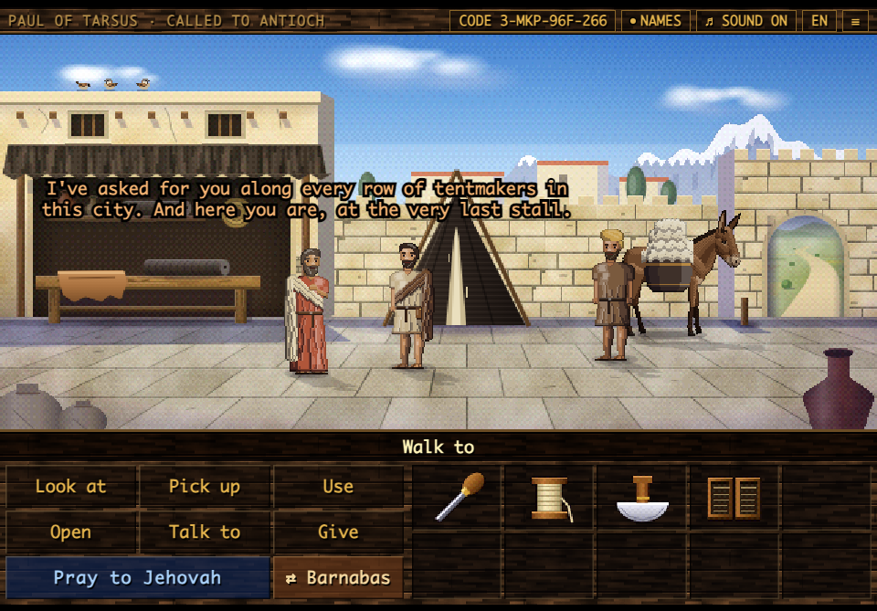
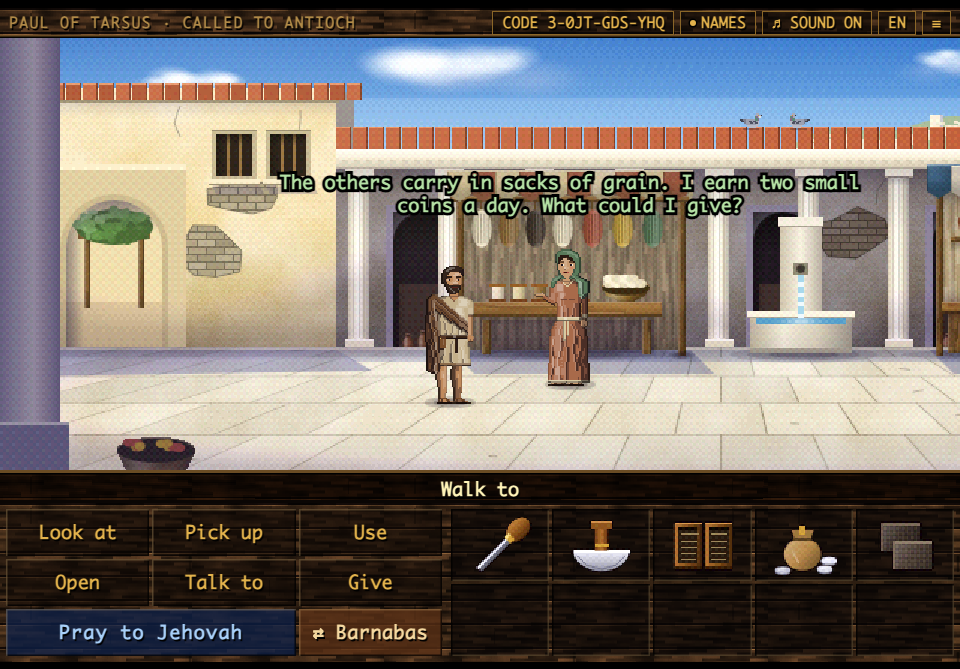
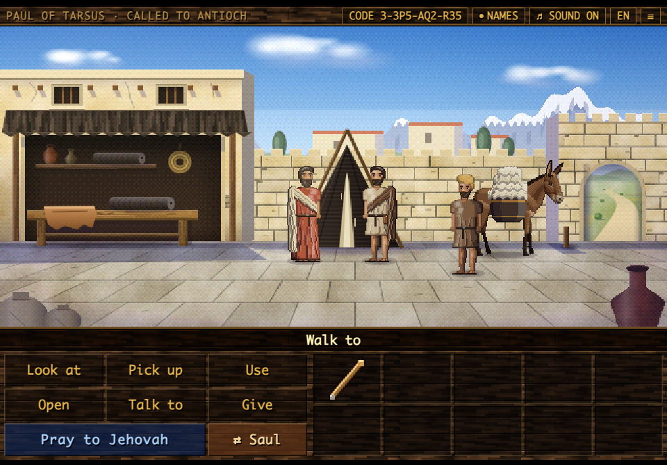
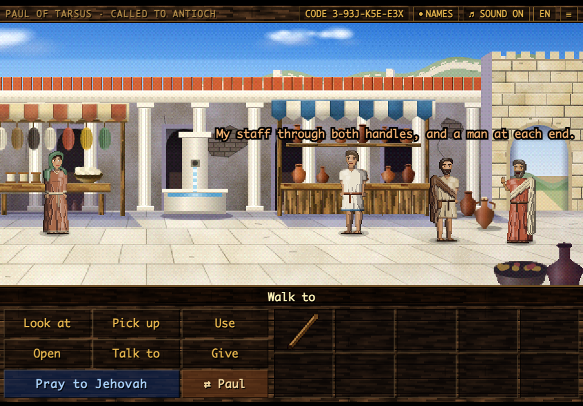

# Chapter Three: Called to Antioch

Tarsus, about 45 C.E. In Antioch of Syria very many who speak Greek have come to believe, and Barnabas travels to Tarsus and searches until he has found Saul. A full year long the two of them teach in the congregation at Antioch, the first place where the disciples, by divine providence, come to be called Christians. Then the prophet Agabus foretells a great famine. The disciples decide to send help to the brothers in Judea, each as much as his means allow, and Barnabas and Saul are to deliver it (Acts 11:19-30; 12:25).

| | |
|---|---|
|  |  |
| Tarsus: Barnabas finds his man, who has a promise to keep first | Antioch: the gifts are in, with weeks of road ahead of them |

Three more locations and five new characters, with Barnabas back at Paul's side, and this time you can play him too. Paul finishes a promised tent before he will leave Tarsus, sews pack bags for the relief, and sees the gift counted and sealed before the brothers. Some work takes both men: Barnabas holds the far edge of the tent while Paul sews, and Theron's jar of oil is a load for two men and a bar, like the grapes of Eshcol (Numbers 13:23). The puzzle about people is a spinner who stays away because she thinks she has nothing to give: pressure and pity both fail with her.

| | |
|---|---|
|  |  |
| Barnabas holds the far edge; his own inventory holds his staff | Both men at Theron's stall, Barnabas's staff through the handles |

Walkthrough (spoilers)

1. In Tarsus, switch to Barnabas (the **⇄ Barnabas** button beside the prayer, or `C`) and use the tent: he holds the far edge. Switch back to Paul and use the awl on the tent.
2. Use the knife on the leather hide, then the leather loops on the tent.
3. Pick up the finished tent and give it to Kleon. Leave by the east gate.
4. In the courtyard at Antioch, use the knife with the goat-hair cloth.
5. Go out to the street and talk to Xanthe. Tell her that each gives what he can afford, ask what is in her hands, and tell her that the gift has no bags and you have no thread.
6. Use the awl with the cloth panels.
7. Switch to Barnabas, who is still in the courtyard, and walk him out to the street. Use his staff on Theron's oil jar: the two men carry it to the courtyard.
8. As Paul, give your savings to Lucius, and ask for the purse to be counted before the brothers and sealed.
9. Use the pack bags with the donkey.

## Music and sound

| Chapter | Music | Around you |
|---|---|---|
| Called to Antioch | A quick lyre figure, walking bass and reed pipe in G Mixolydian, with claps in the busy street | A tentmakers' row, vine leaves in the courtyard, the fountain and the crowd |

## About the content

The supporting characters are invented dramatization: Kleon, Xanthe and Theron.

The Scriptures say nothing of how the relief was packed or counted: those details are invented.

[← All chapters](../README.md#chapters)
