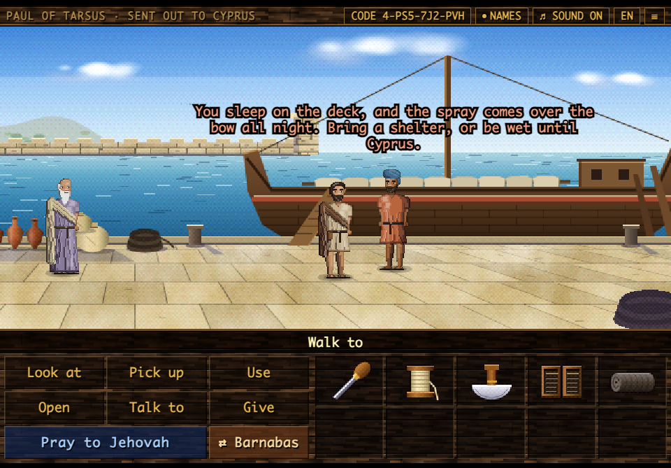
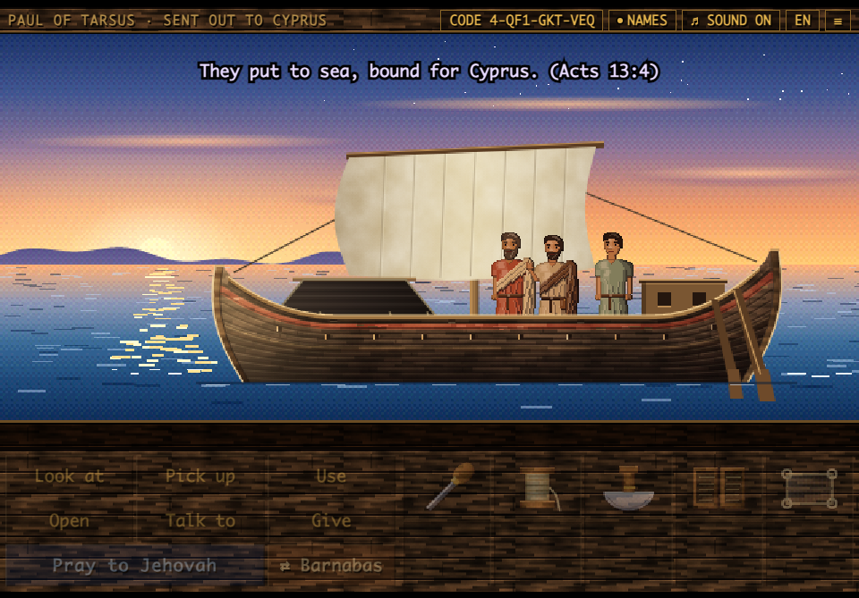
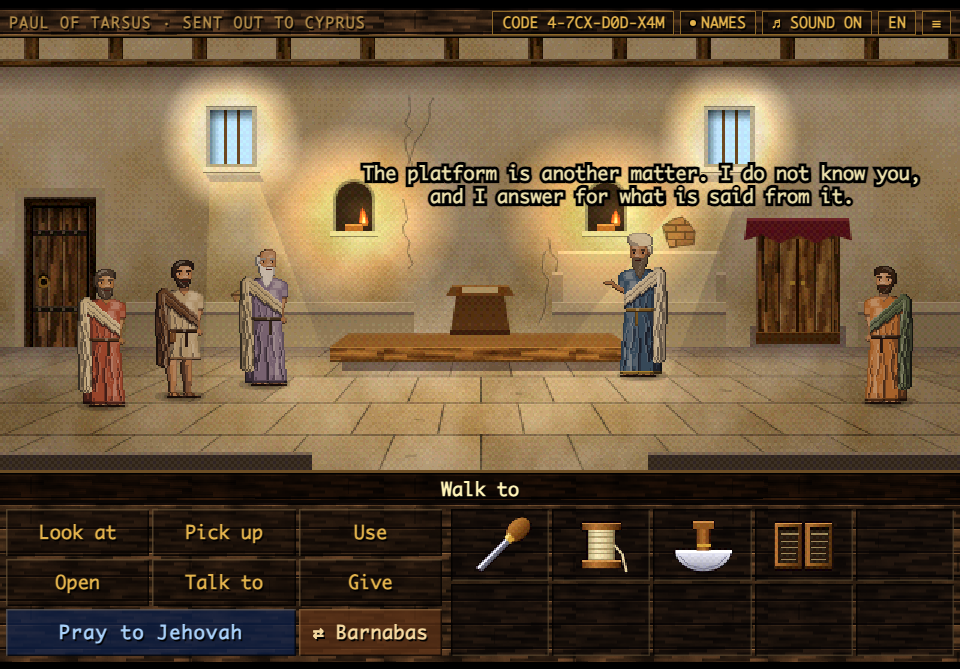
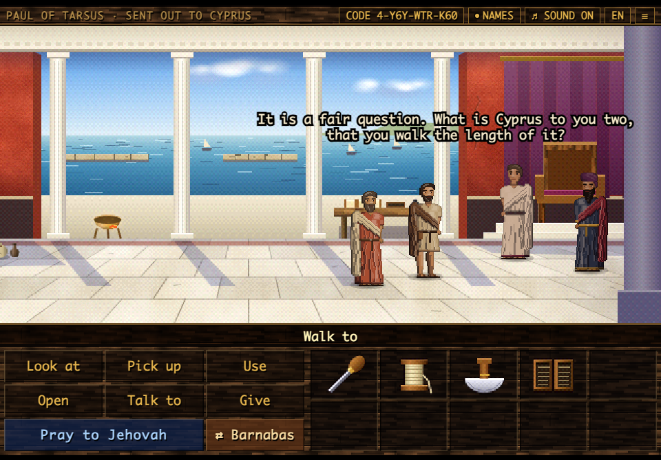
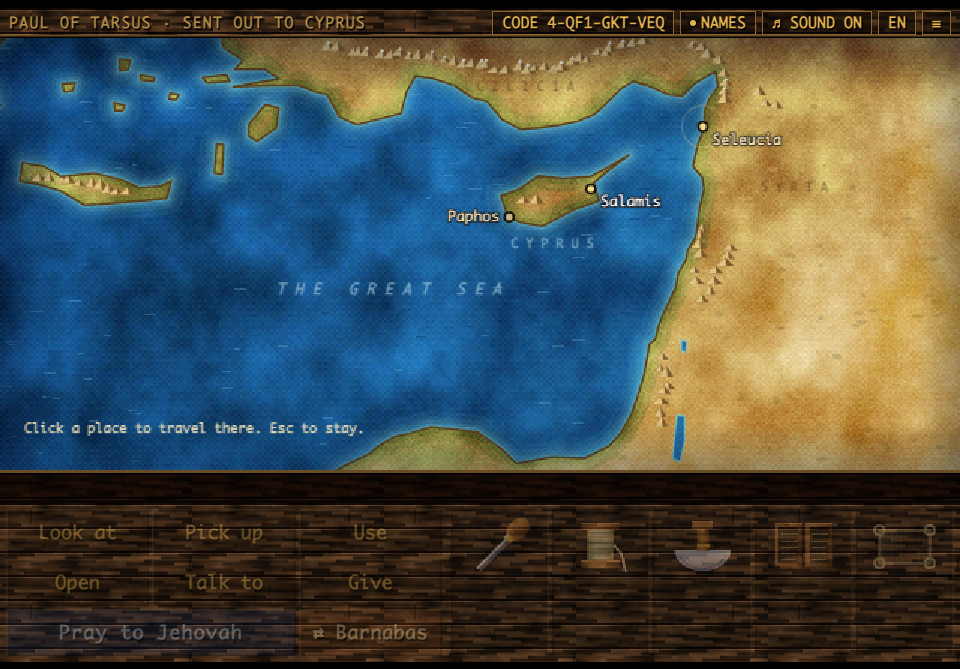
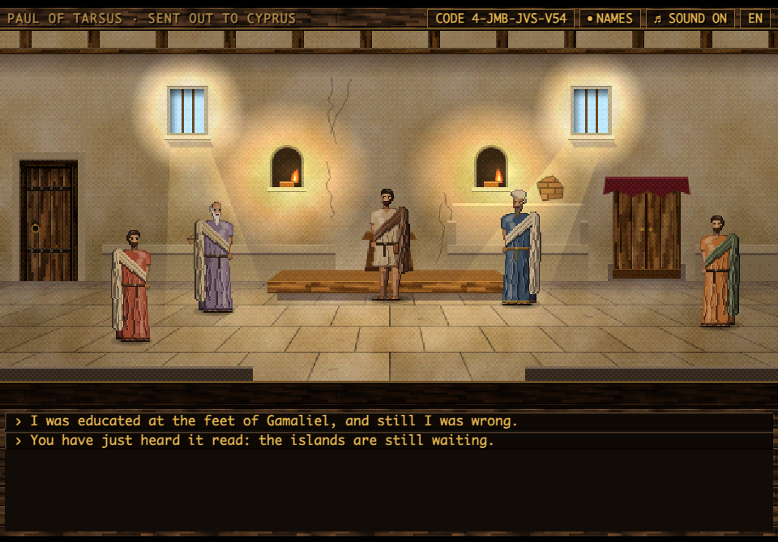

# Chapter Four: Sent Out to Cyprus

Antioch, about 47 C.E. As the prophets and teachers of the congregation are ministering to Jehovah and fasting, the holy spirit says: "Set aside for me Barnabas and Saul for the work to which I have called them." They lay their hands on them and send them off. With John Mark as their attendant, the two go down to Seleucia and sail to Cyprus, where Barnabas was born. At Salamis they proclaim the word of God in the synagogues of the Jews. Then they go through the whole island as far as Paphos, where the proconsul Sergius Paulus, an intelligent man, calls for them, and the sorcerer Bar-Jesus, also called Elymas, tries to turn him away from the faith (Acts 13:1-12; 4:36).

| | |
|---|---|
|  |  |
| Seleucia: a ship for Cyprus, and no roof for her deck | The crossing, under the roof a tentmaker sewed |
|  |  |
| Salamis: a stranger is welcome to a seat, not to the platform | Paphos: the proconsul asks, and Elymas objects |

Four more locations and seven new characters, and the first chapter in which the travel map is the way from place to place: the gangplank at Seleucia and the west gate of Salamis open it, and a click on a place goes there.

A merchant ship of those days gave its passengers drinking water and nothing else, so Paul sews a shelter for the deck, with a rope in its edge to lash it to the rail. On the quay sits an old disciple of Salamis whom Saul's persecution once drove out of Jerusalem (Acts 8:1-3; 11:19). He has nothing to say to Saul of Tarsus. Barnabas has to speak for his friend first, and then Saul has to say it himself, without an excuse.

On his own island Barnabas is the one who is known. He asks the presiding officer of a synagogue in Salamis for a hearing, and Paul builds his "word of encouragement" in the right order, beginning with what has just been read: the islands keep waiting for his law (Isaiah 42:4). In Paphos, Elymas raises three objections before the proconsul, and each is answered in its own way: one by Barnabas, one by showing Paul's awl, and one from the Scriptures. Then the account takes its course. What happens to Elymas is told as Acts tells it, and it solves no puzzle. From that hearing on the game calls Saul by his Roman name, Paul, as Acts does from chapter 13, verse 9.

| | |
|---|---|
|  |  |
| The gangplank opens the map: Salamis lies a day and a night away | A word of encouragement has an order: do not run ahead of the hearers |

Walkthrough (spoilers)

1. At Seleucia, talk to Kallias, the shipmaster by the gangplank.
2. Use the knife on the coil of cord beside the mooring post. Use the awl (or the tarred cord) with the goat-hair cloth.
3. Switch to Barnabas and talk to the old man by the jars. Tell him that you asked the same question once, and then heard Saul out.
4. As Paul, talk to the old man, Jair, and say plainly what you did.
5. Walk up the gangplank, and click Salamis on the map.
6. In Salamis, open the door of the synagogue. Switch to Barnabas and talk to Zadok: let Saul speak after the reading, and test every word by the scroll.
7. As Paul, talk to Zadok. Build the talk in this order: the islands keep waiting; the promise to David; the savior from David's offspring, raised up; forgiveness of sins.
8. Leave by the door and then by the west gate, and click Paphos on the map.
9. In Paphos, switch to Barnabas and talk to the proconsul. As Paul, give the awl to the proconsul to show it. Then answer with Daniel 2:27, 28.

## Music and sound

| Chapter | Music | Around you |
|---|---|---|
| Sent Out to Cyprus | A harp in E Aeolian that rocks in three, three and two like a hull on a swell, with a ney at sea and a reed pipe in the harbors; before the proconsul only a drone, a slow drum and a few notes of the lyre | Waves, gulls and creaking timbers, a coppersmith's hammer in the market of Salamis, lamps in the synagogue, a brazier in the proconsul's hall |

## The travel map

Chapter Four draws the first missionary journey on a map of its own: Antioch to Seleucia, by sea to Salamis, and across the island to Paphos. The earlier roads are left off it, because the sea lane from Caesarea to Tarsus runs between Cyprus and Syria, just where the ship from Seleucia has to pass. In that chapter the map is also how you travel.

## About the content

Chapter Four fills several silences of the account in the same way. Acts does not say where on Cyprus Barnabas was born, what was said in the synagogues of Salamis or how the people there responded, or what Elymas said to turn the proconsul away. The chapter places Barnabas's boyhood in Salamis, keeps the response there small, and gives Elymas three objections of its own. Acts 13:5 records that they proclaimed the word of God in the synagogues of Salamis but gives no talk, so the talk in the synagogue there is dramatized, and modeled on the one Paul gave in the synagogue at Antioch in Pisidia (Acts 13:16-41). The shelter on the ship's deck rests on what is known of sea travel then: passengers on a merchant ship slept on deck and brought their own food and bedding. The ship has no figurehead, because those commonly showed a god.

The supporting characters are invented: the shipmaster Kallias, the old disciple Jair, the presiding officer Zadok and the merchant Philon.

[← All chapters](../README.md#chapters)
