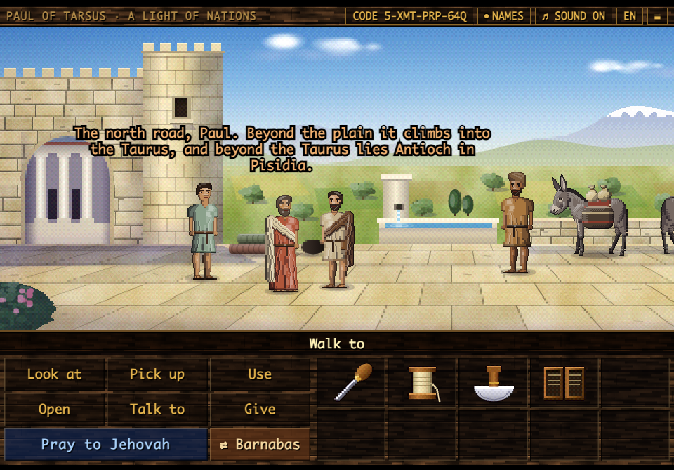
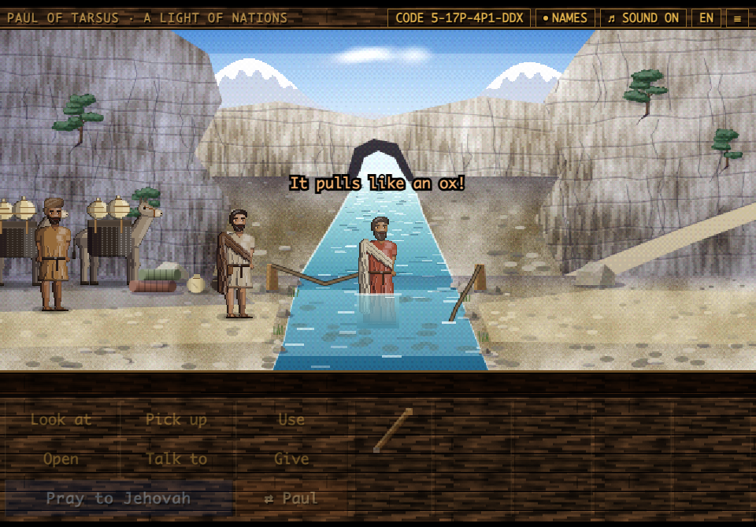
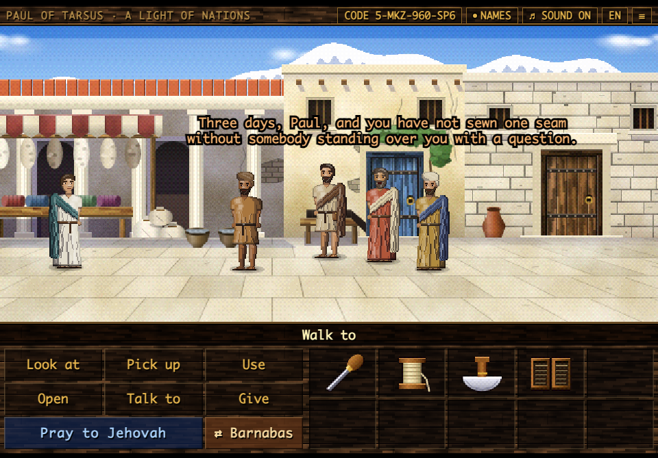
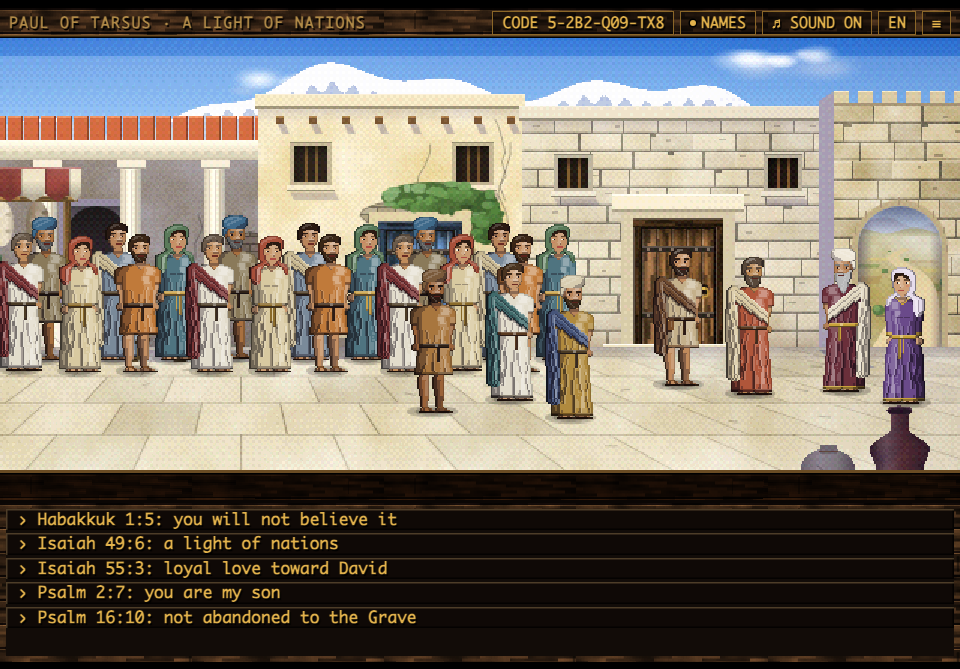
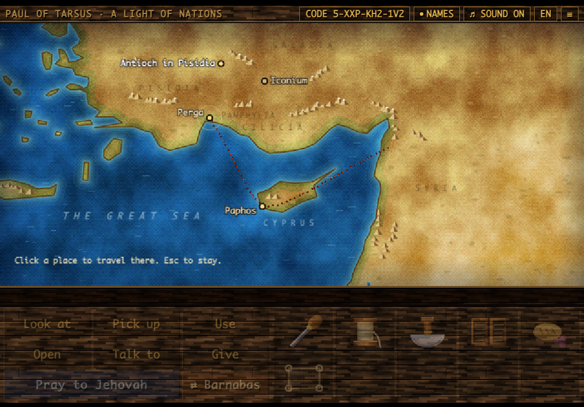
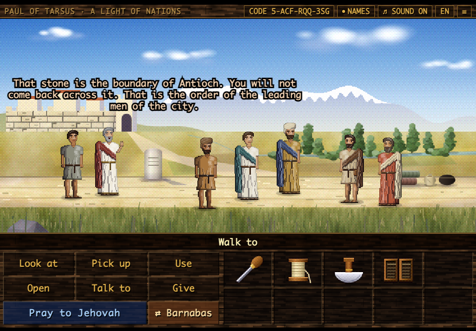

# Chapter Five: A Light of Nations

About 47 C.E. Paul and his companions put out to sea from Paphos and arrive at Perga in Pamphylia, where John Mark leaves them and returns to Jerusalem. The two go on, up through the Taurus, to Antioch in Pisidia. On the Sabbath they take a seat in the synagogue, and after the reading the presiding officers send word to them: "Men, brothers, if you have any word of encouragement for the people, tell it." The people plead to hear more, and the next Sabbath nearly all the city gathers to hear the word of Jehovah. When the Jews see the crowds, they are filled with jealousy and begin blasphemously contradicting the things Paul is saying. Paul and Barnabas answer boldly: "Since you are rejecting it and do not judge yourselves worthy of everlasting life, look! we turn to the nations. For Jehovah has commanded us in these words: 'I have appointed you as a light of nations, for you to be a salvation to the ends of the earth.'" Those of the nations rejoice, and all those who are rightly disposed for everlasting life become believers. Then persecution is stirred up: the two are thrown outside the city's boundaries, shake the dust off their feet and go on to Iconium, and the disciples continue to be filled with joy and holy spirit (Acts 13:13-52).

| | |
|---|---|
|  |  |
| Perga: the road north, a split sandal, and a parting | The ford: Barnabas carries the rope over, and Paul holds the line |
|  |  |
| Antioch in Pisidia: a week of questions at a tentmaker's bench | The next Sabbath: nearly all the city, and an objection |

Five more locations and six new characters. The account gives no reason why John Mark turned back, so the game gives none: he says that he is going, Paul says once and plainly that he wishes he would stay with the work, and the bundles change hands. Whether John Mark starts for Jerusalem with a share of the bread is up to the player.

The road to Antioch was about 180 kilometers over a mountain pass, through country known for its robbers and for rivers that dash down through narrow ravines (2 Corinthians 11:26). Nobody climbs it alone, so the two walk with a drover's pack train, and where a river has carried away the guide rope of a ford, the chapter's two-man puzzle begins. The rope Paul sewed into the edge of a deck shelter in Chapter Four comes out again, stitch by stitch, and is spliced to what is left on the post. Then somebody has to carry the end across, and only one of the two men has a staff.

In Antioch nothing is forced. A visitor takes a seat and waits to be asked, and when Paul is asked, the player chooses whom he addresses and which passages he quotes, as Acts records them. In the week that follows, three people want an answer, and each needs a different one: a Greek who has kept to the place by the synagogue door for years, of his own accord, is shown what Isaiah wrote about the foreigner; a drover who has never heard the Prophets read hears first about the God who made the mountains he crosses; and a Jew who fears what his new faith will cost him wants Barnabas, not Paul. On the next Sabbath the objection is answered from the tablets with Isaiah 49:6. What follows is told as Acts tells it. Nothing the player does keeps the two men in the city, and the last thing to do there is for the disciples, not against the opposers.

| | |
|---|---|
|  |  |
| The map looks further north: Perga, Antioch in Pisidia, Iconium | Outside the boundaries: three disciples have come out to stand with them |

Walkthrough (spoilers)

1. At Perga, talk to Papias, the drover by his donkeys. Talk to John Mark: he hands over the roof, the food bag and a leather thong.
2. Use the leather thong (or the awl) on Barnabas to mend his sandal. Leave by the road north, and click Antioch in Pisidia on the map.
3. At the ford, use the knife on the tent roof, then the tarred rope on the near post.
4. Switch to Barnabas and use his staff on the river. Switch back to Paul and talk to Papias (or use the river). Take the road to the pass.
5. In Antioch, open the door of the synagogue and use the bench. Address "Men, Israelites and you others who fear God", then choose Psalm 2:7, Isaiah 55:3 (or Psalm 16:10) and Habakkuk 1:5.
6. In the week, talk to Eumenes and show him what is written about the foreigner. Talk to Papias and begin with the God who made the mountains. Switch to Barnabas, talk to Joel, and urge him to remain in the undeserved kindness of God.
7. Go to the door of the synagogue, and answer with Isaiah 49:6.
8. Outside the boundaries, talk to Eumenes: it was never our word. Then use the boundary stone.

Optional: give the bread to John Mark before leaving Perga.

## Music and sound

| Chapter | Music | Around you |
|---|---|---|
| A Light of Nations | A walking tune in D Phrygian, the mode named after the country Antioch borders on: a lyre in even fours, a frame drum at the pace of a pack train, and a reed pipe; a ney in the synagogue; at the ford and before the opposers only a drone, a slow drum and a few notes of the oud | Crickets and hooves on the hot plain, the rush of the river in the gorge, the wool market of Antioch, the wind across the high plain |

## The travel map

Antioch in Pisidia and Iconium lie north of that map's upper edge, so Chapter Five looks at the same map through a second window, further north: Asia Minor as far as Galatia, with the Aegean islands on the left and Jerusalem and Egypt out of sight below. Pamphylia, a strip of coast too small for a widely spaced name, is named on it in closer letters. The chapter opens on it, with the crossing from Paphos to Perga, and closes on it, with the road from Perga over the Taurus to Antioch and on to Iconium.

## About the content

Chapter Five does the same. Acts does not say why John Mark left, how the two men travelled from Perga to Antioch, what was said in the week between the two Sabbaths, or who carried out the expulsion. The game gives John Mark no reason; the pack train, the ford and its rope are invented, and rest on what is known of that road: it was notorious for bandits, and its rivers were dangerous. That Paul worked at his trade in Antioch, and the three conversations of the week, are invented too. No source says where those who feared God sat in a synagogue, so the game claims no custom: Eumenes keeps to the place by the door of his own accord. The account does not give the season either; the game sets the climb in spring, with snow still on the mountains, and puts the river at the ford in flood after rain: the Study Edition's note on 2 Corinthians 11:26 says that in Pisidia the rivers often flooded after rains. The chest of the scrolls is one that is carried in and set in place: *Insight on the Scriptures* ("Synagogue") says that the scrolls came to be kept in a portable chest that was put in position during worship, and that only later synagogues built it into a wall. Paul is unwell after the climb: *Bearing Thorough Witness* (chapter 11) says it is likely that he had health problems at this point, and cites Galatians 4:13; the game does not say what the illness was. The opposers' words are kept mild, and that they spoke "blasphemously" is told only in the words of Acts 13:45. In his talk Paul quotes the Scriptures as Acts 13 words them, while the tablets hold the same passages as they stand in the Psalms and the Prophets.

The supporting characters are invented: the drover Papias, the wool merchant Eumenes, Joel, the presiding officer Hanan, Ammia and her husband Straton.

[← All chapters](../README.md#chapters)
