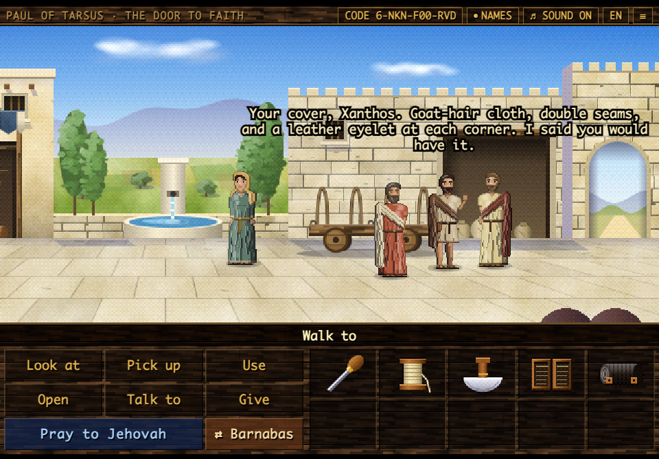
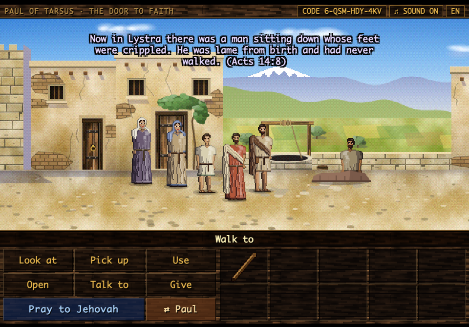
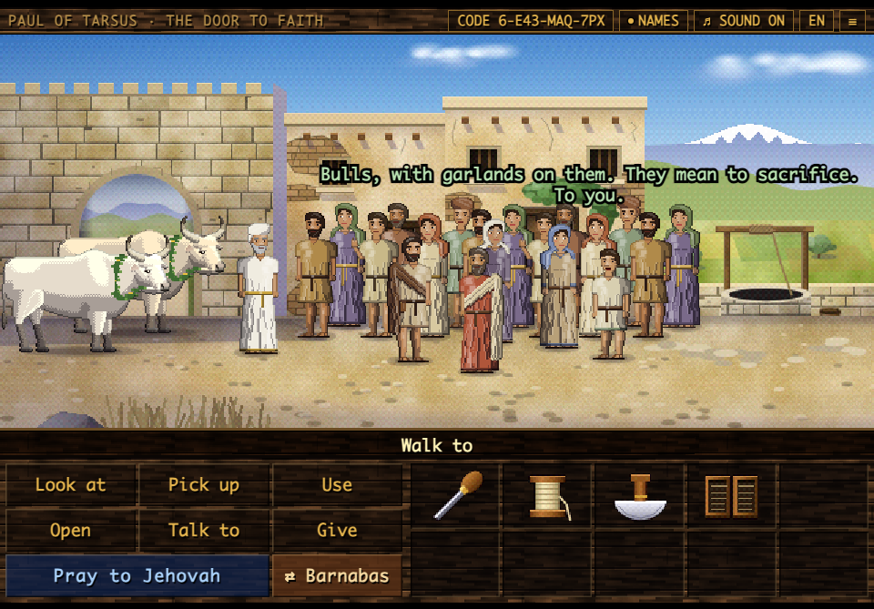
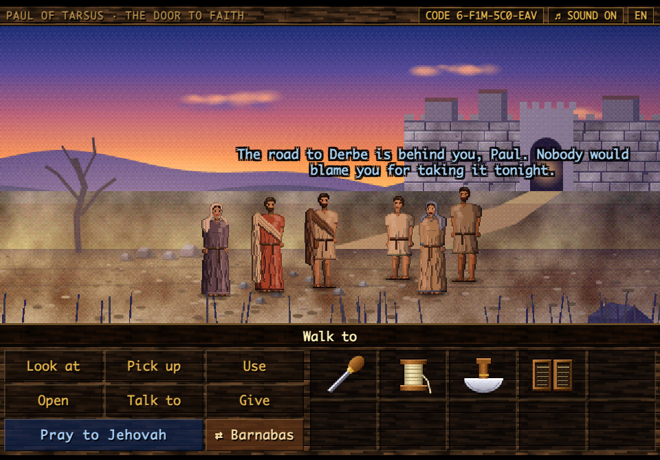
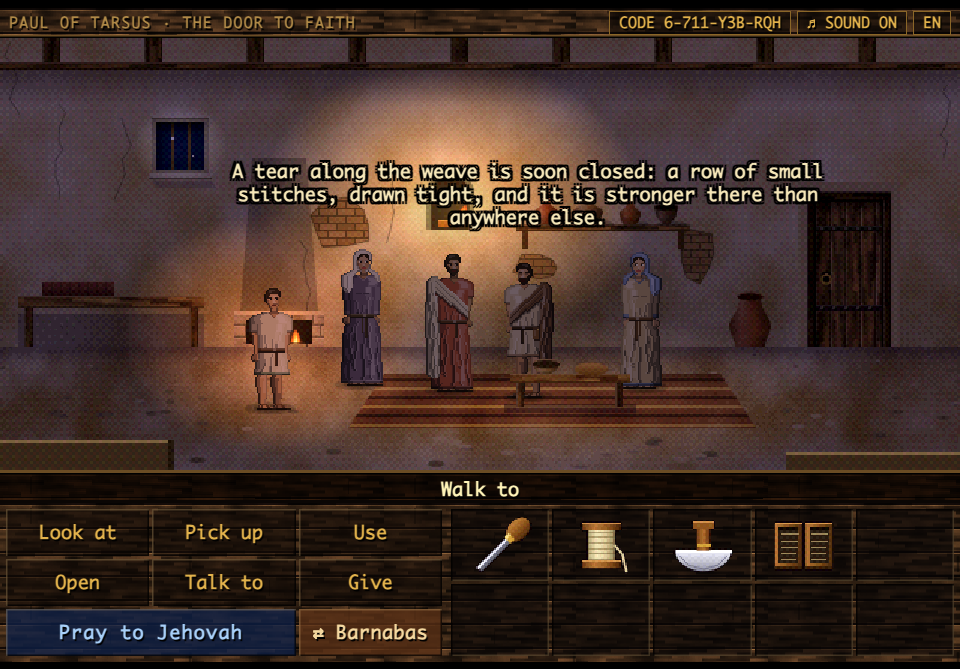
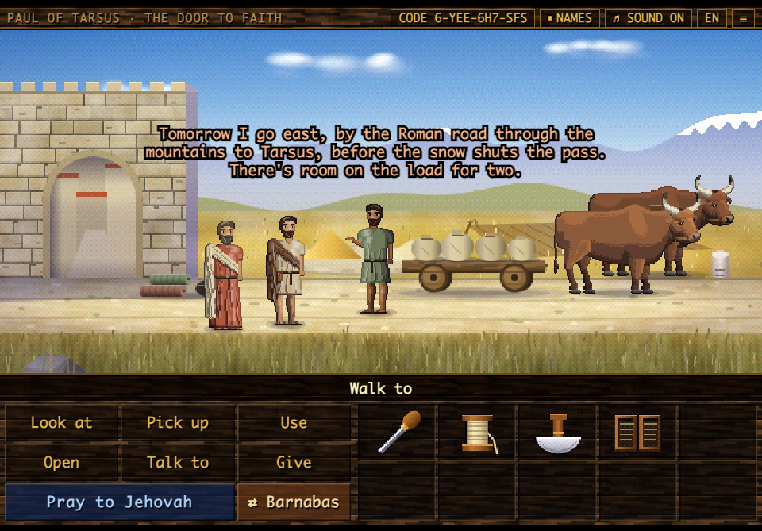
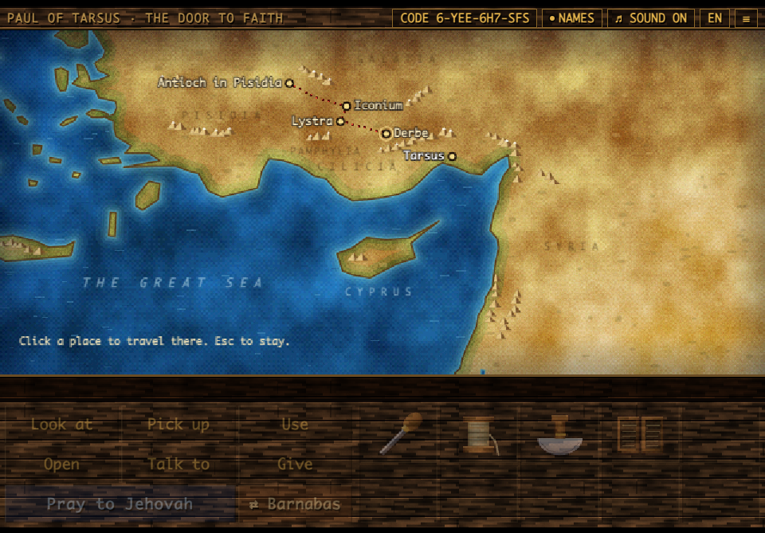
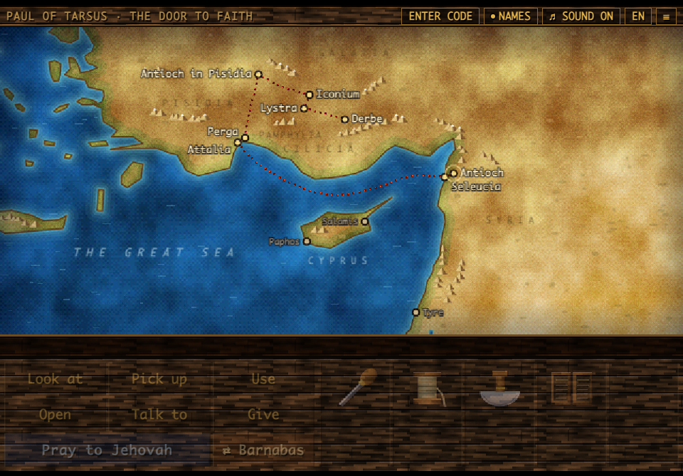

# Chapter Six: The Door to Faith

About 47 to 48 C.E. In Iconium the two men speak in the synagogue, and a great number of Jews and Greeks come to believe; they stay a long while, speaking out boldly with the authority Jehovah has given them. But the city is split, and when a move is made to stone them, they get word of it and escape to the cities of Lycaonia. In Lystra Paul heals a man who has been lame since he was born, and the crowds shout in the Lycaonian tongue that the gods have come down to them in human form. They call Barnabas Zeus and Paul Hermes, and the priest of Zeus brings bulls and garlands to the gates. The two tear their garments and rush out among the people, and tell them that they are only human too. They can scarcely keep the crowds from offering sacrifice to them. Then Jews come from Antioch and Iconium and win the crowds over; Paul is stoned and dragged out of the city, and left for dead. When the disciples gather around him, he rises and goes back into the city. The next day he sets out with Barnabas for Derbe. From there they turn back to Lystra, Iconium and Antioch, making the disciples strong and telling them that the way into the Kingdom of God leads through many tribulations. They appoint elders in each congregation, go down by Perga to Attalia, and sail home to Antioch, where they tell how God has opened the door to faith for the nations (Acts 14:1-28).

| | |
|---|---|
|  |  |
| Iconium: a promise is kept before the road is taken | Lystra: a town with no synagogue, and a man who has never walked |
|  |  |
| The gate: bulls and garlands, for two men who will not have them | Outside the city: the disciples surround him, and he gets up |

Five more locations and nine new characters. In Iconium the two men are informed of the stones in the first minute, and they leave the same day. But Paul has taken half the price of a wagon cover from a carrier who now sides with the rulers and calls him a swindler, and the cover wants its corners. A saddler who believes gives the leather; Paul finishes the cover and puts it into the hands of the man who speaks against him. The carrier's wife is a believer, and it is Barnabas she asks why bold men go: words were answered, but of stones the Lord said that those who are persecuted in one city should flee to the next (Matthew 10:23). Whether the silver stays behind for the brothers of Iconium is up to the player.

Lystra has no synagogue, so Paul speaks at the well. The healing is told as Acts tells it. It solves no puzzle; it makes one, because the crowds cry out in Lycaonian and neither man understands a word. A boy of the town has both tongues: Timothy, whose mother Eunice and grandmother Lois taught him the holy writings from his earliest years. Once the two men know what is coming to the gate, the player chooses how Paul begins, to whom he turns his hearers, and what witness he names. The Law of Moses means nothing to people who never heard it read, and neither does the name of a psalm; what the psalm says does, and so do the rain and the harvests of their own valley. It is the lesson of Chapter Five, where a drover who had never heard the Prophets was told first about the God who made the mountains.

What follows is told as Acts 14:19 tells it, in the dark, read from the narrator's scroll, and nothing of it is shown. The next scene is dusk outside the city, and the first thing the player decides there is which way Paul goes: by the road to Derbe, or back in through the gate. That night, by the lamp of Lois and Eunice, the tentmaker mends the garments the two men ripped. In Derbe nobody lifts a hand against them, and a disciple offers a place on his wagon: a well-traveled Roman road ran on from Derbe to Tarsus, and from there it was a short journey home. The travel map offers Tarsus. It also offers the road back. In Lystra again, a believing woman with an unbelieving husband asks whether it will always be like this, and Paul does not tell her that it gets easier.

| | |
|---|---|
|  |  |
| The house of Lois and Eunice: stoned by day, and sewing by lamplight the same night | Derbe: a loaded wagon, and the short road home |
|  |  |
| At Derbe the map offers Tarsus, and the road back | The way home: by Perga to Attalia, and by sea to Antioch |

Walkthrough (spoilers)

1. In Iconium, talk to Nathan and ask for leather for four corners. Use the leather corners (or the awl) on the unfinished cover, and give the wagon cover to Xanthos.
2. Switch to Barnabas and talk to Tatia: "We answered their words. Our Lord says to flee from stones." Leave by the south gate, and click Lystra on the map.
3. In Lystra, talk to Timothy, then use the well. Talk to Timothy again to learn what the crowd is shouting.
4. Go to the city gate. Choose the three answers that say that they are only humans too, that the living God made heaven, earth and sea, and that he gave rain and seasons of harvest (Acts 14:15-17).
5. Outside the city, go in at the city gate. In the house, use the thread (or the awl) on Barnabas. Leave by the door to the lane, and click Derbe on the map.
6. At Derbe, take the road and click Lystra on the map, not Tarsus.
7. Back in the house of Lois, talk to Eunice: "I will not tell you that it gets easier." Then leave by the door to the lane.

Optional: give the silver coins to Nathan before leaving Iconium, and give the wax tablets to Timothy during the night in Lystra.

## Music and sound

| Chapter | Music | Around you |
|---|---|---|
| The Door to Faith | A tune for a high, well-watered plain in F Lydian: lyre, bass, frame drum and reed pipe on the roads; harp and ney indoors; a low string that plucks the keynote and leans on the note above it, a ticking drum that almost stops every fourth bar, and a ney that begins the tune and breaks off before it comes home when stones are spoken of; and when a whole town runs to the gate with garlands, a doubled drum, hand claps, a drone and a pair of pipes, one going round and round on four notes while the other holds the keynote under it | The fountain and the saddlers' hammers of Iconium, the well and the crowd of Lystra, crickets and an owl at dusk outside the city, a thorn fire in the house of Lois, wind over the stubble at Derbe |

## The travel map

Chapter Six looks through the same window, and travels on it: from Iconium to Lystra, on to Derbe, and back. The way home is the road they came by, so the closing map does not draw it a second time: a light walks back from city to city, to Lystra, Iconium, Antioch and Perga. Then two new legs draw themselves, from Perga down to Attalia and by sea, between Cyprus and the coast of Cilicia, to Seleucia and Antioch. The crossing from Paphos to Perga is left off this map, because the voyage home would have to cross it.

## About the content

Chapter Six does the same. Acts does not say who informed the two men of the attempt to stone them, what Paul worked at in Iconium, where in Lystra he spoke, or who told them what the crowds were crying out in Lycaonian. The wagon cover, the saddler and the carrier's divided household are invented; so is the well, though *Bearing Thorough Witness* (chapter 12) notes that Lystra possibly had no synagogue, so that they preached in a public area. The old story of Zeus and Hermes that the household of Lois tells is the legend that the same chapter cites. Acts does not name the disciples who surrounded Paul. The game makes them Lois, Eunice and Timothy: the Study Edition's note on 2 Timothy 1:5 says that Eunice and Lois likely became Christians during this first stay in Lystra, and Timothy knew what happened to Paul there (2 Timothy 3:10, 11); but the account does not say so, and the chapter's end screen says that it does not. The healing of the lame man is told as Acts tells it and solves no puzzle. The stoning is not shown. The bulls and garlands of Acts 14:13 are shown, because the scene is about refusing them; Acts does not say what became of them, and in the game they are led away after the priest when he gives up; the temple of Zeus is not, and nothing in the chapter shows a statue, an altar or an image of a god. That a road ran on from Derbe to Tarsus, and that the two men could have gone home that way, is from *The Watchtower* of September 1, 1992; the carter who offers it is invented. Of the return visits only the one to Lystra is shown, and the appointing of elders is told as Acts 14:23 tells it.

The supporting characters are invented: the saddler Nathan, the carrier Xanthos and his wife Tatia, and the carter Zenon.

[← All chapters](../README.md#chapters)
