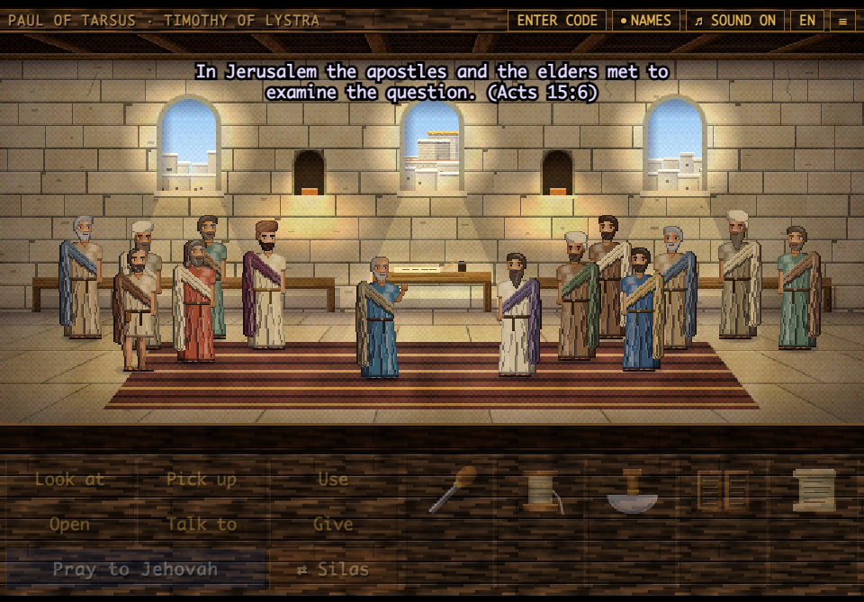
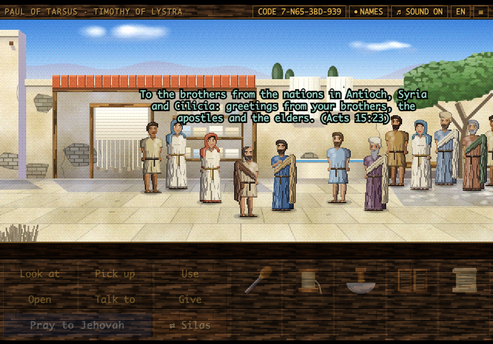
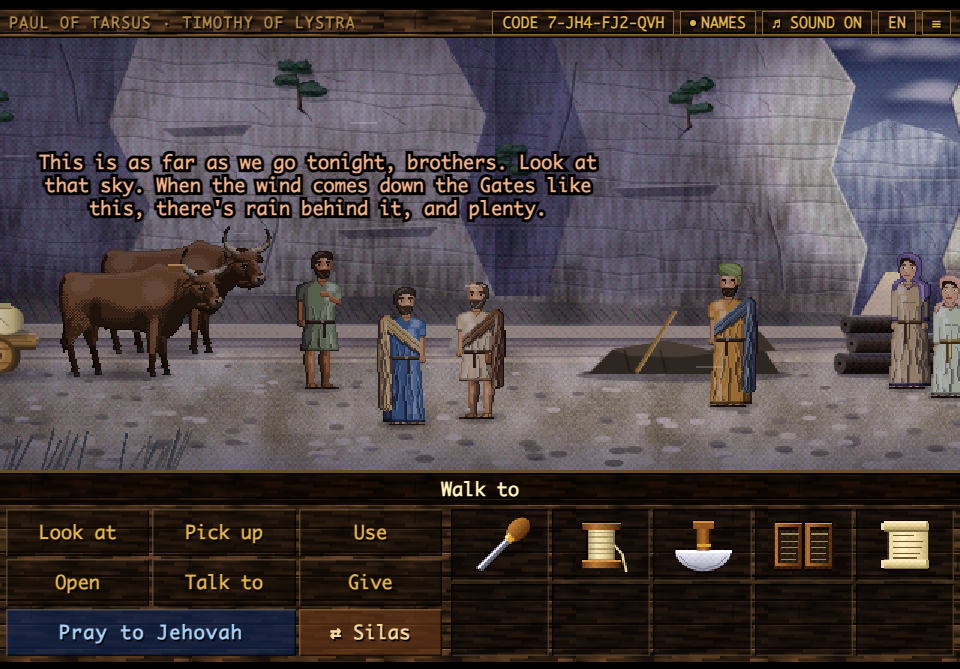
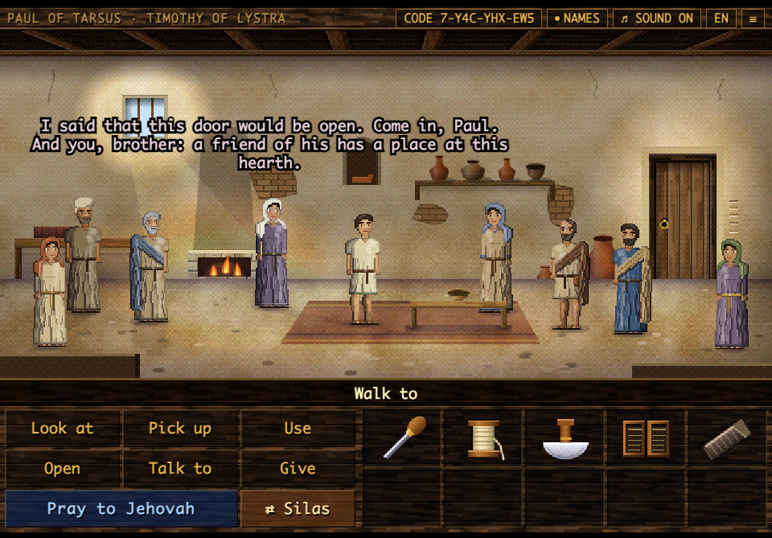
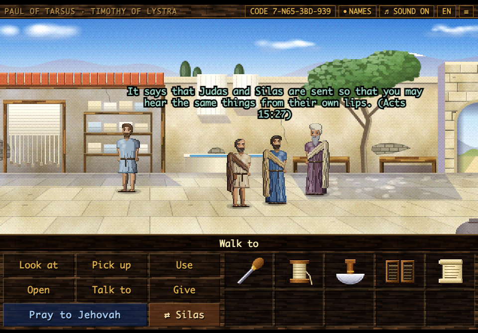
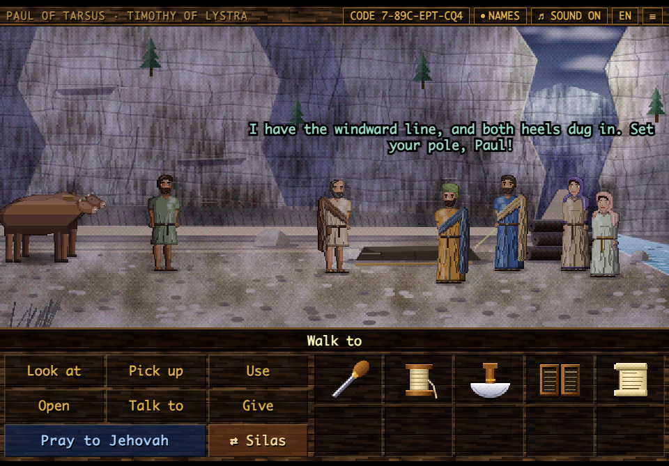
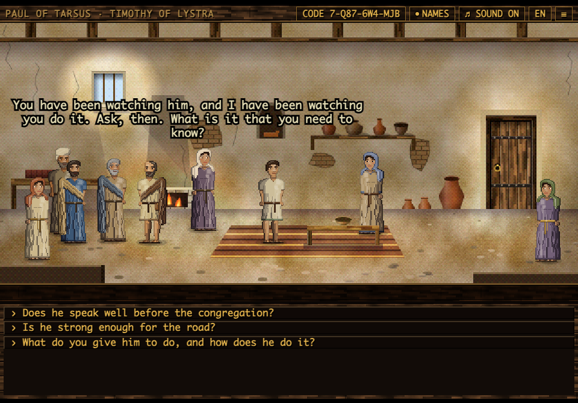
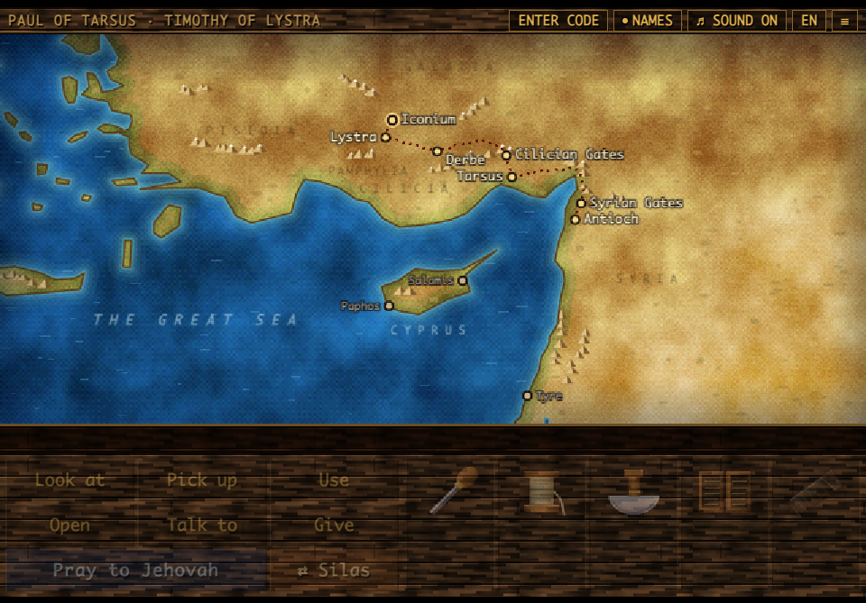

# Chapter Seven: Timothy of Lystra

About 49 C.E. Some men arrive in Antioch from Judea and teach the brothers that nobody can be saved without being circumcised as the custom of Moses requires. Paul, Barnabas and some others take the question up to the apostles and elders in Jerusalem. There Peter speaks, Barnabas and Paul tell what God has done through them among the nations, and James gives his decision. Judas called Barsabbas and Silas, who both take the lead among the brothers, are sent back with them and with a letter to the brothers from the nations in Antioch, Syria and Cilicia, and Antioch is glad of the encouragement it gives. Some days later Paul proposes to visit the brothers in every city. Barnabas has made up his mind that John Mark should come too, and Paul is against it. Anger flares up so sharply that the two part; Barnabas sails for Cyprus with Mark. Paul chooses Silas, and his way leads through Syria and Cilicia, where he makes the congregations stronger. In this way he reaches Derbe, and Lystra after it, where a disciple named Timothy lives, of whom the brothers in Lystra and Iconium speak well. Paul wants Timothy to travel with him. In city after city on their way they hand on the decrees, and the congregations keep growing firmer in the faith and larger in number with every day (Acts 15:1–16:5).

| | |
|---|---|
|  |  |
| Jerusalem: the apostles and the elders look into the matter | Tarsus: the letter, read to the whole congregation by the man who was sent with it |
|  |  |
| The Cilician Gates: a torn tent, and a storm an hour away | Lystra: the door that Lois said would be open |

Four more locations, eight new characters, and a new man to play: Silas. The meeting in Jerusalem is told as the chapter opens, as Acts 15 tells it, in three scenes without a puzzle. So is the parting from Barnabas. The account gives no explanation for it, and the game adds none.

In Tarsus the congregation has heard the teaching from Judea, and a careful brother will not take the letter on the word of the man who carries it: Paul was one of the two sides in that dispute. Everything Paul can answer is true, and none of it helps. The answer is standing beside him. Silas was sent out from Jerusalem with the letter, to tell the same things in person (Acts 15:27), and two witnesses are what the Law asks for (Deuteronomy 19:15). Then the letter has to be read, and not to one man beside a loom: in Antioch everyone was assembled before the letter was handed over (Acts 15:30).

The road north climbs to the Cilician Gates, a cleft in the Taurus so narrow that the way for wagons was cut into its rock. Zenon, the carter of Derbe who offered this road in Chapter Six, is on it with his oxen; so is a cloth merchant whose tent has torn, with his wife and daughter, and the wind that comes before rain. Paul can close the seam and sew in a new corner loop, with leather from the carter's harness box. Raising a tent in that wind takes two: Silas, who has never pitched one, holds the windward line while Paul sets the pole and drives the pins. That night the rain finds the letter. The copies of the decrees are for every congregation on the road (Acts 16:4), so the merchant's thanks, a length of goat-hair cloth, becomes a case for them, and the carter's axle tallow keeps the water out of it.

In Lystra the door that Lois said would be open is open, and Timothy is a man's height. Paul would like to ask him at once, and the game lets the player try: it is a hasty choice, not an untrue one, and Paul sets it aside. First he hears what Acts 16:2 reports. He asks the elders appointed in Chapter Six, Timothy's mother and grandmother, and, a day's walk away in Iconium, the saddler Nathan and Tatia. What he asks matters. A question about what appears to the eyes (does he speak well, is he strong, does he come of a good family?) gets a short answer; a question about what Timothy does gets a true one (1 Samuel 16:7). Then Paul asks him, and tells him what it will cost.

| | |
|---|---|
|  |  |
| The second witness: sent to tell the same things in person | A tent goes up in a wind only with a man on its windward line |
|  |  |
| What to ask an elder about a young one | By the Syrian Gates to Tarsus, over the Taurus, and on to Iconium |

Walkthrough (spoilers)

1. In Tarsus, talk to Reuben: nothing Paul says persuades him. Switch to Silas (the **⇄ Silas** button, or `C`) and talk to Reuben: "I was sent from Jerusalem to report it by word of mouth."
2. Give the letter from Jerusalem to Eirene (either man can carry it). Leave by the gate to the street, and click the Cilician Gates on the map.
3. At the Gates, talk to Zenon and ask for leather. Use the yoke strap (or the awl) on the torn tent.
4. Switch to Silas and use the mended tent: he takes its windward line. Switch back to Paul and use the tent.
5. Use the awl with the goat-hair cloth. Ask Zenon how to keep the letter dry, and use the axle tallow with the letter case. Walk on to the Cilician Gates, and click Derbe on the map.
6. In Lystra, give the letter to Myron. Talk to Myron: "What do you give him to do, and how does he do it?" Talk to Eunice: "What is he at home, when the brothers aren't looking?" Leave by the door to the lane, and click Iconium on the map.
7. In Iconium, give the letter to Nathan. Talk to Nathan: "How does Iconium come to know a young man from Lystra?" Talk to Tatia: "What does he do, when he comes to Iconium?" Leave by the south gate, and click Lystra on the map.
8. Talk to Timothy: "I want you with us. It will cost you your home."

Optional: give the wax tablets to Lois.

## Music and sound

| Chapter | Music | Around you |
|---|---|---|
| Timothy of Lystra | A road tune on five notes, in E flat, such as a shepherd's pipe plays: lyre, bass, frame drum and reed pipe on the roads; harp and ney in the courtyard and by the hearth; a low string that plucks the keynote and leans on the note above it, a ticking drum that almost stops every fourth bar, and a ney that begins the tune and breaks off before it comes home while a congregation is of two minds; and in the gorge the same low string under a drum that rolls like thunder a long way off | Birds in a fig tree over a divided congregation, the wind coming down the Gates and then rain on a goat-hair tent, a thorn fire in the house of Lois, the fountain and the saddlers' hammers of Iconium |

## The travel map

Chapter Seven draws the opening of the second journey on a map of its own, as Chapter Four did, and through the northern window: from Antioch by the Syrian Gates and round the Gulf of Issus to Tarsus, over the Taurus by the Cilician Gates to Derbe and Lystra, and on to Iconium. The roads of the first journey are left off it. The chapter opens on this map and travels on it; Derbe is passed on the way, and the walk from Lystra to Iconium is made in both directions. Acts names neither of the two passes: the map shows the road that was likely.

## About the content

Chapter Seven does the same, and its end screen says so. Acts 15:41 says that Paul went through Syria and Cilicia strengthening the congregations, and names no city. The game sets one of those congregations in Tarsus, the chief city of the Cilician plain: *Insight on the Scriptures* ("Tarsus") says that he no doubt passed through there on some of his missionary journeys. Acts does not describe the road beyond it either. *Insight* ("Cilicia") names the Cilician Gates, a gorge in the Taurus some 50 kilometers north of Tarsus, as the natural route for his second journey, so the game takes him that way, and its narration says that the account does not. The doubting brother, the reading in a weaver's courtyard, the torn tent, the storm, the case for the copies of the decrees, the tallow that proofs it, and the reading on a threshing floor at Derbe are invented; that the decrees were delivered in each city is from Acts 16:4. After Acts 15:32 Silas is shown neither leaving Antioch nor staying behind: the Study Edition leaves out verse 34, and its note says that those words are not found in the earliest and most reliable manuscripts; where Silas was in between is uncertain. James is said to have presided because the Study Edition's note on Acts 15:13 says that it appears so, and the narration keeps that caution. Lystra was apparently Timothy's home. Acts 16:1 speaks of his mother only as a believing Jewish woman: her name, and that of his grandmother Lois, are from 2 Timothy 1:5, and the account does not say that Lois lived in that house, as she does here and in Chapter Six. Of Timothy's father Acts says only that he was a Greek, and the Study Edition's note on Acts 16:1 adds that he was apparently not a Christian; that he is living, keeps sheep and does not hinder his household is invented. Acts says that the brothers in Lystra and Iconium spoke well of Timothy, but not how Paul came to hear it: the four conversations, the walk to Iconium and back, and what each witness says are invented, around the qualities that *Bearing Thorough Witness* (chapter 15) draws from Philippians 2:20-22 and 2 Timothy 1:5. That book says that Paul and the local elders recommended him; that there were prophecies about Timothy, and that the body of elders and Paul laid their hands on him, is from 1 Timothy 1:18; 4:14 and 2 Timothy 1:6. That this was the occasion is only likely, and the narration says that it may have been at this time. His circumcision is told as Acts 16:3 tells it, with the reason it gives, and is not shown. What Peter and James say in the opening scenes follows Acts 15:10, 11 and 19, in paraphrase; the words given to Silas are dramatization, like the rest of the dialogue. The supporting characters are invented: Reuben, Agathon and Eirene in Tarsus; the merchant Bion, his wife Charis and their daughter Melissa at the Cilician Gates; and Myron, one of the elders of Lystra. Zenon, Nathan and Tatia come back from Chapter Six.

[← All chapters](../README.md#chapters)
