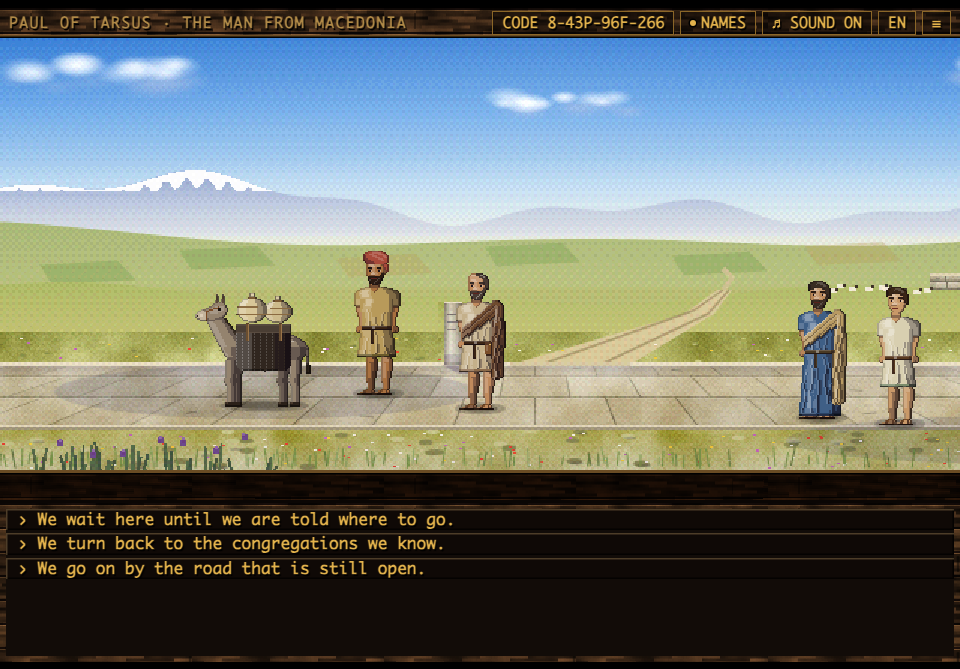
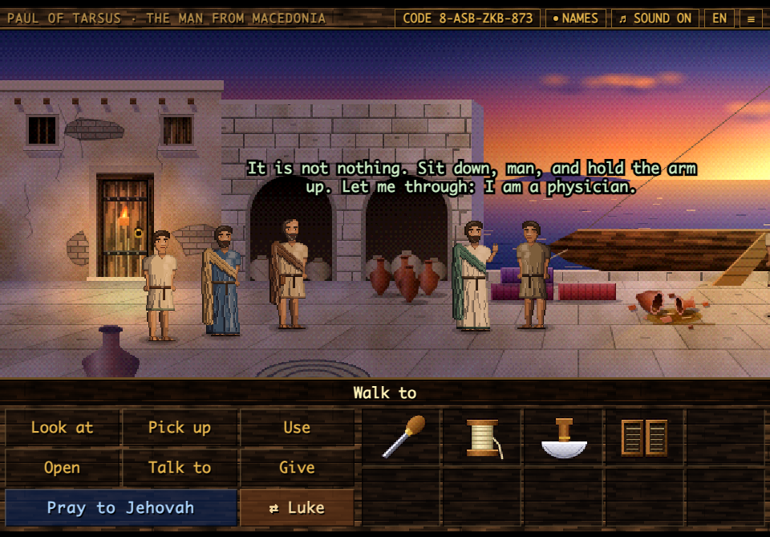
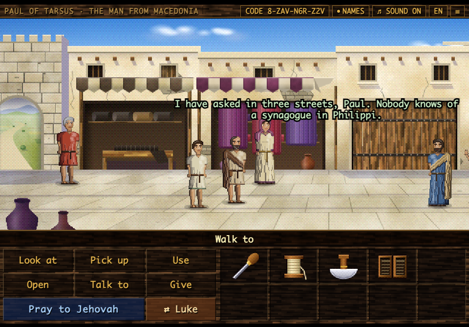
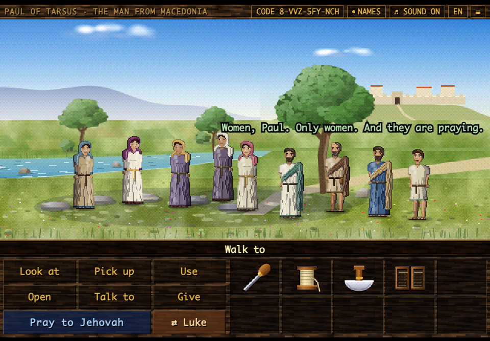
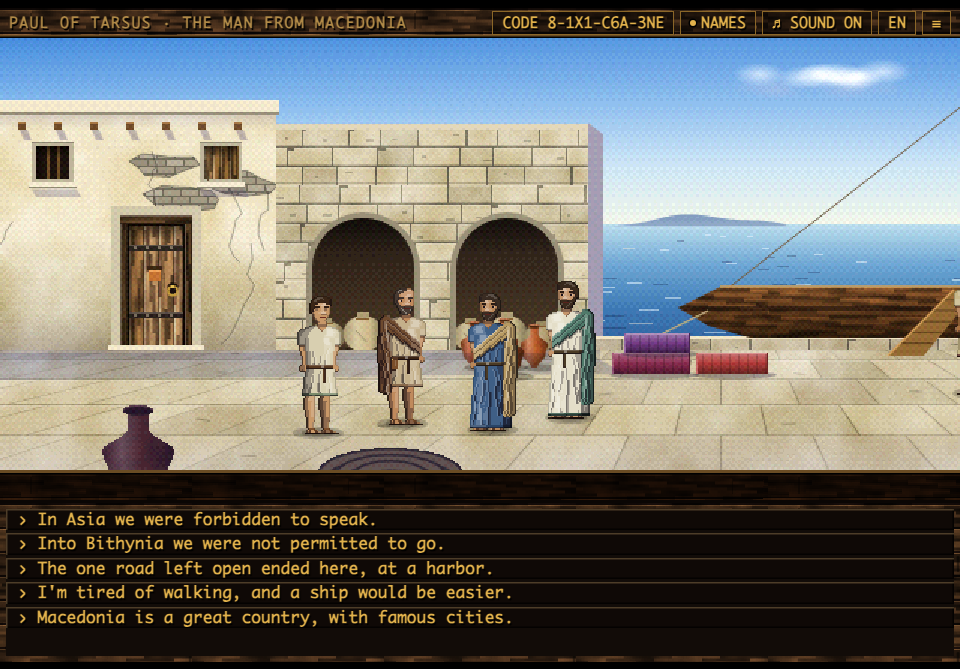
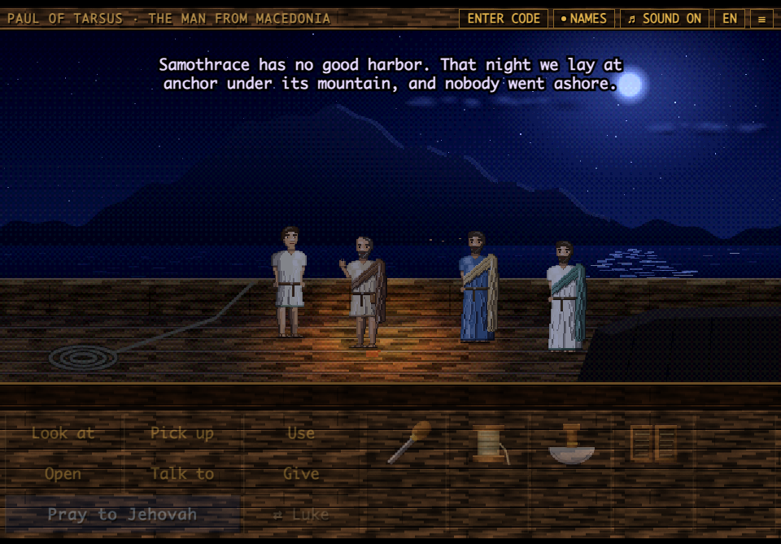
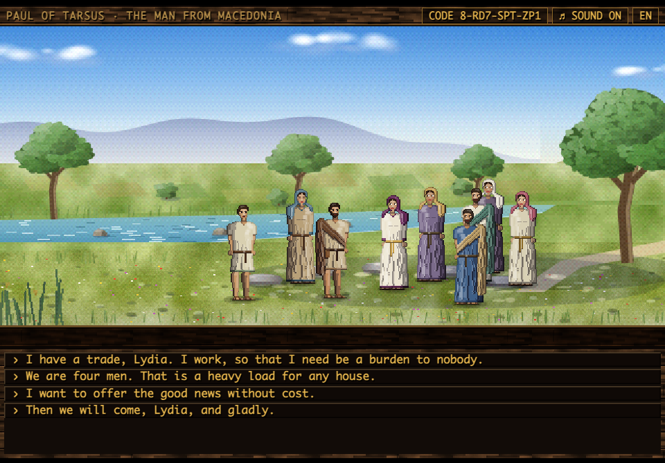
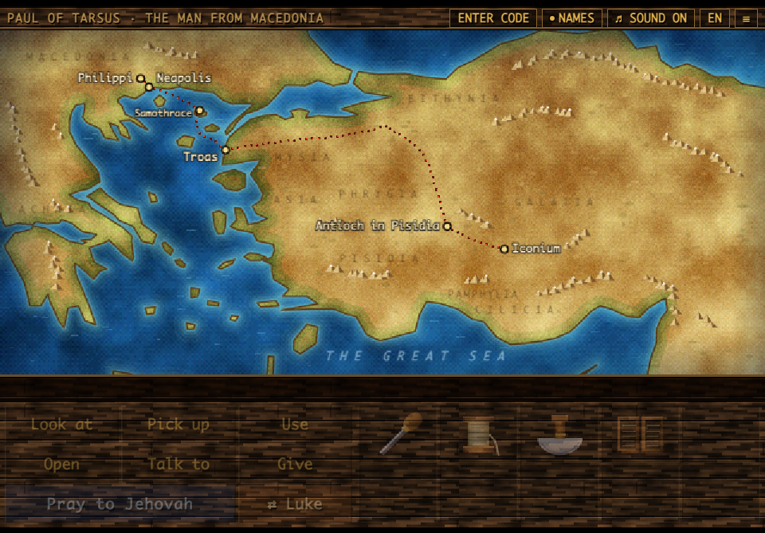

# Chapter Eight: The Man from Macedonia

About 50 C.E. Paul, Silas and Timothy travel through Phrygia and the country of Galatia, because the holy spirit forbids them to speak the word in the province of Asia. On reaching Mysia they try to go on into Bithynia, but the spirit of Jesus will not let them. So they go on past Mysia, down to Troas. That night Paul has a vision: a man of Macedonia stands there and begs him to cross over into Macedonia and help them. From here on the account says "we": after the vision they set about getting to Macedonia without delay, concluding that God has called them to bring the good news to its people. They hold one course to Samothrace, reach Neapolis the next day, and go on to Philippi, a Roman colony and the foremost city of its district of Macedonia. On the Sabbath they walk out through the gate to a river, where they suppose there is a place of prayer, sit down and talk with the women who have come together. A woman called Lydia, from Thyatira, who sells purple and worships God, listens, and Jehovah opens her heart fully to what Paul says. When she and her household have been baptized, she presses them to stay under her roof if in their eyes she is faithful to Jehovah, and she will take no refusal (Acts 16:6-15).

| | |
|---|---|
|  |  |
| The plateau: the road to Ephesus is closed, and Paul has to decide what to do next | Troas: a hurt man on the quay, and a physician who wants clean linen |
|  |  |
| Philippi: a Roman colony with no synagogue, and one shop that is shut | The Sabbath: outside the gate, beside a river |

Five more locations, ten new characters, and a new man to play: Luke. The chapter is about not knowing where to go. *Bearing Thorough Witness* says of these weeks that the men knew what and how to preach but not where, and that direction came only after each step had been taken. So nobody in this chapter gets anywhere by standing still, and nobody gets to Macedonia by being clever.

On the plateau a paved road runs west, down to Ephesus, and Paul means to take it. He is forbidden, as Acts 16:6 tells it, and the game does not say how: the account does not. What the player decides is what Paul does next. He can wait at the fork until he is told where to go, or turn back to the congregations he knows. Both are honest and unwise, and Paul sets them aside. He goes on by the road that is still open, and at a ferry on the edge of Bithynia the same thing happens again. The one road left runs west for some 550 kilometers, past city after city, to a harbor. Mysia belonged to the province of Asia, so they pass it by: what was forbidden there is forbidden here.

At Troas a jar has slipped from its sling and laid a seaman's arm open, and a physician is already kneeling beside him. Luke has wine and oil, the treatment he himself later recorded (Luke 10:34), and no linen. Timothy's mother packed a clean cloth in his bundle; Paul cuts it into strips, and later sews a sling out of old sailcloth. Binding the wound is not the tentmaker's craft, so the player does that as Luke, who leaves the sewing to Paul. That night the vision is told as Acts 16:9 tells it, in the dark, read from the narrator's scroll, and nothing of it is shown. In the morning Paul does not announce a decision. He tells the other three exactly what he saw, and no more, and the four of them lay beside it what they already know: Asia closed, Bithynia closed, and the one open road ending at a harbor that looks toward Macedonia. Acts gives the conclusion to all of them: "we". From that verse on the game's narration says "we" too, as it took up the name Paul at Acts 13:9.

Philippi has no synagogue, and nobody in the game says why: the Study Edition offers two possible reasons and decides for neither. Paul finds the place of prayer by asking people what they have seen. An old soldier at the gate does not know why there is no synagogue, or whom other people pray to; he does know who goes out by his gate that is not going to work. A seller of purple does not know any Jews; she does know that the shop beside hers is shut every seventh day. Then Paul sews at a borrowed bench until the Sabbath. He says "I think", never "I know": Acts itself says only that they supposed a place of prayer was there (Acts 16:13).

Beside the river the player chooses how the four men come to the women, and where Paul begins. These hearers pray to the God of Israel already, so he begins from the Scriptures, which is the opposite of Lystra. Whatever is chosen, the scene comes to the same point: Jehovah opens her heart (Acts 16:14). Nothing the player does wins Lydia, and Paul says so. Her baptism is told as Acts 16:15 tells it and is not drawn. Then she urges them to stay at her house, and the last puzzle of the chapter is solved by accepting. Paul has reasons to decline that are all true: they have lodgings and pay for them, he has a trade, four men are a heavy load, and he wants to offer the good news without cost. To each of them she has one answer, the one Acts gives her (Acts 16:15). She is not asking about lodgings.

| | |
|---|---|
|  |  |
| The morning at Troas: what else do we know, besides what Paul saw? | Samothrace: a night at anchor under the mountain, and nobody goes ashore |
|  |  |
| Lydia urges the four men to stay at her house (Acts 16:15) | From Iconium to Troas, and over the sea to Philippi |

Walkthrough (spoilers)

1. On the plateau, take the paved road west. Choose "We go on by the road that is still open." Then take the track to the north.
2. At the river, use the ferry. Choose "West. It is the one road left." Then take the road west.
3. At Troas, talk to Timothy and tell him that the physician needs clean linen. Use the knife with the linen cloth, and give the linen strips to Luke.
4. Switch to Luke (the **⇄ Luke** button, or `C`). Use his bag on Sosias, and then the linen strips.
5. As Paul, pick up the old sailcloth by the stern of the ship, use the awl with it, and give the arm sling to Luke. As Luke, use the sling on Sosias.
6. Go in at the door of the inn.
7. In the morning, talk to Silas, Timothy or Luke: "Tell them exactly what I saw, and no more." Then name the three things they know: Asia, Bithynia, and the harbor at the end of the one road left.
8. Go up the gangplank.
9. In Philippi, talk to Quintus at the gate: "Who goes out by this gate that is not going to work?" Talk to Zosime: "Why is the shop beside yours shut?"
10. Use the bench, and then go out by the west gate.
11. At the river, talk to one of the women: "Go down, greet them, and sit among them." Then talk to Lydia: "With the Scriptures they know, and the one they promise."
12. Answer Lydia: "Then we will come, Lydia, and gladly."

Optional: use the awl on Zosime's torn awning.

## Music and sound

| Chapter | Music | Around you |
|---|---|---|
| The Man from Macedonia | A walking tune in bars of five, three steps and two, on the white notes from D: a lyre, a low string, a hand drum and a pair of pipes whose phrases never come to rest on their own first note; a harp and a ney in the harbor and the street; a drone, a slow drum and a few notes of the oud where a road is closed; a drone and a harp by night; and beside the river the same notes settle a step lower, on C, where the ney's tune ends. Nothing is claimed about how music was played then | Wind, larks and hooves on the plateau; the river and the leaves at the ferry; waves, gulls and creaking timbers at Troas and at anchor; the fountain and the crowd of a Roman street; water, birds and leaves at the place of prayer |

## The travel map

Chapter Eight leaves that window too. Troas, Samothrace, Neapolis and Philippi lie north and west of it, so the map has a third one: the lands round the Aegean, from Macedonia and Achaia on the left to Iconium on the right, with the Black Sea along its top. The coast of Thrace and Macedonia, the Propontis, the Peloponnese and the islands of the northern Aegean were painted for it, once, for the chapters that follow. The chapter's road is drawn on a map of its own: from Iconium by Antioch in Pisidia, north through Phrygia and Galatia until Bithynia is near, west through Mysia to Troas, between Lemnos and Imbros to Samothrace, through the strait north of Thasos to Neapolis, and up to Philippi. Acts names the regions and not the roads: the line shows what is likely, and two of its turning points have no name on the map because the account gives them none. Philippi lay some fifteen kilometers from its port, less than two dots apart at this scale, so it stands a little further inland than it lay.

## About the content

Chapter Eight does the same, and its end screen says so. Acts does not say how the holy spirit forbade them to speak in Asia, or how the spirit of Jesus did not permit them to go into Bithynia; *Bearing Thorough Witness* (chapter 16) says that it was done in a way the account does not disclose, and the game shows and explains nothing. That a paved road led west to Ephesus, that they may have walked for days on unpaved tracks between Phrygia and Galatia, and that the walk west to Troas was some 550 kilometers past city after city, is from that chapter; the fork, the milestone, the carrier, the ferry and its ferryman are invented, and the account names no road. They went through Mysia without stopping to preach there: the Study Edition's note on Acts 16:8 explains "passed by" so, and *Insight on the Scriptures* ("Asia", "Mysia") says that Mysia belonged to the province of Asia. Luke is with them from Troas on, because the account says "we" from Acts 16:10; how he came to be with them, where he was from and when he became a disciple is not told, and the game does not say. The hurt seaman, the shipmaster, the linen and the sling are invented. That Luke treats the wound with oil and wine rests on Luke 10:34, which the Study Edition's note calls consistent with the methods of the day. The vision is told as Acts 16:9 tells it, on a dark screen. That the four men worked their passage is invented. Samothrace has no good harbor, and there is no indication that Paul went ashore there (*Insight*, "Samothrace"): the night at anchor is invented, and nobody lands. The ship has no figurehead. Neapolis lay about fifteen kilometers from Philippi, three or four hours on foot over a pass (*Insight*, "Neapolis", "Philippi").

Why Philippi had no synagogue is not known. The Study Edition's note on Acts 16:13 says that perhaps the Jews were forbidden to have one because of the city's military character, or that the city might have lacked ten Jewish males; nobody in the game gives either reason. The river is not named: the same note gives three candidates. That Paul worked at his trade in Philippi is invented; *The Watchtower* of September 15, 1996, says that before they met Lydia the missionaries perhaps had lodgings at their own expense. The old soldier, the seller of purple beside the shut shop, and that Lydia kept a shop and closed it every seventh day are invented; an inscription found in Philippi attests a guild of sellers of purple there, and the Study Edition's note on Acts 16:14 says that Lydia was probably a Jewish proselyte. What was said beside the river is not recorded: Paul's words there are dramatized, around Isaiah 53:5 and Psalm 16:10, the second of which he quoted in Antioch in Pisidia (Acts 13:35), and the game credits Lydia's response as Acts does. Her household is seen and not explained: the note says that it could mean relatives, or slaves and servants. Her baptism is told in the words of Acts 16:15 and not drawn; the account does not say where it took place. That she had to insist implies that they held back, and the same *Watchtower* article gives Paul's reasons (1 Corinthians 9:18; 2 Corinthians 12:14); the wording of his refusals is invented. Lydia came from Thyatira, which lay in the province of Asia, where the men had just been forbidden to speak. The game lets the player notice it and draws no conclusion from it, because the sources draw none. Carpus of Troas (2 Timothy 4:13) and the Philippians named in Paul's letter are not placed in these events by the account, and do not appear. The words given to Luke and to Lydia are dramatization, except her one sentence from Acts 16:15. The supporting characters are invented: the carrier Attalos and the ferryman Kleitos in Asia Minor; the shipmaster Leon and his steersman Sosias at Troas; and in Philippi the old soldier Quintus, the seller of purple Zosime, and Phila and Elpis, two of the women at the river.

[← All chapters](../README.md#chapters)
