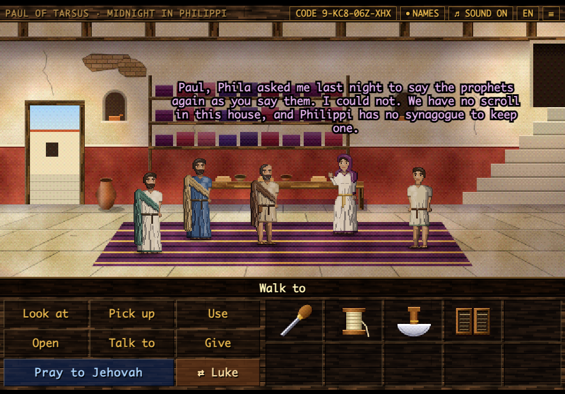
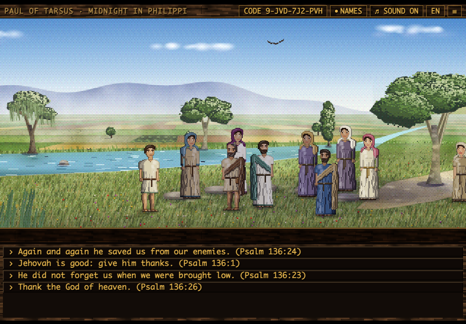
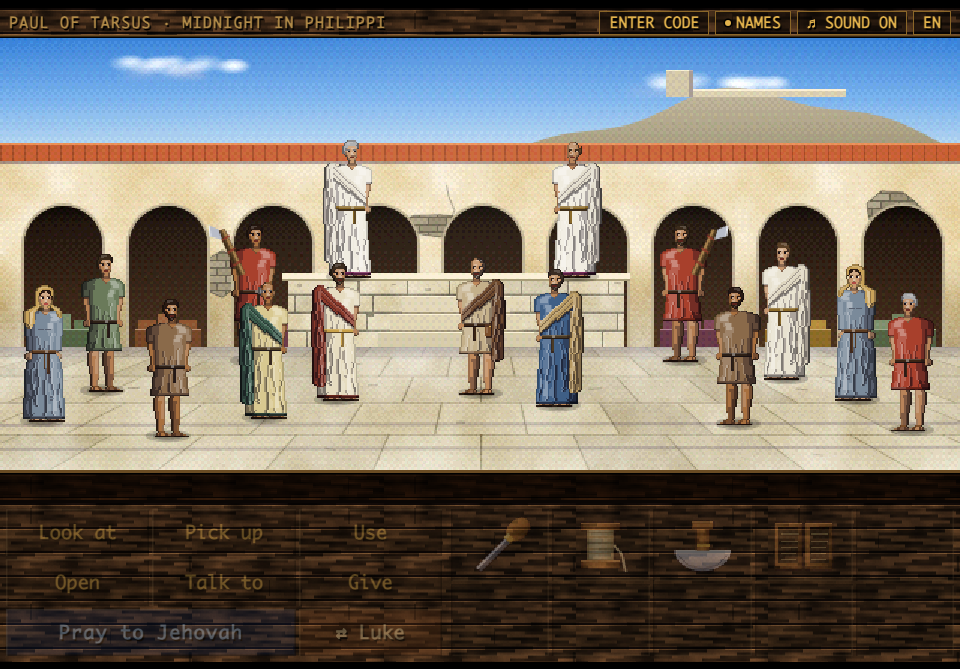
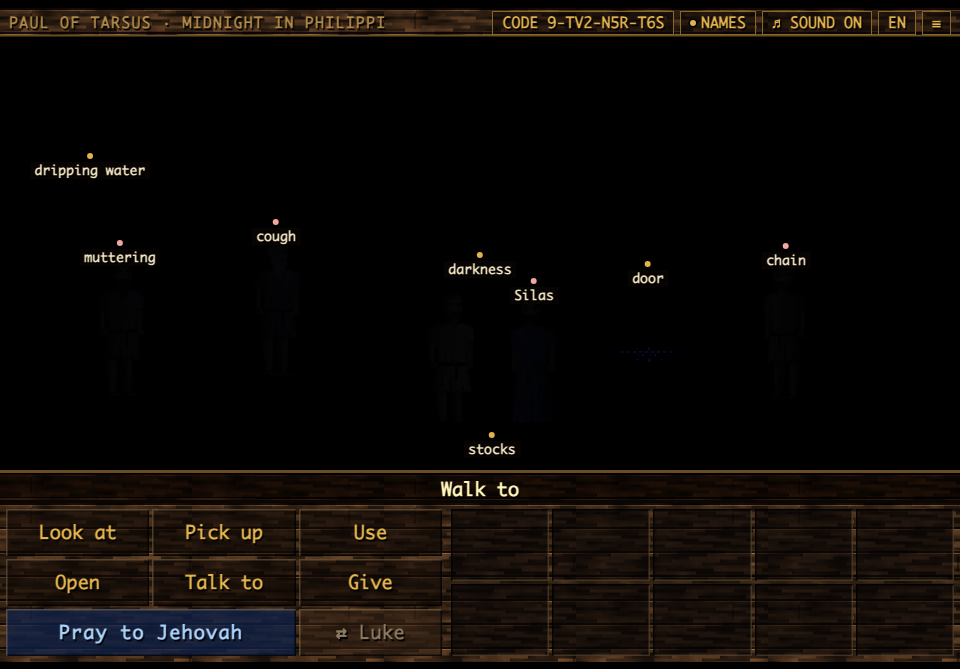
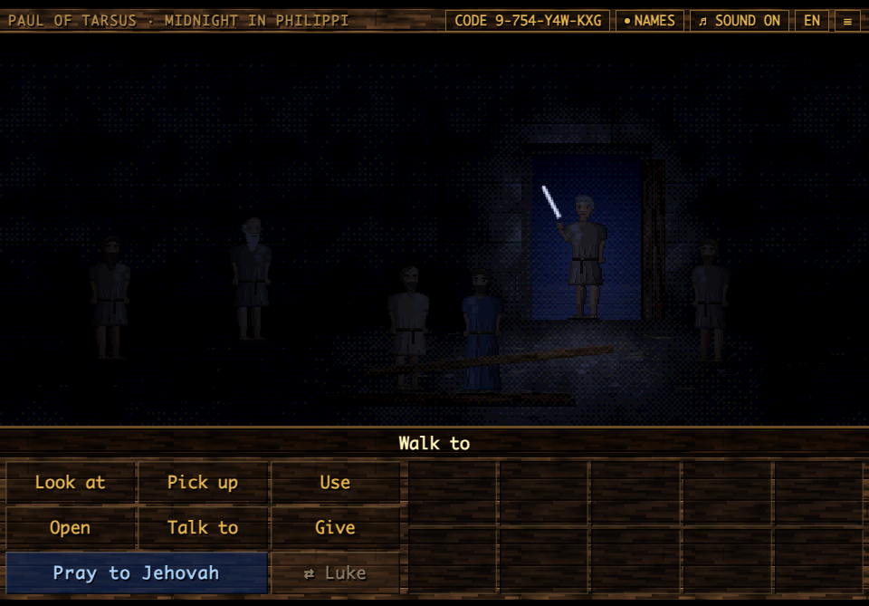
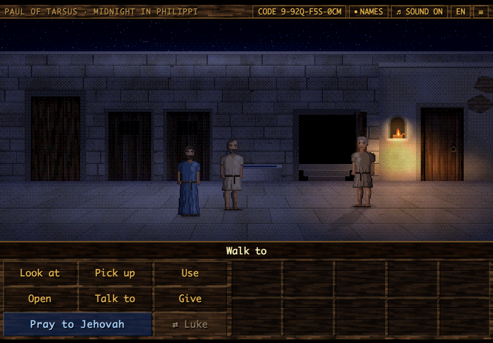
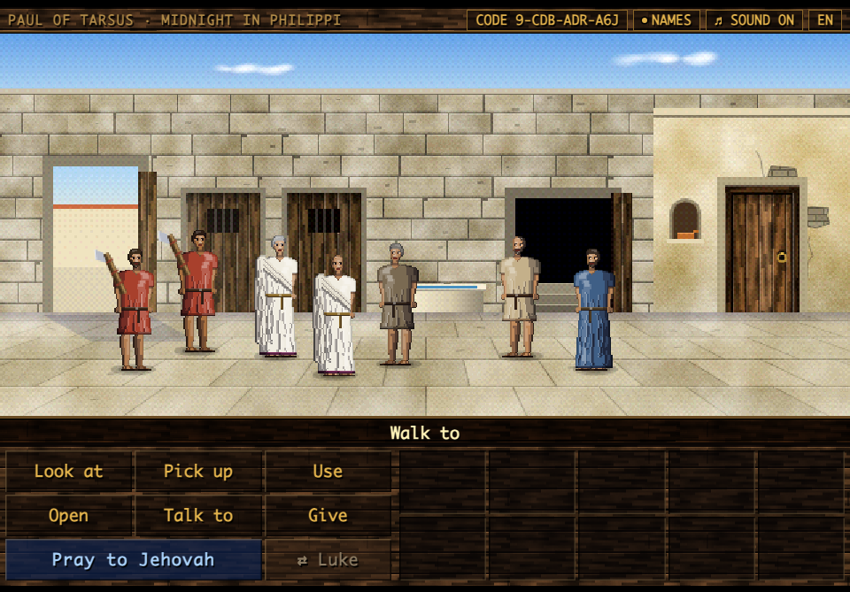
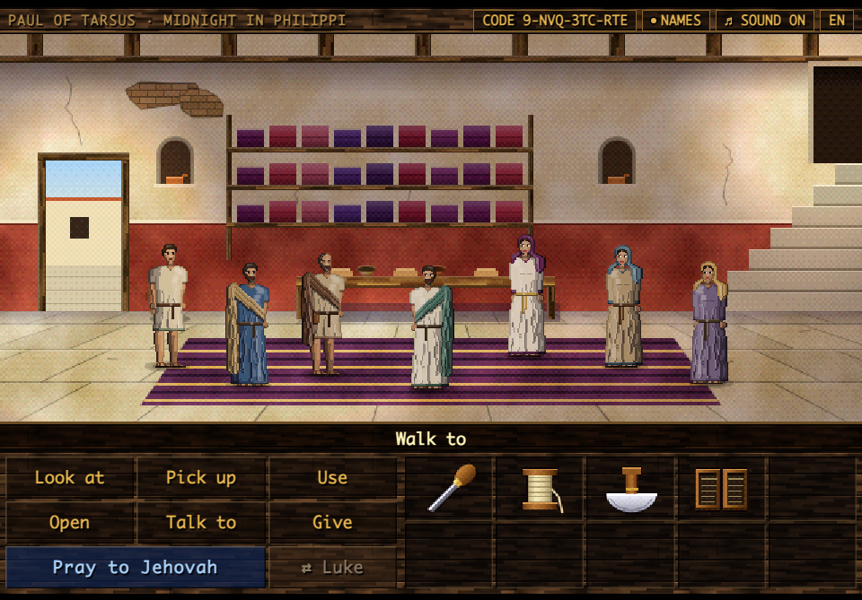

# Chapter Nine: Midnight in Philippi

About 50 C.E. For many days a servant girl who has a demon of divination comes along behind the men on their way to the place of prayer and shouts who they are; her fortune-telling makes her masters a great deal of money. At last Paul has had enough and, in the name of Jesus Christ, commands the spirit to leave her. Her masters see their income gone, haul Paul and Silas into the marketplace and accuse them before the civil magistrates. The two are beaten with rods and shut in the inner prison, with their feet locked in the stocks. Toward midnight they are praying and singing praise to God, and the prisoners are listening, when an earthquake throws every door open and frees everyone from his bonds. The jailer means to take his own life, and Paul shouts that they are all still there. That night the jailer and his household hear the word of Jehovah and are baptized. In the morning the magistrates send word that the men are to be let go. Paul will not be put out on the quiet: he and Silas are Romans, and they were flogged in public without a trial. The magistrates come in person, lead them out and ask them to leave. The two go to Lydia's house, encourage the brothers and depart (Acts 16:16-40).

| | |
|---|---|
|  |  |
| Lydia's house: no scroll, and no synagogue to keep one | The river: a psalm in call and answer, and a cry that breaks it off |
|  |  |
| The marketplace: the charge before the magistrates | The inner prison: no tools, no light, and the names of what is heard |

Four more locations, and the first chapter with voices in it. Here the narrator alone tells what the account says: each verse of Acts 16:16-40 is told in paraphrase with its reference, and nothing of it is put into a mouth. The lines of the psalm are notes in Paul's own words on his tablets, shown without quotation marks. They stand together at the top of `levels/chapter9.js` and `lang/de/chapter9.js` (`TOLD` and `PS`), where they can be checked against the Study Edition.

The place of prayer has no chest for scrolls, and Philippi has no synagogue. What Lydia's household can keep of the Scriptures is what it can sing, so Paul teaches a psalm that is written as a call and an answer: one gives a line, and all give the same answer (Psalm 136). The player leads it and chooses each line. Then the girl cries out across the singing, the women lose their place, and the psalm has to be taken up again at the line that was broken. It gets a little further on each of three days, and it is never sung to its end. Nothing the player does stops the crying. The account does, and that is told: Paul speaks to the spirit, not to the girl, and nothing is shown when it leaves.

What follows in the marketplace is told in the dark, read from the narrator's scroll. Then the door of the inner prison shuts, and for the first time in nine chapters the player has nothing: the pouch and the tablets went with the garments, the feet are in the stocks, and there is no light. The room is not shown. Its hotspots are sounds, and their names are all that stands on the screen: water dripping, a chain, a man muttering, a cough, Silas. Every verb gives a true answer and gets nowhere, except **Talk to**. Silas asks whether they also took what was written on the tablets. So the psalm is sung from memory, with no tablets to open: Paul begins, hoarse, and Silas answers, and after each answer one sound in the dark falls silent, because the prisoners are listening. After the last answer the earthquake is told.

| | |
|---|---|
|  |  |
| After the earthquake: the door is open, and a man has drawn his sword | Before day: the outer door stands open too |
|  |  |
| The morning: the magistrates have come on foot | Lydia's house: an hour, and nothing may be left waiting for Paul |

The stocks have fallen open and so has the door. Beyond it the jailer stands against the grey of the outer door with his sword drawn. Paul wants to call out that all of them are there, and he says nothing that he does not know to be true: so first the player turns back into the dark and speaks to the three men who listened. All of them answer. Then Paul calls out. The jailer's question, the answer, the word spoken to all in his house, the washing of the wounds, the baptism and the table are told as the account tells them; the baptism is not drawn. Before day the two walk back into the prison of their own accord, so that the jailer has his prisoners when the constables come: Acts has them there in the morning, and does not say how.

In the morning a brother wishes them peace and the door is open. Paul's answer is in the account, and it is told. Then the magistrates stand in the court themselves, afraid, and would give a good deal to have the matter forgotten. Silver, the rods for the accusers, leave to stay: each could be accepted without a lie, and Paul sets each aside. He asks for the one thing his answer named, to be led out by them in daylight, and then he leaves the city as they ask. In Lydia's house there is an hour. Luke is staying in Philippi. Each of Paul's cares is handed to one who stays, and to the right one, until nobody there has to ask for Paul. Then the household sings the psalm to its end.

Walkthrough (spoilers)

1. In Lydia's house, go out by the door to the street.
2. At the river, use the flat stones. Give the first line (the thanks to Jehovah) and then the second (he did not forget us). When the girl's cry breaks the answer, take the psalm up at that same line. Then choose "Come back tomorrow, and go on from where we stopped."
3. On the second day, use the flat stones again: the third line (he saved us), and the same line once more when it is broken.
4. On the third day, use the flat stones and give the last line (the thanks to the God of heaven).
5. In the inner prison, click the name **Silas** to talk to him: "What we know by heart, and two voices."
6. Talk to Silas four more times, and sing the four lines in the order you learned them.
7. After the earthquake, talk to each of the three prisoners. Then talk to the jailer in the doorway.
8. In the court by night, open the door of the inner prison.
9. In the morning, talk to the jailer: "We stay here until they come themselves." Then talk to the magistrate: "That they lead us out themselves, in daylight."
10. In Lydia's house, talk to Luke and ask who goes to the household by the prison; to Lydia, where the brothers meet; and to Phila, who begins the psalm.

## Music and sound

| Chapter | Music | Around you |
|---|---|---|
| Midnight in Philippi | A tune on six notes from E, with no sixth in its scale: a harp and a ney in Lydia's house, the harp alone beside the river, and nothing at all while the psalm is sung there; a low string that plucks the keynote and leans on the note above it, a ticking drum that almost stops every fourth bar, and a ney that begins the tune and breaks off before it comes home in the marketplace and before the magistrates; no instrument in the inner prison, only two men singing the psalm in call and answer; a drone and a harp in the jailer's court by night; a lyre, a low string, a hand drum and a pair of pipes when the two are led out. Nothing is claimed about how psalms were sung then | Water, birds and leaves beside the river; the crowd of the marketplace; in the dark, water dripping, a chain, a man muttering and a cough, which fall silent one by one; crickets and a lamp in the court by night |

Chapter Nine has the game's first voices. There are still no audio files: a voice is built as the lyre and the pipes are. A wave with every overtone stands for the throat, and five resonant filters in a row stand for the mouth; they move from vowel to vowel as the line is sung, each syllable with the vowel of its own word, and the level dips where a consonant would be. A note scoops up onto its pitch, slurred notes glide, vibrato comes in late on held notes only, there is breath in the tone, and a singer draws breath before a line. It has no consonants, so it sounds like people singing and never like words: the line stands on the screen while it is sung. Paul's voice is the lower and darker one and starts the night hoarse; Silas's is brighter; the women of a household sing an octave above the men. The vowels and the rhythm follow the words, so the German lines are sung with German vowels. Every step that is sung can also be read, because the game stays quiet in Silent Mode.

## The travel map

Nobody travels in Chapter Nine. It closes on the same Aegean window, with the road that led to Philippi drawn and the city lit, and [Chapter Ten](chapter-10.md#the-travel-map) draws the road on from there.

## About the content

Chapter Nine does the same, and its end screen says so. It tells what the account says (Acts 16:16-40) in the narrator's own words, verse by verse with the reference, and puts none of it into a mouth as a quotation; the psalm lines are Paul's notes, not quotations either. Acts does not say what the two men sang. The game has them sing Psalm 136, which *Insight on the Scriptures* ("Music") names as a psalm written for singing in call and answer; that Paul taught it to Lydia's household beside the river, on three days, is invented, and so is everything said there. The servant girl, her masters, the magistrates, the constables, the jailer and those of his house are not named in the account, and are not named here. The girl is shown as a servant girl like any other; nothing of her later life is invented. What became of her, whether the two spoke of being Romans before they were beaten, how many prisoners there were, why none of them fled, and how Paul knew what the jailer was about to do, the account does not say: the three prisoners are voices without names, and nobody says why he has stayed. *Bearing Thorough Witness* (chapter 16) says that in the inner prison the two could no doubt hardly see each other, so the room is heard and not shown. That the two walked back into the prison before day is invented: Acts 16:36 and 16:40 have them there in the morning. The offers of the magistrates and the walk across the marketplace are invented; the reason for Paul's answer is the one that chapter gives (paragraphs 17 and 18). Acts does not say who the brothers in Lydia's house were: the jailer's household is spoken of there, and not shown. That Timothy gathered up what was torn off the two men is invented. Luke stayed in Philippi, as the Study Edition's notes on Acts 16:10 and 16:33 say; Timothy leaves with Paul and Silas, as *Insight* ("Macedonia") says it appears he did. The constables carry what *Insight* ("Constable") describes as the mark of their office, a bundle of rods bound round the handle of an ax.

[← All chapters](../README.md#chapters)
