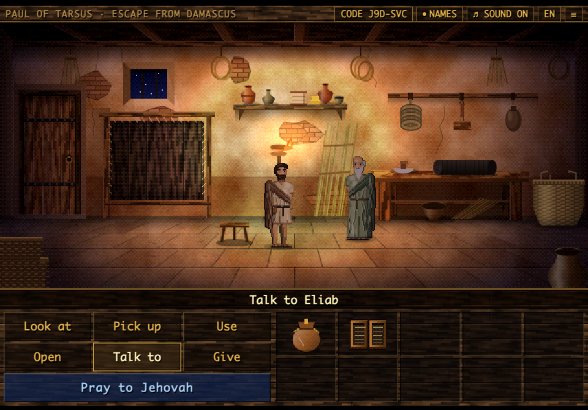
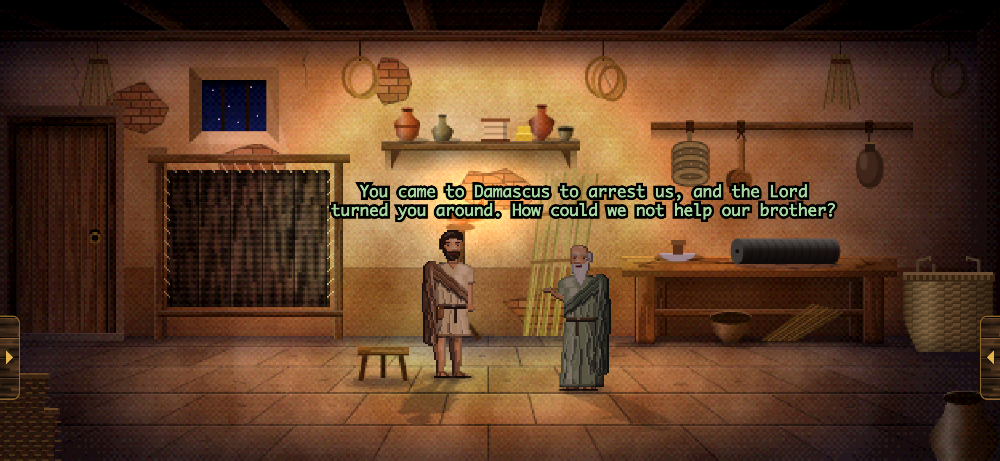
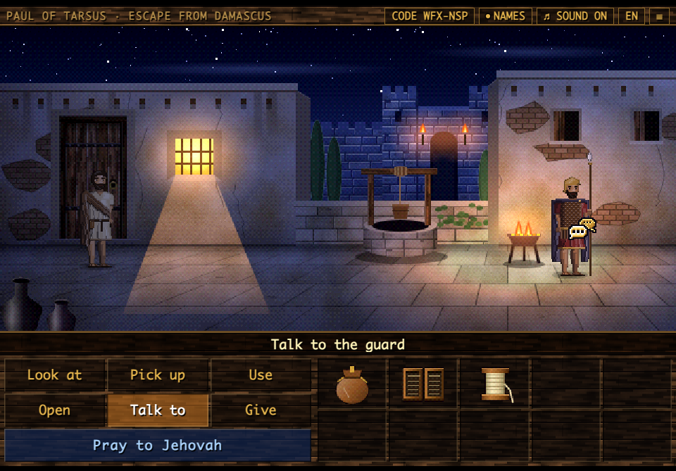
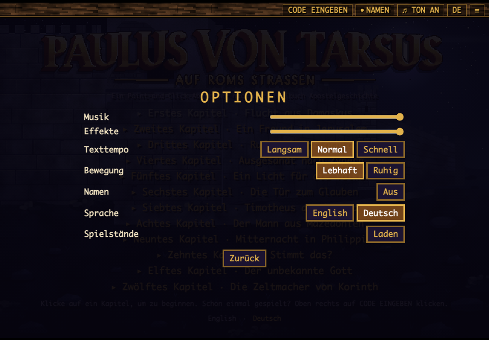
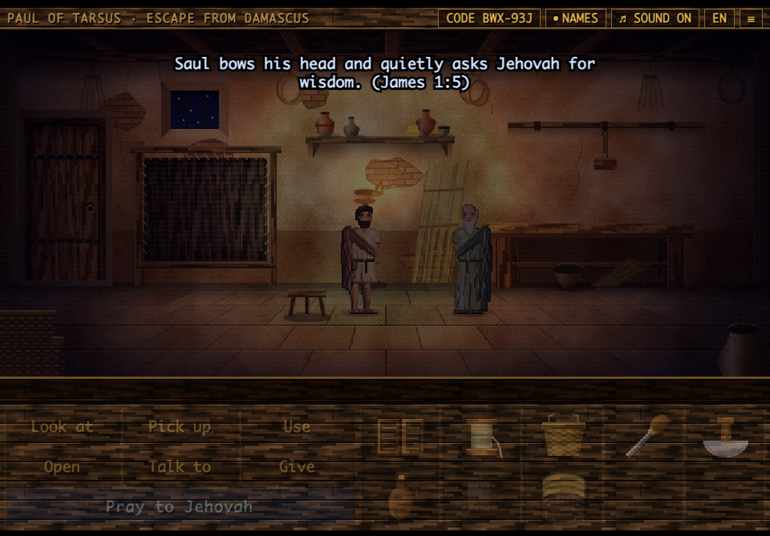
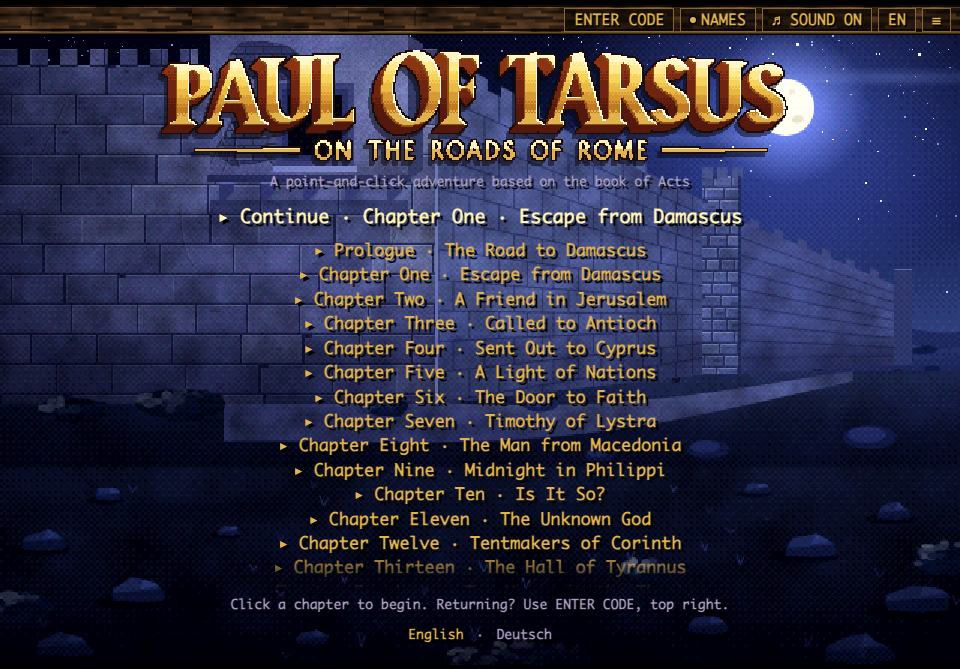
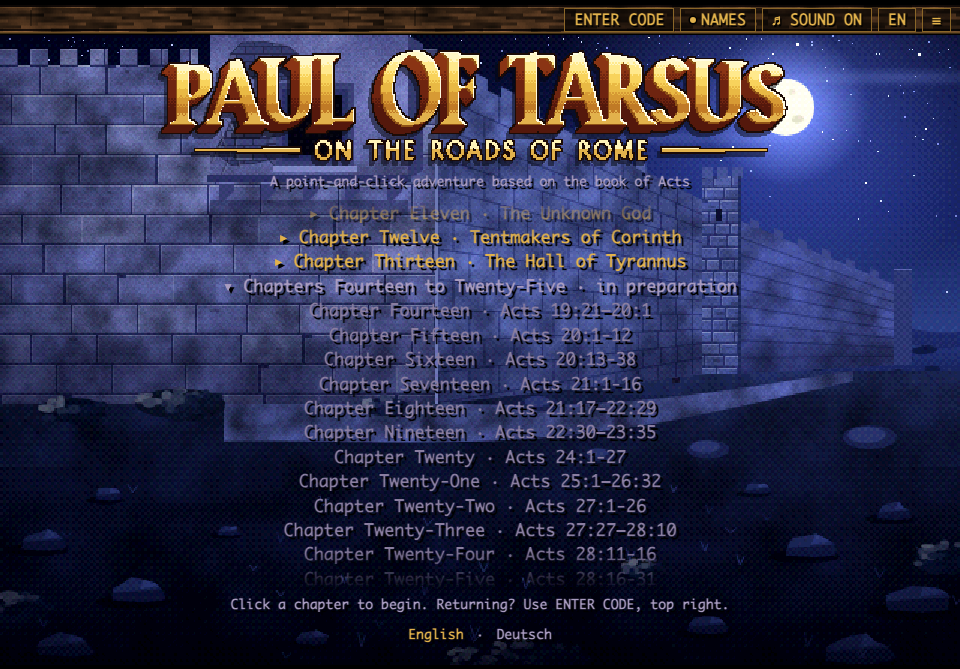
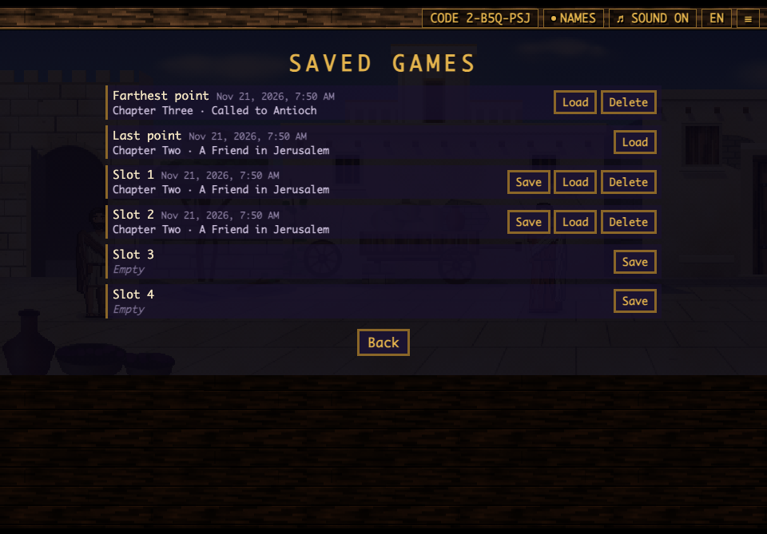
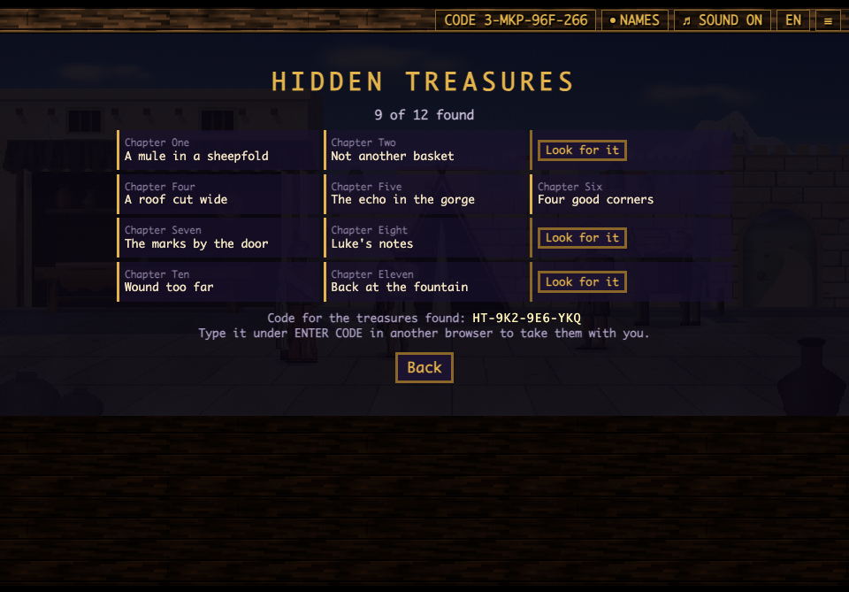

# How to play

| Action | How |
|---|---|
| Do the obvious thing | Point at something: its usual verb lights up in the panel and shows on the status line (**Open** a door, **Talk to** a person, **Pick up** what can be taken, **Look at** anything else). Click to do it. On a touch screen the status line shows it as your finger touches the scene. |
| Use a verb | Click **Look at**, **Pick up**, **Use**, **Open**, **Talk to** or **Give**, then the target |
| Look at something | Right-click it, in the scene or in the inventory. Paul looks from where he stands. |
| Leave a room at once | Double-click an exit to skip the walk to it |
| Show what can be clicked | Hold `Tab`: everything in the room gets a dot and its name. On a touch screen, or to keep them on, tap **NAMES** in the top bar; tap it again to hide them. While they are on, a name stands for its thing: pointing at it, tapping it, a right-click and a double-click do what they would do on the thing itself. The names step aside while a scene plays or someone speaks. |
| Tell who is speaking | A line stands over the head of whoever says it, in his own colour. When the speaker is not in the picture, as at a close view or from the deck outside it, or on a city map, where the figures are small, his name stands before his words. |
| Combine things | **Use**, then an inventory item, then another item or something in the scene |
| Play the other man | In Chapters Three, Four and Five, click **⇄ Barnabas** (or **⇄ Paul**) beside the prayer button, or press `C`. Each man has his own inventory, and in Chapter Three he can stand in a different room; the view follows the one you play. **Give** an item to the other when they share a room to hand it over (**Use** on him only shows it). |
| Play Silas | In Chapter Seven the button reads **⇄ Silas**: he was sent out with the letter, and he has two hands. He leaves the tentmaker's crafts to Paul, as Barnabas did. |
| Play Luke | In Chapter Eight the button reads **⇄ Luke**. It is there from the start and cannot be used until Troas, where he is with them. He is a physician: binding a wound is his craft, and Paul leaves it to him. |
| Play Timothy | In Chapter Ten the button reads **⇄ Timothy** and stays grey until Paul is sent to the sea (Acts 17:14). Then you are Timothy, and the button reads **⇄ Paul**, grey, until Athens. |
| Set something by hand | Chapter Ten has two close views, in which nobody walks. On the bolt of cloth, click a panel on the board to take it, click it again to turn it, and click the cloth to lay it there; a click on a panel that lies on the cloth lifts it off. At the scroll table, click a scroll's left or right roller to wind it back or on, click the tablets to turn to their next line, and talk to those who listen when everything on the table says one thing. What lies open is named under it. The stool, or the steps, lead back. |
| Carry a question | In Chapter Eleven Paul is alone, and his tablets stay shut. He carries four questions in his pack instead, like tools: choose **Use**, then a question, then something in the city. Put to the right thing, a question becomes something he has seen, noted on the tablets under "Seen in Athens". |
| Listen | In the painted colonnade of Chapter Eleven two men teach, one at each end. Walk toward one to hear him; **Talk to** him to listen on, or to keep the one saying of his that Paul can hold with him. |
| Build the speech | On the Areopagus Paul stands still. Click **what I begin from** and **how I say it**, at the foot of the view, until they are set as you want them, then click the men on the seats. What is to be said next stands over the two settings. Using one of the things he has seen on the men does the same as setting it. |
| Hang the awning | In Chapter Twelve the court of Titius Justus is seen from the side. Click a hook to move that end of the rope to it, and click a cloth to slide it along the rope, a quarter of the court at a time. The light in the court changes as you do, and what is set is written at the foot of the view. Click **step back and look**: if something is wrong, somebody says what he sees. |
| Play Aquila and Priscilla | In Chapter Twelve the button reads **⇄ Aquila and Priscilla**. It is grey until Paul lays down his awl, and grey again at Ephesus, where he leaves them. The two move, stand and answer as one, they stay at their bench, and the sewing is theirs. Chapter Thirteen begins with them: the button reads **⇄ Paul**, grey, until he has come down to Ephesus. From then on either can be played, and one evening needs both. |
| Let a season turn | In Chapter Twelve the road to the harbors opens a picture of the neck of land: click a harbor to go there, Corinth to stay. After the night of the vision the season stands at the foot of that picture, and a click on it lets it turn, once nobody is expecting Paul any longer. People say when they have time for him, and it is noted on the tablets under "Noted in Corinth". |
| Find what is missing | In the synagogue of Chapter Thirteen a man speaks, and nothing that he says is wrong. **Talk to** him: each time he has spoken, choose the note on the tablets that he has just said. When he has finished, talk to him again and choose the one that was not heard. |
| Move the day on | From the hall onward, Chapter Thirteen has mornings, middays and evenings. **Use** the sundial in the street to let its shadow move on. It will not move while something promised for that part of the day is still open; the tablets say what is. The steps to the loft, in the workshop, end the day. |
| Search a house | One evening in Chapter Thirteen a house is seen with one wall taken away. **Talk to** its owner for what he remembers of each hiding place, and click where his words point. How many are found stands at the foot of the view. |
| Reckon a sum | The counting board of Chapter Thirteen has five places. Click a trough to lay a pebble in it and the hollow above it to lay one there; **Pick up** takes one off, and the bowl takes off everything laid for the sum in hand. Beside each trough and each hollow its worth is cut in a Greek number letter: finding out what they mean is the puzzle (**Look at** names a letter, and prayer helps). What was said stands under the board, and a click on Timothy asks him whether the board agrees. |
| Walk a city from above | Chapter Fourteen shows Ephesus, and Chapter Seventeen the island city of Tyre, at a slant from above, larger than the screen. Click a lane to walk there: the way is shown as a row of gold dots up to a small diamond, and it goes only by the lanes already seen or come by, so a click on a far place may only bring you nearer. The arrow keys or `W` `A` `S` `D` steer directly. Zoom with two fingers, the mouse wheel, or `+` and `-`. A house that hides you fades. Whatever blocks a way is named when you stop before it. |
| Be played in turn | In Chapter Fifteen nobody is chosen: Paul is played in Greece, and Luke from the quay of Troas to the end, each with wax tablets of his own. At midnight nobody is played: what happens then is told. In Chapter Seventeen Paul is played, and in Philip's house Luke, with his own tablets, from the moment they all begin to plead with Paul until it is left in Jehovah's hands. |
| Weigh on a balance | The balance of Chapter Fifteen is a close view. Click a weight to move it from the board into the right pan; click it again and it goes into the left pan, beside the bag; a third click, or **Pick up**, brings it back to the board. The beam tilts as it would, and **Look at** says which pan is down. The bag's weight stands on its letter, and each weight's worth is cut into it, in Greek number letters (**Look at** the letter). **Use** the scale, or talk to Timothy, when the beam stands level. A weight beside the bag takes away from what lies across from it. |
| Lay out a plan | In the wet sand of Chapter Fifteen, seen from above, three things are settled with three things from the inventory: **Use** the reed, the shell and the awl with the roads and the pebbles. Over the plan, **Look at** the shell and the awl to hear what each stands for. |
| Keep the lamps burning | In the upper room of Chapter Fifteen, **Use** the stool to sit and listen: every lamp burns one measure, and the jug is filled again with three. **Use** the jug with a lamp to pour one measure. **Look at** a lamp to see what it holds and what is in it. You cannot sit while a lamp is burning its last or with oil left in the jug, and a measure that would leave another lamp dark before midnight is not poured, so there is no way to lose the night. |
| Be in two places | In Chapter Sixteen Paul walks to Assos while Luke sails there. From the quay of Troas until they meet, click **⇄ Luke** (or **⇄ Paul**), or press `C`, to play the other: each is in his own room with his own inventory, and the view goes to the one you play. Paul's bag goes aboard with Luke. From Assos to Chios Luke is played while Paul rests, and at Miletus Paul again. |
| Read the wind | The close view over the stern in Chapter Sixteen shows the signs: **Look at** the pennant, the smoke on the shore, the whitecaps and the clouds. **Use** the wool tuft to turn where the wind comes from, and the knotted cord to set how hard it blows; what the boy will report stands at the top. **Talk to** Pamphilos, the master, whose hand is on the tiller, to report. A sign can mislead, and the master says why. |
| Draw up the watches | On Luke's tablet in Chapter Sixteen, click a name and then a watch to lay it there; click a laid name to take it back. When all eight are laid, Luke reads the list, and a man whose wish it breaks says so. |
| Chalk a plan | The hold of Chapter Seventeen is seen from the side, in section. Click a lot (or **Use** or **Pick up** it) to chalk the next day on it; how many are chalked stands at the top left, and a click on a chalked lot rubs it out with every day after it. When all seven are chalked, the master reads the plan through day by day and the hull trims as it would; he stops on the first day that breaks one of his rules, and the chalk from that day on is rubbed out. **Look at** the marks and the mast. |
| Tell it in order | When James asks Paul to tell everything one thing after another, in Chapter Eighteen, the travel map opens on the places of the journeys. Click the place that came next; each right one is told, and the road told so far draws itself. Every place stays on offer: one told already or one that came later is answered so, and nothing is lost. `Esc` or a right-click stops for now, and talking to James again goes on from there. |
| Read an inscription | The warning stone of Chapter Eighteen is a close view in Greek capitals. **Look at** each word to hear Paul read it; one of them decides who may pass the barrier. **Back to the court**, at the foot of the view, leaves it. |
| Speak in another tongue | On the stairs of Chapter Eighteen every line Paul can say is offered twice, beginning **In Greek:** or **In Hebrew:**. The words are true either way; what changes is who understands them. **Use** the crowd to motion to them with the hand. |
| Choose where to look | While the soldiers carry Paul up the stairs, the player does not steer. Twice a choice asks where he looks; any choice is right, and what he saw is what he can say later. |
| Put two thoughts together | In Chapter Nineteen what Paul's nephew overhears in the lanes becomes a thought in his inventory, as an item would. **Use** one thought with another to see what they mean together; only the right pair tells him more. |
| Mark a letter against your notes | At Caesarea in Chapter Nineteen the commander's letter lies beside Paul's tablet in a close view. **Use** a note to say which line of the letter tells it, or that the letter does not; **Use** a line of the letter to say whether it tells it as it happened. When every note and one line are marked, Paul says what does not agree, and the marks can be changed. |
| Let the seasons pass | In Chapter Twenty the harbor below Paul's window shows the time of year. **Use** the awl with the window, or with its sill in the close view, to scratch a mark and move the season on. While somebody is still waiting for Paul, a visitor, the governor or Luke, he leaves the sill alone. |
| Choose whom to speak to | In the audience chamber of Chapter Twenty-One, **Talk to** Festus and **Talk to** King Agrippa offer the same true sentences. What changes is who hears them: each answers in his own way, and the sentences stay on offer. |
| Wait for the right moment | In Chapter Eighteen Paul carries one true sentence in his inventory, **Roman by birth**. **Give** it to someone, as you would an item: only to the right person, at the right moment, does it change anything. If the moment passes, it comes again. |
| Give directions | On Paul's old page from Ephesus, click a name and then a place. A wrong match is only Paul's own check. When everyone who is to be fetched has his place, the list is given to the messenger. |
| Seal a tablet | In Chapter Fourteen a tablet is closed and sealed in a close view: **Pick up** a leaf to turn it round, **Use** it to lay it on the other, then **Use** the cord and the clay from the inventory with the tablet. Whoever holds the ring presses it last. A wrong order is turned back with its reason. |
| Travel | In Chapters Four and Five the way out of a town opens the travel map. Click a place to go there; `Esc` or a right-click stays. A place the story has not reached yet, or one that lies behind, says why not. |
| Read Paul's notes | Click the **wax tablets** in the inventory (their default verb is **Open**): the people he has met, what is still to be done, and the Scriptures for the chapter. Click or press Space to close them. |
| Show something to someone | **Give** (or **Use**) an item on a person. Everyone has something to say about everything Paul carries, sometimes a clue. Only what someone actually needs changes hands. |
| Ask about what you have learned | Once Paul learns something (a frayed basket, a torn sail, a famine), it appears as a new question when he talks to people in that chapter |
| Skip a line of dialogue | Click the scene or press Space |
| See what is coming | The last line on the title screen, **Chapters Twenty-Two to Twenty-Five · in preparation**, opens the chapters that are planned and not yet built, each with the part of Acts it will tell. They cannot be played yet; click the line again to close them. |
| Change the language | Click **English** or **Deutsch** on the title screen, or the **EN**/**DE** button in the top bar at any time |
| Keyboard | `1`-`6` verbs, `P` pray, `M` mute, `Tab` names, `C` switch character, `Esc` options |
| Options | Click **≡** in the top right or press `Esc` to set the music and effects volume, the text speed, how much the figures move (**Movement**: lively, or calm, which keeps the mouths and leaves the rest still; a device set to reduce motion starts in calm), **NAMES** and the language, to save and load games (see [Saved games](#saved-games)), to see the [hidden treasures](#hidden-treasures) you have found, or to go back to the title screen. It opens between scenes, not during a cutscene or a conversation. The options are kept in your browser apart from your safe point (`paul.opts`). |
| Begin | The game opens on its opening picture and waits, silent: a browser lets a page sound only after a click or a key. Click, or press Space or Enter, and the overture begins. When its melody has been heard the chapters appear; a second click, Space or Enter brings them at once, and the music plays on. |
| Skip the title card | A chapter opens with its title card for a few seconds. Click or press Space or `Esc` to go on at once. |
| Skip the prologue | While the prologue plays, click **SKIP** in the top bar to jump straight to Chapter One. |
| Watch the end | After the last scene of the last chapter the game is no longer played: a map shows where the letters written in Rome went, the narrator closes the roll, and the look back draws every journey from Damascus to Rome, map by map, with each chapter's name under the map and a bar of its tune as its road is drawn. A click or Space passes over a line, or over the whole look back; **SKIP** in the top bar goes straight to the closing screen. |
| After the end | The closing screen names the hidden treasures you found (click them to look for the others) and has a line, **About the last chapter**, for what that chapter invented and what the account leaves unsaid. A click leads back to the title, which now has the line **From Damascus to Rome**: it shows the look back and the closing screen again. **Continue** leads into the room in Rome on the last morning. |
| Sound | It starts with your first click, tap or key. **♫ SOUND ON** (or `M`) switches it off and on, and the options menu adjusts music and effects levels independently. On iPhone and iPad the game respects Silent Mode, and Safari cannot tell the game whether it is on, so a short note at the top right says where to look when the sound starts and whenever you switch it on. |
| Play on a phone | Hold the phone sideways. The verbs stand in a column on the left, under **≡** (the options) and **NAMES**, and the inventory in a column on the right; the picture fills the space between them from top to bottom. It follows Paul, or whoever is speaking. Draw a finger across it to look along the room, pinch with two fingers to zoom in up to three times, and tap twice to go back. A close view, such as the bolt of cloth, and the map are shown whole. The status line lies over the top of the picture while you touch something, and the choices of a conversation over its foot. The options, a safe point, an end screen and the narrator's scroll take the whole screen, and the columns slide out of the way. The safe-point code is shown and entered from the options (**Saved games**); on the title screen **ENTER CODE** and **≡** stand in the top right corner. Held upright, the phone asks to be turned. The game chooses this layout by itself on a phone; **Layout** in the options switches between **Auto**, **Phone** and **Classic**. |

The pointer over the scene is the game's own: a gold arrow with a dark contour, painted in code like everything else, so that it shows in a night scene as well as on a sunlit quay. It grows with the window, brightens over objects and people, and turns into a directional arrow over exits.

While a verb is chosen, the pointer shows it: a magnifying glass for **Look at**, an open hand for **Pick up**, a pointing hand for **Use**, a key for **Open**, two speech balloons for **Talk to**, and a hand holding out a purse for **Give**. It brightens over anything the verb can be used on, and becomes the arrow again once the verb is put down.

The options (**≡** or `Esc`) take the whole screen while they are open, and are the same in every chapter.

| | |
|---|---|
|  |  |
| Showing the long rope to the guard | The fisherman can be asked about Barnabas, the sail and the twine |

## Languages

The game plays in English and in German (Deutsch). It starts in your browser's language and remembers your choice; switch on the title screen or with the **EN**/**DE** button in the top bar, even in the middle of a scene. Only the words change: the puzzles, the answers and their order are the same, so the walkthroughs above hold in German too. A safe-point code works in either language. The German text tells the verses in its own words, checked against the *Neue-Welt-Übersetzung der Heiligen Schrift (Studienausgabe)*, and names follow that edition: Saulus, Kephas, Jakobus, Damaskus, Antiochia. A link can choose the language with `?lang=de` or `?lang=en`.

## Pray to Jehovah

The blue button is the hint system. Paul (Saul, as the account calls him until Acts 13:9) pauses, bows his head and prays for wisdom (James 1:5) and leaves his cares with Jehovah (1 Peter 5:7). Prayer never solves a puzzle or changes the game. It clears his mind, and he then has a thought that points toward the next practical step. Praying again at the same point gives a more direct thought. While you play someone who does not worship Jehovah, such as the governor's clerk in Chapter Twenty-One, the button reads **Think it over** and gives the same hints as his own thoughts, with no prayer.

## Safe-point codes

The top bar always shows a short code for exactly where you are: six characters in Chapter One, and the same with a leading `2-` in Chapter Two. Chapter Three, Four and Five codes are nine characters (`3-XXX-XXX-XXX`, `4-XXX-XXX-XXX`, `5-XXX-XXX-XXX`), because they also remember which man you are playing, where each of them stands and who carries what; six-character Chapter Three codes from before still work. Write it down, and enter it later with **ENTER CODE** on the title screen (or the code button during play) to return to the same room with the same inventory and progress. Any moment outside a cutscene is a safe point.

The game also keeps that same point in your browser, every time it changes. Come back in the same browser and the title screen leads with **Continue**, naming the chapter, which returns you to the room, inventory and progress you left. A finished chapter leaves **Continue** at the next one, and a finished game leaves nothing. The code is still what carries your place to another browser or device, and what you write down; the browser's copy is only as lasting as the browser's site data, so clearing it, a private window or another browser starts without it.

Chapter Six, Seven, Eight and Nine codes are nine characters too (`6-XXX-XXX-XXX`, `7-XXX-XXX-XXX`, `8-XXX-XXX-XXX`, `9-XXX-XXX-XXX`), and so are Chapter Ten's and Chapter Eleven's, which begin with both digits of the chapter's number (`10-XXX-XXX-XXX`, `11-XXX-XXX-XXX`). Chapter Twelve's, Chapter Thirteen's and Chapter Fourteen's are fifteen characters (`12-XXX-XXX-XXX-XXX-XXX`, `13-XXX-XXX-XXX-XXX-XXX`, `14-XXX-XXX-XXX-XXX-XXX`): they have more to remember. Chapter Fifteen's are twelve (`15-XXX-XXX-XXX-XXX`). In the close views and in the upper room of that chapter a code holds what is finished: a bag that is sealed, a part of the plan that is settled, a sitting that is over. It brings you back with the weights on the board, and with the lamps as they stood after that sitting and a full jug.

## Saved games

Open the options (**≡** or `Esc`) and choose **Saved games** to see what this browser keeps:

- **Farthest point**: the farthest you have played: the latest chapter, and within it the point with the most of the story done. Going back to an earlier chapter to try something never moves it back, and finishing a chapter moves it to the start of the next. Only you can delete it. A point you return to by typing a code does not count, but playing on from there does.
- **Last point**: where you were last, the same point **Continue** returns to.
- **Slot 1** to **Slot 4**: four points of your own. **Save** keeps the point you are at, with its chapter and the date and time.

Saving over a kept game, deleting one, and loading one while a game is in play each ask first, in the row itself. On the title screen the slots and both points can be loaded too, and when the farthest point is not where **Continue** goes, the title screen offers it as well. Like the last point, all of this lives only in this browser; a safe-point code is still what carries your place anywhere else.

## Hidden treasures

Every chapter hides one small thing that the story does not need: a detail, a word or a sound that a curious player may come across, and no prayer hints at it. When you find one, a small notice in the top left corner says so. Finding it changes nothing in your game.

The title screen (once you have found one) and the options (**Hidden treasures**) show what you have found, one place for each chapter. A treasure you have not found shows nothing. In a chapter you have already reached, its place offers **Look for it**, which takes you back to a point in that chapter a little before it; your farthest point stays where it was. The screen also shows a code for the treasures you have found, beginning with `HT-`: type it under **ENTER CODE** in another browser to take them with you. It only ever adds to what that browser has found.

The treasures are kept apart from your saved games (`paul.treasures`), so they never touch a safe point.

