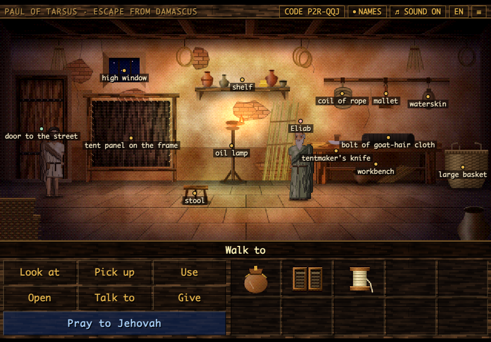
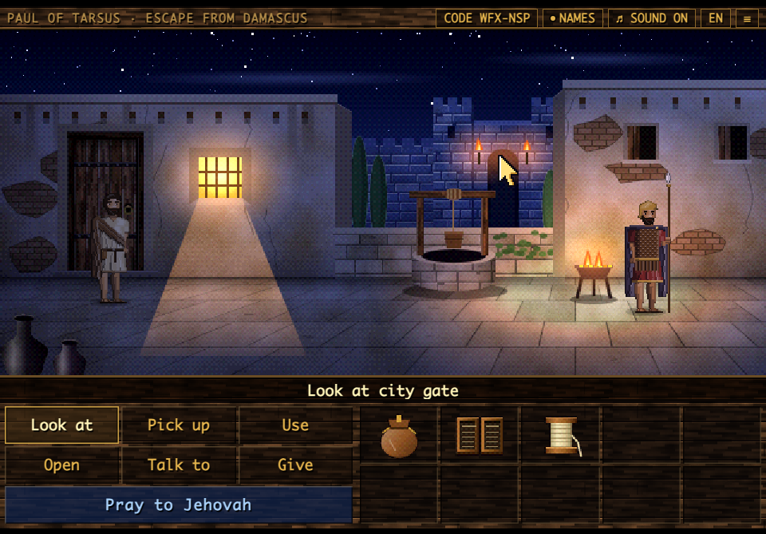
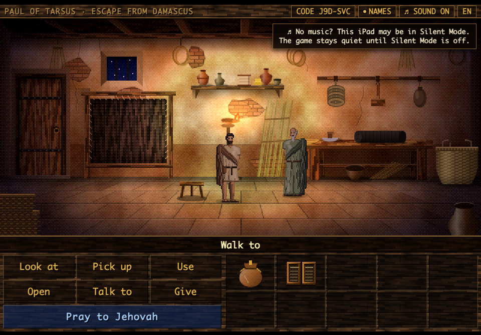
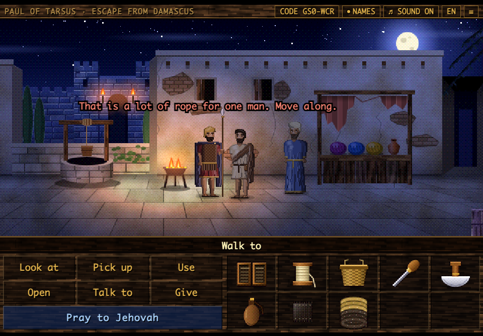
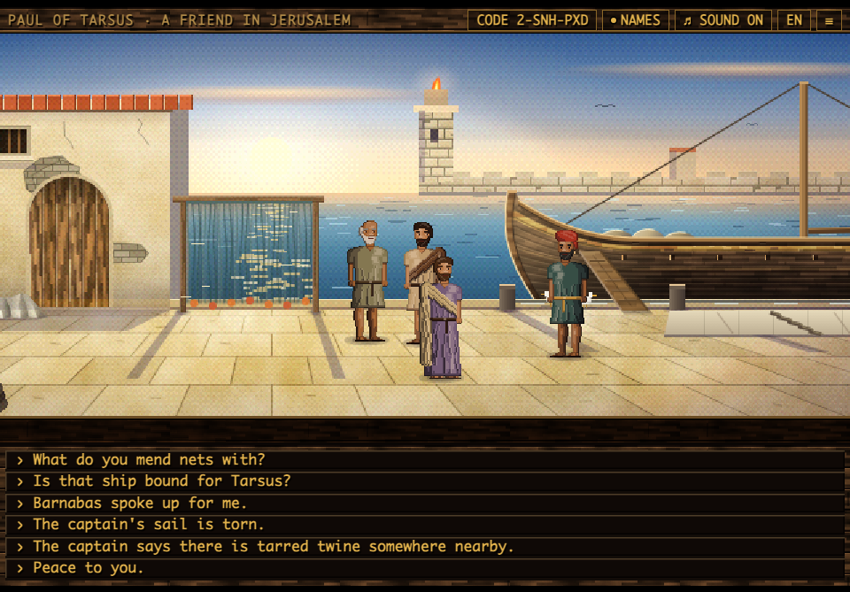
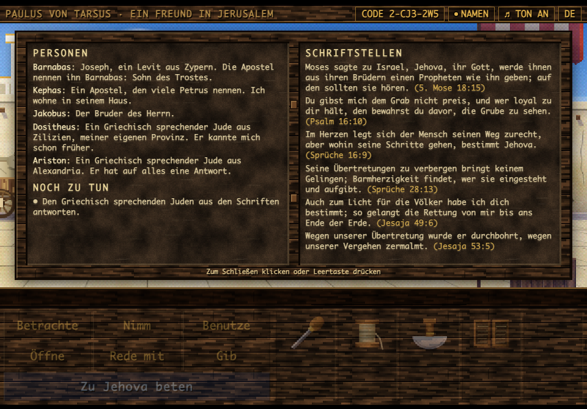
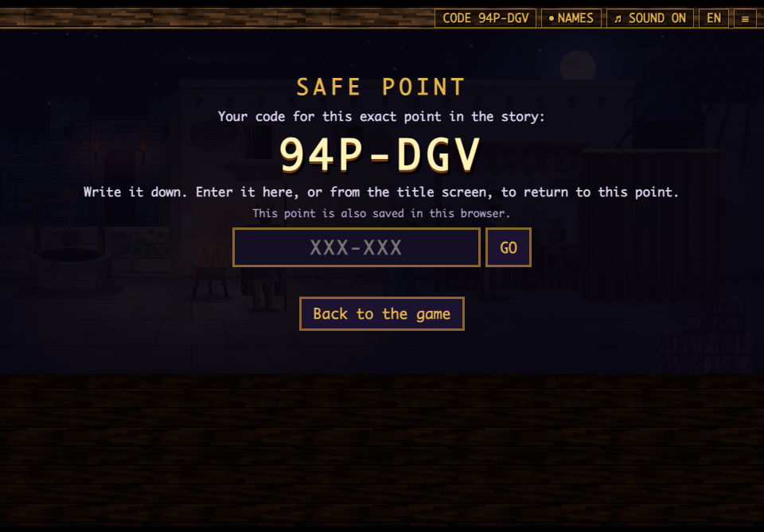

# How to play

| Action | How |
|---|---|
| Do the obvious thing | Point at something: its usual verb lights up in the panel and shows on the status line (**Open** a door, **Talk to** a person, **Pick up** what can be taken, **Look at** anything else). Click to do it. On a touch screen the status line shows it as your finger touches the scene. |
| Use a verb | Click **Look at**, **Pick up**, **Use**, **Open**, **Talk to** or **Give**, then the target |
| Look at something | Right-click it, in the scene or in the inventory. Paul looks from where he stands. |
| Leave a room at once | Double-click an exit to skip the walk to it |
| Show what can be clicked | Hold `Tab`: everything in the room gets a dot and its name. On a touch screen, or to keep them on, tap **NAMES** in the top bar; tap it again to hide them. While they are on, a name stands for its thing: pointing at it, tapping it, a right-click and a double-click do what they would do on the thing itself. The names step aside while a scene plays or someone speaks. |
| Combine things | **Use**, then an inventory item, then another item or something in the scene |
| Play the other man | In Chapters Three, Four and Five, click **⇄ Barnabas** (or **⇄ Paul**) beside the prayer button, or press `C`. Each man has his own inventory, and in Chapter Three he can stand in a different room; the view follows the one you play. **Give** an item to the other when they share a room to hand it over (**Use** on him only shows it). |
| Play Silas | In Chapter Seven the button reads **⇄ Silas**: he was sent out with the letter, and he has two hands. He leaves the tentmaker's crafts to Paul, as Barnabas did. |
| Play Luke | In Chapter Eight the button reads **⇄ Luke**. It is there from the start and cannot be used until Troas, where he is with them. He is a physician: binding a wound is his craft, and Paul leaves it to him. |
| Play Timothy | In Chapter Ten the button reads **⇄ Timothy** and stays grey until Paul is sent to the sea (Acts 17:14). Then you are Timothy, and the button reads **⇄ Paul**, grey, until Athens. |
| Set something by hand | Chapter Ten has two close views, in which nobody walks. On the bolt of cloth, click a panel on the board to take it, click it again to turn it, and click the cloth to lay it there; a click on a panel that lies on the cloth lifts it off. At the scroll table, click a scroll's left or right roller to wind it back or on, click the tablets to turn to their next line, and talk to those who listen when everything on the table says one thing. What lies open is named under it. The stool, or the steps, lead back. |
| Carry a question | In Chapter Eleven Paul is alone, and his tablets stay shut. He carries four questions in his pack instead, like tools: choose **Use**, then a question, then something in the city. Put to the right thing, a question becomes something he has seen, noted on the tablets under "Seen in Athens". |
| Listen | In the painted colonnade of Chapter Eleven two men teach, one at each end. Walk toward one to hear him; **Talk to** him to listen on, or to keep the one saying of his that Paul can hold with him. |
| Build the speech | On the Areopagus Paul stands still. Click **what I begin from** and **how I say it**, at the foot of the view, until they are set as you want them, then click the men on the seats. What is to be said next stands over the two settings. Using one of the things he has seen on the men does the same as setting it. |
| Hang the awning | In Chapter Twelve the court of Titius Justus is seen from the side. Click a hook to move that end of the rope to it, and click a cloth to slide it along the rope, a quarter of the court at a time. The light in the court changes as you do, and what is set is written at the foot of the view. Click **step back and look**: if something is wrong, somebody says what he sees. |
| Play Aquila and Priscilla | In Chapter Twelve the button reads **⇄ Aquila and Priscilla**. It is grey until Paul lays down his awl, and grey again at Ephesus, where he leaves them. The two move, stand and answer as one, they stay at their bench, and the sewing is theirs. |
| Let a season turn | In Chapter Twelve the road to the harbors opens a picture of the neck of land: click a harbor to go there, Corinth to stay. After the night of the vision the season stands at the foot of that picture, and a click on it lets it turn, once nobody is expecting Paul any longer. People say when they have time for him, and it is noted on the tablets under "Noted in Corinth". |
| Travel | In Chapters Four and Five the way out of a town opens the travel map. Click a place to go there; `Esc` or a right-click stays. A place the story has not reached yet, or one that lies behind, says why not. |
| Read Paul's notes | Click the **wax tablets** in the inventory (their default verb is **Open**): the people he has met, what is still to be done, and the Scriptures for the chapter. Click or press Space to close them. |
| Show something to someone | **Give** (or **Use**) an item on a person. Everyone has something to say about everything Paul carries, sometimes a clue. Only what someone actually needs changes hands. |
| Ask about what you have learned | Once Paul learns something (a frayed basket, a torn sail, a famine), it appears as a new question when he talks to people in that chapter |
| Skip a line of dialogue | Click the scene or press Space |
| Change the language | Click **English** or **Deutsch** on the title screen, or the **EN**/**DE** button in the top bar at any time |
| Keyboard | `1`-`6` verbs, `P` pray, `M` mute, `Tab` names, `C` switch character |
| Sound | It starts with your first click, tap or key. **♫ SOUND ON** (or `M`) switches it off and on. On iPhone and iPad the game respects Silent Mode, and Safari cannot tell the game whether it is on, so a short note at the top right says where to look when the sound starts and whenever you switch it on. |

The pointer over the scene is the game's own: a gold arrow with a dark contour, painted in code like everything else, so that it shows in a night scene as well as on a sunlit quay. It grows with the window.

| | |
|---|---|
|  |  |
| Showing the long rope to the guard | The fisherman can be asked about Barnabas, the sail and the twine |

## Languages

The game plays in English and in German (Deutsch). It starts in your browser's language and remembers your choice; switch on the title screen or with the **EN**/**DE** button in the top bar, even in the middle of a scene. Only the words change: the puzzles, the answers and their order are the same, so the walkthroughs above hold in German too. A safe-point code works in either language. The German text tells the verses in its own words, checked against the *Neue-Welt-Übersetzung der Heiligen Schrift (Studienausgabe)*, and names follow that edition: Saulus, Kephas, Jakobus, Damaskus, Antiochia. A link can choose the language with `?lang=de` or `?lang=en`.

## Pray to Jehovah

The blue button is the hint system. Paul pauses, bows his head and prays for wisdom and a calm heart (James 1:5; Proverbs 3:5, 6). Prayer never solves a puzzle or changes the game. It clears his mind, and he then has a thought that points toward the next practical step. Praying again at the same point gives a more direct thought.

## Safe-point codes

The top bar always shows a short code for exactly where you are: six characters in Chapter One, and the same with a leading `2-` in Chapter Two. Chapter Three, Four and Five codes are nine characters (`3-XXX-XXX-XXX`, `4-XXX-XXX-XXX`, `5-XXX-XXX-XXX`), because they also remember which man you are playing, where each of them stands and who carries what; six-character Chapter Three codes from before still work. Write it down, and enter it later with **ENTER CODE** on the title screen (or the code button during play) to return to the same room with the same inventory and progress. Any moment outside a cutscene is a safe point.

The game also keeps that same point in your browser, every time it changes. Come back in the same browser and the title screen leads with **Continue**, naming the chapter, which returns you to the room, inventory and progress you left. A finished chapter leaves **Continue** at the next one, and a finished game leaves nothing. The code is still what carries your place to another browser or device, and what you write down; the browser's copy is only as lasting as the browser's site data, so clearing it, a private window or another browser starts without it.

Chapter Six, Seven, Eight and Nine codes are nine characters too (`6-XXX-XXX-XXX`, `7-XXX-XXX-XXX`, `8-XXX-XXX-XXX`, `9-XXX-XXX-XXX`), and so are Chapter Ten's and Chapter Eleven's, which begin with both digits of the chapter's number (`10-XXX-XXX-XXX`, `11-XXX-XXX-XXX`). Chapter Twelve's are fifteen characters (`12-XXX-XXX-XXX-XXX-XXX`): it has more to remember.

