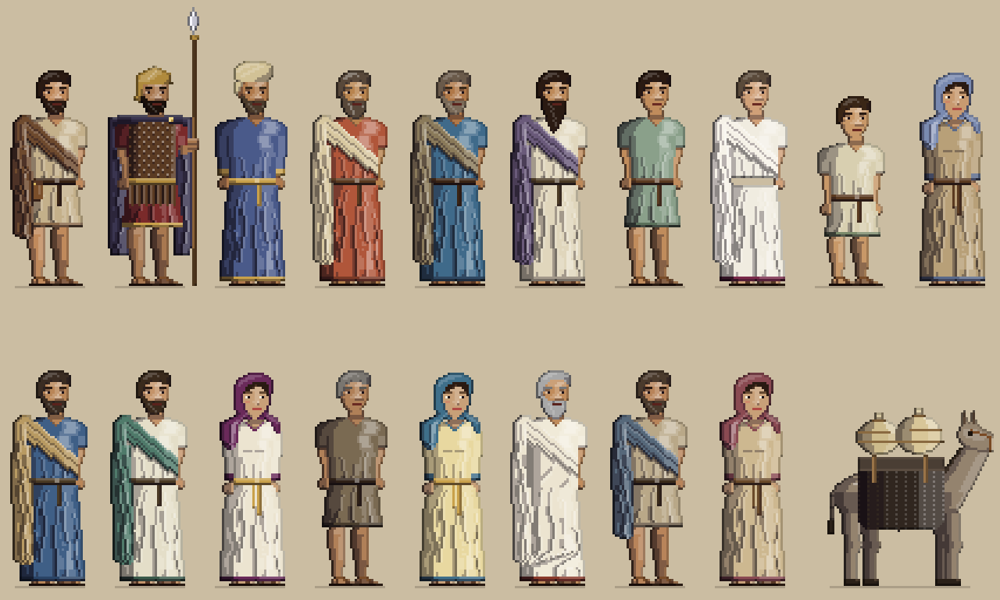
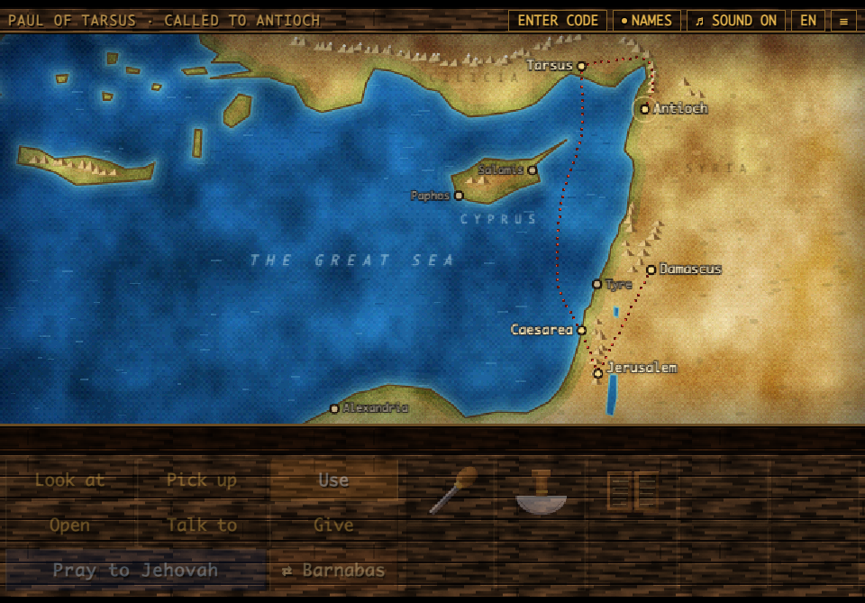
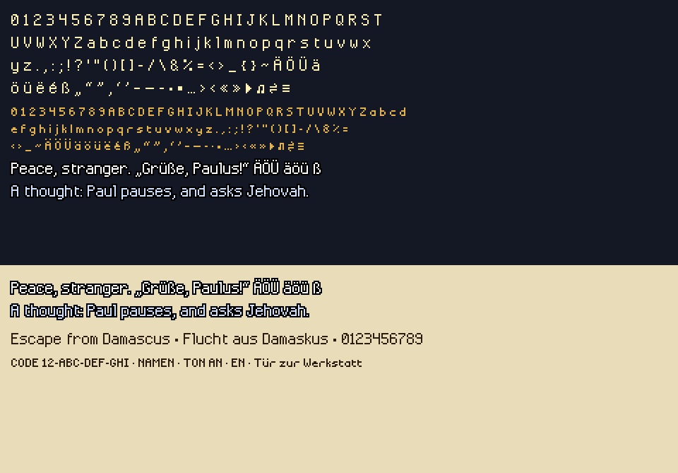

# Look and sound

The backdrops are painted in the manner of early-1990s VGA adventure games: perspective floors, textured plaster and stone, warm light against cool shadow, a foreground layer that slides past the scene as it scrolls, and a final ordered dither. Rooms are painted at twice the classic 320-pixel resolution. Night scenes and interiors are painted in daylight colors and then multiplied by a light map, so a lamp, a brazier or the moon through a window really lights the room; the same light falls on the characters as they walk through it.

The characters are sprites in the manner of the same era: placed pixel by pixel in a three-quarter view, shaded in flat bands of tone with dark edges on the shadow side instead of an outline. Faces, beards and head coverings are small hand-drawn pixel maps; one figure serves the whole cast through its palette and dress.

The people grow older as the years of the account pass. Paul is a young man in Damascus and Jerusalem; when Barnabas fetches him from Tarsus his hair has begun to recede, on the second journey it is thin on the crown and greying, and at Cenchreae it is clipped short (Acts 18:18). Barnabas, Peter and James turn grey from one chapter to the next, John Mark has his first beard in Chapter Seven, and Timothy, a boy in Chapter Six, is a young man from Chapter Seven on. Silas has the first grey in his hair when he comes to Corinth. The looks for the chapters still to come are prepared, down to the older man of Philemon 9.

A scene has depth: whoever stands farther back is drawn behind. A man who walks behind the carrier's mule is hidden by it up to the waist, and hides it when he stands in front; the same holds for a stool, a low table or a heap of sailcloth that stands out on the floor.

Chapter Ten has the game's first close views: a bolt of cloth and a reading table, each seen from above, in which nobody walks and the parts are set by hand. What moves in them is painted as the rooms are: a scroll is a sheet between two plain rolls, as thick as they are wound, with writing in short strokes that stop short of the margins. What lies open is named under it in small letters, as the names on the map are written, in the player's language.

Chapter Eleven is Athens, and Athens is shown as it stood: CONTRIBUTING section 3 makes an exception for Athens, Ephesus and Rome. The Acropolis with the temple of Athena stands over every outdoor scene, the temple of Zeus beside the road has tall columns and no roof, because it was not finished until 129 C.E., and the streets are full of statues. All of it is seen from outside: a temple as a row of columns under a deep beam and a gable, an altar as a block with a band of cut letters, a statue as a draped figure. A statue is painted by the same figure painter as the people, in one material and with blank eyes. No rite is shown, nothing is unclothed, and no image of a god is seen close. In the close view of the altars the picture is cut off at the height of a man's knee, and the inscriptions are in Greek capitals.

Chapter Twelve is Corinth, which the maintainer added to that exception: the old temple stands on its rise over the roofs, with heavy columns each of a single stone, and a second one, small and far off, on the summit of the rock. The chapter has the game's first light that is worked out and not painted: in the view of the court of Titius Justus the sun is not in the picture, and the brightness on the far wall and the floor follows where the rope and the cloth are hung. The same court and the same street are painted in autumn, in winter rain, in the spring of the games and in summer.

The Athenians are dressed as the publications describe: the men of standing in the Greek mantle, a rectangular length of cloth wrapped over a long tunic, and the few women who are seen out of doors in a tunic to the feet and the mantle, the hair parted and bound with a band, or the mantle drawn over the head. On the Areopagus the men sit on seats cut in the rock, and no woman is among them.

Each chapter ends on a travel map of the eastern Mediterranean, painted the same way: coasts, shallows and mountain ranges, cities as dots, and no grid lines. The road travelled so far is shown, and the chapter's own leg draws itself as a dotted line from city to city, to a short sting on frame drum, harp and ney in the chapter's own key: Damascus to Jerusalem; Jerusalem to Caesarea and by sea to Tarsus; Tarsus to Antioch, where Paul's missionary journeys would begin. The routes never cross. Where the Scriptures do not say which way he went, the line takes a plausible one: by sea east of Cyprus, by road round the Gulf of Issus, and through the south of Cyprus.

Each chapter has its own score and room sounds, and the end-of-chapter map is described in the chapter's own page (see [the chapter list](../README.md#chapters)).

All text uses two bitmap fonts painted in code (`shared/font.js`) on the grid of the backdrops, two font pixels to the room pixel: **Paul Pixel** for speech, verbs, choices and headings, and **Paul Pixel Small** for the top bar, the names, notes and the names on the map. Every letter stands on one baseline, the short ones at one x-height, and only g, j, p, q and y hang below it. Speech is outlined one font pixel all round, as thick as the strokes, so that it reads on a sunlit quay as well as at night. Paul's thoughts and the answers to prayer stand upright like speech, told apart by their pale blue: a slanted pixel letter tears where its strokes step over. The fonts are built in memory as TrueType fonts from the pixels, with no font file, and the system's monospace stands in if a browser refuses them. The Greek letters cut in stone in Chapters Eleven and Twelve are part of the painting and keep their own lettering.

A chapter opens with a title card: its name in the gold capitals of the title's logo, with "Chapter One" between two rules beneath it, over a short sting in the key of the chapter's score. It stays about three seconds; a click, Space or Esc moves on. The card is shown when a chapter is begun from the title, or from a code at its very beginning, and never when a code puts the player in the middle of one.

The title, the safe-point screen, the options and the end of a chapter own the whole screen: the verb panel slides down out of sight and comes back when play goes on, and the top bar keeps only its buttons. Walking from one room into the next cross-fades from the old picture to the new; a fade to black is kept for where the story wants it, such as nightfall or the map.

