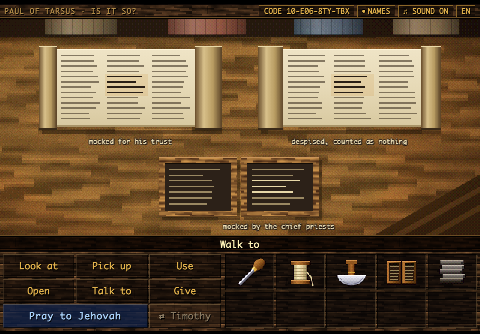

# Look and sound

The backdrops are painted in the manner of early-1990s VGA adventure games: perspective floors, textured plaster and stone, warm light against cool shadow, a foreground layer that slides past the scene as it scrolls, and a final ordered dither. Rooms are painted at twice the classic 320-pixel resolution. Night scenes and interiors are painted in daylight colors and then multiplied by a light map, so a lamp, a brazier or the moon through a window really lights the room; the same light falls on the characters as they walk through it.

The characters are sprites in the manner of the same era: placed pixel by pixel in a three-quarter view, shaded in flat bands of tone with dark edges on the shadow side instead of an outline. Faces, beards and head coverings are small hand-drawn pixel maps; one figure serves the whole cast through its palette and dress.

A scene has depth: whoever stands farther back is drawn behind. A man who walks behind the carrier's mule is hidden by it up to the waist, and hides it when he stands in front; the same holds for a stool, a low table or a heap of sailcloth that stands out on the floor.

Chapter Ten has the game's first close views: a bolt of cloth and a reading table, each seen from above, in which nobody walks and the parts are set by hand. What moves in them is painted as the rooms are: a scroll is a sheet between two plain rolls, as thick as they are wound, with writing in short strokes that stop short of the margins. What lies open is named under it in small letters, as the names on the map are written, in the player's language.

Each chapter ends on a travel map of the eastern Mediterranean, painted the same way: coasts, shallows and mountain ranges, cities as dots, and no grid lines. The road travelled so far is shown, and the chapter's own leg draws itself as a dotted line from city to city, to a short sting on frame drum, harp and ney in the chapter's own key: Damascus to Jerusalem; Jerusalem to Caesarea and by sea to Tarsus; Tarsus to Antioch, where Paul's missionary journeys would begin. The routes never cross. Where the Scriptures do not say which way he went, the line takes a plausible one: by sea east of Cyprus, by road round the Gulf of Issus, and through the south of Cyprus.

Each chapter has its own score and room sounds, and the end-of-chapter map is described in the chapter's own page (see [the chapter list](../README.md#chapters)).
