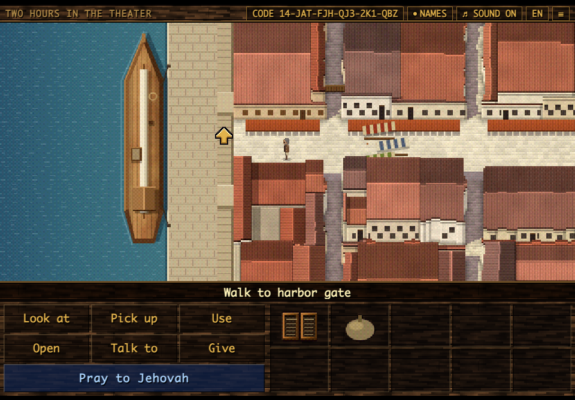
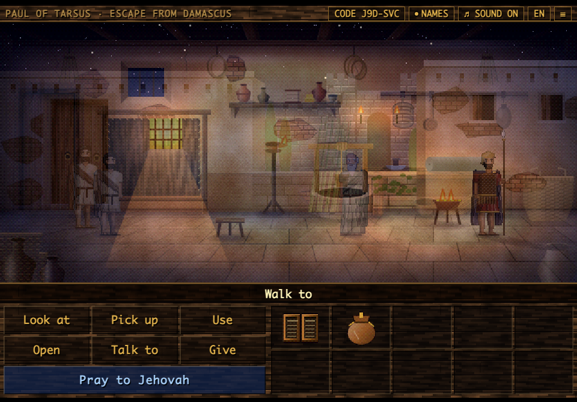

# Look and sound

The backdrops are painted in the manner of early-1990s VGA adventure games: perspective floors, textured plaster and stone, warm light against cool shadow, a foreground layer that slides past the scene as it scrolls, and a final ordered dither. Rooms are painted at twice the classic 320-pixel resolution. Night scenes and interiors are painted in daylight colors and then multiplied by a light map, so a lamp, a brazier or the moon through a window really lights the room; the same light falls on the characters as they walk through it.

The characters are sprites in the manner of the same era: placed pixel by pixel in a three-quarter view, shaded in flat bands of tone with dark edges on the shadow side instead of an outline. Faces, beards and head coverings are small hand-drawn pixel maps; one figure serves the whole cast through its palette and dress. A figure stands about five heads tall. That is a larger head than life gives, and it is how the sprites of those games were drawn: a face has to be read on a small screen.

The people grow older as the years of the account pass. Paul is a young man in Damascus and Jerusalem; when Barnabas fetches him from Tarsus his hair has begun to recede, on the second journey it is thin on the crown and greying, and at Cenchreae it is clipped short (Acts 18:18). Barnabas, Peter and James turn grey from one chapter to the next, John Mark has his first beard in Chapter Seven, and Timothy, a boy in Chapter Six, is a young man from Chapter Seven on. Silas has the first grey in his hair when he comes to Corinth. The looks for the chapters still to come are prepared, down to the older man of Philemon 9.

A figure that speaks moves as it speaks. Its mouth has five shapes, and they are read from the words that stand on the screen: wide for an a and round for an o or a u, with the chin a pixel down and a beard going down with it; half open for the other vowels; the lips parted for consonants and shut for m, b and p. The chin drops only on a stressed syllable and on every other one, or everybody would seem to shout. A comma is a short rest and a full stop a longer one, and when the words are through the mouth is still, even if the line stands a little longer. Because the words are read as they are shown, a German line moves the mouth to its own rhythm, and nobody has to write that rhythm down.

The head moves with the sentence: it dips on a stressed syllable, lifts with raised brows as a question ends, and sits a pixel forward for a clause now and then. The far hand speaks in phrases, one to a clause and not to every clause: half raised and open for a question, raised for an exclamation, and otherwise half raised, raised, laid on the chest or left down, as the words of the line decide, so that a line is always spoken the same way. A hand goes up and comes down through the half-raised pose and never jumps, and on an exclamation the speaker leans in by a pixel. Every forearm is bent and slanting; no arm is ever stretched out. Whoever sings or holds a spear keeps his hand down.

Two who talk look at each other. Whoever speaks turns to the one he speaks to, and that one turns to him, and so they stay while the scene lasts; afterwards each stands as the scene had him. A preacher, a reader and a man who calls out to a crowd keep facing it. When Paul walks up to someone, he stands beside that person where nobody else is standing, so that neither hides the other. Aquila and Priscilla, who go everywhere together, each turn on the spot and do not change places. Whoever is spoken to raises his brows at a question and may blink as a sentence ends; everybody else glances aside from time to time. Nobody nods by himself, because a nod is a yes.

Where a line plainly says yes or no, its speaker says it with his head as well: a nod dips the head twice, and a shake turns it from side to side. These are directed by the chapter, never guessed by the engine, and there are few of them: three nods (Paul's admission to Barnabas in Chapter Two, a householder in Chapter Five, the boy Timothy in Chapter Six) and fifteen shakes of the head, most of them a brother or sister who will not take back what Paul offers. A script can also have a hand laid on the chest. A figure that bows keeps its head still, and a statue never moves.

Where a line is sung, as the psalm is in Chapter Nine, each singer's mouth holds the vowel of every note for as long as the note, and everyone who answers sings along. The small blips of a speaking voice fall on the first syllables of its line. On the options screen, **Movement** can be set from lively to calm, which keeps the mouth and leaves head and hand still; a device that asks for less motion starts in calm.

People walk as the ground passes under them. A stride has sixteen moments, and the painter works each of them out: both hips share a centered pivot so the legs open cleanly like a pair of compasses without crossing, the thigh angles smoothly from the hip through the knee to the ankle, a heel lands with the toes up, the foot rolls flat through a double-support overlap, the heel lifts and the toes push off, and the knee bends forward as the leg swings through. The arm opposite a leg swings smoothly along an arc and bends at the elbow; the body follows a four-beat weight curve—lowest on recoil after a heel lands, rising through passing to a slight lift on push-off—with the head lagging a frame behind, a subtle forward lean and shoulder counter-sway, and the hem, folds and hanging mantle responding to the step. The frame follows the distance covered and not a clock, so a foot that stands stays planted on the paving, a step is heard as each foot lands, and a walk eases in and out on shorter steps, as does a walk up or down the room, where a side view would stride on the spot.

Everybody covers ground at the same speed, so that companions stay together, but each has a step of his own: a long robe shortens it while still flaring with the stride, a boy and a grey-haired man take shorter and quicker steps, a youth longer ones, and whoever carries a spear steps short and upright. At the game's walking speed (48 room pixels a second) a man's standing foot stays planted with less than 4 % slip, giving the grounded pace of classic 1990s adventures.

The pack donkey walks in four beats, near hind, near fore, far hind, far fore: each hoof stands while the body passes over it and is then lifted and swung forward with the joint bent, and the body sinks a pixel as each fore hoof lands. On the road of Chapter Three its hooves stay where they are set down.

A scene has depth: whoever stands farther back is drawn behind. A man who walks behind the carrier's mule is hidden by it up to the waist, and hides it when he stands in front; the same holds for a stool, a low table or a heap of sailcloth that stands out on the floor.

A scene has one horizon. The sea, the fields and the paving run back to one level, about as high as the eyes of the people in it, and the country seen through a city gate ends at that level too: the road beyond the gate of Lystra runs back to the line where the valley beside the well ends.

Chapter Ten has the game's first close views: a bolt of cloth and a reading table, each seen from above, in which nobody walks and the parts are set by hand. What moves in them is painted as the rooms are: a scroll is a sheet between two plain rolls, as thick as they are wound, with writing in short strokes that stop short of the margins. What lies open is named under it in small letters, as the names on the map are written, in the player's language.

Chapter Eleven is Athens, and Athens is shown as it stood: CONTRIBUTING section 3 makes an exception for Athens, Ephesus and Rome. The Acropolis with the temple of Athena stands over every outdoor scene, the temple of Zeus beside the road has tall columns and no roof, because it was not finished until 129 C.E., and the streets are full of statues. All of it is seen from outside: a temple as a row of columns under a deep beam and a gable, an altar as a block with a band of cut letters, a statue as a draped figure. A statue is painted by the same figure painter as the people, in one material and with blank eyes. No rite is shown, nothing is unclothed, and no image of a god is seen close. In the close view of the altars the picture is cut off at the height of a man's knee, and the inscriptions are in Greek capitals.

Chapter Twelve is Corinth, which the maintainer added to that exception: the old temple stands on its rise over the roofs, with heavy columns each of a single stone, and a second one, small and far off, on the summit of the rock. The chapter has the game's first light that is worked out and not painted: in the view of the court of Titius Justus the sun is not in the picture, and the brightness on the far wall and the floor follows where the rope and the cloth are hung. The same court and the same street are painted in autumn, in winter rain (via the shared weather helper `shared/weather.js`, with wind-slanted strokes, damp wall bases, and rippling puddles), in the spring of the games and in summer.

Chapter Thirteen is Ephesus, and for the first time a chapter stays in one street. That street is painted in three lights, with the shadows of the morning, of midday and of the evening, and once more on the morning of the fire; the workshop is painted by day, by lamplight before sunrise and at night. Between two houses the hill is seen with its theater: a bowl of seats in tiers, cut by a walkway, with its stage building in front. The temple of the city is seen once, small and far off in the plain, from the road above the city, and nobody names it. Two close views are new: a house in the evening with one wall taken away, in which every hiding place is a thing of the household, and a counting board of wood with troughs, hollows and pebbles. Ten Greek number letters are cut beside the places of the board, and nothing else is written on it. When the day is moved on, the sundial in the street is seen close while its shadow turns: a block of pale stone, weathered, with lichen on it and a green streak where the rain has run down from its bronze pointer, before a low wall of old blocks with a caper growing from a joint. The sun moves with the shadow: the shade inside the hollow under the rim, the light on the stone's side and the stone's own shadow on the wall behind it move from right to left as the day goes on. No book of magic is ever seen open: a book is a roll with its tie, and the fire burns low and steady, by day, and never flashes.

The Athenians are dressed as the publications describe: the men of standing in the Greek mantle, a rectangular length of cloth wrapped over a long tunic, and the few women who are seen out of doors in a tunic to the feet and the mantle, the hair parted and bound with a band, or the mantle drawn over the head. On the Areopagus the men sit on seats cut in the rock, and no woman is among them.

A lane map shows a city at a slant from above, the way the city maps of those games did. Every house stands up from its ground: its front of plaster over a course of dark stone, one or two storeys tall, with its door, its windows and their shutters, under the eaves of a roof of tiles, or now and then a flat one. A house hides the lane behind it, and while the one who is played walks behind a house it fades, so that he is never lost from sight; a covered passage is a house built over a lane, with a dark archway in its front. The lanes are paved with small stones, the streets with slabs and the squares with great ones, and the sun in the west-south-west throws every house's shadow to the right. The people on it are figures about fourteen room pixels tall, in the colors of the period's dyes and undyed wool; a crowd comes in by the gates and along the streets in waves, steps out of the doors of the houses, fills the streets from side to side, and shuffles as it packs before a narrow way in. A click shows the way as a row of gold dots up to a small diamond, and the player may zoom the map with two fingers, the mouse wheel, or + and -. Its sound can lead the player: in Chapter Fourteen the roar of the crowd dies down as the house where Paul is staying comes near, measured along the lanes, so that a dead end beside the house still sounds loud. Lanes meet as forks and bends and never as a crossing, which from above would be a plus sign.

Chapter Fourteen's city follows what is known of Ephesus in Paul's day: the theater in the hollow of Mount Pion, where two main thoroughfares meet; the marble street from in front of it straight to the harbor, with a colonnade on each side, and a gate at the harbor end; the market square beside them; and round them the lower city's grid of streets at right angles, which on this map may cross (the exception for Ephesus in CONTRIBUTING section 3). The house where Paul is staying lies in a court inside one block of the residential quarter. Its houses are as large against the people as those of the city maps of those games, their roofs clearly modelled: the slopes the sun finds lit, the others in shade, a bright ridge and a dark line at the eaves. In the uproar some narrow streets are jammed by people who cannot get through themselves; nobody passes them, so the runner has to find another way. Whatever blocks a way is named when the one who is played stops before it: the packed people, a barred gate, an overturned stall.

Chapter Fourteen is the day of the uproar in Ephesus. The silversmiths' marketplace is shown once while the narrator tells what Demetrius said: the stalls hold boxes, shrines wrapped in cloth and a few small silvery figures that are plain draped shapes, and nobody bows to anything. At the theater the crowd presses in at the arches beside a colonnade of columns under a deep beam. The tablet is sealed in a close view on the base of a column, the cord running only through the holes at its edge and the clay on the knot, so that nothing lies across its face. Inside the door of the house the light from the hatch moves across the floor while they wait two hours. The crowd's cry is heard and never written: many voices shouting the vowels of the words Acts gives, each a little off the others' beat and pitch, in the player's language.

Chapter Fifteen goes from a winter room in Corinth to a night in spring at Troas. Two of its pictures are close views. The balance in the storeroom is seen from in front and a little above: its beam hangs from two cords that part as they rise out of the picture, nothing points up or down at its middle, and each pan hangs by cords that meet at the beam's end, so that it never reads as a cross; the beam comes to rest slowly, and the bag and the weights ride with their pans. The weights and the letters bear Greek number letters, as the counting board of Chapter Thirteen does. The plan in the sand is seen from above: coasts drawn as grooves with a reed, a pebble for each city, and no line that crosses or meets another. In the upper room only the flames move: each lamp's flame and its glow follow the oil that is left in it, and the light on the people in the room follows the lamps; the light of the five is put together and then dithered once, like any backdrop, so that the walls keep the fine grain of the other rooms. The lamp by the speaker stands on a stand as tall as a man and burns above every head. The young man in the window is a figure like the others: he sits in the opening, on its sill, turned to the speaker, and the sill hides him from the hip down. What happens at midnight is not painted: the narrator tells it over the same room with the window empty, in silence, and the street below is then seen by night with the people standing round, and again at daybreak.

Each chapter ends on a travel map of the eastern Mediterranean, painted the same way: coasts, shallows and mountain ranges, cities as dots, and no grid lines. The road travelled so far is shown, and the chapter's own leg draws itself as a dotted line from city to city, to a short sting on frame drum, harp and ney in the chapter's own key: Damascus to Jerusalem; Jerusalem to Caesarea and by sea to Tarsus; Tarsus to Antioch, where Paul's missionary journeys would begin. The routes never cross. Where the Scriptures do not say which way he went, the line takes a plausible one: by sea east of Cyprus, by road round the Gulf of Issus, and through the south of Cyprus.

Each chapter has its own score and room sounds, and the end-of-chapter map is described in the chapter's own page (see [the chapter list](../README.md#chapters)).

Speech stands over the scene in a bold monospace with a dark edge all round: a stroke painted behind the letters, even on every curve, so that a line reads over a busy backdrop as well as at night. The names on the map and the captions of a close view are edged the same way. Paul's thoughts and the answers to prayer are in italics and pale blue.

Narration that is told while the picture is dark is not set on a black screen. It is read from the narrator's scroll: an open roll of papyrus held in two hands by lamplight, with a clay lamp in a wall niche on one side and another on a shelf on the other. The line stands in ink on the open part of the roll, larger when it is short and smaller when it is long, and a reference such as (Acts 13:14) is never divided over two lines. The scroll comes up out of the dark for the first line of a passage, stays while one line follows another, and goes down into the dark again before the next picture fades in or anybody speaks. As it comes up the roll is heard being drawn open: one soft rustle, no louder than a lamp being snuffed. Only the two flames move, with the small glow round each: the picture as a whole never brightens or darkens. What a chapter tells and does not show is read from the scroll too: the stoning at Lystra, the vision at Troas, the beating at Philippi, the words by night in Corinth. The one exception is in the prologue, when the light from heaven flashes around Saul on the road to Damascus (Acts 9:3; 22:6, 11; 26:13): the screen fades smoothly to plain warm white without rays or figures, and the narration stands straight on the white in dark ink, followed by two seconds of silent dark before he is led by the hand into Damascus.

The roll is drawn as *Insight on the Scriptures* describes one ("Papyrus", "Book", "Scroll, Roll"): sheets of papyrus pasted edge to edge and written on the side whose strips run across; wound on a stick, a long roll on a stick at each end; and read by unrolling it with one hand while the other rolls it up. Christians mainly used the roll until about the end of the first century ("Book"), and what the narrator tells is for the most part Luke's account, a book of that kind. The reader, the room and its lamps are invented. The hands follow an example picture of the maintainer's: seen from the back, the forefinger gone behind the roll, the thumb resting on it with its nail and the folds of its joint. They are painted in greys, as light, and then set in a short scale of skin tones with the same ordered dither as the backdrops. The papyrus has its fibers running one way and nothing ruled on it, no stick stands out of a rolled end, and nothing lies across a roll (CONTRIBUTING, section 3).

**The opening picture.** Each time the game is opened it shows its name over a still life before it shows the chapters: a tentmaker's bench by the light of one clay lamp. On it lie rolls of papyrus, one of them open, an inkpot and a reed pen; two awls, a knife, a needle and a ball of thread; and a length of dark goat-hair cloth sewn of strips, with a seam half sewn. Only the flame moves. The picture is silent until the player clicks, because a browser lets a page sound only then. That click starts the overture: Chapter One's theme in ten bars, about 26 seconds, with a horn call and a rising harp to raise the curtain, the melody on the ney over a walking bass and a strummed lyre, and the melody again, higher, with the aulos and the horn. As it ends the bench passes into the wall of Damascus under the moon, the chapters appear under the name, which has not moved, and the quiet music of the title follows by itself. A second click brings the chapters at once. Coming back to the title from a game does not show the picture again. The title then opens its music with the same ten bars on the game's own ensemble, without the horn.

What the picture rests on: *Insight on the Scriptures* ("Tentmaker") says that Paul's home region was known for a goat-hair cloth from which tents were made, stiff and rough to cut and sew; *The Watchtower* of November 1, 2012 ("Did You Know?") says that tentmakers sewed strips of such cloth together, names knives and awls as the tools of the trade, and describes the reed pen and the ink of the time; *Insight* ("Horn", "Trumpet") names the horn and the metal trumpet as instruments. How the bench was laid out is invented. For the rules of section 3 of [CONTRIBUTING](../CONTRIBUTING.md): no stick stands out of a roll and nothing is tied round one, the writing is rows of broken strokes that stop short of every edge, the knife is a plain blade without a guard, the tools lie side by side and none across another, the bench is one board without joints, and the seams and stitches of the cloth run one way.

A chapter opens with a title card: its name in the gold capitals of the title's logo, with "Chapter One" between two rules beneath it, over a short sting in the key of the chapter's score. It stays about three seconds; a click, Space or Esc moves on. The card is shown when a chapter is begun from the title, or from a code at its very beginning, and never when a code puts the player in the middle of one.

The title, the safe-point screen, the options and the end of a chapter own the whole screen: the verb panel slides down out of sight and comes back when play goes on, and the top bar keeps only its buttons. The title alone also uses the room that the panel leaves. Its picture, the wall of Damascus under the moon, is painted on down to the foot of the window: open ground with rocks, tufts of dry grass and thorn bushes, while a ten-bar overture in D Hijaz (a two-bar harp fanfare, a four-bar theme for ney, aulos with tonic drone pipe, lyre, oud and road percussion, and a four-bar high climax) plays and then cross-fades into the quiet night score. The prologue and the twelve chapters stand in its list at once; a returning player's title has two more lines above the list, and then the list scrolls in its box. When a chapter begins the view is as high as it always is, and the upper part of the picture has not moved. Walking from one room into the next cross-fades from the old picture to the new; a fade to black is kept for where the story wants it, such as nightfall or the map.

