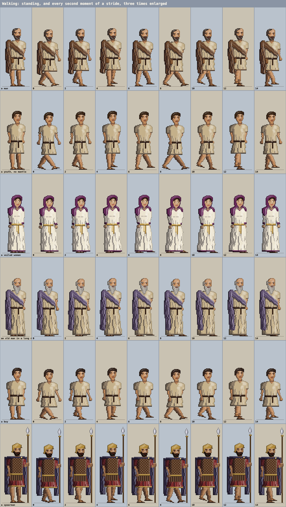
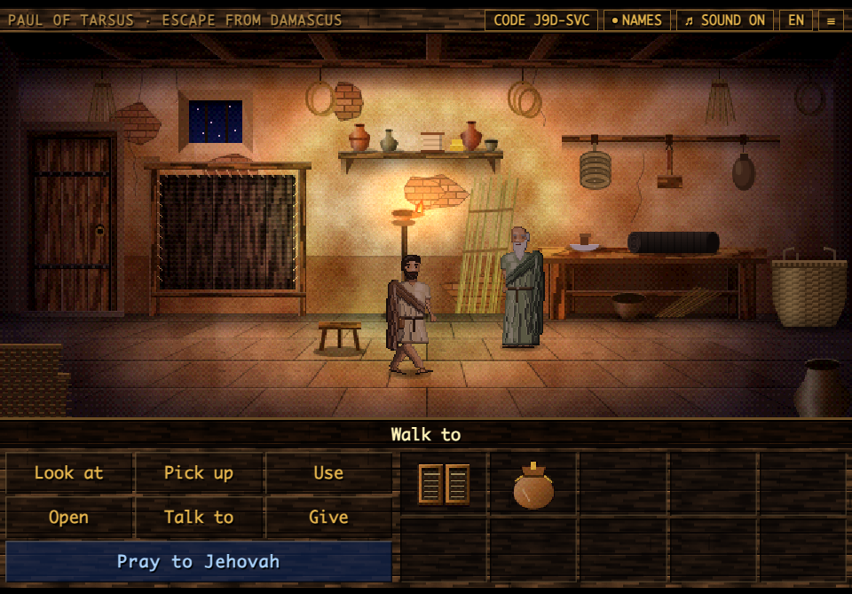
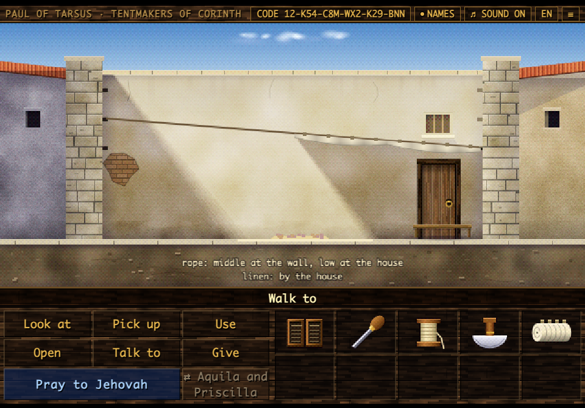
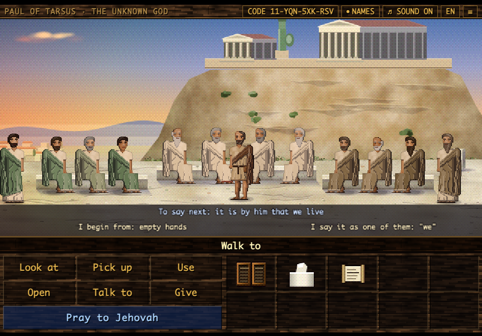
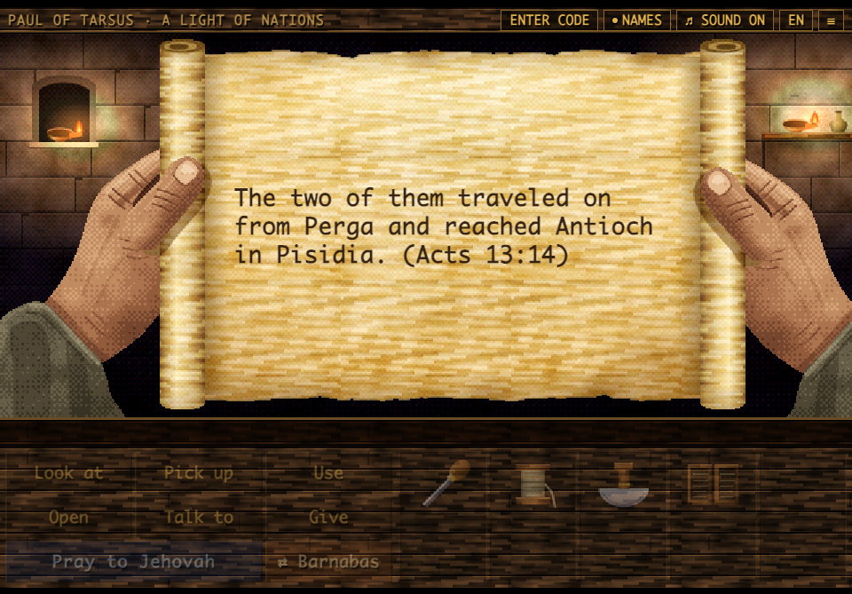

# Look and sound

The backdrops are painted in the manner of early-1990s VGA adventure games: perspective floors, textured plaster and stone, warm light against cool shadow, a foreground layer that slides past the scene as it scrolls, and a final ordered dither. Rooms are painted at twice the classic 320-pixel resolution. Night scenes and interiors are painted in daylight colors and then multiplied by a light map, so a lamp, a brazier or the moon through a window really lights the room; the same light falls on the characters as they walk through it.

The characters are sprites in the manner of the same era: placed pixel by pixel in a three-quarter view, shaded in flat bands of tone with dark edges on the shadow side instead of an outline. Faces, beards and head coverings are small hand-drawn pixel maps; one figure serves the whole cast through its palette and dress. A figure stands about five heads tall. That is a larger head than life gives, and it is how the sprites of those games were drawn: a face has to be read on a small screen.

The people grow older as the years of the account pass. Paul is a young man in Damascus and Jerusalem; when Barnabas fetches him from Tarsus his hair has begun to recede, on the second journey it is thin on the crown and greying, and at Cenchreae it is clipped short (Acts 18:18). Barnabas, Peter and James turn grey from one chapter to the next, John Mark has his first beard in Chapter Seven, and Timothy, a boy in Chapter Six, is a young man from Chapter Seven on. Silas has the first grey in his hair when he comes to Corinth. The looks for the chapters still to come are prepared, down to the older man of Philemon 9.

A figure that speaks moves as it speaks. Its mouth has five shapes, and they are read from the words that stand on the screen: wide for an a and round for an o or a u, with the chin a pixel down and a beard going down with it; half open for the other vowels; the lips parted for consonants and shut for m, b and p. The chin drops only on a stressed syllable and on every other one, or everybody would seem to shout. A comma is a short rest and a full stop a longer one, and when the words are through the mouth is still, even if the line stands a little longer. Because the words are read as they are shown, a German line moves the mouth to its own rhythm, and nobody has to write that rhythm down.

The head moves with the sentence: it dips on a stressed syllable, lifts with raised brows as a question ends, and sits a pixel forward for a clause now and then. The far hand speaks in phrases, one to a clause and not to every clause: half raised and open for a question, raised for an exclamation, and otherwise half raised, raised, laid on the chest or left down, as the words of the line decide, so that a line is always spoken the same way. A hand goes up and comes down through the half-raised pose and never jumps, and on an exclamation the speaker leans in by a pixel. Every forearm is bent and slanting; no arm is ever stretched out. Whoever sings or holds a spear keeps his hand down.

Whoever Paul talks with turns to face him for as long as they talk, and afterwards stands as the scene had him. Whoever is spoken to raises his brows at a question and may blink as a sentence ends; everybody else glances aside from time to time. Nobody nods by himself, because a nod is a yes.

Where a line plainly says yes or no, its speaker says it with his head as well: a nod dips the head twice, and a shake turns it from side to side. These are directed by the chapter, never guessed by the engine, and there are few of them: three nods (Paul's admission to Barnabas in Chapter Two, a householder in Chapter Five, the boy Timothy in Chapter Six) and fifteen shakes of the head, most of them a brother or sister who will not take back what Paul offers. A script can also have a hand laid on the chest. A figure that bows keeps its head still, and a statue never moves.

Where a line is sung, as the psalm is in Chapter Nine, each singer's mouth holds the vowel of every note for as long as the note, and everyone who answers sings along. The small blips of a speaking voice fall on the first syllables of its line. On the options screen, **Movement** can be set from lively to calm, which keeps the mouth and leaves head and hand still; a device that asks for less motion starts in calm.

People walk as the ground passes under them. A stride has sixteen moments, and the painter works each of them out: a heel lands with the toes up, the foot rolls flat, the heel lifts and the toes push off, and the knee bends as the leg swings through. The arm opposite a leg goes forward with it and bends at the elbow; the body is lowest as a heel lands and highest as the legs pass; the hem of a robe and the hanging mantle swing a little behind the step. The frame follows the distance covered and not a clock, so a foot that stands is not carried along, and a step is heard as each foot lands. A walk begins and ends on a shorter step, and so does a walk up or down the room, where a side view would stride on the spot.

Everybody covers ground at the same speed, so that companions stay together, but each has a step of his own: a long robe shortens it, a boy and a grey-haired man take shorter and quicker steps, a youth longer ones, and whoever carries a spear steps short. At the game's walking speed a man in a short tunic still slips by about a fifth of a step; a walk that planted every foot would be a good deal slower.

The pack donkey walks in four beats, near hind, near fore, far hind, far fore: each hoof stands while the body passes over it and is then lifted and swung forward with the joint bent, and the body sinks a pixel as each fore hoof lands. On the road of Chapter Three its hooves stay where they are set down.

A scene has depth: whoever stands farther back is drawn behind. A man who walks behind the carrier's mule is hidden by it up to the waist, and hides it when he stands in front; the same holds for a stool, a low table or a heap of sailcloth that stands out on the floor.

Chapter Ten has the game's first close views: a bolt of cloth and a reading table, each seen from above, in which nobody walks and the parts are set by hand. What moves in them is painted as the rooms are: a scroll is a sheet between two plain rolls, as thick as they are wound, with writing in short strokes that stop short of the margins. What lies open is named under it in small letters, as the names on the map are written, in the player's language.

Chapter Eleven is Athens, and Athens is shown as it stood: CONTRIBUTING section 3 makes an exception for Athens, Ephesus and Rome. The Acropolis with the temple of Athena stands over every outdoor scene, the temple of Zeus beside the road has tall columns and no roof, because it was not finished until 129 C.E., and the streets are full of statues. All of it is seen from outside: a temple as a row of columns under a deep beam and a gable, an altar as a block with a band of cut letters, a statue as a draped figure. A statue is painted by the same figure painter as the people, in one material and with blank eyes. No rite is shown, nothing is unclothed, and no image of a god is seen close. In the close view of the altars the picture is cut off at the height of a man's knee, and the inscriptions are in Greek capitals.

Chapter Twelve is Corinth, which the maintainer added to that exception: the old temple stands on its rise over the roofs, with heavy columns each of a single stone, and a second one, small and far off, on the summit of the rock. The chapter has the game's first light that is worked out and not painted: in the view of the court of Titius Justus the sun is not in the picture, and the brightness on the far wall and the floor follows where the rope and the cloth are hung. The same court and the same street are painted in autumn, in winter rain, in the spring of the games and in summer.

The Athenians are dressed as the publications describe: the men of standing in the Greek mantle, a rectangular length of cloth wrapped over a long tunic, and the few women who are seen out of doors in a tunic to the feet and the mantle, the hair parted and bound with a band, or the mantle drawn over the head. On the Areopagus the men sit on seats cut in the rock, and no woman is among them.

Each chapter ends on a travel map of the eastern Mediterranean, painted the same way: coasts, shallows and mountain ranges, cities as dots, and no grid lines. The road travelled so far is shown, and the chapter's own leg draws itself as a dotted line from city to city, to a short sting on frame drum, harp and ney in the chapter's own key: Damascus to Jerusalem; Jerusalem to Caesarea and by sea to Tarsus; Tarsus to Antioch, where Paul's missionary journeys would begin. The routes never cross. Where the Scriptures do not say which way he went, the line takes a plausible one: by sea east of Cyprus, by road round the Gulf of Issus, and through the south of Cyprus.

Each chapter has its own score and room sounds, and the end-of-chapter map is described in the chapter's own page (see [the chapter list](../README.md#chapters)).

Speech stands over the scene in a bold monospace with a dark edge all round: a stroke painted behind the letters, even on every curve, so that a line reads over a busy backdrop as well as at night. The names on the map and the captions of a close view are edged the same way. Paul's thoughts and the answers to prayer are in italics and pale blue.

Narration that is told while the picture is dark is not set on a black screen. It is read from the narrator's scroll: an open roll of papyrus held in two hands by lamplight, with a clay lamp in a wall niche on one side and another on a shelf on the other. The line stands in ink on the open part of the roll, larger when it is short and smaller when it is long, and a reference such as (Acts 13:14) is never divided over two lines. The scroll comes up out of the dark for the first line of a passage, stays while one line follows another, and goes down into the dark again before the next picture fades in or anybody speaks. As it comes up the roll is heard being drawn open: one soft rustle, no louder than a lamp being snuffed. Only the two flames move, with the small glow round each: the picture as a whole never brightens or darkens. What a chapter tells and does not show is read from the scroll too: the stoning at Lystra, the vision at Troas, the beating at Philippi, the words by night in Corinth.

The roll is drawn as *Insight on the Scriptures* describes one ("Papyrus", "Book", "Scroll, Roll"): sheets of papyrus pasted edge to edge and written on the side whose strips run across; wound on a stick, a long roll on a stick at each end; and read by unrolling it with one hand while the other rolls it up. Christians mainly used the roll until about the end of the first century ("Book"), and what the narrator tells is for the most part Luke's account, a book of that kind. The reader, the room and its lamps are invented. The hands follow an example picture of the maintainer's: seen from the back, the forefinger gone behind the roll, the thumb resting on it with its nail and the folds of its joint. They are painted in greys, as light, and then set in a short scale of skin tones with the same ordered dither as the backdrops. The papyrus has its fibers running one way and nothing ruled on it, no stick stands out of a rolled end, and nothing lies across a roll (CONTRIBUTING, section 3).

A chapter opens with a title card: its name in the gold capitals of the title's logo, with "Chapter One" between two rules beneath it, over a short sting in the key of the chapter's score. It stays about three seconds; a click, Space or Esc moves on. The card is shown when a chapter is begun from the title, or from a code at its very beginning, and never when a code puts the player in the middle of one.

The title, the safe-point screen, the options and the end of a chapter own the whole screen: the verb panel slides down out of sight and comes back when play goes on, and the top bar keeps only its buttons. Walking from one room into the next cross-fades from the old picture to the new; a fade to black is kept for where the story wants it, such as nightfall or the map.

