# Look and sound

The backdrops are painted in the manner of early-1990s VGA adventure games: perspective floors, textured plaster and stone, warm light against cool shadow, a foreground layer that slides past the scene as it scrolls, and a final ordered dither. Rooms are painted at twice the classic 320-pixel resolution. Night scenes and interiors are painted in daylight colors and then multiplied by a light map, so a lamp, a brazier or the moon through a window really lights the room; the same light falls on the characters as they walk through it.

The characters are sprites in the manner of the same era: placed pixel by pixel in a three-quarter view, shaded in flat bands of tone with dark edges on the shadow side instead of an outline. Faces, beards and head coverings are small hand-drawn pixel maps; one figure serves the whole cast through its palette and dress. A figure stands about five heads tall. That is a larger head than life gives, and it is how the sprites of those games were drawn: a face has to be read on a small screen.

The people grow older as the years of the account pass. Paul is a young man in Damascus and Jerusalem; when Barnabas fetches him from Tarsus his hair has begun to recede, on the second journey it is thin on the crown and greying, and at Cenchreae it is clipped short (Acts 18:18). Barnabas, Peter and James turn grey from one chapter to the next, John Mark has his first beard in Chapter Seven, and Timothy, a boy in Chapter Six, is a young man from Chapter Seven on. Silas has the first grey in his hair when he comes to Corinth. The looks for the chapters still to come are prepared, down to the older man of Philemon 9.

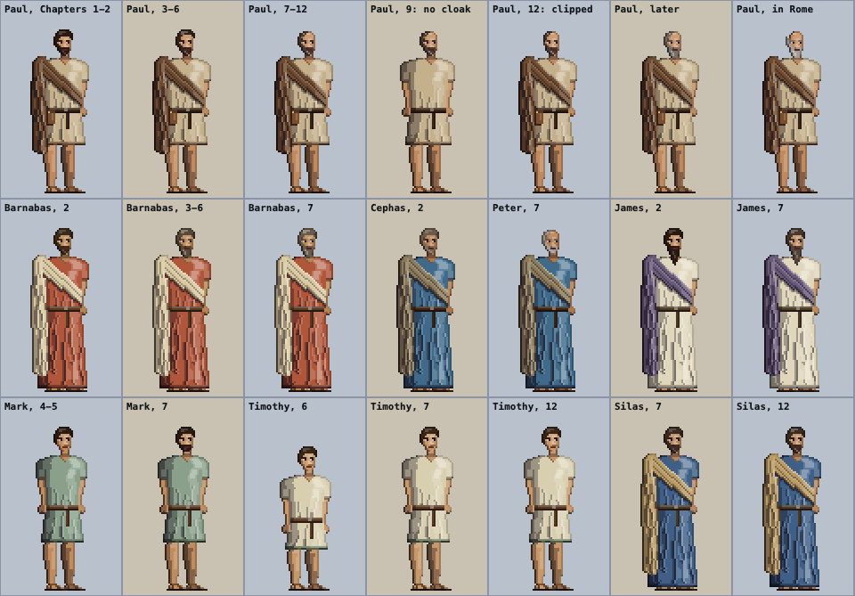

A figure that speaks moves as it speaks. Its mouth has five shapes, and they are read from the words that stand on the screen: wide for an a and round for an o or a u, with the chin a pixel down and a beard going down with it; half open for the other vowels; the lips parted for consonants and shut for m, b and p. The chin drops only on a stressed syllable and on every other one, or everybody would seem to shout. A comma is a short rest and a full stop a longer one, and when the words are through the mouth is still, even if the line stands a little longer. Because the words are read as they are shown, a German line moves the mouth to its own rhythm, and nobody has to write that rhythm down.

The head moves with the sentence: it dips on a stressed syllable, lifts with raised brows as a question ends, and sits a pixel forward for a clause now and then. The far hand speaks in phrases, one to a clause and not to every clause: half raised and open for a question, raised for an exclamation, and otherwise half raised, raised, laid on the chest or left down, as the words of the line decide, so that a line is always spoken the same way. A hand goes up and comes down through the half-raised pose and never jumps, and on an exclamation the speaker leans in by a pixel. Every forearm is bent and slanting; no arm is ever stretched out. Whoever sings or holds a spear keeps his hand down.

Two who talk look at each other. Whoever speaks turns to the one he speaks to, and that one turns to him, and so they stay while the scene lasts; afterwards each stands as the scene had him. A preacher, a reader and a man who calls out to a crowd keep facing it. When Paul walks up to someone, he stands beside that person where nobody else is standing, so that neither hides the other. Aquila and Priscilla, who go everywhere together, each turn on the spot and do not change places. Whoever is spoken to raises his brows at a question and may blink as a sentence ends; everybody else glances aside from time to time. Nobody nods by himself, because a nod is a yes.

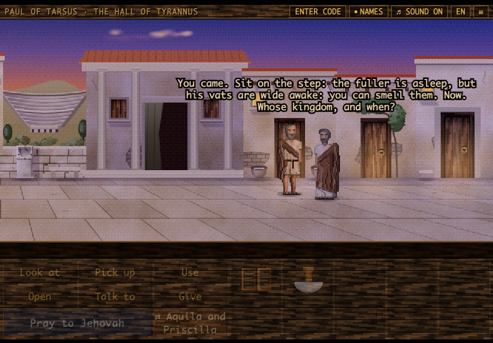

Where a line plainly says yes or no, its speaker says it with his head as well: a nod dips the head twice, and a shake turns it from side to side. These are directed by the chapter, never guessed by the engine, and there are few of them: three nods (Paul's admission to Barnabas in Chapter Two, a householder in Chapter Five, the boy Timothy in Chapter Six) and fifteen shakes of the head, most of them a brother or sister who will not take back what Paul offers. A script can also have a hand laid on the chest. A figure that bows keeps its head still, and a statue never moves.

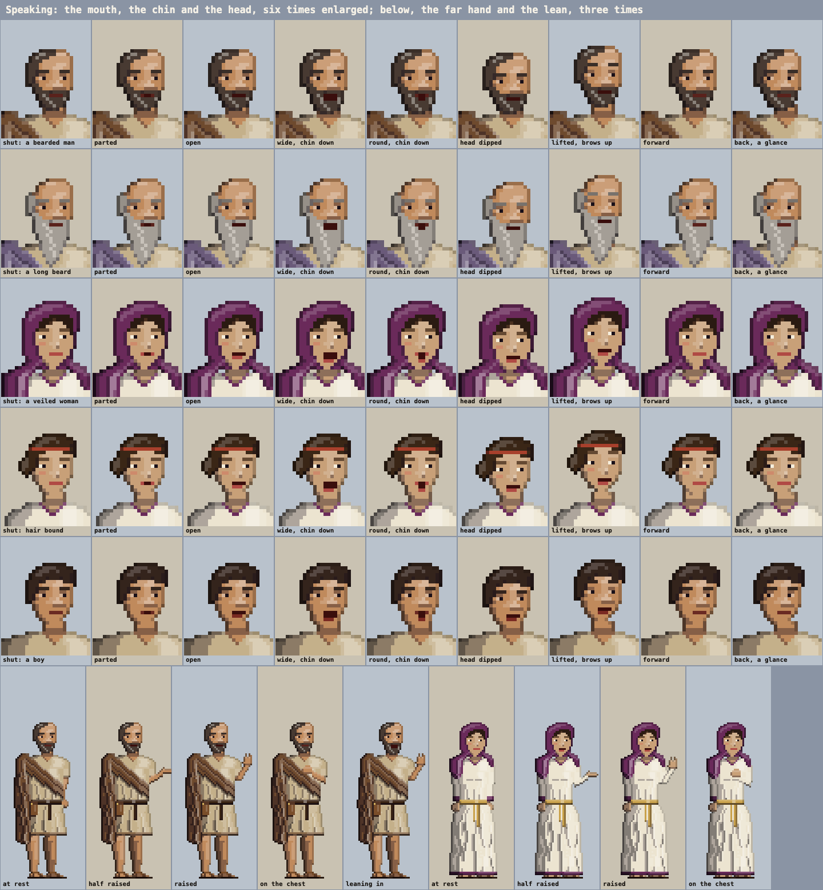

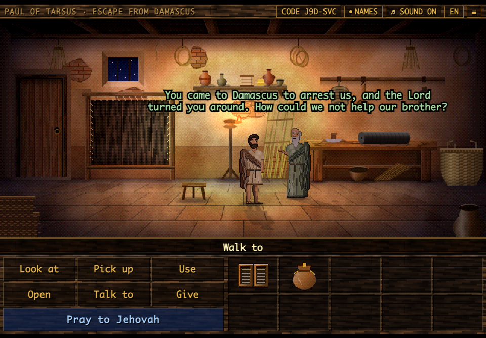

A line stands over the head of whoever says it. When the speaker is not in the picture, as at a close view or in a painted scene, and on a lane map, where the figures are too small to tell, his name stands before his words, since his colour alone would not tell who he is; the one who is played is never named.

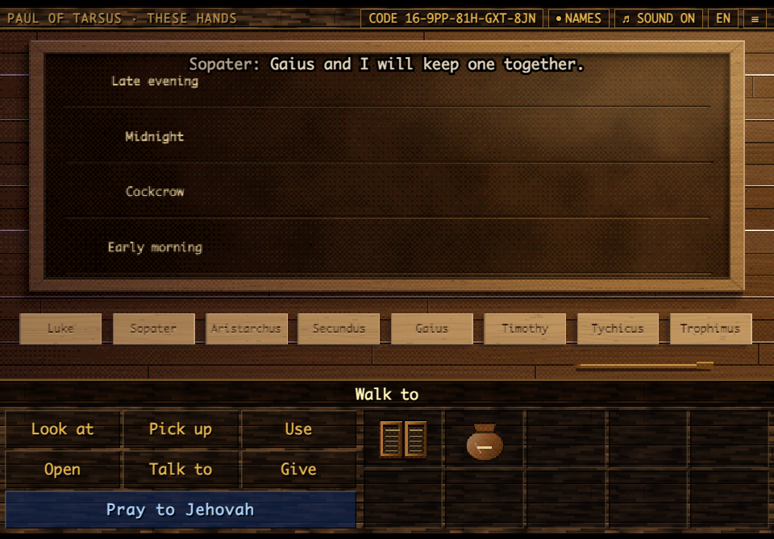

Where a line is sung, as the psalm is in Chapter Nine, each singer's mouth holds the vowel of every note for as long as the note, and everyone who answers sings along. The small blips of a speaking voice fall on the first syllables of its line. On the options screen, **Movement** can be set from lively to calm, which keeps the mouth and leaves head and hand still; a device that asks for less motion starts in calm.

People walk as the ground passes under them. A stride has sixteen moments, and the painter works each of them out: both hips share a centered pivot so the legs open cleanly like a pair of compasses without crossing, the thigh angles smoothly from the hip through the knee to the ankle, a heel lands with the toes up, the foot rolls flat through a double-support overlap, the heel lifts and the toes push off, and the knee bends forward as the leg swings through. The arm opposite a leg swings smoothly along an arc and bends at the elbow; the body follows a four-beat weight curve—lowest on recoil after a heel lands, rising through passing to a slight lift on push-off—with the head lagging a frame behind, a subtle forward lean and shoulder counter-sway, and the hem, folds and hanging mantle responding to the step. The frame follows the distance covered and not a clock, so a foot that stands stays planted on the paving, a step is heard as each foot lands, and a walk eases in and out on shorter steps, as does a walk up or down the room, where a side view would stride on the spot.

Everybody covers ground at the same speed, so that companions stay together, but each has a step of his own: a long robe shortens it while still flaring with the stride, a boy and a grey-haired man take shorter and quicker steps, a youth longer ones, and whoever carries a spear steps short and upright. At the game's walking speed (48 room pixels a second) a man's standing foot stays planted with less than 4 % slip, giving the grounded pace of classic 1990s adventures.

The pack donkey is a small grey animal seen from the side, drawn after a picture the maintainer chose. Its big head is carried high on a fairly upright neck and turned three-quarters toward us: a broad skull with a deep, round jowl, a dark eye in a pale ring set high on its side, and a large pale muzzle, the lowest and frontmost part of the head, with a dark nostril and dark lips. Its very long ears open in a V: the near one shows its pale inside, the far one its back, both with dark rims and tips. It has a short erect dark mane that runs from the withers to between the ears, a pale band along the belly that runs into the pale inside of the thigh, a thick forearm and a thick lower thigh that narrows to a pointed hock, legs that are dark grey from the knees and hocks down (the far legs darker still), small dark hooves, and a thin tail with a dark tuft that hangs close behind the hind legs. The dark stripe of a real donkey runs along its back from the mane to the tail, and the one across its shoulders is left out, because together they would make a cross; for the same reason no dark line runs down behind the shoulder, which takes the light on its face and fades into the body. Its body is built of smooth masses traced from the picture, each lit from the front and above in flat bands of tone with a checker where one gives way to the next, so that the haunch, the shoulder and the near legs stand out from the barrel. It carries a striped saddle blanket held by a girth, then striped pack bags over it, and at last the bags filled with two sacks of grain on top; the stripes of the cloth all run one way, and no strap crosses them.

The donkey walks in four beats, near hind, near fore, far hind, far fore, with short, quick, neat steps: each hoof stands while the body passes over it and is then lifted and swung forward, the knee of a fore leg folding forward and the hock of a hind leg further back, and the body sinks a pixel and the head nods as each fore hoof lands. It covers ground at the same speed as the people beside it, each leg stepping twice a second, and at that speed a hoof that stands stays exactly where it was set down. Spoken to, it brays: its head goes up and forward with the ears laid back, and its mouth opens wide on a thin rising "hee" and again on a lower, rougher "haw".

The pack mule is a painter of its own and a size bigger than the donkey: its back stands about as high as a man's chest and its ears as high as his head. It is drawn after the maintainer's picture of a mule and built more like a horse than the donkey is: a compact, deep barrel, a round high croup and a deep chest, legs that grow out of a big thigh and a broad forearm down to slim dark cannons and large hooves, and a neck thick at its base, carried high under a short, even, upright mane. Its long head is turned three-quarters toward us, with the broad forehead and the front of the face in the light, long ears set in a V, a large eye in a pale ring and a big pale muzzle, and a tail of long dark hair hangs close behind the thigh from high on the rump. Its coat is a bay brown, paler along the belly and darker on the legs below the knees and hocks, so that it never reads as the grey donkey. It walks in the same four beats with a longer, swinging stride, its head nodding as each fore hoof lands, and at the game's walking speed its hooves do not slip at all. Under a full load it carries bags stuffed with wool and fleeces piled high on its back, as the carrier's mule does in Chapter Eight. Spoken to, as Kleon's mule is in Chapter Three, it brays: it raises its head and lays back its ears, and its call begins like a horse's whinny and ends in two hee-haws, with the mouth opening on each. `node tools/playtest.mjs mules` shows every frame of its walk and voice enlarged.

The ox is the heaviest of the three, drawn after a reference picture the maintainer supplied: a massive body whose back runs from a rounded rump to a high, heavy hump over the shoulder, a deep chest low between the forelegs, a thick neck with curved skin folds behind the jaw and a dewlap hanging under it from the throat to the brisket, stout legs that are dark below the knee and the hock on compact cloven hooves, and a tail set on at the croup that hugs the buttock down to a dark switch behind the hock. It carries its head low and forward, turned three-quarters toward us: a broad brow with an angled eye under its lid, a tuft of darker hair on the poll, dark-rimmed cupped ears below the horns, and a compact pale-ringed muzzle with a dark nostril. The horns are shaded horn crescents, thick at the root, that curve out, up and a little in to dark tips. The same painter takes its tones from the coat it is given: rich umber brown for Zenon's oxen at Derbe and at the Cilician Gates, near white for the garlanded bulls at the gate of Lystra, whose garland of leaves and yellow flowers hangs round the neck in a curve over the dewlap. Like the people, every animal stands on a contact shadow centered under its hooves—widening and narrowing with the stride—and casts floor and wall-bent silhouette shadows away from the nearest lights. Two oxen that stand together stand a head apart, so that each head stands clear of the other: the far ox of a yoked pair a little higher, as if the pair were seen a little from the front. The yoke rests on the crest of the near ox's neck just behind its horns, and the wagon stands close behind the team, its pole a stub that ends short of the near ox's tail. It plods in the same four beats with a long, slow step, swinging its legs from the hip and the shoulder: the body sinks a pixel as each fore hoof takes its weight, hip and shoulder roll up in turn, the head sways a little and the dewlap swings after it, and at the game's walking speed its hooves do not slip at all. When Paul speaks to Zenon's near ox, it lows: it lifts the same head a little and pushes its muzzle forward, the dewlap drawn taut, and opens its mouth with a deep, warm note of about a second and a half. When the priest of Zeus gives up at Lystra, the two bulls turn and are led out of the picture after him. `node tools/playtest.mjs oxen` shows every frame of its walk and voice enlarged.

The sheep of Chapter Sixteen's flock are ewes, a horned ram and lambs of the broad-tailed kind kept in the hills of Asia, redrawn after the maintainer's reference picture: a deep, shaggy fleece in flowing vertical-diagonal locks shaded in warm earthy tones with sculpted woolly thigh and chest masses hanging low over the belly; a plump broad tail set on at the rump; a thick woolly neck blending out of the shoulder in curved collar folds up into a woolly poll cap crowning the head; a compact, slightly Roman-nosed bare head turned three-quarters toward us with a light plane along the bridge of the nose, a dark eye with a pale lower lid, and soft pendulous lop ears hanging down beside the cheek (never pricked, so that ears and head never make a cross); and sturdy tapering shanks in the face's tones with pointed hocks and compact dark hooves. The flock varies in its fleece (cream, warm ivory, russet fawn, oatmeal, dark brown-grey), its face and its size; the ram carries a fuller ringed neck and thick ribbed horns curving back, down behind the cheek and forward at the tips; a lamb has a shorter, plumper curly-wool body, taller slender legs for its size, a bigger head and shorter drooping ears. A ewe's back stands about as high as a man's belt. They walk with short, quick steps at the people's pace, without a slip; they graze with the head down by the grass, chew with the head up, and bleat when spoken to (deepest for a ram, mid for a ewe, higher for a lamb), with beaten-metal sheep bells sounding quietly on the pass.

The first-century Roman cavalry horse is the tallest mount in `shared/beasts.js`, drawn after the maintainer's reference pictures: a sturdy bay coat with a deep chest, sloping muscular shoulder, arched neck under a full dark flowing mane and forelock, rounded croup with a thick dark tail flowing past the hocks, clean legs darkening to black below the knees and hocks on unshod dark-horn hooves, and a noble head turned three-quarters toward us with short pointed ears, a pale forehead blaze, a dark eye and a dark-grey velvet muzzle. Outfitted for the road (`tack: 1`), it wears a leather bridle with a temple boss and curved reins, a bordered saddle cloth under a Roman four-horned leather saddle (no stirrups and no horseshoes, as in the first century, and no vertical girth crossing the cloth's border), and a curved breast-collar and breeching strap with bronze phalerae. A rider—Paul in Chapter Nineteen or a Roman horseman from `shared/cast.js`—sits astride inside the saddle horns: the upper figure is drawn by `person()`, any cloak drapes back over the croup, both hands stay low on the reins, the near leg slants forward to a bent knee and back to the boot or sandal along the horse's flank (never straight down as a T), and a horseman's spear is carried slanting forward-up clear of both heads. It walks in four beats at the people's pace (`WALK_V`) with a longer stride and zero slip, sinking a pixel as each fore hoof lands, and when spoken to it lifts its head, lays back its ears and lets out a short synthesized whinny and snort. A matching small horseman (~14 room pixels tall, hand-placed like the lane-map figures) renders distant mounted columns and travel-map routes. `node tools/playtest.mjs horses` shows every frame of its walk and voice enlarged alongside its riders.

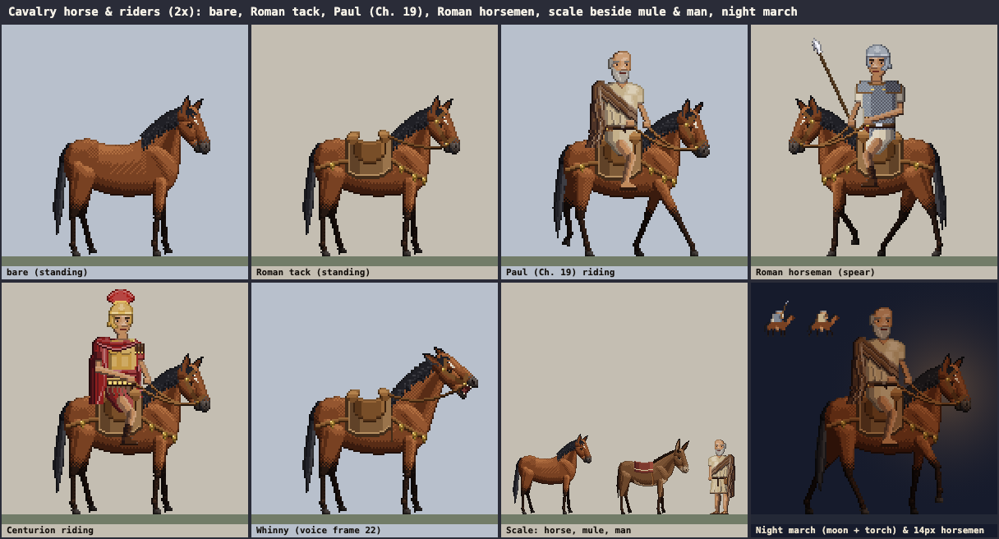

Anyone may kneel, on both knees or on one, with the arms down or the hands folded low in front, and always with the head bowed and the eyes shut, as the elders at Miletus kneel with Paul (Acts 20:36). The body sinks by the length of a shin; the shins lie back along the ground under the hem and the feet behind stand on their toes, the sole turned back, or on one knee the near foot is set forward under the raised knee. Folded hands meet in a V of the two forearms; under a mantle the near arm stays covered and the hands lie nearer the far side, so that no forearm crosses the mantle's edge. No arm is spread or raised. A figure may also sit bound, as Agabus binds himself with Paul's belt (Acts 21:11): the feet side by side and the wrists together low in front, each wound round with the cloth, its turns running with the limbs and its loose end hanging a little way down from the wrists, so that nothing lies across anything as a cross.

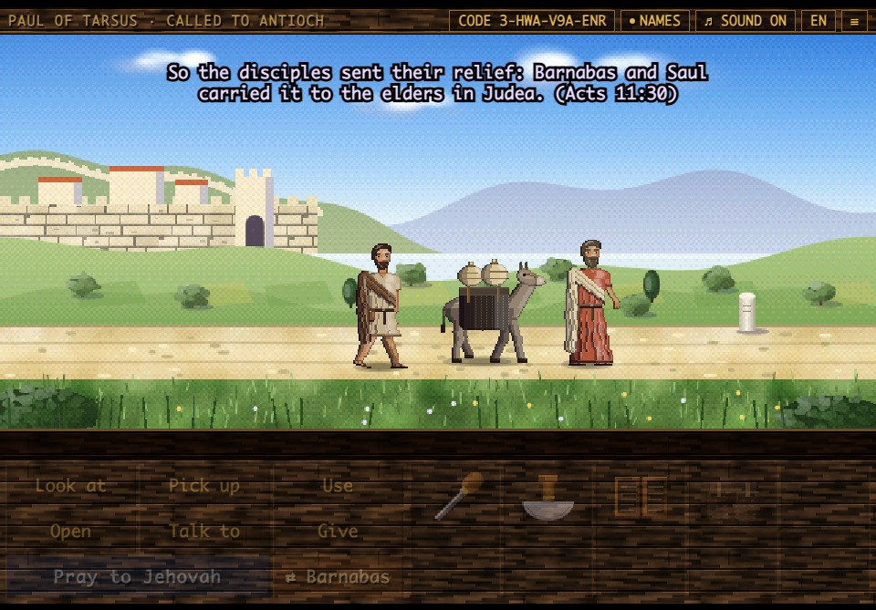

Birds keep the open air alive, by day and in fair weather. Gulls wheel over every harbor, and one or two stand on the edge of the quay; in the winter rain at Cenchreae none flies, and two sit hunched on the stones. Over open country a bird of prey circles high and slow, its wings in a shallow V, swallows skim the rivers, a lark climbs singing over the fields, hangs there and drops, and in spring a loose line of storks passes north. On the roofs and walls of the towns sparrows peck and look about and doves sit in the sun; when Paul comes under them they fly up with a flutter of wings, and some while after he has gone they come back. Each of them can be looked at, from where one stands. A bird in flight is drawn as a bent line of pixels, never as a level stroke with a body across it, and its path keeps to open sky.

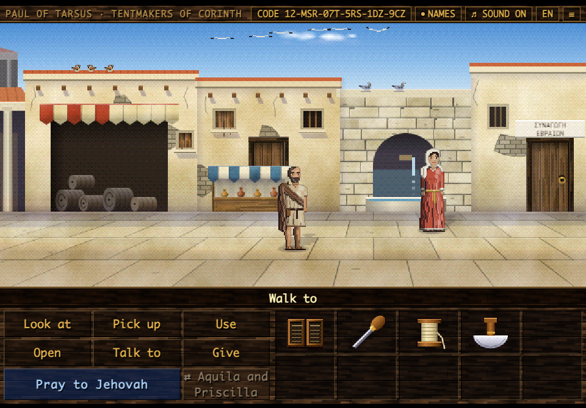

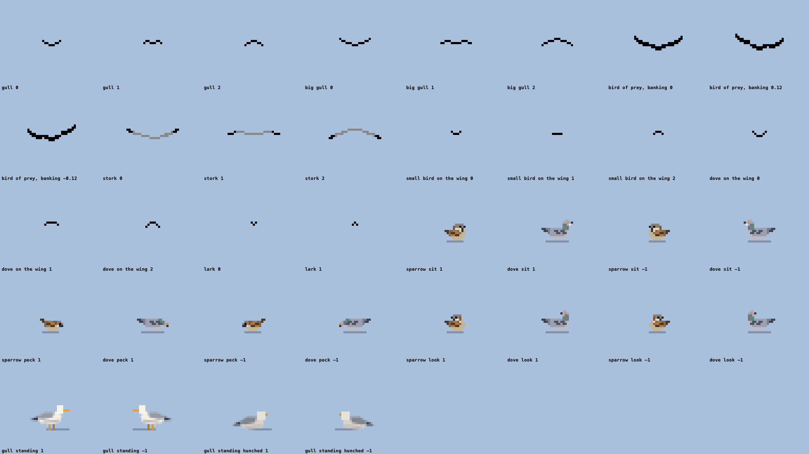

The sea is painted as it is seen from a quay or a deck, a man's height above it. Each pixel of it is the color of the sky that the waves turn toward us, laid over the blue of the water: near at hand the swell and the small waves show, and toward the horizon they close up into level bands, until a little haze lies along the line where sea meets sky. Under the sun, or the moon at night, the light breaks on the waves into a long, narrow road of level glints that twinkle as the water moves. The wind decides the rest: the harder it blows, the more the waves chop and the more whitecaps break, each a short crest of foam spilling down the face of its wave and blown on ahead; small waves run before it, and the clouds drift with it on a deck that lies in perspective over the sea. The same wind lifts a pennant at a ship's stern and bends the smoke of the hearths on shore; and because a sign can mislead, as smoke does in the lee of a hill, or a pennant on a ship swung round at anchor by the current, each can be set by itself. The coast is painted to the same standard: islands and capes on the horizon in the haze of their distance, headlands of bedded rock with scrub above and tumbled stones at the water's edge, beaches of sand or shingle with the sky lying in their wet edge and a lace of foam that runs up and back, the coast road, the stone quays with their squat mooring stones, and harbor towns whose houses step up the hill above their warehouses. All of it is lit by the hour: dawn, morning, midday, evening and night.

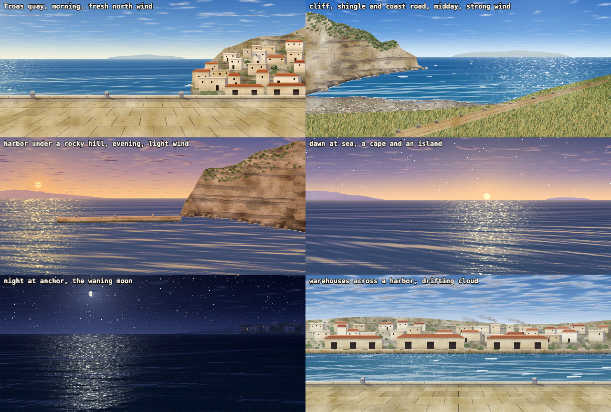

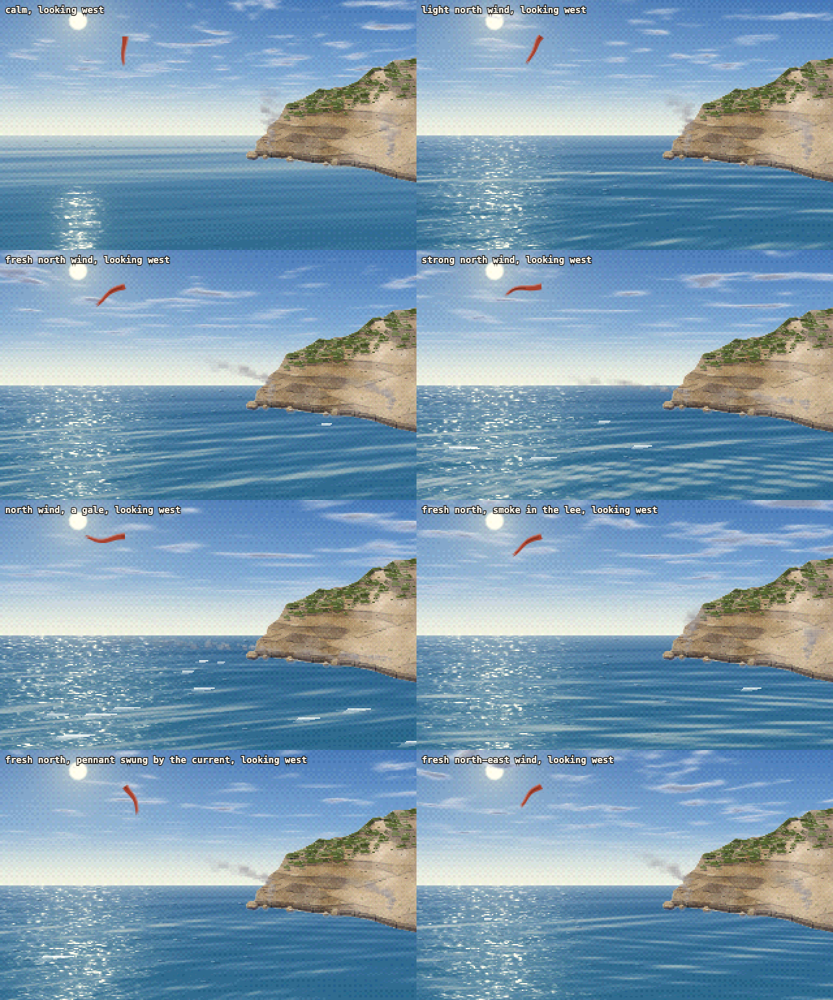

A scene has depth: whoever stands farther back is drawn behind. A man who walks behind the carrier's mule is hidden by it up to the waist, and hides it when he stands in front; the same holds for a stool, a low table or a heap of sailcloth that stands out on the floor.

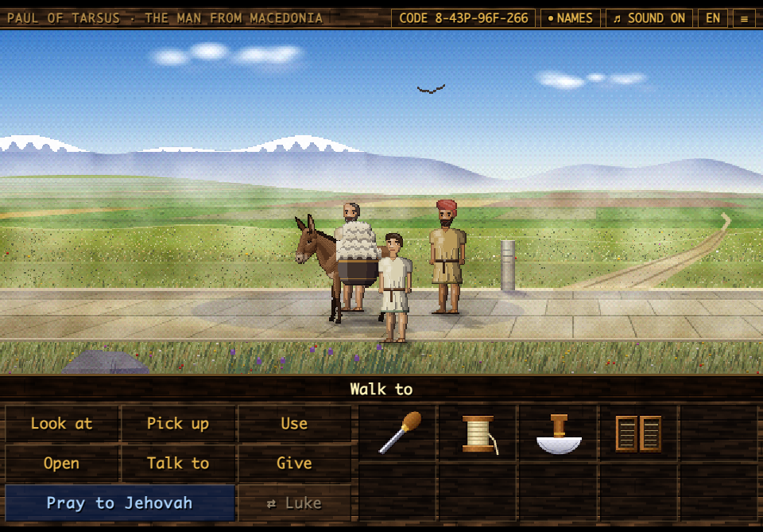

A lamp, a brazier or the moon through a window also throws the shadows of the people in the room. Each figure stands on a soft contact shadow and casts up to two softened shadows away from the nearest lights across the paving or the floorboards, following every step, gesture and fold of cloth; as a lamp's oil burns low, or daylight fills the room, the cast shadows soften with it, and in pitch dark there are none. Where a lamp is held or set on a stand in front of someone—as when the jailer brings lights into the inner prison at Philippi, or Paul speaks behind the tall lampstand in the upper room at Troas—the shadow runs back to the foot of the wall and bends straight up the stone or plaster behind him, stopping at open doorways and windows. Because all shadows lie on the floor and the wall before anyone or any furniture is laid over them, a stool, a low table or another person in the foreground is never darkened by a shadow behind it.

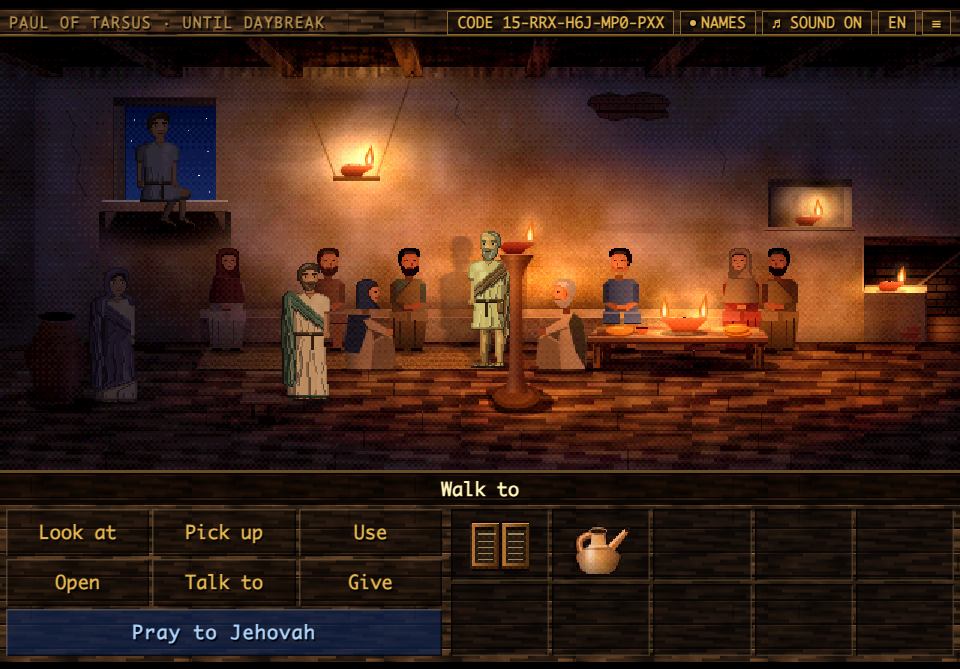

A scene has one horizon. The sea, the fields and the paving run back to one level, about as high as the eyes of the people in it, and the country seen through a city gate ends at that level too: the road beyond the gate of Lystra runs back to the line where the valley beside the well ends.

Chapter Ten has the game's first close views: a bolt of cloth and a reading table, each seen from above, in which nobody walks and the parts are set by hand. What moves in them is painted as the rooms are: a scroll is a sheet between two plain rolls, as thick as they are wound, with writing in short strokes that stop short of the margins. What lies open is named under it in small letters, as the names on the map are written, in the player's language.

Chapter Eleven is Athens, and Athens is shown as it stood: CONTRIBUTING section 3 makes an exception for Athens, Ephesus and Rome. The Acropolis with the temple of Athena stands over every outdoor scene, the temple of Zeus beside the road has tall columns and no roof, because it was not finished until 129 C.E., and the streets are full of statues. All of it is seen from outside: a temple as a row of columns under a deep beam and a gable, an altar as a block with a band of cut letters, a statue as a draped figure. A statue is painted by the same figure painter as the people, in one material and with blank eyes. No rite is shown, nothing is unclothed, and no image of a god is seen close. In the close view of the altars the picture is cut off at the height of a man's knee, and the inscriptions are in Greek capitals.

Chapter Twelve is Corinth, which the maintainer added to that exception: the old temple stands on its rise over the roofs, with heavy columns each of a single stone, and a second one, small and far off, on the summit of the rock. The chapter has the game's first light that is worked out and not painted: in the view of the court of Titius Justus the sun is not in the picture, and the brightness on the far wall and the floor follows where the rope and the cloth are hung. The same court and the same street are painted in autumn, in winter rain (via the shared weather helper `shared/weather.js`, with wind-slanted strokes, damp wall bases, and rippling puddles), in the spring of the games and in summer.

Chapter Thirteen is Ephesus, and for the first time a chapter stays in one street. That street is painted in three lights, with the shadows of the morning, of midday and of the evening, and once more on the morning of the fire; the workshop is painted by day, by lamplight before sunrise and at night. Between two houses the hill is seen with its theater: a bowl of seats in tiers, cut by a walkway, with its stage building in front. The temple of the city is seen once, small and far off in the plain, from the road above the city, and nobody names it. Two close views are new: a house in the evening with one wall taken away, in which every hiding place is a thing of the household, and a counting board of wood with troughs, hollows and pebbles. Ten Greek number letters are cut beside the places of the board, and nothing else is written on it. When the day is moved on, the sundial in the street is seen close while its shadow turns: a block of pale stone, weathered, with lichen on it and a green streak where the rain has run down from its bronze pointer, before a low wall of old blocks with a caper growing from a joint. The sun moves with the shadow: the shade inside the hollow under the rim, the light on the stone's side and the stone's own shadow on the wall behind it move from right to left as the day goes on. No book of magic is ever seen open: a book is a roll with its tie, and the fire burns low and steady, by day, and never flashes.

The Athenians are dressed as the publications describe: the men of standing in the Greek mantle, a rectangular length of cloth wrapped over a long tunic, and the few women who are seen out of doors in a tunic to the feet and the mantle, the hair parted and bound with a band, or the mantle drawn over the head. On the Areopagus the men sit on seats cut in the rock, and no woman is among them.

A lane map shows a city at a slant from above, the way the city maps of those games did. Every house stands up from its ground: its front of plaster over a course of dark stone, one or two storeys tall, with its door, its windows and their shutters, under the eaves of a roof of tiles, or now and then a flat one. A house hides the lane behind it, and while the one who is played walks behind a house it fades, so that he is never lost from sight; a covered passage is a house built over a lane, with a dark archway in its front. The lanes are paved with small stones, the streets with slabs and the squares with great ones, and the sun in the west-south-west throws every house's shadow to the right. The people on it are figures about fourteen room pixels tall, in the colors of the period's dyes and undyed wool; a crowd comes in by the gates and along the streets in waves, steps out of the doors of the houses, fills the streets from side to side, and shuffles as it packs before a narrow way in. A click shows the way as a row of gold dots up to a small diamond, and the player may zoom the map with two fingers, the mouse wheel, or + and -. Its sound can lead the player: in Chapter Fourteen the roar of the crowd dies down as the house where Paul is staying comes near, measured along the lanes, so that a dead end beside the house still sounds loud. Lanes meet as forks and bends and never as a crossing, which from above would be a plus sign.

Chapter Fourteen's city follows what is known of Ephesus in Paul's day: the theater in the hollow of Mount Pion, where two main thoroughfares meet; the marble street from in front of it straight to the harbor, with a colonnade on each side, and a gate at the harbor end; the market square beside them; and round them the lower city's grid of streets at right angles, which on this map may cross (the exception for Ephesus in CONTRIBUTING section 3). The house where Paul is staying lies in a court inside one block of the residential quarter. Its houses are as large against the people as those of the city maps of those games, their roofs clearly modelled: the slopes the sun finds lit, the others in shade, a bright ridge and a dark line at the eaves. In the uproar some narrow streets are jammed by people who cannot get through themselves; nobody passes them, so the runner has to find another way. Whatever blocks a way is named when the one who is played stops before it: the packed people, a barred gate, an overturned stall.

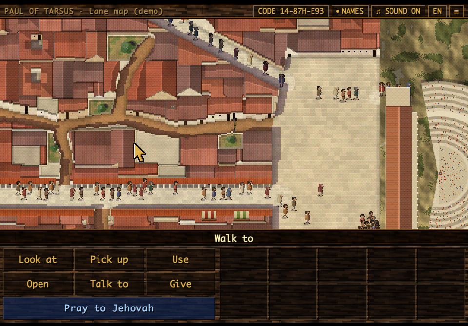

Chapter Fourteen is the day of the uproar in Ephesus. The silversmiths' marketplace is shown once while the narrator tells what Demetrius said: the stalls hold boxes, shrines wrapped in cloth and a few small silvery figures that are plain draped shapes, and nobody bows to anything. At the theater the crowd presses in at the arches beside a colonnade of columns under a deep beam. The tablet is sealed in a close view on the base of a column, the cord running only through the holes at its edge and the clay on the knot, so that nothing lies across its face. Inside the door of the house the light from the hatch moves across the floor while they wait two hours. The crowd's cry is heard and never written: many voices shouting the vowels of the words Acts gives, each a little off the others' beat and pitch, in the player's language.

Chapter Fifteen goes from a winter room in Corinth to a night in spring at Troas. Two of its pictures are close views. The balance in the storeroom is seen from in front and a little above: its beam hangs from two cords that part as they rise out of the picture, nothing points up or down at its middle, and each pan hangs by cords that meet at the beam's end, so that it never reads as a cross; the beam comes to rest slowly, and the bag and the weights ride with their pans. The weights and the letters bear Greek number letters, as the counting board of Chapter Thirteen does. The plan in the sand is seen from above: coasts drawn as grooves with a reed, a pebble for each city, and no line that crosses or meets another. In the upper room only the flames move: each lamp's flame and its glow follow the oil that is left in it, and the light on the people in the room follows the lamps; the light of the five is put together and then dithered once, like any backdrop, so that the walls keep the fine grain of the other rooms. The lamp by the speaker stands on a stand as tall as a man and burns above every head. The young man in the window is a figure like the others: he sits in the opening, on its sill, turned to the speaker, and the sill hides him from the hip down. What happens at midnight is not painted: as the room appears with the window empty, a woman's distant startled cry breaks the quiet, and the narrator tells it in silence; the street below is then seen by night with the people standing round, and again at daybreak.

Chapter Sixteen is mostly coast and sea, painted by the shared coast painter described above: the quay of Troas in the early morning, the coast road with the sea on Paul's right, a stony pass with the gulf and Lesbos to the south, the harbor of Assos under its bare rock and walls, a quay of Miletus with its warehouses and its theater far off across the water, seen from outside and empty, and a shaded place by the shore under a tamarisk, where the ship is seen far off against the town. The deck of the coaster is seen from aboard, looking aft, with the mast behind the viewer so that no upright stands across the horizon: the stern post with its curl, the two steering oars, a low shelter, the cargo and the gift's chest, in six lights, from moored at Troas in the morning to at anchor off Chios by moonlight with one lamp hung by two cords. Under sail the sea and the wake move and the deck stays steady. The north wind is a close view over the stern: the pennant, the hearth smoke, the whitecaps and the drifting clouds are all the signs there are, with no compass and no labels, and the boy's wool tuft and knotted cord are what the player sets. The watches are written in four ruled rows on Luke's tablet with no column lines, and the names lie on it as small wooden tags. The flock on the pass and the kneeling at the parting are the painters described with the animals and the figures.

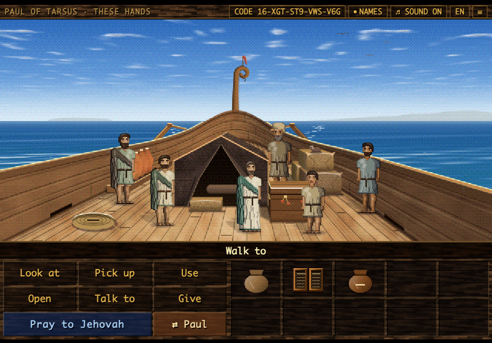

Chapter Seventeen goes down the coast from Patara to Caesarea. The harbor of Patara lies under the mountains of Lycia, with four ships painted by the ship painter in curved strakes; their masts stand against the land, and the open sea and its horizon show only in the harbor mouth. The quay of Tyre has the island city's warehouses and the causeway far off, and the bay of Ptolemais is one told picture in the evening, with Mount Carmel closing it to the south. The hold of Akestor's ship is a close view in section, seen from the side: its frames rise from the floor of the hold to the deck and stop there, the deck is parted at the mast, and no beam or hatch lies across a frame; the hull trims on the water as the plan is read, and the marks on bow and stern show how far she may go. Tyre's lanes are a lane map of the island city, which was no grid: its lanes bend and fork, a sea wall runs round its edge with the shallows along it, fishing boats lie off the shore, and the glass furnace in its yard glows and smokes until the glassworker banks it for the evening. The prayer on the beach is a picture of its own, seen from the dune: the whole congregation, about twenty small figures, kneels at the water's edge with its back to us, every arm down or folded, and no bird flies over it. In Caesarea no temple is seen: the court of Philip's house is whitewashed, its gate shows a street down to the harbor and the breakwater, and the road out of the city passes the aqueduct on its arches into the hills.

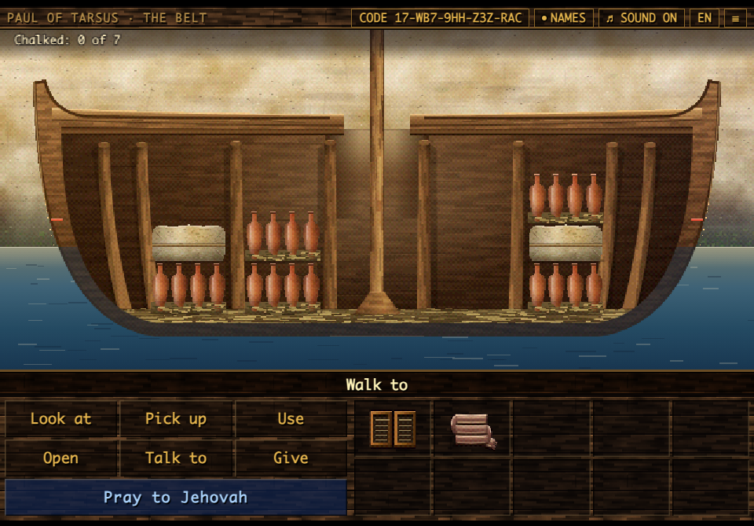

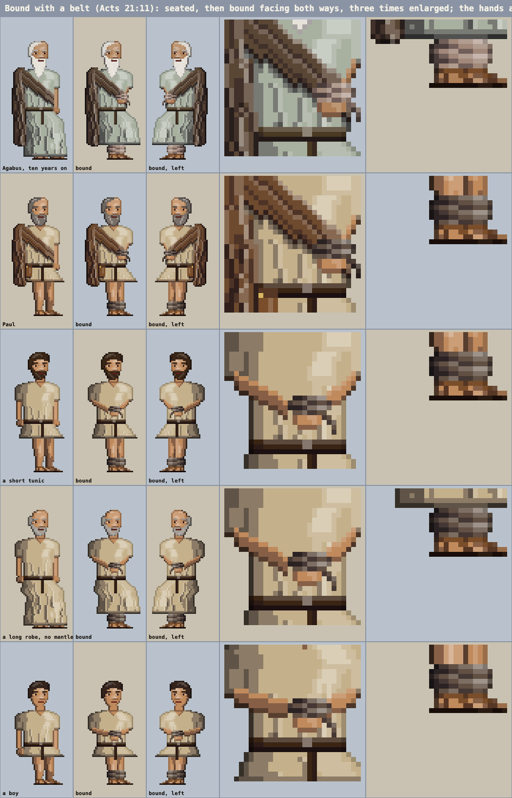

Chapter Eighteen is Jerusalem, and the first chapter to show Jehovah's temple (CONTRIBUTING section 3). Mnason's court is seen in the evening, pale limestone with a solid stone stair up the back wall, a lamp in a niche whose light falls outward and down, and the donkey at her manger; the street of the upper city lies in the morning sun from the east, with James's door in a dressed-stone frame and the barber's stall under a linen awning on two poles at its ends; the elders' court has a goat-hair awning in a warm, sunlit brown, light enough not to weigh on the elders below it, with a tear that lets the sun through onto the paving. Where the plaster of a Jerusalem house has fallen away, in this chapter, in Chapter Two's street and in the Prologue, rough limestone rubble in mortar shows through, not courses of brick. The Court of the Gentiles is wider than the screen and is seen looking north in the morning: the fortress of Antonia at the left with its tallest tower at the end of its wall and one long flight of stairs behind a solid parapet, the barrier as a low solid wall with piers only at the ends of its runs and beside its opening, the warning stones set on it as slabs wider than they are high, the steps, the inner walls with their gatehouses, the Court of Women, and over them the sanctuary, its taller front block to the east with a gold coping. Solomon's Colonnade runs away to the east as a row of columns under a deep beam and a roof. No altar is seen: it lies behind the inner walls, and no fire, smoke or rite is shown. Every stone face is weathered, with joints that stop at the edge of their own course. The warning stone is a close view: its Greek capitals are drawn stroke by stroke as grooves lit from the side, the round letters as true circles, and the alpha with a faint short crossbar so that it is not taken for a lambda. From the landing of the stairs the view looks south against the light, over a court full of people with their faces turned up, to the sanctuary's flank and the Royal Colonnade far off; when they shout him down, men wave their outer garments a little above the heads, soft lengths of cloth that flap in the light, toss one up now and then, and dust rises in pale puffs: nothing in the air could be taken for a stone. Antonia's windows stand in two rows, slits under the gaps of the row above, and its tower's slits in one column, so that no four of them stand two by two or as a diamond. The soldiers' quarters are a court with a gallery of columns under a deep beam, spears leaning one way in a bay with their feet in a trough, shields and helmets, and a stone bench without legs: no post, frame, whip or standard. The officer's transverse crest is a rounded brush of red hair sitting on the top of his helmet, narrower than the helmet, so that it reads neither as a bar across the head nor as a ring round it. Doves and sparrows sit on the roofs and walls until the arrest, and from then on no bird is seen.

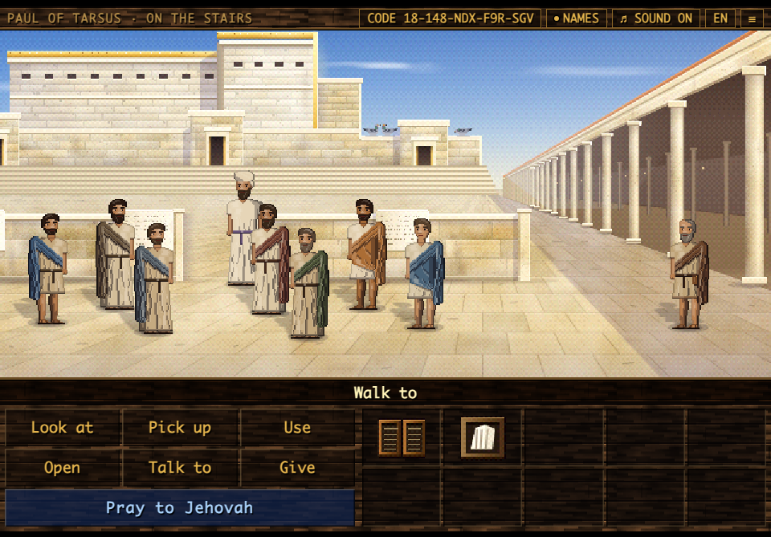

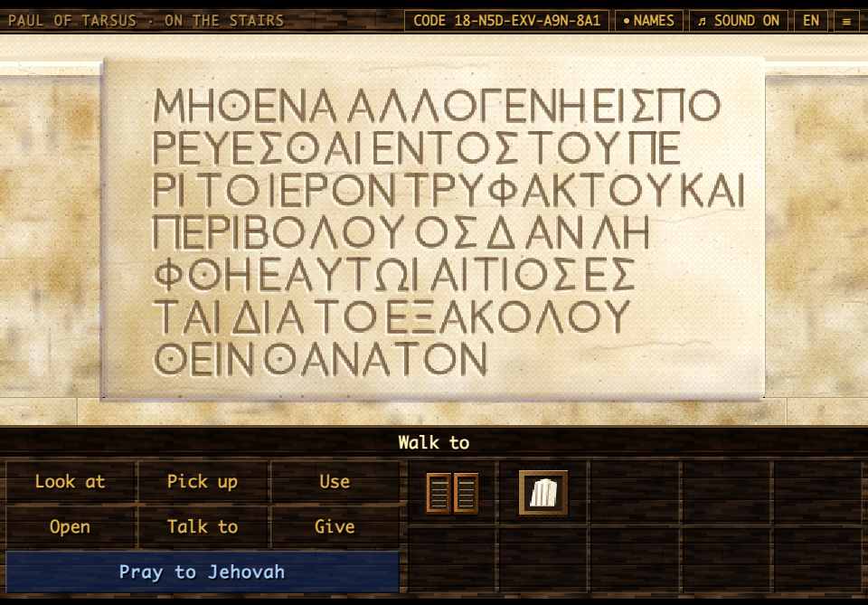

Jerusalem is painted alike in every chapter that shows it, in the pale weathered limestone of Chapter Eighteen's temple courts (`shared/temple.js`): the walls of the city in the Prologue, the street and the upper room of Chapter Two, the council room of Chapter Seven and the streets of Chapter Eighteen. Wherever the temple is seen from afar it is drawn as the courts show it near by, from where one stands and in that scene's light: from the city on the west we see the sanctuary's west end and its long south flank, its front block rising taller behind with its gilded face turned east, the gold along its tops catching the sun, the fortress of Antonia with its corner towers on the left and the red roof of the Royal colonnade on the right. In the morning the sun stands behind it, so that its west faces lie in shade.

Chapter Eighteen's arrest is drawn in poses of its own. Bound with two chains (Acts 21:33), Paul stands with both arms down along his body and the hands a little forward, an iron cuff round each wrist, and a short chain hangs from each cuff to the wrist of a soldier on either side, link by link in small squares of iron; held by the arms before the whipping (22:25), two soldiers stand a little behind him and grip his upper arms, their fingers over his sleeves; carried up the stairs (21:35), he is seen head and shoulders above a tight knot of five soldiers who keep step with short steps. No arm is spread, nothing hangs from the middle of anything, and when he motions to the crowd (21:40) only his far forearm is raised, bent, with its chain. The commander of the garrison is a military tribune, in a tunic with the narrow purple stripe of his rank, a military cloak and a gold ring of two pixels; he is drawn bareheaded in his cuirass too, and with a plumed helmet.

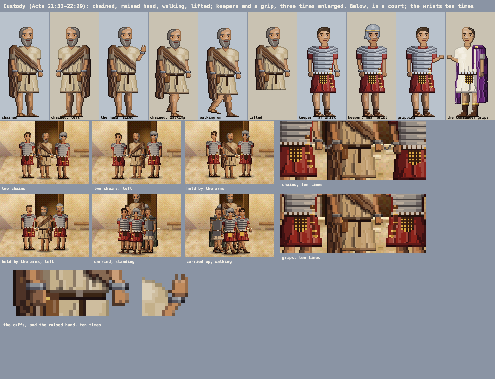

Chapter Nineteen goes from Jerusalem down to Caesarea. The council meets in a hall of hewn stone by day: stone with drafted margins whose joints never line up from one course to the next, a cedar ceiling, two long low openings high on the right that let the sun in as slanting parallelograms, never as round patches, and the Sanhedrin on two wings of stepped stone seats on arcs of one half circle, solid and without legs, each seat level under the one who sits on it. The members are told apart by what they wear: the Pharisees' scripture case is a broad square box at the hairline, lit at its top, with no strap, and their fringes hang long from the corners of the mantle as short slanting threads with a blue cord, ending above the hem; the Sadducees wear fine linen, edge bands and rings, with a small case or none. Ananias wears a rich robe with a wine mantle and a white headcloth, not the high priest's vestments. The upper city of Jerusalem is a lane map in the late afternoon, its flat roofs and plastered houses in the same pale limestone as the rest of Jerusalem, with the fortress wall along its top at the map's slant, a tower at each end and its gate between them, the stalls standing up under plain awnings on two corner posts, and a donkey standing slantwise across the short lane, drawn by hand in three poses. The gate of the fortress is a round arch with its leaves open against the walls of a vaulted passage; only the floor of the court beyond is bright, so that no ring of light stands behind a head. The soldiers' quarters are Chapter Eighteen's court in three lights: the morning, the late sun from the west with the left wall's shadow slanting across, and the third hour by torchlight, the torches leaning out from the wall on iron arms. The commander's room looks west over the city through a wide opening above a parapet. Antipatris is seen at dawn over the Plain of Sharon, the spring's pool under a willow at the left and the young river winding from it to the one horizon. Herod's palace at Caesarea is a court over the sea wall, with the sea right up to it and the dais of two steps at the right. The letter is a close view of a sheet of papyrus on quiet wood beside Paul's boxwood tablet, its notes scratched in the wax; a note marked as not in the letter gets a short slanting stroke, and the line told out of order a small hollow diamond. Paul is drawn bald from this chapter on, with grey at the sides and a grey beard.

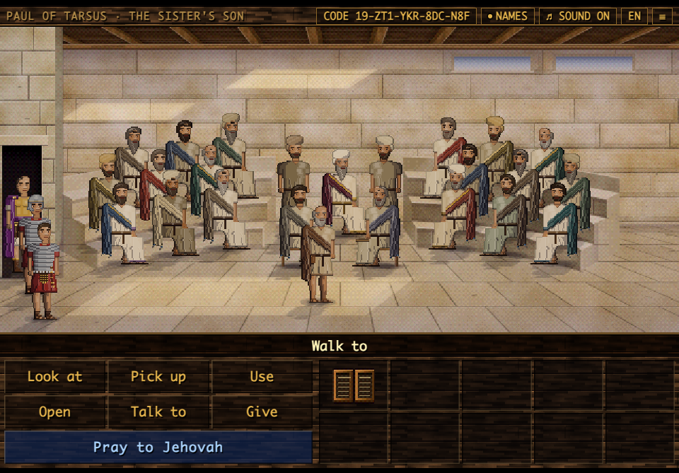

Chapters Twenty and Twenty-One stay at Caesarea (`shared/caesarea.js`). The court of Herod's palace is the court of Chapter Nineteen, painted by morning, with the sun low over the land and the shade falling toward the sea, and a small desk for the governor's clerk left of the dais. Paul's room has limewashed walls and one deep window with no bars, and through it the harbor of Sebastos is the calendar of the two years: in summer full of ships, in autumn fewer, in winter empty under a grey sky with rain and a swell on the breakwater, and in spring the first ships back. The horizon lies above the breakwater's tower and every mast, so nothing stands across it, and the harbor shows no temple. The marks Paul scratches on the sill are short slanting strokes side by side, each inside the stone and none across another. The inner hall is one painter for both chapters: private and nearly empty in the afternoon for Felix and Drusilla, and dressed for the great show of Acts 25:23 with three chairs on the dais, purple hangings behind them, and two benches for the commanders and the leading men. Two Roman standards stand small at its back, in the shade of the plain plaster, as CONTRIBUTING section 3 allows them there and nowhere else: a pole with a short stack of discs drawn as squares, no crossbar, no cloth, nothing on them that can be made out, and no band of the wall behind them. Before the governor Paul wears one light chain on one wrist, to the soldier beside him: always the same hand whichever way he turns, and when the chained hand is the far one it may rise, bent, and the chain follows it in a light curve. Agrippa's diadem is a plain band of gold with nothing standing up from it. The clerk's writing room has its rolls on two shelves, ends toward us with no stick or tie, and his report is a close view of papyrus whose marks are a word beside each line and a sign in the margin, a slanting stroke or a hollow diamond, with nothing struck through. The carter's cart in the court stands on solid wheels without spokes, and its goad lies along its bed, crossing nothing.

Each chapter ends on a travel map of the eastern Mediterranean, painted the same way: coasts, shallows and mountain ranges, cities as dots, and no grid lines. The road travelled so far is shown, and the chapter's own leg draws itself as a dotted line from city to city, to a short sting on frame drum, harp and ney in the chapter's own key: Damascus to Jerusalem; Jerusalem to Caesarea and by sea to Tarsus; Tarsus to Antioch, where Paul's missionary journeys would begin. The routes never cross. Where the Scriptures do not say which way he went, the line takes a plausible one: by sea east of Cyprus, by road round the Gulf of Issus, and through the south of Cyprus.

Each chapter has its own score and room sounds, and the end-of-chapter map is described in the chapter's own page (see [the chapter list](../README.md#chapters)).

Where a step is timed by the sea, as on the deck in the storm, each sea is seen and heard as one: the swell rising, the crash and the water running off the planks are synthesized on the clock that moves the wave in the picture, so they come together, and with the sound off the picture alone keeps the time. There is no thunder.

Speech stands over the scene in a bold monospace with a dark edge all round: a stroke painted behind the letters, even on every curve, so that a line reads over a busy backdrop as well as at night. The names on the map and the captions of a close view are edged the same way. Paul's thoughts and the answers to prayer are in italics and pale blue.

Narration that is told while the picture is dark is not set on a black screen. It is read from the narrator's scroll: an open roll of papyrus held in two hands by lamplight, with a clay lamp in a wall niche on one side and another on a shelf on the other. The line stands in ink on the open part of the roll, larger when it is short and smaller when it is long, and a reference such as (Acts 13:14) is never divided over two lines. The scroll comes up out of the dark for the first line of a passage, stays while one line follows another, and goes down into the dark again before the next picture fades in or anybody speaks. As it comes up the roll is heard being drawn open: one soft rustle, no louder than a lamp being snuffed. Only the two flames move, with the small glow round each: the picture as a whole never brightens or darkens. What a chapter tells and does not show is read from the scroll too: the stoning at Lystra, the vision at Troas, the beating at Philippi, the words by night in Corinth. The one exception is in the prologue, when the light from heaven flashes around Saul on the road to Damascus (Acts 9:3; 22:6, 11; 26:13): the screen fades smoothly to plain warm white without rays or figures, and the narration stands straight on the white in dark ink, followed by two seconds of silent dark before he is led by the hand into Damascus.

The roll is drawn as *Insight on the Scriptures* describes one ("Papyrus", "Book", "Scroll, Roll"): sheets of papyrus pasted edge to edge and written on the side whose strips run across; wound on a stick, a long roll on a stick at each end; and read by unrolling it with one hand while the other rolls it up. Christians mainly used the roll until about the end of the first century ("Book"), and what the narrator tells is for the most part Luke's account, a book of that kind. The reader, the room and its lamps are invented. The hands follow an example picture of the maintainer's: seen from the back, the forefinger gone behind the roll, the thumb resting on it with its nail and the folds of its joint. They are painted in greys, as light, and then set in a short scale of skin tones with the same ordered dither as the backdrops. The papyrus has its fibers running one way and nothing ruled on it, no stick stands out of a rolled end, and nothing lies across a roll (CONTRIBUTING, section 3).

**The end of the game.** The game ends where Acts ends, with the door open in Rome, and what follows is shown and not played (`shared/finale.js`). First the travel map, on which Paul's light stays on Rome while Philippi, Ephesus and Colossae light up one after another: the places his letters of those two years went to. No road is drawn there, because no source gives one. Then the look back: every journey of the game on a map of its own, twelve of them, so that no two roads cross on any, each with one line of the narrator's that stands beside its roads and never over a place on them. As each chapter's road is drawn, the chapter's name stands in the status line under the map and one bar of that chapter's own tune is heard, in its own key and bar: the ney of Damascus first, the lyre of Caesarea near the end. The bars are brought toward one level, because a bar with a drone and a drum under it is far louder by itself than a lyre and a bass. No tense music is heard anywhere in it. The closing screen stands over the bench of the opening picture, by day, to the theme of Chapter One as the overture played it.

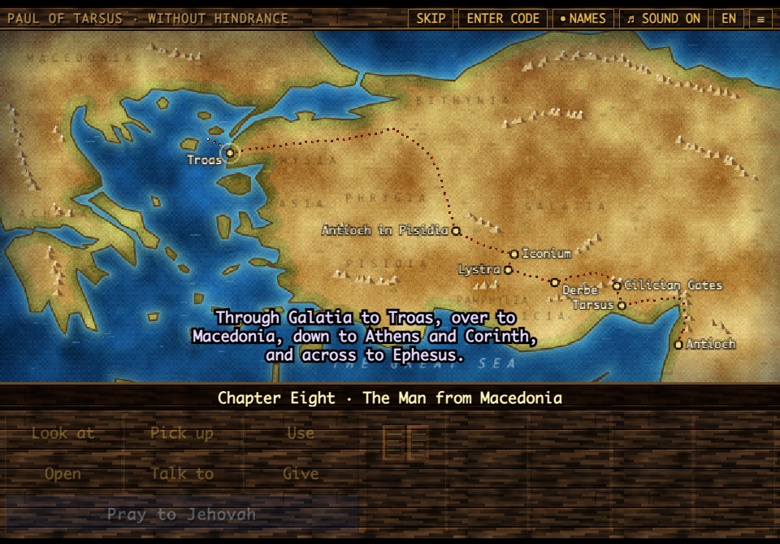

**The opening picture.** Each time the game is opened it shows its name over a still life before it shows the chapters: a tentmaker's bench by the light of one clay lamp. On it lie rolls of papyrus, one of them open, an inkpot and a reed pen; two awls, a knife, a needle and a ball of thread; and a length of dark goat-hair cloth sewn of strips, with a seam half sewn. Only the flame moves. The picture is silent until the player clicks, because a browser lets a page sound only then. That click starts the overture: Chapter One's theme in ten bars, about 26 seconds, with a horn call and a rising harp to raise the curtain, the melody on the ney over a walking bass and a strummed lyre, and the melody again, higher, with the aulos and the horn. As it ends the bench passes into the wall of Damascus under the moon, the chapters appear under the name, which has not moved, and the quiet music of the title follows by itself. A second click brings the chapters at once. Coming back to the title from a game does not show the picture again. The title then opens its music with the same ten bars on the game's own ensemble, without the horn.

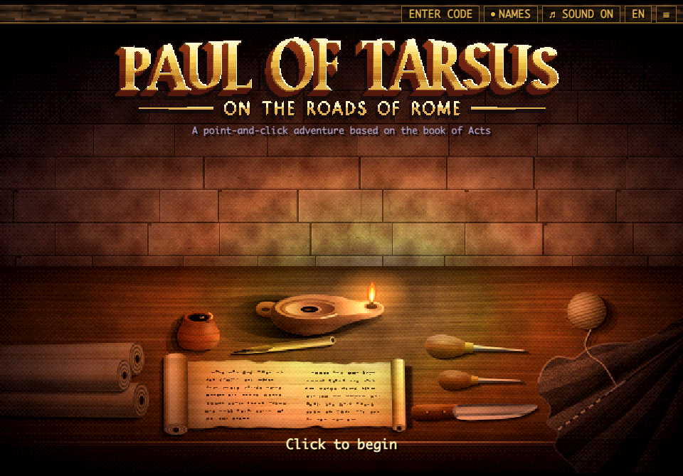

What the picture rests on: *Insight on the Scriptures* ("Tentmaker") says that Paul's home region was known for a goat-hair cloth from which tents were made, stiff and rough to cut and sew; *The Watchtower* of November 1, 2012 ("Did You Know?") says that tentmakers sewed strips of such cloth together, names knives and awls as the tools of the trade, and describes the reed pen and the ink of the time; *Insight* ("Horn", "Trumpet") names the horn and the metal trumpet as instruments. How the bench was laid out is invented. For the rules of section 3 of [CONTRIBUTING](../CONTRIBUTING.md): no stick stands out of a roll and nothing is tied round one, the writing is rows of broken strokes that stop short of every edge, the knife is a plain blade without a guard, the tools lie side by side and none across another, the bench is one board without joints, and the seams and stitches of the cloth run one way.

A chapter opens with a title card: its name in the gold capitals of the title's logo, with "Chapter One" between two rules beneath it, over a short sting in the key of the chapter's score. It stays about three seconds; a click, Space or Esc moves on. The card is shown when a chapter is begun from the title, or from a code at its very beginning, and never when a code puts the player in the middle of one.

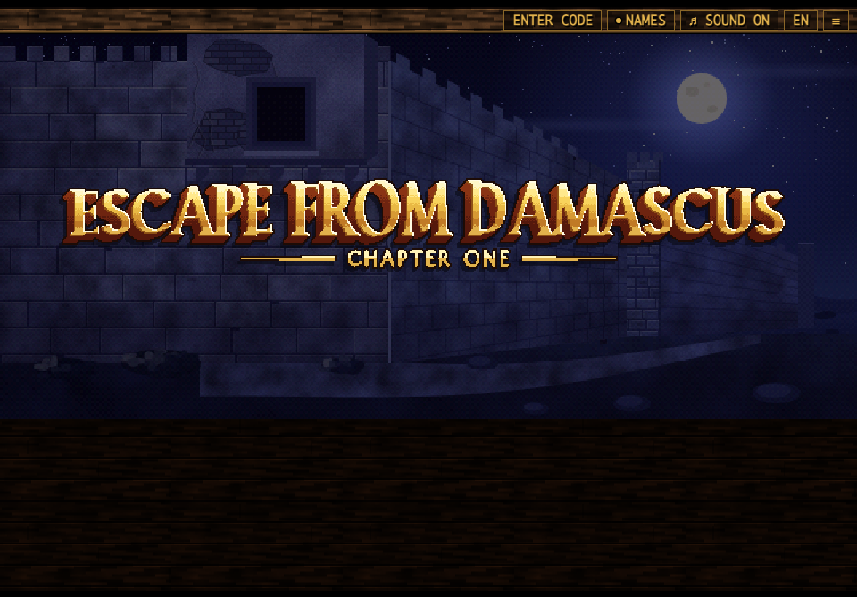

The title, the safe-point screen, the options and the end of a chapter own the whole screen: the verb panel slides down out of sight and comes back when play goes on, and the top bar keeps only its buttons. The title alone also uses the room that the panel leaves. Its picture, the wall of Damascus under the moon, is painted on down to the foot of the window: open ground with rocks, tufts of dry grass and thorn bushes, while a ten-bar overture in D Hijaz (a two-bar harp fanfare, a four-bar theme for ney, aulos with tonic drone pipe, lyre, oud and road percussion, and a four-bar high climax) plays and then cross-fades into the quiet night score. The prologue and every chapter that is built stand in its list at once; a returning player's title has two more lines above the list, and then the list scrolls in its box. When a chapter begins the view is as high as it always is, and the upper part of the picture has not moved. Walking from one room into the next cross-fades from the old picture to the new; a fade to black is kept for where the story wants it, such as nightfall or the map.

On a phone held sideways the panel parts in two: the verbs stand in a column of dark timber on the left, the inventory in one on the right, and the picture fills the field between them from top to bottom, its sides cropped. It follows whoever is played, or whoever speaks, and the player may move it with a finger and zoom it with two; the pixels grow, and the words on it keep their size. A close view and the map are fitted into the field whole, with timber above and below them. Where the panel would slide down, the columns slide out to the sides, and the narrator's scroll is read on the whole screen.

