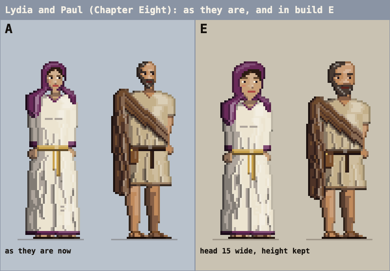
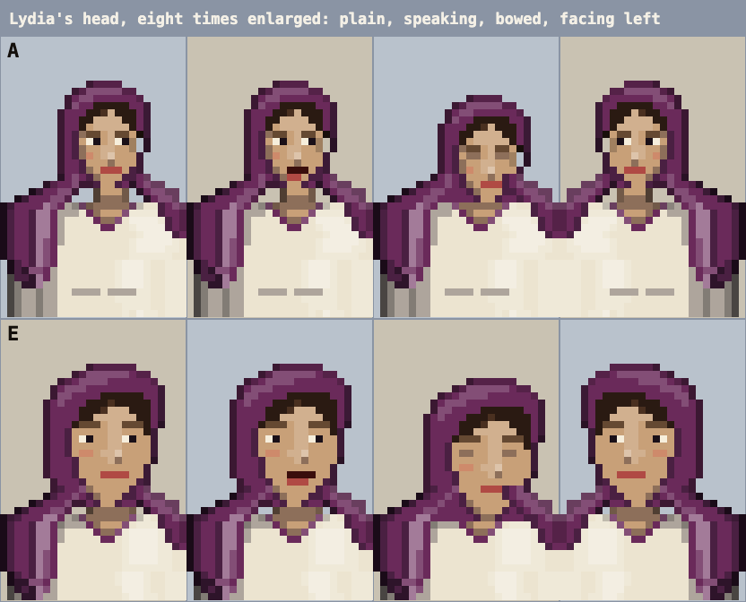
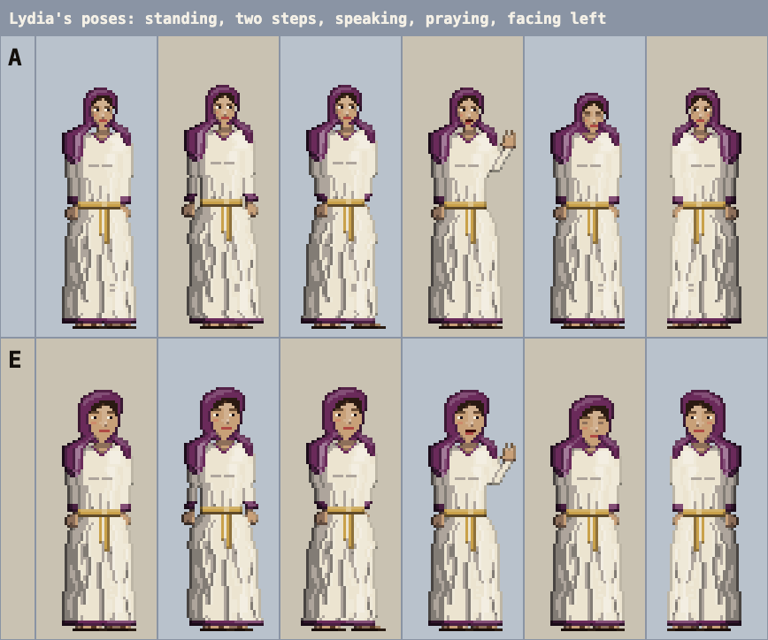
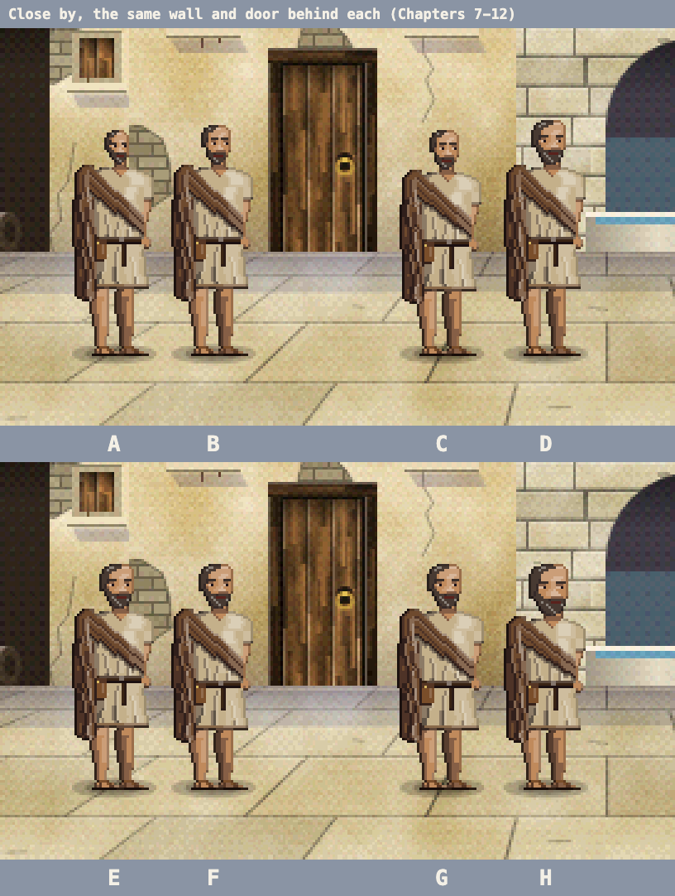
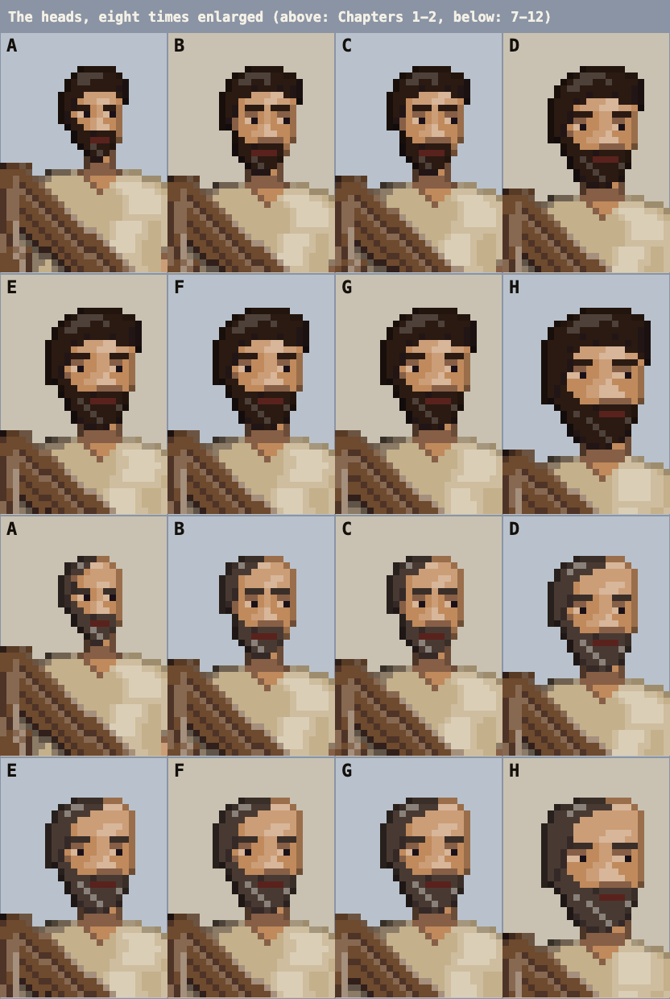
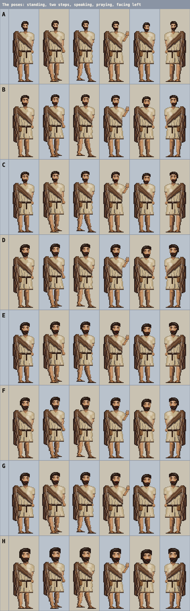

# A trial of proportions: Paul with a larger head

A trial on the branch `paul-proportions`, not part of the game. Paul is drawn in eight builds, A to H: A is the figure as it is today, and the others give him a larger head, in the manner of the adventure sprites of the early 1990s. Paul is drawn in all eight, and Lydia in the one that was chosen (E). Everything is painted by the game's own figure painter; the heads are new pixel maps drawn by hand at their own size, not the old head enlarged.

| | Head | Body | Height | Heads tall |
|---|---|---|---|---|
| **A** | 11 wide, as it is now | as it is now | 92 | 6.1 |
| **B** | 13 wide | unchanged, so he stands 2 rows taller | 94 | 5.5 |
| **C** | 13 wide | legs and trunk one row shorter each | 92 | 5.4 |
| **D** | 15 wide | unchanged, so he stands 4 rows taller | 96 | 5.1 |
| **E** | 15 wide | legs and trunk two rows shorter each | 92 | 4.8 |
| **F** | 15 wide | the trunk kept, the legs shorter: a stockier man | 92 | 4.8 |
| **G** | 15 wide | as F, with shoulders, trunk and skirt a pixel broader on each side | 92 | 4.8 |
| **H** | 17 wide | legs and trunk three rows shorter each | 92 | 4.2 |

## Round two: Lydia in build E

The maintainer chose E. To see how a woman looks in it, Lydia of Chapter Eight is drawn as she is today (A) and in build E, with a face and a veil drawn by hand at the larger size. The Paul of that chapter stands beside her in the same build.

## Round one: Paul in eight builds

### In the street of Corinth, close by

The Paul of Chapters Seven to Twelve, with the same wall and door behind each build.

### The line-up

Four times enlarged. The small red notch at the left of each field marks the height of today's figure.

### The heads

Eight times enlarged.

### As the game shows them

The whole width of the screen, all eight in a row.

### The poses

Standing, the two steps of the walk, speaking with the hand raised, the head bowed in prayer, and facing left.

## Making the sheets again

`node tools/playtest.mjs proportions` saves them to `tools/out/` as `proportions-1-young.png` and so on, Lydia's among them. The builds are `BUILDS` in `index.html`; a look that says `build:'lc'` is drawn in that build, and a look that names none is drawn exactly as before.
